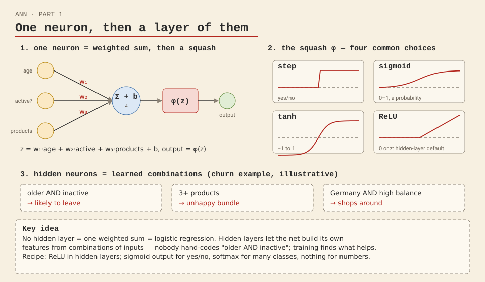
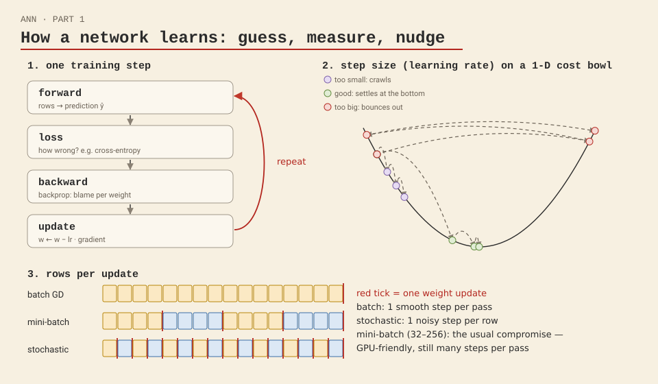

# Artificial Neural Networks

> **How to read this note.** Study guide for *Deep Learning A-Z*, Part 1 (sections 3–5) plus the ML-basics annex (sections 26–29). §1–3 go with the intuition lectures, §4 with the Python build, §5 with the annex. Section 5 of the course (no-code AWS SageMaker Canvas) is summarized in one paragraph at the end of §4. The course's churn CSV isn't bundled here, so §4 generates a synthetic bank-churn table with the same kinds of columns.

## Why This Exists

**Problem.** "A neural network is like a brain" tells you nothing about what to type or why a model fails. The real moving parts are few — a weighted sum, a squash, a cost, a downhill step — but each hides a choice that decides whether training works: learning rate, batch size, output activation, how you scale data, which threshold you use.

**Key insight.** A neuron computes a weighted sum of its inputs and squashes it. A network stacks layers of neurons so hidden ones can build new features from combinations of inputs. Training repeats one loop — predict, measure the error, assign each weight its share of the blame (backprop), nudge every weight a little downhill (gradient descent).

**Reach for this when:**
- Working through Deep Learning A-Z Part 1 or the annex.
- Building a first classifier or regressor on a table of features.
- Training diverges, stalls, or "86% accuracy" turns out to mean nothing.

**Don't reach for this when:**
- Your data are images, sequences or text — the architectures in [convolutional-neural-networks](convolutional-neural-networks.md) and [recurrent-neural-networks](recurrent-neural-networks.md) fit better.
- You have a small, plain table and want the best accuracy fast — gradient-boosted trees (XGBoost, LightGBM) usually beat a small ANN on tabular data.

## Diagrams





## 1. The neuron

One row of data goes in. Each input is multiplied by its weight, the products are summed with a bias, and an **activation function** turns the sum into the output:

$$z = w_1x_1 + w_2x_2 + \dots + w_mx_m + b \qquad \text{output} = \varphi(z)$$

```python
import numpy as np
x = np.array([0.5, -1.2, 2.0])                       # one row: 3 (already scaled) input features
w, b = np.array([0.8, 0.1, -0.4]), 0.2               # one weight per input, plus a bias
z = w @ x + b                                        # step 1: weighted sum
acts = {"step": float(z > 0), "sigmoid": 1 / (1 + np.exp(-z)), "tanh": np.tanh(z), "relu": max(z, 0.0)}
print("z =", round(z, 3))
for name, val in acts.items():
    print(f"{name:8s}-> {val:.3f}")                  # step 2: activation turns z into the output
# Expected output:
# z = -0.32
# step    -> 0.000
# sigmoid -> 0.421
# tanh    -> -0.310
# relu    -> 0.000
```

| Activation | Output range | Typical use |
|---|---|---|
| Step (threshold) | 0 or 1 | Historical (perceptron); no gradient, so not trainable by backprop |
| Sigmoid | 0 to 1 | Output layer for yes/no — read it as a probability |
| Tanh | −1 to 1 | Hidden layers in older nets, RNN internals |
| ReLU | 0 or $z$ | **Default for hidden layers** — cheap, doesn't saturate for $z > 0$ |
| Softmax | probabilities summing to 1 | Output layer for 3+ classes |

**Inputs must be on similar scales.** Standardize ($\frac{x - \text{mean}}{\text{sd}}$) or normalize ($\frac{x - \min}{\max - \min}$) each column, or a feature measured in dollars swamps one measured in years.

## 2. Why hidden layers help

A network with no hidden layer is one weighted sum — with a sigmoid output, that's exactly logistic regression. A hidden neuron can learn to fire for a *combination*: "older **and** inactive", "three or more products". The next layer then works with those combinations. Nobody writes these rules; training finds whatever combinations reduce the error. (The course illustrates this with house prices — area, bedrooms, distance, age — the idea is the same.)

## 3. How it learns

### Cost
Compare the prediction $\hat y$ with the truth $y$. Squared error $\tfrac12(\hat y - y)^2$ for numbers; **cross-entropy** for probabilities (it punishes confident wrong answers much harder, which gives stronger gradients — see [convolutional-neural-networks](convolutional-neural-networks.md) §5).

### Gradient descent
Trying every weight combination is hopeless (25 weights × 1000 values each = $10^{75}$ tries). Instead compute the slope of the cost with respect to each weight and step downhill. The **learning rate** sets the step size:

```python
import numpy as np
# Fit y = w*x with gradient descent on cost C = mean((w*x - y)^2); the true w is 3
x = np.array([1.0, 2.0, 3.0, 4.0]); y = 3 * x
for lr in (0.01, 0.05, 0.15):                         # learning rate = step size
    w = 0.0
    for step in range(20):
        grad = np.mean(2 * (w * x - y) * x)          # dC/dw: slope of the cost at the current w
        w -= lr * grad                               # walk downhill
    print(f"lr={lr}: w after 20 steps = {w:.3f}")
# Expected output:
# lr=0.01: w after 20 steps = 2.884
# lr=0.05: w after 20 steps = 3.000
# lr=0.15: w after 20 steps = -257.209
```

Too small crawls, a good rate converges, too large overshoots further each step and explodes.

### Batch, mini-batch, stochastic
How many rows you use per weight update:

```python
import torch
torch.manual_seed(0)
X = torch.randn(1024, 5); y = X @ torch.tensor([1.0, -2.0, 0.5, 3.0, 0.0]) + 0.1 * torch.randn(1024)
for name, bs in [("batch GD", 1024), ("mini-batch", 32), ("stochastic", 1)]:
    w = torch.zeros(5, requires_grad=True)
    opt = torch.optim.SGD([w], lr=0.01)
    updates = 0
    for epoch in range(3):                              # 3 passes over the same 1024 rows
        for i in torch.randperm(1024).split(bs):        # rows per weight update = batch size
            loss = ((X[i] @ w - y[i]) ** 2).mean()
            opt.zero_grad(); loss.backward(); opt.step(); updates += 1
    full = ((X @ w - y) ** 2).mean().item()
    print(f"{name:10s}: {updates:5d} updates, loss after 3 epochs {full:.3f}")
# Expected output:
# batch GD  :     3 updates, loss after 3 epochs 11.756
# mini-batch:    96 updates, loss after 3 epochs 0.376
# stochastic:  3072 updates, loss after 3 epochs 0.011
```

Same data, same passes — smaller batches take more (noisier) steps, so at a fixed learning rate they get further. Full batch gives smooth but few steps. One row per step is noisy and leaves a GPU idle. **Mini-batches of 32–256 are the standard compromise.** Noise also helps escape poor regions of non-convex costs.

### Backpropagation
The chain rule, applied layer by layer from the output back, gives every weight's gradient in one backward pass. Frameworks do it for you (`loss.backward()`), but it's worth seeing that it's nothing more than calculus:

```python
import torch
torch.manual_seed(0)
x, y = torch.tensor([1.0, 2.0]), torch.tensor(1.0)
W1 = torch.randn(3, 2, requires_grad=True); w2 = torch.randn(3, requires_grad=True)
h = torch.sigmoid(W1 @ x)                               # hidden layer (3 neurons)
y_hat = w2 @ h                                          # output
loss = 0.5 * (y_hat - y) ** 2                           # cost for one row
loss.backward()                                         # autograd: backprop through every layer
d_out = (y_hat - y).detach()                            # chain rule by hand, layer by layer
grad_w2 = d_out * h.detach()
grad_W1 = torch.outer(d_out * w2.detach() * h.detach() * (1 - h.detach()), x)   # sigmoid' = h(1-h)
print("w2 grads match:", torch.allclose(w2.grad, grad_w2))
print("W1 grads match:", torch.allclose(W1.grad, grad_W1))
# Expected output:
# w2 grads match: True
# W1 grads match: True
```

**The training recipe:** initialize weights to small random values → forward pass a batch → measure the cost → backprop → update → repeat; one full pass over the data is an **epoch**. (The course calls row-by-row updating "reinforcement learning" at one point — it isn't; that's plain stochastic gradient descent. Reinforcement learning is learning from rewards.)

## 4. A churn classifier, end to end

**The task.** Predict which bank customers leave (`Exited` = 1) from credit score, country, gender, age, tenure, balance, number of products, activity and salary. About 19% of customers leave — remember that number.

**Preprocessing rules** (from the annex, applied here):
- One-hot encode text categories (`Geography`, `Gender`).
- Split train/test **before** scaling, then `fit` the scaler on train only and `transform` test. Fitting on everything leaks test information into training.

### Keras

```python
import os; os.environ.setdefault("KERAS_BACKEND", "torch")
import numpy as np, pandas as pd, keras
from sklearn.compose import ColumnTransformer
from sklearn.preprocessing import OneHotEncoder, StandardScaler
from sklearn.model_selection import train_test_split
from sklearn.metrics import confusion_matrix
rng = np.random.default_rng(0)                       # synthetic bank-churn table, 10,000 customers
n = 10_000
df = pd.DataFrame({
    "CreditScore": rng.normal(650, 95, n).clip(350, 850).round(),
    "Geography": rng.choice(["France", "Germany", "Spain"], n, p=[0.5, 0.25, 0.25]),
    "Gender": rng.choice(["Female", "Male"], n),
    "Age": rng.normal(39, 10, n).clip(18, 92).round(),
    "Tenure": rng.integers(0, 11, n),
    "Balance": np.where(rng.random(n) < 0.35, 0, rng.normal(120_000, 30_000, n)).round(2),
    "NumOfProducts": rng.choice([1, 2, 3, 4], n, p=[0.5, 0.45, 0.03, 0.02]),
    "IsActiveMember": rng.integers(0, 2, n),
    "EstimatedSalary": rng.uniform(10_000, 200_000, n).round(2)})
logit = (-1.4 + 0.07 * (df.Age - 39) - 0.9 * df.IsActiveMember + 0.7 * (df.Geography == "Germany")
         + 0.4 * (df.Gender == "Female") + 1.8 * (df.NumOfProducts >= 3) - 0.8 * (df.NumOfProducts == 2))
df["Exited"] = (rng.random(n) < 1 / (1 + np.exp(-logit))).astype(int)   # 1 = customer left the bank
X, y = df.drop(columns="Exited"), df.Exited.values
X_tr, X_te, y_tr, y_te = train_test_split(X, y, test_size=0.2, random_state=0, stratify=y)
prep = ColumnTransformer([("cat", OneHotEncoder(), ["Geography", "Gender"]),   # text -> 0/1 columns
                          ("num", StandardScaler(), X.columns.drop(["Geography", "Gender"]).tolist())])
X_tr = prep.fit_transform(X_tr)                       # fit on TRAIN only...
X_te = prep.transform(X_te)                           # ...then apply the same scaling to test
keras.utils.set_random_seed(0)
model = keras.Sequential([keras.Input((X_tr.shape[1],)),
                          keras.layers.Dense(6, activation="relu"),
                          keras.layers.Dense(6, activation="relu"),
                          keras.layers.Dense(1, activation="sigmoid")])   # P(customer leaves)
model.compile(optimizer="adam", loss="binary_crossentropy", metrics=["accuracy"])
model.fit(X_tr, y_tr, batch_size=32, epochs=30, validation_split=0.1, verbose=0)
p = model.predict(X_te, verbose=0).ravel()
print("test accuracy:", round(((p > 0.5) == y_te).mean(), 3), " 'nobody leaves' baseline:", round(1 - y_te.mean(), 3))
print("confusion matrix [[stay ok, false alarm], [missed leaver, caught leaver]]:\n", confusion_matrix(y_te, p > 0.5))
for t in (0.5, 0.3):                                 # the 0.5 cut-off is a choice, not a law
    print(f"threshold {t}: caught {((p > t) & (y_te == 1)).sum()} of {y_te.sum()} leavers, false alarms {((p > t) & (y_te == 0)).sum()}")
new = pd.DataFrame([{"CreditScore": 600, "Geography": "Germany", "Gender": "Female", "Age": 55, "Tenure": 3,
                     "Balance": 80_000, "NumOfProducts": 1, "IsActiveMember": 0, "EstimatedSalary": 50_000}])
print("P(leave) for one new customer:", round(float(model.predict(prep.transform(new), verbose=0)[0, 0]), 2))
# Expected output:
# test accuracy: 0.827  'nobody leaves' baseline: 0.807
# confusion matrix [[stay ok, false alarm], [missed leaver, caught leaver]]:
#  [[1577   37]
#  [ 309   77]]
# threshold 0.5: caught 77 of 386 leavers, false alarms 37
# threshold 0.3: caught 193 of 386 leavers, false alarms 238
# P(leave) for one new customer: 0.63
```

**Read the output honestly.** 82.7% accuracy sounds good until you see that predicting "nobody leaves" gets 80.7%. At threshold 0.5 the model catches only 77 of 386 leavers. Lowering the threshold to 0.3 catches 193 at the cost of more false alarms. Which is better depends on what a missed leaver costs versus a wasted retention offer — a business decision, not a modeling one.

**Predicting one customer** has three gotchas: pass a 2-D table (one row), encode categories exactly as in training, and use `prep.transform` — never refit the scaler on a single row.

### PyTorch

```python
import numpy as np, pandas as pd, torch, torch.nn as nn
from sklearn.compose import ColumnTransformer
from sklearn.preprocessing import OneHotEncoder, StandardScaler
from sklearn.model_selection import train_test_split
rng = np.random.default_rng(0)                       # synthetic bank-churn table, 10,000 customers
n = 10_000
df = pd.DataFrame({
    "CreditScore": rng.normal(650, 95, n).clip(350, 850).round(),
    "Geography": rng.choice(["France", "Germany", "Spain"], n, p=[0.5, 0.25, 0.25]),
    "Gender": rng.choice(["Female", "Male"], n),
    "Age": rng.normal(39, 10, n).clip(18, 92).round(),
    "Tenure": rng.integers(0, 11, n),
    "Balance": np.where(rng.random(n) < 0.35, 0, rng.normal(120_000, 30_000, n)).round(2),
    "NumOfProducts": rng.choice([1, 2, 3, 4], n, p=[0.5, 0.45, 0.03, 0.02]),
    "IsActiveMember": rng.integers(0, 2, n),
    "EstimatedSalary": rng.uniform(10_000, 200_000, n).round(2)})
logit = (-1.4 + 0.07 * (df.Age - 39) - 0.9 * df.IsActiveMember + 0.7 * (df.Geography == "Germany")
         + 0.4 * (df.Gender == "Female") + 1.8 * (df.NumOfProducts >= 3) - 0.8 * (df.NumOfProducts == 2))
df["Exited"] = (rng.random(n) < 1 / (1 + np.exp(-logit))).astype(int)   # 1 = customer left the bank
X, y = df.drop(columns="Exited"), df.Exited.values
X_tr, X_te, y_tr, y_te = train_test_split(X, y, test_size=0.2, random_state=0, stratify=y)
prep = ColumnTransformer([("cat", OneHotEncoder(), ["Geography", "Gender"]),
                          ("num", StandardScaler(), X.columns.drop(["Geography", "Gender"]).tolist())])
Xtr = torch.tensor(prep.fit_transform(X_tr), dtype=torch.float32); ytr = torch.tensor(y_tr, dtype=torch.float32)
Xte = torch.tensor(prep.transform(X_te), dtype=torch.float32)
torch.manual_seed(0)
model = nn.Sequential(nn.Linear(Xtr.shape[1], 6), nn.ReLU(), nn.Linear(6, 6), nn.ReLU(), nn.Linear(6, 1))
opt = torch.optim.Adam(model.parameters())
loss_fn = nn.BCEWithLogitsLoss()                      # sigmoid + binary cross-entropy in one stable step
for epoch in range(30):
    for i in torch.randperm(len(Xtr)).split(32):      # shuffled mini-batches of 32 rows
        loss = loss_fn(model(Xtr[i]).squeeze(1), ytr[i])
        opt.zero_grad(); loss.backward(); opt.step()  # backprop, then one gradient-descent step
with torch.no_grad():
    p = torch.sigmoid(model(Xte)).squeeze(1).numpy()  # logits -> probabilities
print("test accuracy:", round(((p > 0.5) == y_te).mean(), 3), " 'nobody leaves' baseline:", round(1 - y_te.mean(), 3))
# Expected output:
# test accuracy: 0.824  'nobody leaves' baseline: 0.807
```

PyTorch makes the loop explicit: Keras's `fit()` is these five lines. The last layer has no sigmoid because `BCEWithLogitsLoss` applies it internally (more numerically stable).

**AWS section (5), in one paragraph.** The course's AWS part uses SageMaker Canvas, a no-code tool: import a CSV, pick the target column, choose a quick or standard build, and it tries several algorithms (XGBoost, linear, neural nets) and reports metrics such as RMSE/R² or F1/accuracy and feature importance. Useful for a baseline in minutes; delete the Canvas app and domain afterwards, or it keeps billing.

## 5. The annex: the classical models underneath

- **Linear regression** $y = b_0 + b_1x$, fitted by **ordinary least squares** — the line minimizing squared vertical distances. With many inputs it's multiple regression.
- **Logistic regression** — a sigmoid on a linear equation, giving a probability; fitted by maximum likelihood; a 0.5 cut-off (or any other) turns probability into a class. It's a neural network with **no hidden layer**:

```python
import numpy as np, pandas as pd
from sklearn.compose import ColumnTransformer
from sklearn.preprocessing import OneHotEncoder, StandardScaler
from sklearn.model_selection import train_test_split
from sklearn.linear_model import LogisticRegression
rng = np.random.default_rng(0)                       # synthetic bank-churn table, 10,000 customers
n = 10_000
df = pd.DataFrame({
    "CreditScore": rng.normal(650, 95, n).clip(350, 850).round(),
    "Geography": rng.choice(["France", "Germany", "Spain"], n, p=[0.5, 0.25, 0.25]),
    "Gender": rng.choice(["Female", "Male"], n),
    "Age": rng.normal(39, 10, n).clip(18, 92).round(),
    "Tenure": rng.integers(0, 11, n),
    "Balance": np.where(rng.random(n) < 0.35, 0, rng.normal(120_000, 30_000, n)).round(2),
    "NumOfProducts": rng.choice([1, 2, 3, 4], n, p=[0.5, 0.45, 0.03, 0.02]),
    "IsActiveMember": rng.integers(0, 2, n),
    "EstimatedSalary": rng.uniform(10_000, 200_000, n).round(2)})
logit = (-1.4 + 0.07 * (df.Age - 39) - 0.9 * df.IsActiveMember + 0.7 * (df.Geography == "Germany")
         + 0.4 * (df.Gender == "Female") + 1.8 * (df.NumOfProducts >= 3) - 0.8 * (df.NumOfProducts == 2))
df["Exited"] = (rng.random(n) < 1 / (1 + np.exp(-logit))).astype(int)   # 1 = customer left the bank
X, y = df.drop(columns="Exited"), df.Exited.values
X_tr, X_te, y_tr, y_te = train_test_split(X, y, test_size=0.2, random_state=0, stratify=y)
prep = ColumnTransformer([("cat", OneHotEncoder(), ["Geography", "Gender"]),
                          ("num", StandardScaler(), X.columns.drop(["Geography", "Gender"]).tolist())])
logreg = LogisticRegression().fit(prep.fit_transform(X_tr), y_tr)     # a linear model: one weighted sum + sigmoid
print("logistic regression test accuracy:", round(logreg.score(prep.transform(X_te), y_te), 3))
# Expected output:
# logistic regression test accuracy: 0.812
```

0.812 for logistic regression vs 0.82–0.83 for the network: the hidden layers buy a little, because this data has a few non-linear effects (two products lowers churn, three or more raises it). On many real tables the gap is similar or zero. **Always fit the linear model first.**

- **Preprocessing toolkit:** fill missing values (`SimpleImputer`, mean/median), one-hot encode categories, label-encode a yes/no target, split, then scale with the scaler fitted on train only. Dropping rows with missing values is fine only when very few are affected.

## Trade-offs

- **ANN vs gradient-boosted trees on tables.** Trees need no scaling, handle mixed types and usually win on small/medium tabular data. ANNs win when data are huge, or when they're part of a bigger network (embeddings, images, text).
- **Wide/deep vs small.** More neurons and layers can fit more patterns and overfit more; there's no formula for unit counts — tune on validation data.
- **Batch size.** Small batches = more, noisier steps, better generalization sometimes, poor hardware use. Large batches = smooth, fast per epoch on GPUs, may need a higher learning rate.
- **Accuracy vs recall/precision.** Accuracy is easy to explain but hides minority-class failure; recall/precision/F1 or cost-weighted metrics reflect business impact.

## Common Pitfalls

- **No baseline on imbalanced data.** 82% accuracy when 81% don't churn is nearly nothing (§4). Print the majority-class rate and the confusion matrix.
- **Scaling before splitting.** The scaler sees test-set statistics — leakage. Split first, fit on train, transform test.
- **Unscaled inputs.** Large-valued columns dominate the weighted sum and gradients; training is slow or unstable.
- **Learning rate too large.** The cost explodes or bounces (§3). Lower it, or use Adam, which adapts step sizes.
- **Sigmoid in the model *and* `BCEWithLogitsLoss`.** Applies the sigmoid twice; predictions squash toward 0.5. Use logits with `BCEWithLogitsLoss`, or a sigmoid with `BCELoss`/Keras `binary_crossentropy`.
- **Refitting the scaler for one prediction.** One row has no meaningful mean or spread; always reuse the training-time transformer.
- **Judging on the test set repeatedly.** Every tweak checked against test makes it a validation set. Keep a validation split for tuning (`validation_split` in Keras).

## Decision Table

| Scenario | Use this | Not that | Why |
|----------|----------|----------|-----|
| First model on a table | Logistic regression → then ANN | ANN first | Linear baseline tells you what the hidden layers add |
| Best accuracy on a mid-size table | Gradient-boosted trees | Deep ANN | Trees usually win on tabular data |
| Binary output | Sigmoid + binary cross-entropy | MSE | Cross-entropy gives stronger gradients for probabilities |
| 3+ classes | Softmax + categorical cross-entropy | One sigmoid | Softmax makes classes compete, probabilities sum to 1 |
| Hidden layers | ReLU | Sigmoid/tanh | No saturation for positive inputs, faster training |
| Optimizer | Adam (default lr) | Plain SGD untuned | Adapts per-weight step sizes; robust starting point |
| Rare positive class | Tune threshold; report recall/precision | Accuracy at 0.5 | The cut-off controls the catch vs false-alarm trade |

## References

- [Michael Nielsen — *Neural Networks and Deep Learning*, ch. 2: How backpropagation works](http://neuralnetworksanddeeplearning.com/chap2.html)
- [Andrew Trask — A Neural Network in 11 Lines of Python](https://iamtrask.github.io/2015/07/12/basic-python-network/)
- [Glorot, Bordes & Bengio — Deep Sparse Rectifier Neural Networks (2011)](https://proceedings.mlr.press/v15/glorot11a.html) — the case for ReLU.
- [Keras — Sequential model guide](https://keras.io/api/models/sequential/)
- [PyTorch — `BCEWithLogitsLoss`](https://docs.pytorch.org/docs/stable/generated/torch.nn.BCEWithLogitsLoss.html)
- [scikit-learn — ColumnTransformer and pipelines](https://scikit-learn.org/stable/modules/compose.html) · [Common pitfalls (leakage)](https://scikit-learn.org/stable/common_pitfalls.html)

## See Also

- [calculus](../math-for-ml/calculus.md) — derivatives, chain rule, gradient descent, optimizers in depth.
- [statistics-and-probability](../math-for-ml/statistics-and-probability.md) — logistic regression, maximum likelihood, cross-entropy.
- [autoencoders](autoencoders.md) · [boltzmann-machines](boltzmann-machines.md) — later parts of the same course.
