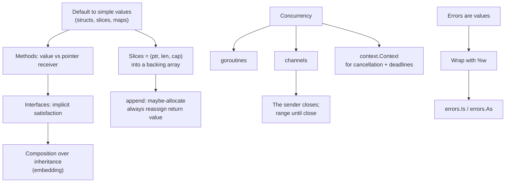

# Go Fundamentals — Cheatsheet for Easy Stuff, Teaching Journey for Hard Stuff

## Why This Exists

**Problem.** Go reads simple — and most of it is. But a handful of things bite people who came from other languages: slices share backing arrays in surprising ways, `append` sometimes allocates and sometimes doesn't, value vs pointer receivers change semantics, channels and `close()` have a sender-side ownership rule, `context.Context` is *the* cancellation mechanism, and `nil` interfaces aren't always nil. The official docs explain each piece well in isolation; this note connects them.

**Key insight.** Go's design choice over and over again is **make the simple case obvious, surface the trade-off where it actually matters.** That's why slices have explicit length+capacity (no hidden growth surprise — once you understand it), why goroutines need explicit cancellation (no hidden runtime control), why interfaces are implicit (no ceremony), and why errors are values (no hidden control flow).

**Reach for this when:**
- You see a slice mutate when you didn't expect it
- You wrote `append` and the original slice changed (or didn't)
- You're choosing between a value and pointer receiver
- Goroutine leaks, channel deadlocks, "send on closed channel" panics
- `context.Context`, `WithTimeout`, cancellation, `<-ctx.Done()`
- `errors.Is`, `errors.As`, `%w` wrapping
- Generics syntax (`func F[T any](...)`)

**Don't reach for this when:**
- You want a Go API reference — go to pkg.go.dev
- You need build/module tooling deep dives — see [`go mod`](https://go.dev/ref/mod) docs
- Advanced topics like reflection internals, unsafe, linker tricks, runtime scheduler — out of scope here

---

## Diagrams

### The unifying picture



### A slice is three words pointing at an array

```
slice := arr[1:4]    →    ┌─────┬─────┬─────┐
                          │ ptr │ len │ cap │
                          └──┬──┴─────┴─────┘
                             │
                             ▼
backing array:   [ a │ b │ c │ d │ e │ f ]
                       ^—— ptr   ^——— end (cap)
                       └── len ──┘
```

This single picture explains every slice gotcha you'll run into. Bookmark it.

---

## 0. Quick Reference (Cheatsheet)

### Modules and tooling

| Command | Purpose |
|---|---|
| `go mod init <module>` | initialise a module |
| `go run ./...` | compile + run |
| `go build ./...` | compile, no run |
| `go test ./...` | run tests |
| `go vet ./...` | static checks |
| `go fmt ./...` / `gofmt -w` | formatter (run on save) |
| `go mod tidy` | sync `go.sum` and prune unused deps |
| `go get pkg@v1.2.3` | add/update a dependency |

`go.mod` lists the module path, Go version, and direct deps. Don't hand-edit `go.sum`.

### Packages and naming

```go
package mypkg          // one per directory; lower-case, single word

import (
    "fmt"              // stdlib
    "github.com/x/y"   // external
    myalias "long/path/here"
    _ "net/http/pprof" // side-effect import
)
```

Naming conventions:
- **Exported = capitalised first letter** (`User`, `ParseConfig`). Unexported = lowercase.
- **Use `MixedCaps`, never underscores.**
- **No `Get` prefix** on getters: `obj.Owner()`, not `obj.GetOwner()`.
- **One-method interfaces use `-er` suffix:** `Reader`, `Writer`, `Stringer`.
- **Package-qualified names** — name `bufio.Reader`, not `bufio.BufReader`. Avoid stuttering.

### Variables, constants, zero values

```go
var x int = 5         // explicit
var y = 5             // inferred
z := 5                // short form (function scope only)
const Pi = 3.14
const (
    A = iota          // 0
    B                 // 1
    C                 // 2
)

// Every type has a useful zero value:
var s string          // ""
var n int             // 0
var b bool            // false
var p *int            // nil
var sl []int          // nil — but works with len/append
var m map[string]int  // nil — len works, write panics
var ch chan int       // nil — read/write blocks forever
```

**Zero-value-ready types are idiomatic.** `bytes.Buffer{}` and `sync.Mutex{}` work without any constructor.

### Primitive types

| Category | Types |
|---|---|
| Integers | `int8`/`int16`/`int32`/`int64`, `uint8`–`uint64`, `int`/`uint` (machine word), `uintptr` |
| Aliases | `byte` = `uint8`, `rune` = `int32` (Unicode code point) |
| Floats | `float32`, `float64` |
| Complex | `complex64`, `complex128` |
| Other | `bool`, `string` |

`int` and `uint` are 32 or 64 bits depending on the platform — use `int64` if you need a guarantee.

### Strings and runes

```go
s := "héllo"
len(s)              // bytes (6, not 5 — é is two bytes)
for i, r := range s { ... }   // r is a rune (int32), i is byte offset
[]byte(s)           // copy to bytes
[]rune(s)           // copy to runes (slow — full UTF-8 decode)
strings.Contains(s, "ll")
fmt.Sprintf("%d", 42)
```

Strings are immutable byte sequences. Indexing `s[i]` gives you a `byte`, not a rune.

### Composite types

```go
// Array — fixed length, value type (assignment copies)
var arr [3]int = [3]int{1, 2, 3}

// Slice — variable length, descriptor pointing into a backing array
sl := []int{1, 2, 3}
sl = append(sl, 4)      // see §3 for the gotcha
sl2 := sl[1:3]          // shares backing array

// Map
m := map[string]int{"a": 1}
m["b"] = 2
v, ok := m["c"]         // comma-ok: v=0, ok=false if missing
delete(m, "a")
for k, v := range m { ... }

// Struct
type Point struct {
    X, Y int
}
p := Point{X: 1, Y: 2}
p2 := Point{1, 2}                    // positional, fragile — prefer named
pp := &Point{X: 1, Y: 2}             // pointer
```

### Control flow

```go
// if — initializer + condition; no parens
if v, err := f(); err != nil {
    return err
}

// for — Go's only loop
for i := 0; i < 10; i++ { ... }      // C-style
for cond { ... }                      // while
for { ... }                           // infinite
for i, v := range collection { ... }  // index/key + value
for range ch { ... }                  // until channel closes

// switch — no fallthrough by default
switch x {
case 1, 2, 3:
    // ...
case 4:
    // ...
default:
    // ...
}

// switch as if/else chain
switch {
case x < 0:
    // ...
case x == 0:
    // ...
}

// type switch
switch v := i.(type) {
case string: fmt.Println(v)
case int:    fmt.Println(v)
default:     fmt.Printf("%T", v)
}
```

No semicolons in conditions. No parens around them either. Braces are required (no single-line `if` without braces).

### Functions

```go
func add(a, b int) int { return a + b }

// Multiple returns
func divmod(a, b int) (int, int) { return a / b, a % b }

// Named returns — initialised to zero, naked return works
func parse(s string) (n int, err error) {
    n, err = strconv.Atoi(s)
    return
}

// Variadic
func sum(nums ...int) int { ... }
sum(1, 2, 3)
sum(slice...)              // expand a slice

// Closures
adder := func(x int) func(int) int {
    return func(n int) int { return x + n }
}
```

### `defer`

```go
f, err := os.Open(path)
if err != nil { return err }
defer f.Close()              // runs when surrounding function returns
```

Rules:
- LIFO — multiple defers run in reverse order.
- **Arguments are evaluated at the `defer` site**, not when it runs.
- Runs even on `panic`. Used for cleanup, mutex unlock, recovery.

```go
defer fmt.Println(time.Now())   // captures NOW, not return time
defer func() { fmt.Println(time.Now()) }()  // captures return time
```

### Methods

```go
type Counter struct{ n int }

func (c Counter) Get() int      { return c.n }   // value receiver
func (c *Counter) Inc()         { c.n++ }        // pointer receiver
```

When to pick which: see §5.

### Structs — composition via embedding

```go
type Animal struct { Name string }
func (a Animal) Greet() { fmt.Println("hi", a.Name) }

type Dog struct {
    Animal      // embedded — promoted fields & methods
    Breed string
}

d := Dog{Animal{Name: "Rex"}, "Lab"}
d.Greet()        // works — Animal.Greet promoted
d.Name           // works — Animal.Name promoted
```

Embedding is **composition**, not inheritance. Methods called on the embedded field receive the *embedded* value, not the outer one.

### Errors

```go
v, err := f()
if err != nil {
    return fmt.Errorf("doing X: %w", err)   // wrap with %w
}

if errors.Is(err, io.EOF) { ... }
var perr *os.PathError
if errors.As(err, &perr) { fmt.Println(perr.Path) }
```

Full treatment in §10.

### Goroutines and channels (basic)

```go
go doWork()                     // fire-and-forget goroutine

ch := make(chan int)            // unbuffered
ch := make(chan int, 10)        // buffered

ch <- 42                        // send
v := <-ch                       // receive
v, ok := <-ch                   // ok=false if channel closed and drained
close(ch)                       // sender's job — see §8
for v := range ch { ... }       // drains until close
```

Full treatment in §8.

---

## 1. Packages, Imports, Visibility

Every file starts with `package <name>`. All files in a directory must declare the same package.

**Visibility rule:** capital first letter = exported (visible to other packages). Lowercase = package-private. There's no `public`/`private` keyword.

```go
type User struct {
    Name string         // exported
    salt string         // package-private
}

func (u *User) Greet() {}     // exported method
func (u *User) hash() {}      // private
```

**Side-effect imports** (`import _ "net/http/pprof"`) run the package's `init()` functions without binding any identifier. Used for registering drivers (`_ "github.com/lib/pq"`) or HTTP handlers.

**Compile-time interface check** — a common idiom to ensure a type still implements an interface even if no code uses it as one:

```go
var _ json.Marshaler = (*RawMessage)(nil)
```

If `*RawMessage` ever stops implementing `json.Marshaler`, the package won't compile.

---

## 2. Arrays vs Slices — and Why You Almost Always Want Slices

### The problem

```go
var a [3]int = [3]int{1, 2, 3}
b := a              // COPIES the entire array
b[0] = 99
fmt.Println(a[0])   // 1 — a is unchanged
```

Arrays in Go are **values**. Assigning or passing an array copies all of it. Their size is part of the type — `[3]int` and `[4]int` are different types — so they're rigid and rarely the right tool.

### Slices: the descriptor model

A slice is a small struct: a pointer to a backing array, a length, and a capacity:

```
slice := arr[1:4]    →    (ptr → arr+1, len = 3, cap = 5)
```

`len` is how many elements you can index right now. `cap` is how many elements the backing array has from the slice's start pointer.

```go
s := make([]int, 3, 10)    // len=3, cap=10
fmt.Println(len(s), cap(s))
```

When you pass a slice to a function, you copy the *descriptor* (3 words), not the array. Modifications to the elements through the slice are visible to the caller.

### Sub-slicing shares storage

```go
d := []byte{'r', 'o', 'a', 'd'}
e := d[2:]
e[1] = 'm'
// d is now {'r', 'o', 'a', 'm'}  ← surprise!
```

`d` and `e` point into the same array. Mutating one mutates the other in the overlap.

### `append` — the real gotcha

`append` returns a slice. It might extend the existing backing array, or it might allocate a new one. **You can't tell from the call site.** Hence: **always reassign the return value.**

```go
s := []int{1, 2, 3}
s = append(s, 4)   // CORRECT — might reallocate
append(s, 4)       // WRONG — discarded if reallocated
```

The mechanics:

| Condition | What `append` does |
|---|---|
| `len + n ≤ cap` | writes into existing backing array, returns extended slice |
| `len + n > cap` | allocates new larger array (typically doubles), copies old, writes new |

**The concrete trap.** This bites everyone once:

```go
s := []int{1, 2, 3, 4, 5}      // cap = 5
sub := s[:2]                    // sub = [1, 2], shares cap=5 backing array
sub = append(sub, 99)           // fits in cap → writes into s[2]!
fmt.Println(s)                  // [1, 2, 99, 4, 5]  ← s mutated
```

The fix is to **force a new backing array** when you take a "logical copy":

```go
sub := append([]int{}, s[:2]...)   // explicit copy
// or
sub := make([]int, 2)
copy(sub, s[:2])
```

### The "small slice into a large array" leak

A small returned slice keeps its entire backing array alive. The GC can't free it.

```go
func extractDigits(filename string) []byte {
    b, _ := os.ReadFile(filename)            // reads 50MB
    return digitRegexp.Find(b)                // returns ~10 bytes — but pins the 50MB
}
```

Fix: copy the result to a fresh slice before returning.

```go
result := digitRegexp.Find(b)
out := make([]byte, len(result))
copy(out, result)
return out
```

### `copy` vs `append`

```go
copy(dst, src)        // copies min(len(dst), len(src)) elements; returns count
```

`copy` is a write into existing space. `append` may allocate. Use `copy` when you've already sized your destination.

### Mental model

> **Slices are descriptors. They share data with whoever else has a descriptor into the same array.** When you want isolation, copy explicitly. When you call `append`, always reassign — and assume it might or might not have allocated.

---

## 3. Maps

```go
m := map[string]int{"a": 1, "b": 2}
m["c"] = 3                              // insert/update
v := m["x"]                             // 0 if absent (zero value)
v, ok := m["x"]                         // comma-ok: ok=false if absent
delete(m, "a")
for k, v := range m { ... }             // iteration order is randomised!
len(m)
```

### Comma-ok idiom

The map returns the value type's zero on missing keys, so you can't tell "absent" from "explicit zero" without `, ok`. This same idiom shows up everywhere — channel receives (`v, ok := <-ch`), type assertions (`s, ok := x.(string)`).

### nil maps are read-only

```go
var m map[string]int
m["x"] = 1            // PANIC: assignment to entry in nil map
v := m["x"]           // OK — returns 0, ok = false
len(m)                // OK — returns 0
```

You must `make` (or use a literal) before writing.

### Map iteration order is intentionally random

The runtime randomises the start position each iteration, so you can't accidentally rely on order. To iterate in order, sort the keys:

```go
keys := make([]string, 0, len(m))
for k := range m { keys = append(keys, k) }
sort.Strings(keys)
for _, k := range keys { fmt.Println(k, m[k]) }
```

### Maps are not safe for concurrent use

Concurrent reads are fine. Any concurrent write (or write+read) needs `sync.Mutex` or `sync.RWMutex`. For specific patterns, `sync.Map` exists but is *not* a general-purpose replacement — see its docs for when it pays off.

---

## 4. Structs and Methods (the basics)

```go
type Rectangle struct {
    Width, Height float64
}

// Constructor convention — package-level function returning *T or T
func NewRectangle(w, h float64) *Rectangle {
    return &Rectangle{Width: w, Height: h}
}

func (r Rectangle) Area() float64 {
    return r.Width * r.Height
}
```

### Composite literals

```go
r := Rectangle{Width: 3, Height: 4}    // named fields
r := Rectangle{3, 4}                   // positional — fragile, breaks if you add a field
r := &Rectangle{Width: 3, Height: 4}   // pointer
r := new(Rectangle)                    // pointer to zero-value Rectangle
```

`new(T)` and `&T{}` produce the same thing. Use whichever reads better.

### Embedding (composition)

```go
type Logger struct{ prefix string }
func (l *Logger) Log(s string) { fmt.Println(l.prefix, s) }

type Service struct {
    *Logger              // embedded
    Name string
}

s := Service{Logger: &Logger{prefix: "[svc]"}, Name: "auth"}
s.Log("hello")           // promoted: calls s.Logger.Log
```

Promoted methods receive the **inner** type, not the outer. If `Logger.Log` mutates state, it mutates the embedded `Logger`, not the `Service`. To override, define a method on the outer type:

```go
func (s *Service) Log(msg string) {
    s.Logger.Log(s.Name + ": " + msg)
}
```

This is composition — explicit delegation, not inheritance.

---

## 5. Value vs Pointer Receivers — Choose Once Per Type

The single most asked Go question. The rule:

> **Use pointer receivers when:**
> - the method needs to mutate the receiver,
> - the receiver is large enough that copying it would be wasteful,
> - or the type contains a `sync.Mutex` or another non-copyable field.
>
> **Use value receivers for small, immutable, value-semantic types** (small structs, basic numeric wrappers).
>
> **Be consistent.** Don't mix value and pointer receivers on the same type without a strong reason.

### The semantic difference

```go
type Counter struct{ n int }

func (c Counter) IncByValue()  { c.n++ }     // mutates a copy — useless
func (c *Counter) IncByPtr()   { c.n++ }     // mutates the actual counter

c := Counter{}
c.IncByValue(); fmt.Println(c.n)  // 0
c.IncByPtr();   fmt.Println(c.n)  // 1
```

### Method set and interface satisfaction

This is where the rule "be consistent" matters. The method set of `T` includes only value-receiver methods. The method set of `*T` includes both. So:

```go
type Stringer interface { String() string }

type Foo struct{}
func (f *Foo) String() string { return "foo" }   // pointer receiver only

var s Stringer = Foo{}        // ERROR: Foo doesn't satisfy Stringer
var s Stringer = &Foo{}       // OK
```

If you'd written the receiver as `(f Foo)`, both `Foo` and `*Foo` would satisfy `Stringer`. But since your data has fields a method might mutate, you usually want pointer receivers — and that's fine, just always pass `*Foo` where the interface is expected.

### Mutex / non-copyable fields

```go
type Cache struct {
    mu    sync.Mutex     // copying this is a bug — locks don't share state
    items map[string]int
}

// All methods on *Cache so we never accidentally copy
func (c *Cache) Get(k string) int { ... }
```

`go vet` will catch you if you copy a `sync.Mutex` accidentally.

### Mental model

> **A value receiver works on a copy. A pointer receiver works on the original.** Default to pointer receivers for anything bigger than a few words or anything you'll mutate. For small immutable types (a `Point{X, Y int}`-style value), value receivers are fine — they cost nothing.

---

## 6. Interfaces — Implicit Satisfaction

### The model

A type satisfies an interface by having the right methods. **You don't declare it.** No `implements` keyword.

```go
type Stringer interface {
    String() string
}

type Money struct{ Cents int }
func (m Money) String() string {
    return fmt.Sprintf("$%d.%02d", m.Cents/100, m.Cents%100)
}

var s Stringer = Money{Cents: 199}      // automatic — Money satisfies Stringer
fmt.Println(s)                          // "$1.99" via Money.String
```

This decouples consumers from producers. You can pass `Money` to any function that takes a `Stringer` without either side knowing about the other.

### Small interfaces are idiomatic

> **The bigger the interface, the weaker the abstraction.** — Rob Pike

The standard library is full of one-method interfaces:

```go
type Reader  interface { Read(p []byte) (n int, err error) }
type Writer  interface { Write(p []byte) (n int, err error) }
type Closer  interface { Close() error }
type Stringer interface { String() string }
```

And combinations:

```go
type ReadWriter interface {
    Reader
    Writer
}
```

The `-er` naming convention (`Reader`, `Writer`, `Stringer`) is universal.

### Type assertions and type switches

```go
// Assertion — extract concrete type
s, ok := x.(string)            // safe form
if ok { ... }

s := x.(string)                 // panics on failure — only when you're certain

// Type switch
switch v := x.(type) {
case string:        fmt.Println("string", v)
case int:           fmt.Println("int", v)
case fmt.Stringer:  fmt.Println("stringer", v.String())
default:            fmt.Printf("unknown %T", v)
}
```

### The empty interface — `interface{}` and `any`

`interface{}` (or `any` since Go 1.18 — they're identical) holds *any* value:

```go
var x any = 42
var y any = "hi"
```

You unwrap with type assertions or type switches. Use it sparingly — it's the type-system equivalent of "I'll figure it out later." Generics (§13) are usually a better answer.

### The `nil` interface gotcha

```go
type Error struct{ msg string }
func (e *Error) Error() string { return e.msg }

func makeErr() error {
    var e *Error = nil
    return e          // returns a non-nil interface!
}

err := makeErr()
fmt.Println(err == nil)   // false — surprise
```

An interface value is nil **only when both the type and the value are nil**. Returning a typed nil pointer wraps it in an interface with a non-nil type tag, so `err == nil` is false.

Fix: return a literal `nil`, not a typed nil pointer.

```go
func makeErr() error {
    if !somethingWrong {
        return nil
    }
    return &Error{msg: "bad"}
}
```

### Returning interfaces

The convention: **accept interfaces, return concrete types.** A function that takes a `Reader` is flexible; one that returns `Reader` hides too much. Exceptions exist (constructors that need to return one of several types behind a common interface), but in general, return the concrete type so callers can use any extra methods it has.

---

## 7. `defer`, `panic`, `recover`

### `defer` — deferred function call

```go
f, err := os.Open(path)
if err != nil { return err }
defer f.Close()
```

Runs when the surrounding function returns (normally or via panic). Multiple defers run LIFO.

**Argument evaluation is eager:**

```go
i := 0
defer fmt.Println(i)        // prints 0 — i evaluated NOW
i = 42
return                      // 0 prints
```

```go
i := 0
defer func() { fmt.Println(i) }()    // prints 42 — closure reads at run time
i = 42
return
```

Common uses: closing files, unlocking mutexes, decrementing wait groups, restoring state, recovering from panics.

### `panic` and `recover`

`panic(value)` unwinds the stack. Each frame's deferred functions run; then the goroutine dies.

`recover()` (only useful inside a deferred function) catches a panic and returns the panic value. The goroutine resumes normally.

```go
func safe(f func()) {
    defer func() {
        if r := recover(); r != nil {
            log.Printf("recovered: %v", r)
        }
    }()
    f()
}
```

**Use sparingly.** Idiomatic Go uses errors as values, not panic-as-control-flow. `panic` is for *truly unrecoverable* state — corrupted invariants, programmer bugs. The boundaries where `recover` is appropriate are well-known: HTTP handlers, RPC servers, the top of long-running goroutines.

A panicked goroutine that nobody recovers crashes the whole program.

---

## 8. Goroutines and Channels

### Goroutines

```go
go doWork()                              // fire-and-forget
go func() { ... }()                      // anonymous
```

A goroutine is a lightweight thread (~2KB starting stack, grown on demand) scheduled by the Go runtime onto OS threads. You can have hundreds of thousands without trouble.

But: **the Go runtime won't tell you when one is stuck or leaked.** If you spawn a goroutine that's waiting on a channel that nobody will ever send to, it sits there until the program exits. This is the most common Go bug — see §9.

### Channels

A typed conduit. Send and receive synchronise.

```go
ch := make(chan int)        // unbuffered
ch := make(chan int, 10)    // buffered (capacity 10)

ch <- 42                    // send (blocks until received, if unbuffered)
v := <-ch                   // receive
v, ok := <-ch               // ok=false if channel closed and empty
close(ch)                   // closes (only the SENDER should close)

for v := range ch { ... }   // receives until closed
```

### Unbuffered vs buffered

| Channel | Send blocks until... |
|---|---|
| Unbuffered (`make(chan T)`) | a receiver is ready (rendezvous) |
| Buffered (`make(chan T, n)`) | the buffer is full |

**Unbuffered = synchronisation.** A successful send means a successful receive happened. Use it as a semaphore, a "done" signal, or a handoff.

**Buffered = decoupling.** Producer can run ahead of consumer up to `n`. Don't size the buffer to "fix" a deadlock — that's papering over a design problem. Size it for genuine decoupling (smoothing bursts, batching).

### The sender-closes rule

> **The sender closes the channel. Receivers `range` until close.**

Never close from the receive side. Never close a channel twice (panics). Never send on a closed channel (panics).

```go
// Producer
go func() {
    defer close(ch)             // close exactly once, when done sending
    for _, x := range data {
        ch <- x
    }
}()

// Consumer
for v := range ch {
    process(v)
}                               // exits when ch is closed
```

### Multiple senders → coordinator closes

When several goroutines send to the same channel, none of them owns the close decision. Use a `sync.WaitGroup` and a coordinator goroutine:

```go
var wg sync.WaitGroup
for _, src := range sources {
    wg.Add(1)
    go func(s Source) {
        defer wg.Done()
        for v := range s.Read() { ch <- v }
    }(src)
}

go func() {
    wg.Wait()
    close(ch)            // only after every sender has returned
}()
```

### `select` — wait on multiple channels

```go
select {
case v := <-ch1:
    handle(v)
case ch2 <- x:
    sent()
case <-time.After(5*time.Second):
    timeout()
case <-ctx.Done():
    return ctx.Err()
default:
    // none of the above are ready
}
```

`select` blocks until one case is ready, then runs it. If multiple are ready, one is chosen at random. The `default` makes it non-blocking.

### Fan-out / fan-in

**Fan-out:** several goroutines reading from the same channel — automatic work distribution.

```go
for i := 0; i < numWorkers; i++ {
    go worker(jobs, results)
}
```

**Fan-in:** merging multiple channels into one.

```go
func merge(cs ...<-chan int) <-chan int {
    var wg sync.WaitGroup
    out := make(chan int)
    for _, c := range cs {
        wg.Add(1)
        go func(c <-chan int) {
            defer wg.Done()
            for v := range c { out <- v }
        }(c)
    }
    go func() {
        wg.Wait()
        close(out)       // only after all senders done
    }()
    return out
}
```

### Channel direction in signatures

```go
func producer(out chan<- int)      // send-only
func consumer(in <-chan int)       // receive-only
func pipeline(in <-chan int, out chan<- int)
```

Restricting direction at the parameter type catches misuse at compile time. Always declare channel parameters with a direction.

---

## 9. Cancellation, Goroutine Leaks, and `context.Context`

### The leak problem

```go
func leak() {
    ch := make(chan int)
    go func() { ch <- 42 }()    // sends and blocks
    // ... we forget to receive ...
}
```

The goroutine is now stuck forever. `ch <- 42` never completes; the goroutine never exits; its memory is never freed. **Go does not garbage collect goroutines.** They must exit on their own.

### `context.Context` — the standard cancellation mechanism

`context.Context` is the standard way to plumb cancellation, deadlines, and request-scoped values through a call tree.

```go
type Context interface {
    Done() <-chan struct{}                  // closes when canceled
    Err() error                              // why canceled
    Deadline() (time.Time, bool)
    Value(key any) any
}
```

**Convention: `ctx` is the first parameter** of any function that does I/O, blocks, or might be cancelled.

```go
func Search(ctx context.Context, query string) (Results, error)
```

### Creating contexts

```go
ctx := context.Background()                    // root, never cancelled
ctx := context.TODO()                          // when you don't have one yet (placeholder)

ctx, cancel := context.WithCancel(parent)      // manual cancel
ctx, cancel := context.WithTimeout(parent, 5*time.Second)
ctx, cancel := context.WithDeadline(parent, deadline)
ctx := context.WithValue(parent, key, value)   // request-scoped data

defer cancel()                                  // ALWAYS — releases resources
```

Always `defer cancel()` even for `WithTimeout` — it releases the timer immediately when the function returns (which matters if it returned before the timeout fired).

### Listening for cancellation

```go
func work(ctx context.Context) error {
    for {
        select {
        case <-ctx.Done():
            return ctx.Err()              // context.Canceled or context.DeadlineExceeded
        case job := <-jobs:
            process(job)
        }
    }
}
```

Cancellation propagates down. If you derived `child` from `parent` and `parent` is cancelled, `child.Done()` closes too.

### Context values

```go
type ctxKey int
const userKey ctxKey = 0

ctx := context.WithValue(parent, userKey, user)
u, _ := ctx.Value(userKey).(*User)
```

**Use a private unexported key type** so other packages can't collide. Use `WithValue` only for request-scoped data (auth tokens, request IDs, trace spans) — *not* for passing optional parameters. Function arguments are clearer.

### Don't store `Context` in structs

`Context` is tied to a request lifetime. Stashing it in a struct lets it outlive the request. Pass it as a parameter on every method that needs it. (One narrow exception: long-lived stateful types like a `*http.Request` carry one internally — but that's not your code, that's the framework.)

### Three rules to live by

1. **Pass `ctx` as the first parameter** of any blocking/IO function.
2. **Always `defer cancel()`** when you create a cancellable context.
3. **Check `<-ctx.Done()`** in long-running loops and `select` statements.

---

## 10. Error Handling

### Errors are values

```go
type error interface {
    Error() string
}

errors.New("not found")
fmt.Errorf("user %d: %w", id, err)    // wrapping
```

There are no exceptions. Errors are the second return value, by convention:

```go
v, err := f()
if err != nil {
    return fmt.Errorf("calling f: %w", err)
}
use(v)
```

The verbose `if err != nil { return err }` is the idiom. Don't fight it.

### `%w` wrapping (Go 1.13+)

```go
return fmt.Errorf("loading config %s: %w", path, err)
```

`%w` (instead of `%v`) records the wrapped error in a chain. Callers can inspect it without parsing the message string.

### `errors.Is` — sentinel comparison through wrapping

For "is this *that specific* error":

```go
var ErrNotFound = errors.New("not found")

func get(id int) (Item, error) {
    if id == 0 { return Item{}, fmt.Errorf("get: %w", ErrNotFound) }
    ...
}

if errors.Is(err, ErrNotFound) {           // walks the wrap chain
    // ...
}
if errors.Is(err, io.EOF) { ... }
```

### `errors.As` — extract a structured error type

For "is there *a value of this type* anywhere in the chain":

```go
var perr *os.PathError
if errors.As(err, &perr) {
    fmt.Println("path:", perr.Path)
}
```

`errors.As` walks the chain and assigns to the pointer if it finds a matching type.

### Defining error types

**Sentinel errors** (matched by `errors.Is`):

```go
var ErrNotFound = errors.New("user not found")
```

**Structured errors** (matched by `errors.As`, carry data):

```go
type ValidationError struct {
    Field string
    Msg   string
}

func (e *ValidationError) Error() string {
    return fmt.Sprintf("validation: %s: %s", e.Field, e.Msg)
}
```

Use sentinels for error *kinds* the caller wants to compare against (`io.EOF`). Use structured types when the caller needs the data (file path, line number).

### When to `panic`

- Programmer bugs / impossible-state assertions (`panic("unreachable")`).
- Invariant violations during initialization that make the program unable to start (`log.Fatal` is often more appropriate — it logs and exits).
- *Never* for ordinary, expected failure modes. Return an error.

### Error best practices

1. **Return errors; don't log-and-return.** If you log at every layer, you get the same error printed five times. Log once at the boundary that decides what to do.
2. **Wrap with `%w`** so callers can use `errors.Is` / `errors.As`. Add context as you go up: `"loading config %s: %w"`.
3. **Don't compare error strings.** Use `errors.Is` or `errors.As`.
4. **Sentinel for kinds, structured for data.** Pick once per error.
5. **Don't return `interface{}` errors.** Always return the `error` interface — concrete types behind it work fine but the signature should be `error`.
6. **Avoid the typed-nil bug.** Returning a typed nil pointer wraps it in a non-nil interface (see §6). Always `return nil` (untyped) for the success case.
7. **`errors.Join`** (Go 1.20+) combines multiple errors into one. Useful for validators that want to report all failures at once.
8. **`%w` only once per `Errorf`** — wrapping multiple errors with `%w` is undefined behaviour for `errors.Is`. Use `errors.Join` instead.

---

## 11. Synchronisation Primitives (When Channels Aren't Enough)

The aphorism "share memory by communicating" is the *default* — but `sync` primitives exist for the cases where channels would be awkward.

### `sync.Mutex` and `sync.RWMutex`

```go
type Counter struct {
    mu sync.Mutex
    n  int
}
func (c *Counter) Inc() { c.mu.Lock(); defer c.mu.Unlock(); c.n++ }
func (c *Counter) Get() int { c.mu.Lock(); defer c.mu.Unlock(); return c.n }
```

`RWMutex` allows many readers OR one writer. Use it when reads vastly outnumber writes; otherwise plain `Mutex` is fine and faster.

`defer mu.Unlock()` immediately after `Lock()` is the idiom. Always.

### `sync.WaitGroup`

Wait for a known number of goroutines to finish:

```go
var wg sync.WaitGroup
for _, x := range items {
    wg.Add(1)
    go func(x Item) {
        defer wg.Done()
        process(x)
    }(x)
}
wg.Wait()
```

Call `Add` *before* the goroutine starts, not inside it. (Race: the goroutine might not start before `wg.Wait()` runs.)

### `sync.Once`

```go
var once sync.Once
once.Do(func() { /* runs exactly once */ })
```

Lazy initialisation, threadsafe.

### `sync.Pool`

A pool of reusable objects to reduce GC pressure. Useful for high-allocation hotspots (parsers, buffers). Items in the pool can be removed at any time, so it's only suitable for things that are cheap to recreate.

### `atomic`

```go
import "sync/atomic"

var counter atomic.Int64
counter.Add(1)
v := counter.Load()
```

Lock-free atomic operations. Useful for counters and flags. Don't reach for them when a `Mutex` would do — the readability cost is real.

---

## 12. Standard Formatting

### `fmt` verbs

| Verb | What |
|---|---|
| `%v` | default format |
| `%+v` | struct with field names |
| `%#v` | Go-syntax representation |
| `%T` | type |
| `%d` | decimal int |
| `%x` / `%X` | hex |
| `%s` | string |
| `%q` | quoted string |
| `%f` / `%g` / `%e` | floats |
| `%t` | bool |
| `%p` | pointer |
| `%w` | wrapped error (only in `Errorf`) |

```go
type User struct{ Name string; Age int }
u := User{"Alice", 30}
fmt.Printf("%v\n", u)    // {Alice 30}
fmt.Printf("%+v\n", u)   // {Name:Alice Age:30}
fmt.Printf("%#v\n", u)   // main.User{Name:"Alice", Age:30}
```

Implement `String() string` to control `%v`/`%s` for your type. Avoid recursion: don't `fmt.Sprintf("%s", t)` where `t`'s `String()` calls `Sprintf("%s", t)` — convert to the underlying type first.

---

## 13. Generics (Go 1.18+)

### Why

You used to write the same logic for `int64` and `float64`:

```go
func SumInts(m map[string]int64) int64    { ... }
func SumFloats(m map[string]float64) float64 { ... }
```

Generics let you write it once.

### Syntax

Type parameters go in **square brackets** before the regular parameter list:

```go
func SumNumbers[K comparable, V int64 | float64](m map[K]V) V {
    var s V
    for _, v := range m {
        s += v
    }
    return s
}
```

`[K comparable, V int64 | float64]` declares two type parameters with constraints.

### Constraints

A constraint is an interface that lists what types are allowed and what operations they support.

- `any` — any type at all (alias for `interface{}`).
- `comparable` — types that support `==` and `!=`. Required for map keys.
- **Type unions** — `int | int64 | float64`, etc. Allows operations valid on all listed types.
- **Method-set constraints** — any interface with methods: `interface { String() string }`.

### Defining named constraints

```go
type Number interface {
    int | int64 | float32 | float64
}

func Sum[V Number](nums []V) V {
    var s V
    for _, v := range nums { s += v }
    return s
}
```

Reuse named constraints across functions. The standard library has `golang.org/x/exp/constraints` (and proposals to move it into `cmp` / `slices` packages) with `Ordered`, `Integer`, `Float`, etc.

### Type inference

```go
Sum([]int{1, 2, 3})              // V inferred as int
Sum[int64]([]int64{1, 2, 3})     // explicit
```

The compiler infers from arguments. When inference fails (e.g. zero-arg function), you provide explicitly.

### Generic types

```go
type Stack[T any] struct {
    items []T
}

func (s *Stack[T]) Push(v T) { s.items = append(s.items, v) }
func (s *Stack[T]) Pop() (T, bool) {
    if len(s.items) == 0 {
        var zero T
        return zero, false
    }
    last := s.items[len(s.items)-1]
    s.items = s.items[:len(s.items)-1]
    return last, true
}

s := &Stack[int]{}
s.Push(1); s.Push(2)
v, ok := s.Pop()
```

### When to reach for generics

- Container types that should hold any element (stacks, queues, sets).
- Algorithms that work over an interface or constraint (`Sort`, `Min`, `Max`, `Filter`).
- Reducing duplicate code across numeric types.

### When *not* to

- One-off code where `interface{}` and a type assertion is clearer.
- When method polymorphism (interface) fits the problem better.
- Generics in Go are deliberately limited compared to Rust/C++; if you find yourself fighting the type system, consider whether interfaces or code generation would fit better.

---

## Trade-offs

- **Slices' performance vs surprise.** Sharing backing arrays is fast — no implicit copying — but the aliasing bites. `append` returns a new slice partly *because* it might allocate; this surfaces the trade-off rather than hiding it.
- **Implicit interface satisfaction.** Decouples consumers from producers, which is great. The cost: harder to find what implements an interface (no `implements`); IDE / `gopls` does the heavy lifting now.
- **Goroutines are cheap, not free.** You'll happily spawn 100k of them. Each one that leaks is invisible until pprof tells you. Cancellation discipline (`context.Context`) is non-negotiable in production code.
- **Panic vs error.** Errors-as-values is verbose (`if err != nil { return err }` everywhere) but explicit; you can see every failure point. Code reads slower; bugs are louder.
- **No exceptions, no try/catch.** The flip side of explicit errors is no hidden exits — control flow is exactly what you read.
- **Generics are intentionally limited.** No higher-kinded types, no specialisation, no SFINAE. Simplicity wins; some patterns (numeric tower abstractions, advanced type-level programming) just aren't expressible. That's a feature.
- **Channels vs mutexes.** Channels for ownership transfer / pipelines / cancellation; mutexes for shared state with simple invariants. Don't dogmatically pick one. The `sync` package exists because channels aren't always the cleanest answer.

---

## Common Pitfalls

- **Forgetting to reassign `append`.** `append(s, x)` may or may not have allocated. **Why:** when capacity grows, you get a new backing array. **Fix:** always `s = append(s, x)`.
- **Sub-slicing then appending mutates the parent.** `sub := s[:2]; sub = append(sub, 99)` may write into `s[2]`. **Why:** they share a backing array; if `cap` allows, no allocation happens. **Fix:** force a copy: `sub := append([]int{}, s[:2]...)` or `make`+`copy`.
- **Returning a small slice from a large array pins memory.** GC can't free the backing array while any descriptor references it. **Fix:** copy the result before returning.
- **Modifying a map during iteration.** Adding new keys mid-`range` is allowed but their inclusion is unspecified. Deletion is fine. **Fix:** collect keys first, modify after.
- **Writing to a nil map.** Panics. `var m map[string]int; m["x"]=1`. **Fix:** `m := make(map[string]int)` or `m := map[string]int{}`.
- **Capturing the loop variable in a goroutine.** Pre-Go 1.22:
  ```go
  for _, x := range xs {
      go func() { use(x) }()    // BUG — all goroutines see the last x
  }
  ```
  **Why:** the loop variable is reused. **Fix:** pass as argument: `go func(x int) { use(x) }(x)`. Go 1.22+ scopes loop variables per-iteration, fixing this — but if your codebase still supports older Go, write the safe form.
- **Missing `defer cancel()`.** `WithTimeout` schedules a goroutine that cleans up only when `cancel` is called or the timeout fires. **Fix:** always `defer cancel()` immediately after the `WithTimeout` call.
- **Storing `context.Context` in a struct field.** Lifetime mismatch. **Fix:** pass `ctx` as the first argument on every method that needs it.
- **Sending on a closed channel.** Panics. **Why:** there's no way to recover gracefully — the receiver might already be reading the trailing zero values. **Fix:** the sender owns close; coordinate with `WaitGroup` if there are multiple senders.
- **Closing a channel from the receiver side.** Same panic territory. **Fix:** receivers `range` until close; senders `close()`. If you need a "stop" signal in reverse, use a separate `done chan struct{}` that the receiver closes.
- **The typed-nil interface bug.** Returning a typed nil pointer through an `error` return makes `err == nil` false. **Fix:** explicit `return nil` (untyped) on success.
- **Comparing errors with `==`.** Misses wrapped chains. **Fix:** `errors.Is(err, ErrFoo)` or `errors.As(err, &target)`.
- **Logging errors at every layer.** Spam. **Fix:** wrap (`fmt.Errorf("doing X: %w", err)`) and let the boundary log.
- **Mixing value and pointer receivers on the same type.** Confusing for callers; method sets diverge. **Fix:** pick one and stick to it.
- **Goroutine leak via blocked send/receive.** A goroutine waits on a channel nobody will ever satisfy. **Why:** Go won't tell you. **Fix:** always have an exit path — `select` with `<-ctx.Done()`.
- **Panicking in a goroutine.** Crashes the whole program if not recovered. **Fix:** if the goroutine is at a server boundary (HTTP handler, RPC handler), defer a `recover` at the top.
- **Modifying a `sync.Mutex` field via copy.** Copying a struct that contains a mutex copies the *unlocked* lock state — different goroutines now lock different locks. `go vet` catches this. **Fix:** pointer receivers, or `sync.Mutex` always behind a pointer.

---

## Decision Table

| Scenario | Use this | Not that | Why |
|----------|----------|----------|-----|
| Variable-size sequence | `[]T` slice | `[N]T` array | Arrays are size-typed and rarely useful directly |
| Pass a sequence to a function | `[]T` | `*[N]T` | Slice header is 3 words, descriptor model |
| Need an isolated copy of a slice | `append([]T{}, s...)` or `make`+`copy` | another `s[:]` | Sub-slicing shares storage |
| Method that mutates the receiver | pointer receiver | value receiver | Value receiver works on a copy |
| Method on a struct with `sync.Mutex` | pointer receiver | value receiver | `Mutex` must not be copied |
| Method on a small immutable struct | value receiver | pointer receiver | Cheaper, clearer value semantics |
| Function takes "any sequence reader" | `io.Reader` parameter | concrete type | Accept interfaces |
| Function returns a parser | concrete `*Parser` | `Parser` interface | Return concrete types |
| One-time setup, threadsafe | `sync.Once` | bool flag + mutex | Simpler, harder to mess up |
| Many readers, rare writes | `sync.RWMutex` | `sync.Mutex` | Concurrent reads |
| Counter shared by goroutines | `atomic.Int64` | `sync.Mutex` + int | Lock-free, faster |
| Producer/consumer pipeline | channels | shared queue + mutex | Idiomatic, composable |
| Wait for N goroutines | `sync.WaitGroup` | counting in a channel | Purpose-built |
| Bound concurrency | buffered channel as semaphore | unbounded `go` | Backpressure |
| Cancel a long operation | `context.Context` + `select` | `os.Exit` / panic | Clean unwind |
| "Is this `io.EOF`?" | `errors.Is(err, io.EOF)` | `err == io.EOF` | Walks wrap chain |
| "Does it have a `*os.PathError`?" | `errors.As(err, &target)` | type assertion | Walks wrap chain |
| Error caller will compare against | sentinel `var ErrX = errors.New(...)` | `Errorf` string | `errors.Is`-friendly |
| Error carrying data | struct type implementing `error` | embedding strings | `errors.As`-friendly |
| Container of any element type | generic `type Stack[T any]` | `interface{}` | Type safety |
| Sort/Min/Max across numeric types | generics with `constraints.Ordered` | duplicate functions | DRY |
| Heterogeneous data in one map | `map[string]any` | generics | Generics don't help here |

---

## References

### Official docs
- [The Go Programming Language Specification](https://go.dev/ref/spec)
- [Effective Go](https://go.dev/doc/effective_go) — canonical idioms
- [Tour of Go](https://go.dev/tour/) — interactive walkthrough
- [Go FAQ](https://go.dev/doc/faq)
- [`context` package docs](https://pkg.go.dev/context)
- [`sync` package docs](https://pkg.go.dev/sync)
- [`errors` package docs](https://pkg.go.dev/errors)
- [`go mod` reference](https://go.dev/ref/mod)

### Official blog posts (sources for this note)
- [Go Slices: usage and internals](https://go.dev/blog/slices-intro)
- [Error handling and Go](https://go.dev/blog/error-handling-and-go) (2011, predates `%w` / `errors.Is`)
- [Working with Errors in Go 1.13](https://go.dev/blog/go1.13-errors) — `%w`, `errors.Is`, `errors.As`
- [Go Concurrency Patterns: Pipelines and Cancellation](https://go.dev/blog/pipelines)
- [Go Concurrency Patterns](https://go.dev/talks/2012/concurrency.slide) (Rob Pike)
- [Context (the package)](https://go.dev/blog/context)
- [Contexts and structs](https://go.dev/blog/context-and-structs) — why not to store contexts
- [An Introduction to Generics](https://go.dev/blog/intro-generics)
- [Tutorial: Getting started with generics](https://go.dev/doc/tutorial/generics)

### Style and review
- [Go Code Review Comments](https://go.dev/wiki/CodeReviewComments)
- [Uber's Go Style Guide](https://github.com/uber-go/guide/blob/master/style.md)
- [Google Go Style Guide](https://google.github.io/styleguide/go/)

## See Also

- [rust-fundamentals](../rust/rust-fundamentals.md) — the parallel note for Rust. Cross-reference points: Rust's ownership system vs Go's GC + value/pointer split, `&`/`&mut` vs value/pointer receivers, `Result<T, E>` vs `(T, error)`, `Box<dyn Trait>` vs Go interfaces, async/`tokio` vs goroutines/`context`.
