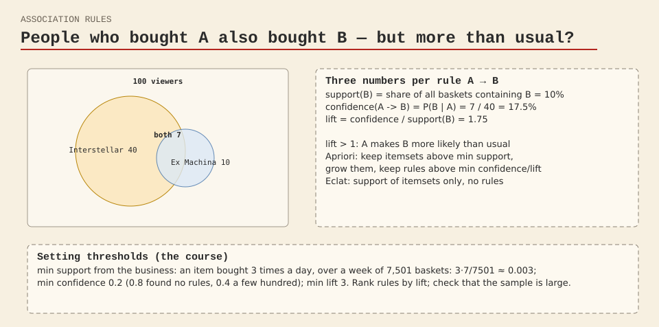

# Association Rules: Apriori and Eclat

> **How to read this note.** Study guide for *Machine Learning A-Z*, Part 5 (sections 28–30): Apriori and Eclat intuition, then builds in Python (`apyori`) and R (`arules`) on `Market_Basket_Optimisation.csv` — a week of 7,501 baskets from a French grocery store. The snippet uses baskets of my own with two planted associations, so you can check that the method finds them. The quizzes aren't included. Install: `VIRTUAL_ENV=/Users/phahng/Desktop/workarea/.venv uv pip install apyori`.

## Why This Exists

**Problem.** A store wants to know which products to place together or bundle; a streaming service wants "people who watched X also watched Y". Counting co-purchases is easy — but popular items appear together just because they're popular.

**Key insight.** Score a rule A → B by how much A **raises** the chance of B above its normal rate (**lift**), and make the search tractable by only extending itemsets that are already frequent (the **Apriori** principle: every subset of a frequent itemset is frequent).

**Reach for this when:**
- Market basket analysis, product placement, simple "frequently bought together" recommendations.
- Exploring co-occurrence in any set-valued data (symptoms, logs, tags).

**Don't reach for this when:**
- You need personalised recommendations — collaborative filtering or embeddings ([boltzmann-machines](../deep-learning/boltzmann-machines.md), [autoencoders](../deep-learning/autoencoders.md), [behavioral-embeddings](../ml-systems/behavioral-embeddings.md)).
- You want causal effects of placing items together — run an experiment.

## Diagrams



## 1. Support, confidence, lift

For a rule A → B over N baskets: **support**(B) = share of baskets containing B; **confidence**(A → B) = share of A-baskets that also contain B, i.e. P(B | A); **lift** = confidence / support(B). Lift 1 means A tells you nothing about B; above 1, recommending B to A-buyers beats recommending it to everyone.

```python
# 100 viewers; 40 watched Interstellar; 10 watched Ex Machina; 7 watched both.
n, A, B, AB = 100, 40, 10, 7
support_B = B / n                                         # how common the consequent is overall
confidence = AB / A                                       # P(Ex Machina | Interstellar)
lift = confidence / support_B                             # how much better than recommending at random
print(f"support(Ex Machina) {support_B:.0%}  confidence(Interstellar -> Ex Machina) {confidence:.1%}  lift {lift:.2f}")
# Expected output:
# support(Ex Machina) 10%  confidence(Interstellar -> Ex Machina) 17.5%  lift 1.75
```

Recommend Ex Machina to everyone and 10% bite; to Interstellar fans, 17.5% — a lift of 1.75.

## 2. Apriori, and Eclat

**Apriori:** set a minimum support and confidence; find all itemsets above the support threshold (growing them one item at a time, only from frequent ones); turn them into rules; keep rules above the confidence threshold; sort by lift. **Eclat** mines the same frequent itemsets by a different search: it stores each item's list of basket IDs (a vertical tid-list), goes depth-first, and gets an itemset's support by intersecting those lists instead of rescanning the baskets. Rules can be built from its itemsets in the same way (arules: `ruleInduction`). The course just stops at the itemsets, ranked by support, with no rules and no direction.

```python
import random
from itertools import combinations
from collections import Counter
from apyori import apriori                                # small pure-Python Apriori implementation
random.seed(0)
items = ["water", "eggs", "bread", "milk", "pasta", "tomato sauce", "chicken", "cream", "honey", "yogurt", "chocolate", "wine"]
baskets = []
for _ in range(2000):                                     # random baskets with two planted associations
    b = set(random.sample(items, random.randint(1, 4)))
    if "pasta" in b and random.random() < 0.6: b.add("tomato sauce")
    if "chicken" in b and random.random() < 0.4: b.add("cream")
    baskets.append(sorted(b))
rules = apriori(baskets, min_support=0.01, min_confidence=0.2, min_lift=1.5, max_length=2)
for r in sorted(rules, key=lambda r: -r.ordered_statistics[0].lift)[:4]:
    s = r.ordered_statistics[0]
    print(f"{set(s.items_base)} -> {set(s.items_add)}  support {r.support:.3f}  confidence {s.confidence:.2f}  lift {s.lift:.2f}")
pairs = Counter(p for b in baskets for p in combinations(b, 2))   # Eclat-style: support of item pairs only
print("most frequent pairs:", [(p, round(c / len(baskets), 3)) for p, c in pairs.most_common(3)])
# Expected output:
# {'pasta'} -> {'tomato sauce'}  support 0.149  confidence 0.67  lift 2.13
# {'chicken'} -> {'cream'}  support 0.100  confidence 0.49  lift 1.84
# most frequent pairs: [(('pasta', 'tomato sauce'), 0.149), (('chicken', 'cream'), 0.1), (('cream', 'tomato sauce'), 0.07)]
```

Both planted associations come out on top by lift; the third most frequent pair (cream + tomato sauce, 7%) has no rule because its lift is below 1.5 — it's common only because both items are.

**The course's settings** (Python, `apyori`): baskets read with `header=None` and turned into lists of strings; `min_support = 3 × 7 / 7501 ≈ 0.003` (an item bought at least three times a day over the week), `min_confidence = 0.2` (0.8 gave no rules; R: 0.4 gave 281 rules and 0.2 gave 1,348), `min_lift = 3`, rules of two items. Top rules: fromage blanc → honey (lift 5.16) and light cream → chicken (confidence 0.29, lift 4.84). R: `arules::read.transactions(..., rm.duplicates = TRUE)` (7,501 baskets × 119 products), `itemFrequencyPlot`, `apriori(..., parameter = list(support, confidence))`, `inspect(sort(rules, by = "lift")[1:10])`; Eclat with `eclat(support = 0.004, minlen = 2)` — mineral water + spaghetti on top (support 0.059). The course's Python "Eclat" just reruns Apriori sorted by support, with the confidence and lift filters still on.

## Trade-offs

- **Low vs high support threshold.** Finds niche rules vs fewer, more reliable rules and much faster runs.
- **Confidence vs lift.** Confidence favours popular consequents; lift corrects for popularity but inflates rare-item rules.
- **Apriori vs FP-Growth.** Simple vs much faster on large data (no candidate generation).

## Common Pitfalls

- **Ranking by confidence alone.** Rules toward bestsellers (mineral water) win by default; use lift.
- **Padding baskets with NaN strings.** Converting missing cells with `str()` adds a fake item called "nan"; drop empty cells instead.
- **Tiny samples.** Rules from a few hundred baskets are noise; the course recommends large samples.
- **Reading rules as causation.** "Bought together" may be a shared cause (a recipe, a promotion).
- **Thresholds without business meaning.** Derive support from volumes you care about, as the course does.

## Decision Table

| Scenario | Use this | Not that | Why |
|----------|----------|----------|-----|
| "Frequently bought together" | Apriori sorted by lift | Raw co-occurrence counts | Corrects for popularity |
| Only itemset frequency needed | Frequent itemsets (Eclat or Apriori) | Rules | Simpler output |
| Millions of baskets | FP-Growth (`mlxtend`, Spark MLlib) | apyori | Speed |
| Personalised suggestions | Collaborative filtering / embeddings | Global rules | Per-user signal |

## References

- [Agrawal & Srikant — Fast Algorithms for Mining Association Rules (1994)](https://www.vldb.org/conf/1994/P487.PDF)
- Zaki — Scalable Algorithms for Association Mining (Eclat), *IEEE TKDE* 12(3), 2000
- [apyori on PyPI](https://pypi.org/project/apyori/) · [arules for R](https://cran.r-project.org/package=arules)

## See Also

- [clustering](clustering.md) — Part 4, the other unsupervised technique.
- [boltzmann-machines](../deep-learning/boltzmann-machines.md) · [autoencoders](../deep-learning/autoencoders.md) — learned recommenders.
- [multi-armed-bandits](../reinforcement-learning/multi-armed-bandits.md) — Part 6: choosing which ad to show by trial and reward.
