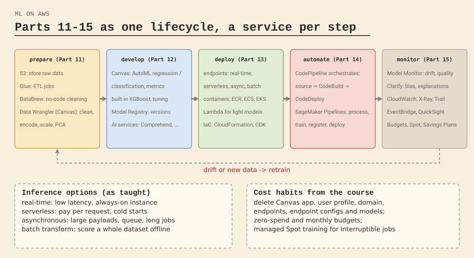

# Deployment, CI/CD and Monitoring on AWS

> **How to read this note.** Study guide for *Machine Learning A-Z*, Part 13 (deployment, section 47), Part 14 (workflow automation, section 48), Part 15 (monitoring and maintenance, section 49) and the closing article (section 50). Mostly console walkthroughs, many of them shown but not submitted; the snippets make two ideas runnable: a CI step that tests the model it trains, and measuring data drift. The responsible-AI lectures repeat AI A-Z's — see [responsible-ai](../llm-engineering/responsible-ai.md) for guardrails, bias metrics, Clarify, A2I and Model Cards. Lecture 444 ("SageMaker vs ECS vs EKS vs Lambda") repeats lecture 439 word for word, so the comparison it promises is filled in from the AWS docs here.

## Why This Exists

**Problem.** A model in a notebook helps no one. It needs an endpoint that answers requests at the right latency and cost, a pipeline that rebuilds and redeploys it safely, and monitoring that notices when the world drifts away from the training data — on infrastructure that keeps billing until you delete it.

**Key insight.** Pick the **serving pattern** from latency and traffic (real-time, serverless, async, batch), automate **build → test → deploy** so every release is reproducible, and **monitor inputs as well as outputs**: data drift usually shows up before accuracy drops are visible.

**Reach for this when:**
- Putting a SageMaker (or any) model into production.
- Choosing between endpoints, containers and Lambda.
- Setting up retraining, drift alarms or cost guardrails.

**Don't reach for this when:**
- You need an LLM/agent deployment guide — see [agentic-ai-systems](../llm-engineering/agentic-ai-systems.md) and [frontier-apis-and-tools](../llm-engineering/frontier-apis-and-tools.md).
- A one-off analysis with no consumers — keep it in the notebook.

## Diagrams



## 1. Deployment (Part 13)

**Five methods:** a managed API (SageMaker endpoints), self-hosted (an API on EC2, or the model embedded in an application), serverless (Lambda — cheap, scales to zero, cold starts), containers (ECS/EKS), and edge devices.

**SageMaker inference types**, as the course tabulates them:

| Type | Payload / time limit (course) | Use it for |
|---|---|---|
| Real-time endpoint | 6 MB, 60 s | Steady traffic, low latency; instance always on |
| Serverless | 6 MB, 60 s (AWS docs: 4 MB) | Spiky or low traffic; pay per request, cold starts |
| Asynchronous | 1 GB, 1 hour | Large inputs, long processing; requests queued, results to S3 |
| Batch transform | 100 MB per record, long jobs | Score a whole dataset offline, no endpoint |

The hands-on enables ML Ops in the Canvas user profile and deploys the Part 12 models as real-time endpoints on one `ml.t2.medium` instance; test predictions come back as 433.5 for the power-plant inputs and "benign" for the breast-cancer one. The endpoint page shows sample `boto3` code (`invoke_endpoint`) and CloudWatch metrics (invocations, latency, errors).

**Choosing a target** (not actually covered by its lecture): SageMaker endpoints for managed ML serving with autoscaling and monitoring; **Lambda** for small models and infrequent requests (package size and 15-minute limits); **ECS** (on EC2 you manage the instances; on **Fargate**, serverless containers) for your own container images without Kubernetes; **EKS** when the organisation already runs Kubernetes. **ECR** stores the images for all of them.

**Infrastructure as code.** **CloudFormation** turns a YAML/JSON template into a **stack** you can recreate in any account or region and delete in one step (the course's example template: an S3 bucket, an EC2 instance, a role, a security group); **CDK** writes the same in Python/TypeScript and synthesises CloudFormation. **Docker** packages the model with its dependencies — lighter than virtual machines, identical everywhere.

## 2. CI/CD (Part 14)

**CodePipeline** orchestrates stages; **CodeBuild** runs builds and tests from a `buildspec`; **CodeDeploy** rolls releases out — **in-place** (update existing instances) or **blue/green** (stand up a new fleet, shift traffic, keep the old one for rollback); **CodeCommit** hosted Git repositories (closed to new customers since 2024 — GitHub or GitLab sources are the usual choice now). CI = automatically build and test every change; CD = automatically release what passes.

The course's CodeBuild project has no source: its inline buildspec runs a from-scratch linear regression. The same idea, with the step a real CI job needs — **fail the build if the model is wrong**:

```python
# The course's CodeBuild demo trains this inside a buildspec: proof that a CI job can run a training step.
X, Y = [1, 2, 3, 4, 5], [2, 4, 6, 8, 10]                   # y = 2x
w, lr = 0.0, 0.01
for epoch in range(1000):                                  # gradient descent on mean squared error
    grad = sum(-2 * x * (y - w * x) for x, y in zip(X, Y)) / len(X)
    w -= lr * grad
print(f"learned weight {w:.4f}, prediction for x = 6: {w * 6:.2f}")
assert abs(w * 6 - 12) < 0.01                              # a CI step should FAIL the build if the model is off
# Expected output:
# learned weight 2.0000, prediction for x = 6: 12.00
```

**SageMaker Pipelines** chains ML-specific steps in Studio — processing, training (the course: `ml.m5.xlarge`, max runtime 86,400 s), fine-tuning, model creation, registration in the Model Registry, endpoint deployment — so retraining is one pipeline execution.

## 3. Monitoring and maintenance (Part 15)

**Model Monitor** compares live endpoint traffic with a baseline captured from training data on a schedule: **data quality** (missing values, types, distributions), **model quality** (accuracy once ground truth arrives), **bias drift** and **feature-attribution drift** (with **Clarify**). The demos only tour the dashboards. What "drift" means numerically:

```python
import numpy as np
from scipy.stats import ks_2samp                           # two-sample Kolmogorov-Smirnov test
rng = np.random.default_rng(0)
train = rng.normal(50, 10, 5000)                           # a feature at training time (e.g. customer age)
def psi(expected, actual, bins=10):                        # population stability index over training deciles
    edges = np.quantile(expected, np.linspace(0, 1, bins + 1)); edges[[0, -1]] = -np.inf, np.inf
    e = np.histogram(expected, edges)[0] / len(expected); a = np.histogram(actual, edges)[0] / len(actual)
    return float(np.sum((a - e) * np.log((a + 1e-6) / (e + 1e-6))))
for name, live in [("same population", rng.normal(50, 10, 2000)), ("mild shift (+2)", rng.normal(52, 10, 2000)),
                   ("big shift (+8, wider)", rng.normal(58, 14, 2000))]:
    print(f"{name:22s} PSI {psi(train, live):.3f}   KS p-value {ks_2samp(train, live).pvalue:.3g}")
print("rule of thumb: PSI < 0.1 stable, 0.1-0.25 watch, > 0.25 investigate/retrain")
# Expected output:
# same population        PSI 0.007   KS p-value 0.2
# mild shift (+2)        PSI 0.063   KS p-value 4.21e-14
# big shift (+8, wider)  PSI 0.511   KS p-value 9.81e-110
# rule of thumb: PSI < 0.1 stable, 0.1-0.25 watch, > 0.25 investigate/retrain
```

With thousands of rows the KS test calls even a 2-unit shift "significant" (p ≈ 4e-14), while the **population stability index** says it's stable (0.06) — statistical significance isn't practical importance. A large shift trips both. Monitor a few key features with PSI-style thresholds and alert on sustained changes.

**Documentation and operations:**
- **Model Cards** — intended use, training data, evaluation (the course's card: the breast-cancer classifier, 93% accuracy), risks ([responsible-ai](../llm-engineering/responsible-ai.md)).
- **X-Ray** (traces, now inside CloudWatch), **Lambda Insights** and **Logs Insights** for latency and errors; **CloudTrail** for who-did-what API audit logs (a trail writes to S3); **EventBridge** rules routing events (the course: EC2 state changes → a CloudWatch log group, shown by starting and terminating a `t2.micro`); dashboards in **CloudWatch** (endpoint metrics) or **QuickSight** (business-facing).
- **Inference Recommender** — load-tests a model across instance types (up to 8 in the default job) to pick the cheapest that meets latency.
- **Cost:** Cost Explorer and Trusted Advisor for visibility; **Budgets** with alerts (templates: zero-spend at $0.01, monthly $100); **managed Spot training** (up to ~90% cheaper, interruptible, with a maximum wait — the course sets 48 hours); **Savings Plans** (commit to $/hour for 1 or 3 years for lower rates). The instructor shows his own monthly bills ($178 and $253) as a reminder that forgotten resources add up.

**Cleanup order for these parts:** Canvas app → user profile → domain → endpoints → endpoint configurations → models (the course found 4 configurations and 3 leftover models), plus any trails, buckets and test instances.

The course ends with a congratulations article (share the certificate, tag the instructors for a prize).

## Trade-offs

- **Real-time vs serverless vs async vs batch.** Latency vs cost at low traffic vs large payloads vs throughput.
- **SageMaker vs containers vs Lambda.** Managed ML features vs portability and control vs lowest cost for small, rare workloads.
- **Blue/green vs in-place.** Instant rollback, double capacity during release vs cheaper, riskier.
- **Monitoring breadth.** Early warnings vs alert fatigue and cost.

## Common Pitfalls

- **Endpoints left running.** Real-time endpoints bill per instance-hour even with no traffic.
- **CI that trains but never tests.** Add assertions on metrics so bad models fail the build.
- **Alerting on p-values alone.** Large samples make tiny shifts "significant"; use effect-size measures like PSI.
- **Monitoring only accuracy.** Labels arrive late; watch input drift too.
- **Deleting in the wrong order.** Dependencies block deletion and leave orphans that keep billing.

## Decision Table

| Scenario | Use this | Not that | Why |
|----------|----------|----------|-----|
| Steady traffic, ms latency | Real-time endpoint | Batch transform | Always on |
| Rare, spiky requests | Serverless endpoint or Lambda | Always-on instance | Pay per use |
| Big inputs, minutes of processing | Asynchronous endpoint | Real-time | Limits |
| Nightly scoring of a table | Batch transform | Endpoint | No idle cost |
| Repeatable environments | CloudFormation / CDK | Console clicks | Reproducible, deletable |
| Safe releases | CodeDeploy blue/green | In-place | Rollback |
| Production drift | Model Monitor baseline + PSI-style alerts | Ad-hoc checks | Continuous |

## References

- [SageMaker — deploy models for inference](https://docs.aws.amazon.com/sagemaker/latest/dg/deploy-model.html) · [Serverless inference](https://docs.aws.amazon.com/sagemaker/latest/dg/serverless-endpoints.html) · [Asynchronous inference](https://docs.aws.amazon.com/sagemaker/latest/dg/async-inference.html)
- [SageMaker Model Monitor](https://docs.aws.amazon.com/sagemaker/latest/dg/model-monitor.html) · [SageMaker Pipelines](https://docs.aws.amazon.com/sagemaker/latest/dg/pipelines.html) · [Inference Recommender](https://docs.aws.amazon.com/sagemaker/latest/dg/inference-recommender.html)
- [AWS CodePipeline](https://docs.aws.amazon.com/codepipeline/latest/userguide/welcome.html) · [CodeDeploy deployment types](https://docs.aws.amazon.com/codedeploy/latest/userguide/welcome.html) · [CloudFormation](https://docs.aws.amazon.com/AWSCloudFormation/latest/UserGuide/Welcome.html)
- [Managed Spot training](https://docs.aws.amazon.com/sagemaker/latest/dg/model-managed-spot-training.html) · [AWS Budgets](https://docs.aws.amazon.com/cost-management/latest/userguide/budgets-managing-costs.html)

## See Also

- [responsible-ai](../llm-engineering/responsible-ai.md) — Part 15's responsible-AI lectures (same material as AI A-Z Part 10).
- [aws-ml-model-development](aws-ml-model-development.md) — the models deployed here.
- [aws-ml-data-preparation](aws-ml-data-preparation.md) — Part 11.
