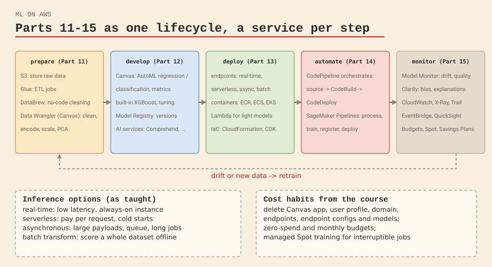

# Model Development on AWS: Boosting Internals and SageMaker Canvas

> **How to read this note.** Study guide for *Machine Learning A-Z*, Part 12 (section 46, 42 items, aimed at an AWS ML certification). Its first half re-teaches regression, classification and evaluation (covered in [regression-models](regression-models.md) and [classification-models](classification-models.md)) and then goes deep on gradient boosting — XGBoost, LightGBM, CatBoost — which this note makes runnable. The second half is console work: AutoML models in SageMaker Canvas, the Model Registry, and a tour of AWS's pre-trained AI services. Needs `numpy`, `scikit-learn`, `xgboost`.

## Why This Exists

**Problem.** Gradient-boosted trees win most tabular problems and are SageMaker's default suggestion, but "it's an ensemble of trees" doesn't explain the knobs (λ, learning rate, leaves, encoding of categories) or why a feature can look predictive in training and fail in production.

**Key insight.** Boosting adds small trees one at a time, each fitted to the current errors and chosen by a closed-form **gain** score; the libraries differ in how they make that search fast (LightGBM) and how they turn categories into numbers without leaking the target (CatBoost).

**Reach for this when:**
- Tuning or debugging XGBoost/LightGBM/CatBoost.
- Encoding high-cardinality categorical features.
- Building a first model in SageMaker Canvas, or studying for the AWS ML exam.

**Don't reach for this when:**
- Images, audio or text — deep learning or the pre-trained AI services fit better.
- You need hand-written training code on SageMaker — see the SageMaker Python SDK docs.

## Diagrams



## 1. Boosting, in the course's order

**Bagging vs boosting.** Bagging (random forests) trains models independently on bootstrap samples and **averages** them. Boosting trains them **in sequence**, each correcting the previous ones, and **sums** them. Each tree's contribution is multiplied by a **learning rate** (e.g. 0.1): learning is slower but overfits less.

**XGBoost for regression.** Start from a constant prediction; compute residuals. For a candidate leaf holding residuals $r_i$, the **similarity score** is $(\sum r_i)^2 / (n + \lambda)$ — large when the residuals agree in sign. A split's **gain** is left similarity + right similarity − parent similarity; try every threshold and keep the largest gain. λ shrinks scores of small leaves (regularisation); a split is pruned if its gain is below γ. The leaf's output is $\sum r_i / (n + \lambda)$.

```python
import json, numpy as np, xgboost as xgb
x = np.array([5, 12, 18, 25, 33, 40, 47, 55], dtype=float)   # e.g. dosage -> effect
y = np.array([-10, -7, 6, 8, 7, 12, -8, -11], dtype=float)
res = y - 0.0                                              # residuals from the initial prediction 0
sim = lambda r, lam=0.0: r.sum() ** 2 / (len(r) + lam)     # similarity score of a leaf (λ = regularisation)
root = sim(res)
best = max(((sim(res[x < t]) + sim(res[x >= t]) - root, t) for t in (x[:-1] + x[1:]) / 2))
print(f"root similarity {root:.1f}; best split x < {best[1]} with gain {best[0]:.1f}")
m = xgb.XGBRegressor(n_estimators=1, max_depth=1, learning_rate=1.0, reg_lambda=0.0, base_score=0.0,
                     min_child_weight=0, tree_method="exact").fit(x.reshape(-1, 1), y)
tree = json.loads(m.get_booster().get_dump(with_stats=True, dump_format="json")[0])
print("xgboost's first split:", tree["split"], "<", tree["split_condition"], " gain", round(tree["gain"], 1))
# Expected output:
# root similarity 1.1; best split x < 43.5 with gain 222.0
# xgboost's first split: f0 < 43.5  gain 222.0
```

The hand computation and XGBoost's own first split agree exactly — the gain formula *is* the algorithm (for squared error, each point's hessian is 1, so $n$ in the denominator is the sum of hessians). The course's toy example: gain 43 + 123 − 16 = 150.

**XGBoost for classification.** The course starts every point at probability 0.5. The library doesn't by default: since XGBoost 2.0 it estimates `base_score` from the labels (on xgboost 3.4.1, breast-cancer data gives 0.6274, the positive-class rate), so set `base_score=0.5` if you want to match a hand computation. Residuals are $y - p$; the similarity score's denominator becomes $\sum p(1 - p) + \lambda$ (the hessians of the log-loss), and leaf outputs are in **log-odds**, added up across trees and converted back with the sigmoid (the course: $0 + 2 + 1.51 = 3.51$ log-odds → probability 0.97). Points in the same leaf can end with different probabilities because their starting probabilities differed.

## 2. LightGBM: making the search fast

- **Histogram splits** — bin each feature (ages 20–100 into 5-year bins) and only try bin edges: far fewer candidates, slightly less precision.
- **Exclusive feature bundling** — sparse columns that are rarely non-zero together (cash, credit, debit, gift-card amounts) are merged into one column by offsetting their ranges, so fewer features are scanned.
- **Gradient-based one-side sampling (GOSS)** — keep the rows with the largest gradients (the course: top 20%) and a random sample of the rest (10%), reweighting the sampled ones; the rows the model already fits well contribute little.
- **Leaf-wise growth** — split the single leaf with the best gain anywhere in the tree instead of growing level by level; deeper, more accurate trees, so limit `num_leaves` (default 31), depth and minimum data per leaf.

## 3. CatBoost: categories without leakage

One-hot encoding a 100-category feature makes 99 sparse columns, hides the feature's overall importance and prevents grouping categories. **Target encoding** replaces each category with the mean target for that category (optionally blended with the global mean, weight $w$, to tame rare categories) — but each row's *own* target is inside its encoding, so the model learns from the answer:

```python
import numpy as np
from sklearn.tree import DecisionTreeClassifier
rng = np.random.default_rng(0)
n, cats = 4000, 1500                                       # a high-cardinality feature (e.g. user id) with NO real signal
c = rng.integers(0, cats, n); y = (rng.random(n) < 0.3).astype(int)
tr, te = np.arange(n) < 3000, np.arange(n) >= 3000
prior, w = y[tr].mean(), 1.0
def naive(c_fit, y_fit, c_apply):                          # mean target per category, own row included
    s, k = np.bincount(c_fit, y_fit, cats), np.bincount(c_fit, minlength=cats)
    return np.where(k[c_apply] > 0, s[c_apply] / np.maximum(k[c_apply], 1), prior)
def ordered(c_fit, y_fit):                                 # CatBoost-style: only rows BEFORE this one count
    s, k, out = np.zeros(cats), np.zeros(cats), np.empty(len(c_fit))
    for i, (ci, yi) in enumerate(zip(c_fit, y_fit)):
        out[i] = (s[ci] + w * prior) / (k[ci] + w); s[ci] += yi; k[ci] += 1
    return out
for name, enc_tr in (("naive target encoding", naive(c[tr], y[tr], c[tr])), ("ordered target encoding", ordered(c[tr], y[tr]))):
    enc_te = naive(c[tr], y[tr], c[te])                    # test rows always use training statistics
    clf = DecisionTreeClassifier(max_depth=3, random_state=0).fit(enc_tr.reshape(-1, 1), y[tr])
    print(f"{name:24s} train acc {clf.score(enc_tr.reshape(-1, 1), y[tr]):.3f}   test acc {clf.score(enc_te.reshape(-1, 1), y[te]):.3f}")
print(f"{'always predict 0':24s} test acc {(y[te] == 0).mean():.3f}")
# Expected output:
# naive target encoding    train acc 0.795   test acc 0.648
# ordered target encoding  train acc 0.702   test acc 0.718
# always predict 0         test acc 0.718
```

The category here is pure noise, yet naive encoding scores 0.80 on training rows and *below* the always-0 baseline on test rows (0.648 vs 0.718): with ~2 rows per category, a row's encoding is mostly its own label. **Ordered target encoding** (CatBoost) shuffles or time-orders the rows and encodes each one using only the rows *before* it, plus a prior: (sum of earlier targets in the category + prior) / (count + 1). It learns nothing from the noise feature and lands on the baseline, as it should. The course's example with prior 100: the first row of any category gets 100; the second Germany row, after one earlier target of 31, gets 131 / 2 = 65.5; the first France row after an earlier 200 gets 150. K-fold target encoding (encode each fold from the others) is the middle ground.

**Symmetric trees.** CatBoost uses the same split at every node of a level, so a row's path is a bit vector that indexes the leaf directly — very fast prediction and weak, regularised individual trees.

## 4. Tuning

Hyperparameters are fixed before training (learning rate, depth, λ, number of trees). **Grid search** tries every combination; **random search** samples combinations and covers wide spaces better for the same budget; **Bayesian optimisation** (SageMaker automatic model tuning's default) uses past results to pick the next promising setting. The bias–variance picture is in [model-selection-boosting](model-selection-boosting.md) §2.

## 5. SageMaker Canvas, the registry and AI services

**Canvas** (no-code AutoML) needs a SageMaker domain and user profile. The course imports two datasets and builds:

| Model | Data | Course results |
|---|---|---|
| Regression | power plant, target PE (electrical output) | R² 0.970, RMSE 2.943, MAE 2.099; one prediction 448.97 |
| 2-category classification | breast cancer (benign/malignant) | accuracy 93.4%, precision 0.898, recall 0.917, F1 0.907, AUC 0.973 |

Canvas shows the candidate algorithms it tried and per-feature impact. **Model Registry** stores model versions in **model groups** (the course: `canvas-Regression-Model`) with approval status, which deployment pipelines then pick up ([aws-ml-deployment-mlops](aws-ml-deployment-mlops.md)). Delete the Canvas app, user profile and domain afterwards (the course deletes the domain one lecture before it needs it for the registry — do the registry first).

**Pre-trained AI services** (no training needed): **Comprehend** (sentiment, entities — the course scores two restaurant reviews), **Rekognition** (labels in images), **Polly** (text to speech), **Transcribe** (speech to text), **Textract** (text and tables from documents), **Translate**. Some services in the console's ML list have since been closed to new customers; check the current list.

## Trade-offs

- **XGBoost vs LightGBM vs CatBoost.** Mature, exact or histogram splits vs fastest on large data vs best native categorical handling, robust defaults.
- **One-hot vs target encoding.** Leak-free, sparse vs compact, needs ordered or K-fold encoding to avoid leakage.
- **Canvas vs code.** Fast AutoML for analysts vs control, reproducibility, cost visibility.
- **Pre-trained AI services vs custom models.** Zero training vs less control over domain-specific accuracy.

## Common Pitfalls

- **Naive target encoding.** Leaks the label; use ordered (CatBoost) or out-of-fold encoding.
- **Large learning rate with few trees.** Overfits quickly; lower the rate and add trees (with early stopping).
- **Unlimited leaves in LightGBM.** Leaf-wise growth overfits small data; cap `num_leaves`.
- **Comparing Canvas metrics with your own CV.** Different splits and metrics; recompute on the same holdout.
- **Forgetting the domain.** Canvas and domains bill until deleted.

## Decision Table

| Scenario | Use this | Not that | Why |
|----------|----------|----------|-----|
| Tabular data, mostly numeric | XGBoost / LightGBM | Single tree | Accuracy |
| Many high-cardinality categories | CatBoost (ordered encoding) | Naive target encoding | No leakage |
| Millions of rows | LightGBM (histograms, GOSS) | Exact-split XGBoost | Speed |
| Analysts need a baseline model | SageMaker Canvas | Custom training code | No code |
| Standard text/image/speech task | Comprehend / Rekognition / Transcribe | Training from scratch | Pre-trained |

## References

- [Chen & Guestrin — XGBoost (2016)](https://arxiv.org/abs/1603.02754) · [XGBoost — introduction to boosted trees](https://xgboost.readthedocs.io/en/stable/tutorials/model.html)
- [Ke et al. — LightGBM (2017)](https://papers.nips.cc/paper/2017/hash/6449f44a102fde848669bdd9eb6b76fa-Abstract.html) · [Prokhorenkova et al. — CatBoost (2017)](https://arxiv.org/abs/1706.09516)
- [SageMaker Canvas](https://docs.aws.amazon.com/sagemaker/latest/dg/canvas.html) · [Model Registry](https://docs.aws.amazon.com/sagemaker/latest/dg/model-registry.html) · [Automatic model tuning](https://docs.aws.amazon.com/sagemaker/latest/dg/automatic-model-tuning.html)

## See Also

- [model-selection-boosting](model-selection-boosting.md) — Part 10: cross-validation, grid search, XGBoost in code.
- [aws-ml-data-preparation](aws-ml-data-preparation.md) — Part 11.
- [aws-ml-deployment-mlops](aws-ml-deployment-mlops.md) — Parts 13–15.
- [behavioral-embeddings](../ml-systems/behavioral-embeddings.md) — another answer to high-cardinality IDs.
