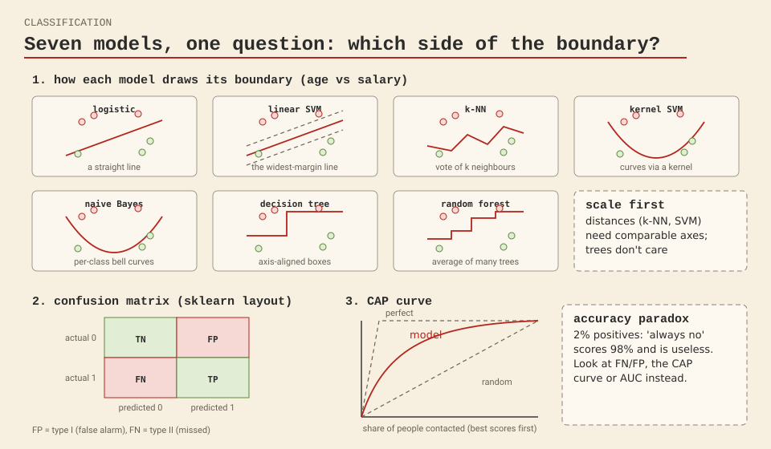

# Classification Models: From Logistic Regression to Random Forests

> **How to read this note.** Study guide for *Machine Learning A-Z*, Part 3 (sections 15–24): seven classifiers, each with an intuition lecture and Python and R builds on `Social_Network_Ads.csv` (400 customers: age, estimated salary, bought after an ad or not; 300 train / 100 test, both features scaled), then a model-selection exercise on a breast-cancer dataset and a section on evaluating classifiers. The snippets use a synthetic stand-in of the same shape; R appears as notes. The section quizzes aren't included. Logistic regression's maths is derived in [artificial-neural-networks](../deep-learning/artificial-neural-networks.md) §5.3; this note compares models.

## Why This Exists

**Problem.** There are dozens of classifiers, each with its own vocabulary — margins, kernels, priors, entropy, bagging — and a test accuracy that can look excellent while the model is useless.

**Key insight.** Every classifier draws a **decision boundary** in feature space; they differ only in the boundary's shape and how it's learned. Pick by the shape your data needs, compare against a trivial baseline, and judge with the right metric — not raw accuracy.

**Reach for this when:**
- Predicting a yes/no or category from tabular features.
- Choosing between "classic" models before trying gradient boosting or a neural network.
- A model's accuracy looks great on rare-event data.

**Don't reach for this when:**
- Predicting a number — see [regression-models](regression-models.md).
- Images, text or audio — deep learning ([convolutional-neural-networks](../deep-learning/convolutional-neural-networks.md)).
- You want the strongest tabular model — try gradient boosting ([model-selection-boosting](model-selection-boosting.md)).

## Diagrams



## 1. The models, one intuition each

- **Logistic regression** fits an S-shaped probability curve $p = 1/(1 + e^{-(b_0 + b_1 x_1 + \dots)})$ and predicts "yes" above 50%. The course's example: a 35-year-old has a 42% chance of buying, a 45-year-old 81%. It's fitted by **maximum likelihood**: choose the curve that makes the observed outcomes most probable (multiply each point's predicted probability of what actually happened). Boundary: a straight line.
- **k-nearest neighbours** stores the training set; a new point gets the majority label of its k nearest neighbours (the course: k = 5, Euclidean distance). No training, slow predictions, needs scaling.
- **Linear SVM** picks, among all separating lines, the one with the **widest margin** to the nearest points of each class — the **support vectors**, which alone determine it. The course's angle: it learns from the borderline cases (the apple that looks like an orange), not the typical ones.
- **Kernel SVM.** Points that no line separates can become separable in a higher dimension — e.g. 1-D points mapped by $x \mapsto (x - 5)^2$. Computing that mapping is expensive; the **kernel trick** computes similarities as if mapped. The **RBF kernel** $K(x, l) = \exp(-\lVert x - l \rVert^2 / 2\sigma^2)$ is a bump around each landmark; larger σ means wider bumps and smoother boundaries. scikit-learn's `gamma` is $1/(2\sigma^2)$ — larger gamma means *narrower* bumps. Sigmoid and polynomial kernels are alternatives.
- **Naive Bayes** applies Bayes' theorem per class and picks the most probable class. "Naive" because it assumes the features are independent *given the class* — rarely true, often good enough. See §3 for the theorem worked out.
- **Decision tree** splits the feature space with yes/no questions on one feature at a time (age < 44.5? salary < 90k?), chosen to make the groups purer (entropy or Gini); leaves vote. Easy to read, easy to overfit.
- **Random forest** averages many trees, each grown on a bootstrap sample of the rows and considering a random subset of features at each split — the randomness makes their errors partly cancel. (The course's explanation skips the bootstrap and feature subsampling, which are what make it work.)

## 2. All seven on one dataset

```python
import numpy as np
from sklearn.model_selection import train_test_split
from sklearn.preprocessing import StandardScaler
from sklearn.pipeline import make_pipeline
from sklearn.linear_model import LogisticRegression
from sklearn.neighbors import KNeighborsClassifier
from sklearn.svm import SVC
from sklearn.naive_bayes import GaussianNB
from sklearn.tree import DecisionTreeClassifier
from sklearn.ensemble import RandomForestClassifier
rng = np.random.default_rng(0)                            # 400 customers: age, salary -> bought after an ad?
age, sal = rng.uniform(18, 60, 400), rng.uniform(15e3, 150e3, 400)
p = 1 / (1 + np.exp(-(0.25 * (age - 45) + 4 * (sal > 95e3) + 1.5 * (age > 50))))   # older OR well-paid buyers
X, y = np.c_[age, sal], (rng.random(400) < p).astype(int)
Xtr, Xte, ytr, yte = train_test_split(X, y, test_size=0.25, random_state=0)   # 300 train / 100 test
models = {"logistic regression": LogisticRegression(), "k-NN (k=5)": KNeighborsClassifier(5),
          "linear SVM": SVC(kernel="linear"), "RBF kernel SVM": SVC(kernel="rbf"), "naive Bayes": GaussianNB(),
          "decision tree": DecisionTreeClassifier(criterion="entropy", random_state=0),
          "random forest (10 trees)": RandomForestClassifier(10, criterion="entropy", random_state=0)}
print(f"{'always predict majority':25s} {max(yte.mean(), 1 - yte.mean()):.2f}")
for name, m in models.items():
    acc = make_pipeline(StandardScaler(), m).fit(Xtr, ytr).score(Xte, yte)   # scaling inside the pipeline
    print(f"{name:25s} {acc:.2f}")
# Expected output:
# always predict majority   0.55
# logistic regression       0.84
# k-NN (k=5)                0.86
# linear SVM                0.83
# RBF kernel SVM            0.85
# naive Bayes               0.81
# decision tree             0.84
# random forest (10 trees)  0.84
```

All beat the majority baseline (55%) by about 30 points and sit within a few points of each other; on 100 test rows that spread is mostly noise (a single split moves accuracy by ±4 points). The course's Python results on its data: logistic regression 0.89, k-NN 0.93, linear SVM 0.90, kernel SVM 0.93, naive Bayes 0.90, decision tree 0.91, random forest 0.91 (also with 100 trees). In R (`glm`, `class::knn`, `e1071::svm`, `e1071::naiveBayes`, `rpart`, `randomForest`): 17, 11, 20, 10, 14, 17 and 15–17 test errors. R needs the target as a `factor` for the classifiers (naive Bayes returns nothing otherwise) and `type = "class"` when predicting with `rpart`.

The course then runs all of them on a breast-cancer dataset (benign vs malignant): logistic 0.947, k-NN 0.947, SVM 0.94, kernel SVM 0.953, naive Bayes 0.94, decision tree 0.96 — and its feature matrix still includes the sample-ID column, which carries no medical information.

## 3. Bayes' theorem on the course's wrench example

Machine 1 makes 30 wrenches an hour, machine 2 makes 20; 1% of all wrenches are defective and half of the defective ones come from machine 2. What fraction of machine 2's wrenches are defective?

$$P(\text{def} \mid m_2) = \frac{P(m_2 \mid \text{def})\, P(\text{def})}{P(m_2)} = \frac{0.5 \times 0.01}{0.4} = 1.25\%.$$

```python
import numpy as np
rng = np.random.default_rng(0)
# Two machines make wrenches: m1 30/hour, m2 20/hour. 1% of all wrenches are defective; half the defects come from m2.
p_m2, p_def, p_m2_given_def = 20 / 50, 0.01, 0.5
print("Bayes: P(defect | m2) =", p_m2_given_def * p_def / p_m2)        # P(m2|def) P(def) / P(m2)
n = 1_000_000                                                            # check by simulating a factory
m2 = rng.random(n) < p_m2
defect = np.where(m2, rng.random(n) < 0.0125, rng.random(n) < 0.005 / 0.6)
print("simulated share of m2 wrenches that are defective:", round(defect[m2].mean(), 4))
print("simulated share of defects from m2:", round(m2[defect].mean(), 3))
# Expected output:
# Bayes: P(defect | m2) = 0.012499999999999999
# simulated share of m2 wrenches that are defective: 0.0125
# simulated share of defects from m2: 0.504
```

Naive Bayes does the same with features as evidence: $P(\text{class} \mid x) \propto P(x \mid \text{class})\,P(\text{class})$, comparing classes so the denominator $P(x)$ cancels. (The course says Bayes' theorem needs independent features — only the *naive* classifier does.)

## 4. Evaluating classifiers

**Confusion matrix.** scikit-learn puts actual classes in rows and predictions in columns: `[[TN, FP], [FN, TP]]`. A **false positive** (type I error) is a false alarm; a **false negative** (type II) is a miss. Which costs more depends on the problem (spam filter vs cancer screen).

**The accuracy paradox.** On rare events, a model can lose to "always say no":

```python
import numpy as np
from sklearn.metrics import confusion_matrix, roc_auc_score
rng = np.random.default_rng(0)
y = (rng.random(10_000) < 0.02).astype(int)                       # rare event: 2% positives (fraud, churn, disease)
score = np.where(y == 1, rng.normal(1.0, 1, y.size), rng.normal(-1.0, 1, y.size))   # a decent model's scores
pred = (score > 1.5).astype(int)
tn, fp, fn, tp = confusion_matrix(y, pred).ravel()               # sklearn: rows = actual, columns = predicted
print(f"model:        accuracy {(pred == y).mean():.3f}   TP {tp} FP {fp} FN {fn} TN {tn}")
print(f"always 'no':  accuracy {(y == 0).mean():.3f}   catches 0 of {y.sum()} positives")
order = np.argsort(-score); captured = np.cumsum(y[order]) / y.sum()   # CAP curve: contact the top-scored first
print(f"contacting the top 10% captures {captured[999]:.0%} of positives (random: 10%)")
ar = (captured.mean() - 0.5) / ((1 - y.mean() / 2) - 0.5)        # accuracy ratio = area to random / perfect area to random
print(f"accuracy ratio {ar:.2f}   AUC {roc_auc_score(y, score):.2f}  (AR = 2·AUC − 1 = {2 * roc_auc_score(y, score) - 1:.2f})")
# Expected output:
# model:        accuracy 0.979   TP 59 FP 79 FN 131 TN 9731
# always 'no':  accuracy 0.981   catches 0 of 190 positives
# contacting the top 10% captures 76% of positives (random: 10%)
# accuracy ratio 0.84   AUC 0.92  (AR = 2·AUC − 1 = 0.84)
```

The model's accuracy (97.9%) is *below* the useless constant (98.1%), yet it ranks people well: contacting its top 10% reaches 76% of all positives. The **CAP curve** (cumulative accuracy profile) plots exactly that — share of positives captured vs share of people contacted, best scores first — between the random diagonal and the perfect curve. The **accuracy ratio** compares the model's area above random with the perfect model's; it equals 2·AUC − 1. The course's rule of thumb: read the curve at 50% contacted — above 90% captured is suspiciously good (check for leakage), 80–90% very good, 70–80% good, 60–70% poor, below 60% rubbish — and the decision tree's 91% vs 90% and similar spoken numbers in the course disagree within lectures, so treat them as approximate.

## 5. Course extras (articles)

- **Conclusion of Part 3 — which model when:** decide whether the problem is linear (logistic regression, SVM) or non-linear (k-NN, naive Bayes, tree, forest), then compare with k-fold CV. For business use: logistic regression (linear) or naive Bayes (non-linear) to **rank** customers by probability for targeting; SVM to assign customers to segments; a decision tree when the decisions must be explained; a random forest for raw performance. Improve any model by tuning its hyperparameters (Part 10).
- **Extras:** a free breast-cancer logistic-regression case study, an "Ultimate Guide to Regression and Classification", colour-blind-friendly versions of the result plots, and an R note on installing `ElemStatLearn` (used for the decision-boundary plots; it has since been archived on CRAN, so install it from the archive tarball as the article describes).

## Trade-offs

- **Linear vs flexible boundaries.** Interpretable, stable vs captures curves but overfits small data.
- **k-NN.** No training vs slow, memory-hungry prediction and sensitivity to scaling and irrelevant features.
- **Kernel SVM.** Strong on small/medium data vs slow on large sets, needs tuning of C and gamma.
- **Naive Bayes.** Very fast, works with little data vs poorly calibrated probabilities when features are correlated.
- **Tree vs forest.** Readable rules vs accuracy and stability.

## Common Pitfalls

- **Reporting accuracy on imbalanced data.** Compare with the majority baseline; use the confusion matrix, precision/recall, CAP or AUC.
- **Reading the confusion matrix the wrong way round.** In scikit-learn rows are actual, columns predicted.
- **Forgetting to scale for k-NN and SVM.** Salary would dominate age.
- **Picking a model on one small test split.** Differences of a few points are noise; use cross-validation ([model-selection-boosting](model-selection-boosting.md)).
- **ID columns as features.** They can only add noise or leakage.
- **Confusing σ and gamma.** In scikit-learn, raising `gamma` makes RBF boundaries *wigglier*.

## Decision Table

| Scenario | Use this | Not that | Why |
|----------|----------|----------|-----|
| Need explanations, roughly linear boundary | Logistic regression | Kernel SVM | Coefficients, probabilities |
| Curved boundary, small/medium data | RBF kernel SVM or random forest | Linear models | Shape of the boundary |
| Many text-like features, tiny data | Naive Bayes | k-NN | Fast, robust with few rows |
| Human-readable rules | Shallow decision tree | Forest | Inspectable |
| Strongest tabular baseline | Random forest, then gradient boosting | Single tree | Averaging reduces variance |
| Rare positives | CAP/AUC, precision/recall | Accuracy | Accuracy paradox |

## References

- [scikit-learn — Supervised learning user guide](https://scikit-learn.org/stable/supervised_learning.html) · [SVM kernels and gamma](https://scikit-learn.org/stable/modules/svm.html) · [Model evaluation](https://scikit-learn.org/stable/modules/model_evaluation.html)
- [Breiman — Random Forests (2001)](https://link.springer.com/article/10.1023/A:1010933404324)
- [Cortes & Vapnik — Support-Vector Networks (1995)](https://link.springer.com/article/10.1007/BF00994018)
- [Hastie, Tibshirani & Friedman — The Elements of Statistical Learning](https://hastie.su.domains/ElemStatLearn/)

## See Also

- [regression-models](regression-models.md) — Part 2: the same model families predicting numbers.
- [data-preprocessing](data-preprocessing.md) — scaling and splitting these models rely on.
- [model-selection-boosting](model-selection-boosting.md) — cross-validation, grid search and XGBoost.
- [artificial-neural-networks](../deep-learning/artificial-neural-networks.md) §5.3 — logistic regression derived.
