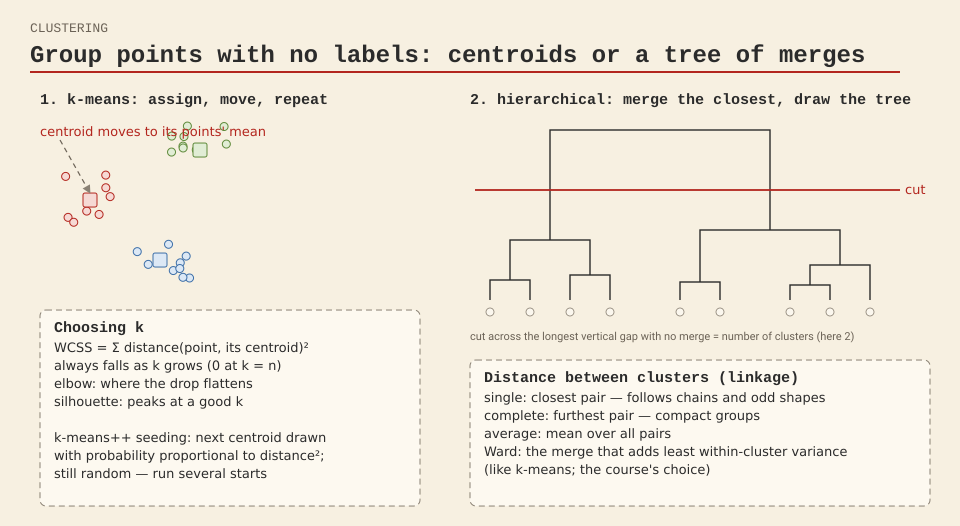

# Clustering: k-Means and Hierarchical

> **How to read this note.** Study guide for *Machine Learning A-Z*, Part 4 (sections 25–27): k-means (intuition, elbow method, k-means++) and hierarchical clustering (agglomerative steps, linkage, dendrograms), each built in Python and R on `Mall_Customers.csv` — 200 shoppers, clustered on annual income and spending score. The snippets use a stand-in with five planted groups. The k-means basics also appear in [self-organizing-maps](../deep-learning/self-organizing-maps.md) §1 (Deep Learning A-Z covers them too); this note adds the elbow-vs-silhouette check and hierarchical clustering. The quizzes aren't included.

## Why This Exists

**Problem.** You have customers but no labels — no one has told you which "types" exist. You want groups that are similar inside and different from each other, and you need to decide how many groups there are without a right answer to check against.

**Key insight.** Clustering *creates* a label. k-means does it by moving k centres until each point belongs to the nearest one; hierarchical clustering does it by repeatedly merging the two closest groups and letting you cut the resulting tree at the height you like. Both depend completely on what "close" means — so scaling and the distance definition are the real decisions.

**Reach for this when:**
- Segmenting customers, products or documents without predefined categories.
- Exploring structure before building a supervised model.
- You need a small number of interpretable groups for a business decision.

**Don't reach for this when:**
- You have labels — use a classifier ([classification-models](classification-models.md)).
- Clusters have odd shapes or varying density and you can't pick k — consider DBSCAN/HDBSCAN.
- You need recommendations of "items bought together" — that's [association-rules](association-rules.md).

## Diagrams



## 1. k-means and how many clusters

The algorithm: choose k; place k centroids (k-means++ spreads them out — each next one is drawn with probability proportional to its squared distance from those already chosen); assign every point to its nearest centroid; move each centroid to the mean of its points; repeat until assignments stop changing.

**Choosing k.** **WCSS** (within-cluster sum of squares, `inertia_`) always falls as k grows — to 0 when every point is its own cluster — so look for the **elbow** where it stops falling steeply. The **silhouette score** (how much closer each point is to its own cluster than to the next one, from −1 to 1) gives a second opinion with a clear peak:

```python
import numpy as np
from sklearn.cluster import KMeans
from sklearn.metrics import silhouette_score
rng = np.random.default_rng(0)                            # mall customers: annual income (k$), spending score (1-100)
centres = [(25, 20), (25, 80), (55, 50), (88, 18), (88, 82)]
X = np.vstack([rng.normal(c, (7, 8), size=(40, 2)) for c in centres])
for k in range(1, 9):
    km = KMeans(k, init="k-means++", n_init=10, random_state=42).fit(X)   # n_init: best of 10 starts
    sil = silhouette_score(X, km.labels_) if k > 1 else float("nan")       # -1..1: how well points sit in their cluster
    print(f"k={k}  WCSS {km.inertia_:9.0f}   silhouette {sil:.2f}")
# Expected output:
# k=1  WCSS    333706   silhouette nan
# k=2  WCSS    191687   silhouette 0.41
# k=3  WCSS    114040   silhouette 0.51
# k=4  WCSS     52229   silhouette 0.62
# k=5  WCSS     21981   silhouette 0.68
# k=6  WCSS     19695   silhouette 0.61
# k=7  WCSS     18055   silhouette 0.55
# k=8  WCSS     16499   silhouette 0.46
```

The WCSS drop flattens after k = 5 and the silhouette peaks there. On the course's mall data the elbow also gives 5, read as: low income/low spending, low/high ("careless"), middle, high/low ("careful"), high/high (the main targets). The course's Python call is `KMeans(n_clusters=i, init="k-means++", random_state=42)`; in R, `kmeans(X, 5, iter.max = 300, nstart = 10)` and `cluster::clusplot` for the picture (its axes are principal components, not income and score).

**The initialisation trap.** Different starting centroids can converge to different — and worse — clusterings. k-means++ makes a bad start less likely, not impossible, and doesn't make results deterministic (the course claims both); fix `random_state` and run several starts (`n_init`, R's `nstart`), keeping the lowest WCSS. scikit-learn's `n_init` default changed to `"auto"` (one run with k-means++), so older code can behave differently.

## 2. Hierarchical clustering

**Agglomerative steps:** start with every point as its own cluster; merge the two closest clusters; repeat until one remains. The record of merges is the **dendrogram** — each merge drawn at a height equal to how far apart the merged clusters were. "How far apart" for groups (the **linkage**): closest pair (single), furthest pair (complete), average over pairs, distance between centroids — or Ward's method, which merges the pair that increases within-cluster variance least (the course uses Ward).

**Cutting the tree:** draw a horizontal line through the longest vertical stretch that no merge crosses; the number of vertical lines it cuts is the number of clusters.

```python
import numpy as np
from scipy.cluster.hierarchy import linkage, fcluster      # agglomerative clustering + cutting the tree
from sklearn.cluster import KMeans
from sklearn.metrics import adjusted_rand_score
rng = np.random.default_rng(0)
centres = [(25, 20), (25, 80), (55, 50), (88, 18), (88, 82)]
X = np.vstack([rng.normal(c, (7, 8), size=(40, 2)) for c in centres])
Z = linkage(X, method="ward")                             # each row: the two clusters merged and the merge height
h = Z[::-1, 2]                                            # merge heights from the top of the dendrogram down
print("top merge heights:", h[:6].round(0))
gaps = h[:-1] - h[1:]                                     # cutting between merge i and i+1 leaves i+2 clusters
print("biggest vertical gap -> clusters:", int(np.argmax(gaps)) + 2)
hc = fcluster(Z, t=5, criterion="maxclust")               # cut the tree into 5 clusters
km = KMeans(5, n_init=10, random_state=42).fit_predict(X)
print("agreement with k-means (adjusted Rand, 1 = identical):", round(adjusted_rand_score(hc, km), 3))
# Expected output:
# top merge heights: [527. 402. 347. 254.  62.  58.]
# biggest vertical gap -> clusters: 5
# agreement with k-means (adjusted Rand, 1 = identical): 1.0
```

The big jump between merge heights 254 and 62 says "five clusters", and cutting there gives exactly the k-means answer (adjusted Rand index 1.0). On the course's data the gap rule nearly tied between 3 and 5 clusters and 5 was chosen to match k-means. In Python: `scipy.cluster.hierarchy.dendrogram(linkage(X, "ward"))`, then `AgglomerativeClustering(5, linkage="ward")` (the course passes `affinity="euclidean"`, renamed `metric` in current scikit-learn). In R: `hclust(dist(X), method = "ward.D")` and `cutree(hc, 5)` — `ward.D2` is the one that implements Ward's criterion on Euclidean distances.

**Linkage changes the answer.** Two interleaved half-moons:

```python
import numpy as np
from sklearn.datasets import make_moons                   # two interleaved half-circles
from sklearn.cluster import AgglomerativeClustering, KMeans
from sklearn.metrics import adjusted_rand_score
X, y = make_moons(400, noise=0.05, random_state=0)
for link in ("single", "complete", "average", "ward"):    # closest pair, furthest pair, average pair, variance (Ward)
    lab = AgglomerativeClustering(2, linkage=link).fit_predict(X)
    print(f"{link:9s} linkage  ARI {adjusted_rand_score(y, lab):.2f}")
print(f"k-means           ARI {adjusted_rand_score(y, KMeans(2, n_init=10, random_state=0).fit_predict(X)):.2f}")
# Expected output:
# single    linkage  ARI 1.00
# complete  linkage  ARI 0.28
# average   linkage  ARI 0.24
# ward      linkage  ARI 0.25
# k-means           ARI 0.27
```

Only single linkage, which can follow a chain of nearby points, recovers the moons; Ward, average, complete and k-means all cut them with a straight-ish line. Compact blobs favour Ward and k-means; elongated shapes favour single linkage (which in turn is fragile with noise).

## Trade-offs

- **k-means vs hierarchical.** Fast, scales to millions of rows vs a full tree you can cut anywhere, but O(n²) memory and time.
- **Elbow vs silhouette.** Cheap and visual vs a clearer optimum, more computation.
- **Ward/complete vs single linkage.** Compact, balanced groups vs following arbitrary shapes, sensitive to noise bridges.
- **Few vs many clusters.** Actionable segments vs finer, harder-to-use detail.

## Common Pitfalls

- **Not scaling features.** Clustering on income in dollars and age in years groups by income alone ([data-preprocessing](data-preprocessing.md) §3).
- **Trusting one k-means run.** Run several starts and keep the best WCSS.
- **Reading the elbow as exact.** It's a judgment call; check silhouette and whether the clusters make business sense.
- **Plotting clusters on PCA axes but labelling them as raw features.** `clusplot` axes are components.
- **Using old scikit-learn arguments.** `affinity=` is gone (use `metric=`); `n_init` defaults changed.
- **Treating cluster labels as truth.** They're a summary of your distance choice, not discovered categories.

## Decision Table

| Scenario | Use this | Not that | Why |
|----------|----------|----------|-----|
| Many rows, roughly round groups | k-means (k-means++, n_init ≥ 10) | Hierarchical | Speed |
| Small data, want to explore k | Hierarchical + dendrogram | k-means alone | See all levels |
| Elongated or chained shapes | Single linkage / DBSCAN | k-means / Ward | Shape |
| Pick k | Elbow + silhouette + business sense | One criterion | Robustness |
| Mixed numeric and categorical features | k-prototypes / Gower distance | k-means on one-hot | Distances meaningless otherwise |

## References

- [scikit-learn — Clustering](https://scikit-learn.org/stable/modules/clustering.html) · [Silhouette analysis](https://scikit-learn.org/stable/auto_examples/cluster/plot_kmeans_silhouette_analysis.html)
- [SciPy — hierarchical clustering](https://docs.scipy.org/doc/scipy/reference/cluster.hierarchy.html)
- Arthur & Vassilvitskii — k-means++: the advantages of careful seeding, SODA 2007 · [Wikipedia — k-means++](https://en.wikipedia.org/wiki/K-means%2B%2B)
- [Murtagh & Legendre — Ward's hierarchical clustering: which algorithms implement Ward's criterion? (2014)](https://link.springer.com/article/10.1007/s00357-014-9161-z)

## See Also

- [self-organizing-maps](../deep-learning/self-organizing-maps.md) — k-means recap and SOMs.
- [association-rules](association-rules.md) — Part 5: the other unsupervised technique in the course.
- [dimensionality-reduction](dimensionality-reduction.md) — PCA, which `clusplot` uses for its axes.
