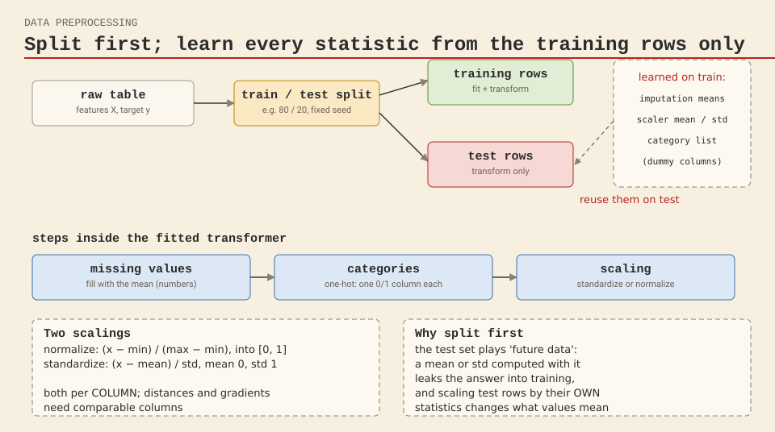

# Data Preprocessing: Split, Impute, Encode, Scale

> **How to read this note.** Study guide for *Machine Learning A-Z* (Kirill Eremenko, Hadelin de Ponteves), section 1 (welcome: course map, a five-minute car-purchase demo in Colab, a list of optional AWS workshops) and Part 1 (sections 2–4: preprocessing in Python and in R). The course's 10-row `Data.csv` (country, age, salary, purchased) is replaced here by a similar table of my own. R isn't run in this wiki, so R appears as a mapping table. The coding exercises and quiz in these sections aren't included. The same instructors cover scaling more briefly in [artificial-neural-networks](../deep-learning/artificial-neural-networks.md) §5.4–5.5.

## Why This Exists

**Problem.** Models need a numeric matrix with no gaps, on comparable scales, and an honest test set. Each step — filling gaps, turning categories into numbers, scaling — has a version that quietly leaks the test set into training or gives the model wrong inputs at prediction time.

**Key insight.** Treat every preprocessing step as a model with parameters (a mean, a standard deviation, a list of categories): **split first**, fit those parameters on the training rows, and reuse them unchanged on the test rows and on future data.

**Reach for this when:**
- Starting any tabular ML project.
- Test scores look better than production performance.
- A model trained in a notebook gives odd predictions on new rows.

**Don't reach for this when:**
- Using tree models only — they don't need scaling (imputation and encoding still matter).
- Working with images or text — see [convolutional-neural-networks](../deep-learning/convolutional-neural-networks.md) and [nlp-bag-of-words](nlp-bag-of-words.md).

## Diagrams



## 1. The workflow and the split

The course's three stages: **preprocess** (import, clean, split), **model** (build, train, predict), **evaluate** (metrics, decide). The split comes first because the test set stands in for the future: you hold out ~20% (the course's example: 4 of 20 cars), train on the rest, and compare predictions with the known answers. Put features in a matrix **X** and the target in a vector **y**; scikit-learn expects them separately.

## 2. Missing values and categories

**Missing values.** Drop rows only if very few are affected and you can spare them; otherwise fill each numeric gap with the column **mean** (or median, robust to outliers; or the most frequent value for categories).

**Categories.** Coding France/Spain/Germany as 0/1/2 tells the model Germany is "twice" Spain. **One-hot encoding** makes one 0/1 column per category. A yes/no target can simply become 1/0. scikit-learn orders categories alphabetically, so the column order isn't the order you see in the data — use `get_feature_names_out()`.

## 3. Feature scaling

**The question.** Three people: blue earns 70k and is 45, purple 60k and 44, red 52k and 40. Is purple more like blue or like red?

```python
import numpy as np
people = {"blue": [70_000, 45], "purple": [60_000, 44], "red": [52_000, 40]}   # income, age
X = np.array(list(people.values()), dtype=float)
def dists(Z):                                             # Euclidean distance from purple to blue and to red
    return [round(float(np.linalg.norm(Z[1] - Z[i])), 3) for i in (0, 2)]
norm = (X - X.min(0)) / (X.max(0) - X.min(0))             # min-max: each column to [0, 1]
std = (X - X.mean(0)) / X.std(0)                          # z-score: mean 0, std 1 per column
for name, Z in [("raw", X), ("normalized", norm), ("standardized", std)]:
    d = dists(Z); print(f"{name:12s} purple->blue {d[0]:>9}  purple->red {d[1]:>9}  closer: {'blue' if d[0] < d[1] else 'red'}")
print("purple's normalized income:", norm[1, 0].round(3))
# Expected output:
# raw          purple->blue   10000.0  purple->red  8000.001  closer: red
# normalized   purple->blue      0.59  purple->red     0.915  closer: blue
# standardized purple->blue     1.435  purple->red     2.147  closer: blue
# purple's normalized income: 0.444
```

On raw numbers the income gap (thousands) swamps the age gap (years), and purple looks like red. After scaling, each column counts on a comparable scale and purple is closer to blue — the course's example and answer. Two scalings, always **per column**:

- **Normalization** (min-max): $(x - \min) / (\max - \min)$, into [0, 1]. Sensitive to a single extreme value.
- **Standardization** (z-score): $(x - \bar x)/s$, mean 0, standard deviation 1; most values within ±3 for roughly bell-shaped data.

Distance-based models (k-NN, k-means, SVM) and gradient-trained ones (neural networks, regularised regression) need scaling; trees don't; ordinary least squares gives the same predictions either way. The course doesn't scale the one-hot columns (they're already 0/1 and stay readable) — a reasonable default, not a law.

## 4. Doing it without leakage

**Fit on training rows, transform both.** The course's Python code splits before scaling, fits the scaler on `X_train`, and only transforms `X_test`. (It fits the imputer and encoder on all rows before splitting — harmless on a 10-row demo, a leak in principle.) A pipeline makes the right order automatic:

```python
import numpy as np, pandas as pd
from sklearn.compose import ColumnTransformer
from sklearn.pipeline import make_pipeline
from sklearn.impute import SimpleImputer
from sklearn.preprocessing import OneHotEncoder, StandardScaler
from sklearn.model_selection import train_test_split
df = pd.DataFrame({"city": ["Lyon", "Porto", "Graz", "Porto", "Lyon", "Graz", "Porto", "Lyon", "Graz", "Lyon"],
                   "age": [44, 27, 30, 38, np.nan, 35, 48, 50, 37, 41],
                   "income": [72e3, 48e3, 54e3, 61e3, 58e3, np.nan, 52e3, 83e3, 67e3, 63e3],
                   "bought": ["no", "yes", "no", "no", "yes", "yes", "no", "yes", "no", "yes"]})
X, y = df.drop(columns="bought"), (df["bought"] == "yes").astype(int)
X_tr, X_te, y_tr, y_te = train_test_split(X, y, test_size=0.2, random_state=1)   # split FIRST
prep = ColumnTransformer([
    ("num", make_pipeline(SimpleImputer(strategy="mean"), StandardScaler()), ["age", "income"]),
    ("cat", OneHotEncoder(handle_unknown="ignore"), ["city"])])     # unseen city at test time -> all zeros
Z_tr = prep.fit_transform(X_tr)                                    # every statistic learned from training rows only
Z_te = prep.transform(X_te)
print(prep.get_feature_names_out())
print("imputed mean age (training rows only):", prep.named_transformers_["num"][0].statistics_[0].round(2))
print(np.round(Z_te, 2))
# Expected output:
# ['num__age' 'num__income' 'cat__city_Graz' 'cat__city_Lyon'
#  'cat__city_Porto']
# imputed mean age (training rows only): 39.86
# [[-1.42 -0.86  1.    0.    0.  ]
#  [ 0.16  0.    0.    1.    0.  ]]
```

The imputed mean (39.86) comes from the 8 training rows only, and `handle_unknown="ignore"` means a city never seen in training becomes all zeros instead of an error.

**Never re-scale new data by its own statistics.** The course's R code scales the test set with `scale(test_set)` — its own mean and standard deviation. That changes what the numbers mean:

```python
import numpy as np
from sklearn.linear_model import LogisticRegression
from sklearn.preprocessing import StandardScaler
rng = np.random.default_rng(0)
age = rng.uniform(20, 60, 300); income = rng.uniform(20e3, 150e3, 300)
y = (0.05 * (age - 40) + (income - 85e3) / 3e4 + rng.normal(0, 0.5, 300) > 0).astype(int)
X = np.c_[age, income]; Xtr, ytr, Xte, yte = X[:250], y[:250], X[250:], y[250:]
sc = StandardScaler().fit(Xtr); clf = LogisticRegression().fit(sc.transform(Xtr), ytr)
rich = Xte[Xte[:, 1] > 110e3]                                         # suppose the new batch is only high earners
print("correct: reuse training scaler   ->", clf.predict(sc.transform(rich)).mean().round(2), "predicted buyers")
print("wrong: re-scale the test batch   ->", clf.predict(StandardScaler().fit_transform(rich)).mean().round(2), "predicted buyers")
# Expected output:
# correct: reuse training scaler   -> 1.0 predicted buyers
# wrong: re-scale the test batch   -> 0.55 predicted buyers
```

A batch of high earners, correctly scaled with the training statistics, is all predicted to buy. Rescaled by their own mean, their incomes look "average" and only about half are. Real prediction batches are rarely representative; always reuse the training transformer.

## 5. Python ↔ R

| Step | Python (scikit-learn) | R (as in the course) |
|---|---|---|
| Load | `pd.read_csv`, `iloc[:, :-1]` | `read.csv` (1-based indexing) |
| Missing values | `SimpleImputer(strategy="mean")` | `ifelse(is.na(x), ave(x, FUN = function(v) mean(v, na.rm = TRUE)), x)` — `na.rm = TRUE` *removes* NAs before averaging |
| Categories | `ColumnTransformer` + `OneHotEncoder` | `factor(x, levels, labels)` — one column; models create dummies internally |
| Split | `train_test_split(test_size=0.2, random_state=1)` | `caTools::sample.split(y, SplitRatio = 0.8)` (ratio is the *training* share), `subset()` |
| Scale | `StandardScaler().fit(X_train)` | `scale()` on numeric columns only (factors cause "x must be numeric"); reuse the training `scaled:center` / `scaled:scale` for test data |

## 6. Course extras (articles)

- **Object-oriented programming in one paragraph:** a **class** is the blueprint (a house plan), an **object** is one thing built from it (a house), a **method** is an action on that object (open the door) — which is why the code says `imputer = SimpleImputer(...)` then `imputer.fit(...)`.
- **Getting started:** the code, datasets and slides come from the course's materials page; the Python lectures run in Google Colab (copy the shared notebook, upload the CSV). The first lecture trains a purchase-prediction logistic regression in five minutes as a teaser. An article lists optional AWS workshops (chatbots, SageMaker forecasting, recommenders, Bedrock RAG and agents), not part of the course text.

## Trade-offs

- **Drop vs impute.** No invented values vs keeps rows but shrinks variance (mean imputation); add a "was missing" flag when missingness itself is informative.
- **One-hot vs integer codes.** No fake order vs many columns for high-cardinality features (consider target or hashing encoders).
- **Normalize vs standardize.** Bounded range vs robustness to differing ranges; both are hurt by outliers (consider `RobustScaler`).

## Common Pitfalls

- **Preprocessing before the split.** Statistics computed with the test rows leak into training.
- **Scaling test or production data by its own statistics.** Reuse the fitted training transformer.
- **Integer-coding nominal categories.** Implies an order that isn't there (fine for tree models, wrong for linear ones).
- **Assuming the one-hot column order.** Check `get_feature_names_out()`.
- **Hard-coded column positions.** `X[:, 1:3]` breaks when a column is added; select by name in a `ColumnTransformer`.
- **Unseen categories at prediction time.** Set `handle_unknown="ignore"` or the pipeline crashes on a new value.

## Decision Table

| Scenario | Use this | Not that | Why |
|----------|----------|----------|-----|
| Any tabular project | `Pipeline` + `ColumnTransformer`, split first | Manual steps on the full table | No leakage, same steps in production |
| Few missing values, lots of data | Drop rows | Imputation | Simpler, no invented values |
| Nominal category | One-hot | Integer codes | No fake order |
| k-NN, SVM, k-means, neural nets | Standardize | Raw features | Distances and gradients need comparable scales |
| Trees, random forests, XGBoost | No scaling | Scaling | Splits don't care about scale |

## References

- [scikit-learn — Preprocessing data](https://scikit-learn.org/stable/modules/preprocessing.html) · [Imputation](https://scikit-learn.org/stable/modules/impute.html) · [ColumnTransformer](https://scikit-learn.org/stable/modules/generated/sklearn.compose.ColumnTransformer.html)
- [scikit-learn — Common pitfalls: data leakage](https://scikit-learn.org/stable/common_pitfalls.html)
- Course materials: superdatascience.com/pages/machine-learning (linked from the course's first article).

## See Also

- [regression-models](regression-models.md) — Part 2, using these steps.
- [artificial-neural-networks](../deep-learning/artificial-neural-networks.md) §5 — the same instructors' preprocessing and regression primer.
- [aws-ml-data-preparation](aws-ml-data-preparation.md) — Part 11: the same steps at scale with AWS Glue and SageMaker.
