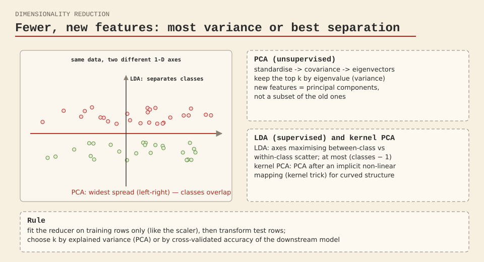

# Dimensionality Reduction: PCA, LDA and Kernel PCA

> **How to read this note.** Study guide for *Machine Learning A-Z*, Part 9 (sections 38–41): PCA and LDA on `Wine.csv` (178 wines, 13 chemical measurements, three customer segments — the UCI wine data, which ships with scikit-learn, so the snippets use the real thing), then kernel PCA on `Social_Network_Ads`, each in Python and R. The linear algebra (eigenvectors, covariance) is in [linear-algebra](../math-for-ml/linear-algebra.md). The quizzes aren't included.

## Why This Exists

**Problem.** Thirteen features can't be plotted, often carry overlapping information, and slow or destabilise some models. Dropping columns by hand throws away information you might need.

**Key insight.** Build a few **new** features — combinations of all the old ones — that keep what matters: the directions of greatest **variance** (PCA, no labels needed) or the directions that best **separate the classes** (LDA, uses labels). Kernel PCA does the PCA idea after an implicit non-linear mapping.

**Reach for this when:**
- Visualising high-dimensional data in 2-D.
- Many correlated features, or more features than you'd like for a small dataset.
- Compressing or denoising inputs before a simple model.

**Don't reach for this when:**
- You need to explain predictions in terms of the original features — components mix them all.
- You have a strong non-linear model with enough data — it may do better on the raw features.
- Features are already few and informative.

## Diagrams



## 1. PCA by hand

**Feature selection** keeps some original columns (backward elimination in [regression-models](regression-models.md) §2); **feature extraction** builds new ones. PCA's recipe: standardise; compute the covariance matrix; find its eigenvectors and eigenvalues; sort by eigenvalue (the variance along each eigenvector); project onto the top k.

```python
import numpy as np
from sklearn.datasets import load_wine                    # 178 wines, 13 chemical measurements, 3 cultivars
from sklearn.preprocessing import StandardScaler
from sklearn.decomposition import PCA
X = StandardScaler().fit_transform(load_wine().data)       # step 1: standardise
vals, vecs = np.linalg.eigh(np.cov(X.T))                   # step 2: eigen-decompose the covariance (eigh: symmetric)
order = np.argsort(vals)[::-1]; vals, vecs = vals[order], vecs[:, order]   # step 3: sort, largest variance first
Z = X @ vecs[:, :2]                                        # steps 4-5: project onto the top 2 eigenvectors
print("variance explained by PC1, PC2 (by hand):", (vals[:2] / vals.sum()).round(3))
pca = PCA(2).fit(X)
print("sklearn PCA:                            ", pca.explained_variance_ratio_.round(3))
print("same projection up to sign:", np.allclose(np.abs(Z), np.abs(pca.transform(X))))
print("components for 90% of variance:", int(np.searchsorted(np.cumsum(vals) / vals.sum(), 0.9) + 1), "of 13")
# Expected output:
# variance explained by PC1, PC2 (by hand): [0.362 0.192]
# sklearn PCA:                             [0.362 0.192]
# same projection up to sign: True
# components for 90% of variance: 8 of 13
```

Two components keep 55% of the variance; 8 of 13 are needed for 90%. The course starts with 2 (so the result can be plotted) and adds more if results are poor; R's `caret::preProcess(method = "pca", thresh = ...)` picks k from a variance threshold instead. PCA ignores the target and is sensitive to outliers.

## 2. PCA, LDA and kernel PCA as preprocessing

**LDA** (linear discriminant analysis) finds axes that maximise the spread *between* class means relative to the spread *within* classes — supervised, at most (classes − 1) axes, so 2 for three wine segments. **Kernel PCA** applies the kernel trick ([classification-models](classification-models.md) §1) so that a linear method in the new space can draw curved boundaries in the original one.

```python
from sklearn.datasets import load_wine
from sklearn.model_selection import cross_val_score
from sklearn.pipeline import make_pipeline
from sklearn.preprocessing import StandardScaler
from sklearn.decomposition import PCA, KernelPCA
from sklearn.discriminant_analysis import LinearDiscriminantAnalysis as LDA
from sklearn.linear_model import LogisticRegression
X, y = load_wine(return_X_y=True)
reducers = {"all 13 features": "passthrough", "PCA, 2 components": PCA(2), "LDA, 2 discriminants": LDA(n_components=2),
            "kernel PCA (rbf), 2": KernelPCA(2, kernel="rbf", gamma=0.05)}
for name, red in reducers.items():                         # reducer fitted inside each fold: no leakage
    acc = cross_val_score(make_pipeline(StandardScaler(), red, LogisticRegression(max_iter=1000)), X, y, cv=10)
    print(f"{name:22s} 10-fold accuracy {acc.mean():.3f} ± {acc.std():.3f}")
print(f"{'most frequent class':22s} {max((y == k).mean() for k in range(3)):.3f}")
# Expected output:
# all 13 features        10-fold accuracy 0.983 ± 0.025
# PCA, 2 components      10-fold accuracy 0.961 ± 0.036
# LDA, 2 discriminants   10-fold accuracy 0.989 ± 0.022
# kernel PCA (rbf), 2    10-fold accuracy 0.967 ± 0.027
# most frequent class    0.399
```

Two LDA axes match or beat all 13 raw features; two PCA components lose a little; the most-frequent-class baseline is 40%. Each reducer is fitted inside the cross-validation folds — on training rows only, exactly like a scaler. The course's results: Python logistic regression after PCA(2) 97% (one error), after LDA 100%, after kernel PCA 100%; R with an SVM after caret PCA 100%, after MASS `lda` one error; R kernel PCA (`kernlab::kpca`, `rbfdot`) on `Social_Network_Ads` 83%. With 36 test wines, one error is 3 points.

## 3. When PCA throws the signal away

```python
import numpy as np
from sklearn.decomposition import PCA
from sklearn.discriminant_analysis import LinearDiscriminantAnalysis as LDA
from sklearn.linear_model import LogisticRegression
rng = np.random.default_rng(0)
n = 500                                                    # two classes that differ only along a LOW-variance direction
X = np.c_[rng.normal(0, 5, 2 * n), np.r_[rng.normal(-1, 0.5, n), rng.normal(1, 0.5, n)]]
y = np.r_[np.zeros(n), np.ones(n)]
for name, red in (("PCA (ignores y)", PCA(1)), ("LDA (uses y)", LDA(n_components=1))):
    Z = red.fit_transform(X, y)
    print(f"{name:16s} keeps direction {np.round(red.components_[0] if name[0] == 'P' else red.scalings_[:, 0] / np.linalg.norm(red.scalings_[:, 0]), 2)}"
          f"   accuracy on that 1 feature: {LogisticRegression().fit(Z, y).score(Z, y):.2f}")
# Expected output:
# PCA (ignores y)  keeps direction [1. 0.]   accuracy on that 1 feature: 0.51
# LDA (uses y)     keeps direction [-0.01  1.  ]   accuracy on that 1 feature: 0.98
```

The two classes differ only along a direction with little variance; PCA keeps the high-variance direction and accuracy collapses to a coin flip, LDA keeps the separating one (98%). Variance is not the same as usefulness.

## Trade-offs

- **PCA vs LDA.** No labels needed, general-purpose vs uses labels, directly targets separation, but limited to classes − 1 axes and assumes similar class spreads.
- **Linear vs kernel PCA.** Fast, interpretable loadings vs curved structure, but O(n²) memory and a kernel parameter to tune.
- **Fewer vs more components.** Simpler, plottable vs more information kept.

## Common Pitfalls

- **Fitting PCA/LDA on all data before splitting.** Leaks the test set; fit inside the pipeline.
- **Forgetting to standardise before PCA.** Large-unit features dominate the components.
- **Assuming high variance means useful.** See §3; check downstream accuracy.
- **Reading components as original features.** Each is a mix of all 13.
- **Using LDA with many classes and few rows.** Scatter matrices become unstable; regularise (`solver="eigen", shrinkage="auto"`).

## Decision Table

| Scenario | Use this | Not that | Why |
|----------|----------|----------|-----|
| Visualise unlabelled data | PCA (2 components) | LDA | No labels needed |
| Reduce features for a classifier | LDA, or PCA chosen by CV | Arbitrary k | Target-aware |
| Curved class structure | Kernel PCA or a non-linear model | Linear PCA | Shape |
| Need original-feature explanations | Feature selection | Extraction | Interpretability |
| Visualise clusters non-linearly | t-SNE / UMAP | PCA | Local structure (for plots only) |

## References

- [scikit-learn — Decomposition (PCA, kernel PCA)](https://scikit-learn.org/stable/modules/decomposition.html) · [LDA](https://scikit-learn.org/stable/modules/lda_qda.html)
- [UCI — Wine dataset](https://archive.ics.uci.edu/dataset/109/wine)
- Schölkopf, Smola & Müller — Nonlinear Component Analysis as a Kernel Eigenvalue Problem, *Neural Computation* 10(5), 1998 · [Wikipedia — kernel PCA](https://en.wikipedia.org/wiki/Kernel_principal_component_analysis)
- Jolliffe & Cadima — Principal component analysis: a review and recent developments, *Phil. Trans. R. Soc. A* 374, 2016

## See Also

- [linear-algebra](../math-for-ml/linear-algebra.md) — eigenvectors and covariance.
- [model-selection-boosting](model-selection-boosting.md) — choosing k with cross-validation.
- [clustering](clustering.md) — `clusplot` draws clusters on PCA axes.
