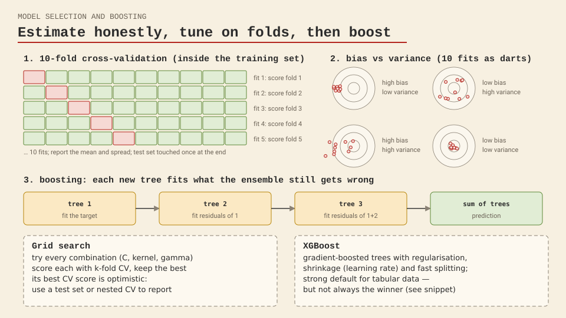

# Model Selection and Boosting

> **How to read this note.** Study guide for *Machine Learning A-Z*, Part 10 (sections 42–44): k-fold cross-validation, the bias–variance trade-off and grid search (on the kernel SVM for `Social_Network_Ads`), then XGBoost (Python on a breast-cancer dataset, R on the bank-churn data), plus an article pointing to CatBoost. The snippets use scikit-learn's bundled Wisconsin breast-cancer data (a close relative of the course's file). Install: `VIRTUAL_ENV=/Users/phahng/Desktop/workarea/.venv uv pip install xgboost`.

## Why This Exists

**Problem.** Every earlier part picked "the best model" from one test split and default settings. Test accuracy on 100 rows moves by several points from split to split, and defaults are rarely best — so those rankings were partly luck.

**Key insight.** Estimate performance on **many** splits (k-fold cross-validation), tune hyperparameters against those estimates (grid search), and keep one untouched test set for the final number. Then try the model family that usually wins on tables: **gradient-boosted trees**.

**Reach for this when:**
- Comparing models or settings.
- Reporting how well a model will do on new data.
- You want the strongest tabular baseline.

**Don't reach for this when:**
- Data is huge — a single large validation set is enough and k-fold is expensive.
- Rows are ordered in time — use time-based splits, not shuffled folds.

## Diagrams



## 1. k-fold cross-validation

```python
import numpy as np
from sklearn.datasets import load_breast_cancer           # 569 tumours, 30 features, malignant vs benign
from sklearn.model_selection import train_test_split, cross_val_score
from sklearn.pipeline import make_pipeline
from sklearn.preprocessing import StandardScaler
from sklearn.svm import SVC
X, y = load_breast_cancer(return_X_y=True)
model = make_pipeline(StandardScaler(), SVC(kernel="rbf"))
single = []
for seed in range(10):                                     # the "lucky split" problem: same model, different splits
    Xtr, Xte, ytr, yte = train_test_split(X, y, test_size=0.2, random_state=seed)
    single.append(model.fit(Xtr, ytr).score(Xte, yte))
print("one 80/20 split, 10 different seeds:", np.round(single, 3))
cv = cross_val_score(model, X, y, cv=10)                   # 10 folds: each row is validated exactly once
print(f"10-fold CV: mean {cv.mean():.3f}, std {cv.std():.3f}")
# Expected output:
# one 80/20 split, 10 different seeds: [0.982 0.974 0.965 0.947 0.974 0.965 0.974 0.982 0.982 0.982]
# 10-fold CV: mean 0.975, std 0.025
```

The same model scores anywhere from 94.7% to 98.2% depending on which 20% landed in the test set. **k-fold CV** splits the training data into k folds, trains on k − 1 and scores the held-out one, k times; report the mean and the standard deviation. The course's "schools of thought": (1) split off a test set, cross-validate on the rest, retrain and test once (the one it uses, and the standard); (2) skip the test set and train the final model on everything; (3) like 2 but keep one of the fold models; (4) do the classic split, then run k-fold afterwards to check the test score wasn't luck. The invariant: validation and test rows never influence training. The course's Python result: kernel SVM mean 90%, standard deviation 6%; R (`caret::createFolds` + `lapply`): mean 91%.

## 2. Bias and variance

**Bias**: systematic error from a model too simple for the pattern (darts clustered away from the bullseye). **Variance**: how much the model changes when trained on different data (darts scattered). Too simple → high bias; too flexible → high variance; aim for the middle. In practice: a big gap between training and CV scores means variance (overfitting); both low means bias. In §4, the single decision tree scores 1.000 on training rows and 0.917 in CV — high variance.

## 3. Grid search

**Hyperparameters** are chosen, not learned: SVM's C (lower = stronger regularisation), the kernel, gamma. **Grid search** scores every combination with k-fold CV. Separate grids avoid pointless combinations (gamma does nothing for a linear kernel):

```python
from sklearn.datasets import load_breast_cancer
from sklearn.model_selection import GridSearchCV, cross_val_score, train_test_split
from sklearn.pipeline import make_pipeline
from sklearn.preprocessing import StandardScaler
from sklearn.svm import SVC
X, y = load_breast_cancer(return_X_y=True)
Xtr, Xte, ytr, yte = train_test_split(X, y, test_size=0.2, random_state=0)
grid = [{"svc__kernel": ["linear"], "svc__C": [0.25, 0.5, 0.75, 1]},           # gamma only matters for rbf
        {"svc__kernel": ["rbf"], "svc__C": [0.25, 0.5, 0.75, 1], "svc__gamma": [0.01, 0.02, 0.05, 0.1, 0.5]}]
gs = GridSearchCV(make_pipeline(StandardScaler(), SVC()), grid, cv=10, scoring="accuracy").fit(Xtr, ytr)
print("best:", gs.best_params_, f" CV accuracy {gs.best_score_:.3f}")
print(f"same model on the untouched test set: {gs.score(Xte, yte):.3f}")
nested = cross_val_score(gs, X, y, cv=5)                   # the whole search inside each outer fold
print(f"nested CV (honest estimate of 'search + fit'): {nested.mean():.3f}")
# Expected output:
# best: {'svc__C': 0.25, 'svc__kernel': 'linear'}  CV accuracy 0.976
# same model on the untouched test set: 0.974
# nested CV (honest estimate of 'search + fit'): 0.972
```

The best CV score is the maximum over many noisy estimates, so it's optimistic; check it on the untouched test set, or wrap the whole search in an outer CV (**nested cross-validation**) for an honest estimate of the procedure. The course's search on `Social_Network_Ads` found C = 0.5, RBF, gamma = 0.6 with 90.67% CV accuracy versus 90.33% for the defaults — a difference far inside the 6-point standard deviation. In R, `caret::train(method = "svmRadial")` tunes C and sigma automatically (C = 0.5, sigma ≈ 1.13, 92% over 25 bootstrap resamples).

## 4. Boosting and XGBoost

**Boosting** builds trees one after another, each fitted to what the ensemble so far still gets wrong (residuals, or more generally the gradient of the loss), and adds them up with a small learning rate. **XGBoost** adds regularisation of tree size and leaf values, second-order gradient information and fast split finding; LightGBM and CatBoost (the course's bonus article) are faster or handle categories natively.

```python
import numpy as np
from sklearn.datasets import load_breast_cancer
from sklearn.model_selection import cross_validate
from sklearn.ensemble import RandomForestClassifier
from sklearn.linear_model import LogisticRegression
from sklearn.pipeline import make_pipeline
from sklearn.preprocessing import StandardScaler
from sklearn.tree import DecisionTreeClassifier
from xgboost import XGBClassifier                          # gradient-boosted trees
X, y = load_breast_cancer(return_X_y=True)
models = {"logistic regression": make_pipeline(StandardScaler(), LogisticRegression(max_iter=1000)),
          "decision tree": DecisionTreeClassifier(random_state=0), "random forest": RandomForestClassifier(300, random_state=0),
          "XGBoost (defaults)": XGBClassifier(random_state=0, n_jobs=1)}
for name, m in models.items():
    r = cross_validate(m, X, y, cv=10, return_train_score=True)
    print(f"{name:20s} train {r['train_score'].mean():.3f}   CV {r['test_score'].mean():.3f} ± {r['test_score'].std():.3f}")
print(f"{'majority class':20s} {max(y.mean(), 1 - y.mean()):.3f}")
# Expected output:
# logistic regression  train 0.988   CV 0.981 ± 0.015
# decision tree        train 1.000   CV 0.917 ± 0.033
# random forest        train 1.000   CV 0.965 ± 0.028
# XGBoost (defaults)   train 1.000   CV 0.975 ± 0.020
# majority class       0.627
```

XGBoost with defaults beats the random forest and the single tree — but on this small, nearly linearly separable dataset a scaled logistic regression is best. Boosting is a strong default, not a guarantee. The course's results: Python XGBoost 97.8% test accuracy and 96.5% ± 2% in 10-fold CV on its breast-cancer file, beating every Part 3 model; R `xgboost(nrounds = 10)` on the churn data, 88% k-fold accuracy versus 86% for the Part 8 neural network. Two version notes: current Python XGBoost requires class labels 0…k−1 (the course's file uses 2 and 4, so encode them), and the course's R call sets no `objective`, so it fits a squared-error *regression* on 0/1 labels (the log shows RMSE) — use `objective = "binary:logistic"`.

## Trade-offs

- **More folds vs fewer.** Less biased estimates, more fits vs speed; 5 or 10 is standard.
- **Grid vs random search.** Exhaustive on a few parameters vs better coverage of many for the same budget.
- **Boosting vs forests.** Usually more accurate vs fewer sensitive hyperparameters, easier to parallelise.
- **Nested CV.** Honest estimate vs k × inner-k fits.

## Common Pitfalls

- **Tuning on the test set.** Every look at it while choosing makes its score optimistic.
- **Preprocessing outside the folds.** Put scalers and reducers in the pipeline so each fold fits its own.
- **Reading small CV differences as real.** Compare to the fold standard deviation.
- **Shuffled folds on time series.** Future rows leak into training; use `TimeSeriesSplit`.
- **XGBoost API drift.** Encode labels to 0…k−1; set the objective explicitly.

## Decision Table

| Scenario | Use this | Not that | Why |
|----------|----------|----------|-----|
| Compare models | 10-fold CV mean ± std | One split | Luck |
| Tune 2–3 hyperparameters | `GridSearchCV` | Defaults | Settings matter |
| Tune many hyperparameters | `RandomizedSearchCV` / Optuna | Full grid | Budget |
| Report final performance | Untouched test set or nested CV | Best CV score | Optimism |
| Strong tabular model | XGBoost / LightGBM / CatBoost, plus a linear baseline | Single tree | Accuracy |

## References

- [scikit-learn — Cross-validation](https://scikit-learn.org/stable/modules/cross_validation.html) · [Grid search](https://scikit-learn.org/stable/modules/grid_search.html) · [Nested CV example](https://scikit-learn.org/stable/auto_examples/model_selection/plot_nested_cross_validation_iris.html)
- [Chen & Guestrin — XGBoost (2016)](https://arxiv.org/abs/1603.02754) · [XGBoost docs](https://xgboost.readthedocs.io/en/stable/)
- [Prokhorenkova et al. — CatBoost (2017)](https://arxiv.org/abs/1706.09516) · [Ke et al. — LightGBM (2017)](https://papers.nips.cc/paper/2017/hash/6449f44a102fde848669bdd9eb6b76fa-Abstract.html)
- [Hastie, Tibshirani & Friedman — Elements of Statistical Learning, ch. 7 and 10](https://hastie.su.domains/ElemStatLearn/)

## See Also

- [classification-models](classification-models.md) · [regression-models](regression-models.md) — the models being selected.
- [dimensionality-reduction](dimensionality-reduction.md) — reducers inside CV pipelines.
- [aws-ml-model-development](aws-ml-model-development.md) — SageMaker's built-in XGBoost and automatic tuning.
