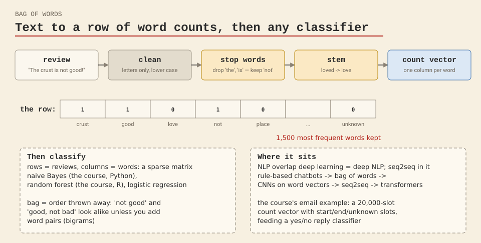

# NLP with Bag of Words

> **How to read this note.** Study guide for *Machine Learning A-Z*, Part 7 (section 34): intuition lectures placing classical NLP among deep NLP and seq2seq, the bag-of-words model, then a sentiment classifier for `Restaurant_Reviews.tsv` (1,000 reviews, liked or not) in Python and R, plus two homework articles. The snippets use NLTK's stemmer and scikit-learn's stop-word list (no downloads) and a set of synthetic reviews. Install: `VIRTUAL_ENV=/Users/phahng/Desktop/workarea/.venv uv pip install nltk`. For neural text models see [text-classification-embeddings](../deep-learning/text-classification-embeddings.md). The section quiz isn't included.

## Why This Exists

**Problem.** Classifiers need numeric columns; reviews are free text with punctuation, inflections and filler words. The simplest working answer — count words — has cleaning steps that can silently delete the most important word in a sentence.

**Key insight.** Turn each document into a row of **word counts** over a fixed vocabulary (order thrown away), shrink the vocabulary by cleaning and stemming, and then any tabular classifier applies. Keep negations, and add word pairs if order matters.

**Reach for this when:**
- A quick, explainable text-classification baseline (sentiment, spam, topic).
- Little labelled data and no GPU.
- You need to know which words drive a prediction.

**Don't reach for this when:**
- Meaning depends on word order or context ("not bad at all") — use n-grams, embeddings or a transformer.
- You need generation or conversation — see [seq2seq-bidirectional-rnns](../deep-learning/seq2seq-bidirectional-rnns.md) and [llm-foundations](../llm-engineering/llm-foundations.md).

## Diagrams



## 1. Where this fits

The course draws NLP and deep learning as overlapping circles: the overlap is **deep NLP**, and **seq2seq** sits inside it. Its examples run from rule-based chatbots (if/else tables), through audio frequency analysis for speech, bag-of-words classification, CNNs over word vectors, to seq2seq. The bag-of-words intuition uses an email: a 20,000-slot vector (roughly an adult's active vocabulary; about 3,000 words cover most everyday text) with fixed slots for each word, plus start, end and unknown-word slots, filled with counts, then fed to logistic regression or a neural network to predict a yes/no reply. It can classify, not converse.

## 2. Cleaning and counting

The steps, per review: keep letters only, lower-case, split into words, drop **stop words** (the, is, and…), **stem** each word to its root (loved → love, really → realli), rejoin. Then `CountVectorizer` builds one column per word, each cell the word's count in that review:

```python
import re
from nltk.stem.porter import PorterStemmer                # rule-based suffix stripping
from sklearn.feature_extraction.text import ENGLISH_STOP_WORDS, CountVectorizer
stem = PorterStemmer().stem
def clean(text, stop):
    words = re.sub("[^a-zA-Z]", " ", text).lower().split() # letters only, lower case
    return " ".join(stem(w) for w in words if w not in stop)
review = "The crust is not good, and I really loved the dessert!"
print("all stop words removed: ", clean(review, ENGLISH_STOP_WORDS))
print("keeping 'not':          ", clean(review, ENGLISH_STOP_WORDS - {"not"}))
cv = CountVectorizer()
X = cv.fit_transform(["love love this place", "not love it", "this place not good"])   # sparse counts
print(cv.get_feature_names_out()); print(X.toarray())    # counts, not just 0/1
# Expected output:
# all stop words removed:  crust good realli love dessert
# keeping 'not':           crust not good realli love dessert
# ['good' 'it' 'love' 'not' 'place' 'this']
# [[0 0 2 0 1 1]
#  [0 1 1 1 0 0]
#  [1 0 0 1 1 1]]
```

Standard stop-word lists include "not", so "the crust is not good" becomes "crust good" — the opposite meaning. The course catches this and removes "not" from NLTK's list (in its R version, `tm`'s stop words still remove it). The counts in the matrix are counts, not just 0/1 ("love" appears twice in the first row).

**Reading the file.** Reviews contain commas and quotes, so the data is tab-separated and read with `pd.read_csv(..., delimiter="\t", quoting=3)` (3 = ignore double quotes). The course's corpus had 1,566 distinct stems; `max_features=1500` keeps the most frequent.

## 3. Classifying

```python
import random, numpy as np
from sklearn.feature_extraction.text import CountVectorizer
from sklearn.model_selection import train_test_split
from sklearn.pipeline import make_pipeline
from sklearn.naive_bayes import GaussianNB, MultinomialNB
from sklearn.linear_model import LogisticRegression
from sklearn.preprocessing import FunctionTransformer
random.seed(0)
good, bad = ["great", "tasty", "friendly", "fresh", "amazing", "loved"], ["bland", "rude", "cold", "slow", "awful", "overpriced"]
filler = "the food service place staff we our was were very really and a to it at for".split()
def review(pos):                                          # 1,000 synthetic reviews; 'not' flips a word's meaning
    words = random.sample(filler, 6)
    for _ in range(2):
        flip = random.random() < 0.25
        words += (["not"] if flip else []) + [random.choice(bad if pos ^ flip else good)]
    return " ".join(words), int(pos) if random.random() > 0.05 else 1 - int(pos)   # 5% mislabelled
data = [review(random.random() < 0.5) for _ in range(1000)]
texts, y = zip(*data)
Xtr, Xte, ytr, yte = train_test_split(texts, np.array(y), test_size=0.2, random_state=0)
dense = FunctionTransformer(lambda X: X.toarray(), accept_sparse=True)   # GaussianNB needs a dense matrix
models = {"GaussianNB (the course)": make_pipeline(CountVectorizer(max_features=1500), dense, GaussianNB()),
          "MultinomialNB": make_pipeline(CountVectorizer(max_features=1500), MultinomialNB()),
          "logistic, unigrams": make_pipeline(CountVectorizer(), LogisticRegression(max_iter=1000)),
          "logistic, + bigrams": make_pipeline(CountVectorizer(ngram_range=(1, 2)), LogisticRegression(max_iter=1000))}
print(f"{'majority class':24s} {max(yte.mean(), 1 - yte.mean()):.3f}")
for name, m in models.items(): print(f"{name:24s} {m.fit(Xtr, ytr).score(Xte, yte):.3f}")
# Expected output:
# majority class           0.525
# GaussianNB (the course)  0.730
# MultinomialNB            0.720
# logistic, unigrams       0.715
# logistic, + bigrams      0.950
```

On reviews where a "not" flips a word's meaning, every single-word model lands in the low 70s — they can't tell "not tasty" from "tasty" — while adding **bigrams** (word pairs) reaches 95%, the ceiling set by 5% mislabelled reviews. The vocabulary is fitted inside the pipeline, on training reviews only (the course builds it from all 1,000 reviews before splitting — a small leak). **MultinomialNB** is the naive Bayes variant made for counts; the course uses **GaussianNB**, which needs a dense matrix and assumes bell-shaped features.

The course's results: Python, GaussianNB, 0.73 accuracy on 200 test reviews (55 true negatives, 91 true positives), with the challenge to beat 80%. R: `tm` corpus → lower case → remove numbers, punctuation, stop words → `SnowballC` stemming → strip whitespace → `DocumentTermMatrix` (1,577 terms) → `removeSparseTerms(dtm, 0.999)` (keeps terms appearing in more than 0.1% of reviews: 691) → random forest with 10 trees, 74.5%. The homework articles ask you to try other classifiers (logistic regression, k-NN, SVM, kernel SVM, decision trees, random forest, CART, maximum entropy) and report accuracy, precision, recall and F1.

## Trade-offs

- **Stemming vs lemmatisation.** Fast, crude roots ("realli") vs real dictionary words, slower.
- **Bigger vocabulary vs `max_features`.** Rare signal words vs noise and memory.
- **Unigrams vs n-grams.** Small, simple vs captures negation and phrases, many more columns.
- **Counts vs TF-IDF.** Simple vs down-weights words common to every document.

## Common Pitfalls

- **Removing "not" with the stop words.** Negations flip sentiment; keep them (and "no", "never").
- **Contractions after punctuation stripping.** "isn't" becomes "isn" + "t"; handle contractions before cleaning.
- **Fitting the vocabulary on all data.** Do it inside a pipeline, on training rows.
- **GaussianNB on counts.** MultinomialNB or logistic regression fit count data better.
- **Comparing models on one 200-review split.** Differences of a few points are noise; cross-validate.

## Decision Table

| Scenario | Use this | Not that | Why |
|----------|----------|----------|-----|
| Quick sentiment/spam baseline | CountVectorizer/TF-IDF + logistic regression or MultinomialNB | Deep model first | Fast, explainable |
| Negations matter | Bigrams (`ngram_range=(1, 2)`) | Unigrams | Order-blind otherwise |
| Words used in context, synonyms | Embeddings / fine-tuned transformer | Bag of words | Meaning beyond exact words |
| Very little data | Naive Bayes | Large neural nets | Few parameters |

## References

- [scikit-learn — Text feature extraction](https://scikit-learn.org/stable/modules/feature_extraction.html#text-feature-extraction) · [Naive Bayes](https://scikit-learn.org/stable/modules/naive_bayes.html)
- [NLTK — stemming](https://www.nltk.org/howto/stem.html)
- Manning, Raghavan & Schütze — *Introduction to Information Retrieval* (Cambridge, 2008) — ch. 6 (term weighting), 13 (naive Bayes text classification).
- [tm package for R](https://cran.r-project.org/package=tm)

## See Also

- [text-classification-embeddings](../deep-learning/text-classification-embeddings.md) — neural text classifiers with embeddings.
- [classification-models](classification-models.md) — the classifiers used here.
- [rnn-attention](../deep-learning/rnn-attention.md) — the seq2seq models the course previews.
