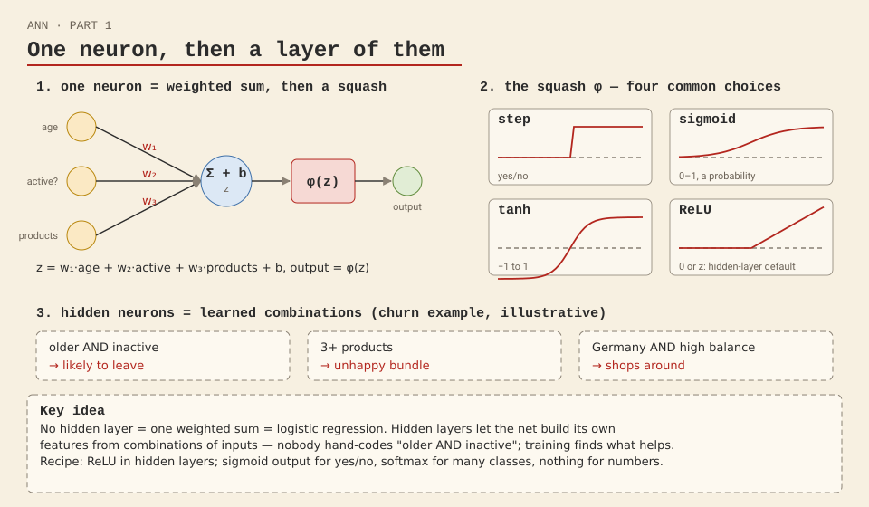
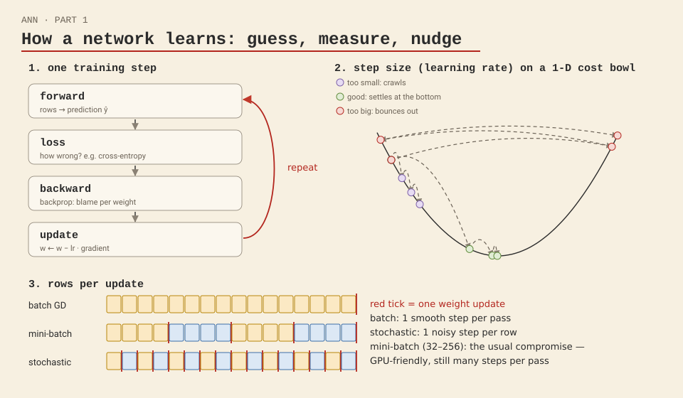
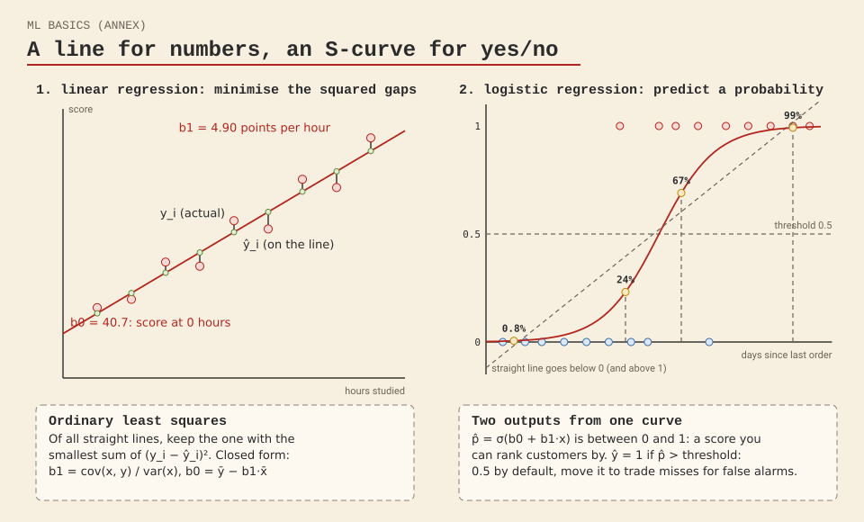

# Artificial Neural Networks

> **How to read this note.** Study guide for *Deep Learning A-Z*, Part 1 (sections 3–5) plus the ML-basics annex (sections 26–29). §1–3 go with the intuition lectures, §4 with the Python build, §5 with the annex. Section 5 of the course (no-code AWS SageMaker Canvas) is summarized in one paragraph at the end of §4. The course's churn CSV isn't bundled here, so §4 generates a synthetic bank-churn table with the same kinds of columns.

## Why This Exists

**Problem.** "A neural network is like a brain" tells you nothing about what to type or why a model fails. The real moving parts are few — a weighted sum, a squash, a cost, a downhill step — but each hides a choice that decides whether training works: learning rate, batch size, output activation, how you scale data, which threshold you use.

**Key insight.** A neuron computes a weighted sum of its inputs and squashes it. A network stacks layers of neurons so hidden ones can build new features from combinations of inputs. Training repeats one loop — predict, measure the error, assign each weight its share of the blame (backprop), nudge every weight a little downhill (gradient descent).

**Reach for this when:**
- Working through Deep Learning A-Z Part 1 or the annex.
- Building a first classifier or regressor on a table of features.
- Training diverges, stalls, or "86% accuracy" turns out to mean nothing.

**Don't reach for this when:**
- Your data are images, sequences or text — the architectures in [convolutional-neural-networks](convolutional-neural-networks.md) and [recurrent-neural-networks](recurrent-neural-networks.md) fit better.
- You have a small, plain table and want the best accuracy fast — gradient-boosted trees (XGBoost, LightGBM) usually beat a small ANN on tabular data.

## Diagrams





## 1. The neuron

One row of data goes in. Each input is multiplied by its weight, the products are summed with a bias, and an **activation function** turns the sum into the output:

$$z = w_1x_1 + w_2x_2 + \dots + w_mx_m + b \qquad \text{output} = \varphi(z)$$

```python
import numpy as np
x = np.array([0.5, -1.2, 2.0])                       # one row: 3 (already scaled) input features
w, b = np.array([0.8, 0.1, -0.4]), 0.2               # one weight per input, plus a bias
z = w @ x + b                                        # step 1: weighted sum
acts = {"step": float(z > 0), "sigmoid": 1 / (1 + np.exp(-z)), "tanh": np.tanh(z), "relu": max(z, 0.0)}
print("z =", round(z, 3))
for name, val in acts.items():
    print(f"{name:8s}-> {val:.3f}")                  # step 2: activation turns z into the output
# Expected output:
# z = -0.32
# step    -> 0.000
# sigmoid -> 0.421
# tanh    -> -0.310
# relu    -> 0.000
```

| Activation | Output range | Typical use |
|---|---|---|
| Step (threshold) | 0 or 1 | Historical (perceptron); no gradient, so not trainable by backprop |
| Sigmoid | 0 to 1 | Output layer for yes/no — read it as a probability |
| Tanh | −1 to 1 | Hidden layers in older nets, RNN internals |
| ReLU | 0 or $z$ | **Default for hidden layers** — cheap, doesn't saturate for $z > 0$ |
| Softmax | probabilities summing to 1 | Output layer for 3+ classes |

**Inputs must be on similar scales.** Standardize ($\frac{x - \text{mean}}{\text{sd}}$) or normalize ($\frac{x - \min}{\max - \min}$) each column, or a feature measured in dollars swamps one measured in years.

## 2. Why hidden layers help

A network with no hidden layer is one weighted sum — with a sigmoid output, that's exactly logistic regression. A hidden neuron can learn to fire for a *combination*: "older **and** inactive", "three or more products". The next layer then works with those combinations. Nobody writes these rules; training finds whatever combinations reduce the error. (The course illustrates this with house prices — area, bedrooms, distance, age — the idea is the same.)

## 3. How it learns

### Cost
Compare the prediction $\hat y$ with the truth $y$. Squared error $\tfrac12(\hat y - y)^2$ for numbers; **cross-entropy** for probabilities (it punishes confident wrong answers much harder, which gives stronger gradients — see [convolutional-neural-networks](convolutional-neural-networks.md) §5).

### Gradient descent
Trying every weight combination is hopeless (25 weights × 1000 values each = $10^{75}$ tries). Instead compute the slope of the cost with respect to each weight and step downhill. The **learning rate** sets the step size:

```python
import numpy as np
# Fit y = w*x with gradient descent on cost C = mean((w*x - y)^2); the true w is 3
x = np.array([1.0, 2.0, 3.0, 4.0]); y = 3 * x
for lr in (0.01, 0.05, 0.15):                         # learning rate = step size
    w = 0.0
    for step in range(20):
        grad = np.mean(2 * (w * x - y) * x)          # dC/dw: slope of the cost at the current w
        w -= lr * grad                               # walk downhill
    print(f"lr={lr}: w after 20 steps = {w:.3f}")
# Expected output:
# lr=0.01: w after 20 steps = 2.884
# lr=0.05: w after 20 steps = 3.000
# lr=0.15: w after 20 steps = -257.209
```

Too small crawls, a good rate converges, too large overshoots further each step and explodes.

### Batch, mini-batch, stochastic
How many rows you use per weight update:

```python
import torch
torch.manual_seed(0)
X = torch.randn(1024, 5); y = X @ torch.tensor([1.0, -2.0, 0.5, 3.0, 0.0]) + 0.1 * torch.randn(1024)
for name, bs in [("batch GD", 1024), ("mini-batch", 32), ("stochastic", 1)]:
    w = torch.zeros(5, requires_grad=True)
    opt = torch.optim.SGD([w], lr=0.01)
    updates = 0
    for epoch in range(3):                              # 3 passes over the same 1024 rows
        for i in torch.randperm(1024).split(bs):        # rows per weight update = batch size
            loss = ((X[i] @ w - y[i]) ** 2).mean()
            opt.zero_grad(); loss.backward(); opt.step(); updates += 1
    full = ((X @ w - y) ** 2).mean().item()
    print(f"{name:10s}: {updates:5d} updates, loss after 3 epochs {full:.3f}")
# Expected output:
# batch GD  :     3 updates, loss after 3 epochs 11.756
# mini-batch:    96 updates, loss after 3 epochs 0.376
# stochastic:  3072 updates, loss after 3 epochs 0.011
```

Same data, same passes — smaller batches take more (noisier) steps, so at a fixed learning rate they get further. Full batch gives smooth but few steps. One row per step is noisy and leaves a GPU idle. **Mini-batches of 32–256 are the standard compromise.** Noise also helps escape poor regions of non-convex costs.

### Backpropagation
The chain rule, applied layer by layer from the output back, gives every weight's gradient in one backward pass. Frameworks do it for you (`loss.backward()`), but it's worth seeing that it's nothing more than calculus:

```python
import torch
torch.manual_seed(0)
x, y = torch.tensor([1.0, 2.0]), torch.tensor(1.0)
W1 = torch.randn(3, 2, requires_grad=True); w2 = torch.randn(3, requires_grad=True)
h = torch.sigmoid(W1 @ x)                               # hidden layer (3 neurons)
y_hat = w2 @ h                                          # output
loss = 0.5 * (y_hat - y) ** 2                           # cost for one row
loss.backward()                                         # autograd: backprop through every layer
d_out = (y_hat - y).detach()                            # chain rule by hand, layer by layer
grad_w2 = d_out * h.detach()
grad_W1 = torch.outer(d_out * w2.detach() * h.detach() * (1 - h.detach()), x)   # sigmoid' = h(1-h)
print("w2 grads match:", torch.allclose(w2.grad, grad_w2))
print("W1 grads match:", torch.allclose(W1.grad, grad_W1))
# Expected output:
# w2 grads match: True
# W1 grads match: True
```

**The training recipe:** initialize weights to small random values → forward pass a batch → measure the cost → backprop → update → repeat; one full pass over the data is an **epoch**. (The course calls row-by-row updating "reinforcement learning" at one point — it isn't; that's plain stochastic gradient descent. Reinforcement learning is learning from rewards.)

## 4. A churn classifier, end to end

**The task.** Predict which bank customers leave (`Exited` = 1) from credit score, country, gender, age, tenure, balance, number of products, activity and salary. About 19% of customers leave — remember that number.

**Preprocessing rules** (from the annex, applied here):
- One-hot encode text categories (`Geography`, `Gender`).
- Split train/test **before** scaling, then `fit` the scaler on train only and `transform` test. Fitting on everything leaks test information into training.

### Keras

```python
import os; os.environ.setdefault("KERAS_BACKEND", "torch")
import numpy as np, pandas as pd, keras
from sklearn.compose import ColumnTransformer
from sklearn.preprocessing import OneHotEncoder, StandardScaler
from sklearn.model_selection import train_test_split
from sklearn.metrics import confusion_matrix
rng = np.random.default_rng(0)                       # synthetic bank-churn table, 10,000 customers
n = 10_000
df = pd.DataFrame({
    "CreditScore": rng.normal(650, 95, n).clip(350, 850).round(),
    "Geography": rng.choice(["France", "Germany", "Spain"], n, p=[0.5, 0.25, 0.25]),
    "Gender": rng.choice(["Female", "Male"], n),
    "Age": rng.normal(39, 10, n).clip(18, 92).round(),
    "Tenure": rng.integers(0, 11, n),
    "Balance": np.where(rng.random(n) < 0.35, 0, rng.normal(120_000, 30_000, n)).round(2),
    "NumOfProducts": rng.choice([1, 2, 3, 4], n, p=[0.5, 0.45, 0.03, 0.02]),
    "IsActiveMember": rng.integers(0, 2, n),
    "EstimatedSalary": rng.uniform(10_000, 200_000, n).round(2)})
logit = (-1.4 + 0.07 * (df.Age - 39) - 0.9 * df.IsActiveMember + 0.7 * (df.Geography == "Germany")
         + 0.4 * (df.Gender == "Female") + 1.8 * (df.NumOfProducts >= 3) - 0.8 * (df.NumOfProducts == 2))
df["Exited"] = (rng.random(n) < 1 / (1 + np.exp(-logit))).astype(int)   # 1 = customer left the bank
X, y = df.drop(columns="Exited"), df.Exited.values
X_tr, X_te, y_tr, y_te = train_test_split(X, y, test_size=0.2, random_state=0, stratify=y)
prep = ColumnTransformer([("cat", OneHotEncoder(), ["Geography", "Gender"]),   # text -> 0/1 columns
                          ("num", StandardScaler(), X.columns.drop(["Geography", "Gender"]).tolist())])
X_tr = prep.fit_transform(X_tr)                       # fit on TRAIN only...
X_te = prep.transform(X_te)                           # ...then apply the same scaling to test
keras.utils.set_random_seed(0)
model = keras.Sequential([keras.Input((X_tr.shape[1],)),
                          keras.layers.Dense(6, activation="relu"),
                          keras.layers.Dense(6, activation="relu"),
                          keras.layers.Dense(1, activation="sigmoid")])   # P(customer leaves)
model.compile(optimizer="adam", loss="binary_crossentropy", metrics=["accuracy"])
model.fit(X_tr, y_tr, batch_size=32, epochs=30, validation_split=0.1, verbose=0)
p = model.predict(X_te, verbose=0).ravel()
print("test accuracy:", round(((p > 0.5) == y_te).mean(), 3), " 'nobody leaves' baseline:", round(1 - y_te.mean(), 3))
print("confusion matrix [[stay ok, false alarm], [missed leaver, caught leaver]]:\n", confusion_matrix(y_te, p > 0.5))
for t in (0.5, 0.3):                                 # the 0.5 cut-off is a choice, not a law
    print(f"threshold {t}: caught {((p > t) & (y_te == 1)).sum()} of {y_te.sum()} leavers, false alarms {((p > t) & (y_te == 0)).sum()}")
new = pd.DataFrame([{"CreditScore": 600, "Geography": "Germany", "Gender": "Female", "Age": 55, "Tenure": 3,
                     "Balance": 80_000, "NumOfProducts": 1, "IsActiveMember": 0, "EstimatedSalary": 50_000}])
print("P(leave) for one new customer:", round(float(model.predict(prep.transform(new), verbose=0)[0, 0]), 2))
# Expected output:
# test accuracy: 0.827  'nobody leaves' baseline: 0.807
# confusion matrix [[stay ok, false alarm], [missed leaver, caught leaver]]:
#  [[1577   37]
#  [ 309   77]]
# threshold 0.5: caught 77 of 386 leavers, false alarms 37
# threshold 0.3: caught 193 of 386 leavers, false alarms 238
# P(leave) for one new customer: 0.63
```

**Read the output honestly.** 82.7% accuracy sounds good until you see that predicting "nobody leaves" gets 80.7%. At threshold 0.5 the model catches only 77 of 386 leavers. Lowering the threshold to 0.3 catches 193 at the cost of more false alarms. Which is better depends on what a missed leaver costs versus a wasted retention offer — a business decision, not a modeling one.

**Predicting one customer** has three gotchas: pass a 2-D table (one row), encode categories exactly as in training, and use `prep.transform` — never refit the scaler on a single row.

### PyTorch

```python
import numpy as np, pandas as pd, torch, torch.nn as nn
from sklearn.compose import ColumnTransformer
from sklearn.preprocessing import OneHotEncoder, StandardScaler
from sklearn.model_selection import train_test_split
rng = np.random.default_rng(0)                       # synthetic bank-churn table, 10,000 customers
n = 10_000
df = pd.DataFrame({
    "CreditScore": rng.normal(650, 95, n).clip(350, 850).round(),
    "Geography": rng.choice(["France", "Germany", "Spain"], n, p=[0.5, 0.25, 0.25]),
    "Gender": rng.choice(["Female", "Male"], n),
    "Age": rng.normal(39, 10, n).clip(18, 92).round(),
    "Tenure": rng.integers(0, 11, n),
    "Balance": np.where(rng.random(n) < 0.35, 0, rng.normal(120_000, 30_000, n)).round(2),
    "NumOfProducts": rng.choice([1, 2, 3, 4], n, p=[0.5, 0.45, 0.03, 0.02]),
    "IsActiveMember": rng.integers(0, 2, n),
    "EstimatedSalary": rng.uniform(10_000, 200_000, n).round(2)})
logit = (-1.4 + 0.07 * (df.Age - 39) - 0.9 * df.IsActiveMember + 0.7 * (df.Geography == "Germany")
         + 0.4 * (df.Gender == "Female") + 1.8 * (df.NumOfProducts >= 3) - 0.8 * (df.NumOfProducts == 2))
df["Exited"] = (rng.random(n) < 1 / (1 + np.exp(-logit))).astype(int)   # 1 = customer left the bank
X, y = df.drop(columns="Exited"), df.Exited.values
X_tr, X_te, y_tr, y_te = train_test_split(X, y, test_size=0.2, random_state=0, stratify=y)
prep = ColumnTransformer([("cat", OneHotEncoder(), ["Geography", "Gender"]),
                          ("num", StandardScaler(), X.columns.drop(["Geography", "Gender"]).tolist())])
Xtr = torch.tensor(prep.fit_transform(X_tr), dtype=torch.float32); ytr = torch.tensor(y_tr, dtype=torch.float32)
Xte = torch.tensor(prep.transform(X_te), dtype=torch.float32)
torch.manual_seed(0)
model = nn.Sequential(nn.Linear(Xtr.shape[1], 6), nn.ReLU(), nn.Linear(6, 6), nn.ReLU(), nn.Linear(6, 1))
opt = torch.optim.Adam(model.parameters())
loss_fn = nn.BCEWithLogitsLoss()                      # sigmoid + binary cross-entropy in one stable step
for epoch in range(30):
    for i in torch.randperm(len(Xtr)).split(32):      # shuffled mini-batches of 32 rows
        loss = loss_fn(model(Xtr[i]).squeeze(1), ytr[i])
        opt.zero_grad(); loss.backward(); opt.step()  # backprop, then one gradient-descent step
with torch.no_grad():
    p = torch.sigmoid(model(Xte)).squeeze(1).numpy()  # logits -> probabilities
print("test accuracy:", round(((p > 0.5) == y_te).mean(), 3), " 'nobody leaves' baseline:", round(1 - y_te.mean(), 3))
# Expected output:
# test accuracy: 0.824  'nobody leaves' baseline: 0.807
```

PyTorch makes the loop explicit: Keras's `fit()` is these five lines. The last layer has no sigmoid because `BCEWithLogitsLoss` applies it internally (more numerically stable).

**AWS section (5), in one paragraph.** The course's AWS part uses SageMaker Canvas, a no-code tool: import a CSV, pick the target column, choose a quick or standard build, and it tries several algorithms (XGBoost, linear, neural nets) and reports metrics such as RMSE/R² or F1/accuracy and feature importance. Useful for a baseline in minutes; delete the Canvas app and domain afterwards, or it keeps billing.

## 5. The annex: the classical models underneath

The annex (sections 26–29) teaches the two models every neural network grows out of, plus the workflow around them. Each one answers one question.



### 5.1 Simple linear regression: "how much does y change per unit of x?"

**The problem.** You have exam scores and the hours each student studied, and you want a rule: *score ≈ something + something × hours*. That's the model

$$\hat y = b_0 + b_1 x$$

- $y$ is the **dependent variable** (what you want to explain: the score); $x$ the **independent variable** (what you think drives it: hours).
- $b_1$, the **slope**, is the change in $\hat y$ for one extra unit of $x$: "points per extra hour".
- $b_0$, the **intercept**, is the prediction at $x = 0$: the score of someone who didn't study. (Only meaningful if $x = 0$ is a realistic value.)

A fitted line doesn't prove that hours *cause* the score. It measures an association; causation needs an experiment or a careful argument.

**Which line?** For each student, the vertical gap between the real score $y_i$ and the line's prediction $\hat y_i$ is the error. Square each gap (so positives and negatives don't cancel, and big misses count more), add them up, and pick the line with the smallest total. That's **ordinary least squares** (OLS). You could literally try thousands of lines and keep the best; calculus gives the winner directly: $b_1 = \operatorname{cov}(x, y) / \operatorname{var}(x)$, and the line passes through the point of means, so $b_0 = \bar y - b_1 \bar x$.

```python
import numpy as np
rng = np.random.default_rng(0)
hours = rng.uniform(0, 10, 30)                            # hours studied
score = 40 + 5 * hours + rng.normal(0, 6, 30)             # exam score: true intercept 40, slope 5
def sse(b0, b1): return ((score - (b0 + b1 * hours)) ** 2).sum()   # sum of squared vertical gaps
grid = [(sse(b0, b1), b0, b1) for b0 in np.arange(20, 60, 0.5) for b1 in np.arange(0, 10, 0.05)]
best = min(grid)                                          # "try every line, keep the smallest SSE"
b1 = np.cov(hours, score, ddof=0)[0, 1] / hours.var()     # least-squares slope in closed form: cov / var
b0 = score.mean() - b1 * hours.mean()                     # the line passes through the means
print(f"brute force: b0={best[1]:.1f} b1={best[2]:.2f}  SSE={best[0]:.0f}")
print(f"closed form: b0={b0:.1f} b1={b1:.2f}  SSE={sse(b0, b1):.0f}")
print(f"np.polyfit : b1, b0 = {np.round(np.polyfit(hours, score, 1), 2)}")   # degree-1 least-squares fit
# Expected output:
# brute force: b0=42.0 b1=4.95  SSE=948
# closed form: b0=41.7 b1=4.99  SSE=947
# np.polyfit : b1, b0 = [ 4.99 41.73]
```

Brute force over 16,000 candidate lines, the closed form and numpy all land on the same line (the brute force is slightly off only because its grid has steps of 0.5 and 0.05). The true values were 40 and 5; noise in 30 points moves the estimate a little.

### 5.2 Multiple linear regression: several causes at once

**The problem.** Scores depend on more than hours: sleep the night before and lectures attended matter too. Add a slope per input:

$$\hat y = b_0 + b_1 x_1 + b_2 x_2 + \dots + b_n x_n$$

Each $b_j$ now means "change in $\hat y$ for one more unit of $x_j$, **holding the other inputs fixed**". That last clause is the point of fitting them together: with sleep in the model, the hours coefficient no longer gets credit for what sleep does.

```python
import numpy as np
from sklearn.linear_model import LinearRegression
rng = np.random.default_rng(0)
n = 200
hours, sleep, lectures = rng.uniform(0, 10, n), rng.uniform(4, 9, n), rng.integers(0, 13, n)
score = 20 + 4 * hours + 3 * sleep + 1.5 * lectures + rng.normal(0, 5, n)   # true b0..b3 = 20, 4, 3, 1.5
X = np.column_stack([hours, sleep, lectures])
m = LinearRegression().fit(X, score)                      # ordinary least squares, many inputs
print("b0 =", round(m.intercept_, 1), "| b1, b2, b3 =", m.coef_.round(2))
print("one more hour of study, all else fixed: +%.1f points" % m.coef_[0])
# Expected output:
# b0 = 15.1 | b1, b2, b3 = [4.16 3.6  1.51]
# one more hour of study, all else fixed: +4.2 points
```

The slopes come back close to the true 4, 3 and 1.5. The intercept is further off (15 vs 20): nobody in the data slept 0 hours, so the intercept is an extrapolation and the least reliable number in the model.

### 5.3 Logistic regression: "how likely is yes?"

**The problem.** A shop emails a reorder offer. For each customer you know how many days since their last order, and whether they acted (1) or not (0). Plot it and the points sit on two horizontal lines, at 0 and 1. Customers who haven't ordered for a while act more often — but how do you model that?

**First try: a straight line.** Fit linear regression to the 0/1 values and read its output as a probability. In the middle that sort of works: the output rises with the days. At the ends it breaks: it predicts *negative* probability for recent customers and more than 100% for lapsed ones. Probabilities must stay in [0, 1].

**The fix: bend the line.** Push the straight-line score $z = b_0 + b_1 x$ through the **sigmoid**, which squashes any number into (0, 1):

$$\hat p = \sigma(z) = \frac{1}{1 + e^{-(b_0 + b_1 x)}}$$

Equivalently, the straight line now models the **log-odds**, $\ln\frac{p}{1-p} = b_0 + b_1 x$. Fitting picks $b_0, b_1$ to maximise the likelihood of the observed 0s and 1s (minimise cross-entropy) — the same idea as least squares, "the best-fitting curve of this shape".

**Two outputs.** $\hat p$ is a probability you can rank people by ("who is most likely to respond?"). If you need a yes/no, pick a **threshold**: $\hat y = 1$ when $\hat p$ is above it. 0.5 is the default because it's symmetric, not because it's right — lower it when missing a "yes" is costly, raise it when false alarms are.

```python
import numpy as np
from sklearn.linear_model import LinearRegression, LogisticRegression
rng = np.random.default_rng(0)
days = rng.uniform(0, 60, 300)                            # days since a customer's last order
p_true = 1 / (1 + np.exp(-(days - 30) / 5))               # the longer the gap, the likelier a reorder email works
clicked = (rng.random(300) < p_true).astype(int)          # observed: 0 = ignored the email, 1 = acted
X = days[:, None]
lin = LinearRegression().fit(X, clicked)                  # straight line through 0/1 data
log = LogisticRegression().fit(X, clicked)                # sigmoid of a straight line
q = np.array([[5], [25], [35], [55]])
print("days:           ", q.ravel())
print("linear 'prob':  ", lin.predict(q).round(2))        # can fall below 0 or rise above 1
p = log.predict_proba(q)[:, 1]                            # column 1 = P(clicked = 1)
print("logistic p_hat: ", p.round(3))
print("y_hat @ 0.5:    ", (p > 0.5).astype(int), "  y_hat @ 0.2:", (p > 0.2).astype(int))
# Expected output:
# days:            [ 5 25 35 55]
# linear 'prob':   [-0.07  0.37  0.59  1.03]
# logistic p_hat:  [0.008 0.238 0.666 0.988]
# y_hat @ 0.5:     [0 0 1 1]   y_hat @ 0.2: [0 1 1 1]
```

The straight line gives −0.07 and 1.03 at the ends; the logistic curve stays inside (0, 1). Moving the threshold from 0.5 to 0.2 flips the 25-day customer (24%) to "yes".

**How "best fitting" is decided: maximum likelihood.** For a candidate curve, go through the points. If a person actually said yes, take the curve's $\hat p$ at their $x$; if they said no, take $1 - \hat p$. That is the chance the curve gave to what really happened. Multiply all of these together: the **likelihood**. A curve that gives high probability to the real outcomes scores high. Fitting means finding the $b_0, b_1$ with the largest likelihood. In practice you add logs instead of multiplying (the product of hundreds of numbers below 1 underflows to 0), and the negative mean log-likelihood is exactly the cross-entropy loss a neural network minimises.

```python
import numpy as np
x = np.array([18, 25, 30, 41, 47, 52, 23, 33, 38, 58])    # ages
y = np.array([0, 0, 0, 1, 1, 1, 0, 1, 0, 1])               # 1 = bought
def likelihood(b0, b1):
    p = 1 / (1 + np.exp(-(b0 + b1 * x)))                   # the curve's P(yes) at each point
    per_point = np.where(y == 1, p, 1 - p)                 # chance the curve gives to what ACTUALLY happened
    return per_point.prod(), np.log(per_point).sum()
for b0, b1 in [(-4, 0.10), (-9, 0.25), (-30, 0.85)]:       # three candidate curves: shallow, medium, steep
    L, logL = likelihood(b0, b1)
    print(f"b0={b0:4} b1={b1:.2f}: likelihood {L:.2e}   log-likelihood {logL:6.2f}")
# Expected output:
# b0=  -4 b1=0.10: likelihood 1.92e-02   log-likelihood  -3.95
# b0=  -9 b1=0.25: likelihood 6.33e-02   log-likelihood  -2.76
# b0= -30 b1=0.85: likelihood 1.11e-02   log-likelihood  -4.50
```

The shallow curve is too unsure everywhere; the steep one is confidently wrong on the 38-year-old who didn't buy and the 33-year-old who did. The medium curve gives the real outcomes the most probability, so it wins.

### 5.4 The workflow: preprocess, model, evaluate

Every build in the course follows three steps:
1. **Preprocess** — import the data, clean it (fill missing values, encode categories — §5.7), split into training and test sets, scale.
2. **Model** — build, train on the training set, predict.
3. **Evaluate** — compute metrics on the test set and decide whether the model is good enough.

**Why split first.** Put roughly 20% of the rows aside *before doing anything else*. Train only on the other 80%. Then predict the held-out rows: the model has never seen them, but you know their true answers, so the comparison is an honest estimate of how it will do on new data. Scoring on the training rows only measures memory.

### 5.5 Feature scaling: making columns comparable

**The problem.** Three people, described by income and age. Is B more similar to A or to C?

| | income | age |
|---|---|---|
| A | $70,000 | 25 |
| B | $68,000 | 50 |
| C | $60,000 | 48 |

By eye, B and C are both around 50 and A is 25 — B looks like C. But a distance calculation on the raw numbers sees income gaps of 2,000 and 8,000 and age gaps of 25 and 2, and the dollars swamp the years. Measure age in seconds instead and the answer flips again. The units, not the data, decide.

**Scale each column** (always per column, never across a row) so all columns are on a similar range:
- **Normalisation** (min-max): $x' = \dfrac{x - \min}{\max - \min}$, giving values in [0, 1].
- **Standardisation**: $x' = \dfrac{x - \text{mean}}{\text{std}}$, giving mean 0 and standard deviation 1; most values land between −3 and 3, outliers outside.

```python
import numpy as np
people = {"A": [70_000, 25], "B": [68_000, 50], "C": [60_000, 48]}   # annual income ($), age (years)
X = np.array(list(people.values()), dtype=float)
norm = (X - X.min(0)) / (X.max(0) - X.min(0))            # normalisation: per COLUMN, into [0, 1]
std = (X - X.mean(0)) / X.std(0)                          # standardisation: per column, mean 0, std 1
for name, Z in (("raw", X), ("normalised", norm), ("standardised", std)):
    dA, dC = np.linalg.norm(Z[1] - Z[0]), np.linalg.norm(Z[1] - Z[2])   # distance from B to A and to C
    print(f"{name:12s}: B-A {dA:9.2f}  B-C {dC:9.2f}  -> B is closest to {'A' if dA < dC else 'C'}")
# Expected output:
# raw         : B-A   2000.16  B-C   8000.00  -> B is closest to A
# normalised  : B-A      1.02  B-C      0.80  -> B is closest to C
# standardised: B-A      2.25  B-C      1.86  -> B is closest to C
```

After either scaling, B's nearest neighbour is C, as common sense said. Distance-based methods (k-NN, K-Means, [SOMs](self-organizing-maps.md)) and gradient-trained ones (neural networks) need this; tree models don't care. Fit the scaler's min/max or mean/std **on the training set only**, then apply it to the test set — otherwise test information leaks into training.

### 5.6 Logistic regression is a network with no hidden layer

A neuron with a sigmoid activation computes exactly $\sigma(b_0 + b_1 x_1 + \dots)$. So logistic regression is the ANN of §1 with the hidden layers removed — which makes it the natural baseline for the churn network in §4:

```python
import numpy as np, pandas as pd
from sklearn.compose import ColumnTransformer
from sklearn.preprocessing import OneHotEncoder, StandardScaler
from sklearn.model_selection import train_test_split
from sklearn.linear_model import LogisticRegression
rng = np.random.default_rng(0)                       # synthetic bank-churn table, 10,000 customers
n = 10_000
df = pd.DataFrame({
    "CreditScore": rng.normal(650, 95, n).clip(350, 850).round(),
    "Geography": rng.choice(["France", "Germany", "Spain"], n, p=[0.5, 0.25, 0.25]),
    "Gender": rng.choice(["Female", "Male"], n),
    "Age": rng.normal(39, 10, n).clip(18, 92).round(),
    "Tenure": rng.integers(0, 11, n),
    "Balance": np.where(rng.random(n) < 0.35, 0, rng.normal(120_000, 30_000, n)).round(2),
    "NumOfProducts": rng.choice([1, 2, 3, 4], n, p=[0.5, 0.45, 0.03, 0.02]),
    "IsActiveMember": rng.integers(0, 2, n),
    "EstimatedSalary": rng.uniform(10_000, 200_000, n).round(2)})
logit = (-1.4 + 0.07 * (df.Age - 39) - 0.9 * df.IsActiveMember + 0.7 * (df.Geography == "Germany")
         + 0.4 * (df.Gender == "Female") + 1.8 * (df.NumOfProducts >= 3) - 0.8 * (df.NumOfProducts == 2))
df["Exited"] = (rng.random(n) < 1 / (1 + np.exp(-logit))).astype(int)   # 1 = customer left the bank
X, y = df.drop(columns="Exited"), df.Exited.values
X_tr, X_te, y_tr, y_te = train_test_split(X, y, test_size=0.2, random_state=0, stratify=y)
prep = ColumnTransformer([("cat", OneHotEncoder(), ["Geography", "Gender"]),
                          ("num", StandardScaler(), X.columns.drop(["Geography", "Gender"]).tolist())])
logreg = LogisticRegression().fit(prep.fit_transform(X_tr), y_tr)     # a linear model: one weighted sum + sigmoid
print("logistic regression test accuracy:", round(logreg.score(prep.transform(X_te), y_te), 3))
# Expected output:
# logistic regression test accuracy: 0.812
```

0.812 for logistic regression vs 0.82–0.83 for the network: the hidden layers buy a little, because this data has a few non-linear effects (two products lowers churn, three or more raises it). On many real tables the gap is similar or zero. **Always fit the linear model first.**

### 5.7 The course's Python builds (sections 28–29)

**The preprocessing template (section 28).** A 10-row table: country, age, salary, and whether the person bought. One age and one salary are missing on purpose. The steps, in the order the course runs them:
1. **Split columns** into features `X` (all but the last) and target `y` (the last), with `iloc`.
2. **Missing values** — dropping rows is fine when about 1% of rows are affected; otherwise replace each gap with the column's mean (or median, or most frequent value) using `SimpleImputer`.
3. **Encode the category** — `OneHotEncoder` inside a `ColumnTransformer` turns country into three 0/1 columns (`remainder="passthrough"` keeps the others). Not 0/1/2 codes: those would tell the model that Spain is "two Frances", an order that doesn't exist. A yes/no target only needs `LabelEncoder` → 0/1.
4. **Split** into training and test sets (`test_size=0.2`).
5. **Scale** age and salary with `StandardScaler`: `fit_transform` on train (learn mean and std, apply), `transform` on test (apply the *training* mean and std). The dummy columns are left alone: they're already 0/1, and keeping them readable costs nothing.

```python
import numpy as np, pandas as pd
from sklearn.impute import SimpleImputer
from sklearn.compose import ColumnTransformer
from sklearn.preprocessing import OneHotEncoder, LabelEncoder, StandardScaler
from sklearn.model_selection import train_test_split
df = pd.DataFrame({"Country": ["France", "Spain", "Germany", "Spain", "Germany", "France", "Spain", "France", "Germany", "France"],
                   "Age": [44, 27, 30, 38, 40, 35, np.nan, 48, 50, 37],
                   "Salary": [72e3, 48e3, 54e3, 61e3, np.nan, 58e3, 52e3, 79e3, 83e3, 67e3],
                   "Purchased": ["No", "Yes", "No", "No", "Yes", "Yes", "No", "Yes", "No", "Yes"]})   # Data.csv-shaped
X, y = df.iloc[:, :-1].values, df.iloc[:, -1].values
X[:, 1:3] = SimpleImputer(strategy="mean").fit_transform(X[:, 1:3])   # fill gaps with the column mean
ct = ColumnTransformer([("enc", OneHotEncoder(), [0])], remainder="passthrough")   # country -> 3 dummy columns
X = ct.fit_transform(X)                                                # dummies first, then Age, Salary
y = LabelEncoder().fit_transform(y)                                    # "No"/"Yes" -> 0/1
X_tr, X_te, y_tr, y_te = train_test_split(X, y, test_size=0.2, random_state=1)
sc = StandardScaler()
X_tr[:, 3:] = sc.fit_transform(X_tr[:, 3:])                            # learn mean/std on TRAIN only
X_te[:, 3:] = sc.transform(X_te[:, 3:])                                # reuse them on test (no refit)
print("encoded row 0:", X[0])
print("y:", y, "| train/test rows:", len(X_tr), len(X_te))
print("scaled test rows:\n", np.round(X_te.astype(float), 2))
# Expected output:
# encoded row 0: [1.0 0.0 0.0 44.0 72000.0]
# y: [0 1 0 0 1 1 0 1 0 1] | train/test rows: 8 2
# scaled test rows:
#  [[ 0.    1.    0.   -1.47 -0.91]
#  [ 1.    0.    0.   -0.45  0.21]]
```

`fit` learns parameters, `transform` applies them, and `fit_transform` does both. Only the training set ever gets `fit`. The course imputes and encodes *before* the split, which strictly leaks the test rows' values into the imputed mean; for a 10-row demo it doesn't matter, but in real work wrap every step in a scikit-learn `Pipeline` and fit it on the training set only.

**The logistic-regression case study (section 29).** 400 users of a social network, with age, estimated salary, and whether they bought a product after seeing an ad. Split 300/100, scale both features, fit `LogisticRegression`, predict one new person (30 years old, $87,000), then score the test set with a **confusion matrix**. This version uses synthetic data of the same shape:

```python
import numpy as np, matplotlib.pyplot as plt
from sklearn.model_selection import train_test_split
from sklearn.preprocessing import StandardScaler
from sklearn.linear_model import LogisticRegression
from sklearn.metrics import confusion_matrix, accuracy_score
rng = np.random.default_rng(0)                             # Social_Network_Ads-shaped: 400 users, age + salary
age = rng.integers(18, 61, 400); salary = rng.integers(15, 151, 400) * 1000
p = 1 / (1 + np.exp(-(0.25 * (age - 42) + 0.00004 * (salary - 70_000))))
bought = (rng.random(400) < p).astype(int)                 # 1 = bought after seeing the ad
X = np.column_stack([age, salary]).astype(float)
X_tr, X_te, y_tr, y_te = train_test_split(X, bought, test_size=0.25, random_state=0)
sc = StandardScaler().fit(X_tr)
clf = LogisticRegression(random_state=0).fit(sc.transform(X_tr), y_tr)   # default C=1 (L2 penalty)
print("30 y/o earning 87k: predict", clf.predict(sc.transform([[30, 87_000]])),
      "proba", clf.predict_proba(sc.transform([[30, 87_000]])).round(3))
pred = clf.predict(sc.transform(X_te))
print("confusion matrix [[TN FP] [FN TP]]:\n", confusion_matrix(y_te, pred))
print("accuracy", accuracy_score(y_te, pred), "| always-majority", round(max(y_te.mean(), 1 - y_te.mean()), 2))
A, S = np.meshgrid(np.arange(18, 61, 0.5), np.arange(15_000, 151_000, 1_000))   # grid over the real units
Z = clf.predict(sc.transform(np.c_[A.ravel(), S.ravel()])).reshape(A.shape)    # predict every grid point
plt.contourf(A, S, Z, alpha=0.3, cmap="RdYlGn"); plt.scatter(*X_te.T, c=y_te, cmap="RdYlGn", edgecolor="k", s=15)
plt.xlabel("age"); plt.ylabel("salary"); plt.title("logistic regression: a straight boundary"); plt.show()
# Expected output:
# 30 y/o earning 87k: predict [0] proba [[0.873 0.127]]
# confusion matrix [[TN FP] [FN TP]]:
#  [[50  8]
#  [ 2 40]]
# accuracy 0.9 | always-majority 0.58
```

Reading the outputs:
- `predict` gives the class, `predict_proba` the two probabilities (no, yes). The class is just "proba of yes > 0.5".
- **The confusion matrix** in scikit-learn is laid out `[[TN, FP], [FN, TP]]`: rows are the truth, columns the prediction. Here 50 correct no's, 40 correct yes's, 8 false alarms and 2 misses. (The course reads its own matrix the other way round at one point; trust the layout, not the narration.)
- **Accuracy** 0.90 vs 0.58 for always predicting the majority class. Without the baseline, 0.90 means nothing; with 95% of one class it would be poor.
- **The plot** colours a fine grid of (age, salary) points by the model's prediction. The boundary between the regions is a **straight line**, because the model is $\sigma$(linear function). Data whose classes curve around each other needs a non-linear model — a kernel SVM, a tree ensemble, or the neural network of §4.
- `LogisticRegression` is **regularised by default** (`C=1`; smaller C = stronger penalty on the coefficients). That's one reason scaling matters even for a linear model: the penalty treats all coefficients alike, so the features should be on a similar scale.

The course also links a free breast-cancer logistic-regression case study and an "ultimate guide" PDF to regression and classification; those are extras outside the videos.

## Course extras (also AI A-Z, Annex 1)

AI A-Z reuses these intuition lectures as its Annex 1. Points they make that the sections above don't:

- **The biological picture.** A neuron receives signals through dendrites and passes its own along an axon to other neurons' dendrites across synapses; the brain has ~100 billion neurons with ~1,000 connections each. The artificial neuron keeps only the idea: weighted inputs, one output.
- **Outputs.** A yes/no target needs one output; a categorical target with k classes needs **one output neuron per class** (one-hot), usually with softmax.
- **What hidden neurons do.** In the course's house-price example, each hidden neuron "specialises": one fires for large area *and* many bedrooms, another (via ReLU) only switches on for houses over ~100 years old — historic properties that sell at a premium. The network finds such feature combinations itself.
- **Why not brute force?** With 25 weights (4 inputs × 5 hidden + 5 outputs) and 1,000 candidate values each, there are $1000^{25} = 10^{75}$ combinations. Even a ~93-petaflop supercomputer would need on the order of $10^{50}$ years to try them all — the **curse of dimensionality**. Gradient descent instead follows the slope.
- **Convex vs not.** For a convex cost there's one minimum; a neural network's cost has many local minima. Stochastic (per-row or mini-batch) updates are noisy, which can help them escape shallow minima; batch gradient descent is deterministic — same start, same result.
- **The training recipe, in seven steps:** (1) initialise weights to small random numbers; (2) feed the first observation; (3) forward-propagate to a prediction; (4) measure the error; (5) back-propagate and update the weights by the learning rate; (6) repeat per row (stochastic) or per batch; (7) one pass over the data is an epoch — run more epochs.
- **Further reading suggested by the course:** LeCun et al., *Efficient BackProp* (1998), on initialisation, normalisation and learning rates.

## Also in Machine Learning A-Z (Part 8, sections 35–36)

ML A-Z repeats these intuition lectures (with the AI A-Z extras above) and builds the churn ANN again on the real `Churn_Modelling.csv` (10,000 customers). Its specifics:

- **Python (TF 2):** features `iloc[:, 3:-1]`; gender label-encoded, geography one-hot; **all** columns standardised (dummies included); two hidden layers of 6 ReLU units, sigmoid output, Adam, binary cross-entropy, batch 32, 100 epochs. Training accuracy ~0.86 from about epoch 20; test confusion matrix [[1520, 75], [202, 203]] — 86.2% accuracy against ~80% for "nobody leaves". Its homework customer (France, credit score 600, male, 40, tenure 3, balance 60k, 2 products, card, active, salary 50k) gets P(leave) = 0.038.
- **R (h2o):** `h2o.init(nthreads = -1)`, then `h2o.deeplearning(y = "Exited", training_frame = as.h2o(training_set), activation = "Rectifier", hidden = c(6, 6), epochs = 100, train_samples_per_iteration = -2)` (−2 = let h2o tune it; it isn't the batch size), `h2o.predict`, `h2o.shutdown()`. Hidden size from the rule of thumb (inputs + outputs) / 2 = 5.5 → 6. Result: 86.5% accuracy (1,536 + 195 correct of 2,000). Caveats: geography coded as the numbers 1/2/3 implies an order; with a numeric `Exited`, h2o fits a regression unless the target is a factor; train and test are scaled separately.
- **Using the output:** rank customers by predicted probability and study the top 10% (e.g. with chi-square tests); raise the threshold (~0.8) when false alarms are costly. A case-study article applies an ANN to regression (combined-cycle power plant output).
- **History intro:** storage cost falling from ~$2,500/month for 5 MB (1956) to $150 for 256 GB (2017), Moore's law, Rosenblatt's perceptron (1957) — context for why deep learning took off after 2010.

## Trade-offs

- **ANN vs gradient-boosted trees on tables.** Trees need no scaling, handle mixed types and usually win on small/medium tabular data. ANNs win when data are huge, or when they're part of a bigger network (embeddings, images, text).
- **Wide/deep vs small.** More neurons and layers can fit more patterns and overfit more; there's no formula for unit counts — tune on validation data.
- **Batch size.** Small batches = more, noisier steps, better generalization sometimes, poor hardware use. Large batches = smooth, fast per epoch on GPUs, may need a higher learning rate.
- **Accuracy vs recall/precision.** Accuracy is easy to explain but hides minority-class failure; recall/precision/F1 or cost-weighted metrics reflect business impact.

## Common Pitfalls

- **No baseline on imbalanced data.** 82% accuracy when 81% don't churn is nearly nothing (§4). Print the majority-class rate and the confusion matrix.
- **Scaling before splitting.** The scaler sees test-set statistics — leakage. Split first, fit on train, transform test.
- **Unscaled inputs.** Large-valued columns dominate the weighted sum and gradients; training is slow or unstable.
- **Learning rate too large.** The cost explodes or bounces (§3). Lower it, or use Adam, which adapts step sizes.
- **Sigmoid in the model *and* `BCEWithLogitsLoss`.** Applies the sigmoid twice; predictions squash toward 0.5. Use logits with `BCEWithLogitsLoss`, or a sigmoid with `BCELoss`/Keras `binary_crossentropy`.
- **Refitting the scaler for one prediction.** One row has no meaningful mean or spread; always reuse the training-time transformer.
- **Judging on the test set repeatedly.** Every tweak checked against test makes it a validation set. Keep a validation split for tuning (`validation_split` in Keras).

## Decision Table

| Scenario | Use this | Not that | Why |
|----------|----------|----------|-----|
| First model on a table | Logistic regression → then ANN | ANN first | Linear baseline tells you what the hidden layers add |
| Best accuracy on a mid-size table | Gradient-boosted trees | Deep ANN | Trees usually win on tabular data |
| Binary output | Sigmoid + binary cross-entropy | MSE | Cross-entropy gives stronger gradients for probabilities |
| 3+ classes | Softmax + categorical cross-entropy | One sigmoid | Softmax makes classes compete, probabilities sum to 1 |
| Hidden layers | ReLU | Sigmoid/tanh | No saturation for positive inputs, faster training |
| Optimizer | Adam (default lr) | Plain SGD untuned | Adapts per-weight step sizes; robust starting point |
| Rare positive class | Tune threshold; report recall/precision | Accuracy at 0.5 | The cut-off controls the catch vs false-alarm trade |

## References

- [Michael Nielsen — *Neural Networks and Deep Learning*, ch. 2: How backpropagation works](http://neuralnetworksanddeeplearning.com/chap2.html)
- [Andrew Trask — A Neural Network in 11 Lines of Python](https://iamtrask.github.io/2015/07/12/basic-python-network/)
- [Glorot, Bordes & Bengio — Deep Sparse Rectifier Neural Networks (2011)](https://proceedings.mlr.press/v15/glorot11a.html) — the case for ReLU.
- [Keras — Sequential model guide](https://keras.io/api/models/sequential/)
- [PyTorch — `BCEWithLogitsLoss`](https://docs.pytorch.org/docs/stable/generated/torch.nn.BCEWithLogitsLoss.html)
- [scikit-learn — ColumnTransformer and pipelines](https://scikit-learn.org/stable/modules/compose.html) · [Common pitfalls (leakage)](https://scikit-learn.org/stable/common_pitfalls.html)

## See Also

- [calculus](../math-for-ml/calculus.md) — derivatives, chain rule, gradient descent, optimizers in depth.
- [statistics-and-probability](../math-for-ml/statistics-and-probability.md) — logistic regression, maximum likelihood, cross-entropy.
- [autoencoders](autoencoders.md) · [boltzmann-machines](boltzmann-machines.md) — later parts of the same course.
