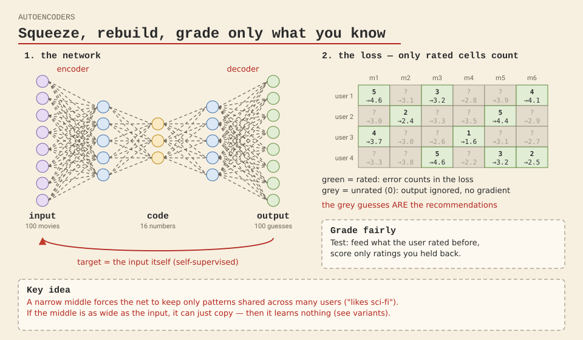
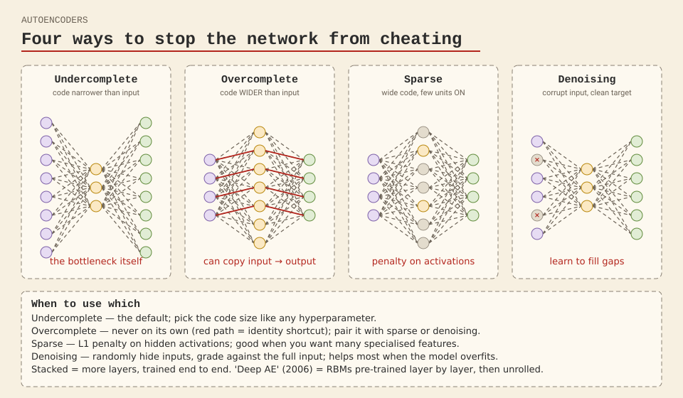

# Autoencoders

> **How to read this note.** Study guide for *Deep Learning A-Z*, Part 6: section 22 (intuition), section 23 (building a movie-rating autoencoder in PyTorch) and section 24 (a single article linking to an external YouTube workshop that builds two recommenders on AWS, one for e-commerce and one for Netflix movies; the workshop isn't part of the course, so it isn't summarised here). Read §1–2 before the build lectures and §3 alongside the intuition lectures on variants. §4 maps the course's code onto today's APIs. Every snippet runs on its own with a seeded synthetic dataset shaped like MovieLens, because the course's data files aren't bundled here.

## Why This Exists

**Problem.** "Train a network to output its own input" sounds pointless. The tricks that make it useful — a narrow middle, masking missing values, corrupting inputs — are easy to state and easy to get subtly wrong. Use the wrong loss and the model learns from the zeros that mean "unrated". Use the wrong layer width and it learns to copy. Use the wrong test protocol and the score is fiction.

**Key insight.** An autoencoder is a network forced to describe each input with a few numbers (the **code**) and then rebuild the input from them. Because the code is small, the network has to discover patterns shared across many inputs. For ratings, "this user likes sci-fi" is cheaper to store than 100 separate ratings. The rebuilt values for the cells the user *didn't* rate are the recommendations.

**Reach for this when:**
- Working through Deep Learning A-Z Part 6, or any "autoencoder recommender" tutorial.
- You want compressed features, anomaly scores (high reconstruction error = unusual) or a denoiser, without labels.
- A ratings or interaction matrix has many missing cells and you want to fill them in.

**Don't reach for this when:**
- You want embeddings for *similarity search*. Contrastive training does that far better — see [embedding-training](../ml-systems/embedding-training.md).
- You're building a production recommender. Start from matrix factorization or a two-tower model — see [behavioral-embeddings](../ml-systems/behavioral-embeddings.md). Autoencoders are a fine alternative, not the default.
- You want to *generate* new samples. That's a VAE or a diffusion model, a different note.

## Diagrams





## 1. The idea in four inputs

**The question.** Can a network store 4 different things in 2 numbers?

Take 4 movies, and say each user liked exactly one, so each input is one-hot. A 4 → 2 → 4 network has to give each movie its own pair of numbers in the middle, then decode the pair back.

```python
import torch, torch.nn as nn
torch.manual_seed(0)
X = torch.eye(4)                                     # 4 movies, one-hot: "the one movie this user liked"
ae = nn.Sequential(nn.Linear(4, 2), nn.Tanh(), nn.Linear(2, 4))   # 4 -> 2 -> 4
opt = torch.optim.Adam(ae.parameters(), lr=0.05)
for _ in range(500):
    loss = nn.functional.cross_entropy(ae(X), X.argmax(1))        # rebuild which movie it was
    opt.zero_grad(); loss.backward(); opt.step()
codes = ae[1](ae[0](X)).detach()                     # the 2-number bottleneck for each input
print("codes:\n", codes.round(decimals=2))
print("rebuilt:", ae(X).argmax(1).tolist())
# Expected output:
# codes:
#  tensor([[ 0.9800, -0.9700],
#         [-0.9400,  0.9400],
#         [-0.9900, -0.9900],
#         [ 0.9700,  0.9900]])
# rebuilt: [0, 1, 2, 3]
```

The network *learned* the four corners of a square, (+,−), (−,+), (−,−), (+,+), as codes. Nobody told it to. That's the whole idea: the bottleneck forces a compact description.

The course draws the same idea with hand-set weights of +1 and −1 instead of learned ones. Wiring it up by hand shows that two numbers really are enough for four one-hot inputs:

```python
import numpy as np
X = np.eye(4)                                       # 4 users, each liked exactly one of 4 movies
enc = np.array([[1, 1], [1, -1], [-1, 1], [-1, -1]])   # hand-picked weights: each movie gets a +/-1 corner
code = X @ enc                                      # 2 numbers per user
dec = enc.T                                         # decoder reuses the same +/-1 pattern
scores = code @ dec                                 # the right movie scores 2, the others 0 or -2
print("codes:", code.tolist())
print("scores row 0:", scores[0].tolist(), "| rebuilt:", scores.argmax(1).tolist())
# Expected output:
# codes: [[1.0, 1.0], [1.0, -1.0], [-1.0, 1.0], [-1.0, -1.0]]
# scores row 0: [2.0, 0.0, 0.0, -2.0] | rebuilt: [0, 1, 2, 3]
```

The decoder's output scores the right movie highest, and softmax (or argmax) picks it. Training finds weights like these on its own, as the learned codes above show.

**Parts and their roles.**
- **Encoder** — layers that shrink the input to the code. Usually a nonlinearity such as sigmoid, tanh or ReLU.
- **Code** (bottleneck, latent vector) — the compressed description.
- **Decoder** — layers that expand the code back to input size. The last layer is often *linear*, so it can output any rating value.
- **Bias** — every layer has a constant added ($Wx + b$). Some diagrams draw it as an extra node.
- **Self-supervised** — the target is the input itself, so no labels are needed.

## 2. A movie recommender autoencoder

**The setup.** One row per user, one column per movie. A cell holds 1–5 stars, or **0 for "not rated"**. The course uses MovieLens 100K: 943 users × 1682 movies, with the ready-made `u1.base` / `u1.test` split. The snippets below build a 300 × 100 synthetic matrix of the same kind, so they run anywhere.

**Two rules make it work.**
1. **Mask the loss.** A 0 means *unknown*, not "zero stars". Compute the error only on rated cells. The unrated cells get no gradient, and their outputs become the predictions.
2. **Test on ratings the model never saw.** Feed the user's *training* ratings in, then score the prediction against the *held-out* ratings.

### PyTorch

```python
import numpy as np, torch, torch.nn as nn
torch.manual_seed(0)
rng = np.random.default_rng(0)                        # synthetic MovieLens-style data: 300 users x 100 movies
taste, genre = rng.normal(size=(300, 2)), rng.normal(size=(100, 2))   # 2 hidden "genres"
stars = np.clip(np.round(3 + 1.2 * taste @ genre.T + 0.5 * rng.normal(size=(300, 100))), 1, 5)
rated = rng.random((300, 100)) < 0.25                 # each user rated ~25% of movies
held = rated & (rng.random((300, 100)) < 0.2)         # hide ~20% of those ratings for testing
train = np.where(rated & ~held, stars, 0).astype("float32")   # 0 = unrated
test = np.where(held, stars, 0).astype("float32")
train, test = torch.tensor(train), torch.tensor(test)
model = nn.Sequential(nn.Linear(100, 16), nn.Sigmoid(),  # encoder: 100 movies -> 16 "taste" numbers
                      nn.Linear(16, 100))                # decoder: back to 100 predicted ratings
opt = torch.optim.Adam(model.parameters(), lr=0.01)
def masked_mse(pred, target):
    m = target > 0                                       # only cells the user actually rated
    return ((pred - target)[m] ** 2).mean()
for epoch in range(600):
    loss = masked_mse(model(train), train)              # input = target = what the user rated
    opt.zero_grad(); loss.backward(); opt.step()
with torch.no_grad():
    pred = model(train)                                  # feed what we KNOW, score what we held out
    movie_mean = (train.sum(0) / (train > 0).sum(0).clamp(min=1)).expand_as(test)
    print("train RMSE:", round(loss.sqrt().item(), 3))
    print("test  RMSE:", round(masked_mse(pred, test).sqrt().item(), 3))
    print("baseline (movie average) test RMSE:", round(masked_mse(movie_mean, test).sqrt().item(), 3))
# Expected output:
# train RMSE: 0.629
# test  RMSE: 0.788
# baseline (movie average) test RMSE: 1.292
```

Read it: the model's guesses on held-out ratings are off by about 0.8 stars, against 1.3 for "predict each movie's average". **Always print a baseline** — without one, "0.8 stars" means nothing.

### Keras

The same model. The only real work is the masked loss.

```python
import os; os.environ.setdefault("KERAS_BACKEND", "torch")   # works on tensorflow / jax too
import numpy as np, keras
keras.utils.set_random_seed(0)
rng = np.random.default_rng(0)                        # synthetic MovieLens-style data: 300 users x 100 movies
taste, genre = rng.normal(size=(300, 2)), rng.normal(size=(100, 2))   # 2 hidden "genres"
stars = np.clip(np.round(3 + 1.2 * taste @ genre.T + 0.5 * rng.normal(size=(300, 100))), 1, 5)
rated = rng.random((300, 100)) < 0.25                 # each user rated ~25% of movies
held = rated & (rng.random((300, 100)) < 0.2)         # hide ~20% of those ratings for testing
train = np.where(rated & ~held, stars, 0).astype("float32")   # 0 = unrated
test = np.where(held, stars, 0).astype("float32")
def masked_mse(y_true, y_pred):                         # ignore unrated (0) cells in the loss
    m = keras.ops.cast(y_true > 0, "float32")
    return keras.ops.sum(m * (y_pred - y_true) ** 2) / keras.ops.maximum(keras.ops.sum(m), 1.0)
model = keras.Sequential([keras.Input((100,)),
                          keras.layers.Dense(16, activation="sigmoid"),   # encoder
                          keras.layers.Dense(100)])                        # decoder
model.compile(optimizer=keras.optimizers.Adam(0.01), loss=masked_mse)
model.fit(train, train, epochs=600, batch_size=300, verbose=0)   # full batch, like the torch version
pred = model.predict(train, verbose=0)
m = test > 0
print("test RMSE:", round(float(np.sqrt(((pred - test)[m] ** 2).mean())), 3))
# Expected output:
# test RMSE: 0.756
```

The two versions land close but not identical (0.788 vs 0.756). Keras and PyTorch start the weights differently — Glorot-uniform with zero biases vs Kaiming-uniform — and with 300 epochs instead of 600 the Keras model was still well behind. Same architecture ≠ same training run.

**Making a recommendation** for one user: run their row through the model, ignore movies they already rated, sort the rest by predicted rating.

## 3. Variants — four ways to stop the network cheating

### Overcomplete: the copy shortcut
If the code is as wide as the input or wider, the network can pass each input straight through. The loss hits zero and it has learned nothing.

```python
import torch, torch.nn as nn
torch.manual_seed(0)
X = torch.randn(256, 8)                              # 8 random features, no structure to find
ae = nn.Sequential(nn.Linear(8, 16, bias=False), nn.Linear(16, 8, bias=False))   # hidden WIDER than input
opt = torch.optim.Adam(ae.parameters(), lr=0.01)
for _ in range(2000):
    loss = ((ae(X) - X) ** 2).mean()
    opt.zero_grad(); loss.backward(); opt.step()
W = ae[1].weight @ ae[0].weight                      # end-to-end map, 8 x 8
print("loss:", round(loss.item(), 5))
print("distance from identity:", round((W - torch.eye(8)).norm().item(), 3))
# Expected output:
# loss: 0.0
# distance from identity: 0.0
```

Perfect reconstruction of pure noise, and the end-to-end map is exactly the identity matrix. A wide code needs one of the regularizers below.

### Sparse: wide code, few units on
Keep the wide layer but penalize hidden activations (an L1 penalty), so each input may only light up a few units. Different inputs use different units, so the network can't copy.

```python
import os; os.environ.setdefault("KERAS_BACKEND", "torch")
import numpy as np, keras
rng = np.random.default_rng(0)
X = (rng.random((2000, 32)) < 0.15).astype("float32")      # 2000 sparse binary rows, 32 features
for l1 in (0.0, 1e-2):                                     # 0 = plain, 1e-2 = sparse autoencoder
    keras.utils.set_random_seed(0)
    enc = keras.layers.Dense(64, activation="relu",         # OVERcomplete: 64 hidden > 32 inputs
                             activity_regularizer=keras.regularizers.L1(l1))  # penalty on activations
    model = keras.Sequential([keras.Input((32,)), enc, keras.layers.Dense(32, activation="sigmoid")])
    model.compile("adam", "binary_crossentropy")
    model.fit(X, X, epochs=30, batch_size=64, verbose=0)
    h = keras.Sequential([keras.Input((32,)), enc]).predict(X, verbose=0)   # hidden activations
    loss = model.evaluate(X, X, verbose=0)
    print(f"L1={l1}: active hidden units per row = {(h > 1e-3).sum(1).mean():.1f} / 64, loss {loss:.3f}")
# Expected output:
# L1=0.0: active hidden units per row = 57.3 / 64, loss 0.022
# L1=0.01: active hidden units per row = 22.1 / 64, loss 0.252
```

The penalty cuts active units from 57 to 22 per row. The reported loss includes the penalty term, so it isn't pure reconstruction error. (*k-sparse* autoencoders do the same thing by keeping only the top-$k$ activations.)

### Denoising: corrupt the input, grade against the clean version
Randomly hide some inputs on every pass, but compute the loss against the *full* known input. The network must learn to fill gaps from the other values — exactly the recommender's job.

```python
import numpy as np, torch, torch.nn as nn
rng = np.random.default_rng(0)                        # same synthetic ratings as above
taste, genre = rng.normal(size=(300, 2)), rng.normal(size=(100, 2))
stars = np.clip(np.round(3 + 1.2 * taste @ genre.T + 0.5 * rng.normal(size=(300, 100))), 1, 5)
rated = rng.random((300, 100)) < 0.25
held = rated & (rng.random((300, 100)) < 0.2)
train = torch.tensor(np.where(rated & ~held, stars, 0), dtype=torch.float32)
test = torch.tensor(np.where(held, stars, 0), dtype=torch.float32)
def mse(p, t): m = t > 0; return ((p - t)[m] ** 2).mean()
for hidden, drop in [(16, 0.0), (16, 0.3), (128, 0.0), (128, 0.3)]:   # drop 0 = plain AE, 0.3 = denoising
    torch.manual_seed(0)
    model = nn.Sequential(nn.Linear(100, hidden), nn.Sigmoid(), nn.Linear(hidden, 100))
    opt = torch.optim.Adam(model.parameters(), lr=0.01)
    for _ in range(600):
        noisy = train * (torch.rand_like(train) > drop)   # hide some known ratings from the INPUT
        loss = mse(model(noisy), train)                    # ...but grade against ALL known ratings
        opt.zero_grad(); loss.backward(); opt.step()
    with torch.no_grad():
        print(f"hidden={hidden:3d} drop={drop}: test RMSE {mse(model(train), test).sqrt().item():.3f}")
# Expected output:
# hidden= 16 drop=0.0: test RMSE 0.788
# hidden= 16 drop=0.3: test RMSE 0.874
# hidden=128 drop=0.0: test RMSE 1.135
# hidden=128 drop=0.3: test RMSE 0.957
```

Read it carefully, because this is the real lesson. With a small code (16) the plain model isn't overfitting, so the noise only hurts (0.788 → 0.874). With a wide code (128) the plain model overfits badly (1.135), and denoising rescues much of it (0.957). **Regularizers fix overfitting; they don't improve a model that isn't overfitting.**

### Contractive (concept only)
Add a penalty on how much the code changes when the input changes slightly — the size of the encoder's Jacobian. The code becomes insensitive to tiny input wiggles. It has the same goal as denoising, reached analytically instead of by sampling noise. Rarely used today.

### Stacked vs "deep"
- **Stacked autoencoder (literature sense)** — shallow autoencoders trained greedily one layer at a time: train the first on the input, train the second on the first one's codes, and so on. The trained encoders are then stacked and the whole network is fine-tuned with backprop (Vincent et al. 2010, §3.5; denoising autoencoders are the usual building block).
- **Deep autoencoder (2006 sense)** — the same greedy pre-train-then-fine-tune recipe, but each layer is a [restricted Boltzmann machine](boltzmann-machines.md). After pre-training, the stack is "unrolled" into an encoder–decoder and fine-tuned with backprop. The two differ in the building block (autoencoder vs RBM), not in whether there is pre-training.
- **What the course builds** — a multi-layer autoencoder (for example 100 → 20 → 10 → 20 → 100) trained end to end with backprop and **no** layer-wise pre-training. The course still names its class `SAE` for *stacked* (not sparse), and many people use "stacked" this loosely today. Modern initialization and optimizers are why skipping pre-training works.

## 4. Reading the course's code with modern eyes

The build lectures were recorded on an early PyTorch. The ideas hold up; some details need translating.

| In the course code | What it means / modern equivalent |
|---|---|
| `Variable(...)` wrappers, `loss.data[0]` | `Variable` is gone; tensors track gradients directly. Use `loss.item()`. |
| Output set to 0 wherever the target is 0, before the loss | The masking trick from §2. A boolean index (`(pred - target)[mask]`) does the same thing more clearly. |
| Loss × `nb_movies / (rated + 1e-10)` ("mean corrector") | `MSELoss` averages over *all* columns. This rescales it to an average over rated columns only, which is exactly what a masked mean computes directly. |
| `RMSprop(..., weight_decay=0.5)` described as decay | `weight_decay` is an **L2 penalty on weights**, not learning-rate decay. 0.5 is very strong, which may be why training was slow. Try 1e-4 to 1e-2, or `AdamW`. |
| One user per optimizer step, 200 epochs | Online SGD (batch size 1). Mini-batches of 32–256 users train faster and more smoothly. |
| Test input = training row, target = test row | Correct protocol — keep it. |
| Homework challenge (lecture 140): write the function that turns (user, movie, rating) rows into one list per user with 0 for unrated movies | It's a pivot: `df.pivot_table(index='user', columns='movie', values='rating', fill_value=0)` — or `np.zeros((n_users, n_movies))` filled by fancy indexing `M[users-1, movies-1] = ratings`. |
| Epochs and sizes tuned against the test score | That turns the test set into a validation set. Hold out a separate validation split for tuning and touch the test set once. |
| Reported loss = average of per-user RMSE | Not the same as RMSE pooled over all test ratings; users with few ratings count as much as heavy raters. Report pooled RMSE plus a baseline. |

## Trade-offs

- **Code size.** Too small loses detail and underfits; too large memorizes or copies. It's a hyperparameter — tune it on validation data.
- **Autoencoder vs matrix factorization for ratings.** An autoencoder gives a nonlinear model and a natural way to add side features, but it trains slower and has more knobs. MF is simpler, faster and often just as accurate on explicit ratings.
- **Denoising/sparse regularization.** Better generalization when overfitting, at the cost of slower training and worse fit when you weren't overfitting (see §3).
- **Unrated = 0 as input.** Simple, but the input layer can't tell "unrated" from a real low value. Masking fixes the *loss*, not the input. Alternatives: a separate "rated" indicator input, or a model that only reads observed entries.

## Common Pitfalls

- **Unmasked loss on a sparse matrix.** The model learns to predict 0 for everything, because most cells are 0. Mask unrated cells out of the loss.
- **Testing on the training ratings.** Training RMSE on the same ratings is a memorization score. Hide some ratings, feed the rest, score the hidden ones.
- **No baseline.** Report the movie-average (or user-average) RMSE next to the model's; otherwise you can't tell if it learned anything.
- **Overcomplete without regularization.** Hidden ≥ input lets the net copy (§3). Add sparsity or denoising, or narrow the code.
- **Confusing `weight_decay` with learning-rate decay.** One shrinks weights (L2), the other shrinks step size over time (a scheduler). Different knobs, different effects.
- **Reading meaning into single hidden units.** "This neuron is horror" is a story, not a finding; hidden units are usually mixtures. Inspect them before claiming anything.
- **Using an autoencoder's code for similarity search.** It keeps whatever helps reconstruction, not what makes items alike for *your* task (see [embedding-training](../ml-systems/embedding-training.md) §1).

## Decision Table

| Scenario | Use this | Not that | Why |
|----------|----------|----------|-----|
| Fill in a ratings matrix, learning exercise | Masked-loss autoencoder (§2) | Unmasked MSE | 0 means unknown, not zero stars |
| Model overfits (train ≪ test error) | Denoising input corruption or weight decay | Wider code | Regularizers fix overfitting |
| Want a wide, specialised feature layer | Sparse AE (L1 on activations) | Plain overcomplete AE | Plain overcomplete just copies |
| Anomaly detection without labels | Undercomplete AE; flag high reconstruction error | Classifier | No fraud labels to train on |
| Production recommender | MF / two-tower ([behavioral-embeddings](../ml-systems/behavioral-embeddings.md)) | Autoencoder first | Simpler, scalable, strong baseline |
| Similarity / search embeddings | Contrastive training ([embedding-training](../ml-systems/embedding-training.md)) | AE bottleneck | Reconstruction ≠ similarity |
| Generate new samples | VAE / diffusion | Plain AE | A plain AE's code space has holes |

## References

- Goodfellow, Bengio & Courville — [*Deep Learning*, ch. 14: Autoencoders](https://www.deeplearningbook.org/contents/autoencoders.html) — undercomplete, sparse, denoising, contractive in one chapter.
- Hinton & Salakhutdinov — *Reducing the Dimensionality of Data with Neural Networks*, Science 313 (2006) — the RBM-pretrained deep autoencoder.
- [Vincent et al. — Stacked Denoising Autoencoders (JMLR 2010)](https://www.jmlr.org/papers/v11/vincent10a.html)
- [Makhzani & Frey — k-Sparse Autoencoders (2013)](https://arxiv.org/abs/1312.5663)
- [Rifai et al. — Contractive Auto-Encoders (ICML 2011)](https://icml.cc/2011/papers/455_icmlpaper.pdf)
- Sedhain et al. — *AutoRec: Autoencoders Meet Collaborative Filtering*, WWW 2015 — the masked-loss rating autoencoder.
- [Liang et al. — Variational Autoencoders for Collaborative Filtering (2018)](https://arxiv.org/abs/1802.05814) — the modern autoencoder recommender.
- [MovieLens 100K dataset](https://grouplens.org/datasets/movielens/100k/) — the course's data (`u1.base`, `u1.test`).
- [Keras regularizers (activity_regularizer)](https://keras.io/api/layers/regularizers/) · [PyTorch RMSprop (`weight_decay` = L2)](https://docs.pytorch.org/docs/stable/generated/torch.optim.RMSprop.html)

## See Also

- [boltzmann-machines](boltzmann-machines.md) — Part 5: the same movie data with an RBM; the building block of the 2006 deep autoencoder.
- [behavioral-embeddings](../ml-systems/behavioral-embeddings.md) — how recommenders are usually built (MF, BPR, two-tower), and how to evaluate them.
- [embedding-training](../ml-systems/embedding-training.md) — why an autoencoder's bottleneck is a weak similarity embedding.
- [linear-algebra](../math-for-ml/linear-algebra.md) — a linear autoencoder learns the same subspace as PCA.
