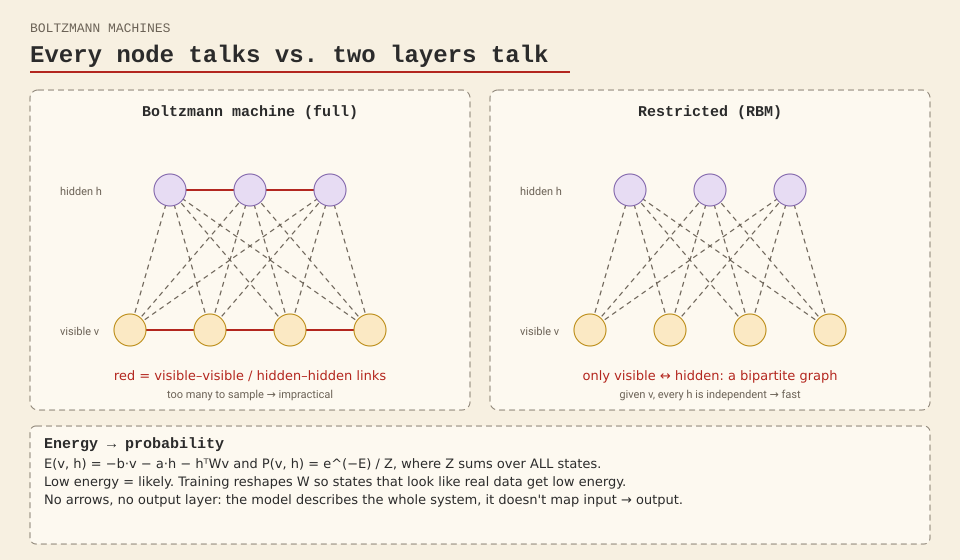
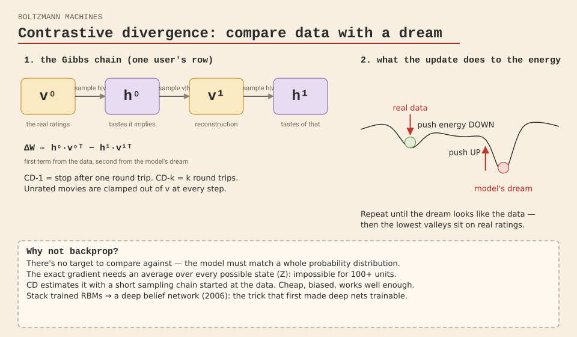

# Boltzmann Machines and RBMs

> **How to read this note.** Study guide for *Deep Learning A-Z*, Part 5: section 19 (intuition) and section 20 (building an RBM recommender in PyTorch). §1–3 go with the intuition lectures, §4 with the build. Everything runs on a seeded synthetic ratings matrix shaped like the course's MovieLens data. Historically important, rarely used today — learn the ideas (energy, sampling, contrastive learning), not the architecture as a tool.

## Why This Exists

**Problem.** Every network so far maps an input to an output and learns by backprop. A Boltzmann machine has no output and no backprop, and its "training" is a sampling procedure. Without a clear picture, the course's code looks like magic: why sample random 0/1 values, why go back and forth between layers, why subtract two matrix products?

**Key insight.** A Boltzmann machine gives every possible state of the system (every combination of 0/1 units) an **energy**, and low energy means likely. Training reshapes the energy so states that look like real data become valleys. To know where to dig, it compares the real data with what the model *imagines* after a short round trip (a "dream") — and moves the weights toward the data and away from the dream. That's **contrastive divergence**.

**Reach for this when:**
- Working through Deep Learning A-Z Part 5.
- Reading older deep learning papers (2006–2012): deep belief networks, RBM pre-training.
- You want intuition for energy-based models, which come back in modern forms such as score-based diffusion and contrastive learning.

**Don't reach for this when:**
- You need a recommender that works in production — use [behavioral-embeddings](../ml-systems/behavioral-embeddings.md) (matrix factorization, two-tower) or an [autoencoder](autoencoders.md).
- You need a generative model today — VAEs, GANs, diffusion and autoregressive transformers replaced RBMs.

## Diagrams





## 1. What makes it different from every other network

| ANN / CNN / RNN / autoencoder | Boltzmann machine |
|---|---|
| Directed: arrows from input to output | Undirected: a link means "these two units influence each other" |
| Has an output layer | No output — it models the whole system |
| Deterministic forward pass | Stochastic: units switch on with a probability |
| Trained by backprop on a loss | Trained by sampling (contrastive divergence) |

**Visible units** are what you observe (movie liked or not). **Hidden units** are things you don't observe but that explain the data ("likes action", "likes Oscar dramas" — the model never gets these names, only patterns). The usual motivating picture, Hinton's, is a power plant: train on readings from normal operation, and the model learns which combinations of readings are "normal". A reading combination the model finds very unlikely signals a fault — even though you never had examples of faults.

## 2. Energy and probability

Each joint state of visible $v$ and hidden $h$ gets an energy:

$$E(v, h) = -b^\top v - a^\top h - h^\top W v \qquad P(v, h) = \frac{e^{-E(v,h)}}{Z}$$

$Z$ sums $e^{-E}$ over **every** possible state, which is why exact training is impossible for real sizes ($2^{1782}$ states for 1682 movies + 100 hidden units). With 3 movies and 2 hidden units you can enumerate everything:

```python
import itertools, numpy as np
# A tiny RBM: 3 visible units (movies), 2 hidden units (tastes). Enumerate EVERY state exactly.
W = np.array([[2.0, 2.0, -1.0],                      # hidden 0 "likes action": wants movies 0,1 on
              [-1.0, -1.0, 2.0]])                    # hidden 1 "likes drama":  wants movie 2 on
a, b = np.array([-1.0, -1.0]), np.zeros(3)           # hidden biases a, visible biases b
def energy(v, h): return -(v @ b + h @ a + h @ W @ v)  # E(v,h) = -b.v - a.h - h.W.v
states = [(np.array(v), np.array(h)) for v in itertools.product([0, 1], repeat=3)
          for h in itertools.product([0, 1], repeat=2)]
E = np.array([energy(v, h) for v, h in states])
p = np.exp(-E) / np.exp(-E).sum()                    # Boltzmann distribution: low energy = likely
pv = {}                                              # P(v) = sum over hidden states
for (v, h), pi in zip(states, p): k = tuple(int(x) for x in v); pv[k] = pv.get(k, 0) + pi
for v, pi in sorted(pv.items(), key=lambda kv: -kv[1])[:4]:
    print("movies on/off", v, " P =", round(float(pi), 3))
# Expected output:
# movies on/off (1, 1, 0)  P = 0.394
# movies on/off (1, 1, 1)  P = 0.204
# movies on/off (0, 0, 1)  P = 0.075
# movies on/off (0, 1, 0)  P = 0.075
```

The weights *are* the model: the "action" hidden unit makes "movies 0 and 1 together" the most likely viewer profile. Training is the reverse problem — find weights that make the observed profiles likely.

## 3. Restricted, Gibbs sampling and contrastive divergence

**Why "restricted".** A full Boltzmann machine also links visible to visible and hidden to hidden. An RBM drops those links, leaving a bipartite graph. The payoff: given the visible units, every hidden unit is independent, so one matrix multiply gives all their probabilities, and the same holds in the other direction:

$$P(h_j = 1 \mid v) = \sigma(a_j + W_{j,:} v) \qquad P(v_i = 1 \mid h) = \sigma(b_i + W_{:,i}^\top h)$$

**Gibbs sampling.** Alternate: sample $h$ from $v$, then a new $v$ from $h$, and so on. Run long enough and the samples come from the model's own distribution — its "dreams".

**Contrastive divergence (CD-k).** The exact gradient is "statistics of the data minus statistics of the model". CD approximates the second part by starting a Gibbs chain *at the data* and stopping after $k$ round trips:

$$\Delta W \propto h^{(0)} v^{(0)\top} - h^{(k)} v^{(k)\top}$$

CD-1 (one round trip) is the classic choice and usually enough. Training on ratings adds one twist: **unrated movies are clamped out** at every step, so they never pull on the weights.

**Stacking.**
- **Deep belief network (DBN):** train an RBM, feed its hidden activations as data to a second RBM, repeat (*greedy layer-wise* training). The top two layers stay undirected and the lower ones become directed. In 2006 this was how deep nets first trained well; the same pre-training seeded the "deep autoencoder" in [autoencoders](autoencoders.md).
- **Deep Boltzmann machine (DBM):** a stack where *every* layer stays undirected. Harder to train; mostly of research interest.

## 4. An RBM movie recommender

**The data.** Users × movies, converted to binary: **1 = liked** (3+ stars), **0 = disliked**, **−1 = unrated**. The course does exactly this with MovieLens 100K (943 × 1682) and trains in PyTorch from scratch, because no library layer exists for an RBM. Here it's 300 × 100 synthetic ratings with about 20% of known ratings held out for testing.

### PyTorch

```python
import numpy as np, torch
torch.manual_seed(0); rng = np.random.default_rng(0)
taste, genre = rng.normal(size=(300, 2)), rng.normal(size=(100, 2))      # same synthetic users x movies
stars = np.clip(np.round(3 + 1.2 * taste @ genre.T + 0.5 * rng.normal(size=(300, 100))), 1, 5)
rated = rng.random((300, 100)) < 0.25
held = rated & (rng.random((300, 100)) < 0.2)
like = (stars >= 3).astype("float32")                                     # 1 = liked (3+ stars), 0 = disliked
train = torch.tensor(np.where(rated & ~held, like, -1), dtype=torch.float32)  # -1 = unrated
test = torch.tensor(np.where(held, like, -1), dtype=torch.float32)
nv, nh = 100, 20
W, a, b = 0.01 * torch.randn(nh, nv), torch.zeros(nh), torch.zeros(nv)   # weights, hidden bias, visible bias
def sample_h(v): p = torch.sigmoid(v @ W.T + a); return p, torch.bernoulli(p)   # P(h=1 | v)
def sample_v(h): p = torch.sigmoid(h @ W + b); return p, torch.bernoulli(p)     # P(v=1 | h)
for epoch in range(100):
    for i in range(0, 300, 30):                                           # mini-batches of 30 users
        v0 = train[i:i + 30]; known = v0 >= 0
        x0 = v0.clamp(min=0)                                              # unrated -1 -> 0 as input
        ph0, h = sample_h(x0)
        for _ in range(1):                                                # CD-1: one Gibbs round trip
            _, vk = sample_v(h); vk = vk * known                          # unrated cells stay out of it
            phk, h = sample_h(vk)
        W += 0.1 * (ph0.T @ x0 - phk.T @ vk) / 30                        # data stats minus model stats
        b += 0.1 * (x0 - vk).mean(0); a += 0.1 * (ph0 - phk).mean(0)
p_like, _ = sample_v(sample_h(train.clamp(min=0))[0])                     # one up-down pass, probabilities
m = test >= 0
acc = ((p_like > 0.5).float()[m] == test[m]).float().mean().item()
base = (test[m] == 1).float().mean().item()                               # always guess "liked"
print(f"test accuracy {acc:.3f}   always-'like' baseline {base:.3f}")
# Expected output:
# test accuracy 0.812   always-'like' baseline 0.638
```

No `loss.backward()` anywhere — the update line *is* the learning rule. Two details beyond the course's version: the prediction uses **probabilities** rather than one random 0/1 draw (smoother, repeatable), and the score is printed **next to a baseline**.

**A warning from tuning this.** With learning rate 0.05 instead of 0.1, the same RBM scored 0.63 — *exactly* the always-"like" baseline, for CD-1 and CD-5 alike. It looked like it had learned something ("63% correct!") while predicting "like" for nearly everything. Without the baseline line you'd never notice.

### Keras

Keras has no RBM layer, and `model.fit()` can't help, because CD isn't gradient descent on a loss. The same math in `keras.ops` runs on any backend (TensorFlow, JAX, PyTorch):

```python
import os; os.environ.setdefault("KERAS_BACKEND", "torch")
import numpy as np, keras
from keras import ops                                                    # backend-agnostic tensor math
keras.utils.set_random_seed(0); rng = np.random.default_rng(0)
taste, genre = rng.normal(size=(300, 2)), rng.normal(size=(100, 2))      # same synthetic users x movies
stars = np.clip(np.round(3 + 1.2 * taste @ genre.T + 0.5 * rng.normal(size=(300, 100))), 1, 5)
rated = rng.random((300, 100)) < 0.25
held = rated & (rng.random((300, 100)) < 0.2)
like = (stars >= 3).astype("float32")
train = np.where(rated & ~held, like, -1).astype("float32")              # -1 = unrated
test = np.where(held, like, -1).astype("float32")
W = keras.Variable(0.01 * rng.normal(size=(20, 100)).astype("float32"))  # no layers, no fit(): CD isn't backprop
a, b = keras.Variable(np.zeros(20, "float32")), keras.Variable(np.zeros(100, "float32"))
bern = lambda p: ops.cast(keras.random.uniform(ops.shape(p)) < p, "float32")    # Bernoulli sample
for epoch in range(100):
    for i in range(0, 300, 30):
        v0 = ops.convert_to_tensor(train[i:i + 30]); known = ops.cast(v0 >= 0, "float32")
        x0 = ops.maximum(v0, 0.0)
        ph0 = ops.sigmoid(x0 @ ops.transpose(W) + a)
        vk = bern(ops.sigmoid(bern(ph0) @ W + b)) * known                 # CD-1 reconstruction
        phk = ops.sigmoid(vk @ ops.transpose(W) + a)
        W.assign_add(0.1 * (ops.transpose(ph0) @ x0 - ops.transpose(phk) @ vk) / 30)
        b.assign_add(0.1 * ops.mean(x0 - vk, 0)); a.assign_add(0.1 * ops.mean(ph0 - phk, 0))
x = ops.convert_to_tensor(np.maximum(train, 0))
p_like = ops.convert_to_numpy(ops.sigmoid(ops.sigmoid(x @ ops.transpose(W) + a) @ W + b))
m = test >= 0
print(f"test accuracy {((p_like > 0.5) == test)[m].mean():.3f}   always-'like' baseline {(test[m] == 1).mean():.3f}")
# Expected output:
# test accuracy 0.808   always-'like' baseline 0.638
```

### Reading the course's code with modern eyes

| In the course code | What it means / modern equivalent |
|---|---|
| `torch.FloatTensor(list_of_lists)`, `Variable`-era idioms | `torch.tensor(..., dtype=torch.float32)`; tensors need no wrapper. |
| Ratings: 0 → −1 first, then 1–2 → 0, then 3+ → 1 | Order matters: recode "unrated" *before* turning low ratings into 0, or they collide. |
| `sample_h` / `sample_v` return probabilities *and* a Bernoulli sample | Same as above. Use probabilities for scoring, samples inside the chain. |
| CD-10 during training, 1 step at test | Any small $k$ works; CD-1 is standard. At test you only need one up-down pass. |
| Loss = mean absolute difference on rated cells | Fine as a monitor (CD doesn't minimize it). With 0/1 targets, 1 − MAE is accuracy — compare it against "always like". The course's *Evaluating the Boltzmann Machine* article reports a test distance of about 0.24 (≈ 75% correct) and an RMSE of about 0.46. On 0/1 targets RMSE is just √(error rate), so the two say the same thing, and random guessing scores 0.5 / 0.71. Neither number is compared with the always-like rate. |
| Test input = training row, target = test row | Correct protocol — keep it. |

## 5. Star ratings as softmax units (*Recommender Systems and Deep Learning in Python*)

Section 6 of *Recommender Systems and Deep Learning in Python* builds the same RBM recommender on the same kind of data, but **keeps the stars** instead of collapsing them to like/dislike — and it supplies the piece §3 takes as given: where the contrastive-divergence update rule comes from. That course writes the hidden bias $c$ where §2 writes $a$; the energy function and both conditionals are otherwise identical, so the two sections compose.

### One categorical unit per movie, K levels per unit

The binary trick in §4 — liked if 3+ stars, disliked otherwise — throws away rating strength, and you cannot simply feed 1–5 into a sigmoid, whose output is confined to $[0, 1]$. Rescaling stars onto $[0, 1]$ the way you would MNIST pixels is one option. The course follows the Salakhutdinov–Mnih–Hinton paper instead: **every visible unit becomes a K-way categorical distribution** over rating levels, one-hot encoded. MovieLens 20M rates in half-stars from 0.5 to 5.0, so $K = 10$: a 0.5 is `1,0,0,0,0,0,0,0,0,0`, a 5.0 is `0,...,0,1`.

| Tensor | Shape |
|---|---|
| $v$ (one user's ratings) | $D \times K$ |
| $W$ | $D \times K \times M$ |
| $b$ (visible bias) | $D \times K$ |
| $c$ (hidden bias) | $M$ |
| $h$ | $M$ |

Here $D$ = movies, $M$ = hidden units, $K$ = rating classes — a deliberate local override of that course's usual "N users, M movies, K latent dimensions" convention, and worth re-reading the shapes for if you move between its sections.

Hidden units stay Bernoulli, so **visible → hidden keeps the sigmoid**; **hidden → visible becomes a softmax over each movie's K levels**, since exactly one level can be set. The contraction $\sum_{d,k} W[d,k,m]\,v[d,k]$ runs over two axes at once — a "double dot product" with no standard symbol, which is why the code uses `tensordot(V, W, axes=[[1,2],[0,1]])` rather than `matmul`, which insists on 2-D arguments and contracts one axis. Because the energy is still a **scalar**, every step of the free-energy derivation below carries over verbatim with dot products reread as double dots.

**Predicting a star rating.** Argmax over the K softmax outputs is one option; the paper (and the course's code) uses the **probability-weighted average** instead. With probabilities 0.05, 0.10, 0.20, 0.50, 0.15 over one-to-five stars, the weighted average is 3.6 while argmax says 4 — more mass sits below 4 than above it, so the average pulls under. This is the K-class version of §4's "score with probabilities, not one random 0/1 draw". The course sets trying both rules as an exercise and reports no number for either.

### Masking, derived rather than asserted

§3 says unrated movies are "clamped out at every step". This course shows *why* that is the correct thing and not a patch. A missing rating is **already an all-zero K-vector** — no level is set. If you also force the reconstruction $v'$ to all zeros at that movie, then that movie contributes identically to $F(v)$ and $F(v')$, the difference cancels, and **its gradient is exactly zero**: no update, nothing learned from absence.

The consequence is the part people get wrong: the mask has to hit the **reconstruction**, not just the input. Mask only the input and the sampler is free to invent a rating for an unrated movie, which the negative phase then happily learns from. In the course's code the mask is the $N \times D$ "did this user rate it" matrix **repeated K times** — present ratings keep all K entries, because you do not know in advance which one is set.

### Free energy: where CD's update rule comes from

§3 presents $\Delta W \propto h^{(0)} v^{(0)\top} - h^{(k)} v^{(k)\top}$ and the phrase "statistics of the data minus statistics of the model" as a given. The free energy is the missing middle. Define

$$F(v) = -\log \sum_h e^{-E(v,h)} \qquad\Longrightarrow\qquad P(v) = \frac{e^{-F(v)}}{Z}, \quad Z = \sum_{v'} e^{-F(v')}$$

so $Z$ is now a sum over visible states only. Differentiating the negative log-likelihood splits in two:

$$\frac{\partial}{\partial \theta}\big[-\log P(v)\big] = \underbrace{\frac{\partial F(v)}{\partial \theta}}_{\text{positive phase}} - \underbrace{\sum_{v'} P(v')\,\frac{\partial F(v')}{\partial \theta}}_{\text{negative phase}}$$

The positive phase depends only on the data: push the energy of *what you saw* down. The negative phase sums over every possible $v'$ weighted by the model's current belief: push *what the model dreams* up, hardest on states it currently loves but has never observed. The negative phase is an expectation, so approximate it by a sample — draw that sample from a Gibbs chain started at the data, stop after one round trip, and you have CD-1. §3's update is the sampled form of exactly this expression.

$F(v)$ still looks like a sum over $2^M$ hidden states, but it factorises (the sum-product rule) into a closed form that is **linear in M**:

$$F(v) = -b^\top v - \sum_{j=1}^{M} \log\big(1 + e^{\,W[:,j] \cdot v + c_j}\big)$$

**The practical payoff: you never code a gradient.** Define `loss = F(v) - F(v')` and hand it to Adam; autodiff reproduces contrastive divergence. The course is explicit that this is "not a real loss" — just an object whose gradient approximates the true one. §4's hand-written update line is correct, but it reads as though the manual rule were the only way; it is not, and the autodiff version is what you would write today.

One caveat the course never states: `F(v) - F(v')` is right **only if $v'$ is detached**. The TF1 code gets away with it because `Categorical.sample()` and `tf.one_hot` happen to break the graph. Port it with a reparameterised or Gumbel-softmax sampler and you will silently differentiate through the sampling path and get a wrong gradient. Add `.detach()` / `stop_gradient` on purpose rather than by luck.

One aside that connects this note to its neighbour: if you feed the hidden **probabilities** back through instead of a sample, an RBM's round trip is computationally identical to a tied-weight autoencoder with sigmoids at both ends — which is why reconstruction cross-entropy falls during training even though CD never optimises it. Same forward computation, different objective; see [autoencoders](autoencoders.md).

### Against matrix factorization — and the missing numbers

The course places RBM collaborative filtering in the matrix-factorization *lineage* rather than measuring it against one: the section opens by noting that the RBM-CF paper's authors also wrote the probabilistic and Bayesian matrix-factorization papers used earlier in the course, declares the section optional and "very advanced", and notes that Keras cannot express the model, so the code is raw TensorFlow 1. The following section then returns to matrix factorization at scale with Spark ALS. See [matrix-factorization-recommenders](../ml-systems/matrix-factorization-recommenders.md) for that side of the comparison.

**No quantitative comparison can be drawn from this course, because it reports no numbers at all.** Section 6 ends on "our results are not bad" and never reads out an MSE, an epoch count, a batch size, the hidden-unit count $M$, the learning rate, or even the dimensions of the shrunken MovieLens subset it trains on. Train and test MSE curves are plotted; the axes are never quoted. Nor is there a baseline — no global, per-user or per-movie mean to beat — which makes the first entry under Common Pitfalls below the thing to fix before trusting any of it. Take the derivation and the representation from this section; take evidence from somewhere else.

Two smaller differences from §4 worth noting if you read both: this course uses **CD-1 throughout** where *Deep Learning A-Z* used CD-10 at train time and one step at test, and it trains with Adam rather than plain SGD at a fixed learning rate. Neither is a contradiction; both are tuning choices with no reported result behind them here.

## Trade-offs

- **Undirected generative model vs feed-forward net.** An RBM models the joint distribution, so it can fill in *any* missing subset of units. The cost: sampling-based training that's slow, noisy and hard to monitor (no exact likelihood).
- **CD-1 vs CD-k vs persistent CD.** CD-1 is cheap but biased toward the data. Larger $k$ or persistent chains give better generative models at higher cost. For feature learning and recommendation, CD-1 is usually enough.
- **Binary vs real-valued units.** Binary like/dislike keeps the math simple but throws away rating strength. Gaussian visible units or softmax units per rating level keep it, at the price of trickier training.
- **RBM vs autoencoder for the same data.** The autoencoder trains with ordinary backprop and keeps 1–5 stars. The RBM is a probabilistic model you can sample from.

## Common Pitfalls

- **No baseline.** An RBM stuck at "everyone likes everything" still scores the majority-class rate. Always print the always-like (or movie-majority) baseline next to accuracy.
- **Letting unrated cells into the chain.** If −1 / unknown cells are reconstructed and used in the update, the model learns from missing data as if it were dislikes. Clamp them out every step.
- **Expecting a loss to go down like backprop.** CD follows no exact objective, and reconstruction error is only a rough monitor. Track held-out accuracy instead.
- **Learning rate too low or too high.** Too low and it sits at the baseline (see §4); too high and the weights blow up into all-on or all-off units. Watch the hidden activation mean (should be neither ~0 nor ~1).
- **Confusing DBN and DBM.** DBN: directed lower layers, undirected top, trained greedily. DBM: undirected throughout. Different models, often mixed up.
- **Treating hidden units as named genres.** The model only sees 0/1 patterns; a hidden unit is a learned mix, not a label.

## Decision Table

| Scenario | Use this | Not that | Why |
|----------|----------|----------|-----|
| Learning the course material | RBM with CD-1 (§4) | Library search | No maintained RBM layer exists; writing it teaches the idea |
| Fill in a ratings matrix in practice | Matrix factorization / [autoencoder](autoencoders.md) | RBM | Simpler training, keeps rating strength, easier to tune |
| Understand energy-based ideas | §2 enumeration + energy-curve picture | Jumping to diffusion papers | Same "low energy = likely" idea, small enough to see |
| Pre-train a deep net | Modern init + Adam/AdamW | DBN greedy pre-training | Pre-training stopped being necessary around 2012 |
| Anomaly detection, no fault labels | Autoencoder reconstruction error or density model | Full Boltzmann machine | Same idea, practical tools |

## References

- [Hinton — A Practical Guide to Training Restricted Boltzmann Machines (UTML TR 2010-003)](https://www.cs.toronto.edu/~hinton/absps/guideTR.pdf) — learning rates, CD-k, monitoring; the practitioner's manual.
- [Hinton, Osindero & Teh — A Fast Learning Algorithm for Deep Belief Nets (2006)](https://www.cs.toronto.edu/~hinton/absps/fastnc.pdf) — greedy layer-wise DBN training.
- [Salakhutdinov, Mnih & Hinton — Restricted Boltzmann Machines for Collaborative Filtering (ICML 2007)](https://www.cs.toronto.edu/~rsalakhu/papers/rbmcf.pdf) — the RBM recommender (Netflix Prize era).
- [Salakhutdinov & Hinton — Deep Boltzmann Machines (AISTATS 2009)](https://proceedings.mlr.press/v5/salakhutdinov09a.html)
- [Goodfellow, Bengio & Courville — *Deep Learning*, ch. 20: Deep Generative Models](https://www.deeplearningbook.org/contents/generative_models.html) — Boltzmann machines, RBMs, DBNs, DBMs.
- LeCun et al. — *A Tutorial on Energy-Based Learning* (2006) — the general energy-based view.

## See Also

- [autoencoders](autoencoders.md) — Part 6: the same movie data with an autoencoder; the "deep autoencoder" built from stacked RBMs.
- [behavioral-embeddings](../ml-systems/behavioral-embeddings.md) — how recommenders are built and evaluated today.
- [statistics-and-probability](../math-for-ml/statistics-and-probability.md) — Bernoulli sampling, the softmax/Boltzmann connection.
- [markov-chains](../math-for-ml/markov-chains.md) — Gibbs sampling is a Markov chain whose stationary distribution is the model.
