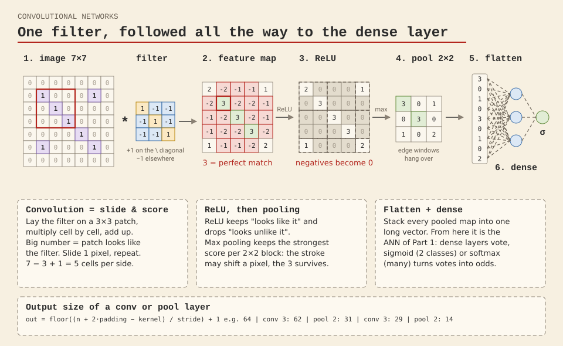
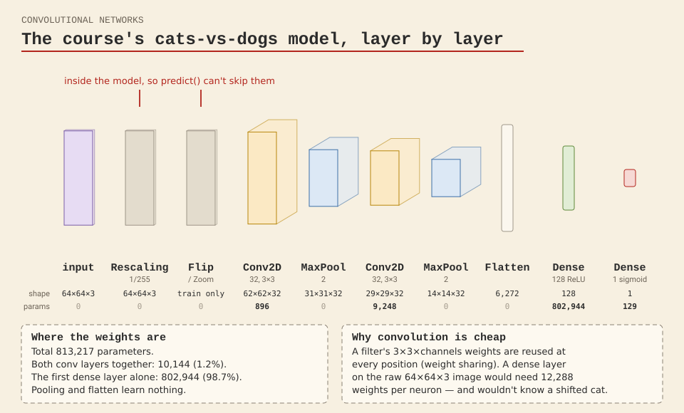

# Convolutional Neural Networks

> **How to read this note.** Study guide for *Deep Learning A-Z*, Part 2: section 7 (intuition), section 8 (building a cats-vs-dogs CNN in Keras) and section 9 (AWS console demos, summarised in §6). Read §1–4 alongside the intuition lectures, §5 alongside the build lectures. The course's 10,000-photo dataset isn't bundled here, so the snippets use small synthetic images of the same shape (64×64 RGB, two classes) and run on a laptop CPU in seconds. Keras snippets need `keras` (and `grain` for the folder loader in §5): `VIRTUAL_ENV=/Users/phahng/Desktop/workarea/.venv uv pip install keras grain`.

## Why This Exists

**Problem.** A plain dense network (the ANN of [Part 1](artificial-neural-networks.md)) treats a 64×64 colour photo as 12,288 unrelated numbers. It has to learn "ear" separately for every position the ear could be in, it needs 12,288 weights per neuron, and it overfits fast. CNN diagrams make it look like magic boxes; the arithmetic underneath is short and worth doing once by hand.

**Key insight.** A CNN slides a small grid of weights (a **filter**) over the image and records how well each patch matches it. The same 9 or 27 weights are reused at every position, so the network learns "what an edge looks like" once and finds it anywhere. Pooling then keeps the strongest match per neighbourhood, so a feature that moves a pixel or two still registers. Everything after that is an ordinary dense network.

**Reach for this when:**
- Working through Deep Learning A-Z Part 2, or any first image-classification tutorial.
- The input has a grid structure where nearby values are related: images, spectrograms, sometimes 1-D signals.
- You need to read a CNN's layer shapes or parameter counts and they don't add up.

**Don't reach for this when:**
- You need a strong image model fast. Fine-tune a pretrained network (ResNet, EfficientNet, a ViT) — it beats a from-scratch 2-layer CNN with a fraction of the data.
- The data is a table. Column order means nothing, so "neighbouring pixels" doesn't either; use gradient boosting or the ANN.
- The task is detection or segmentation (where *and* what). Same building blocks, different heads and losses — out of scope here.

## Diagrams





## 1. Images are arrays of numbers

**The question.** What does the network actually receive when you hand it a photo?

A grayscale image is a 2-D grid: one number per pixel, 0 for black up to 255 for white. A colour image is three such grids stacked — red, green and blue — so a 64×64 photo is a 64 × 64 × 3 block of numbers. Networks train best on small inputs, so pixels are usually divided by 255 to land in [0, 1].

```python
import numpy as np
img = np.zeros((5, 6), dtype=np.uint8)            # grayscale: one number per pixel, 0 = black, 255 = white
img[1:4, 2:4] = 255                               # a white 3x2 block
print(img)
rgb = np.stack([img, img // 2, np.zeros_like(img)], axis=-1)   # colour: 3 stacked layers (R, G, B)
print("grayscale", img.shape, "| colour", rgb.shape, "| pixel (2,2) =", rgb[2, 2], "| scaled", rgb[2, 2] / 255)
# Expected output:
# [[  0   0   0   0   0   0]
#  [  0   0 255 255   0   0]
#  [  0   0 255 255   0   0]
#  [  0   0 255 255   0   0]
#  [  0   0   0   0   0   0]]
# grayscale (5, 6) | colour (5, 6, 3) | pixel (2,2) = [255 127   0] | scaled [1.         0.49803922 0.        ]
```

The block of 255s is the "object". Everything a CNN does is arithmetic on grids like this.

## 2. Convolution: slide a filter, score each patch

**The question.** How can a network find a diagonal stroke without caring *where* in the image it is?

Make a 3×3 template of what a diagonal looks like: +1 on the diagonal, −1 everywhere else. Lay it over the top-left 3×3 patch of the image, multiply each pair of overlapping cells, and add the nine products. A patch that looks like the template scores high; a patch that has ink where the template says "no ink" scores low or negative. Then slide one pixel right and repeat, row by row. The grid of scores is the **feature map**.

The filter is called a *feature detector* or *kernel*. In a real CNN nobody designs it: its 9 numbers (27 for a colour image, one 3×3 slice per channel) are weights, learned by backprop like any other.

```python
import numpy as np, torch
img = np.zeros((7, 7))                            # a 7x7 binary picture with a "\" diagonal stroke
for i in range(1, 6): img[i, i] = 1
img[1, 5] = img[5, 1] = 1                         # plus two stray dots
k = 2 * np.eye(3) - 1                             # 3x3 feature detector: +1 on the "\" diagonal, -1 elsewhere
fmap = np.array([[(img[r:r + 3, c:c + 3] * k).sum()          # slide, multiply element-wise, add up
                  for c in range(5)] for r in range(5)])
print(fmap.astype(int))
t = torch.nn.functional.conv2d(torch.tensor(img)[None, None], torch.tensor(k)[None, None])   # same thing in torch
print("torch matches:", np.allclose(t[0, 0].numpy(), fmap))
s2 = torch.nn.functional.conv2d(torch.tensor(img)[None, None], torch.tensor(k)[None, None], stride=2)
print("stride 1 ->", tuple(t.shape[-2:]), "| stride 2 ->", tuple(s2.shape[-2:]))
# Expected output:
# [[ 2 -2 -1 -1  1]
#  [-2  3 -2 -2 -1]
#  [-1 -2  3 -2 -1]
#  [-1 -2 -2  3 -2]
#  [ 1 -1 -1 -2  2]]
# torch matches: True
# stride 1 -> (5, 5) | stride 2 -> (3, 3)
```

Read the map: the three 3s run down the diagonal — the filter found the stroke, and found it in three places with the same weights. The 2s in the corners are partial matches; the negatives are patches that contradict the template.

**Output size.** A 3-wide filter fits in 7 − 3 + 1 = 5 positions per row, so 7×7 becomes 5×5. Moving 2 pixels at a time (**stride 2**) gives 3×3. In general:

$$\text{out} = \left\lfloor \frac{n + 2p - k}{s} \right\rfloor + 1$$

with input size $n$, kernel $k$, stride $s$ and $p$ pixels of zero **padding** around the border. `padding="same"` in Keras picks $p$ so that, at stride 1, the output stays the same size as the input.

**Many filters.** One filter finds one pattern. A layer has many — the course uses 32 — and each produces its own feature map, so the layer's output is a 62×62×32 stack. The next conv layer's filters look across all 32 maps at once: they combine "diagonal here" and "curve there" into bigger patterns.

**Classic hand-made filters** show what kernels can do: sharpen (big centre weight, negative neighbours), blur (all weights equal), edge detection (weights that sum to zero, so flat regions score 0). A trained CNN's first-layer filters usually end up looking like edge and colour-blob detectors; deeper filters rarely mean anything a human can name.

> **Terminology.** What deep-learning libraries call "convolution" is, strictly, *cross-correlation*: the kernel isn't flipped first. Since the kernel is learned, the difference doesn't matter — but it's why textbook convolution formulas look mirrored.

## 3. ReLU, pooling, flatten

### ReLU: keep the matches, drop the mismatches
After each convolution comes ReLU, $\max(0, x)$. In the feature map above, the negatives meant "this patch looks *unlike* a diagonal". ReLU zeroes them, keeping only positive evidence.

The deeper reason is the same as in [Part 1](artificial-neural-networks.md): convolution is linear, and a stack of linear layers collapses into one linear layer. The nonlinearity between them is what lets depth build complex patterns out of simple ones. (Explanations about "the image's shading being linear" are a loose analogy, not the reason.)

### Max pooling: keep the strongest score per neighbourhood
Cut the feature map into 2×2 blocks and keep only the largest value in each. A 5×5 map becomes 2×2 (PyTorch and Keras drop the leftover row and column by default) or 3×3 if edge windows may hang over the border (`ceil_mode=True` in PyTorch, `padding="same"` in Keras).

What pooling buys:
- **Small shifts don't matter.** If the stroke moves one pixel, the 3 usually lands in the same 2×2 block, so the pooled value doesn't change.
- **Less to compute.** Each pooling layer cuts the number of values to a quarter, so later layers and the dense head are much smaller.

What it doesn't buy: real rotation or scale invariance. A cat rotated 90° produces different feature maps; that robustness comes from data augmentation (§5), not pooling.

### Flatten, then an ordinary dense network
Unroll every pooled map into one long vector and feed it to dense layers. From here it is exactly the ANN of Part 1: each neuron in the dense layer learns which features to "listen to" — one might fire for "pointy ear + whisker texture", another for "floppy ear" — and the output layer weighs those votes.

```python
import torch, torch.nn.functional as F
torch.manual_seed(0)
fmap = torch.randn(1, 1, 5, 5).round(decimals=1)  # a 5x5 feature map from the conv step (has negatives)
r = F.relu(fmap)                                  # negatives -> 0
p = F.max_pool2d(r, 2)                            # 2x2 window, stride 2; drops the leftover edge row/col
p_edge = F.max_pool2d(r, 2, ceil_mode=True)       # keep the edge: windows may hang over the border
print("relu:\n", r[0, 0])
print("pooled:", tuple(p.shape[-2:]), "| pooled, ceil_mode:", tuple(p_edge.shape[-2:]))
print("flattened:", [round(v, 1) for v in p_edge.flatten().tolist()])   # 9 numbers -> the dense layer
# Expected output:
# relu:
#  tensor([[0.0000, 0.0000, 0.0000, 0.0000, 0.8000],
#         [0.7000, 0.0000, 0.0000, 0.3000, 0.0000],
#         [1.4000, 0.3000, 0.2000, 0.9000, 0.0000],
#         [0.0000, 0.0000, 1.3000, 2.0000, 0.1000],
#         [0.6000, 0.0000, 0.0000, 0.0000, 0.0000]])
# pooled: (2, 2) | pooled, ceil_mode: (3, 3)
# flattened: [0.7, 0.3, 0.8, 1.4, 2.0, 0.1, 0.6, 0.0, 0.0]
```

During training, backprop runs through all of it. The dense weights, *and the filters*, are adjusted together, so the filters become whatever features help the final decision.

## 4. Softmax and cross-entropy

**The question.** The output layer gives raw scores ("logits") such as dog 2.1, cat −0.4. How do we turn them into probabilities, and how do we grade them?

**Softmax** exponentiates each score and divides by the total:

$$p_i = \frac{e^{z_i}}{\sum_j e^{z_j}}$$

Exponentials are always positive, and dividing by the sum makes them add to 1. With two classes, softmax over (dog, cat) is the same as a single sigmoid output — which is what the course uses (`Dense(1, activation="sigmoid")`).

**Cross-entropy** grades a prediction by the log of the probability given to the right answer: $L = -\log p_{\text{true}}$. Being 99% sure and right costs almost nothing; being 1% sure of the truth costs $-\log 0.01 \approx 4.6$.

Why not mean squared error, as in regression? Two reasons.

**1. Cross-entropy rewards confidence where it matters.** Two models can make exactly the same calls — same accuracy — while one is far more sure when it's right:

```python
import numpy as np
y = np.array([0, 1, 1, 0])                              # truth for 4 images: 0 = cat, 1 = dog
A = np.array([0.30, 0.80, 0.55, 0.60])                  # model A: p(dog) per image
B = np.array([0.05, 0.97, 0.90, 0.51])                  # model B: same calls, more confident when right
for name, p in (("A", A), ("B", B)):
    acc = ((p > 0.5) == y).mean()
    mse = ((p - y) ** 2).mean()
    ce = -(y * np.log(p) + (1 - y) * np.log(1 - p)).mean()   # binary cross-entropy
    print(f"{name}: accuracy {acc:.2f}  MSE {mse:.3f}  cross-entropy {ce:.3f}")
# Expected output:
# A: accuracy 0.75  MSE 0.173  cross-entropy 0.523
# B: accuracy 0.75  MSE 0.068  cross-entropy 0.225
```

Accuracy can't tell them apart. Both losses can, but cross-entropy is the one built for probabilities.

**2. MSE stops teaching when the model is confidently wrong.** Look at the gradient each loss sends back to the logits:

```python
import torch
y = torch.tensor([1., 0., 0.])                     # the truth: class 0 ("dog")
for z0 in ([4., -2., 0.], [-4., 4., 0.]):          # logits: confidently right, then confidently WRONG
    z = torch.tensor(z0, requires_grad=True)
    p = torch.softmax(z, 0)                        # e^z / sum(e^z): positive, sums to 1
    ce = -(y * p.log()).sum()                      # cross-entropy
    mse = ((p - y) ** 2).sum()
    g_ce, = torch.autograd.grad(ce, z, retain_graph=True)   # gradient each loss sends back to the logits
    g_mse, = torch.autograd.grad(mse, z)
    print(f"p(dog)={p[0]:.4f}  CE={ce:.3f} |grad|={g_ce.norm():.3f}   MSE={mse:.3f} |grad|={g_mse.norm():.4f}")
# Expected output:
# p(dog)=0.9796  CE=0.021 |grad|=0.027   MSE=0.001 |grad|=0.0020
# p(dog)=0.0003  CE=8.018 |grad|=1.401   MSE=1.963 |grad|=0.0490
```

When the model puts 0.03% on the right class, cross-entropy pushes hard (gradient 1.4) while MSE through softmax barely moves (0.05) — about 30× weaker, exactly when learning matters most. With cross-entropy the gradient on the logits is simply $p - y$: predicted minus true.

## 5. The course's CNN: cats vs dogs

**The setup.** 8,000 training photos (4,000 cats, 4,000 dogs) and 2,000 test photos, in one folder per class. Every image is resized to 64×64. Training images get random augmentation (shear, zoom, horizontal flip) so the model sees a slightly different photo each epoch; test images are only rescaled. The model, compiled with Adam and binary cross-entropy and trained for 25 epochs, reaches about 89% training and 80% test accuracy.

The architecture (see the second diagram):

| Layer | Output shape | Parameters |
|---|---|---|
| Conv2D(32, 3×3, ReLU) | 62×62×32 | 896 |
| MaxPool2D(2) | 31×31×32 | 0 |
| Conv2D(32, 3×3, ReLU) | 29×29×32 | 9,248 |
| MaxPool2D(2) | 14×14×32 | 0 |
| Flatten | 6,272 | 0 |
| Dense(128, ReLU) | 128 | 802,944 |
| Dense(1, sigmoid) | 1 | 129 |

The conv layers hold 1% of the weights; the first dense layer holds 99%. That's typical of small CNNs, and why modern ones replace Flatten with global average pooling.

The stand-in dataset below: noisy 64×64 RGB images with either a circle ("cat", 0) or a square ("dog", 1) of random size, colour and position. Same shapes, same model, same training recipe — 5 epochs instead of 25 because the task is easier.

### PyTorch

```python
import numpy as np, torch, torch.nn as nn
torch.manual_seed(0); rng = np.random.default_rng(0)
def shapes(n):                                      # stand-in for cats/dogs: circle = 0, square = 1, uint8 RGB 64x64
    yy, xx = np.mgrid[:64, :64]
    y = rng.integers(0, 2, n); X = rng.integers(0, 120, (n, 64, 64, 3)).astype(np.uint8)   # noisy background
    for i in range(n):
        cx, cy = rng.integers(14, 50, 2); r = rng.integers(6, 13)
        m = (abs(xx - cx) <= r) & (abs(yy - cy) <= r) if y[i] else (xx - cx) ** 2 + (yy - cy) ** 2 <= r * r
        X[i][m] = rng.integers(100, 256, 3)        # random colour, overlaps the background range
    return torch.tensor(X).permute(0, 3, 1, 2).float(), torch.tensor(y).float()   # torch wants N, C, H, W
Xtr, ytr = shapes(1600); Xte, yte = shapes(400)
cnn = nn.Sequential(
    nn.Conv2d(3, 32, 3), nn.ReLU(), nn.MaxPool2d(2),      # 64 -> 62 -> 31
    nn.Conv2d(32, 32, 3), nn.ReLU(), nn.MaxPool2d(2),     # 31 -> 29 -> 14
    nn.Flatten(), nn.Linear(32 * 14 * 14, 128), nn.ReLU(),
    nn.Linear(128, 1))                                     # one logit; sigmoid lives inside the loss
opt = torch.optim.Adam(cnn.parameters(), lr=1e-3)
loss_fn = nn.BCEWithLogitsLoss()                           # sigmoid + binary cross-entropy, numerically stable
for epoch in range(5):
    for i in range(0, 1600, 32):
        xb, yb = Xtr[i:i + 32] / 255, ytr[i:i + 32]        # rescale to [0, 1]
        flip = torch.rand(len(xb)) < 0.5
        xb[flip] = xb[flip].flip(-1)                       # augmentation: random horizontal flip, TRAIN only
        loss = loss_fn(cnn(xb).squeeze(1), yb)
        opt.zero_grad(); loss.backward(); opt.step()
with torch.no_grad():
    acc = ((cnn(Xte / 255).squeeze(1) > 0) == yte.bool()).float().mean().item()
    raw = torch.sigmoid(cnn(Xte).squeeze(1))               # the course's bug: predict WITHOUT the /255
print("majority-class baseline:", round(max(yte.mean().item(), 1 - yte.mean().item()), 3))
print("CNN test accuracy:", round(acc, 3))
print("forgot /255 -> accuracy:", round(((raw > 0.5) == yte.bool()).float().mean().item(), 3),
      "| share of outputs at exactly 0 or 1:", round(((raw < 1e-6) | (raw > 1 - 1e-6)).float().mean().item(), 3))
# Expected output:
# majority-class baseline: 0.512
# CNN test accuracy: 0.918
# forgot /255 -> accuracy: 0.488 | share of outputs at exactly 0 or 1: 1.0
```

Three things to read:
- **Baseline first.** Classes are balanced, so always guessing the bigger class scores 51%. The CNN's 92% is the real gain.
- **Augmentation only on training batches.** The flip happens inside the training loop; test images are never flipped. Augmenting test data would just add noise to the score.
- **Forgetting the rescale breaks everything.** The model learned on pixels in [0, 1]. Feed it raw 0–255 pixels and every activation is ~255× too large, so every sigmoid output saturates to exactly 0 or 1 and accuracy falls to coin-flip (49%). The course's single-image prediction does exactly this (see below).

### Keras, with preprocessing inside the model

```python
import os; os.environ.setdefault("KERAS_BACKEND", "torch")
import numpy as np, keras
keras.utils.set_random_seed(0); rng = np.random.default_rng(0)
def shapes(n):                                      # same circle (0) vs square (1) stand-in, channels-last uint8
    yy, xx = np.mgrid[:64, :64]
    y = rng.integers(0, 2, n); X = rng.integers(0, 120, (n, 64, 64, 3)).astype(np.uint8)
    for i in range(n):
        cx, cy = rng.integers(14, 50, 2); r = rng.integers(6, 13)
        m = (abs(xx - cx) <= r) & (abs(yy - cy) <= r) if y[i] else (xx - cx) ** 2 + (yy - cy) ** 2 <= r * r
        X[i][m] = rng.integers(100, 256, 3)
    return X, y
Xtr, ytr = shapes(1600); Xte, yte = shapes(400)
cnn = keras.Sequential([
    keras.Input((64, 64, 3)),
    keras.layers.Rescaling(1 / 255),                     # preprocessing INSIDE the model: raw pixels in, always
    keras.layers.RandomFlip("horizontal"),               # augmentation layer: active in fit(), off in predict()
    keras.layers.Conv2D(32, 3, activation="relu"), keras.layers.MaxPooling2D(2),
    keras.layers.Conv2D(32, 3, activation="relu"), keras.layers.MaxPooling2D(2),
    keras.layers.Flatten(), keras.layers.Dense(128, activation="relu"),
    keras.layers.Dense(1, activation="sigmoid")])
cnn.compile(optimizer="adam", loss="binary_crossentropy", metrics=["accuracy"])
cnn.fit(Xtr, ytr, epochs=5, batch_size=32, verbose=0)   # 5 x 50 = 250 steps, same as the torch version
p = cnn.predict(Xte, verbose=0).ravel()                  # raw 0-255 images: the model rescales them itself
print("majority-class baseline:", round(max(yte.mean(), 1 - yte.mean()), 3))
print("CNN test accuracy:", round(float(((p > 0.5) == yte).mean()), 3))
print("params:", cnn.count_params())
# Expected output:
# majority-class baseline: 0.512
# CNN test accuracy: 0.755
# params: 813217
```

Same architecture, same 250 update steps, 813,217 parameters as in the table. Keras lands lower here (76% vs 92%) mainly because its default weight initialisation (Glorot) differs from PyTorch's (Kaiming) and the run is short; more epochs close the gap. Same architecture ≠ same training run.

The important change is `Rescaling(1/255)` and `RandomFlip` *as layers*. The model takes raw pixels, so no caller can forget to rescale, and augmentation layers switch themselves off in `predict()` and `evaluate()`.

### Loading folders: old API vs new

The course uses `ImageDataGenerator`, which later TensorFlow 2.x releases deprecated and Keras 3 removed. For reference, its training pipeline looked like this (does not run on Keras 3):

```
# Legacy (Keras 2 / TF <= 2.15) — the course's pipeline
train_gen = ImageDataGenerator(rescale=1/255, shear_range=0.2, zoom_range=0.2, horizontal_flip=True)
training_set = train_gen.flow_from_directory("dataset/training_set", target_size=(64, 64),
                                             batch_size=32, class_mode="binary")
test_set = ImageDataGenerator(rescale=1/255).flow_from_directory("dataset/test_set", ...)
```

The modern equivalent splits loading from preprocessing: `image_dataset_from_directory` reads and resizes, and the rescale and augmentation become model layers.

```python
import os; os.environ.setdefault("KERAS_BACKEND", "torch")
import tempfile, numpy as np, keras
from PIL import Image
rng = np.random.default_rng(0); root = tempfile.mkdtemp()
for cls in ("cats", "dogs"):                         # the course's layout: one sub-folder per class
    os.makedirs(f"{root}/training_set/{cls}")
    for i in range(16):
        Image.fromarray(rng.integers(0, 256, (80, 100, 3), dtype=np.uint8)).save(f"{root}/training_set/{cls}/{i}.jpg")
train = keras.utils.image_dataset_from_directory(    # replaces ImageDataGenerator.flow_from_directory
    f"{root}/training_set", image_size=(64, 64), batch_size=8, label_mode="binary",
    seed=0, format="grain", verbose=False)           # format="grain" -> works without TensorFlow
print("classes:", train.class_names)                 # alphabetical: cats = 0, dogs = 1
x, y = next(iter(train)); x = np.asarray(x)
print("batch:", tuple(x.shape), "| pixel range:", float(x.min()), "-", float(x.max()))   # resized, NOT rescaled
augment = keras.Sequential([keras.layers.RandomFlip("horizontal"), keras.layers.RandomZoom(0.2, seed=0)])
print("augment changes pixels  (training=True): ", bool((keras.ops.convert_to_numpy(augment(x, training=True)) != x).any()))
print("augment changes pixels  (training=False):", bool((keras.ops.convert_to_numpy(augment(x, training=False)) != x).any()))
img = keras.utils.img_to_array(keras.utils.load_img(f"{root}/training_set/dogs/0.jpg", target_size=(64, 64)))
print("one image for predict():", np.expand_dims(img, 0).shape, "max", img.max())   # still 0-255 -> needs Rescaling
# Expected output:
# classes: ['cats', 'dogs']
# batch: (8, 64, 64, 3) | pixel range: 0.83203125 - 252.29296875
# augment changes pixels  (training=True):  True
# augment changes pixels  (training=False): False
# one image for predict(): (1, 64, 64, 3) max 255.0
```

| Course (`ImageDataGenerator`) | Modern Keras |
|---|---|
| `flow_from_directory(dir, target_size, class_mode="binary")` | `keras.utils.image_dataset_from_directory(dir, image_size, label_mode="binary")` |
| `rescale=1./255` | `keras.layers.Rescaling(1/255)` as the model's first layer |
| `horizontal_flip=True`, `zoom_range=0.2` | `keras.layers.RandomFlip("horizontal")`, `keras.layers.RandomZoom(0.2)` |
| `shear_range=0.2` | no built-in layer in Keras 3; `RandomRotation` or `RandomTranslation` cover similar ground |
| separate generator without augmentation for test data | not needed: augmentation layers are inactive outside `fit()` |
| `keras.preprocessing.image.load_img` / `img_to_array` | `keras.utils.load_img` / `keras.utils.img_to_array` |
| `training_set.class_indices` | `dataset.class_names` (alphabetical: cats = 0, dogs = 1) |

### Predicting a single image — and the course's bug

The course loads one photo, resizes it to 64×64, adds a batch dimension with `np.expand_dims`, calls `predict`, and reports "dog" if the output equals 1. Two problems:

1. **It never divides by 255.** The model was trained on [0, 1] pixels, so — as the PyTorch snippet shows — raw pixels push every output to exactly 0.0 or 1.0. That is also why the `== 1` check ever fires: a sigmoid fed sensible inputs almost never returns exactly 1. The demo images happened to come out right; on a test set this behaves like a coin flip.
2. **`== 1` should be `> 0.5`**, and the class order should come from `class_indices` / `class_names`, not memory.

Putting `Rescaling` inside the model fixes the first problem for good.

## 6. Section 9: AWS without code

The AWS section is two console demos, framed as AWS ML certification prep. **Amazon Rekognition** labels objects in uploaded photos with bounding boxes and confidence scores; in the demo it found the animals in an AI-generated picture of wolves but labelled them dog, cow, horse and bird. **Amazon Textract** extracts printed and handwritten text, tables and form fields from documents; it read a handwritten note correctly, including text bleeding through from the back of the page. Both are pretrained CNN-based services: no training, pay per image. They're the right tool when the classes you need are generic (people, cars, text). For your own classes you'd train or fine-tune a model, or use Rekognition Custom Labels.

## Course extras (also AI A-Z, Annex 2)

AI A-Z reuses these intuition lectures as its Annex 2. Points they add:

- **Why 0–255?** Each colour channel is stored in 8 bits, so 2⁸ = 256 levels.
- **Names for the same thing.** A feature map is also called a *convolved feature* or *activation map*; a filter is a *kernel* or *feature detector*.
- **Other pooling.** Mean (average) pooling and sum pooling exist besides max pooling; max pooling is the usual choice in classifiers, and global average pooling is common at the end of modern CNNs.
- **Why softmax.** Two independent sigmoid outputs could say "80% dog, 45% cat", which isn't a probability distribution over exclusive classes; softmax forces the outputs to sum to 1.
- **Loss choice.** Cross-entropy for classification, mean squared error for regression — §4 shows why MSE stalls when a classifier is confidently wrong.
- **One output neuron per class**, and "fully connected" layers are simply hidden layers where every neuron connects to every value from the previous layer.
- **Correction to the lecture:** AlexNet's first-layer filters are 11×11 (7×7 is ZFNet); and pooling reduces parameters downstream but isn't a regulariser in itself.
- **Course reading:** Jianxin Wu, *Introduction to Convolutional Neural Networks* (2017); Scherer et al., *Evaluation of Pooling Operations* (2010); Kaiming He et al., *Delving Deep into Rectifiers* (PReLU, 2015).

## Also in Machine Learning A-Z (Part 8, section 37)

ML A-Z teaches the same CNN with the same instructors; the architecture, settings and results in §5 apply (8,000 / 2,000 images at 64×64, two conv + pool blocks, 25 epochs, ~89% train / ~80% test). What it adds:

- **Training log:** after epoch 1, 61% train / 67.75% test; 250 steps per epoch (8,000 / 32); 10 and 15 epochs hadn't converged, 25 did (10–15 minutes). The augmentation settings are copied from the Keras documentation example.
- **Extra single-image checks:** two random test images (a dog and a cat) predicted correctly, four out of four in total — an anecdote, not an evaluation.
- **Running locally:** the image folder is too large for Colab's upload, so a lecture installs Anaconda, TensorFlow and Keras and runs the notebook in Jupyter. There is no R version and no AWS section.
- **Kirill's loss comparison,** which shows why classification error and MSE are poor training signals. Two networks classify three images; both get one wrong:

```python
import numpy as np
truth = np.array([[1, 0], [0, 1], [1, 0]])               # dog, cat, dog
nn1 = np.array([[0.9, 0.1], [0.1, 0.9], [0.4, 0.6]])     # the course's two networks' softmax outputs
nn2 = np.array([[0.6, 0.4], [0.3, 0.7], [0.1, 0.9]])
for name, p in (("NN1", nn1), ("NN2", nn2)):
    err = (p.argmax(1) != truth.argmax(1)).mean()        # classification error
    mse = ((p - truth) ** 2).sum(1).mean()               # squared error summed over classes, averaged over images
    ce = -(truth * np.log(p)).sum(1).mean()              # cross-entropy
    print(f"{name}: classification error {err:.2f}   MSE {mse:.2f}   cross-entropy {ce:.2f}")
# Expected output:
# NN1: classification error 0.33   MSE 0.25   cross-entropy 0.38
# NN2: classification error 0.33   MSE 0.71   cross-entropy 1.06
```

  Same error rate, yet cross-entropy (and MSE) see that NN1 is far more confident when right. Cross-entropy's log also gives a usable gradient when the prediction is tiny — moving from 1e-6 to 1e-3 is a big improvement on a log scale and a negligible one for squared error.
- **Reading suggested:** LeCun et al., *Gradient-Based Learning Applied to Document Recognition* (1998); C.-C. Jay Kuo on why CNNs work; the instructors' "Ultimate Guide to CNNs".

## Trade-offs

- **From scratch vs pretrained.** A 2-block CNN from scratch is the right *learning* exercise; for any real task, fine-tuning a pretrained backbone gets higher accuracy from far fewer images.
- **Input size.** 64×64 trains fast but throws away detail (the course tried 150×150 and found it too slow on a laptop). Doubling the side quadruples compute per conv layer.
- **Pooling vs stride vs global pooling.** Max pooling is simple and robust; strided convolutions learn their own downsampling; global average pooling before the head removes the giant Flatten→Dense weight matrix. Each trades parameters for flexibility.
- **Augmentation.** More robust models and less overfitting (the course reports ~98% train / ~70% test without it), at the cost of slower training — and augmentations must be label-preserving (flipping a "6" makes a different digit).

## Common Pitfalls

- **Different preprocessing at training and prediction.** Rescale in training, forget it at prediction, and every output saturates (§5). Put preprocessing inside the model.
- **Augmenting the test set.** It changes what you're measuring. Augment training data only.
- **Comparing a sigmoid output with `== 1`.** Use a threshold (`> 0.5`, or one tuned on validation data).
- **No baseline.** 80% sounds good; on a 90/10 dataset it's worse than always predicting the majority class. Print the majority-class accuracy next to the model's.
- **Tuning epochs on the test set.** The course picks 25 epochs by watching test accuracy, which turns the test set into a validation set. Hold out a separate validation split.
- **Thinking pooling gives rotation invariance.** It tolerates shifts of a pixel or two. Rotations and scale come from augmentation or architecture.
- **Channel order.** PyTorch wants `N, C, H, W`; Keras (by default) and image files are `N, H, W, C`. A silent transpose bug trains on garbage.

## Decision Table

| Scenario | Use this | Not that | Why |
|----------|----------|----------|-----|
| Learning how CNNs work | The §5 model, from scratch | A pretrained giant | You can read every shape and weight |
| Real image classifier, few thousand images | Fine-tune a pretrained backbone | From-scratch CNN | Pretrained features transfer; much higher accuracy |
| Two classes | 1 sigmoid unit + binary cross-entropy | 2 softmax units | Equivalent, simpler |
| Many classes | Softmax + categorical cross-entropy | MSE on probabilities | MSE gradients vanish when confidently wrong (§4) |
| Loading an image folder in Keras 3 | `image_dataset_from_directory` + preprocessing layers | `ImageDataGenerator` | Deprecated, removed in Keras 3 |
| Generic labels or OCR, no training wanted | Rekognition / Textract | Training your own | Pretrained service, pay per call |
| Tabular data | Gradient boosting / ANN | CNN | No spatial structure to exploit |

## References

- [CS231n — Convolutional Neural Networks for Visual Recognition](https://cs231n.github.io/convolutional-networks/) — the clearest written walkthrough of conv, pooling and layer sizing.
- Goodfellow, Bengio & Courville — [*Deep Learning*, ch. 9: Convolutional Networks](https://www.deeplearningbook.org/contents/convnets.html).
- [Dumoulin & Visin — A guide to convolution arithmetic for deep learning (2016)](https://arxiv.org/abs/1603.07285) — padding, stride and output-size pictures.
- [Krizhevsky, Sutskever & Hinton — ImageNet Classification with Deep CNNs (NeurIPS 2012)](https://papers.nips.cc/paper/4824-imagenet-classification-with-deep-convolutional-neural-networks) — AlexNet.
- [Adam Harley — interactive CNN visualisation](https://adamharley.com/nn_vis/) — draw a digit, watch each layer respond (shown in the course).
- [Adit Deshpande — The 9 Deep Learning Papers You Need To Know About](https://adeshpande3.github.io/The-9-Deep-Learning-Papers-You-Need-To-Know-About.html) — the course's suggested reading.
- [Keras image data loading](https://keras.io/api/data_loading/image/) · [Keras preprocessing layers](https://keras.io/api/layers/preprocessing_layers/) · [Keras example: image classification from scratch](https://keras.io/examples/vision/image_classification_from_scratch/)
- [PyTorch `nn.Conv2d`](https://docs.pytorch.org/docs/stable/generated/torch.nn.Conv2d.html) — shape formula with padding, stride and dilation.
- [Amazon Rekognition](https://docs.aws.amazon.com/rekognition/latest/dg/what-is.html) · [Amazon Textract](https://docs.aws.amazon.com/textract/latest/dg/what-is.html)

## See Also

- [artificial-neural-networks](artificial-neural-networks.md) — Part 1: the dense layers, activations, backprop and Adam that a CNN's head reuses.
- [recurrent-neural-networks](recurrent-neural-networks.md) — Part 3: weight sharing across *time* instead of across space.
- [transformer-forward-pass](../math-for-ml/transformer-forward-pass.md) — the architecture that now competes with CNNs on images (ViT).
- [embedding-training](../ml-systems/embedding-training.md) — a CNN's penultimate layer as an image embedding.
