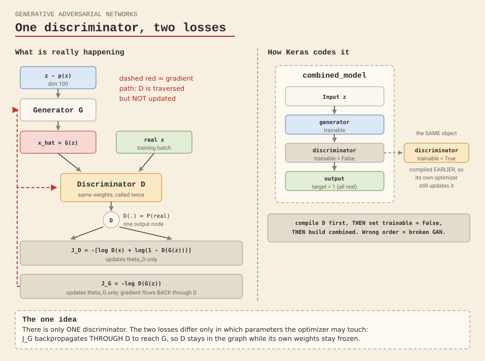
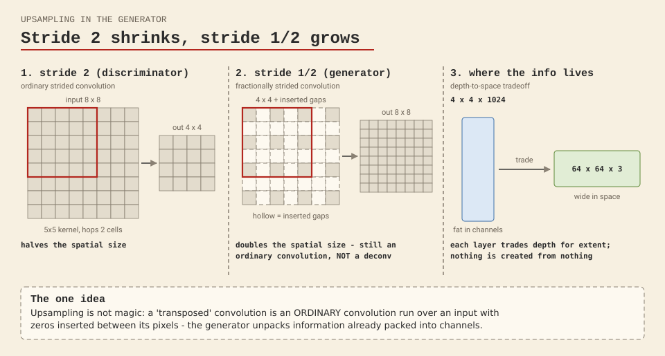

# Generative Adversarial Networks

> **How to read this note.** Study guide for two Lazy Programmer treatments of the same idea: *Deep Learning: GANs and Variational Autoencoders* section 4 (lectures 27–37 — theory, DCGAN, and mirrored TensorFlow 1 / Theano implementations on MNIST and CelebA), and *Deep Learning: Advanced Computer Vision* section 11 (lectures 78–79 — a much shorter, Keras-only dense GAN on MNIST, recorded later). Read §1–2 before either course's theory lectures, §3 before the DCGAN code walkthroughs, and §4–5 after you have run something and found the loss curves useless. §6 is what both courses leave out. The shared appendix lectures that follow every Lazy Programmer course are covered once in [rl-foundations-mc-td](../reinforcement-learning/rl-foundations-mc-td.md) §5.

## Why This Exists

**Problem.** A GAN adds no new machinery — it is two ordinary networks and two ordinary cross-entropy losses. Yet it is the first model in a deep-learning curriculum where **the loss number is not a progress signal**. Every prior model told you when it was working: loss down, accuracy up. Here both losses hover and rattle, and a run that has silently collapsed onto a single output looks identical, on the plot, to a run that is working. The gap between "I can write the code" and "I can tell whether it trained" is where people get stuck, and neither course closes it.

**Key insight.** Don't think of a GAN as minimising a distance to the data. Think of it as a **game**: a discriminator that learns to separate real from fake, and a generator that is rewarded only for fooling it. The generator never sees a real image — its single channel of feedback is the gradient of the discriminator's opinion of its own output. That is why samples come out sharp (nothing in the objective rewards covering the data's low-density regions) and also why they come out narrow (nothing in the objective penalises ignoring half the data).

**Reach for this when:**
- Working through the GAN section of either Lazy Programmer course, or any `train_on_batch` / two-optimizer GAN tutorial.
- Your GAN's losses are flat and noisy and you don't know whether that is healthy.
- All your samples look the same, or your discriminator accuracy sits at 100%.
- You need to explain *why* a generator needs a transposed convolution, a `tanh` output, and data scaled to $[-1, 1]$.
- You're reading a 2015–2018-era GAN codebase and hitting `tf.contrib`, `variable_scope(reuse=True)`, or `conv2d_transpose(output_shape=...)`.

**Don't reach for this when:**
- You want a likelihood, an encoder, or a latent space you can map data *into* — that's [variational-autoencoders](variational-autoencoders.md).
- You want state-of-the-art image synthesis in 2026. Diffusion and flow-matching models displaced GANs for most image generation after ~2021; the instructor concedes as much in the later course's closing lecture.
- You want to generate text. The generator must be differentiable, which a discrete token sampler is not (§6).
- You need convolution, pooling or stride mechanics from scratch — see [convolutional-neural-networks](convolutional-neural-networks.md). Batch norm, Adam and the training loop are in [artificial-neural-networks](artificial-neural-networks.md).

## Diagrams



<!-- DIAGRAM SPEC: name=gan-two-losses | two panels side by side.
LEFT panel titled "What is really happening": box "z ~ p(z), dim 100" -> box "Generator G" -> box "x_hat = G(z)". Separately a box "real x (training batch)". Both x_hat and real x feed arrows into ONE box "Discriminator D" (drawn once, emphasised: label under it "same weights, called twice"). D has a single output node labelled "D(.) = P(real)". From that output TWO arrows diverge to two separate cost boxes: "J_D = -[log D(x) + log(1 - D(G(z)))]" (arrow annotated "updates theta_D only") and "J_G = -log D(G(z))" (arrow annotated "updates theta_G only, gradient flows BACK through D"). Mark the arrow from J_G back through D and into G with a dashed line labelled "gradient path: D is traversed but not updated".
RIGHT panel titled "How Keras codes it": vertical stack "Input z" -> "generator (trainable)" -> "discriminator (trainable = False)" -> "output, target = 1", wrapped in one dashed rounded rectangle labelled "combined_model". To its right a separate small box "discriminator (trainable = True)" labelled "compiled EARLIER, so its own optimizer still updates it". A caption strip under the right panel: "compile D first, THEN set trainable = False, THEN build combined. Wrong order = broken GAN."
The one idea it must land: there is only ONE discriminator; the two losses differ only in which parameters the optimizer is allowed to touch. -->



<!-- DIAGRAM SPEC: name=gan-transposed-conv | three panels left to right.
PANEL 1 "stride 2 (discriminator)": an 8x8 grid of cells, a 5x5 kernel outline sitting on it, arrow marked "kernel hops 2 cells" and a 4x4 output grid. Caption "halves the spatial size".
PANEL 2 "stride 1/2 = fractionally strided (generator)": a 4x4 grid redrawn with one empty cell inserted BETWEEN every pair of input cells (so a sparse 7x7 lattice of filled and blank cells, blanks drawn hollow/dashed and labelled "inserted gaps"), the same 5x5 kernel outline on it, arrow to an 8x8 output grid. Caption "doubles the spatial size - still an ordinary convolution, NOT a deconvolution".
PANEL 3 "where the information lives": left a tall narrow stack labelled "4 x 4 x 1024 (fat in channels, tiny in space)", a right arrow labelled "each layer trades depth for extent", right a wide flat slab labelled "64 x 64 x 3". Caption "nothing is created; channels are spent to buy pixels".
Keep all text ASCII: write "->" not an arrow glyph, "1/2" not a fraction glyph.
The one idea it must land: upsampling is not magic - the generator starts with information packed into channels and unpacks it into space. -->

## 1. The game

### The counterfeiter and the shopkeeper

Both courses lead with the same story, and it is the right place to start. A **counterfeiter** (the generator) wants to pass fake banknotes. A **shopkeeper** (the discriminator) must accept real notes and reject fakes. Both start incompetent.

- Round 1: the forger hands over a black-and-white photocopy. Instantly rejected.
- Round 2: a colour copy — better, but it still looks like Monopoly money.
- Round 3: the forger works out the real paper stock.

Each time the shopkeeper sharpens their criteria, the forger has to improve, which forces the shopkeeper to sharpen again. The escalation never stops; there is no round at which either player is "done". That is the whole of GAN training, and it is also exactly why the loss curves are uninformative (§4).

The closing framing from the first course is worth keeping: **a GAN introduces no new machinery.** You already know how to build a network — now build two. You already know how to write an objective — now make one the opposite of the other.

### Where GANs sit among generative models

| Model family | Explicit density? | How you sample | Cost of a sample |
|---|---|---|---|
| Bayes classifier / Gaussian mixture | Yes, fitted directly | Draw from the fitted density | One draw |
| [Variational autoencoder](variational-autoencoders.md) | Yes — a *lower bound* on the likelihood | Draw $z$, run the decoder | One forward pass |
| Restricted Boltzmann machine ([boltzmann-machines](boltzmann-machines.md)) | Unnormalised | Gibbs sampling | Thousands of Monte-Carlo steps, no stopping rule |
| GAN | **No density at all** | Draw $z$, run the generator | One forward pass |

A GAN touches no density function, anywhere. It is not maximising a likelihood or a bound on one; it is being driven toward the equilibrium of a two-player game. The practical pay-off over an RBM is the last column — a single forward pass instead of an unbounded Markov chain.

The practical pay-off over a VAE is sharpness, and the contrast with [variational-autoencoders](variational-autoencoders.md) is the most useful one to hold in your head:

- A **VAE** maximises a lower bound on $\log p(x)$. That bound contains a reconstruction term, so the model is punished for failing to put probability mass on *any* training example. Covering everything, with a pixel-wise Gaussian likelihood, means hedging — the famous blur.
- A **GAN** optimises neither a likelihood nor a bound. Nothing penalises it for ignoring a region of the data, and nothing rewards hedging. So it concentrates on whatever fools the discriminator: sharp, and often less diverse. Mode collapse (§4) is the pathological end of that spectrum.

The first course is honest that **nobody definitively knows why GAN samples are so sharp** — it notes the proposed theories are highly mathematical, unconfirmed, and that at least one has been disproven. The "no likelihood term, so no reward for covering low-density regions" story above is the modern consensus intuition, and it is better than what the course gives, but it is not a theorem either.

**One promise the first course makes and never keeps:** it opens by claiming GANs learn multiple modes, then never demonstrates this on any multimodal distribution. §4 fills that hole with a snippet, and the answer turns out to be the opposite of the promise.

## 2. The two losses, as actually implemented

### Discriminator: it's just a binary classifier

The discriminator is a classifier with one output, $y = D(x; \theta_D) = P(x \text{ is real})$, trained with ordinary binary cross-entropy:

$$J = -[\, t \log y + (1-t)\log(1-y) \,], \qquad t = 1 \text{ for real},\; t = 0 \text{ for fake}$$

Because you always know which inputs are real — you drew them yourself — the target never has to be looked up, and the two halves of the formula separate cleanly:

$$J_D = -\big(\; \mathbb{E}_{x \sim \text{data}}[\log D(x)] \;+\; \mathbb{E}_{z}[\log(1 - D(G(z)))] \;\big)$$

In code this is two cross-entropy calls — one on the real batch with target 1, one on the fake batch with target 0 — added and averaged. The first course computes exactly that; the second course's Keras notebook makes two separate `discriminator.train_on_batch` calls (reals against a pre-allocated vector of ones, fakes against zeros) and takes the mean of the two returned losses.

The generator is $\hat{x} = G(z; \theta_G)$ with $z$ drawn from a latent prior — structurally the same object as a VAE decoder, minus the encoder that produced its $z$.

### Minimax, and why the word shows up

The simplest generator cost is the negative of the discriminator's, $J_G = -J_D$. The two costs then sum to zero, which makes this a **zero-sum game**, and zero-sum games are **minimax games** because the solution has both a min and a max: the same quantity is minimised over $\theta_D$ and maximised over $\theta_G$. You need no game theory to use a GAN, and the first course says so explicitly.

Two caveats the courses gloss over:

- **"Nash equilibrium" is used loosely.** Simultaneous gradient descent on two coupled non-convex objectives has no guarantee of converging to an equilibrium. The clean theoretical result — that an optimal discriminator makes the generator minimise the Jensen–Shannon divergence — holds only in the non-parametric limit, with a *fully optimal* $D$ at every step. The implemented loop takes one gradient step. Treat the equilibrium language as pedagogy, not as a description of what the code converges to.
- **The zero-sum framing is abandoned immediately,** in the very next lecture, by the fix below.

### Saturation, and the flipped-label fix

Look at $J_G = -J_D$ from the generator's point of view. Its parameters don't appear in $\log D(x)$ at all, so only one term matters: the generator is minimising $\log(1 - D(G(z)))$.

Here is the problem. If the discriminator is doing its job, $D(G(z)) \approx 0$ — and that is precisely the region where this term is flattest. **The better the discriminator, the less the generator can learn.** Early in training, when the generator is worst and most needs a big step, it gets the smallest one.

The fix is to **flip the target**: tell the generator's loss that its fakes are labelled *real*, and run the same binary cross-entropy:

$$J_G = -\,\mathbb{E}_z\big[\log D(G(z))\big]$$

Consequences, all stated in the first course:

1. $J_D + J_G$ no longer sums to zero — **this is no longer a zero-sum game**, and the minimax story from ten minutes earlier is now approximate.
2. The gradient no longer flattens where it matters. $-\log D(G(z))$ is steepest exactly when $D(G(z))$ is near 0, so the more thoroughly the generator is failing, the bigger its corrective step.
3. It is called a **heuristic** because it was invented to fix a numerical problem, with no theoretical derivation behind it.

> **A claim in the course to treat with care.** The first course spends time arguing that Goodfellow's "the gradient vanishes" is an artefact of a badly scaled figure: since $\frac{d}{dx}\log(1-x) = -\frac{1}{1-x}$, the slope is $-1$ at $x=0$ and $-\infty$ as $x \to 1$, so $-1$ is the *smallest-magnitude* slope available, never zero. The arithmetic is right and the complaint about the axis scaling is fair. **But it answers the wrong question.** The gradient that matters is with respect to $\theta_G$, which by the chain rule is $\frac{\partial J}{\partial D(G(z))} \cdot \frac{\partial D}{\partial G} \cdot \frac{\partial G}{\partial \theta_G}$. When $D$ confidently rejects a fake, **its own sigmoid is saturated**, so the middle factor $\partial D / \partial G \approx 0$ and the product really does vanish — which is what the original paper meant. Taken at face value, the course's rebuttal leaves you unable to explain why the non-saturating loss is needed at all. (The non-saturating loss itself, and why it keeps a large gradient exactly where the saturated form kills it, is taught correctly.)

### The alternation

Per training step, both courses do the same three things:

1. Draw a batch of real samples and a batch of $z$; generate fakes.
2. **One** gradient step on the discriminator.
3. **One** gradient step on the generator.

Then the first course's code amends step 3 to **two** generator steps per discriminator step, justified on the spot: if the discriminator learns too fast — detectable by its accuracy climbing toward 100% — train the generator more often. The second course's notebook stays at one-and-one.

This knob is real and it is dangerous in both directions. §4 shows what happens when you turn it up too far.

### The frozen-discriminator trick, and why compile order is load-bearing

The second course's Keras implementation is the cleanest illustration of how the two losses coexist, because Keras has no natural way to say "optimise these parameters only". The move is:

1. Build and **compile** the discriminator with `binary_crossentropy` and its own Adam. It is trainable; it has its own optimizer.
2. Set `discriminator.trainable = False`.
3. Chain generator into discriminator as one model: `z = Input((latent_dim,))`, `img = generator(z)`, `fake_pred = discriminator(img)`, `combined_model = Model(z, fake_pred)`, compiled with `binary_crossentropy`.
4. Train the generator by calling `combined_model.train_on_batch(noise, ones)` — the flipped labels of the non-saturating loss, supplied at train time rather than baked into the compile.

The gradient still flows backwards *through* the discriminator to reach the generator — it has to, because the discriminator's opinion is the only feedback the generator gets. `trainable = False` stops the discriminator's *weights* from being updated by that pass, not the gradient from traversing it.

**The part neither course says out loud:** this works *only* because the discriminator was compiled in step 1, **before** the flag was flipped in step 2. Keras snapshots the list of trainable weights when a model is compiled. The standalone discriminator's optimizer therefore keeps its full weight list and still trains normally; the combined model, compiled after the flag, sees an empty trainable list for the discriminator half. **Get the order wrong and the GAN breaks silently** — either the discriminator stops learning entirely, or the generator's step also pushes the discriminator toward calling fakes real, which is adversarial training with the adversary switched off. Modern Keras at least warns when `trainable` is mutated after compile. The sturdier modern pattern avoids the whole question: two explicit optimizers and a `GradientTape` (or `loss.backward()`) per player, with each optimizer given only its own parameters — which is what the first course does in TensorFlow via Adam's `var_list`, and in Theano by keeping separate `d_params` / `g_params` lists.

## 3. DCGAN: the architecture the first course builds

**DCGAN** (Radford et al., 2015) was the architecture most GANs of the day were built on. Its selling point was high-quality, higher-resolution images **in one pass** — the earlier LAPGAN also reached high resolution, but through a more complex multi-stage process. The first course concedes the name is misleading, since earlier GANs were also deep and convolutional. What actually distinguishes it is four choices.

### The four ingredients

1. **Batch normalization** — at *some* layers, deliberately not all. See [artificial-neural-networks](artificial-neural-networks.md) for the mechanics; the GAN-specific caveats are in §4.
2. **All-convolutional** — from the All-Convolutional Net. Strip the LeNet pattern (conv/pool stack, then several dense layers) down to a stack of convolutions with **no pooling** and at most one dense layer, possibly none. To halve a dimension you can do conv + pool(2), or just conv with **stride 2**; the latter is cheaper in multiplications. Strides and pooling: [convolutional-neural-networks](convolutional-neural-networks.md).
3. **Adam**, reviewed in full in the first course (first and second moment running averages, bias correction, the per-element update). Covered in [artificial-neural-networks](artificial-neural-networks.md). **The one GAN-specific detail the course skips:** DCGAN uses $\beta_1 = 0.5$ rather than the usual 0.9, because high momentum destabilises adversarial training. The lecture reviews Adam generically and never says why GAN practice lowers $\beta_1$.
4. **LeakyReLU in the discriminator, plain ReLU in the generator.** A ReLU unit outputting 0 has zero gradient, so it can never be revived — a dead neuron. A small positive slope on the negative side keeps the gradient non-zero while staying non-linear. (Don't hand-roll it: the first course says TensorFlow "doesn't yet have" a leaky ReLU, but `tf.nn.leaky_relu` has existed since TF 1.4, and Keras has `LeakyReLU`.)

The shape story: the generator takes a **100-dimensional** latent $z$, projects and reshapes it into a small, very deep 3-D volume, then convolves outward to a **64 × 64** image. The discriminator is the mirror — 64 × 64 in, stride-2 convolutions down, flatten, one logistic output.

### Fractionally-strided convolution: how you grow a tensor

The first course's best explanation in the section. Start with the objection: enlarging a photo in an image editor gives you blur and pixelation, and it *must* — lossless enlargement would mean storing infinite information in finite space. You cannot photograph Mars and zoom in. So how does a generator legitimately produce a 64 × 64 image from 100 numbers?

**Because the tensors near the start of the generator are fat.** A `4 × 4 × 1024` volume is tiny in space and enormous in channels. Each layer **trades depth for spatial extent**, moving information out of channels and into pixels. Nothing is created from nothing.

The arithmetic: stride 2 halves a dimension, so **stride 1/2** doubles it. Visually, a fractionally-strided convolution **inserts gaps between the input pixels** and then convolves normally — which is why the output can be larger than the input while the operation is still an honest convolution.

You cannot pass `stride=0.5`; these are different functions. TensorFlow calls it `conv2d_transpose`, by analogy with a tied-weight autoencoder where the hidden→output matrix is the transpose of input→hidden (and even an untied one must have the transposed *shape*, or the dimensions don't line up). Theano names it after the convolution's gradient with respect to its inputs — which is the same operation, because $\partial y/\partial x$ for $y = w * x$ has the same shape as $x$, autodiff frameworks already compute it, and the gradient of a convolution is itself a convolution.

**"Deconvolution" is the wrong name** and the course is right to say so: that word already means the true inverse of a convolution, and this is not an inverse — it is still a convolution.

### Scaling the data to the output activation

| Dataset (first course) | Pixel scaling | Final generator activation |
|---|---|---|
| MNIST, held in memory as a matrix | $[0, 1]$ | `sigmoid` |
| CelebA, 200,000 images / 1.4 GB, loaded per batch from disk, faces cropped | $[-1, +1]$ | `tanh` |

The second course's MNIST notebook uses the $[-1, +1]$ / `tanh` pairing too (`x/255.0 * 2 - 1`). The first course is refreshingly blunt about this: the $[-1,1]$-plus-`tanh` combination is **a GAN-researcher trick, not a derived choice**. What matters is only that the generator's output range *matches* the data's range — a `sigmoid` head can never produce $-0.8$, so if your data lives in $[-1,1]$ the model is structurally unable to fit it. In both courses the same model class handles both datasets with no other code change; only the shape dictionaries and the output activation differ.

Everything else about the architecture — feature-map counts per layer, filter sizes beyond the 5 × 5 used in the shape examples — the first course states was borrowed from other official implementations and assumed to come from standard hyperparameter search ("no magic"). **The numeric values are never read out in the lectures**, so don't expect to learn a recipe from them.

### Reading the course's code with modern eyes

The first course's two implementations are TensorFlow 1 and Theano, and a large fraction of their difficulty is framework archaeology rather than GAN content.

| In the course | What it was for | 2026 equivalent |
|---|---|---|
| `tf.contrib.layers.batch_norm` | Batch norm with internal variables | Deleted in TF 2.0. Use `keras.layers.BatchNormalization`. |
| `variable_scope(..., reuse=True)` + a name on every layer | Function-style layers create a *second* set of weights on a second call — fatal, since a GAN pushes two batches through **one** discriminator | Subclassed models / layer objects are called repeatedly and reuse their own weights. The entire scope-and-reuse apparatus is a TF1 artefact, and the lecture that explains it is wasted effort for a modern reader. |
| `forward(X, reuse, is_training)` | Threading a train/test flag for batch norm | `training=` argument on `__call__`, or `model.eval()` in PyTorch |
| `conv2d_transpose(..., output_shape=(N, 16, 16, 32))` | You must hand it the forward output shape; getting it wrong is an error, which the course calls redundant — and it is | `keras.layers.Conv2DTranspose` / `torch.nn.ConvTranspose2d` compute their own output shape. The whole headache disappears. |
| TF filter `(h, w, in_fm, out_fm)`, in/out **swapped** for transposed conv; Theano filter `(out_fm, in_fm, h, w)`, channels-first images, `border_mode='half'` not `'same'`, shape argument named `input_shape` for the same quantity TF calls `output_shape` | Genuinely confusing, and the course says so | Both libraries now infer shapes. Keep only the mental model: for a transposed conv, specify everything *as if* its input were a normal convolution's output and you were solving for that convolution's input. |
| `tf.placeholder`, `tf.Session`, `AdamOptimizer(var_list=...)` | Graph mode | Eager + `GradientTape`, `model.trainable_variables` |
| Hand-written `adam` and `batchnorm` helpers (Theano) | Theano had neither | Historical. **Theano development ceased in 2017** — the course's own appendix has an "Is Theano Dead?" lecture. Learn PyTorch instead. |

The one transferable exercise in all of this is the generator's **shape bookkeeping**: the first course computes the spatial dimensions at every stage by starting from the *output* size (which equals the training-image size) and working backwards through the conv specs, then reversing into forward order. That is still exactly how you design a generator, in any framework. Same for the discriminator, which must track image dimensionality forward because the first dense layer's input size depends on it.

Two smaller design points worth stealing from the first course's code:

- It computes and prints **discriminator accuracy** alongside the losses. Not required for training, but the single most useful debugging number in the whole loop: if it sits at **100%**, something is wrong.
- It keeps a **separate test-mode sample path** (`is_training=False`) because batch norm behaves differently in train and test mode, and samples must be judged in test mode. Easy to forget, and it changes what your sample grid looks like.

## 4. Why training is hard: flat losses and mode collapse

### The losses tell you nothing — and both courses say so

Each network is minimising a cost that effectively raises the other's. Neither decays like a single objective. There is no flat part to find, so **you do not know when you are done** — you judge by looking at the samples. The first course contrasts this with every prior course, where "how do we interpret the results?" was a non-question: loss fell, accuracy rose.

The second course goes further and states the healthy signature positively: **the two losses should look like noise and stay flat**, and the discriminator's accuracy should *never* climb high. If generator and discriminator improve at the same rate, the per-iteration loss carries no information even though both networks are genuinely getting better.

**That reading is half-true, and the missing half is the point of this section.** Flat, noisy losses are consistent with a healthy adversarial equilibrium. They are *equally* consistent with a stalled generator, or with mode collapse. Flat loss is not evidence of progress; it is the absence of evidence either way.

### Mode collapse — imported from outside both courses

**Say this plainly: neither course discusses mode collapse.** The phrase never appears in either, and nor does any equivalent — no generator collapsing onto a few modes, no minibatch discrimination, no unrolled GANs, no feature matching. Of the 2016 "Improved Techniques for Training GANs" toolkit, only one-sided label smoothing shows up, and it is framed as a weight regulariser rather than a stability measure. If you study the GAN sections alone, you will finish them unable to name the single most common way a GAN fails. The concept below comes from outside the courses.

**Mode collapse** is when the generator finds one output (or a narrow family of them) that reliably fools the current discriminator, and then produces nothing else. Every sample looks the same. The loss curves do not flinch. It follows directly from §1: nothing in a GAN's objective rewards covering the data distribution, only fooling the current adversary — and one convincing fake is enough to do that.

The cheapest way to see it is a distribution so simple you can count modes by hand: a 1-D mixture with one bump at $-2$ and one at $+2$. The snippet below trains the same tiny GAN twice, changing only the generator-to-discriminator step ratio — the exact knob the first course's code turns up to 2 and recommends turning up further when the discriminator learns too fast.

```python
import numpy as np, torch, torch.nn as nn
torch.set_num_threads(1)
real = lambda n: torch.cat([torch.randn(n // 2, 1) * .3 - 2, torch.randn(n // 2, 1) * .3 + 2])   # two modes at -2, +2
def train(steps=4000, g_steps=1, seed=0):
    torch.manual_seed(seed)
    G = nn.Sequential(nn.Linear(2, 32), nn.ReLU(), nn.Linear(32, 1))          # noise -> sample
    D = nn.Sequential(nn.Linear(1, 32), nn.ReLU(), nn.Linear(32, 1))          # sample -> logit "is real"
    og, od = torch.optim.Adam(G.parameters(), 2e-3), torch.optim.Adam(D.parameters(), 2e-3)
    bce = nn.BCEWithLogitsLoss()
    for _ in range(steps):
        x, z = real(128), torch.randn(128, 2)
        fake = G(z).detach()                                                   # detach: no generator update here
        od.zero_grad()
        (bce(D(x), torch.ones(128, 1)) + bce(D(fake), torch.zeros(128, 1))).backward(); od.step()
        for _ in range(g_steps):                                               # generator: label its fakes as real
            og.zero_grad(); bce(D(G(torch.randn(128, 2))), torch.ones(128, 1)).backward(); og.step()
    with torch.no_grad(): s = G(torch.randn(2000, 2)).squeeze().numpy()
    return s
for g_steps in (1, 5):
    s = train(g_steps=g_steps)
    near = lambda c: np.mean(np.abs(s - c) < 1)                                # share of samples near each real mode
    print(f"G steps per D step = {g_steps}: samples near -2: {near(-2):.0%}   near +2: {near(2):.0%}   "
          f"std {s.std():.2f}  (real std 2.02)")
print("a healthy GAN covers both modes ~50/50; when one mode dominates, that is mode collapse")
# Expected output:
# G steps per D step = 1: samples near -2: 52%   near +2: 42%   std 1.97  (real std 2.02)
# G steps per D step = 5: samples near -2: 100%   near +2: 0%   std 0.01  (real std 2.02)
# a healthy GAN covers both modes ~50/50; when one mode dominates, that is mode collapse
```

Read the two lines against each other. With **one generator step per discriminator step** the generator covers both bumps — roughly 52% of samples near $-2$ and 42% near $+2$, and a sample standard deviation of 1.97 against the real data's 2.02. A healthy GAN on a two-mode target should land near 50/50, and this does.

With **five generator steps per discriminator step** it collapses completely: 100% of samples near one mode, 0% near the other, and a standard deviation of 0.01 — every sample is essentially the *same number*. The generator has found a point the stale discriminator cannot refute and stopped exploring. Note what the standard deviation is telling you: it is not that the generator picked the wrong mode, it is that it stopped generating a distribution at all.

Three lessons:

1. **The "train the generator more" remedy is a sharp tool.** The first course's advice — if the discriminator's accuracy gets too high, take more generator steps — is sound as stated, but it has a failure mode in the other direction that the course never mentions. Two steps is a tuning choice; five is a collapse in this setup.
2. **A plot of the losses would not have caught this.** Both runs produce the "flat and noisy" curves the second course calls the desired outcome. The diagnostic that works is *looking at the samples* — here, a standard deviation, in general a sample grid or a distributional metric (§5).
3. **This is the multimodality demonstration the first course promised and never delivered.** It opens by claiming GANs learn multiple modes; with the step ratio pushed up, this one demonstrably does the opposite.

### The other instability knobs

- **Discriminator too strong.** Its accuracy pins at 100%, the generator's gradient dies (the saturation problem of §2, now caused by the schedule rather than the loss form). Remedies: more generator steps (carefully — see above), a weaker discriminator, or label smoothing.
- **Discriminator too weak.** It gives the generator no useful signal; the generator wanders. Symptom: discriminator accuracy near chance from the very start, with samples that never improve.
- **One-sided label smoothing.** Change the real target from 1 to slightly under — the first course suggests **0.9** — and leave the fake target at 0 (hence "one-sided"). The stated reason it regularises is good: a predicted probability of exactly 1 requires enormous logits and therefore enormous weights, and a 0.9 target pulls them back down. The first course presents this as a general classifier trick and a defence against adversarial examples, noting that "adversarial" there means something different from its meaning in "GAN" — an image plus cleverly designed noise that fools an otherwise good classifier. It is *also* a GAN stability measure, which is how the paper it comes from frames it, and the course doesn't make that connection.
- **Batch norm in the discriminator is itself a known problem.** Batch statistics couple the samples within a batch, so discriminator batch norm leaks information across the real and fake batches; later practice largely replaced it with layer norm, instance norm, or spectral normalization, and WGAN-GP's gradient penalty is outright incompatible with it. Much of the first course's careful train/test-mode batch-norm plumbing is effort spent on a component the field later removed from $D$.
- **Checkerboard artifacts, never mentioned.** Transposed convolution with stride 2 and a 5 × 5 kernel — the first course's exact setting — produces the well-known checkerboard pattern, because 5 is not divisible by 2 and the kernel overlaps unevenly. It is a visible defect in the sample grids shown and goes unremarked. Modern practice: resize-then-convolve, or at minimum a kernel size divisible by the stride.

## 5. Evaluation: neither course offers a metric

This is the largest honest gap in both treatments, and the first course states its position outright: supervised learning gives you accuracy or $R^2$; sample realism gives you nothing numeric. We know GANs beat VAEs on sharpness, it says, only by looking at the pictures. Accordingly, **no accuracy, loss, score, epoch count, batch size, learning rate or wall-clock number is ever read out** in the first course's results — only a cost curve that visibly fails to converge and looks like noise, plus 8 × 8 sample grids on MNIST and CelebA judged good enough by eye. The second course's notebook is the same: sample grids inspected at a handful of checkpoints, digits "pretty good" by roughly the one-third mark, diminishing returns after, and no score of any kind.

**The strong claim — that no numerical measure of sample quality exists — was already overstated when recorded and is plainly wrong now.** What you should know instead:

- **Inception Score** (Salimans et al., 2016 — contemporaneous with the first course) — runs samples through a pretrained Inception classifier and rewards confident per-sample predictions with a diverse marginal over classes. Catches total mode collapse. Does not look at the real data at all, which is its main weakness.
- **Fréchet Inception Distance (FID)** (Heusel et al., 2017) — the field's default. Fits a Gaussian to Inception activations of real samples and of generated samples and reports the Fréchet distance between them. Lower is better; it penalises both poor fidelity and poor diversity, so unlike flat losses it *does* move when a model collapses.
- **Precision and recall for generative models** (Kynkäänniemi et al., 2019) — splits "quality" from "coverage" into two numbers, which is exactly the fidelity-versus-diversity trade-off a GAN sits on.
- **Kernel Inception Distance (KID)** — an unbiased MMD-based alternative to FID, better behaved on small sample sets.

The weaker version of the course's claim is true and worth keeping: these are all **imperfect proxies for human judgement**, they are sensitive to sample count and preprocessing, and FID numbers are only comparable within a single consistent implementation. "Metrics exist but are proxies" is a very different statement from "there is no metric", and only the first is defensible. At minimum, compute FID against a held-out split and track it alongside your sample grids; it is the difference between noticing collapse in ten minutes and noticing it in a day.

## 6. What the courses say about the wider picture — and where GANs actually went

Ideas from the first course's summary lecture that are worth carrying:

- **A GAN is reinforcement learning in disguise.** The generator is an *agent*. This is not supervised learning: $\hat{x}$ is never compared against a target, and there is no reconstruction penalty as in an autoencoder. You draw a random $z$ and push it through $G$, so at the start it is taking completely random actions. Its only feedback is a **reward from the discriminator** — $D(G(z))$, really its log, really the gradient of that. The discriminator is a black box to the generator.
- **The generator never sees a real image.** The first course draws an overfitting conclusion from this: a large autoencoder can degenerate into copying its input, but a generator with no access to real images cannot copy them directly. **Treat this as "copying is harder", not as a guarantee** — GANs demonstrably memorise training examples, especially with small datasets or large generators, and the gradient that reaches the generator *does* carry real-data information, laundered through $D$.
- **There is no encoder.** The generator is a VAE decoder without the matching encoder, so there is no map from an $x$ back to its $z$. The first course calls this not a problem, merely interesting; inverting the generator was an active research direction at the time, and GAN inversion is still a field. If you need that map, use a [variational autoencoder](variational-autoencoders.md).
- **The latent space is meaningful.** The second course describes the 100-dimensional $z$ space as "an imaginary space where the generator believes all the images of digits live" — 1s near 7s because they look alike, 9s near 7s because a tight loop makes a 9 resemble a 7, with ambiguous digits on the boundaries. The useful inversion of the usual framing: an embedding maps image → vector, so **a generator is the inverse of an embedding**, mapping vector → image.
- **Labels help**, because they carry extra information. Two options given: concatenate a one-hot label to the input **at every layer**, or have the discriminator learn to predict the labels as well. The first course motivates this by pointing at a single Gaussian mixture model fitted over all ten MNIST digits with no labels, whose samples are poor — and offers running that yourself as the way to be convinced.
- **Text does not work**, because the generator must be differentiable and sampling a discrete token is not. This was correct when recorded and is historically important. A 2026 reader should also know the attempted resolutions — Gumbel-Softmax and straight-through estimators, REINFORCE-style sequence GANs — and that none of them won: **text generation was won by autoregressive transformers trained with maximum likelihood plus RLHF**, not by GANs.

### The line after DCGAN

The first course states that DCGAN is what most GANs of the day are based on. That was true then and is history now. The lineage worth knowing, because it is largely a sequence of fixes for the instability this section shrugs at:

- **WGAN / WGAN-GP** — replaces the cross-entropy loss entirely with a Wasserstein critic plus a gradient penalty, specifically so that the critic can be trained to optimality without killing the generator's gradient. This is the direct answer to §2's saturation problem and §4's balance problem.
- **Spectral normalization** — constrains the discriminator's Lipschitz constant by normalising each weight matrix by its largest singular value. Cheap, drop-in, and the standard replacement for discriminator batch norm.
- **Progressive growing → StyleGAN 1/2/3 → BigGAN** — the high-resolution image-synthesis era, and the source of the photorealistic face grids the second course shows.
- **Diffusion and flow matching** — displaced GANs for most image synthesis after roughly 2021. The second course's own closing lecture concedes diffusion models are much more powerful than GANs, and points at a sequel course. A dense MNIST GAN is now purely pedagogical — which is fine, because the *pedagogy* is excellent.

One more dated-not-wrong detail: both courses sample $z$ from a **uniform** prior in the first course's code (following the DCGAN paper) and from a standard normal in the second course's. Essentially all later work uses an isotropic Gaussian, which interpolates better and is what StyleGAN-era mapping networks assume.

## Trade-offs

- **Sharp samples vs. coverage.** This is the GAN bargain and you cannot opt out of it. No likelihood term means no reward for hedging, which buys sharpness and sells diversity. If covering the data matters more than per-sample crispness, a [VAE](variational-autoencoders.md) or a diffusion model is the better trade.
- **No metric vs. a cheap one.** Judging by eye is free, needs no extra model, and is what both courses do. It also scales terribly, can't be logged, can't be compared across runs, and will not notice a slow collapse. FID costs an Inception forward pass over a few thousand samples. Pay it.
- **Generator steps per discriminator step.** More generator steps rescue a generator starved by an over-strong discriminator; too many hand it a stale adversary to overfit, which is collapse (§4). There is no safe default — instrument it.
- **Batch norm in the discriminator.** It stabilises optimisation and is what DCGAN prescribes; it also couples samples within a batch and leaks real/fake information. Layer norm or spectral norm gives up the DCGAN recipe for a better-behaved discriminator.
- **One dense GAN for both MNIST and CelebA (first course) vs. per-dataset code.** Driving both datasets through one model class with only a shape dict and an output activation differing is elegant and genuinely instructive. It also means every architectural number is buried in a dictionary that the lectures never read out, so you learn the *structure* and none of the *recipe*.
- **Transposed convolution vs. resize-then-convolve.** Transposed conv is one learnable op and is what the course teaches; it produces checkerboard artifacts at stride 2 with an odd kernel. Resize-then-convolve costs an extra op and removes them.

## Common Pitfalls

- **Reading flat losses as "it's working."** Both courses say flat and noisy is the healthy signature, and it is — but so is collapsed, and so is stalled. Don't claim progress from a loss plot; look at samples or compute FID (§4, §5).
- **Setting `discriminator.trainable = False` before compiling the discriminator.** Keras snapshots trainable weights at compile time. Flip the flag first and your discriminator never learns, or your generator step drags it along with it, and nothing errors out (§2).
- **Letting the discriminator win.** Accuracy pinned at 100% means the generator's gradient is dead. The first course flags 100% discriminator accuracy as a "something is wrong" signal — print that number every loop.
- **Fixing an over-strong discriminator with lots of generator steps.** The remedy has its own failure mode in the opposite direction: the generator overfits a stale adversary and collapses (§4). Move the ratio in small increments and watch sample diversity, not loss.
- **Mismatching the output activation to the data range.** `tanh` output with data in $[0,1]$ wastes half the range; `sigmoid` output with data in $[-1,1]$ makes half the target *unreachable*. The pairing is a convention, but the match is a requirement (§3).
- **Judging samples in training mode.** Batch norm uses batch statistics while training and running statistics at test time, so the same generator produces different images in the two modes. Generate your sample grid in test mode, as the first course's code does.
- **Calling a transposed convolution a "deconvolution."** It is not an inverse of anything; it is a convolution with gaps inserted between input pixels. The course is right about this and most blog posts are wrong.
- **Copying the course's TF1 or Theano code.** `tf.contrib` was removed in TF 2.0 and Theano development stopped in 2017. Neither implementation runs as written. The *ideas* transfer; the framework plumbing — scopes, `reuse=True`, manual `output_shape` — is archaeology (§3).
- **Hand-rolling a leaky ReLU because the course says you must.** `tf.nn.leaky_relu` has existed since TF 1.4 and Keras ships `LeakyReLU`.
- **Reading "30,000 epochs" literally.** The second course's notebook names its training-loop variable `epochs` and runs 30,000 iterations of it, printing progress "every 100 epochs". These are **steps, not epochs** — at batch size 32 over 60,000 MNIST images, 30,000 steps is roughly 16 epochs. The variable name is simply wrong, and the per-step sample snapshots elsewhere in the notebook make that obvious once you look.
- **Taking the course's vanishing-gradient rebuttal at face value.** The slope of $\log(1-x)$ really doesn't reach zero, and the original figure really is badly scaled, but the gradient that actually vanishes is the one through the discriminator's saturated sigmoid (§2). You need that to understand why the flipped-label loss exists.
- **Expecting the first course's hyperparameters from the lectures.** Epoch count, sample-save period and per-layer feature-map counts are never stated. The repo reportedly uses Adam at $2 \times 10^{-4}$ with $\beta_1 = 0.5$ (the DCGAN paper's values) and batch size 64 — **unverified**, read from the repository rather than the lectures, so check before quoting. Values the lectures *do* state: 5 × 5 filters, stride 2, latent dimension 100, 64 × 64 images.

## Decision Table

| Scenario | Use this | Not that | Why |
|----------|----------|----------|-----|
| Learning how a GAN trains, from scratch | The second course's dense Keras MNIST notebook (§2) | The first course's TF1/Theano DCGAN | ~40 lines of loop, no scope/reuse archaeology |
| Understanding *why* a generator can upsample | Fractionally-strided convolution + the depth-for-space trade (§3) | "It's a deconvolution" | There is no inverse; channels are spent to buy pixels |
| Generator loss in code | $-\log D(G(z))$ via BCE on fakes with target **1** | $+\log(1-D(G(z)))$ | Non-saturating: steepest gradient exactly where the generator is worst |
| Restricting which parameters a step updates | Two optimizers, each given its own parameter list | `trainable = False` juggling | Explicit, order-independent, and works in every framework |
| ...but you're in old-style Keras | Compile $D$, **then** freeze, **then** build the combined model | Freeze before compiling | Keras snapshots trainable weights at compile time |
| Deciding whether training is working | Sample grid in test mode + FID on a held-out split | The loss curves | Flat losses are also what collapse looks like |
| Discriminator accuracy pinned at 100% | Label smoothing, a weaker $D$, or slightly more $G$ steps | Many more $G$ steps | Overcorrecting hands the generator a stale adversary → collapse |
| All samples look identical | Diagnose mode collapse; WGAN-GP or minibatch discrimination | More training steps | Collapse is a fixed point, not a slow start |
| You need a latent code for a *given* $x$ | [VAE](variational-autoencoders.md), or GAN inversion | Plain GAN | A GAN has no encoder |
| You need a likelihood or density estimate | [VAE](variational-autoencoders.md) bound, or a normalizing flow | GAN | A GAN models no density anywhere |
| Stable training at higher resolution, today | WGAN-GP + spectral norm, or a diffusion model | Vanilla DCGAN | DCGAN's loss is the thing later work replaced |
| Generating text | Autoregressive transformer + maximum likelihood | GAN | The generator must be differentiable; discrete sampling isn't |

## References

- [Goodfellow et al. — *Generative Adversarial Networks* (2014)](https://arxiv.org/abs/1406.2661) — the original paper, including the minimax objective and the non-saturating heuristic.
- [Goodfellow — *NIPS 2016 Tutorial: Generative Adversarial Networks*](https://arxiv.org/abs/1701.00160) — the source of the saturation figures the first course criticises, and much the best single overview of the era.
- [Radford, Metz & Chintala — *Unsupervised Representation Learning with Deep Convolutional Generative Adversarial Networks* (DCGAN, 2015)](https://arxiv.org/abs/1511.06434) — the four ingredients, the uniform $z$, Adam with $\beta_1 = 0.5$.
- [Springenberg et al. — *Striving for Simplicity: The All Convolutional Net* (2014)](https://arxiv.org/abs/1412.6806) — where "no pooling, use stride" comes from.
- [Dumoulin & Visin — *A Guide to Convolution Arithmetic for Deep Learning* (2016)](https://arxiv.org/abs/1603.07285) — the definitive treatment of transposed convolution shapes, with figures.
- [Odena, Dumoulin & Olah — *Deconvolution and Checkerboard Artifacts* (Distill, 2016)](https://distill.pub/2016/deconv-checkerboard/) — the defect the first course's 5 × 5 stride-2 generator has and never mentions.
- [Salimans et al. — *Improved Techniques for Training GANs* (2016)](https://arxiv.org/abs/1606.03498) — one-sided label smoothing, minibatch discrimination, feature matching, and the Inception Score.
- [Heusel et al. — *GANs Trained by a Two Time-Scale Update Rule Converge to a Local Nash Equilibrium* (2017)](https://arxiv.org/abs/1706.08500) — introduces FID.
- [Kynkäänniemi et al. — *Improved Precision and Recall Metric for Assessing Generative Models* (2019)](https://arxiv.org/abs/1904.06991) — fidelity and coverage as two separate numbers.
- [Bińkowski et al. — *Demystifying MMD GANs* (2018)](https://arxiv.org/abs/1801.01401) — KID, the unbiased alternative to FID.
- [Metz et al. — *Unrolled Generative Adversarial Networks* (2016)](https://arxiv.org/abs/1611.02163) — the clearest demonstration of mode collapse on a 2-D mixture, and one remedy.
- [Arjovsky, Chintala & Bottou — *Wasserstein GAN* (2017)](https://arxiv.org/abs/1701.07875) · [Gulrajani et al. — *Improved Training of Wasserstein GANs* (WGAN-GP, 2017)](https://arxiv.org/abs/1704.00028) — the loss replacement that fixes the instability both courses shrug at.
- [Miyato et al. — *Spectral Normalization for Generative Adversarial Networks* (2018)](https://arxiv.org/abs/1802.05957) — the standard replacement for discriminator batch norm.
- [Karras, Laine & Aila — *A Style-Based Generator Architecture for GANs* (StyleGAN, 2018)](https://arxiv.org/abs/1812.04948) — where the photorealistic-face sample grids come from.
- [Keras `Conv2DTranspose`](https://keras.io/api/layers/convolution_layers/convolution2d_transpose/) · [PyTorch `nn.ConvTranspose2d`](https://docs.pytorch.org/docs/stable/generated/torch.nn.ConvTranspose2d.html) — both infer the output shape the course computes by hand.
- [Keras transfer-learning guide — the `trainable` flag and compile](https://keras.io/guides/transfer_learning/) — why freezing must happen before compiling.
- [Keras DCGAN example (`override train_step`)](https://keras.io/examples/generative/dcgan_overriding_train_step/) — the modern shape of the second course's notebook, with explicit per-player gradient steps instead of the frozen-combined-model trick.
- [CelebA dataset](https://mmlab.ie.cuhk.edu.hk/projects/CelebA.html) — the first course's second dataset (it downloads and crops faces itself).

## See Also

- [variational-autoencoders](variational-autoencoders.md) — the other half of the same course: maximises a likelihood bound, has an encoder, gives blurry but better-covered samples. The direct contrast to everything here.
- [autoencoders](autoencoders.md) — the generator is a decoder without an encoder; this is where the decoder half comes from.
- [convolutional-neural-networks](convolutional-neural-networks.md) — convolution, pooling and strides, which DCGAN assumes you already have.
- [artificial-neural-networks](artificial-neural-networks.md) — batch norm, Adam and the training loop that both players use.
- [boltzmann-machines](boltzmann-machines.md) — the generative model GANs replaced: samples via a long Markov chain instead of one forward pass.
- [rl-foundations-mc-td](../reinforcement-learning/rl-foundations-mc-td.md) — §5 covers the shared Lazy Programmer appendix lectures; §1–4 are the agent-and-reward framing the first course borrows to describe the generator.
