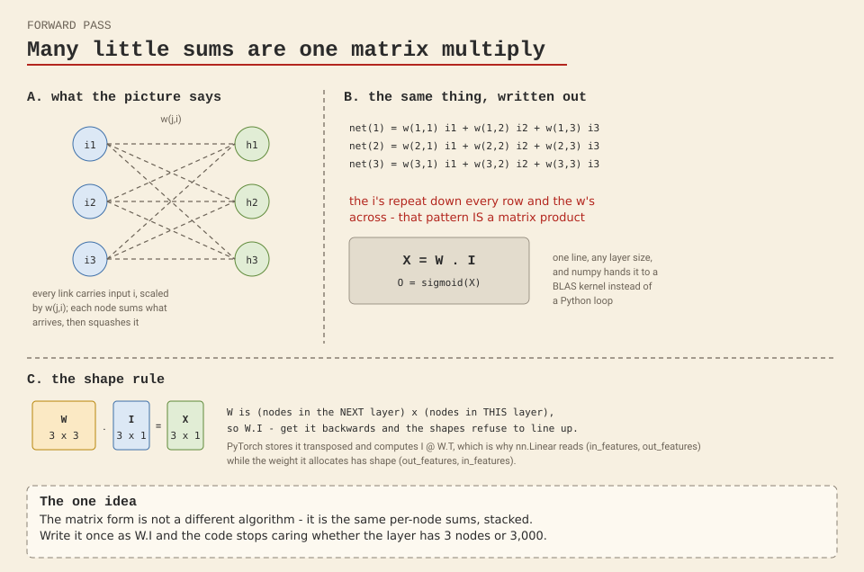

# Write A Neural Network From Scratch

> **How to read this note.** You build one program in nine steps. Each step adds one part and explains it. Each code block runs on its own, so you can start at any step.
>
> The program is a classifier for handwritten digits. It uses numpy only. Step 9 replaces it with PyTorch, line by line. Then you know what each framework call does, because you wrote it first.
>
> This note follows the [ASD-STE100](https://www.asd-ste100.org/) Simplified Technical English rules. The sentences are short. The voice is active. Each sentence gives you one idea. There is one exception. The heading "Don't reach for this when" keeps its contraction, because all 72 notes in this wiki use that exact heading.
>
> The build order follows [Neural-Networks-from-Scratch](https://github.com/lionelmessi6410/Neural-Networks-from-Scratch) by Hsiang-Wei Chao. This note derives the parts that the repository states without proof, and measures the claims that it does not measure.
>
> This note is not a general introduction. [artificial-neural-networks](artificial-neural-networks.md) is the general introduction. Read this note when you want to write the code yourself. This note assumes two things. You know derivatives and the chain rule ([calculus](../math-for-ml/calculus.md)). You know matrix shapes ([linear-algebra](../math-for-ml/linear-algebra.md)).

## Why This Exists

**Problem.** You can call `loss.backward()` for years and still not know why a layer stops to learn. All the failures look the same from outside. The loss stays flat. The accuracy stays low.

The usual advice is a list of rules with no reasons. Scale your data. Use He initialisation. Do not use sigmoid. Use cross-entropy. If you do not know the reason for each rule, you must try them in a random order.

**Key insight.** A neural network is a small amount of code. The whole program of step 7 is four arrays, one forward function, four gradient lines and one loop. After you write those lines, the rules above stop to be advice. Each one becomes a fact about a specific line that you can point at.

**Reach for this when:**
- You want to write a neural network with no framework, and understand each line.
- A layer or a network stops to learn, and you want a reason and not a guess.
- You want to know why ReLU is better than sigmoid, and why cross-entropy is better than squared error.
- You want to find backpropagation inside autograd.
- You want to know why `nn.Linear` takes `(in, out)` but holds a weight of shape `(out, in)`.

**Don't reach for this when:**
- You want to train a model today. Use [artificial-neural-networks](artificial-neural-networks.md). Do not write your own network for production work.
- You want the list of modern parts: batch normalisation, dropout, schedulers, the internal design of Adam.
- You want convolutions, sequences or attention. Use [convolutional-neural-networks](convolutional-neural-networks.md), [recurrent-neural-networks](recurrent-neural-networks.md) or [transformer-forward-pass](../math-for-ml/transformer-forward-pass.md).

## Diagrams

Four diagrams are with the steps that they explain. Step 2 has the three parts of a gradient. Step 3 has the matrix multiplication. Step 4 has the reason for an activation function. Step 6 has the two passes of backpropagation.

## Step 1. One Neuron

A neuron does two things. It adds its inputs together, but it multiplies each input by a weight first. Then it puts the sum through a function that limits the range.

```python
import numpy as np
from sklearn.datasets import load_digits
X, y = load_digits(return_X_y=True)
x = X[0] / 16.0                                   # one 8x8 digit, each pixel scaled to 0..1
target = 1.0 if y[0] == 0 else 0.0                # the question: is this image a zero?
rng = np.random.default_rng(0)
w = rng.normal(0, 0.1, 64)                        # one neuron: one weight for each pixel
net = w @ x                                       # step 1: add the inputs, each times its weight
out = 1 / (1 + np.exp(-net))                      # step 2: squash the sum into 0..1
print(f"the image is a {y[0]}, so the target is {target}")
print(f"net = w . x = {net:+.4f}   ->   output = sigmoid(net) = {out:.4f}")
print(f"error = target - output = {target - out:+.4f}")
print("a neuron is those two lines. nothing else. the weights are random, so the answer is useless.")
# Expected output:
# the image is a 0, so the target is 1.0
# net = w . x = -0.0721   ->   output = sigmoid(net) = 0.4820
# error = target - output = +0.5180
# a neuron is those two lines. nothing else. the weights are random, so the answer is useless.
```

That is a complete neuron. The weights are random, so the answer means nothing yet. Step 2 makes the neuron learn.

Note the two names. The sum before the squash is the **pre-activation**, written `net` or `z`. The value after the squash is the **activation**, written `a` or `o`. You need both names in step 6, because the backward pass uses the two values at different points.

## Step 2. Teach One Weight

To make the weight better, you must know which direction to move it. That direction is the slope of the error with respect to the weight. Do not take a formula for the slope from a book. Measure it first.

```python
import numpy as np
# Do not trust a formula that you did not test. Measure the slope first, by hand.
x_j, t = 0.80, 1.0                                 # the signal on this link, and the target
sig = lambda n: 1 / (1 + np.exp(-n))
loss = lambda w: 0.5 * (t - sig(w * x_j)) ** 2     # the error, as a function of this one weight
w = 0.5
h = 1e-6
measured = (loss(w + h) - loss(w - h)) / (2 * h)   # the slope: rise over run, with a tiny run
out = sig(w * x_j)
error, response, signal = -(t - out), out * (1 - out), x_j
print(f"measured slope (finite difference): {measured:+.8f}")
print(f"error {error:+.4f} x response {response:.4f} x signal {signal:.4f} = {error*response*signal:+.8f}")
print("the two agree. so the formula is not a rule to memorise: it is the slope, split into three parts.")
print("each part is local. the node knows all three without looking at the rest of the network.")
# Expected output:
# measured slope (finite difference): -0.07713568
# error -0.4013 x response 0.2403 x signal 0.8000 = -0.07713568
# the two agree. so the formula is not a rule to memorise: it is the slope, split into three parts.
# each part is local. the node knows all three without looking at the rest of the network.
```

The measured slope and the product of three numbers are the same value. Therefore the formula is not a rule that you must remember. It is the slope, in three parts:

$$\frac{\partial E}{\partial w} = \underbrace{\frac{\partial E}{\partial o}}_{\text{error}} \times \underbrace{\frac{\partial o}{\partial \text{net}}}_{\text{response}} \times \underbrace{\frac{\partial \text{net}}{\partial w}}_{\text{signal}}$$


Read the three parts as a question each. How wrong is the output? How much can this node change its output now? How large is the signal on this link?

This shape is correct for **any** activation function and **any** loss function. Only the first two parts change.

**A product becomes zero if any one part becomes zero.** Therefore a weight can stop to learn in exactly three ways:

| The part becomes zero when | Name of the failure | Step |
|---|---|---|
| the output is already correct | — | this is not a fault |
| the activation function is in a flat area | **saturation** for sigmoid, **dead unit** for ReLU | §8 |
| the input signal is zero | zero input, or a dead unit before this one | §8 |

Keep this table. Each unclear training failure is one of the three rows. This is the complete diagnosis, and the rest of this note uses it.

The update moves the weight **down** the slope:

$$w \leftarrow w - \alpha \frac{\partial E}{\partial w}$$

The number $\alpha$ is the **learning rate**. It controls how much of the step you take.

## Step 3. A Full Layer

One neuron is not useful. A layer has many neurons, and each one has its own weights. A loop over the neurons works, but you must not write it that way.

```python
import numpy as np
rng = np.random.default_rng(0)
W = rng.normal(0, .3, (3, 4))            # W[j, i] = weight from input i to hidden node j
i = np.array([.9, .1, .8, .2])
sig = lambda x: 1 / (1 + np.exp(-x))
# The book's node-by-node description: for each node, sum the moderated incoming signals, then squash.
by_node = np.array([sig(sum(W[j, k] * i[k] for k in range(4))) for j in range(3)])
by_matrix = sig(W @ i)                   # the same thing as X = W.I then O = sigmoid(X)
print("node by node:", by_node.round(6))
print("one matmul  :", by_matrix.round(6))
print("identical:", np.allclose(by_node, by_matrix))
print("shapes: W", W.shape, "@ i", i.shape, "->", by_matrix.shape, "- so W is (next layer x this layer)")
# Expected output:
# node by node: [0.547353 0.558728 0.407315]
# one matmul  : [0.547353 0.558728 0.407315]
# identical: True
# shapes: W (3, 4) @ i (4,) -> (3,) - so W is (next layer x this layer)
```

Both methods give the same values. But the matrix form is one line for a layer of any size. It also sends the work to a BLAS routine and not to a Python loop.



The shape of $W$ is **(number of nodes in the next layer) x (number of nodes in this layer)**. This order is not a convention. The sum goes across *this* layer. Therefore the index of this layer must cancel, and it must be the columns of $W$.

**How to read this in PyTorch.** `nn.Linear(in_features, out_features)` takes its arguments in the opposite order to the shape of its own weight. The shape of the weight is `(out_features, in_features)`. The layer multiplies *row* vectors, as $I W^\top$. A batch goes in with shape `(N, in)` and comes out with shape `(N, out)`.

The column form above and the PyTorch row form are transposes of each other. Many shape errors in hand-written code come from this difference.

## Step 4. Two Layers Need An Activation Function

Put two layers together and you expect more power. You do not receive it, and the reason is algebra. $W \cdot I$ is a *linear* map. If you put two linear maps together, the result is linear.

Put two weight matrices together with nothing between them. The pair is equal to one matrix, $W_2 W_1$. The additional weights give you nothing. You pay for two layers and you receive a model of one layer.


```python
import torch, torch.nn as nn
torch.manual_seed(0)
# 1. Stack two linear layers with nothing between them and you have ONE linear layer.
A, B = nn.Linear(4, 16, bias=False), nn.Linear(16, 3, bias=False)
x = torch.randn(5, 4)
collapsed = B.weight @ A.weight                              # a single 3x4 matrix
print("depth 2 without an activation == depth 1:", torch.allclose(B(A(x)), x @ collapsed.T, atol=1e-6))
print(f"  two layers of 4->16->3 carry {A.weight.numel() + B.weight.numel()} numbers "
      f"but can only express the {collapsed.numel()} of a 4->3 map")
# 2. So depth without a nonlinearity buys nothing. XOR is the smallest proof.
X = torch.tensor([[0., 0.], [0., 1.], [1., 0.], [1., 1.]])
y = torch.tensor([[0.], [1.], [1.], [0.]])                   # XOR: not linearly separable
def fit(net, steps=4000):
    opt = torch.optim.Adam(net.parameters(), 0.05)
    for _ in range(steps):
        opt.zero_grad(); nn.functional.mse_loss(net(X), y).backward(); opt.step()
    return nn.functional.mse_loss(net(X), y).item()
for name, net in [("linear only  (8 hidden)", nn.Sequential(nn.Linear(2, 8), nn.Linear(8, 1))),
                  ("ReLU         (8 hidden)", nn.Sequential(nn.Linear(2, 8), nn.ReLU(), nn.Linear(8, 1))),
                  ("sigmoid      (8 hidden)", nn.Sequential(nn.Linear(2, 8), nn.Sigmoid(), nn.Linear(8, 1)))]:
    torch.manual_seed(0)
    for m in net:
        if isinstance(m, nn.Linear): nn.init.normal_(m.weight, 0, 0.5); nn.init.zeros_(m.bias)
    print(f"{name}: final MSE on XOR {fit(net):.6f}")
print("the linear stack cannot get below the variance of y (0.25) - no straight line separates XOR.")
print("BOTH nonlinearities solve it. breaking linearity is the job of any activation, not of ReLU.")
# Expected output:
# depth 2 without an activation == depth 1: True
#   two layers of 4->16->3 carry 112 numbers but can only express the 12 of a 4->3 map
# linear only  (8 hidden): final MSE on XOR 0.250000
# ReLU         (8 hidden): final MSE on XOR 0.000000
# sigmoid      (8 hidden): final MSE on XOR 0.000000
# the linear stack cannot get below the variance of y (0.25) - no straight line separates XOR.
# BOTH nonlinearities solve it. breaking linearity is the job of any activation, not of ReLU.
```

The linear network cannot go below 0.250 on XOR. That value is the variance of the labels. It is the result that you receive if you always predict the mean. No single straight line can separate the four XOR points. Both activation functions solve the problem completely.

Keep this result. **Any** activation function stops the collapse. Therefore this step does not tell you which activation function to use. Step 8 answers that different question with a different reason.

Keep the two questions apart. Then you can explain why GELU and SiLU replaced ReLU in transformers. All three functions stop the collapse in the same way.

## Step 5. The Output Layer: Softmax And Cross-Entropy

The hidden layer can use any activation function. The output layer cannot. It must give you one number for each class, and those numbers must behave like probabilities. They must be positive, and they must add up to 1.

**Softmax** does that. It makes each score positive with `exp`, then divides by the total:

$$p_k = \frac{e^{z_k}}{\sum_j e^{z_j}}$$

Subtract the largest score from all the scores first. The values of `exp` become too large without that step. This changes no result, because the same factor cancels above and below the line.

**Cross-entropy** then measures the error. It is the negative logarithm of the probability of the correct class:

$$L = -\log p_{\text{correct}}$$

This pair looks like two complex functions to differentiate. Measure the slope instead:

```python
import numpy as np
# Softmax turns scores into probabilities. Cross-entropy measures how wrong they are.
def softmax(z):
    z = z - z.max()                                  # subtract the max: exp() of a big number overflows
    e = np.exp(z)
    return e / e.sum()
z = np.array([2.0, 1.0, -1.0, 0.5])                   # 4 raw scores, one for each class
y = np.array([0.0, 1.0, 0.0, 0.0])                    # the true class is class 1
p = softmax(z)
loss = lambda zz: -np.log(softmax(zz)[y.argmax()])    # -log of the probability of the true class
# Measure the slope of the loss for each score, by hand.
h, measured = 1e-6, np.zeros(4)
for k in range(4):
    d = np.zeros(4); d[k] = h
    measured[k] = (loss(z + d) - loss(z - d)) / (2 * h)
print("probabilities      ", p.round(4))
print("measured slope     ", measured.round(6))
print("p - y              ", (p - y).round(6))
print(f"identical: {np.allclose(measured, p - y)}")
print("so the whole backward pass of a softmax output layer is one subtraction: dZ = p - y.")
print("the softmax Jacobian and the log both cancel. this is why nobody codes them separately.")
# Expected output:
# probabilities       [0.6095 0.2242 0.0303 0.136 ]
# measured slope      [ 0.60946  -0.775792  0.030343  0.135989]
# p - y               [ 0.60946  -0.775792  0.030343  0.135989]
# identical: True
# so the whole backward pass of a softmax output layer is one subtraction: dZ = p - y.
# the softmax Jacobian and the log both cancel. this is why nobody codes them separately.
```

The result is the reason that everybody uses this pair. The complete backward pass of the output layer is **one subtraction**: $\partial L/\partial z = p - y$. The softmax derivative and the logarithm derivative cancel each other exactly.

Compare this with the alternative. A sigmoid output with a squared-error loss keeps its response factor, $\sigma'(z)$. That factor is near zero when the output is very wrong. Therefore the network takes its smallest step when it needs the largest one. Softmax with cross-entropy has no such factor, so a very wrong output gives a large gradient.

This is also the reason that old code scales its targets to 0.01 and 0.99. That rule corrects a problem of squared error. You do not need the rule here.

## Step 6. The Backward Pass

You now have the output error from step 5. You must give a share of it to every weight in the network, including the weights of the hidden layer. The hidden layer has no target of its own.

The method has two passes. The forward pass calculates each layer in order, and keeps each activation. The backward pass starts at the output and moves to the first layer.


Three lines describe the backward pass at any depth. Let $\delta$ be the error at the pre-activation of a node:

$$\delta_{\text{output}} = p - y, \qquad \delta_{\text{layer}} = \big(W^\top \delta_{\text{next}}\big) \odot g'(\text{net}), \qquad \frac{\partial E}{\partial W} = \delta\, a_{\text{prev}}^\top$$

Look at the three lines against step 2. The last line *is* the three-part law. The value $\delta$ holds the error part and the response part. The value $a_{\text{prev}}$ is the signal part.

**Why the backward pass uses a transpose.** In the forward pass you sum across *this* layer and you produce the next layer. In the backward pass you have one value for each node of the *next* layer. You want one value for each node of *this* layer. Therefore you sum across the other index of the same matrix. A transpose does exactly that.

$W^\top$ is not a trick. It is the only shape that is correct.

Now write those three lines for a real network and check every number:

```python
import numpy as np, torch
rng = np.random.default_rng(0)
# A small network: 6 inputs -> 4 hidden units (ReLU) -> 3 classes (softmax).
W1 = rng.normal(0, 0.5, (4, 6))
W2 = rng.normal(0, 0.5, (3, 4))
x = rng.normal(size=6)
y = np.array([0.0, 1.0, 0.0])                    # the true class is class 1

z1 = W1 @ x                                      # forward
a1 = np.maximum(0, z1)
z2 = W2 @ a1
p = np.exp(z2 - z2.max()) / np.exp(z2 - z2.max()).sum()

d2 = p - y                                       # backward, one line for each layer
dW2 = np.outer(d2, a1)                           # gradient = (error above) x (signal below)
d1 = (W2.T @ d2) * (z1 > 0)                      # move back through W2, then undo the ReLU
dW1 = np.outer(d1, x)

tW1 = torch.tensor(W1, requires_grad=True)       # now check every number against autograd
tW2 = torch.tensor(W2, requires_grad=True)
hidden = torch.relu(tW1 @ torch.tensor(x))
torch.nn.functional.cross_entropy(tW2 @ hidden, torch.tensor(y.argmax())).backward()
print("dW2 matches autograd:", np.allclose(dW2, tW2.grad.numpy()))
print("dW1 matches autograd:", np.allclose(dW1, tW1.grad.numpy()))
print("four lines, and they are exact. backpropagation is not an approximation.")
# Expected output:
# dW2 matches autograd: True
# dW1 matches autograd: True
# four lines, and they are exact. backpropagation is not an approximation.
```

Note the position of $g'$. It multiplies **after** the transpose. The $\delta$ that you move backward already holds the $g'$ of the next layer. Many hand-written programs move the raw error backward instead of $\delta$. That is the most common error in such programs.

Note also the line for ReLU. Its derivative is 1 where the unit was active and 0 elsewhere, so the code is `dz1 = da1 * (z1 > 0)`. You need the *pre-activation* `z1` for that test. This is the reason for the two names in step 1.

## Step 7. The Complete Network

All the parts are now ready. Assemble them.

The network has three layers: 64 inputs, 32 hidden units and 10 classes. The hidden layer uses ReLU. The output layer uses softmax. The loss is cross-entropy. Training uses mini-batch SGD, and it shuffles the data at each epoch.

```python
import numpy as np
from sklearn.datasets import load_digits
from sklearn.model_selection import train_test_split

X, y = load_digits(return_X_y=True)                 # 1797 images, 8x8 pixels, 10 classes
X = X / 16.0                                        # pixels arrive as 0..16, so scale them to 0..1
Xtr, Xte, ytr, yte = train_test_split(X, y, test_size=0.3, random_state=0, stratify=y)
N_IN, N_HIDDEN, N_OUT = 64, 32, 10                  # 8x8 pixels in, 10 digits out
RATE, BATCH, EPOCHS = 0.5, 32, 60

rng = np.random.default_rng(0)
W1 = rng.normal(size=(N_HIDDEN, N_IN)) * np.sqrt(1 / N_IN)      # sqrt(1/fan_in): see step 8
W2 = rng.normal(size=(N_OUT, N_HIDDEN)) * np.sqrt(1 / N_HIDDEN)
b1 = np.zeros(N_HIDDEN)
b2 = np.zeros(N_OUT)

def forward(images):
    z1 = images @ W1.T + b1                         # step 3: one matrix multiply for the whole layer
    a1 = np.maximum(0, z1)                          # step 4: ReLU
    z2 = a1 @ W2.T + b2
    z2 = z2 - z2.max(axis=1, keepdims=True)         # step 5: subtract the max before exp()
    p = np.exp(z2) / np.exp(z2).sum(axis=1, keepdims=True)
    return z1, a1, p                                # z1 is needed for the ReLU derivative

targets = np.eye(N_OUT)[ytr]                        # label 3 becomes 0,0,0,1,0,0,0,0,0,0
for epoch in range(EPOCHS):
    order = rng.permutation(len(Xtr))                # shuffle, or the network learns the data order
    for batch in np.array_split(order, len(Xtr) // BATCH):
        images, wanted = Xtr[batch], targets[batch]
        z1, a1, p = forward(images)
        d2 = (p - wanted) / len(batch)              # step 5: the whole output gradient. divide = mean
        d1 = (d2 @ W2) * (z1 > 0)                   # step 6: back through W2, then undo the ReLU
        W2 -= RATE * d2.T @ a1                      # step 2: move each weight down its slope
        b2 -= RATE * d2.sum(axis=0)
        W1 -= RATE * d1.T @ images
        b1 -= RATE * d1.sum(axis=0)

accuracy = (forward(Xte)[2].argmax(axis=1) == yte).mean()
print(f"most-frequent-class baseline {np.bincount(ytr).max() / len(ytr):.4f}")
print(f"this network                 {accuracy:.4f}")
print("that is the whole program: 4 arrays, 1 forward function, 4 gradient lines, 1 loop.")
# Expected output:
# most-frequent-class baseline 0.1018
# this network                 0.9741
# that is the whole program: 4 arrays, 1 forward function, 4 gradient lines, 1 loop.
```

That is the complete program. Read the parts against the earlier steps:

| Line | Step |
|---|---|
| `rng.normal(...) * np.sqrt(1 / fan_in)` | the initialisation of §8 |
| `A0 @ W1.T + b1` | the matrix multiplication of §3 |
| `np.maximum(0, Z1)` | the activation function of §4 |
| `np.exp(Z2) / np.exp(Z2).sum(...)` | the softmax of §5 |
| `dZ2 = (P - T) / len(b)` | the one-subtraction gradient of §5 |
| `dZ1 = (dZ2 @ W2) * (Z1 > 0)` | the transpose and the ReLU derivative of §6 |
| `W2 -= 0.5 * dZ2.T @ A1` | the weight update of §2 |

Three parts of the loop need a note.

**Mini-batches.** The program does not use one example at a time, and it does not use all the data at once. It uses groups of 32. One example gives a noisy gradient. All the data gives one slow step. A group of 32 gives a usable gradient and one fast matrix multiplication.

**Shuffling.** `rng.permutation` makes new groups at each epoch. Without it, the same examples stay together, and the network learns the order of the data.

**The division by the batch size.** `dZ2` divides by `len(b)`. Therefore the gradient is a mean and not a total. Without that division, the size of your step changes when you change the batch size.

## Step 8. Make It Train Better

The network of step 7 works. This step explains the three settings that decide if it works at all. Each one keeps a part of the step 2 law away from zero.

### Initialisation: keep the response factor alive at the start

Each node adds $n_{in}$ input signals together. That sum can be outside the responsive area of the activation function. Then the network starts in saturation, and the first gradients are already very small.

Keep the variance of the sum near 1. The variance of a sum of $n_{in}$ terms increases with $n_{in}$. Therefore the standard deviation of the weights must decrease as $1/\sqrt{n_{in}}$. All the standard formulas come from that one line:

| Formula | Variance | Use with |
|---|---|---|
| **LeCun** | $1/n_{in}$ | sigmoid, tanh. Step 7 uses this one |
| **Xavier/Glorot** | $2/(n_{in} + n_{out})$ | sigmoid, tanh |
| **He/Kaiming** | $2/n_{in}$ | ReLU. It makes one half of the values zero, so double the variance |

Never give all the weights the same value. Equal weights receive equal gradients for all time, and the hidden units stay the same as each other.

```python
import numpy as np
rng = np.random.default_rng(0)
I, H = 784, 100                                   # MNIST: 784 inputs into each of 100 hidden nodes
x = rng.random((I, 2000)) * .99 + .01             # inputs scaled the book's way, into [0.01, 1.0]
for label, sd in [("the book's stated rule  1/sqrt(fan_in=784)", I ** -0.5),
                  ("the book's code         1/sqrt(hnodes=100)", H ** -0.5)]:
    W = rng.normal(0, sd, (H, I))
    net = W @ x                                   # pre-activation signal into the hidden layer
    sat = np.mean(np.abs(net) > 4)                 # |net| > 4 means sigmoid' < 0.018: effectively flat
    print(f"{label}: sd={sd:.4f}  net std={net.std():5.2f}  fraction saturated={sat:.1%}")
print("sigmoid' peaks at 0.25 and is under 0.018 past |net|=4, so a saturated node barely learns.")
# Expected output:
# the book's stated rule  1/sqrt(fan_in=784): sd=0.0357  net std= 0.56  fraction saturated=0.0%
# the book's code         1/sqrt(hnodes=100): sd=0.1000  net std= 1.52  fraction saturated=0.9%
# sigmoid' peaks at 0.25 and is under 0.018 past |net|=4, so a saturated node barely learns.
```

A wrong fan-in number does not stop training. It gives a standard deviation a few times too large, and a small number of units start in saturation. Therefore this error is quiet, and it becomes worse with depth.

### ReLU against sigmoid: do not multiply the gradient away

Step 4 shows that you need *an* activation function. This is the different question. Which one?

Expressive power does not answer it. Sigmoid, tanh, ReLU and GELU all stop the collapse. The **response factor** answers it, because your activation function controls only that factor. A deep network has one such factor for each layer, and the factors **multiply**.

The value of $\sigma'$ is never more than 0.25. Therefore each layer multiplies the gradient by 0.25 or less. The derivative of ReLU is exactly 1 where the unit is active. Then the product stops to decrease:

```python
import torch, torch.nn as nn
torch.manual_seed(0)
# Same 8-layer stack, same init, two activations. Measure the gradient reaching each layer.
def grads(act):
    layers = []
    for _ in range(8):
        layers += [nn.Linear(64, 64), act()]
    net = nn.Sequential(*layers, nn.Linear(64, 1))
    for m in net:                                          # identical init so only the activation differs
        if isinstance(m, nn.Linear): nn.init.normal_(m.weight, 0, 64 ** -0.5); nn.init.zeros_(m.bias)
    net(torch.randn(32, 64)).sum().backward()
    return [m.weight.grad.norm().item() for m in net if isinstance(m, nn.Linear)]
s, r = grads(nn.Sigmoid), grads(nn.ReLU)
print("layer   sigmoid grad norm   ReLU grad norm")
for i, (a, b) in enumerate(zip(s, r)):
    print(f"{i+1:>3}     {a:>14.2e}   {b:>13.2e}")
print(f"\nfirst layer vs last: sigmoid attenuates {s[-1]/s[0]:,.0f}x, ReLU {r[-1]/r[0]:.1f}x")
print("sigmoid' <= 0.25, so every layer multiplies the gradient by at most a quarter. ReLU' is 1 where active.")
# Expected output:
# layer   sigmoid grad norm   ReLU grad norm
#   1           2.78e-04        1.73e+00
#   2           4.56e-03        1.96e+00
#   3           1.89e-02        2.56e+00
#   4           9.10e-02        4.21e+00
#   5           4.34e-01        6.17e+00
#   6           1.67e+00        7.10e+00
#   7           6.27e+00        8.38e+00
#   8           3.06e+01        8.25e+00
#   9           1.37e+02        1.00e+01
# ... trimmed
```

The test uses 8 identical layers and identical initialisation. In the sigmoid network, the first layer receives a gradient approximately **490,000 times** smaller than the last layer. In the ReLU network the difference is less than 6 times.

The first layers of the sigmoid network do not train. No learning rate removes this. A rate that is correct for layer 1 is much too large for layer 8.

**The failure of ReLU is the same law.** The pre-activation of a ReLU unit can be negative for *all* inputs. Then its derivative is 0, and no gradient makes the unit active again. This is a **dead unit**.

Four solutions keep the response factor away from zero. They are LeakyReLU, GELU, careful initialisation and a smaller learning rate. All four work equally well in practice.

Normalisation layers and residual connections change the same factor. A normalisation layer keeps the sums inside the responsive area. A residual connection adds a path with a local derivative of exactly 1.

### Momentum: do not walk across the valley

Plain SGD steps along the newest gradient. The error surface is usually much steeper in some directions than in others. Then the steep directions limit your learning rate, and the shallow directions decide how long training takes.

**Momentum** keeps a running average of the recent gradients, and steps along the average:

$$v \leftarrow \beta v + (1 - \beta)\,\nabla L, \qquad \theta \leftarrow \theta - \alpha v$$

Opposite steps in a steep direction cancel in the average. Steps that agree in a shallow direction add up.

```python
import numpy as np
# A badly conditioned bowl: 200x steeper in y than in x. This is the normal case, not a special one.
grad = lambda p: np.array([2 * p[0], 200 * p[1]])
# Plain SGD is only stable while lr < 2/200 = 0.01, and that tiny step also governs x.
for name, lr, beta in (("sgd", 0.009, None), ("momentum", 0.009, 0.9)):
    p, v = np.array([1.0, 1.0]), np.zeros(2)
    for _ in range(300):
        g = grad(p)
        if beta is None:
            p = p - lr * g
        else:
            v = beta * v + (1 - beta) * g              # running average of recent gradients
            p = p - lr / (1 - beta) * v                # same lr, but the average cancels the zig-zag
    print(f"{name:9} lr={lr}  x left to travel {abs(p[0]):.4f}   y wobble {abs(p[1]):.2e}")
print("the shallow x direction decides how long training takes, and lr is capped by the steep y one.")
print("momentum adds up the agreeing x steps and cancels the alternating y steps, so x moves faster.")
# Expected output:
# sgd       lr=0.009  x left to travel 0.0043   y wobble 8.45e-30
# momentum  lr=0.009  x left to travel 0.0000   y wobble 1.50e-07
# the shallow x direction decides how long training takes, and lr is capped by the steep y one.
# momentum adds up the agreeing x steps and cancels the alternating y steps, so x moves faster.
```

Adam adds one more idea. It divides each parameter's step by a running average of its own gradient size. Therefore it needs less tuning of the learning rate. Use Adam as your default. Use plain SGD with momentum when you must copy a published result.

## Step 9. The Same Network In PyTorch

You no longer need your program. But first, look at what replaces each line. You will recognise all of it.

| Your line | PyTorch |
|---|---|
| `W1`, `b1` as arrays | `nn.Linear(64, 32)` |
| `rng.normal(...) * np.sqrt(1/n)` | `nn.init.normal_`, or the default |
| `A0 @ W1.T + b1` | `layer(x)` |
| `np.maximum(0, Z1)` | `nn.ReLU()` or `torch.relu` |
| softmax, then `-log p` | `nn.CrossEntropyLoss()` on raw scores |
| `dZ2 = P - T`, and the four gradient lines | `loss.backward()` |
| `W2 -= 0.5 * dZ2.T @ A1` | `opt.step()` |
| your mini-batch loop | `DataLoader(..., shuffle=True)` |
| `A1`, kept for the backward pass | autograd keeps it for you |

```python
import numpy as np, torch, torch.nn as nn
from sklearn.datasets import load_digits
from sklearn.model_selection import train_test_split
torch.manual_seed(0); torch.set_num_threads(1)
X, y = load_digits(return_X_y=True)
Xtr, Xte, ytr, yte = train_test_split(X, y, test_size=.3, random_state=0, stratify=y)
to = lambda A: torch.tensor(A / 16.0 * 0.99 + 0.01, dtype=torch.float32)   # the book's input scaling
Xtr, Xte, ytr_t = to(Xtr), to(Xte), torch.tensor(ytr)
T = torch.full((len(ytr), 10), 0.01); T[torch.arange(len(ytr)), ytr] = 0.99  # the book's 0.01/0.99 targets
def run(net, loss_fn, target, opt, epochs=60, bs=32):
    for _ in range(epochs):
        for b in torch.randperm(len(Xtr)).split(bs):
            opt.zero_grad(); loss_fn(net(Xtr[b]), target[b]).backward(); opt.step()
    return (net(Xte).argmax(1).numpy() == yte).mean()
book = nn.Sequential(nn.Linear(64, 100), nn.Sigmoid(), nn.Linear(100, 10), nn.Sigmoid())
for m in book:                                       # the book's init: N(0, 1/sqrt(fan_in))
    if isinstance(m, nn.Linear):
        nn.init.normal_(m.weight, 0, m.in_features ** -0.5); nn.init.zeros_(m.bias)
sse = lambda o, t: ((o - t) ** 2).sum(1).mean()      # sum over nodes, mean over batch, as the book does
print(f"the book's net in PyTorch (sigmoid + squared error):  {run(book, sse, T, torch.optim.SGD(book.parameters(), lr=0.5)):.4f}")
modern = nn.Sequential(nn.Linear(64, 100), nn.ReLU(), nn.Linear(100, 10))    # logits, no output squash
print(f"same shape, modern defaults (ReLU + CE + Adam):       {run(modern, nn.functional.cross_entropy, ytr_t, torch.optim.Adam(modern.parameters(), 1e-3)):.4f}")
# Expected output:
# the book's net in PyTorch (sigmoid + squared error):  0.9630
# same shape, modern defaults (ReLU + CE + Adam):       0.9704
```

Look at the last row of the table. Your program kept `A1` because the gradient needs it. PyTorch does the same thing. This is the reason that training needs much more memory than inference. It is also the reason that gradient checkpointing works. Gradient checkpointing calculates the activations again and does not keep them.

**Do not put a `Softmax` layer before `CrossEntropyLoss`.** That loss applies log-softmax inside, in a stable form. Two applications give a worse result, and the code shows no error.

## How To Check Your Own Gradient

A gradient has a direction and a length. Gradient descent accepts a wrong length, because the learning rate is also a free number. Therefore a derivation with the correct direction and a wrong length **still trains the network**, and the loss curve shows no fault.

This is the most dangerous error class in hand-written code. A missing $g'$ gives a gradient that points almost the correct way. The cosine against the true gradient can be 0.9996 while the length is 5 times too large. Such a network trains well.

Therefore you must check the numbers and not the loss curve. Two methods work:

1. **Finite differences.** Move one weight by a small amount $h$ in both directions. Then $(L(w+h) - L(w-h)) / 2h$ is the slope. Step 2 uses this method.
2. **Compare against autograd.** Build the same forward pass in PyTorch and call `backward()`. Then use `np.allclose`. Step 6 uses this method.

Use the second method when you can. It is exact, and it is eight lines.

## Trade-offs

- **Your own code against a framework.** Writing the network gives you the knowledge to find a fault. It gives no accuracy and no speed. Never use your own version for production work.
- **The three-factor law against the full Jacobian.** The three parts are exactly correct for one weight in a feedforward network. They are not exact when layers share weights, as in convolutional and recurrent networks. There a weight gradient is a *sum* of such products. The diagnosis stays correct.
- **Sigmoid against ReLU.** Sigmoid gives a limited output and a simple derivative. It costs a factor of 4 or more of the gradient at each layer. For hidden layers this is not a difficult choice.
- **Mini-batch size.** A small batch gives a noisy gradient and more steps. A large batch gives a smooth gradient and better use of the hardware. 32 to 256 is the usual range.
- **8x8 digits against real MNIST.** All the code here runs offline in seconds on the small data set of scikit-learn. With MNIST, use sizes of 784, 64 and 10. Expect a higher accuracy and a longer run.
- **Momentum against Adam.** Momentum has one extra number to tune. Adam has three, but it works well with its default values.

## Common Pitfalls

- **Do not trust a hand-written gradient because the network trains.** A gradient with a cosine of 0.9996 and a length 5 times too large still descends. Check the numbers.
- **Do not move the raw error backward instead of $\delta$.** The $g'$ of the next layer belongs inside the value that you move. If you remove it, all earlier layers receive a wrong scale, one time for each layer (§6).
- **Do not use the activation where you need the pre-activation.** The ReLU derivative is a test on `z`, not on `a`. Keep both values in the forward pass (§1, §6).
- **Do not put `Softmax` before `CrossEntropyLoss`.** That loss squashes the values inside (§9).
- **Do not use `exp` on raw scores.** Subtract the largest score first, or the values become too large (§5).
- **Do not think that the task of ReLU is to stop the collapse.** That is the task of *any* activation function, so it does not separate them. ReLU is better because of gradient flow (§8).
- **Do not read a flat loss curve as "the model converged".** A dead part of the step 2 product is a much more common cause.
- **Do not give exact zeros as inputs.** The third part of the gradient *is* the input. Therefore those weights never change (§2).
- **Do not initialise all the weights to the same constant.** Equal weights receive equal gradients for all time (§8).
- **Do not forget to divide the gradient by the batch size.** Then your step size changes when the batch size changes (§7).
- **Do not forget to shuffle.** The network learns the order of the data (§7).
- **Do not transpose `nn.Linear` by mistake.** Its argument order `(in, out)` is the opposite of its weight shape `(out, in)` (§3).

## Decision Table

| Scenario | Use this | Not that | Why |
|----------|----------|----------|-----|
| A layer stops to learn | Find which of the three parts is zero (§2) | A sweep of the learning rate | A rate multiplies a gradient. It cannot restore a zero |
| Depth must add power | Any activation function between the layers | Two `nn.Linear` layers together | Linear maps together become one matrix (§4) |
| Hidden activation for a new network | ReLU or GELU, with He initialisation | Sigmoid or tanh | Both stop the collapse. Only ReLU keeps the gradient (§8) |
| Output and loss for classification | Raw scores with `CrossEntropyLoss` | Softmax, then a separate loss | The pair gives one subtraction, and it is stable (§5, §9) |
| Output and loss for regression | A linear output with MSE | Any squashed output | There is no limited activation function to saturate |
| One unit is never active | LeakyReLU or GELU, a lower rate, new initialisation | More epochs | The gradient of a dead unit is exactly 0 (§8) |
| A check of your own gradient | `np.allclose` against autograd (§6) | "The network trains, so it is correct" | The direction can be correct when the length is wrong |
| Your first optimiser | Adam with its default values | A hand-tuned SGD rate | Adam needs less tuning (§8) |
| Initialisation for sigmoid or tanh | Xavier/Glorot, the framework default | Constants that you choose | It balances the forward and the backward variance (§8) |
| Training is correct but the memory is full | Gradient checkpointing | A smaller batch first | The signal part needs the activations (§9) |
| Production work | PyTorch or Keras | The program of step 7 | Your version has no speed, no device support and no tests |

## References

- [Neural-Networks-from-Scratch](https://github.com/lionelmessi6410/Neural-Networks-from-Scratch) — Hsiang-Wei Chao. The build order of this note follows its README. It reaches about 98% on MNIST with a 784-64-10 network. **Read its code and not only its README.** The README has four errors. It says "3 layers", but it then initialises a network with two hidden layers. Its `feed_forward` uses `b1` and `b2`, but its `initialization` never creates them. Its `train` uses `num_batches`, `l_rate` and `beta` before it defines them. Its batch end index subtracts 1.
- [CS231n — Linear classification: the softmax classifier](https://cs231n.github.io/linear-classify/#softmax) — the cross-entropy loss of step 5, and the subtract-the-maximum trick.
- [Rumelhart, Hinton & Williams — Learning representations by back-propagating errors (Nature, 1986)](https://www.nature.com/articles/323533a0). This paper gives the $\delta$ form of step 6.
- [Nielsen — *Neural Networks and Deep Learning*, ch. 2](http://neuralnetworksanddeeplearning.com/chap2.html) — the same backward pass as four equations. Read it after this note. [Ch. 3](http://neuralnetworksanddeeplearning.com/chap3.html) gives the argument of step 5 in full.
- [Weisberg — A Neural Network from Scratch, part 1](https://jonathanweisberg.org/post/A%20Neural%20Network%20from%20Scratch%20-%20Part%201/) and [part 2](https://jonathanweisberg.org/post/A%20Neural%20Network%20from%20Scratch%20-%20Part%202/) — another numpy build, with more statistics.
- [Glorot & Bengio — Understanding the difficulty of training deep feedforward networks (AISTATS 2010)](https://proceedings.mlr.press/v9/glorot10a.html) — Xavier initialisation (§8).
- [He et al. — Delving Deep into Rectifiers (2015)](https://arxiv.org/abs/1502.01852) — He initialisation (§8).
- [Glorot, Bordes & Bengio — Deep Sparse Rectifier Neural Networks (AISTATS 2011)](https://proceedings.mlr.press/v15/glorot11a.html) — the argument for ReLU that step 8 measures.
- [LeCun's MNIST database](http://yann.lecun.com/exdb/mnist/) — the data set to use after the 8x8 digits.
- [`torch.nn.Linear`](https://docs.pytorch.org/docs/stable/generated/torch.nn.Linear.html) · [`torch.nn.CrossEntropyLoss`](https://docs.pytorch.org/docs/stable/generated/torch.nn.CrossEntropyLoss.html) · [`torch.nn.init`](https://docs.pytorch.org/docs/stable/nn.init.html) · [`torch.utils.checkpoint`](https://docs.pytorch.org/docs/stable/checkpoint.html)
- [ASD-STE100 Simplified Technical English](https://www.asd-ste100.org/) — the specification for the language of this note.

## See Also

- [artificial-neural-networks](artificial-neural-networks.md) — the practical note. It has the list of activation functions, data preparation and a complete Keras and PyTorch classifier. Start there to build a model.
- [calculus](../math-for-ml/calculus.md) — the chain rule. Step 6 is an application of it.
- [linear-algebra](../math-for-ml/linear-algebra.md) — matrix shapes and transposes. They are the tools of step 3.
- [pytorch-cheatsheet](pytorch-cheatsheet.md) — argument order, autograd behaviour, and the reason that `.grad` is `None`. It is the map of step 9 at the level of the keyboard.
- [convolutional-neural-networks](convolutional-neural-networks.md) — the same three parts with shared weights. Each gradient becomes a sum across positions.
- [recurrent-neural-networks](recurrent-neural-networks.md) — the factors of step 8 multiply across *time* and not across depth. This is the reason for the LSTM.
