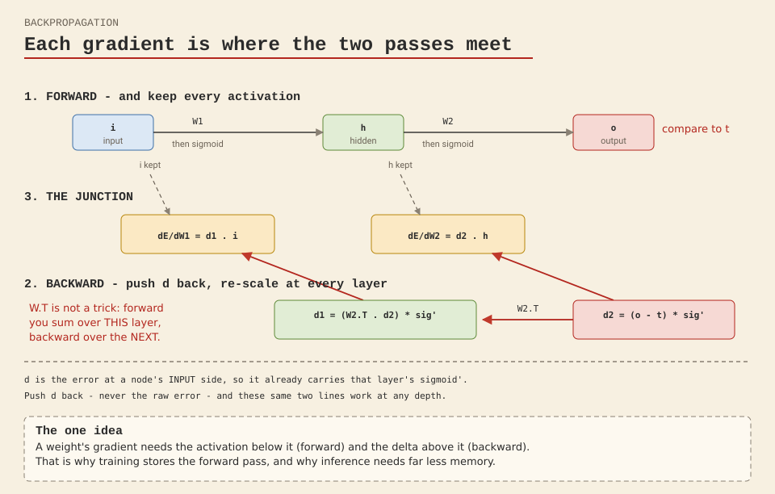

# Neural Networks From Scratch: One Law, and Everything That Follows

> **How to read this note.** There is a single expression at the centre of neural-network training, and most of what you are told to *do* when training one is a consequence of it. §1 states it and proves it against autograd. §2–§3 derive it. §4–§8 then use it as a tool: every "ritual" (scale your inputs, use this initialiser, prefer ReLU, prefer cross-entropy) stops being folklore and becomes a prediction you can check — and each one here is checked, with the numbers in the block.
>
> The derivation follows **Tariq Rashid's *Make Your Own Neural Network*** (2016), which derives it more patiently than anything else in print. Where its maths drifts from the gradient, §9 uses that as the worked example of a more useful lesson: *why wrong gradients are hard to notice.*
>
> This is not a general introduction. [artificial-neural-networks](artificial-neural-networks.md) owns that — the neuron, activation menu, mini-batching, preprocessing, a worked classifier. Read this when you want to know *why* those choices are the choices. Assumes derivatives and the chain rule ([calculus](../math-for-ml/calculus.md)) and matrix shapes ([linear-algebra](../math-for-ml/linear-algebra.md)).

## Why This Exists

**Problem.** You can call `loss.backward()` for years and still be helpless when a layer stops learning. The symptoms all look identical from outside — loss flat, accuracy stuck — and the advice you find is a list of unexplained rituals: scale to [0, 1], use He init, don't use sigmoid, use cross-entropy. Without a model of *why*, you cycle through them at random.

**Key insight.** A weight's gradient is a product of **three local numbers**:

$$\frac{\partial E}{\partial w} = \underbrace{\frac{\partial E}{\partial o}}_{\text{how wrong}} \times \underbrace{\frac{\partial o}{\partial \text{net}}}_{\text{how responsive}} \times \underbrace{\frac{\partial \text{net}}{\partial w}}_{\text{how loud}}$$

A product dies if **any** factor dies. So there are exactly three ways a weight can stop learning, every training ritual is an attempt to keep one of these factors alive, and every "mysterious" failure — dead ReLU, vanishing gradient, saturated sigmoid, silent layer — is one of the three. That is the whole diagnostic.

**Reach for this when:**
- A layer, or a whole network, has stopped learning and you want to reason about it instead of guessing.
- You want to know *why* ReLU beat sigmoid, and why cross-entropy beat squared error, in terms you can verify rather than accept.
- You want to derive backpropagation once, properly, and then recognise it inside autograd.
- You are porting older neural-network code (sigmoid outputs, squared error, hand-written updates, 0.01/0.99 targets) and want to know which parts to keep.
- You want to know why `nn.Linear` is declared `(in, out)` while its weight is `(out, in)`.

**Don't reach for this when:**
- You want to train something today — [artificial-neural-networks](artificial-neural-networks.md) has the recipe; none of this changes what you type.
- You need the practical menu of modern components (batch norm, dropout, schedulers, Adam's internals). Mentioned here only where the law explains them.
- You want convolutions, sequences or attention: [convolutional-neural-networks](convolutional-neural-networks.md), [recurrent-neural-networks](recurrent-neural-networks.md), [transformer-forward-pass](../math-for-ml/transformer-forward-pass.md).

## Diagrams

The whole note in one picture — the law of §1, and the three failures it predicts:


Two more sit with the sections they explain: the forward pass as a matrix multiply in §2, and the two-pass structure of backpropagation in §3.

## 1. The law: a gradient is three numbers multiplied

Take one weight $w_{j,k}$ feeding output node $k$, with a sigmoid activation and squared error. The gradient is

$$\frac{\partial E}{\partial w_{j,k}} = \underbrace{-(t_k - o_k)}_{\text{error}} \cdot \underbrace{\sigma(\text{net}_k)\big(1 - \sigma(\text{net}_k)\big)}_{\text{responsiveness}} \cdot \underbrace{o_j}_{\text{signal}}$$

Read it left to right as a sentence: *how wrong this output is*, times *how much this node can currently change its output*, times *how strong the signal on this particular link was*. §3 derives it; first, confirm it and confirm the consequence:

```python
import torch
torch.manual_seed(0)
# One weight's gradient is three local numbers multiplied. Nothing else.
o_j = torch.tensor(0.80)                         # factor 3: the signal arriving on this link
w = torch.tensor(0.5, requires_grad=True)
net_k = w * o_j
o_k = torch.sigmoid(net_k)
t_k = torch.tensor(1.0)
loss = 0.5 * (t_k - o_k) ** 2
loss.backward()
f1 = -(t_k - o_k)                                # dE/do_k   : how wrong the output is
f2 = o_k * (1 - o_k)                             # do_k/dnet : how responsive the node is
f3 = o_j                                         # dnet/dw   : how loud the input was
print(f"error {f1:+.4f}  x  responsiveness {f2:.4f}  x  signal {f3:.4f}  =  {f1*f2*f3:+.6f}")
print(f"autograd says                                                      {w.grad:+.6f}")
# Each factor is a separate off-switch for this weight.
for name, kw in [("output already correct", dict(t=o_k.item())),
                 ("node saturated (net=12)", dict(w=15.0)),
                 ("input silent (o_j=0)", dict(o=0.0))]:
    oj = torch.tensor(kw.get("o", 0.80)); ww = torch.tensor(kw.get("w", 0.5), requires_grad=True)
    ok = torch.sigmoid(ww * oj); tt = torch.tensor(kw.get("t", 1.0))
    (0.5 * (tt - ok) ** 2).backward()
    print(f"  {name:24} -> gradient {ww.grad:+.2e}")
# Expected output:
# error -0.4013  x  responsiveness 0.2403  x  signal 0.8000  =  -0.077136
# autograd says                                                      -0.077136
#   output already correct   -> gradient -0.00e+00
#   node saturated (net=12)  -> gradient -3.07e-11
#   input silent (o_j=0)     -> gradient -0.00e+00
```

The hand-built product matches autograd exactly, and each factor is an independent off-switch. Those three lines are the entire failure taxonomy:

| Factor goes to zero when | Called | Where it bites |
|---|---|---|
| the output is already correct | — | benign: a solved example stops pulling |
| the node's activation is in a flat region | **saturation** (sigmoid/tanh), **dead unit** (ReLU) | §4, §6 |
| the incoming signal is zero | zero input, dead upstream unit | §4 |

Two notes on scope. First, the "responsiveness" factor is the only one that depends on your choice of activation, which is why activation choice dominates trainability (§6). Second, in a deep network this product has *one responsiveness factor per layer* — they multiply — which is the whole story of depth (§8).

## 2. Why backprop's transpose is forced, not a trick

A node sums its moderated inputs and squashes: $\text{net}_j = \sum_i w_{j,i} i_i$, then $o_j = \sigma(\text{net}_j)$. Write that for every node and the pattern *is* a matrix product:

$$X = W \cdot I, \qquad O = \sigma(X)$$

with $W$ of shape **(nodes in the next layer × nodes in this layer)**. That ordering isn't convention — the sum runs over *this* layer, so this layer's index is the one contracted away, and it must be $W$'s columns.

```python
import numpy as np
rng = np.random.default_rng(0)
W = rng.normal(0, .3, (3, 4))            # W[j, i] = weight from input i to hidden node j
i = np.array([.9, .1, .8, .2])
sig = lambda x: 1 / (1 + np.exp(-x))
# The book's node-by-node description: for each node, sum the moderated incoming signals, then squash.
by_node = np.array([sig(sum(W[j, k] * i[k] for k in range(4))) for j in range(3)])
by_matrix = sig(W @ i)                   # the same thing as X = W.I then O = sigmoid(X)
print("node by node:", by_node.round(6))
print("one matmul  :", by_matrix.round(6))
print("identical:", np.allclose(by_node, by_matrix))
print("shapes: W", W.shape, "@ i", i.shape, "->", by_matrix.shape, "- so W is (next layer x this layer)")
# Expected output:
# node by node: [0.547353 0.558728 0.407315]
# one matmul  : [0.547353 0.558728 0.407315]
# identical: True
# shapes: W (3, 4) @ i (4,) -> (3,) - so W is (next layer x this layer)
```


Now the point. Going **forward**, you contract over *this* layer to produce the next. Going **backward**, you have a quantity per *next*-layer node and want one per *this*-layer node — so you contract over the other index of the same matrix. That is what a transpose is:

$$\text{forward: } W \cdot I \qquad\qquad \text{backward: } W^\top \cdot e$$

$W^\top$ is not a trick someone discovered; it is the only shape that type-checks. Any correct derivation produces it, which is why every framework's backward pass for a linear layer is a `matmul` with the operand transposed.

**Reading this off PyTorch.** `nn.Linear(in_features, out_features)` is declared in the opposite order to its own weight's shape `(out_features, in_features)`, because it applies the weight to *row*-vector batches as $I W^\top$: a batch goes in `(N, in)` and comes out `(N, out)`. The column-vector convention above and PyTorch's row-batch convention are transposes of each other, and mixing them is the most common shape error in hand-ported code.

## 3. Backpropagation is one local rule, applied repeatedly

The output error is easy — $e_k = t_k - o_k$. The obstacle is the hidden layer, which has no target of its own.

**The intuition everyone is taught.** Split each output's error across its incoming links *in proportion to their weights*, since a bigger weight carried more signal and so more blame. With weights 3 and 1, the first link takes $3/4$ of the error. Sum the pieces arriving at each hidden node and you have an error for a layer nobody gave targets to.

It is a good picture and it gets the shape right — blame travels back through $W^\top$. **But the proportional story and $W^\top e$ are not the same arithmetic**: the former divides by $w_{11} + w_{21}$, the latter doesn't. The denominator isn't a constant either — it varies per node — so a learning rate can't absorb it. Texts (including Rashid's, which switches between them without comment) routinely conflate the mnemonic with the derivation. Take the picture for the *direction* and the derivation below for the *number*.



**The derivation.** Over the output layer, $E = \sum_k (t_k - o_k)^2$. The sum collapses immediately, which is the step most texts skip: $o_n$ depends only on weights feeding node $n$, so for $w_{j,k}$ every term but $k$ is constant. Chain-rule what's left, using $\sigma' = \sigma(1-\sigma)$:

$$\frac{\partial E}{\partial w_{j,k}} = -2(t_k - o_k)\,\sigma'(\text{net}_k)\, o_j$$

Define $E = \tfrac12\sum(t-o)^2$ to clear the 2 (the convention's only purpose) and you have §1's law. The update steps *down* the slope: $w \leftarrow w - \alpha\,\partial E/\partial w$.

**Generalising it.** Rather than redo the algebra per layer, name the recurring quantity. Let $\delta_k = \partial E / \partial \text{net}_k$ — the error *at a node's pre-activation*. Then the whole algorithm is three lines that hold for any depth:

$$\delta_{\text{output}} = -(t - o) \odot \sigma'(\text{net}), \qquad \delta_{\text{hidden}} = \big(W^\top \delta_{\text{next}}\big) \odot \sigma'(\text{net}), \qquad \frac{\partial E}{\partial W} = \delta\, o_{\text{prev}}^\top$$

That is backpropagation. Note **where $\sigma'$ sits**: it multiplies *after* the transpose, and the $\delta$ you push back already carries the next layer's $\sigma'$ inside it. Carrying the raw error back instead of $\delta$ is the single most common error in hand-rolled implementations — §9 measures what it costs.

The reason this is cheap is reuse: each $\delta$ is computed once and used for both its own weights' gradients and the layer below. That reuse is the difference between backprop and numerically perturbing every weight, which is how the problem looked unsolvable until the 1970s–80s.

## 4. Consequence: why inputs and targets ever needed scaling

Older code is full of input scaling to $[0.01, 1.0]$ and targets at $0.01/0.99$ instead of $0/1$. The law explains both, and also explains why one of them is now obsolete.

**Zero inputs kill factor three.** The gradient's third factor *is* the input on that link. A zero-valued pixel contributes exactly nothing to its weight's gradient, however wrong the answer was. Hence a floor of 0.01 rather than 0.

**Unreachable targets kill factor two.** A sigmoid cannot output 0 or 1. Demand it and the error never closes, so the node is pushed ever further into its flat tail — where factor two vanishes. The interesting part is what that costs, and under which loss:

```python
import torch, torch.nn as nn, torch.nn.functional as F
# A sigmoid cannot output exactly 1. Push a node hard toward 1, then ask it to learn the OPPOSITE
# example. How much gradient is left to do that with? That is what saturation actually costs.
mse = lambda z, t: ((torch.sigmoid(z) - t) ** 2).mean()
def probe(loss, steps=3000):
    torch.manual_seed(0)
    lin = nn.Linear(4, 1); opt = torch.optim.SGD(lin.parameters(), lr=0.5)
    x = torch.ones(1, 4)
    for _ in range(steps):                                  # saturate it chasing an unreachable 1.0
        opt.zero_grad(); loss(lin(x), torch.ones(1, 1)).backward(); opt.step()
    opt.zero_grad(); loss(lin(x), torch.zeros(1, 1)).backward()   # now demand the opposite
    return torch.sigmoid(lin(x)).item(), lin.weight.grad.norm().item()
for name, loss in (("squared error", mse), ("cross-entropy", F.binary_cross_entropy_with_logits)):
    o, g = probe(loss)
    print(f"{name:15} saturated to {o:.5f}, gradient left to learn t=0: {g:.2e}")
print("\nboth losses saturate the node. only one can still escape:")
print("squared error multiplies by sigmoid'(net), ~0 there, leaving ~90x less gradient to escape with.")
print("cross-entropy's gradient is (output - target), with the sigmoid' cancelled - so it recovers.")
print("that cancellation, not the 0.01/0.99 ritual, is the real fix.")
# Expected output:
# squared error   saturated to 0.99416, gradient left to learn t=0: 2.31e-02
# cross-entropy   saturated to 0.99987, gradient left to learn t=0: 2.00e+00
# 
# both losses saturate the node. only one can still escape:
# squared error multiplies by sigmoid'(net), ~0 there, leaving ~90x less gradient to escape with.
# cross-entropy's gradient is (output - target), with the sigmoid' cancelled - so it recovers.
# that cancellation, not the 0.01/0.99 ritual, is the real fix.
```

Both losses drive the node to saturation. Only one can get back out: squared error multiplies by $\sigma'(\text{net})$, which is ~0 there, so it is left with roughly **90× less gradient** to learn the opposite example with. Cross-entropy's gradient is $(o - t)$ — the $\sigma'$ has cancelled — so saturation costs it nothing.

**Which retires the ritual.** The 0.01/0.99 trick is a workaround for *squared error on a squashed output*. Use cross-entropy on logits and a target of exactly 1 is unremarkable. Keep the input scaling (factor three is real under any loss, and optimisers behave better on comparable scales); drop the target fudging.

## 5. Consequence: why initialisation has a formula

Initialisation is not about breaking ties — though it must do that too, since identical weights receive identical gradients forever and the hidden units never differentiate. It is about **factor two at step zero**. Each node sums $n_{in}$ incoming signals; if that sum routinely lands outside the activation's responsive region, the network starts out saturated and the first gradients are already tiny.

That gives a target — keep the pre-activation's variance around 1 — and the variance of a sum of $n_{in}$ independent terms scales with $n_{in}$, so the weight's standard deviation should scale as $1/\sqrt{n_{in}}$. That single line is where all the named initialisers come from:

| Initialiser | Variance | For | Reasoning |
|---|---|---|---|
| **LeCun** | $1/n_{in}$ | sigmoid, tanh | keep the forward variance at 1 |
| **Xavier/Glorot** | $2/(n_{in} + n_{out})$ | sigmoid, tanh | compromise between forward *and* backward variance |
| **He/Kaiming** | $2/n_{in}$ | ReLU | ReLU zeroes half the distribution, so double it to compensate |

`nn.Linear` defaults to a Kaiming-uniform variant and Keras `Dense` to Glorot-uniform, so you mostly inherit a sane choice; you override when your activation doesn't match the default's assumption.

The failure mode is worth seeing, because it is quiet — a wrong fan-in by a factor of a few is survivable, which is exactly why it goes unnoticed:

```python
import numpy as np
rng = np.random.default_rng(0)
I, H = 784, 100                                   # MNIST: 784 inputs into each of 100 hidden nodes
x = rng.random((I, 2000)) * .99 + .01             # inputs scaled the book's way, into [0.01, 1.0]
for label, sd in [("the book's stated rule  1/sqrt(fan_in=784)", I ** -0.5),
                  ("the book's code         1/sqrt(hnodes=100)", H ** -0.5)]:
    W = rng.normal(0, sd, (H, I))
    net = W @ x                                   # pre-activation signal into the hidden layer
    sat = np.mean(np.abs(net) > 4)                 # |net| > 4 means sigmoid' < 0.018: effectively flat
    print(f"{label}: sd={sd:.4f}  net std={net.std():5.2f}  fraction saturated={sat:.1%}")
print("sigmoid' peaks at 0.25 and is under 0.018 past |net|=4, so a saturated node barely learns.")
# Expected output:
# the book's stated rule  1/sqrt(fan_in=784): sd=0.0357  net std= 0.56  fraction saturated=0.0%
# the book's code         1/sqrt(hnodes=100): sd=0.1000  net std= 1.52  fraction saturated=0.9%
# sigmoid' peaks at 0.25 and is under 0.018 past |net|=4, so a saturated node barely learns.
```

Using the wrong node count — easy to do, and a mistake in Rashid's own code, which uses each matrix's *output* width where his stated rule says fan-in — gives a standard deviation nearly 3× too wide and starts about 1% of units saturated. Not fatal. Also not free, and it compounds with depth.

## 6. Consequence: why ReLU beat sigmoid

Factor two is the only one set by your activation choice, and in a deep network **one factor per layer multiplies**. So the ceiling on a sigmoid network's depth is arithmetic: $\sigma' \le 0.25$ everywhere, with equality only at $\text{net}=0$, so each layer backward multiplies the gradient by at most a quarter. Ten layers is a factor of $4^{10} \approx 10^6$ in the best case.

ReLU's derivative is exactly **1** wherever the unit is active. The product stops shrinking:

```python
import torch, torch.nn as nn
torch.manual_seed(0)
# Same 8-layer stack, same init, two activations. Measure the gradient reaching each layer.
def grads(act):
    layers = []
    for _ in range(8):
        layers += [nn.Linear(64, 64), act()]
    net = nn.Sequential(*layers, nn.Linear(64, 1))
    for m in net:                                          # identical init so only the activation differs
        if isinstance(m, nn.Linear): nn.init.normal_(m.weight, 0, 64 ** -0.5); nn.init.zeros_(m.bias)
    net(torch.randn(32, 64)).sum().backward()
    return [m.weight.grad.norm().item() for m in net if isinstance(m, nn.Linear)]
s, r = grads(nn.Sigmoid), grads(nn.ReLU)
print("layer   sigmoid grad norm   ReLU grad norm")
for i, (a, b) in enumerate(zip(s, r)):
    print(f"{i+1:>3}     {a:>14.2e}   {b:>13.2e}")
print(f"\nfirst layer vs last: sigmoid attenuates {s[-1]/s[0]:,.0f}x, ReLU {r[-1]/r[0]:.1f}x")
print("sigmoid' <= 0.25, so every layer multiplies the gradient by at most a quarter. ReLU' is 1 where active.")
# Expected output:
# layer   sigmoid grad norm   ReLU grad norm
#   1           2.78e-04        1.73e+00
#   2           4.56e-03        1.96e+00
#   3           1.89e-02        2.56e+00
#   4           9.10e-02        4.21e+00
#   5           4.34e-01        6.17e+00
#   6           1.67e+00        7.10e+00
#   7           6.27e+00        8.38e+00
#   8           3.06e+01        8.25e+00
#   9           1.37e+02        1.00e+01
# ... trimmed
```

Across 8 identical layers with identical initialisation, the sigmoid stack's first layer sees a gradient roughly **490,000×** smaller than its last; the ReLU stack's differs by under 6×. The early layers of the sigmoid network are, for practical purposes, not being trained — and no learning-rate choice fixes it, because a rate large enough for layer 1 is wildly too large for layer 8.

**ReLU's own failure is the same law.** A ReLU unit whose pre-activation is negative for *every* input has derivative 0 — factor two again — and no gradient will ever revive it: a **dead unit**. The fixes are all attempts to keep factor two off zero (LeakyReLU, GELU, careful init, lower learning rates), which is why they are interchangeable in practice.

**This also explains the rest of the modern stack.** Normalisation layers (batch/layer norm) keep pre-activations in the responsive region by construction, so factor two can't drift; residual connections add a path whose local derivative is exactly 1, so the product has a route that doesn't shrink. Both are interventions on the same term.

## 7. Consequence: why cross-entropy beat squared error

Squared error on a squashed output has a specific pathology: factor one and factor two *fight*. Being badly wrong makes the error large — and simultaneously means the output sits near 0 or 1, where $\sigma'$ is near zero. The product is small exactly when you need the largest step.

```python
import torch
# Target is 1. Sweep the pre-activation from confidently wrong to confidently right,
# and watch what each loss sends back as dL/dz.
print("  z      output   dL/dz, squared error   dL/dz, cross-entropy")
for z in (-6.0, -2.0, 0.0, 2.0, 6.0):
    t = torch.tensor([1.0])
    a = torch.tensor([z], requires_grad=True)
    (0.5 * (t - torch.sigmoid(a)) ** 2).sum().backward()                 # MSE on a squashed output
    g_mse = a.grad.item()
    b = torch.tensor([z], requires_grad=True)
    torch.nn.functional.binary_cross_entropy_with_logits(b, t).backward()  # CE straight on the logit
    print(f"{z:+5.1f}   {torch.sigmoid(torch.tensor(z)):.4f}        {g_mse:+.5f}              {b.grad.item():+.5f}")
print("at z=-6 the model is as wrong as it can be. squared error sends back 0.002; cross-entropy sends 1.0.")
print("the sigmoid' factor is what dies - and cross-entropy's derivative cancels it exactly.")
# Expected output:
#   z      output   dL/dz, squared error   dL/dz, cross-entropy
#  -6.0   0.0025        -0.00246              -0.99753
#  -2.0   0.1192        -0.09248              -0.88080
#  +0.0   0.5000        -0.12500              -0.50000
#  +2.0   0.8808        -0.01252              -0.11920
#  +6.0   0.9975        -0.00001              -0.00247
# at z=-6 the model is as wrong as it can be. squared error sends back 0.002; cross-entropy sends 1.0.
# the sigmoid' factor is what dies - and cross-entropy's derivative cancels it exactly.
```

At $z = -6$ the model could not be more wrong about a target of 1, and squared error sends back a gradient of **0.002**. Cross-entropy sends back **1.0**, nearly 400× more. The mechanism is exact cancellation: differentiating $-\log \sigma(z)$ gives $\sigma(z) - t$, with the $\sigma'$ factor gone. Cross-entropy is not "a better-shaped loss" in some vague sense; it is the loss whose derivative deletes the term that was sabotaging you.

Hence the modern default: **emit raw logits, let the loss own the squashing.** `nn.CrossEntropyLoss` and `nn.BCEWithLogitsLoss` take logits and apply log-softmax/log-sigmoid internally, in a numerically stable fused form. Putting a `Softmax` or `Sigmoid` before them applies it twice and quietly hurts.

## 8. Why hand-derived gradients fail silently

Having derived it by hand, here is the reason you should still let autograd do it. A gradient has a direction and a magnitude, and **gradient descent is forgiving about magnitude** — a learning rate is already an arbitrary scale factor. So a derivation that gets the direction right and the scale wrong *still trains*, and nothing in your loss curve says otherwise.

Rashid's hidden-layer update is a clean specimen: it carries the raw error back as $W^\top e$ rather than $W^\top \delta$, omitting the output layer's $\sigma'$ (§3). So it is not $\partial E/\partial w$ — but:

```python
import numpy as np, torch
rng = np.random.default_rng(0)
Wih = rng.normal(0, .5, (3, 4)); Who = rng.normal(0, .5, (2, 3))
i = np.array([.9, .1, .8, .2]); t = np.array([.99, .01])
sig = lambda x: 1 / (1 + np.exp(-x))
oh = sig(Wih @ i); oo = sig(Who @ oh)                  # forward pass
eo = t - oo                                            # output error
# The book's rule: backprop the raw error with the transposed weights, no sigmoid' factor.
eh_book = Who.T @ eo
dWho_book = -np.outer(eo * oo * (1 - oo), oh)          # the book's dE/dw_jk
dWih_book = -np.outer(eh_book * oh * (1 - oh), i)
# Ground truth from autograd on E = 0.5 * sum (t - o)^2, which matches the book's dropped factor of 2.
tW1 = torch.tensor(Wih, requires_grad=True); tW2 = torch.tensor(Who, requires_grad=True)
ti = torch.tensor(i); tt = torch.tensor(t)
loss = 0.5 * ((tt - torch.sigmoid(tW2 @ torch.sigmoid(tW1 @ ti))) ** 2).sum()
loss.backward()
print("hidden->output gradient matches autograd:", np.allclose(dWho_book, tW2.grad.numpy()))
print("input->hidden  gradient matches autograd:", np.allclose(dWih_book, tW1.grad.numpy()))
cos = lambda a, b: float(a.ravel() @ b.ravel() / (np.linalg.norm(a) * np.linalg.norm(b)))
print(f"  but the direction is nearly right: cosine = {cos(dWih_book, tW1.grad.numpy()):.4f}")
print(f"  magnitude is inflated by {np.linalg.norm(dWih_book) / np.linalg.norm(tW1.grad.numpy()):.2f}x")
# The missing piece is sigmoid'(net_k) inside the sum over output nodes k.
eh_true = Who.T @ (eo * oo * (1 - oo))
dWih_true = -np.outer(eh_true * oh * (1 - oh), i)
print("add sigmoid'(net_k) inside the sum  ->  matches:", np.allclose(dWih_true, tW1.grad.numpy()))
# Expected output:
# hidden->output gradient matches autograd: True
# input->hidden  gradient matches autograd: False
#   but the direction is nearly right: cosine = 0.9996
#   magnitude is inflated by 5.17x
# add sigmoid'(net_k) inside the sum  ->  matches: True
```

The output layer is exact. The hidden layer is wrong, yet **cosine 0.9996** against the true gradient and merely **5.17×** too long. On a sigmoid network that inflation is even mildly *helpful* — it partly offsets the attenuation of §6, like a larger learning rate on the first layer. End to end, with both rules dropped into the same hand-written network:

```python
import numpy as np
from sklearn.datasets import load_digits
from sklearn.model_selection import train_test_split
X, y = load_digits(return_X_y=True)                       # 1797 8x8 digits, greyscale 0-16
Xtr, Xte, ytr, yte = train_test_split(X, y, test_size=.3, random_state=0, stratify=y)
scale = lambda A: A / 16.0 * 0.99 + 0.01                  # the book's input range, [0.01, 1.0]
Xtr, Xte = scale(Xtr), scale(Xte)
sig = lambda x: 1 / (1 + np.exp(-x))
def train(lr, H=100, epochs=12, seed=0, book_rule=True):
    rng = np.random.default_rng(seed)
    Wih = rng.normal(0, 64 ** -0.5, (H, 64))              # N(0, 1/sqrt(fan_in)), the book's STATED rule
    Who = rng.normal(0, H ** -0.5, (10, H))
    for _ in range(epochs):
        for xi, yi in zip(Xtr, ytr):                      # one example at a time, as the book does
            t = np.full(10, 0.01); t[yi] = 0.99           # targets dodge the unreachable 0 and 1
            oh = sig(Wih @ xi); oo = sig(Who @ oh)        # forward: two matrix multiplies
            eo = t - oo
            eh = Who.T @ eo if book_rule else Who.T @ (eo * oo * (1 - oo))   # the only difference
            Who += lr * np.outer(eo * oo * (1 - oo), oh)  # the book's matrix update rule
            Wih += lr * np.outer(eh * oh * (1 - oh), xi)
    return (sig(Who @ sig(Wih @ Xte.T)).argmax(0) == yte).mean()
print(f"most-frequent-class baseline: {np.bincount(ytr).max() / len(ytr):.4f}\n")
print("lr     the book's rule   the true gradient")
for lr in (0.05, 0.1, 0.2, 0.4):
    print(f"{lr:<6} {train(lr, book_rule=True):.4f}            {train(lr, book_rule=False):.4f}")
print("\n68 lines of the book become 2 matrix multiplies forward and 2 outer products back.")
print("the book's rule wins at every lr here: its 5x-inflated first layer offsets sigmoid damping.")
# Expected output:
# most-frequent-class baseline: 0.1018
# 
# lr     the book's rule   the true gradient
# 0.05   0.9630            0.9593
# 0.1    0.9722            0.9630
# 0.2    0.9778            0.9593
# 0.4    0.9815            0.9685
# 
# 68 lines of the book become 2 matrix multiplies forward and 2 outer products back.
# the book's rule wins at every lr here: its 5x-inflated first layer offsets sigmoid damping.
```

The incorrect rule scores *higher* at every learning rate tried, and the gap narrows as the rate rises — consistent with the true gradient simply under-stepping. (One small dataset, one seed; take the direction of the result, not the decimals.) So the network trains well, beats its 10% baseline by nearly 90 points, and the bug is completely invisible from the outside.

The lesson is not that the bug is an improvement. It is:

- **A wrong-but-aligned gradient is undetectable from training curves.** You need a gradient check — compare against autograd or finite differences — and it costs eight lines.
- **The error compounds with depth.** One missing $\sigma'$ per layer is a systematic per-layer misscaling; at two layers it is absorbed by the learning rate, at twenty it is not.
- **This is the actual argument for autograd**, more than convenience: it is correct for architectures you haven't derived, including the one you'll write tomorrow.

## 9. Reading every term back off PyTorch

Nothing above disappears in a framework — it is all still there, just named differently. This is the mapping, and it is the practical payoff of the derivation.

| The term | Where it lives in PyTorch |
|---|---|
| $W$, shape (next × this) | `layer.weight`, shape `(out_features, in_features)` |
| $W \cdot I$ | `layer(x)`, computed as `x @ W.T + b` |
| $\sigma(\cdot)$ | `torch.sigmoid`, `nn.Sigmoid`, or `nn.ReLU` for §6 |
| factor one, $\partial E/\partial o$ | the loss's own derivative — `(o - t)` for cross-entropy |
| factor two, $\sigma'(\text{net})$ | applied by autograd at the activation node |
| factor three, $o_{\text{prev}}$ | the cached activation; this is *why* the forward pass is kept in memory |
| $\delta$, per node | the gradient flowing into a node — never materialised by name |
| $W^\top \delta$ | the linear layer's backward `matmul` |
| the whole backward sweep | `loss.backward()` |
| $w \leftarrow w - \alpha\,\partial E/\partial w$ | `opt.step()` |
| $\partial E/\partial w$, per parameter | `p.grad` |

That "cached activation" row is worth pausing on: factor three is the layer's *input*, so the backward pass cannot run without it. This is the whole reason training needs so much more memory than inference, and the reason gradient checkpointing works by recomputing activations instead of storing them.

```python
import numpy as np, torch, torch.nn as nn
from sklearn.datasets import load_digits
from sklearn.model_selection import train_test_split
torch.manual_seed(0); torch.set_num_threads(1)
X, y = load_digits(return_X_y=True)
Xtr, Xte, ytr, yte = train_test_split(X, y, test_size=.3, random_state=0, stratify=y)
to = lambda A: torch.tensor(A / 16.0 * 0.99 + 0.01, dtype=torch.float32)   # the book's input scaling
Xtr, Xte, ytr_t = to(Xtr), to(Xte), torch.tensor(ytr)
T = torch.full((len(ytr), 10), 0.01); T[torch.arange(len(ytr)), ytr] = 0.99  # the book's 0.01/0.99 targets
def run(net, loss_fn, target, opt, epochs=60, bs=32):
    for _ in range(epochs):
        for b in torch.randperm(len(Xtr)).split(bs):
            opt.zero_grad(); loss_fn(net(Xtr[b]), target[b]).backward(); opt.step()
    return (net(Xte).argmax(1).numpy() == yte).mean()
book = nn.Sequential(nn.Linear(64, 100), nn.Sigmoid(), nn.Linear(100, 10), nn.Sigmoid())
for m in book:                                       # the book's init: N(0, 1/sqrt(fan_in))
    if isinstance(m, nn.Linear):
        nn.init.normal_(m.weight, 0, m.in_features ** -0.5); nn.init.zeros_(m.bias)
sse = lambda o, t: ((o - t) ** 2).sum(1).mean()      # sum over nodes, mean over batch, as the book does
print(f"the book's net in PyTorch (sigmoid + squared error):  {run(book, sse, T, torch.optim.SGD(book.parameters(), lr=0.5)):.4f}")
modern = nn.Sequential(nn.Linear(64, 100), nn.ReLU(), nn.Linear(100, 10))    # logits, no output squash
print(f"same shape, modern defaults (ReLU + CE + Adam):       {run(modern, nn.functional.cross_entropy, ytr_t, torch.optim.Adam(modern.parameters(), 1e-3)):.4f}")
# Expected output:
# the book's net in PyTorch (sigmoid + squared error):  0.9630
# same shape, modern defaults (ReLU + CE + Adam):       0.9704
```

Same shape, same budget, two sets of defaults: the 2016 pairing (sigmoid + squared error + plain SGD) reaches **0.9630**, the modern one (ReLU + cross-entropy + Adam) **0.9704**. A modest gap on a problem this easy — but every mechanism behind it was derived above, and the gap grows with depth exactly as §6 predicts.

## 10. Introspection: what invertibility bought, and cost

One last thing the law does not give you: a trained network's weights individually mean nothing, because the learning is spread across all of them. So how do you see what it learned?

If the activation is **invertible**, you can run the network backwards — clamp a one-hot label on the outputs and propagate toward the inputs. Signals travel back through the same $W^\top$ as the error, and the activation is undone with its exact inverse. For the sigmoid that is the **logit**:

$$y = \frac{1}{1+e^{-x}} \quad\Longrightarrow\quad x = \ln\frac{y}{1-y}$$

(`scipy.special.logit`, the inverse of `expit`). Since it blows up at 0 and 1, each layer is rescaled into $[0.01, 0.99]$ first.

```python
import numpy as np, matplotlib.pyplot as plt
from sklearn.datasets import load_digits
X, y = load_digits(return_X_y=True)
Xs = X / 16.0 * 0.99 + 0.01
sig = lambda x: 1 / (1 + np.exp(-x))
rng = np.random.default_rng(0)
Wih = rng.normal(0, 64 ** -0.5, (200, 64)); Who = rng.normal(0, 200 ** -0.5, (10, 200))
for _ in range(15):                                          # train the book's way, one example at a time
    for xi, yi in zip(Xs, y):
        t = np.full(10, 0.01); t[yi] = 0.99
        oh = sig(Wih @ xi); oo = sig(Who @ oh); eo = t - oo
        Who += 0.2 * np.outer(eo * oo * (1 - oo), oh)
        Wih += 0.2 * np.outer((Who.T @ eo) * oh * (1 - oh), xi)
band = lambda v: (v - v.min()) / np.ptp(v) * 0.98 + 0.01      # back into the sigmoid's valid range
logit = lambda o: np.log(o / (1 - o))                         # the exact inverse of the sigmoid
digits = [0, 1, 3, 7]
fig, ax = plt.subplots(2, len(digits), figsize=(2 * len(digits), 4.4))
for c, d in enumerate(digits):
    o = np.full(10, 0.01); o[d] = 0.99                        # ask: what input means "this digit"?
    h = band(Who.T @ logit(o))                                # step back through the output layer
    img = band(Wih.T @ logit(h))                              # and back through the hidden layer
    ax[0][c].imshow(img.reshape(8, 8), cmap="gray_r"); ax[0][c].set_title(f"back-query {d}", fontsize=9)
    ax[1][c].imshow(X[y == d].mean(0).reshape(8, 8), cmap="gray_r"); ax[1][c].set_title(f"class mean {d}", fontsize=9)
    ax[0][c].axis("off"); ax[1][c].axis("off")
plt.tight_layout(); plt.show()
print("the back-query is a rough, noisy relative of the class mean - not a copy of it:")
print("it shows which pixels the WEIGHTS care about, which includes areas that must stay BLANK.")
print("at 8x8 it is far less legible than the book's 28x28 MNIST figures; resolution is the limit.")
# Expected output:
# the back-query is a rough, noisy relative of the class mean - not a copy of it:
# it shows which pixels the WEIGHTS care about, which includes areas that must stay BLANK.
# at 8x8 it is far less legible than the book's 28x28 MNIST figures; resolution is the limit.
```

The result is **not** the class mean — compare the rows. It maps what the *weights* are sensitive to, which includes bright regions meaning "this must stay blank". For the `0` that reads correctly: a clear centre ringed by evidence, which is what a zero is. At 8×8 it is far noisier than the 28×28 MNIST version in print; resolution is the binding constraint.

**And here is the cost of §6.** ReLU is not invertible — it destroys the sign — so the moment the field moved to ReLU, this technique stopped working, and interpretability had to be rebuilt on gradients instead: activation maximisation (gradient *ascent* on the input), saliency maps, Grad-CAM for conv nets (see [transfer-learning-and-cnn-architectures](transfer-learning-and-cnn-architectures.md)), SHAP. All stronger, all heavier. Trading invertibility for trainability was clearly the right call — it is just worth knowing a bill was paid.

## Trade-offs

- **The three-factor law vs the full Jacobian view.** "Error × responsiveness × signal" is exactly right for one weight in a feedforward net and is the most useful thing to hold in your head. It stops being literal once weights are shared (conv, RNN), where a weight's gradient is a *sum* of such products over positions or timesteps. The diagnostic survives; the arithmetic gets an extra sum.
- **Deriving it vs calling `backward()`.** Deriving buys debugging intuition and nothing else — no accuracy, no speed. It pays off the first time something stops learning.
- **Sigmoid vs ReLU.** Sigmoid gives a bounded output, a tidy derivative, and invertibility you can introspect (§10). It costs you a factor of ≥4 of gradient per layer (§6). For hidden layers this is not close.
- **Squared error vs cross-entropy.** Squared error is what makes the derivation tractable by hand, and is right for regression. For classification through a squashing output it is actively harmful (§7).
- **Fixing factor two by activation, init, or normalisation.** All three target the same term, and they overlap: good init matters less once you have normalisation layers, which matter less with residual paths. Reach for them in that order — activation choice first, since it's free.
- **8×8 digits vs real MNIST.** Every block here runs offline in seconds on scikit-learn's bundled set, at the cost of fuzzier back-query pictures and slightly inflated accuracies on an easier problem.

## Common Pitfalls

- **Treating a flat loss curve as "converged"** because the far more common cause is a dead factor — check whether activations have piled up in a flat region before you touch the learning rate.
- **Taking "split the error in proportion to the weights" as the derivation** because it is a mnemonic for the *shape* $W^\top$ and disagrees with it arithmetically; its implied per-node denominators are absent from every implementation, and a learning rate cannot absorb a non-constant (§3).
- **Backpropagating the raw error instead of $\delta$** because the next layer's $\sigma'$ belongs inside what you push back; omitting it misscales every earlier layer, once per layer (§3, §8).
- **Trusting a hand-derived gradient because training works** because a wrong-but-aligned gradient trains fine — cosine 0.9996 and 5× too long still descends. Gradient-check against autograd (§8).
- **Applying `Softmax` or `Sigmoid` before `CrossEntropyLoss` / `BCEWithLogitsLoss`** because those losses squash internally; doing it twice is numerically worse and silently wrong (§7).
- **Setting targets a bounded output cannot reach** because the error never closes and the node is driven into saturation — though with cross-entropy on logits this stops mattering, which is why the old 0.01/0.99 advice is obsolete (§4).
- **Feeding exact zeros as inputs** because the gradient's third factor *is* the input, so those weights never update no matter how wrong the output (§4).
- **Initialising every weight to the same constant** because identical weights receive identical gradients forever and the hidden units never differentiate (§5).
- **Copying an initialiser's fan count from the matrix's shape without checking which axis is fan-in** because getting it backwards is survivable — a few× too wide — and therefore silent (§5).
- **Transposing `nn.Linear` by accident** because its declaration order `(in, out)` is the reverse of its weight's shape `(out, in)` (§2).
- **Expecting a back-query to look like a class average** because it shows what the weights are sensitive to, including regions that must stay *empty* (§10).

## Decision Table

| Scenario | Use this | Not that | Why |
|----------|----------|----------|-----|
| A layer has stopped learning | Ask which of the three factors is zero (§1) | Sweeping the learning rate | A rate scales a gradient; it cannot resurrect a zero |
| Hidden activation for a new net | ReLU (or GELU) + He init | Sigmoid/tanh | ≥4× gradient loss per layer, measured at 490,000× over 8 (§6) |
| Output + loss for classification | Raw logits + `CrossEntropyLoss` | Sigmoid/softmax + squared error | Cancels the $\sigma'$ that kills the gradient when confidently wrong (§7) |
| Output + loss for regression | Linear output + MSE | Anything squashed | No bounded activation to saturate; MSE is the right likelihood |
| One unit never activates | LeakyReLU/GELU, lower LR, re-init | More epochs | A dead unit's gradient is exactly 0 — more steps of zero is zero (§6) |
| Targets for a bounded output | Values the activation can reach, or switch to logits + CE | 0 and 1 on a sigmoid with MSE | Unreachable targets saturate the node (§4) |
| Gradients in anything you'll modify | `loss.backward()` | A hand-derived rule | §8 is a worked example of hand derivations failing silently |
| Checking a hand-derived gradient | `torch.allclose` against autograd, plus a cosine | "It trains, so it's right" | Direction can be right while magnitude is 5× off (§8) |
| Training is correct but memory-bound | Gradient checkpointing | A smaller batch, first | Factor three needs cached activations; recompute them instead (§9) |
| Initialising sigmoid/tanh layers | Xavier/Glorot (the framework default) | Hand-rolled constants | Balances forward and backward variance (§5) |
| Interpreting a small sigmoid/tanh net | Back-query through the inverse activation (§10) | Reading individual weights | Learning is distributed; single weights mean nothing |
| Interpreting a ReLU or conv net | Activation maximisation, saliency, Grad-CAM | Back-query | ReLU is not invertible, so there is no inverse to run (§10) |

## References

- Tariq Rashid — *Make Your Own Neural Network* (2016). The patient hand derivation this note's §2–§3 follow. Code: [makeyourownneuralnetwork on GitHub](https://github.com/makeyourownneuralnetwork/makeyourownneuralnetwork).
- [Rumelhart, Hinton & Williams — Learning representations by back-propagating errors (Nature, 1986)](https://www.nature.com/articles/323533a0) — the $\delta$ formulation of §3, with $\sigma'$ in the right place.
- [Nielsen — *Neural Networks and Deep Learning*, ch. 2](http://neuralnetworksanddeeplearning.com/chap2.html) — the same derivation stated as four equations; the best next step after this note. [Ch. 3](http://neuralnetworksanddeeplearning.com/chap3.html) is §7's argument at length.
- [Glorot & Bengio — Understanding the difficulty of training deep feedforward neural networks (AISTATS 2010)](https://proceedings.mlr.press/v9/glorot10a.html) — Xavier init, and the paper that framed §6 as a variance problem.
- [He et al. — Delving Deep into Rectifiers (2015)](https://arxiv.org/abs/1502.01852) — He init and PReLU: §5's table, ReLU row.
- [Glorot, Bordes & Bengio — Deep Sparse Rectifier Neural Networks (AISTATS 2011)](https://proceedings.mlr.press/v15/glorot11a.html) — the case for ReLU that §6 measures.
- [Ioffe & Szegedy — Batch Normalization (2015)](https://arxiv.org/abs/1502.03167) · [He et al. — Deep Residual Learning (2015)](https://arxiv.org/abs/1512.03385) — the two other interventions on factor two (§6).
- [`torch.nn.Linear`](https://docs.pytorch.org/docs/stable/generated/torch.nn.Linear.html) · [`torch.nn.CrossEntropyLoss`](https://docs.pytorch.org/docs/stable/generated/torch.nn.CrossEntropyLoss.html) · [`torch.nn.init`](https://docs.pytorch.org/docs/stable/nn.init.html) · [`torch.utils.checkpoint`](https://docs.pytorch.org/docs/stable/checkpoint.html) · [`scipy.special.logit`](https://docs.scipy.org/doc/scipy/reference/generated/scipy.special.logit.html)

## See Also

- [artificial-neural-networks](artificial-neural-networks.md) — the practical companion: activation menu, mini-batching, preprocessing without leakage, a worked Keras/PyTorch classifier. Start there to build something.
- [calculus](../math-for-ml/calculus.md) — the chain rule that §3 is an application of.
- [linear-algebra](../math-for-ml/linear-algebra.md) — matrix shapes and transposes, the machinery of §2.
- [pytorch-cheatsheet](pytorch-cheatsheet.md) — argument order, autograd mechanics, why `.grad` is `None`: §9's mapping at keyboard depth.
- [convolutional-neural-networks](convolutional-neural-networks.md) — the same three factors with weight sharing, so each gradient becomes a sum over positions.
- [recurrent-neural-networks](recurrent-neural-networks.md) — §6's multiplying factors applied over *time* instead of depth, which is why LSTMs exist.
