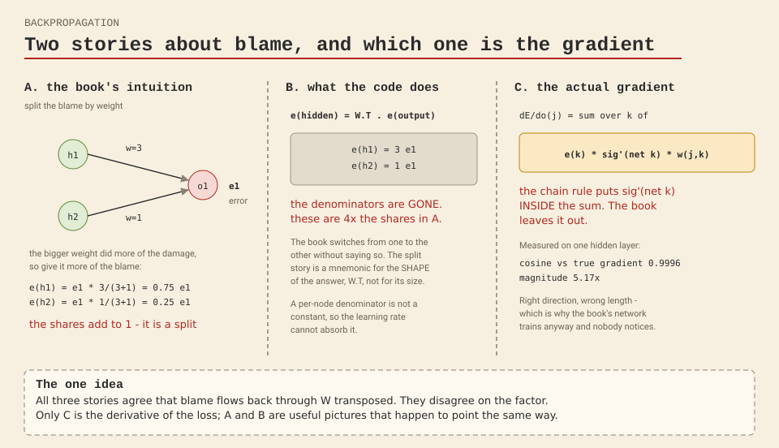

# Neural Networks From Scratch: The Maths, By Hand

> **How to read this note.** Study guide for **Tariq Rashid, *Make Your Own Neural Network*** (2016) — Part 1 (the maths), Part 2 (the numpy build), Part 3's back-query chapter, and Appendix A. Its angle is the one thing that book does better than any course: it derives *every* quantity by hand before writing a line of code. This note keeps that derivation and adds the column the book could not have: **what each hand-written line becomes in PyTorch**, and **where the book's maths is not quite the gradient it claims to be** (§4, measured).
>
> It is deliberately *not* a general neural-network introduction. [artificial-neural-networks](artificial-neural-networks.md) owns that — the neuron, activation choices, mini-batching, and a worked Keras/PyTorch classifier. Read this one when you want the derivation itself. Prerequisite for the calculus: [calculus](../math-for-ml/calculus.md) (derivatives, the chain rule). Prerequisite for the matrix shapes: [linear-algebra](../math-for-ml/linear-algebra.md).
>
> Skipped from the book: the Raspberry Pi appendix (hardware setup, dates fast) and the rotation-augmentation chapter.

## Why This Exists

**Problem.** You can call `loss.backward()` for years without being able to say what it computes. Then a gradient goes to zero, a layer stops learning, or a shape error says `(100, 64) @ (100,)` and there is no mental model to debug against — only an API. Most material either hands you the framework (and hides the maths) or hands you the maths as a wall of indices (and hides the meaning).

**Key insight.** The gradient of one weight is a **product of exactly three local numbers**: how wrong the output was, how responsive the node currently is, and how loud the incoming signal was. Everything else — matrix forms, transposes, autograd — is bookkeeping over that product. Once you can read `-(t - o) · σ(net)(1 - σ(net)) · o_j` as *error × responsiveness × signal*, you can predict which weights will fail to learn before you run anything.

**Reach for this when:**
- You want to derive backpropagation once, properly, rather than trust it.
- A layer isn't learning and you need to reason about which factor in the chain went to zero.
- You are reading older neural-network material (sigmoid outputs, squared error, hand-written update rules) and want it translated to modern PyTorch.
- You want to know *why* `nn.Linear` is declared `(in_features, out_features)` while its weight has shape `(out_features, in_features)`.
- You're working through this book and want to know which of its claims to trust.

**Don't reach for this when:**
- You want to train something today. Use [artificial-neural-networks](artificial-neural-networks.md) for the practical recipe; none of the derivation below changes what you type.
- You need modern architecture choices — ReLU/GELU, batch norm, Adam, dropout. The book predates or ignores all of them, and §8 only gestures at them.
- You want convolutions, sequences, or attention: [convolutional-neural-networks](convolutional-neural-networks.md), [recurrent-neural-networks](recurrent-neural-networks.md), [transformer-forward-pass](../math-for-ml/transformer-forward-pass.md).

## Diagrams





## 1. Learning as repeated small correction

The book spends its first forty pages on a deliberately trivial model — convert miles to kilometres with one parameter `c`, so `km = miles × c` — to establish one habit before any network appears: **you do not solve for the parameter, you nudge it.**

The loop is: guess `c`, compare the output to a known example, and move `c` by a *fraction* of the error. Three ideas fall out of it, and all three survive into modern training:

- **Error drives the correction.** Big error, big nudge. The error is the only signal you have.
- **Never take the whole correction.** Jumping straight to the value that fits the current example throws away everything learned from previous examples, and a single noisy example then wrecks the model. The fraction you keep is the **learning rate**.
- **Noisy data is the reason, not caution.** The book is explicit here and it is worth internalising: moderation exists because training data is imperfect, not because gradient descent is delicate.

Then the same machinery classifies instead of predicts — a line separating two groups, with the error being the gap between where the boundary is and where the example says it should be. The relevant limitation arrives next: **a single linear node cannot learn XOR**, no matter how long you train it, because no straight line separates those four points. That is the argument for layers, and it is the right argument. (The book's framing of XOR as needing *multiple classifiers* is a slightly dated route to the same conclusion; the modern statement is that a hidden layer with a non-linearity makes the decision boundary piecewise-linear in input space.)

## 2. The forward pass is one matrix multiply

A node does two things: **sum the moderated incoming signals**, then **squash the sum**. Writing `w(j,i)` for the weight from node `i` to node `j`, node `j`'s pre-activation is

$$\text{net}_j = \sum_i w_{j,i}\, i_i, \qquad o_j = \sigma(\text{net}_j), \qquad \sigma(x) = \frac{1}{1 + e^{-x}}$$

The book's pivotal observation — the thing that turns a diagram into code — is that writing those sums out for every node produces exactly the pattern of a matrix product. Stack them and the entire layer is

$$X = W \cdot I, \qquad O = \sigma(X)$$

with $W$ of shape **(nodes in the next layer × nodes in this layer)**. That ordering is not a convention you memorise; it is forced, because the sum runs over *this* layer's nodes, so they must be the index that gets contracted away.

```python
import numpy as np
rng = np.random.default_rng(0)
W = rng.normal(0, .3, (3, 4))            # W[j, i] = weight from input i to hidden node j
i = np.array([.9, .1, .8, .2])
sig = lambda x: 1 / (1 + np.exp(-x))
# The book's node-by-node description: for each node, sum the moderated incoming signals, then squash.
by_node = np.array([sig(sum(W[j, k] * i[k] for k in range(4))) for j in range(3)])
by_matrix = sig(W @ i)                   # the same thing as X = W.I then O = sigmoid(X)
print("node by node:", by_node.round(6))
print("one matmul  :", by_matrix.round(6))
print("identical:", np.allclose(by_node, by_matrix))
print("shapes: W", W.shape, "@ i", i.shape, "->", by_matrix.shape, "- so W is (next layer x this layer)")
# Expected output:
# node by node: [0.547353 0.558728 0.407315]
# one matmul  : [0.547353 0.558728 0.407315]
# identical: True
# shapes: W (3, 4) @ i (4,) -> (3,) - so W is (next layer x this layer)
```

The two routes agree to every decimal, which is the only claim being made — but the right-hand one is one line regardless of layer size, and hands the work to a BLAS kernel instead of a Python loop.

**The PyTorch mapping, and a shape trap.** `nn.Linear(in_features, out_features)` is declared in the opposite order to $W$'s shape. That is because PyTorch stores the weight as `(out_features, in_features)` — matching $W$ above — but applies it to row-vector batches as $I W^\top$, so a batch of $N$ inputs goes in as `(N, in_features)` and comes out `(N, out_features)`. The book's column-vector convention and PyTorch's row-batch convention are transposes of each other; mixing them up is the single most common shape error in hand-ported code.

| The book | PyTorch |
|---|---|
| `W` of shape `(next, this)`, input is a column | `nn.Linear(this, next)`, weight is `(next, this)`, input is a row batch `(N, this)` |
| `numpy.dot(W, I)` | `layer(x)`, i.e. `x @ W.T + b` |
| `scipy.special.expit(x)` | `torch.sigmoid(x)` or `nn.Sigmoid()` |
| No bias anywhere | `bias=True` by default — see §8 |

## 3. Backpropagation, story one: whose fault was the error?

The output error is easy: $e_k = t_k - o_k$, target minus actual. The real question is what to do with it when several nodes fed that output.

The book's answer is a genuinely good piece of teaching: **split the error across the incoming links in proportion to their weights**, because a bigger weight carried more of the signal and therefore more of the blame. With weights 3 and 1 into one output node, the first link takes $3/4$ of the error and the second $1/4$.

Repeat that per output node, and sum the pieces arriving at each hidden node, and you have an error for a layer that has no targets of its own — which was the whole obstacle. Written out for two output nodes, hidden node 1 collects

$$e_{h_1} = e_1 \cdot \frac{w_{11}}{w_{11} + w_{21}} + e_2 \cdot \frac{w_{12}}{w_{12} + w_{22}}$$

**Then the book quietly changes the formula.** One section later, vectorising, it builds the matrix version from the terms $e_1 w_{11}$ and $e_2 w_{12}$ — **the denominators are gone** — and lands on the form everyone uses:

$$e_{\text{hidden}} = W^\top \cdot e_{\text{output}}$$

No justification is offered for dropping them, and the book does not acknowledge the change. This matters more than a missing footnote, because the denominator is **not a constant**: it varies per node, so the learning rate cannot absorb it. The honest reading is that the proportional-split story is a mnemonic for the *shape* of the answer — blame flows backwards through $W^\top$ — and not a derivation of it. The derivation is in §4, and it produces $W^\top$ with no normalisation anywhere, which is why the code is right even though the story that motivated it isn't.

## 4. Backpropagation, story two: the actual gradient

Now derive it properly. The error over the output layer is

$$E = \sum_k (t_k - o_k)^2$$

The first simplification is one the book makes well and most texts skip: **the sum disappears.** Output $o_n$ depends only on the weights of links feeding node $n$, so for the weight $w_{j,k}$ every term except $k$ is a constant. The sum over output nodes was never needed for a single weight's gradient:

$$\frac{\partial E}{\partial w_{j,k}} = \frac{\partial}{\partial w_{j,k}} (t_k - o_k)^2$$

Apply the chain rule, use $t_k$ being constant, and use the sigmoid's famously convenient derivative $\sigma' = \sigma(1-\sigma)$:

$$\frac{\partial E}{\partial w_{j,k}} = -2(t_k - o_k)\cdot \sigma(\text{net}_k)\big(1 - \sigma(\text{net}_k)\big)\cdot o_j$$

The book drops the leading 2 on the grounds that only the direction matters — fair, and equivalent to defining $E = \tfrac12\sum(t-o)^2$, which is why most texts carry that half. Dropping it gives the expression the book calls the key to training neural networks:

$$\boxed{\;\frac{\partial E}{\partial w_{j,k}} = -(t_k - o_k)\cdot \sigma(\text{net}_k)\big(1-\sigma(\text{net}_k)\big)\cdot o_j\;}$$

and the update, stepping *down* the slope:

$$w_{j,k} \leftarrow w_{j,k} - \alpha \frac{\partial E}{\partial w_{j,k}}$$

**Read the three factors.** This is the payoff of the whole book, and the third diagram above is this sentence: the gradient is *how wrong the output was* × *how responsive this node currently is* × *how loud the incoming signal was*. Each is a link in the chain — $\partial E/\partial o_k$, $\partial o_k/\partial \text{net}_k$, $\partial \text{net}_k/\partial w_{j,k}$ — and a zero in any one of them freezes the weight.

For the earlier layer, the book reuses the same shape by analogy: replace $(t_k - o_k)$ with the back-propagated $e_j$, and $o_j$ with the layer's own input $o_i$.

**And here is where it stops being the gradient.** That analogy is where the error creeps in. The true chain rule gives

$$\frac{\partial E}{\partial o_j} = -\sum_k (t_k - o_k)\,\underbrace{\sigma'(\text{net}_k)}_{\text{the book omits this}}\, w_{j,k}$$

— the output node's *responsiveness* belongs **inside** the sum, because blame arriving at a hidden node must be scaled by how much each output node could actually act on it. The book's $e_{\text{hidden}} = W^\top e$ carries the raw error back instead. So its hidden-layer update is not $\partial E/\partial w$:

```python
import numpy as np, torch
rng = np.random.default_rng(0)
Wih = rng.normal(0, .5, (3, 4)); Who = rng.normal(0, .5, (2, 3))
i = np.array([.9, .1, .8, .2]); t = np.array([.99, .01])
sig = lambda x: 1 / (1 + np.exp(-x))
oh = sig(Wih @ i); oo = sig(Who @ oh)                  # forward pass
eo = t - oo                                            # output error
# The book's rule: backprop the raw error with the transposed weights, no sigmoid' factor.
eh_book = Who.T @ eo
dWho_book = -np.outer(eo * oo * (1 - oo), oh)          # the book's dE/dw_jk
dWih_book = -np.outer(eh_book * oh * (1 - oh), i)
# Ground truth from autograd on E = 0.5 * sum (t - o)^2, which matches the book's dropped factor of 2.
tW1 = torch.tensor(Wih, requires_grad=True); tW2 = torch.tensor(Who, requires_grad=True)
ti = torch.tensor(i); tt = torch.tensor(t)
loss = 0.5 * ((tt - torch.sigmoid(tW2 @ torch.sigmoid(tW1 @ ti))) ** 2).sum()
loss.backward()
print("hidden->output gradient matches autograd:", np.allclose(dWho_book, tW2.grad.numpy()))
print("input->hidden  gradient matches autograd:", np.allclose(dWih_book, tW1.grad.numpy()))
cos = lambda a, b: float(a.ravel() @ b.ravel() / (np.linalg.norm(a) * np.linalg.norm(b)))
print(f"  but the direction is nearly right: cosine = {cos(dWih_book, tW1.grad.numpy()):.4f}")
print(f"  magnitude is inflated by {np.linalg.norm(dWih_book) / np.linalg.norm(tW1.grad.numpy()):.2f}x")
# The missing piece is sigmoid'(net_k) inside the sum over output nodes k.
eh_true = Who.T @ (eo * oo * (1 - oo))
dWih_true = -np.outer(eh_true * oh * (1 - oh), i)
print("add sigmoid'(net_k) inside the sum  ->  matches:", np.allclose(dWih_true, tW1.grad.numpy()))
# Expected output:
# hidden->output gradient matches autograd: True
# input->hidden  gradient matches autograd: False
#   but the direction is nearly right: cosine = 0.9996
#   magnitude is inflated by 5.17x
# add sigmoid'(net_k) inside the sum  ->  matches: True
```

The output layer is exactly right. The hidden layer is **not** — but the cosine against the true gradient is **0.9996**, so it points almost exactly the right way and is merely about **5× too long**. That is why the book's network trains fine and why this has gone largely unremarked: a consistently inflated first-layer gradient behaves like a larger learning rate on that layer, and on a sigmoid network — where gradients are damped by $\sigma' \le 0.25$ at every layer — inflating them is usually *help*, not harm. §7 measures it: the book's rule actually scores higher than the true gradient at every learning rate tested.

None of which makes it correct. If you port this derivation into anything deeper than two layers, the error compounds per layer, and you should put $\sigma'$ back inside the sum — or just let autograd do it.

## 5. Preparing the inputs, the targets, and the weights

Three disciplines, all of which follow from the three-factor reading of the gradient rather than from superstition.

**Scale inputs into [0.01, 1.0].** A zero input zeroes factor three, so that weight gets no update no matter how wrong the answer was. The book's transform is `x / 255 * 0.99 + 0.01`, deliberately keeping the floor off zero. Large inputs are the other failure: they push $\text{net}$ into the sigmoid's flat tails where factor two vanishes.

**Scale targets into [0.01, 0.99].** A sigmoid output **cannot reach 0 or 1**. Ask it to and the error never closes, so the weights grow without bound chasing an unreachable target — saturating the node and killing factor two. This is the book's sharpest practical point and it generalises: *never set a target a model's output layer cannot represent.*

**Initialise weights to $N(0, 1/\sqrt{\text{fan\_in}})$** — the inverse square root of the number of links *into* a node, so that summing many inputs doesn't blow past the sigmoid's useful range. And never initialise to a constant, least of all zero: identical weights receive identical updates forever, so the hidden units never differentiate.

> **The book's code contradicts its own rule here.** The text states 1/√(incoming links), but both code lines use the matrix's *row* count — the layer's **output** width — instead:
> ```python
> self.wih = numpy.random.normal(0.0, pow(self.hnodes, -0.5), (self.hnodes, self.inodes))
> self.who = numpy.random.normal(0.0, pow(self.onodes, -0.5), (self.onodes, self.hnodes))
> ```
> For `wih` the fan-in is `inodes` (784), not `hnodes` (100). The effect is mild rather than fatal, which is presumably why it survived:

```python
import numpy as np
rng = np.random.default_rng(0)
I, H = 784, 100                                   # MNIST: 784 inputs into each of 100 hidden nodes
x = rng.random((I, 2000)) * .99 + .01             # inputs scaled the book's way, into [0.01, 1.0]
for label, sd in [("the book's stated rule  1/sqrt(fan_in=784)", I ** -0.5),
                  ("the book's code         1/sqrt(hnodes=100)", H ** -0.5)]:
    W = rng.normal(0, sd, (H, I))
    net = W @ x                                   # pre-activation signal into the hidden layer
    sat = np.mean(np.abs(net) > 4)                 # |net| > 4 means sigmoid' < 0.018: effectively flat
    print(f"{label}: sd={sd:.4f}  net std={net.std():5.2f}  fraction saturated={sat:.1%}")
print("sigmoid' peaks at 0.25 and is under 0.018 past |net|=4, so a saturated node barely learns.")
# Expected output:
# the book's stated rule  1/sqrt(fan_in=784): sd=0.0357  net std= 0.56  fraction saturated=0.0%
# the book's code         1/sqrt(hnodes=100): sd=0.1000  net std= 1.52  fraction saturated=0.9%
# sigmoid' peaks at 0.25 and is under 0.018 past |net|=4, so a saturated node barely learns.
```

Nearly 3× too wide, and about 1% of hidden units start saturated — survivable, but it is the wrong constant. For sigmoid and tanh the modern choice is **Xavier/Glorot**, which balances fan-in against fan-out ($\mathrm{Var} = 2/(n_{in}+n_{out})$) and is `nn.Linear`'s and Keras `Dense`'s default; the book's rule is the variant now known as **LeCun initialisation**. For ReLU you want **He/Kaiming** ($\mathrm{Var} = 2/n_{in}$), because ReLU zeroes half the distribution and the variance needs doubling to compensate.

## 6. The whole network, in numpy

Everything above, assembled. The book's class is a 784-100-10 sigmoid network trained one example at a time; this is the same network on scikit-learn's bundled 8×8 digits so it runs offline in seconds, with the book's scaling, the book's initialisation rule, and both backprop variants from §4 so you can see the difference in accuracy rather than just in cosine.

```python
import numpy as np
from sklearn.datasets import load_digits
from sklearn.model_selection import train_test_split
X, y = load_digits(return_X_y=True)                       # 1797 8x8 digits, greyscale 0-16
Xtr, Xte, ytr, yte = train_test_split(X, y, test_size=.3, random_state=0, stratify=y)
scale = lambda A: A / 16.0 * 0.99 + 0.01                  # the book's input range, [0.01, 1.0]
Xtr, Xte = scale(Xtr), scale(Xte)
sig = lambda x: 1 / (1 + np.exp(-x))
def train(lr, H=100, epochs=12, seed=0, book_rule=True):
    rng = np.random.default_rng(seed)
    Wih = rng.normal(0, 64 ** -0.5, (H, 64))              # N(0, 1/sqrt(fan_in)), the book's STATED rule
    Who = rng.normal(0, H ** -0.5, (10, H))
    for _ in range(epochs):
        for xi, yi in zip(Xtr, ytr):                      # one example at a time, as the book does
            t = np.full(10, 0.01); t[yi] = 0.99           # targets dodge the unreachable 0 and 1
            oh = sig(Wih @ xi); oo = sig(Who @ oh)        # forward: two matrix multiplies
            eo = t - oo
            eh = Who.T @ eo if book_rule else Who.T @ (eo * oo * (1 - oo))   # the only difference
            Who += lr * np.outer(eo * oo * (1 - oo), oh)  # the book's matrix update rule
            Wih += lr * np.outer(eh * oh * (1 - oh), xi)
    return (sig(Who @ sig(Wih @ Xte.T)).argmax(0) == yte).mean()
print(f"most-frequent-class baseline: {np.bincount(ytr).max() / len(ytr):.4f}\n")
print("lr     the book's rule   the true gradient")
for lr in (0.05, 0.1, 0.2, 0.4):
    print(f"{lr:<6} {train(lr, book_rule=True):.4f}            {train(lr, book_rule=False):.4f}")
print("\n68 lines of the book become 2 matrix multiplies forward and 2 outer products back.")
print("the book's rule wins at every lr here: its 5x-inflated first layer offsets sigmoid damping.")
# Expected output:
# most-frequent-class baseline: 0.1018
# 
# lr     the book's rule   the true gradient
# 0.05   0.9630            0.9593
# 0.1    0.9722            0.9630
# 0.2    0.9778            0.9593
# 0.4    0.9815            0.9685
# 
# 68 lines of the book become 2 matrix multiplies forward and 2 outer products back.
# the book's rule wins at every lr here: its 5x-inflated first layer offsets sigmoid damping.
```

Against a 10% majority-class baseline, a hand-written two-layer sigmoid network reaches **97–98%** — and the book's technically-wrong rule beats the true gradient at every learning rate, for the reason given in §4. Two honest caveats: this is one small dataset at one seed, and the gap narrows as the learning rate rises (the true gradient is simply under-stepping). The lesson is not "the bug is an improvement" — it is that **a 5× scale error on one layer is within the slack a learning rate already covers**, which tells you something real about how forgiving gradient descent is.

**What the book reports on real MNIST**, for calibration — these are its numbers, not reproduced here: 100 hidden nodes at learning rate 0.3 gives **94.73%** in one epoch; tuning the rate gives 0.9523 at 0.1 and 0.9537 at 0.2, with 0.6 *degrading* to 0.9047; 7 epochs at 0.1 reaches **96.28%**, peaking around 0.9689; and widening to 200 and 500 hidden nodes reaches **97.51%** and **97.62%**. The book compares these against the benchmark table on LeCun's MNIST page, where the simplest listed network scores about 95.3%. Worth knowing the shape of that curve: learning rate has an interior optimum, epochs have one too (its dip at 6 epochs it attributes, plausibly, to a single bad run), and the experiments are each a single run, which the book says outright.

## 7. The same network in PyTorch

The point of this section is subtraction. Every hand-written line above has a one-call replacement, and the replacements are not merely shorter — they are the ones that stay correct when you change the architecture.

| Hand-written (the book) | PyTorch |
|---|---|
| `self.wih`, `self.who` as explicit arrays | `nn.Linear(64, 100)`, `nn.Linear(100, 10)` |
| `numpy.random.normal(0.0, n ** -0.5, ...)` | `nn.init.normal_(w, 0, n ** -0.5)` — or just the default |
| `expit(numpy.dot(W, I))` | `torch.sigmoid(layer(x))`, or `nn.Sigmoid()` in a `Sequential` |
| `e = targets - outputs` then two `numpy.outer` updates | `loss.backward()` |
| `self.who += self.lr * numpy.dot(...)` | `opt.step()` with `torch.optim.SGD(..., lr=...)` |
| `e_hidden = numpy.dot(self.who.T, e_output)` | nothing — autograd derives it, **with** the $\sigma'$ the book drops |
| targets as a 0.01/0.99 vector + squared error | `nn.CrossEntropyLoss()` on raw logits and an integer label |

```python
import numpy as np, torch, torch.nn as nn
from sklearn.datasets import load_digits
from sklearn.model_selection import train_test_split
torch.manual_seed(0); torch.set_num_threads(1)
X, y = load_digits(return_X_y=True)
Xtr, Xte, ytr, yte = train_test_split(X, y, test_size=.3, random_state=0, stratify=y)
to = lambda A: torch.tensor(A / 16.0 * 0.99 + 0.01, dtype=torch.float32)   # the book's input scaling
Xtr, Xte, ytr_t = to(Xtr), to(Xte), torch.tensor(ytr)
T = torch.full((len(ytr), 10), 0.01); T[torch.arange(len(ytr)), ytr] = 0.99  # the book's 0.01/0.99 targets
def run(net, loss_fn, target, opt, epochs=60, bs=32):
    for _ in range(epochs):
        for b in torch.randperm(len(Xtr)).split(bs):
            opt.zero_grad(); loss_fn(net(Xtr[b]), target[b]).backward(); opt.step()
    return (net(Xte).argmax(1).numpy() == yte).mean()
book = nn.Sequential(nn.Linear(64, 100), nn.Sigmoid(), nn.Linear(100, 10), nn.Sigmoid())
for m in book:                                       # the book's init: N(0, 1/sqrt(fan_in))
    if isinstance(m, nn.Linear):
        nn.init.normal_(m.weight, 0, m.in_features ** -0.5); nn.init.zeros_(m.bias)
sse = lambda o, t: ((o - t) ** 2).sum(1).mean()      # sum over nodes, mean over batch, as the book does
print(f"the book's net in PyTorch (sigmoid + squared error):  {run(book, sse, T, torch.optim.SGD(book.parameters(), lr=0.5)):.4f}")
modern = nn.Sequential(nn.Linear(64, 100), nn.ReLU(), nn.Linear(100, 10))    # logits, no output squash
print(f"same shape, modern defaults (ReLU + CE + Adam):       {run(modern, nn.functional.cross_entropy, ytr_t, torch.optim.Adam(modern.parameters(), 1e-3)):.4f}")
# Expected output:
# the book's net in PyTorch (sigmoid + squared error):  0.9630
# same shape, modern defaults (ReLU + CE + Adam):       0.9704
```

The faithful port lands at **0.9630** and the modern-defaults version at **0.9704** on the same budget — a real but unspectacular gap on a problem this easy. The gap widens with depth, which is the actual argument for the modern defaults:

- **Cross-entropy on logits instead of squared error on a squashed output.** With sigmoid + squared error, a *confidently wrong* output has a near-zero gradient — factor two is saturated exactly when you most need a big step. Cross-entropy's gradient through a softmax is just $(\hat{y} - y)$: the $\sigma'$ cancels, and being badly wrong produces a correspondingly large step. This single change removes the book's main training pathology.
- **ReLU instead of sigmoid.** $\sigma' \le 0.25$ means a 3-layer sigmoid network attenuates gradients by at least $4^3$ per backward pass. ReLU's derivative is exactly 1 on the active half, so depth stops being self-defeating — and the input/target scaling rituals of §5 become unnecessary.
- **Adam instead of fixed-rate SGD.** Per-parameter adaptive step sizes make the learning-rate sweep in §6 much less load-bearing.
- **Biases.** The book's network has **none** — not an omission it mentions. Without a bias, a node's hinge is pinned at $\text{net} = 0$, and the layer can only scale and rotate its input, never shift it. `nn.Linear` adds one by default, and you should keep it.

For the full practical workflow — mini-batching, train/validation splits, preprocessing without leakage — see [artificial-neural-networks](artificial-neural-networks.md); it is not repeated here.

## 8. Back-querying: what does the network think a "3" looks like?

The book's most distinctive idea, and the one worth stealing. A trained network is a black box; the weights individually mean nothing because the learning is distributed across them. So: **run it backwards.** Clamp a one-hot label on the *output* nodes, propagate toward the inputs, and look at the image that emerges — the input the network is effectively asking for.

Two mechanics make it work. Signals travel back through the same transposed weights as the error, $W^\top$. And the activation must be *undone*, which for the sigmoid means its exact inverse, the **logit**:

$$y = \frac{1}{1+e^{-x}} \quad\Longrightarrow\quad x = \ln\!\frac{y}{1-y}$$

available as `scipy.special.logit` (the inverse of `scipy.special.expit`). Since the logit explodes at 0 and 1, each layer's values are rescaled into [0.01, 0.99] before it is applied.

```python
import numpy as np, matplotlib.pyplot as plt
from sklearn.datasets import load_digits
X, y = load_digits(return_X_y=True)
Xs = X / 16.0 * 0.99 + 0.01
sig = lambda x: 1 / (1 + np.exp(-x))
rng = np.random.default_rng(0)
Wih = rng.normal(0, 64 ** -0.5, (200, 64)); Who = rng.normal(0, 200 ** -0.5, (10, 200))
for _ in range(15):                                          # train the book's way, one example at a time
    for xi, yi in zip(Xs, y):
        t = np.full(10, 0.01); t[yi] = 0.99
        oh = sig(Wih @ xi); oo = sig(Who @ oh); eo = t - oo
        Who += 0.2 * np.outer(eo * oo * (1 - oo), oh)
        Wih += 0.2 * np.outer((Who.T @ eo) * oh * (1 - oh), xi)
band = lambda v: (v - v.min()) / np.ptp(v) * 0.98 + 0.01      # back into the sigmoid's valid range
logit = lambda o: np.log(o / (1 - o))                         # the exact inverse of the sigmoid
digits = [0, 1, 3, 7]
fig, ax = plt.subplots(2, len(digits), figsize=(2 * len(digits), 4.4))
for c, d in enumerate(digits):
    o = np.full(10, 0.01); o[d] = 0.99                        # ask: what input means "this digit"?
    h = band(Who.T @ logit(o))                                # step back through the output layer
    img = band(Wih.T @ logit(h))                              # and back through the hidden layer
    ax[0][c].imshow(img.reshape(8, 8), cmap="gray_r"); ax[0][c].set_title(f"back-query {d}", fontsize=9)
    ax[1][c].imshow(X[y == d].mean(0).reshape(8, 8), cmap="gray_r"); ax[1][c].set_title(f"class mean {d}", fontsize=9)
    ax[0][c].axis("off"); ax[1][c].axis("off")
plt.tight_layout(); plt.show()
print("the back-query is a rough, noisy relative of the class mean - not a copy of it:")
print("it shows which pixels the WEIGHTS care about, which includes areas that must stay BLANK.")
print("at 8x8 it is far less legible than the book's 28x28 MNIST figures; resolution is the limit.")
# Expected output:
# the back-query is a rough, noisy relative of the class mean - not a copy of it:
# it shows which pixels the WEIGHTS care about, which includes areas that must stay BLANK.
# at 8x8 it is far less legible than the book's 28x28 MNIST figures; resolution is the limit.
```

Compare the two rows. The back-query is **not** the class mean — it is a map of what the *weights* care about, which is why it contains bright regions meaning "this area must stay blank". For the `0` the book's reading holds up: a clear centre surrounded by darker evidence, i.e. *a ring of ink around an empty middle*, which is exactly what a zero is. At 8×8 the pictures are much noisier than the book's 28×28 MNIST figures — resolution is the binding constraint, and this is the honest version of a demo that looks cleaner in print.

**Where this sits among modern tools.** Back-query only works for *invertible* activations — sigmoid, tanh — so it does not transfer to a ReLU network, where the modern equivalent is **activation maximisation** by gradient ascent on the input. Saliency maps, Grad-CAM (for CNNs — see [transfer-learning-and-cnn-architectures](transfer-learning-and-cnn-architectures.md)) and SHAP are all stronger and all heavier. Back-query's merit is that it needs no extra machinery at all: a transpose and a logarithm.

## Trade-offs

- **Deriving it by hand vs calling `backward()`.** The derivation buys you debugging intuition and nothing else — no accuracy, no speed. It pays off exactly once, when something stops learning and you need to know which factor went to zero.
- **The book's hand-rolled update vs autograd.** Hand-rolled makes every term visible and is how you learn it; autograd is correct for architectures you haven't thought of yet, and §4 is a live demonstration that hand-derived gradients quietly go wrong.
- **Sigmoid everywhere vs ReLU.** Sigmoid gives you a bounded output, a clean derivative, and an invertible activation you can back-query. It costs you gradient magnitude at every layer, which is why nothing deep uses it in hidden layers now.
- **Squared error vs cross-entropy.** Squared error makes the derivation simpler (and is the reason the book's maths is tractable by hand); cross-entropy trains better because it refuses to saturate when the model is confidently wrong.
- **One example at a time vs mini-batches.** Per-example updates are what makes the book's code readable, and they converge in few epochs on small data. Mini-batches are what makes a GPU worth owning.
- **8×8 digits vs real MNIST.** Everything here runs offline in seconds on the bundled dataset, at the price of fuzzier back-query pictures and slightly inflated accuracies on an easier problem.

## Common Pitfalls

- **Taking "split the error in proportion to the weights" as the derivation** because it is a mnemonic for $W^\top$, not a result — the denominators it implies are absent from the code, and they vary per node so the learning rate cannot absorb them (§3).
- **Porting the book's hidden-layer update into a deeper network** because it omits $\sigma'(\text{net}_k)$ inside the sum, and that error compounds once per layer (§4).
- **Copying the book's weight-initialisation lines** because they use each matrix's output width where the book's own stated rule says fan-in (§5).
- **Setting a target of 0 or 1 on a sigmoid output** because it is unreachable, so the weights grow forever chasing it and the node saturates — the error does not converge, it runs away (§5).
- **Feeding in raw zero-valued inputs** because the gradient's third factor is the input itself, so those weights never update however wrong the answer is (§5).
- **Initialising all weights to the same value** because identical weights get identical gradients forever and the hidden layer never differentiates its units.
- **Transposing `nn.Linear` by accident** because the declaration order `(in, out)` is the reverse of the stored weight's shape `(out, in)` (§2).
- **Reading a flat loss curve as "converged"** because on a sigmoid network it much more often means saturated — check whether the hidden activations have piled up near 0 and 1.
- **Expecting the back-query to look like a class average** because it shows what the weights are sensitive to, including regions that must stay *empty* (§8).
- **Trusting a single run of a learning-rate or epoch sweep** because, as the book itself says of its 6-epoch dip, gradient descent from a random start is a random process — its own numbers are one run each (§6).

## Decision Table

| Scenario | Use this | Not that | Why |
|----------|----------|----------|-----|
| Understanding why a weight stopped learning | The three-factor reading of $\partial E/\partial w$ (§4) | Staring at the loss curve | The curve tells you *that* it stalled; the factors tell you which one is zero |
| Writing the forward pass for a layer | One matrix multiply, `W.I` | A loop over nodes | Identical arithmetic, one line, and it reaches BLAS (§2) |
| Getting gradients in anything you'll modify | `loss.backward()` | A hand-derived update rule | §4 is a worked example of hand derivations going silently wrong |
| Learning what backprop computes | Derive it once by hand, then check against autograd | Reading the formula | The gradient-check snippet in §4 is the whole lesson in 8 lines |
| Hidden activation for a new network | ReLU + He init | Sigmoid + LeCun init | Sigmoid attenuates the gradient by ≥4× per layer |
| Output + loss for classification | Raw logits + `CrossEntropyLoss` | Sigmoid + squared error | Cross-entropy keeps a large gradient when confidently wrong (§7) |
| Targets for a bounded output layer | Values the activation can actually reach | 0 and 1 on a sigmoid | Unreachable targets drive weights to saturation (§5) |
| Interpreting a small sigmoid classifier | Back-query through the logit (§8) | Reading individual weights | Learning is distributed; single weights mean nothing |
| Interpreting a ReLU or conv network | Activation maximisation, saliency, Grad-CAM | Back-query | ReLU is not invertible, so there is no inverse to run (§8) |
| Initialising sigmoid/tanh layers | Xavier/Glorot (the framework default) | The book's code | Balances fan-in and fan-out; the book's code uses neither correctly (§5) |

## References

- Tariq Rashid — *Make Your Own Neural Network* (2016). The source for this note: Part 1 the maths, Part 2 the numpy build, Part 3 the back-query, Appendix A a gentle calculus introduction. Code: [makeyourownneuralnetwork on GitHub](https://github.com/makeyourownneuralnetwork/makeyourownneuralnetwork).
- [Rumelhart, Hinton & Williams — Learning representations by back-propagating errors (Nature, 1986)](https://www.nature.com/articles/323533a0) — the paper the book's method descends from, with $\sigma'$ in the right place.
- [Nielsen — *Neural Networks and Deep Learning*, ch. 2: How the backpropagation algorithm works](http://neuralnetworksanddeeplearning.com/chap2.html) — the same derivation with the four fundamental equations stated explicitly; the best next step after this note.
- [Nielsen, ch. 3 — the cross-entropy cost function](http://neuralnetworksanddeeplearning.com/chap3.html) — why squared error on a sigmoid output learns slowly when badly wrong (§7).
- [Glorot & Bengio — Understanding the difficulty of training deep feedforward neural networks (AISTATS 2010)](https://proceedings.mlr.press/v9/glorot10a.html) — Xavier initialisation, the successor to the book's rule.
- [He et al. — Delving Deep into Rectifiers (2015)](https://arxiv.org/abs/1502.01852) — He initialisation and PReLU, the ReLU-era answer (§5).
- [LeCun's MNIST database](http://yann.lecun.com/exdb/mnist/) — the benchmark table the book compares its results against (§6).
- [`torch.nn.Linear`](https://docs.pytorch.org/docs/stable/generated/torch.nn.Linear.html) · [`torch.nn.CrossEntropyLoss`](https://docs.pytorch.org/docs/stable/generated/torch.nn.CrossEntropyLoss.html) · [`torch.nn.init`](https://docs.pytorch.org/docs/stable/nn.init.html) · [`scipy.special.logit`](https://docs.scipy.org/doc/scipy/reference/generated/scipy.special.logit.html) · [`sklearn.datasets.load_digits`](https://scikit-learn.org/stable/modules/generated/sklearn.datasets.load_digits.html)

## See Also

- [artificial-neural-networks](artificial-neural-networks.md) — the practical companion: activation choices, mini-batching, preprocessing without leakage, and a worked Keras/PyTorch classifier. Start there if you want to train something.
- [calculus](../math-for-ml/calculus.md) — derivatives and the chain rule, which §4 assumes; covers the ground of the book's Appendix A.
- [linear-algebra](../math-for-ml/linear-algebra.md) — matrix multiplication and transposes, the machinery behind §2 and §3.
- [pytorch-cheatsheet](pytorch-cheatsheet.md) — argument order, autograd mechanics, and why `.grad` is `None`, for when §7's mapping is what you need at the keyboard.
- [convolutional-neural-networks](convolutional-neural-networks.md) — the same gradient machinery with weight sharing added.
- [autoencoders](autoencoders.md) — the first thing to build once a plain feedforward net makes sense.
