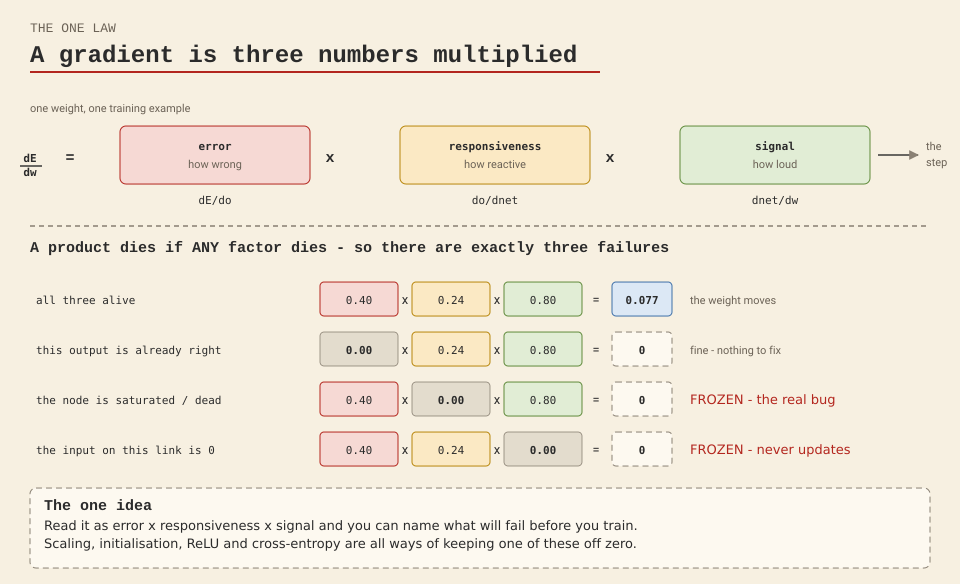
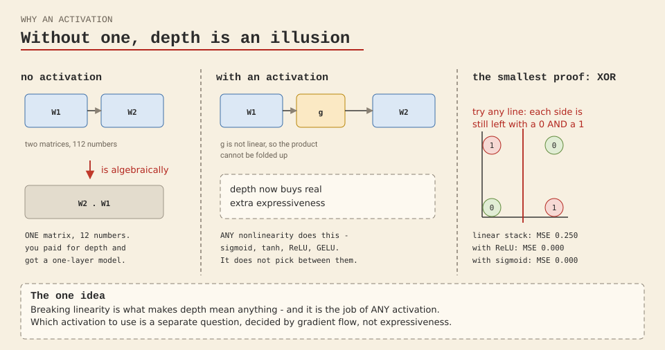

# How A Neural Network Learns: One Law And Its Effects

> **How to read this note.** This note follows the [ASD-STE100](https://www.asd-ste100.org/) Simplified Technical English rules. The sentences are short. The voice is active. Each sentence gives you one idea. There is one exception. The heading "Don't reach for this when" keeps its contraction. All 72 notes in this wiki use that exact heading.
>
> One expression is at the centre of neural network training. Most training advice is an effect of that expression. Section 1 gives the law and tests it against autograd. Sections 2 and 3 derive it. Sections 4 to 8 use it as a tool. Each standard choice becomes a prediction, and this note measures each prediction.
>
> The derivation follows **Tariq Rashid, *Make Your Own Neural Network*** (2016). That book derives the law more slowly than other books. The maths in the book moves away from the true gradient in one place. Section 8 uses that error as an example of a more general lesson.
>
> This note is not a general introduction. [artificial-neural-networks](artificial-neural-networks.md) is the general introduction. It gives the neuron, the list of activation functions, mini-batches, data preparation and a complete classifier. Read this note when you want to know why those choices are correct. This note assumes two things. You know derivatives and the chain rule ([calculus](../math-for-ml/calculus.md)). You know matrix shapes ([linear-algebra](../math-for-ml/linear-algebra.md)).

## Why This Exists

**Problem.** You can call `loss.backward()` for years and still not know why a layer stops to learn. All the failures look the same from outside. The loss stays flat. The accuracy stays low.

The usual advice is a list of rules with no reasons. Scale your data to [0, 1]. Use He initialisation. Do not use sigmoid. Use cross-entropy. If you do not know the reason for each rule, you must try them in a random order.

**Key insight.** The gradient of a weight is **three numbers multiplied together**:

$$\frac{\partial E}{\partial w} = \underbrace{\frac{\partial E}{\partial o}}_{\text{error}} \times \underbrace{\frac{\partial o}{\partial \text{net}}}_{\text{response}} \times \underbrace{\frac{\partial \text{net}}{\partial w}}_{\text{signal}}$$

A product becomes zero if **any** one factor becomes zero. Therefore a weight can stop to learn in exactly three ways. Each training rule keeps one of these three factors away from zero. Each unclear failure is one of the three. This is the complete diagnosis.

**Reach for this when:**
- A layer or a network stops to learn, and you want a reason and not a guess.
- You want to know why ReLU is better than sigmoid, and why cross-entropy is better than squared error.
- You want to derive backpropagation one time, and then find it inside autograd.
- You must read old neural network code. It uses sigmoid outputs, squared error, hand-written updates and 0.01/0.99 targets. You must know which parts to keep.
- You want to know why `nn.Linear` takes `(in, out)` but holds a weight of shape `(out, in)`.

**Don't reach for this when:**
- You want to train a model today. Use [artificial-neural-networks](artificial-neural-networks.md). This note does not change the code that you type.
- You want the list of modern parts: batch normalisation, dropout, schedulers, the internal design of Adam. This note gives them only where the law explains them.
- You want convolutions, sequences or attention. Use [convolutional-neural-networks](convolutional-neural-networks.md), [recurrent-neural-networks](recurrent-neural-networks.md) or [transformer-forward-pass](../math-for-ml/transformer-forward-pass.md).

## Diagrams

This diagram gives the law of section 1 and the three failures that the law predicts.



Three more diagrams are with the sections that they explain. Section 2 has the forward pass as a matrix multiplication. Section 2 also has the reason for an activation function. Section 3 has the two passes of backpropagation.

## 1. The Law: A Gradient Is Three Numbers Multiplied Together

Take one weight $w_{j,k}$. It goes into node $k$. The activation function of that node is $g$. The gradient is:

$$\frac{\partial E}{\partial w_{j,k}} = \underbrace{\frac{\partial E}{\partial o_k}}_{\text{error}} \cdot \underbrace{g'(\text{net}_k)}_{\text{response}} \cdot \underbrace{o_j}_{\text{signal}}$$

This shape is correct for **any** activation function and **any** loss function. Only the first two factors change. This note uses one example for all its measurements. The example has a sigmoid activation function and a squared-error loss. For that example the first two factors are $-(t_k - o_k)$ and $\sigma(\text{net}_k)\big(1-\sigma(\text{net}_k)\big)$.

Read the law from left to right as a sentence. How wrong is this output? How much can this node change its output now? How large is the signal on this link? Section 3 derives the law. First, test it:

```python
import torch
torch.manual_seed(0)
# One weight's gradient is three local numbers multiplied. Nothing else.
o_j = torch.tensor(0.80)                         # factor 3: the signal arriving on this link
w = torch.tensor(0.5, requires_grad=True)
net_k = w * o_j
o_k = torch.sigmoid(net_k)
t_k = torch.tensor(1.0)
loss = 0.5 * (t_k - o_k) ** 2
loss.backward()
f1 = -(t_k - o_k)                                # dE/do_k   : how wrong the output is
f2 = o_k * (1 - o_k)                             # do_k/dnet : how responsive the node is
f3 = o_j                                         # dnet/dw   : how loud the input was
print(f"error {f1:+.4f}  x  responsiveness {f2:.4f}  x  signal {f3:.4f}  =  {f1*f2*f3:+.6f}")
print(f"autograd says                                                      {w.grad:+.6f}")
# Each factor is a separate off-switch for this weight.
for name, kw in [("output already correct", dict(t=o_k.item())),
                 ("node saturated (net=12)", dict(w=15.0)),
                 ("input silent (o_j=0)", dict(o=0.0))]:
    oj = torch.tensor(kw.get("o", 0.80)); ww = torch.tensor(kw.get("w", 0.5), requires_grad=True)
    ok = torch.sigmoid(ww * oj); tt = torch.tensor(kw.get("t", 1.0))
    (0.5 * (tt - ok) ** 2).backward()
    print(f"  {name:24} -> gradient {ww.grad:+.2e}")
# Expected output:
# error -0.4013  x  responsiveness 0.2403  x  signal 0.8000  =  -0.077136
# autograd says                                                      -0.077136
#   output already correct   -> gradient -0.00e+00
#   node saturated (net=12)  -> gradient -3.07e-11
#   input silent (o_j=0)     -> gradient -0.00e+00
```

The product of the three factors is equal to the value from autograd. Each factor can stop the weight on its own. Those three lines are the complete list of failures:

| The factor becomes zero when | Name of the failure | Section |
|---|---|---|
| the output is already correct | — | this failure is not a fault |
| the activation function is in a flat area | **saturation** for sigmoid and tanh, **dead unit** for ReLU | §4, §6 |
| the input signal is zero | zero input, or a dead unit before this one | §4 |

Two notes on the law. First, your choice of activation function controls only the response factor. Therefore that choice controls how well the network trains. Section 6 shows this. Second, a deep network has **one response factor for each layer**, and the factors multiply. Section 6 also shows this.

## 2. A Layer Is A Matrix Multiplication

A node does two steps. It adds its inputs together, but it multiplies each input by a weight first. Then it puts the sum through the activation function:

$$\text{net}_j = \sum_i w_{j,i}\, i_i, \qquad o_j = g(\text{net}_j)$$

Write those sums for all the nodes of a layer. The result is a matrix product:

$$X = W \cdot I, \qquad O = g(X)$$

The shape of $W$ is **(number of nodes in the next layer) x (number of nodes in this layer)**. This order is not a convention. The sum goes across *this* layer. Therefore the index of this layer must cancel, and it must be the columns of $W$.

```python
import numpy as np
rng = np.random.default_rng(0)
W = rng.normal(0, .3, (3, 4))            # W[j, i] = weight from input i to hidden node j
i = np.array([.9, .1, .8, .2])
sig = lambda x: 1 / (1 + np.exp(-x))
# The book's node-by-node description: for each node, sum the moderated incoming signals, then squash.
by_node = np.array([sig(sum(W[j, k] * i[k] for k in range(4))) for j in range(3)])
by_matrix = sig(W @ i)                   # the same thing as X = W.I then O = sigmoid(X)
print("node by node:", by_node.round(6))
print("one matmul  :", by_matrix.round(6))
print("identical:", np.allclose(by_node, by_matrix))
print("shapes: W", W.shape, "@ i", i.shape, "->", by_matrix.shape, "- so W is (next layer x this layer)")
# Expected output:
# node by node: [0.547353 0.558728 0.407315]
# one matmul  : [0.547353 0.558728 0.407315]
# identical: True
# shapes: W (3, 4) @ i (4,) -> (3,) - so W is (next layer x this layer)
```

Both methods give the same values. But the matrix form is one line for a layer of any size. It also sends the work to a BLAS routine and not to a Python loop.

**Why a layer needs an activation function.** $W \cdot I$ is a *linear* map. If you put two linear maps together, the result is linear. Put two weight matrices together with nothing between them.

The pair is equal to one matrix, $W_2 W_1$. The additional weights give you nothing. You pay for two layers and you receive a model of one layer.

The first task of an activation function is to stop this collapse.

Then additional layers make the network more powerful.



```python
import torch, torch.nn as nn
torch.manual_seed(0)
# 1. Stack two linear layers with nothing between them and you have ONE linear layer.
A, B = nn.Linear(4, 16, bias=False), nn.Linear(16, 3, bias=False)
x = torch.randn(5, 4)
collapsed = B.weight @ A.weight                              # a single 3x4 matrix
print("depth 2 without an activation == depth 1:", torch.allclose(B(A(x)), x @ collapsed.T, atol=1e-6))
print(f"  two layers of 4->16->3 carry {A.weight.numel() + B.weight.numel()} numbers "
      f"but can only express the {collapsed.numel()} of a 4->3 map")
# 2. So depth without a nonlinearity buys nothing. XOR is the smallest proof.
X = torch.tensor([[0., 0.], [0., 1.], [1., 0.], [1., 1.]])
y = torch.tensor([[0.], [1.], [1.], [0.]])                   # XOR: not linearly separable
def fit(net, steps=4000):
    opt = torch.optim.Adam(net.parameters(), 0.05)
    for _ in range(steps):
        opt.zero_grad(); nn.functional.mse_loss(net(X), y).backward(); opt.step()
    return nn.functional.mse_loss(net(X), y).item()
for name, net in [("linear only  (8 hidden)", nn.Sequential(nn.Linear(2, 8), nn.Linear(8, 1))),
                  ("ReLU         (8 hidden)", nn.Sequential(nn.Linear(2, 8), nn.ReLU(), nn.Linear(8, 1))),
                  ("sigmoid      (8 hidden)", nn.Sequential(nn.Linear(2, 8), nn.Sigmoid(), nn.Linear(8, 1)))]:
    torch.manual_seed(0)
    for m in net:
        if isinstance(m, nn.Linear): nn.init.normal_(m.weight, 0, 0.5); nn.init.zeros_(m.bias)
    print(f"{name}: final MSE on XOR {fit(net):.6f}")
print("the linear stack cannot get below the variance of y (0.25) - no straight line separates XOR.")
print("BOTH nonlinearities solve it. breaking linearity is the job of any activation, not of ReLU.")
# Expected output:
# depth 2 without an activation == depth 1: True
#   two layers of 4->16->3 carry 112 numbers but can only express the 12 of a 4->3 map
# linear only  (8 hidden): final MSE on XOR 0.250000
# ReLU         (8 hidden): final MSE on XOR 0.000000
# sigmoid      (8 hidden): final MSE on XOR 0.000000
# the linear stack cannot get below the variance of y (0.25) - no straight line separates XOR.
# BOTH nonlinearities solve it. breaking linearity is the job of any activation, not of ReLU.
```

The linear network cannot go below 0.250 on XOR. That value is the variance of the labels. It is the result that you receive if you always predict the mean. No single straight line can separate the four XOR points. Both activation functions solve the problem completely.

Keep this result. **Any** activation function breaks linearity. Therefore this rule does not tell you which activation function to use. Section 6 answers that different question with a different reason.

Keep the two questions apart. Then you can explain why GELU and SiLU replaced ReLU in transformers. All three functions break linearity in the same way.


**Why the backward pass uses a transpose.** In the forward pass you sum across *this* layer and you produce the next layer. In the backward pass you have one value for each node of the *next* layer. You want one value for each node of *this* layer. Therefore you sum across the other index of the same matrix. A transpose does exactly that:

$$\text{forward: } W \cdot I \qquad\qquad \text{backward: } W^\top \cdot e$$

$W^\top$ is not a trick. It is the only shape that is correct. All correct derivations give this result. Therefore the backward pass of a linear layer is a `matmul` with one operand transposed in all frameworks.

**How to read this in PyTorch.** `nn.Linear(in_features, out_features)` takes its arguments in the opposite order to the shape of its own weight. The shape of the weight is `(out_features, in_features)`. The layer multiplies *row* vectors, as $I W^\top$. A batch goes in with shape `(N, in)` and comes out with shape `(N, out)`.

The column form above and the PyTorch row form are transposes of each other. Many shape errors in hand-written code come from this difference.

## 3. Backpropagation Is One Rule That You Use Again At Each Layer

The error at the output is easy. It is $e_k = t_k - o_k$. The problem is the hidden layer, because the data gives no target for it.

**The usual explanation.** Divide the error of each output across its input links. Give a larger part of the error to a larger weight, because a larger weight carried more of the signal. Two weights of 3 and 1 give parts of 3/4 and 1/4. Add the parts that arrive at each hidden node. Now you have an error for a layer with no targets.

This explanation is useful, and it gives the correct shape. The blame moves backward through $W^\top$. **But the explanation and $W^\top e$ are not the same calculation.**

The explanation divides by $w_{11} + w_{21}$. The matrix form does not divide. The divisor is also not a constant, because it changes for each node. Therefore a learning rate cannot remove it.

Many books mix the explanation and the derivation. Rashid's book changes from one to the other with no comment.

Use the explanation for the direction. Use the derivation below for the value.


**The derivation.** At the output layer, $E = \sum_k (t_k - o_k)^2$. The sum disappears immediately. Most books do not show this step. The output $o_n$ depends only on the weights that go into node $n$. Therefore all terms except term $k$ are constants for the weight $w_{j,k}$.

Apply the chain rule to the remaining term. Use $\sigma' = \sigma(1-\sigma)$:

$$\frac{\partial E}{\partial w_{j,k}} = -2(t_k - o_k)\,\sigma'(\text{net}_k)\, o_j$$

Define $E = \tfrac12\sum(t-o)^2$ to remove the factor of 2. That is the only purpose of the one-half convention. The result is the law of section 1. The update moves the weight *down* the slope: $w \leftarrow w - \alpha\,\partial E/\partial w$.

**How to use the rule at any depth.** Do not do the algebra again for each layer. Give a name to the value that comes again at each layer. Let $\delta_k = \partial E / \partial \text{net}_k$. This is the error at the input side of a node. Then three lines give the complete algorithm for any depth:

$$\delta_{\text{output}} = -(t - o) \odot g'(\text{net}), \qquad \delta_{\text{hidden}} = \big(W^\top \delta_{\text{next}}\big) \odot g'(\text{net}), \qquad \frac{\partial E}{\partial W} = \delta\, o_{\text{prev}}^\top$$

This is backpropagation. Note the position of $g'$. It multiplies *after* the transpose. The $\delta$ that you move backward already holds the $g'$ of the next layer.

Many hand-written programs move the raw error backward instead of $\delta$. This is the most common error in such programs. Section 8 measures the cost.

The algorithm is fast because it uses each value again. The network calculates each $\delta$ one time. Then it uses that $\delta$ twice. It uses it for the gradients of its own weights. It uses it again for the layer below.

## 4. Effect: Why You Must Scale The Inputs And The Targets

Old code scales the inputs to $[0.01, 1.0]$. It also sets the targets to 0.01 and 0.99 and not to 0 and 1. The law explains both rules. The law also shows that one of the rules is no longer necessary.

**A zero input stops the signal factor.** The third factor of the gradient *is* the input on that link. A pixel with a value of zero gives no gradient to its weight. The value of the error does not change this. Therefore the lower limit is 0.01 and not 0.

**A target that the network cannot reach stops the response factor.** A sigmoid function cannot give an output of 0 or 1. If you ask for 1, the error never becomes zero. Then the weights push the node further into its flat area. In that area the response factor becomes very small. Measure the cost, and measure it for both loss functions:

```python
import torch, torch.nn as nn, torch.nn.functional as F
# A sigmoid cannot output exactly 1. Push a node hard toward 1, then ask it to learn the OPPOSITE
# example. How much gradient is left to do that with? That is what saturation actually costs.
mse = lambda z, t: ((torch.sigmoid(z) - t) ** 2).mean()
def probe(loss, steps=3000):
    torch.manual_seed(0)
    lin = nn.Linear(4, 1); opt = torch.optim.SGD(lin.parameters(), lr=0.5)
    x = torch.ones(1, 4)
    for _ in range(steps):                                  # saturate it chasing an unreachable 1.0
        opt.zero_grad(); loss(lin(x), torch.ones(1, 1)).backward(); opt.step()
    opt.zero_grad(); loss(lin(x), torch.zeros(1, 1)).backward()   # now demand the opposite
    return torch.sigmoid(lin(x)).item(), lin.weight.grad.norm().item()
for name, loss in (("squared error", mse), ("cross-entropy", F.binary_cross_entropy_with_logits)):
    o, g = probe(loss)
    print(f"{name:15} saturated to {o:.5f}, gradient left to learn t=0: {g:.2e}")
print("\nboth losses saturate the node. only one can still escape:")
print("squared error multiplies by sigmoid'(net), ~0 there, leaving ~90x less gradient to escape with.")
print("cross-entropy's gradient is (output - target), with the sigmoid' cancelled - so it recovers.")
print("that cancellation, not the 0.01/0.99 ritual, is the real fix.")
# Expected output:
# squared error   saturated to 0.99416, gradient left to learn t=0: 2.31e-02
# cross-entropy   saturated to 0.99987, gradient left to learn t=0: 2.00e+00
# 
# both losses saturate the node. only one can still escape:
# squared error multiplies by sigmoid'(net), ~0 there, leaving ~90x less gradient to escape with.
# cross-entropy's gradient is (output - target), with the sigmoid' cancelled - so it recovers.
# that cancellation, not the 0.01/0.99 ritual, is the real fix.
```

Both loss functions push the node into saturation. But only one loss function can move the node out again. Squared error multiplies by $\sigma'(\text{net})$, and that value is near zero in the flat area. Therefore squared error has approximately **90 times less gradient** for the opposite example.

The gradient of cross-entropy is $(o - t)$. The $\sigma'$ factor is not in it. Therefore saturation costs cross-entropy nothing.

**Keep one rule and remove the other.** The 0.01/0.99 rule exists because of a problem with *squared error on a squashed output*. Use cross-entropy with logits, and a target of exactly 1 is correct. Keep the input scaling, because the signal factor is real for all loss functions. Optimisers also work better when all inputs have a similar size. Remove the target rule.

## 5. Effect: Why Initialisation Has A Formula

Initialisation has two tasks. The first task is to make the units different. Equal weights receive equal gradients for all time, and then the hidden units stay the same as each other. The second task is more important. It is to keep the **response factor** alive at the start.

Each node adds $n_{in}$ input signals together. The sum can be outside the responsive area of the activation function. Then the network starts in saturation, and the first gradients are already very small.

This gives you a target. Keep the variance of the sum near 1. The variance of a sum of $n_{in}$ independent terms increases with $n_{in}$. Therefore the standard deviation of the weight must decrease as $1/\sqrt{n_{in}}$. All the standard formulas come from that one line:

| Formula | Variance | Use with | Reason |
|---|---|---|---|
| **LeCun** | $1/n_{in}$ | sigmoid, tanh | keep the forward variance at 1 |
| **Xavier/Glorot** | $2/(n_{in} + n_{out})$ | sigmoid, tanh | balance the forward and the backward variance |
| **He/Kaiming** | $2/n_{in}$ | ReLU | ReLU makes one half of the values zero, so double the variance |

`nn.Linear` uses a Kaiming-uniform formula by default. Keras `Dense` uses Glorot-uniform by default. Therefore you usually receive a correct formula. Change it when your activation function does not agree with the default.

The failure of this rule is quiet. A wrong fan-in number by a small factor does not stop training. Therefore the error is difficult to find:

```python
import numpy as np
rng = np.random.default_rng(0)
I, H = 784, 100                                   # MNIST: 784 inputs into each of 100 hidden nodes
x = rng.random((I, 2000)) * .99 + .01             # inputs scaled the book's way, into [0.01, 1.0]
for label, sd in [("the book's stated rule  1/sqrt(fan_in=784)", I ** -0.5),
                  ("the book's code         1/sqrt(hnodes=100)", H ** -0.5)]:
    W = rng.normal(0, sd, (H, I))
    net = W @ x                                   # pre-activation signal into the hidden layer
    sat = np.mean(np.abs(net) > 4)                 # |net| > 4 means sigmoid' < 0.018: effectively flat
    print(f"{label}: sd={sd:.4f}  net std={net.std():5.2f}  fraction saturated={sat:.1%}")
print("sigmoid' peaks at 0.25 and is under 0.018 past |net|=4, so a saturated node barely learns.")
# Expected output:
# the book's stated rule  1/sqrt(fan_in=784): sd=0.0357  net std= 0.56  fraction saturated=0.0%
# the book's code         1/sqrt(hnodes=100): sd=0.1000  net std= 1.52  fraction saturated=0.9%
# sigmoid' peaks at 0.25 and is under 0.018 past |net|=4, so a saturated node barely learns.
```

Rashid's code uses the *output* width of each matrix. His text says fan-in. This gives a standard deviation approximately 3 times too large. Then approximately 1% of the units start in saturation. This error is not fatal. But it is also not free, and it becomes larger with depth.

## 6. Effect: Why ReLU Is Better Than Sigmoid

Section 2 shows that you need *an* activation function. This section answers a different question. Which activation function must you use? Expressive power does not answer the question. Sigmoid, tanh, ReLU and GELU all break linearity. The universal approximation theorem is true for all of them.

The **response factor** answers the question. Your activation function controls only that factor. In a deep network there is one such factor for each layer, and the factors **multiply**.

Therefore simple arithmetic gives the depth limit of a sigmoid network. The value of $\sigma'$ is never more than 0.25. It is equal to 0.25 only at $\text{net}=0$. Therefore each layer multiplies the gradient by 0.25 or less. For ten layers the best factor is $4^{10}$, or approximately $10^6$.

The derivative of ReLU is exactly **1** where the unit is active. Then the product stops to decrease:

```python
import torch, torch.nn as nn
torch.manual_seed(0)
# Same 8-layer stack, same init, two activations. Measure the gradient reaching each layer.
def grads(act):
    layers = []
    for _ in range(8):
        layers += [nn.Linear(64, 64), act()]
    net = nn.Sequential(*layers, nn.Linear(64, 1))
    for m in net:                                          # identical init so only the activation differs
        if isinstance(m, nn.Linear): nn.init.normal_(m.weight, 0, 64 ** -0.5); nn.init.zeros_(m.bias)
    net(torch.randn(32, 64)).sum().backward()
    return [m.weight.grad.norm().item() for m in net if isinstance(m, nn.Linear)]
s, r = grads(nn.Sigmoid), grads(nn.ReLU)
print("layer   sigmoid grad norm   ReLU grad norm")
for i, (a, b) in enumerate(zip(s, r)):
    print(f"{i+1:>3}     {a:>14.2e}   {b:>13.2e}")
print(f"\nfirst layer vs last: sigmoid attenuates {s[-1]/s[0]:,.0f}x, ReLU {r[-1]/r[0]:.1f}x")
print("sigmoid' <= 0.25, so every layer multiplies the gradient by at most a quarter. ReLU' is 1 where active.")
# Expected output:
# layer   sigmoid grad norm   ReLU grad norm
#   1           2.78e-04        1.73e+00
#   2           4.56e-03        1.96e+00
#   3           1.89e-02        2.56e+00
#   4           9.10e-02        4.21e+00
#   5           4.34e-01        6.17e+00
#   6           1.67e+00        7.10e+00
#   7           6.27e+00        8.38e+00
#   8           3.06e+01        8.25e+00
#   9           1.37e+02        1.00e+01
# ... trimmed
```

The test uses 8 identical layers and identical initialisation. In the sigmoid network, the first layer receives a gradient approximately **490,000 times** smaller than the last layer. In the ReLU network the difference is less than 6 times. The first layers of the sigmoid network do not train. No learning rate removes this. A rate that is correct for layer 1 is much too large for layer 8.

**The failure of ReLU is the same law.** The pre-activation value of a ReLU unit can be negative for *all* inputs. Then its derivative is 0. That is the response factor again. No gradient can make the unit active again. This is a **dead unit**.

Four solutions keep the response factor away from zero. They are LeakyReLU, GELU, careful initialisation and a smaller learning rate. All four work equally well in practice.

**The law also explains the other modern parts.** Normalisation layers keep the sums inside the responsive area. Then the response factor cannot move away. Residual connections add a path with a local derivative of exactly 1. Then the product has a route that does not decrease. Both parts change the same factor.

## 7. Effect: Why Cross-Entropy Is Better Than Squared Error

Squared error with a squashed output has one specific problem. The error factor and the response factor work against each other. A very wrong output makes the error factor large. But a very wrong output is also near 0 or 1, where $\sigma'$ is near zero. Therefore the product is small when you need a large step.

```python
import torch
# Target is 1. Sweep the pre-activation from confidently wrong to confidently right,
# and watch what each loss sends back as dL/dz.
print("  z      output   dL/dz, squared error   dL/dz, cross-entropy")
for z in (-6.0, -2.0, 0.0, 2.0, 6.0):
    t = torch.tensor([1.0])
    a = torch.tensor([z], requires_grad=True)
    (0.5 * (t - torch.sigmoid(a)) ** 2).sum().backward()                 # MSE on a squashed output
    g_mse = a.grad.item()
    b = torch.tensor([z], requires_grad=True)
    torch.nn.functional.binary_cross_entropy_with_logits(b, t).backward()  # CE straight on the logit
    print(f"{z:+5.1f}   {torch.sigmoid(torch.tensor(z)):.4f}        {g_mse:+.5f}              {b.grad.item():+.5f}")
print("at z=-6 the model is as wrong as it can be. squared error sends back 0.002; cross-entropy sends 1.0.")
print("the sigmoid' factor is what dies - and cross-entropy's derivative cancels it exactly.")
# Expected output:
#   z      output   dL/dz, squared error   dL/dz, cross-entropy
#  -6.0   0.0025        -0.00246              -0.99753
#  -2.0   0.1192        -0.09248              -0.88080
#  +0.0   0.5000        -0.12500              -0.50000
#  +2.0   0.8808        -0.01252              -0.11920
#  +6.0   0.9975        -0.00001              -0.00247
# at z=-6 the model is as wrong as it can be. squared error sends back 0.002; cross-entropy sends 1.0.
# the sigmoid' factor is what dies - and cross-entropy's derivative cancels it exactly.
```

At $z = -6$ the model is completely wrong about a target of 1. Squared error gives a gradient of **0.002**. Cross-entropy gives **1.0**. That is approximately 400 times more.

The reason is an exact cancellation. The derivative of $-\log \sigma(z)$ is $\sigma(z) - t$. The $\sigma'$ factor is no longer in the result. Cross-entropy is not a better loss function for a general reason. Its derivative removes the factor that caused the problem.

Therefore the modern rule is simple. **Give raw logits to the loss function, and let the loss function do the squashing.** `nn.CrossEntropyLoss` and `nn.BCEWithLogitsLoss` take logits. They apply log-softmax or log-sigmoid inside, in a stable form. Do not put a `Softmax` or a `Sigmoid` layer before them. That applies the function two times and makes the result worse.

## 8. Why A Wrong Gradient Is Difficult To Find

You can now derive the gradient by hand. But you must still let autograd do the work. This section gives the reason.

A gradient has a direction and a length. Gradient descent accepts a wrong length, because the learning rate is also a free number. Therefore a derivation with the correct direction and a wrong length **still trains the network**. The loss curve shows no fault.

The hidden-layer update in Rashid's book is a clear example. It moves the raw error backward as $W^\top e$ and not as $W^\top \delta$. Therefore it does not have the $\sigma'$ of the output layer. Section 3 explains this. The result is not $\partial E/\partial w$:

```python
import numpy as np, torch
rng = np.random.default_rng(0)
Wih = rng.normal(0, .5, (3, 4)); Who = rng.normal(0, .5, (2, 3))
i = np.array([.9, .1, .8, .2]); t = np.array([.99, .01])
sig = lambda x: 1 / (1 + np.exp(-x))
oh = sig(Wih @ i); oo = sig(Who @ oh)                  # forward pass
eo = t - oo                                            # output error
# The book's rule: backprop the raw error with the transposed weights, no sigmoid' factor.
eh_book = Who.T @ eo
dWho_book = -np.outer(eo * oo * (1 - oo), oh)          # the book's dE/dw_jk
dWih_book = -np.outer(eh_book * oh * (1 - oh), i)
# Ground truth from autograd on E = 0.5 * sum (t - o)^2, which matches the book's dropped factor of 2.
tW1 = torch.tensor(Wih, requires_grad=True); tW2 = torch.tensor(Who, requires_grad=True)
ti = torch.tensor(i); tt = torch.tensor(t)
loss = 0.5 * ((tt - torch.sigmoid(tW2 @ torch.sigmoid(tW1 @ ti))) ** 2).sum()
loss.backward()
print("hidden->output gradient matches autograd:", np.allclose(dWho_book, tW2.grad.numpy()))
print("input->hidden  gradient matches autograd:", np.allclose(dWih_book, tW1.grad.numpy()))
cos = lambda a, b: float(a.ravel() @ b.ravel() / (np.linalg.norm(a) * np.linalg.norm(b)))
print(f"  but the direction is nearly right: cosine = {cos(dWih_book, tW1.grad.numpy()):.4f}")
print(f"  magnitude is inflated by {np.linalg.norm(dWih_book) / np.linalg.norm(tW1.grad.numpy()):.2f}x")
# The missing piece is sigmoid'(net_k) inside the sum over output nodes k.
eh_true = Who.T @ (eo * oo * (1 - oo))
dWih_true = -np.outer(eh_true * oh * (1 - oh), i)
print("add sigmoid'(net_k) inside the sum  ->  matches:", np.allclose(dWih_true, tW1.grad.numpy()))
# Expected output:
# hidden->output gradient matches autograd: True
# input->hidden  gradient matches autograd: False
#   but the direction is nearly right: cosine = 0.9996
#   magnitude is inflated by 5.17x
# add sigmoid'(net_k) inside the sum  ->  matches: True
```

The output layer is exact. The hidden layer is wrong. But the cosine against the true gradient is **0.9996**, and the length is only **5.17 times** too large. On a sigmoid network that larger length is a small help. It cancels part of the loss from section 6, like a larger learning rate on the first layer. Put both rules into the same network and measure the result:

```python
import numpy as np
from sklearn.datasets import load_digits
from sklearn.model_selection import train_test_split
X, y = load_digits(return_X_y=True)                       # 1797 8x8 digits, greyscale 0-16
Xtr, Xte, ytr, yte = train_test_split(X, y, test_size=.3, random_state=0, stratify=y)
scale = lambda A: A / 16.0 * 0.99 + 0.01                  # the book's input range, [0.01, 1.0]
Xtr, Xte = scale(Xtr), scale(Xte)
sig = lambda x: 1 / (1 + np.exp(-x))
def train(lr, H=100, epochs=12, seed=0, book_rule=True):
    rng = np.random.default_rng(seed)
    Wih = rng.normal(0, 64 ** -0.5, (H, 64))              # N(0, 1/sqrt(fan_in)), the book's STATED rule
    Who = rng.normal(0, H ** -0.5, (10, H))
    for _ in range(epochs):
        for xi, yi in zip(Xtr, ytr):                      # one example at a time, as the book does
            t = np.full(10, 0.01); t[yi] = 0.99           # targets dodge the unreachable 0 and 1
            oh = sig(Wih @ xi); oo = sig(Who @ oh)        # forward: two matrix multiplies
            eo = t - oo
            eh = Who.T @ eo if book_rule else Who.T @ (eo * oo * (1 - oo))   # the only difference
            Who += lr * np.outer(eo * oo * (1 - oo), oh)  # the book's matrix update rule
            Wih += lr * np.outer(eh * oh * (1 - oh), xi)
    return (sig(Who @ sig(Wih @ Xte.T)).argmax(0) == yte).mean()
print(f"most-frequent-class baseline: {np.bincount(ytr).max() / len(ytr):.4f}\n")
print("lr     the book's rule   the true gradient")
for lr in (0.05, 0.1, 0.2, 0.4):
    print(f"{lr:<6} {train(lr, book_rule=True):.4f}            {train(lr, book_rule=False):.4f}")
print("\n68 lines of the book become 2 matrix multiplies forward and 2 outer products back.")
print("the book's rule wins at every lr here: its 5x-inflated first layer offsets sigmoid damping.")
# Expected output:
# most-frequent-class baseline: 0.1018
# 
# lr     the book's rule   the true gradient
# 0.05   0.9630            0.9593
# 0.1    0.9722            0.9630
# 0.2    0.9778            0.9593
# 0.4    0.9815            0.9685
# 
# 68 lines of the book become 2 matrix multiplies forward and 2 outer products back.
# the book's rule wins at every lr here: its 5x-inflated first layer offsets sigmoid damping.
```

The wrong rule gives a *better* score at all the learning rates in the test. The difference becomes smaller as the rate increases. This agrees with the explanation, because the true gradient takes steps that are too small. Use one small data set and one seed, so take the direction of the result and not the exact values.

The network trains well. It is better than its 10% baseline by approximately 90 points. The fault is completely invisible from outside.

Do not read this as a reason to keep the error. Read these three lessons:

- **A gradient with the correct direction and a wrong length is invisible in a loss curve.** You must do a gradient check. Compare the gradient against autograd or against finite differences. The check is eight lines.
- **The error becomes larger with depth.** One missing $\sigma'$ for each layer is a systematic error for each layer. At two layers the learning rate hides it. At twenty layers it does not.
- **This is the real reason to use autograd.** Autograd is correct for architectures that you did not derive. It is correct for the architecture that you will write tomorrow.

## 9. Where Each Term Is In PyTorch

A framework does not remove the terms above. All the terms are still there with different names. This table is the map. It is the practical result of the derivation.

| The term | Where it is in PyTorch |
|---|---|
| $W$, shape (next x this) | `layer.weight`, shape `(out_features, in_features)` |
| $W \cdot I$ | `layer(x)`, calculated as `x @ W.T + b` |
| $g(\cdot)$ | `torch.sigmoid`, `nn.Sigmoid`, or `nn.ReLU` for section 6 |
| error factor, $\partial E/\partial o$ | the derivative of the loss function, or `(o - t)` for cross-entropy |
| response factor, $g'(\text{net})$ | autograd applies it at the activation node |
| signal factor, $o_{\text{prev}}$ | the activation in memory. This is the reason to keep the forward pass |
| $\delta$ for each node | the gradient that arrives at a node. It has no name in the code |
| $W^\top \delta$ | the backward `matmul` of the linear layer |
| the complete backward pass | `loss.backward()` |
| $w \leftarrow w - \alpha\,\partial E/\partial w$ | `opt.step()` |
| $\partial E/\partial w$ for each parameter | `p.grad` |

Look at the row for the signal factor. That factor is the *input* of the layer. Therefore the backward pass cannot run without it. This is the reason that training needs much more memory than inference. It is also the reason that gradient checkpointing works. Gradient checkpointing calculates the activations again and does not keep them.

```python
import numpy as np, torch, torch.nn as nn
from sklearn.datasets import load_digits
from sklearn.model_selection import train_test_split
torch.manual_seed(0); torch.set_num_threads(1)
X, y = load_digits(return_X_y=True)
Xtr, Xte, ytr, yte = train_test_split(X, y, test_size=.3, random_state=0, stratify=y)
to = lambda A: torch.tensor(A / 16.0 * 0.99 + 0.01, dtype=torch.float32)   # the book's input scaling
Xtr, Xte, ytr_t = to(Xtr), to(Xte), torch.tensor(ytr)
T = torch.full((len(ytr), 10), 0.01); T[torch.arange(len(ytr)), ytr] = 0.99  # the book's 0.01/0.99 targets
def run(net, loss_fn, target, opt, epochs=60, bs=32):
    for _ in range(epochs):
        for b in torch.randperm(len(Xtr)).split(bs):
            opt.zero_grad(); loss_fn(net(Xtr[b]), target[b]).backward(); opt.step()
    return (net(Xte).argmax(1).numpy() == yte).mean()
book = nn.Sequential(nn.Linear(64, 100), nn.Sigmoid(), nn.Linear(100, 10), nn.Sigmoid())
for m in book:                                       # the book's init: N(0, 1/sqrt(fan_in))
    if isinstance(m, nn.Linear):
        nn.init.normal_(m.weight, 0, m.in_features ** -0.5); nn.init.zeros_(m.bias)
sse = lambda o, t: ((o - t) ** 2).sum(1).mean()      # sum over nodes, mean over batch, as the book does
print(f"the book's net in PyTorch (sigmoid + squared error):  {run(book, sse, T, torch.optim.SGD(book.parameters(), lr=0.5)):.4f}")
modern = nn.Sequential(nn.Linear(64, 100), nn.ReLU(), nn.Linear(100, 10))    # logits, no output squash
print(f"same shape, modern defaults (ReLU + CE + Adam):       {run(modern, nn.functional.cross_entropy, ytr_t, torch.optim.Adam(modern.parameters(), 1e-3)):.4f}")
# Expected output:
# the book's net in PyTorch (sigmoid + squared error):  0.9630
# same shape, modern defaults (ReLU + CE + Adam):       0.9704
```

Both networks have the same shape and the same budget. The pair from 2016 uses sigmoid, squared error and plain SGD. It gives **0.9630**. The modern pair uses ReLU, cross-entropy and Adam. It gives **0.9704**.

The difference is small on an easy problem. But this note derives all the mechanisms behind the difference. The difference also increases with depth, as section 6 predicts.

## 10. How To Look Inside A Trained Network

The law does not give you one thing. The weights of a trained network have no individual meaning, because the network divides its knowledge across all of them. So how do you see what the network learned?

You can run the network backward if the activation function is **invertible**. Set a one-hot label on the output nodes. Then move the signals toward the inputs. The signals move through the same $W^\top$ as the error. Undo the activation function with its exact inverse. The inverse of the sigmoid function is the **logit** function:

$$y = \frac{1}{1+e^{-x}} \quad\Longrightarrow\quad x = \ln\frac{y}{1-y}$$

Use `scipy.special.logit`. It is the inverse of `expit`. The logit function goes to infinity at 0 and at 1. Therefore you must put each layer into the range $[0.01, 0.99]$ first.

```python
import numpy as np, matplotlib.pyplot as plt
from sklearn.datasets import load_digits
X, y = load_digits(return_X_y=True)
Xs = X / 16.0 * 0.99 + 0.01
sig = lambda x: 1 / (1 + np.exp(-x))
rng = np.random.default_rng(0)
Wih = rng.normal(0, 64 ** -0.5, (200, 64)); Who = rng.normal(0, 200 ** -0.5, (10, 200))
for _ in range(15):                                          # train the book's way, one example at a time
    for xi, yi in zip(Xs, y):
        t = np.full(10, 0.01); t[yi] = 0.99
        oh = sig(Wih @ xi); oo = sig(Who @ oh); eo = t - oo
        Who += 0.2 * np.outer(eo * oo * (1 - oo), oh)
        Wih += 0.2 * np.outer((Who.T @ eo) * oh * (1 - oh), xi)
band = lambda v: (v - v.min()) / np.ptp(v) * 0.98 + 0.01      # back into the sigmoid's valid range
logit = lambda o: np.log(o / (1 - o))                         # the exact inverse of the sigmoid
digits = [0, 1, 3, 7]
fig, ax = plt.subplots(2, len(digits), figsize=(2 * len(digits), 4.4))
for c, d in enumerate(digits):
    o = np.full(10, 0.01); o[d] = 0.99                        # ask: what input means "this digit"?
    h = band(Who.T @ logit(o))                                # step back through the output layer
    img = band(Wih.T @ logit(h))                              # and back through the hidden layer
    ax[0][c].imshow(img.reshape(8, 8), cmap="gray_r"); ax[0][c].set_title(f"back-query {d}", fontsize=9)
    ax[1][c].imshow(X[y == d].mean(0).reshape(8, 8), cmap="gray_r"); ax[1][c].set_title(f"class mean {d}", fontsize=9)
    ax[0][c].axis("off"); ax[1][c].axis("off")
plt.tight_layout(); plt.show()
print("the back-query is a rough, noisy relative of the class mean - not a copy of it:")
print("it shows which pixels the WEIGHTS care about, which includes areas that must stay BLANK.")
print("at 8x8 it is far less legible than the book's 28x28 MNIST figures; resolution is the limit.")
# Expected output:
# the back-query is a rough, noisy relative of the class mean - not a copy of it:
# it shows which pixels the WEIGHTS care about, which includes areas that must stay BLANK.
# at 8x8 it is far less legible than the book's 28x28 MNIST figures; resolution is the limit.
```

The result is **not** the mean image of the class. Compare the two rows of the figure. The result shows the areas that the *weights* react to. Some bright areas mean "this area must stay empty".

The result for `0` is correct in that sense. It has a clear centre inside a ring of evidence. A zero has exactly that shape.

The pictures at 8x8 are more noisy than the 28x28 pictures in the book.

The resolution is the limit.

**This is the cost of section 6.** ReLU is not invertible, because it removes the sign. Therefore this method stopped to work when ReLU became standard. Interpretation then moved to gradient methods.

They are activation maximisation with gradient *ascent* on the input, saliency maps, Grad-CAM for convolutional networks (see [transfer-learning-and-cnn-architectures](transfer-learning-and-cnn-architectures.md)) and SHAP. All of them are better. All of them are also larger and slower. The exchange of invertibility for better training was correct. But you must know that it had a cost.

## Trade-offs

- **The three-factor law against the full Jacobian.** The three factors are exactly correct for one weight in a feedforward network. The law is also easy to remember. It is not exact when layers share weights, as in convolutional and recurrent networks. There a weight gradient is a *sum* of such products across positions or time steps. The diagnosis stays correct. The arithmetic takes one more sum.
- **A derivation by hand against `backward()`.** A derivation gives you the knowledge to find a fault and nothing else. It gives no accuracy and no speed. It is useful the first time that a layer stops to learn.
- **Sigmoid against ReLU.** Sigmoid gives a limited output, a simple derivative, and an inverse for section 10. It costs a factor of 4 or more of the gradient at each layer, as section 6 shows. For hidden layers this is not a difficult choice.
- **Squared error against cross-entropy.** Squared error makes the derivation possible by hand. It is also correct for regression. For classification with a squashed output it causes the problem of section 7.
- **Three ways to keep the response factor alive.** Activation function, initialisation and normalisation layers all change the same factor. They also overlap. Good initialisation is less important with normalisation layers. Normalisation layers are less important with residual paths. Use them in that order. Start with the activation function, because it costs nothing.
- **8x8 digits against real MNIST.** All the code here runs offline in seconds on the small data set of scikit-learn. The cost is more noise in the back-query pictures. The accuracies are also a little high, because the problem is easier.

## Common Pitfalls

- **Do not think that the task of ReLU is to break linearity.** That is the task of *any* activation function, so it does not separate them. Sigmoid breaks linearity equally well, and it solves XOR equally well (§2). ReLU is better because of gradient flow (§6). GELU and SiLU are better again for the same type of reason.
- **Do not read a flat loss curve as "the model converged".** A dead factor is a much more common cause. Look at the activations for a flat area before you change the learning rate.
- **Do not use "divide the error across the weights" as the derivation.** It is a memory aid for the *shape* $W^\top$, and it does not agree with it in value. Its divisors are in no program, and a learning rate cannot remove a value that is not constant (§3).
- **Do not move the raw error backward instead of $\delta$.** The $g'$ of the next layer belongs inside the value that you move. If you remove it, all earlier layers receive a wrong scale, one time for each layer (§3, §8).
- **Do not trust a hand-written gradient because the network trains.** A gradient with a cosine of 0.9996 and a length 5 times too large still descends. Compare it against autograd (§8).
- **Do not put `Softmax` or `Sigmoid` before `CrossEntropyLoss` or `BCEWithLogitsLoss`.** Those loss functions squash the values inside. Two applications give a worse result, and the code shows no error (§7).
- **Do not set a target that a limited output cannot reach.** The error never becomes zero, and the node moves into saturation. With cross-entropy and logits this is no longer a problem. Therefore the old 0.01/0.99 rule is obsolete (§4).
- **Do not give exact zeros as inputs.** The third factor of the gradient *is* the input. Therefore those weights never change, and the value of the error does not matter (§4).
- **Do not initialise all the weights to the same constant.** Equal weights receive equal gradients for all time, and the hidden units stay the same as each other (§5).
- **Do not take the fan-in number from the shape of the matrix without a check.** The wrong axis gives a value that is only a few times too large. Therefore the error is quiet (§5).
- **Do not transpose `nn.Linear` by mistake.** Its argument order `(in, out)` is the opposite of its weight shape `(out, in)` (§2).
- **Do not expect a back-query to look like the mean image of the class.** It shows the areas that the weights react to. Some of those areas must stay *empty* (§10).

## Decision Table

| Scenario | Use this | Not that | Why |
|----------|----------|----------|-----|
| A layer stops to learn | Find which of the three factors is zero (§1) | A sweep of the learning rate | A rate multiplies a gradient. It cannot restore a zero |
| Depth must add expressive power | Any activation function between the layers | `nn.Linear` layers with nothing between them | Linear maps together become one matrix (§2) |
| Hidden activation for a new network | ReLU or GELU, with He initialisation | Sigmoid or tanh | Both break linearity. Only ReLU keeps the gradient: 490,000 times against 5.8 times across 8 layers (§6) |
| Output and loss for classification | Raw logits with `CrossEntropyLoss` | Sigmoid or softmax with squared error | It removes the $\sigma'$ that stops the gradient (§7) |
| Output and loss for regression | A linear output with MSE | Any squashed output | There is no limited activation function to saturate |
| One unit is never active | LeakyReLU or GELU, a lower rate, new initialisation | More epochs | The gradient of a dead unit is exactly 0. More steps of zero give zero (§6) |
| Targets for a limited output | Values that the function can reach, or logits with cross-entropy | 0 and 1 on a sigmoid with MSE | Targets that the function cannot reach cause saturation (§4) |
| Gradients for code that you will change | `loss.backward()` | A rule that you derive by hand | Section 8 shows a hand derivation that fails quietly |
| A check of a hand-written gradient | `torch.allclose` against autograd, and a cosine | "The network trains, so the gradient is correct" | The direction can be correct when the length is 5 times wrong (§8) |
| Training is correct but the memory is full | Gradient checkpointing | A smaller batch first | The signal factor needs the activations. Calculate them again (§9) |
| Initialisation for sigmoid or tanh layers | Xavier/Glorot, the framework default | Constants that you choose | It balances the forward and the backward variance (§5) |
| Interpretation of a small sigmoid network | A back-query through the inverse function (§10) | A view of the individual weights | The network divides its knowledge. Single weights have no meaning |
| Interpretation of a ReLU or convolutional network | Activation maximisation, saliency, Grad-CAM | A back-query | ReLU has no inverse, so you cannot run it backward (§10) |

## References

- Tariq Rashid — *Make Your Own Neural Network* (2016). Sections 2 and 3 follow its derivation. Code: [makeyourownneuralnetwork on GitHub](https://github.com/makeyourownneuralnetwork/makeyourownneuralnetwork).
- [Rumelhart, Hinton & Williams — Learning representations by back-propagating errors (Nature, 1986)](https://www.nature.com/articles/323533a0). This paper gives the $\delta$ form of section 3. It puts $g'$ in the correct position.
- [Nielsen — *Neural Networks and Deep Learning*, ch. 2](http://neuralnetworksanddeeplearning.com/chap2.html) — the same derivation as four equations. Read it after this note. [Ch. 3](http://neuralnetworksanddeeplearning.com/chap3.html) gives the argument of section 7 in full.
- [Glorot & Bengio — Understanding the difficulty of training deep feedforward neural networks (AISTATS 2010)](https://proceedings.mlr.press/v9/glorot10a.html) — Xavier initialisation. This paper made section 6 a question about variance.
- [He et al. — Delving Deep into Rectifiers (2015)](https://arxiv.org/abs/1502.01852) — He initialisation and PReLU. It is the ReLU row of the table in section 5.
- [Glorot, Bordes & Bengio — Deep Sparse Rectifier Neural Networks (AISTATS 2011)](https://proceedings.mlr.press/v15/glorot11a.html) — the argument for ReLU that section 6 measures.
- [Ioffe & Szegedy — Batch Normalization (2015)](https://arxiv.org/abs/1502.03167) and [He et al. — Deep Residual Learning (2015)](https://arxiv.org/abs/1512.03385) — the two other changes to the response factor (§6).
- [ASD-STE100 Simplified Technical English](https://www.asd-ste100.org/) — the specification for the language of this note.
- [`torch.nn.Linear`](https://docs.pytorch.org/docs/stable/generated/torch.nn.Linear.html) · [`torch.nn.CrossEntropyLoss`](https://docs.pytorch.org/docs/stable/generated/torch.nn.CrossEntropyLoss.html) · [`torch.nn.init`](https://docs.pytorch.org/docs/stable/nn.init.html) · [`torch.utils.checkpoint`](https://docs.pytorch.org/docs/stable/checkpoint.html) · [`scipy.special.logit`](https://docs.scipy.org/doc/scipy/reference/generated/scipy.special.logit.html)

## See Also

- [artificial-neural-networks](artificial-neural-networks.md) — the practical note. It has the list of activation functions, mini-batches, data preparation and a complete Keras and PyTorch classifier. Start there to build a model.
- [calculus](../math-for-ml/calculus.md) — the chain rule. Section 3 is an application of it.
- [linear-algebra](../math-for-ml/linear-algebra.md) — matrix shapes and transposes. They are the tools of section 2.
- [pytorch-cheatsheet](pytorch-cheatsheet.md) — argument order, autograd behaviour, and the reason that `.grad` is `None`. It is the map of section 9 at the level of the keyboard.
- [convolutional-neural-networks](convolutional-neural-networks.md) — the same three factors with shared weights. Each gradient becomes a sum across positions.
- [recurrent-neural-networks](recurrent-neural-networks.md) — the factors of section 6 multiply across *time* and not across depth. This is the reason for the LSTM.
