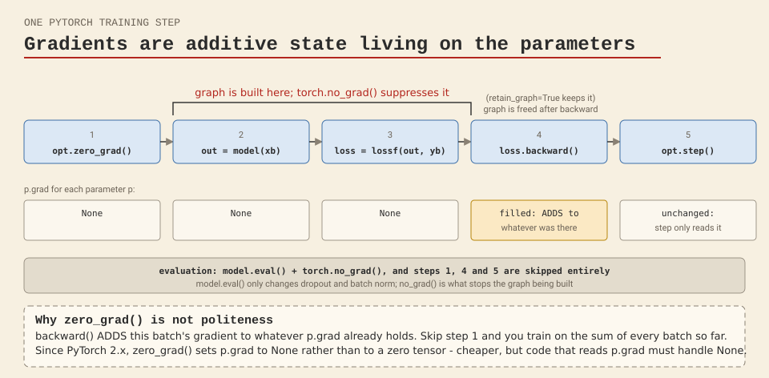

# PyTorch Cheatsheet

> **How to read this note.** This note is a **reference** and not a tutorial. Its neighbours teach in order. This note puts the task that stopped you in the heading. Go to the section with your task in its heading, then read the table.
>
> Every API fact here applies to **PyTorch 2.x**. This note gives no legacy spellings and no translation tables. If you must port old code, read the current call in the table and write that instead.
>
> This note follows the [ASD-STE100](https://www.asd-ste100.org/) Simplified Technical English rules. The sentences are short. The voice is active. There is one exception. The heading "Don't reach for this when" keeps its contraction, because all 72 notes in this wiki use that exact heading.
>
> This note explains no theory. For the mechanisms, read [neural-networks-from-scratch](neural-networks-from-scratch.md), [convolutional-neural-networks](convolutional-neural-networks.md), [recurrent-neural-networks](recurrent-neural-networks.md) and [transformer-forward-pass](../math-for-ml/transformer-forward-pass.md).

## Why This Exists

**Problem.** Deep-learning theory and PyTorch spelling are two different skills. You know what a convolution does, and you still lose twenty minutes to `view` against `reshape`. You know what attention does, and `nn.MultiheadAttention` still gives you the wrong answer with no error message.

**Key insight.** Modern PyTorch has a small surface. There are tensors with an optional `requires_grad` flag. There are modules, which are callables that hold parameters. There is one five-line loop: `zero_grad`, forward, loss, `backward`, `step`.

Everything else is argument order and tensor shape. That is what a cheatsheet is for.

**Reach for this when:**
- You write training code now, and you want the argument order of a layer or a loss.
- You have a shape error: conv output size, a flatten before a linear layer, a hidden state layout, or an attention mask.
- You must know which call makes gradients appear, add up, or stop.
- Your attention layer runs without an error and gives nonsense.

**Don't reach for this when:**
- You want to know *why* backpropagation, convolution or attention works. Read the notes above.
- You want linear or logistic regression *as models*. Read [regression-models](../classical-ml/regression-models.md) and [classification-models](../classical-ml/classification-models.md).
- You want distributed training, quantisation, custom autograd functions or torchvision pipelines. This note does not cover them.

## Diagrams



## Setup, Devices, Reproducibility

Install with `pip install torch torchvision`.

| Task | Call |
|---|---|
| Pick a device one time | `device = torch.device('cuda' if torch.cuda.is_available() else 'cpu')`. Add an `mps` branch on Apple silicon |
| Move a tensor | `x = x.to(device)`. This returns a new tensor |
| Move a model | `model.to(device)`. This changes the module in place |
| Check what the machine has | `torch.cuda.is_available()` and `torch.backends.mps.is_available()` |
| Seed everything | `torch.manual_seed(0)`, which also seeds CUDA. Add `np.random.seed(0)` and `random.seed(0)` |
| Seed one sampler | `torch.Generator().manual_seed(0)`, then give it to `randperm` or to `DataLoader(generator=...)` |
| Force deterministic kernels | `torch.use_deterministic_algorithms(True)`, plus the environment variable `CUBLAS_WORKSPACE_CONFIG=:16:8` |
| Make it faster in one line | `model = torch.compile(model)` |
| Use mixed precision | `with torch.autocast(device_type='cuda', dtype=torch.bfloat16):` around the forward pass. Add `torch.amp.GradScaler` for fp16 |

Seeds matter more than they look. Two runs of the same model can differ by enough to invert a comparison between two models.

## Tensors: Creation, Dtypes, Shapes

Three creation calls behave differently. Two reshape calls are not the same function.

| Want | Call | Note |
|---|---|---|
| A tensor from Python data | `torch.tensor([[1,2],[3,4]])` | It **infers** the dtype, so integers give `int64`. Pass `dtype=torch.float32` to force one |
| A tensor from a numpy array, with no copy | `torch.from_numpy(arr)` | It **shares the memory**. An edit to the array changes the tensor |
| A tensor from a numpy array, with a copy | `torch.tensor(arr)` | The memory is separate |
| No copy when possible | `torch.as_tensor(x)` | It keeps the autograd history. It makes no copy when the dtype and the device already match |
| A copy of a tensor | `t.detach().clone()` | Do not use `torch.tensor(t)`, which gives a warning |
| Back to numpy | `t.numpy()` | It also shares the memory. The tensor must be on the CPU, and you must call `detach()` first if it needs a gradient |
| Zeros, ones, a range, random values | `torch.zeros(2,3)`, `torch.ones_like(t)`, `torch.arange(6.)`, `torch.randn(2,3)` | All of them take `dtype=`, `device=` and `requires_grad=` |
| The shape | `t.shape`, or `t.size()`, or `t.size(0)` for one axis | `t.numel()` gives the number of elements |
| Reshape, with no copy | `t.view(2, 3)` | It gives an error on a tensor that is not contiguous, for example after `.transpose()` |
| Reshape, always | `t.reshape(3, 2)` | It copies when it must. Use this one by default |
| Flatten all axes except the batch | `nn.Flatten()` as a layer, or `t.flatten(1)` | |
| Any operation, in place | Add an underscore: `a.add_(b)`, `t.clamp_(0)` | It changes `a`. It breaks autograd if the backward pass needs `a` |
| One number out of a tensor | `t.item()` | The tensor must hold exactly one element |

Remember three dtype pairings. Images and weights are `float32`. Class labels for `CrossEntropyLoss` must be `int64`, which is `torch.long`. Masks are `bool`.

A `RuntimeError: expected scalar type Long but found Float` is almost always a label dtype problem.

```python
import numpy as np, torch
a = torch.tensor([[1, 2], [3, 4]])                      # from data; dtype inferred (int64 here)
print(a.dtype, a.shape, a.sum().item())
print("float version:", torch.tensor([[1, 2]], dtype=torch.float32).dtype)
n = np.array([1.0, 2.0])
shared = torch.from_numpy(n)                            # SHARES memory with the numpy array
copied = torch.tensor(n)                                # copies
n[0] = 99
print("from_numpy sees the edit:", shared[0].item(), "  torch.tensor does not:", copied[0].item())
print("back to numpy (also shared):", shared.numpy()[0])
x = torch.arange(6.)
print("view (needs contiguous):", x.view(2, 3).shape, " reshape (always works):", x.reshape(3, 2).shape)
print("flatten all but batch:", torch.nn.Flatten()(torch.zeros(8, 3, 4, 4)).shape)
print("add_ modifies in place:", torch.ones(2).add_(5).tolist())
dev = "cuda" if torch.cuda.is_available() else ("mps" if torch.backends.mps.is_available() else "cpu")
print("portable device placement:", torch.zeros(2).to(dev).device)   # .to(dev) instead of .cuda()
# Expected output:
# torch.int64 torch.Size([2, 2]) 10
# float version: torch.float32
# from_numpy sees the edit: 99.0   torch.tensor does not: 1.0
# back to numpy (also shared): 99.0
# view (needs contiguous): torch.Size([2, 3])  reshape (always works): torch.Size([3, 2])
# flatten all but batch: torch.Size([8, 48])
# add_ modifies in place: [6.0, 6.0]
# portable device placement: mps:0
```

Read the shared-memory line. After `n[0] = 99` the `from_numpy` tensor gives 99, and the `torch.tensor` copy still gives 1.0. The same source array gives two different answers.

`nn.Flatten()` turns `(8, 3, 4, 4)` into `(8, 48)`. It keeps the batch axis and collapses the rest. The device line gives whatever this machine has, which is the reason to write `.to(device)` instead of `.cuda()`.

## Autograd

| Task | Call |
|---|---|
| Make a tensor trainable | `torch.tensor([2.0], requires_grad=True)`. **The default is `False`** |
| Change the flag later | `t.requires_grad_(True)`, on leaf tensors only |
| Calculate the gradients | `loss.backward()` on a scalar. Use `y.backward(gradient=v)` when `y` is not a scalar |
| Read a gradient | `p.grad`, which has the shape of `p`, or is `None` |
| Clear the gradients | `opt.zero_grad()` or `model.zero_grad()` |
| Stop the graph | A `with torch.no_grad():` block, or the `@torch.no_grad()` decorator |
| Cut one tensor out of the graph | `t.detach()` |
| Keep the graph for a second backward pass | `loss.backward(retain_graph=True)` |
| A gradient of an output against any input | `torch.autograd.grad(out, inputs)` |
| Limit a large gradient | `torch.nn.utils.clip_grad_norm_(model.parameters(), 1.0)`, after `backward()` and before `step()` |

Three facts cause most autograd confusion. First, `requires_grad` defaults to `False`. Second, `.grad` **adds** to itself and does not overwrite. Third, `zero_grad()` defaults to `set_to_none=True`, so `.grad` becomes `None` and not a tensor of zeros.

```python
import torch
w = torch.tensor([2.0], requires_grad=True)             # no Variable wrapper needed since PyTorch 0.4
print("requires_grad defaults to False:", torch.tensor([2.0]).requires_grad)
y = (3 * w ** 2).sum(); y.backward()
print("dy/dw at w=2 (expect 12):", w.grad.item())
y2 = (3 * w ** 2).sum(); y2.backward()
print("gradients ACCUMULATE, so now 24:", w.grad.item(), "-> call opt.zero_grad() every step")
opt = torch.optim.SGD([w], lr=0.1)
opt.zero_grad()                                          # set_to_none=True is the default in PyTorch 2.x
print("after zero_grad, .grad is", w.grad, "(None, not a zero tensor)")
with torch.no_grad():                                    # no graph is built inside this block
    print("inside no_grad, results need no graph:", (w * 2).requires_grad)
print("detach() cuts one tensor out of the graph:", (w * 2).detach().requires_grad)
print("read one number with .item():", (w * 2).item(), "- use this for a log message")
# Expected output:
# requires_grad defaults to False: False
# dy/dw at w=2 (expect 12): 12.0
# gradients ACCUMULATE, so now 24: 24.0 -> call opt.zero_grad() every step
# after zero_grad, .grad is None (None, not a zero tensor)
# inside no_grad, results need no graph: False
# detach() cuts one tensor out of the graph: False
# read one number with .item(): 4.0 - use this for a log message
```

For `y = 3w²` at `w = 2` the gradient is `6w`, which is 12. The second `backward()` on the same computation gives **24** and not 12, because it added the new gradient to the old one.

That behaviour is the reason that `zero_grad()` exists. It is also the feature that lets you imitate a large batch with several small ones.

After `opt.zero_grad()` the printout is `None`. Any code that calls `p.grad.norm()` straight after `zero_grad()` raises `AttributeError`. Pass `set_to_none=False` if you need zeros.

The last three lines give the three ways out of the graph. A `no_grad()` block gives results with `requires_grad=False`. `detach()` cuts one tensor. `.item()` gives you a Python float for a log message.

## Building Models

A module is a class with two methods. `__init__` declares the layers, and `forward` uses them. Call `model(x)` and never `model.forward(x)`, because the call form also runs the hooks.

**Layers, by job:**

| Job | Layer | Argument order and notes |
|---|---|---|
| Fully connected | `nn.Linear(in_features, out_features, bias=True)` | Input is `(N, ..., in_features)` |
| 2-D convolution | `nn.Conv2d(in_channels, out_channels, kernel_size, stride=1, padding=0, dilation=1, groups=1, bias=True)` | `out_channels` is the number of kernels. `padding='same'` is legal at stride 1 |
| 1-D convolution | `nn.Conv1d(...)`, with the same signature | Input is `(N, C, L)` |
| Transposed convolution | `nn.ConvTranspose2d(...)` | It makes the input larger |
| Max or average pooling | `nn.MaxPool2d(kernel_size, stride=None, padding=0)` and `nn.AvgPool2d(...)` | **`stride` defaults to `kernel_size`** |
| Pool to a chosen size | `nn.AdaptiveAvgPool2d((1,1))` | The usual global average pooling head |
| Flatten before a linear head | `nn.Flatten()` | `start_dim=1` by default |
| Normalisation | `nn.BatchNorm2d(num_features)`, `nn.BatchNorm1d`, `nn.LayerNorm(shape)` | The behaviour differs between `train()` and `eval()` |
| Regularisation | `nn.Dropout(p=0.5)`, `nn.Dropout2d` | It is **off** in `eval()` |
| Activation, as a layer | `nn.ReLU()`, `nn.GELU()`, `nn.SiLU()`, `nn.LeakyReLU()`, `nn.Tanh()`, `nn.Sigmoid()` | Each one has a twin in `torch.nn.functional` |
| Recurrent | `nn.RNN(input_size, hidden_size, num_layers, nonlinearity='tanh', batch_first=False, dropout=0, bidirectional=False)` | The other `nonlinearity` is `'relu'` |
| LSTM or GRU | `nn.LSTM(input_size, hidden_size, num_layers, batch_first=False, bidirectional=False, proj_size=0)` and `nn.GRU(...)` | LSTM takes no activation argument |
| Attention | `nn.MultiheadAttention(embed_dim, num_heads, batch_first=False)` | See the transformer section. Always pass `batch_first=True` |
| Transformer block | `nn.TransformerEncoderLayer(d_model, nhead, dim_feedforward=2048, batch_first=False, norm_first=False)` | See the transformer section |
| Lookup table | `nn.Embedding(num_embeddings, embedding_dim)` | The input is `int64` indices |
| A straight chain | `nn.Sequential(nn.Linear(64,100), nn.ReLU(), nn.Linear(100,10))` | You need no class when the forward pass is a chain |
| A list of layers | `nn.ModuleList([...])` and `nn.ModuleDict({...})` | A plain Python list hides the parameters from the optimizer |

**How to look inside a module:**

| Task | Call |
|---|---|
| Print the architecture | `print(model)` |
| Count the parameter tensors | `len(list(model.parameters()))` |
| Count the single numbers | `sum(p.numel() for p in model.parameters())` |
| Walk the named parameters | `for name, p in model.named_parameters():` |
| Change the mode | `model.train()` and `model.eval()`. They change dropout and batch-norm statistics only |
| Freeze a part of the model | `for p in sub.parameters(): p.requires_grad = False` |

## Losses and Optimizers

The most common error is a loss that receives the wrong kind of number.

| Loss | The model output it wants | The target it wants |
|---|---|---|
| `nn.CrossEntropyLoss()` | Raw **logits**, shape `(N, C)`. It applies log-softmax inside | Class indices, shape `(N,)`, dtype `int64`. It also accepts class probabilities |
| `nn.NLLLoss()` | **Log** probabilities, so apply `log_softmax` first | Class indices |
| `nn.BCEWithLogitsLoss()` | Raw logits, any shape | Floats from 0 to 1, with the same shape |
| `nn.BCELoss()` | Probabilities, so apply sigmoid first | Floats from 0 to 1 |
| `nn.MSELoss()` | Predictions | The same shape as the predictions |
| `nn.L1Loss()` and `nn.SmoothL1Loss()` | Predictions | The same shape |

Never put a `Softmax` or a `Sigmoid` layer before `CrossEntropyLoss` or `BCEWithLogitsLoss`. Apply `softmax(dim=1)` yourself only when you must show probabilities to a user.

| Optimizer or schedule | Call |
|---|---|
| Plain SGD | `torch.optim.SGD(model.parameters(), lr=0.01, momentum=0.9, weight_decay=0)` |
| The default modern choice | `torch.optim.AdamW(model.parameters(), lr=1e-3, weight_decay=0.01)` |
| Adam with the original weight decay | `torch.optim.Adam(model.parameters(), lr=1e-3)` |
| A rate for each group | `optim.SGD([{'params': head.parameters(), 'lr': 1e-2}, {'params': body.parameters(), 'lr': 1e-4}])` |
| Schedules | `optim.lr_scheduler.StepLR`, `CosineAnnealingLR`, `ReduceLROnPlateau`, `OneCycleLR`. Call `sched.step()` one time for each epoch, or for each batch with `OneCycleLR` |
| The rate now | `opt.param_groups[0]['lr']` |

## Data Pipeline

| Task | Call |
|---|---|
| Wrap tensors that are already in memory | `TensorDataset(X, y)` from `torch.utils.data` |
| Write your own dataset | Subclass `Dataset`, then write `__len__` and `__getitem__` |
| Batch, shuffle and load in parallel | `DataLoader(ds, batch_size=64, shuffle=True, num_workers=4, pin_memory=True, drop_last=False)` |
| Split into train and validation | `torch.utils.data.random_split(ds, [0.8, 0.2])` |
| Use a supplied vision dataset | `torchvision.datasets.MNIST(root='./data', train=True, transform=..., download=True)` |
| Reach the tensors and the labels | `ds.data` and `ds.targets` |
| The usual image transform | `transforms.Compose([transforms.ToTensor(), transforms.Normalize(mean, std)])` |

Pass `shuffle=True` for training data. Pass `shuffle=False` for validation and test data.

## The Canonical Training Loop

Everything above assembles into one shape. That shape does not change between architectures.

```python
import torch, torch.nn as nn
from torch.utils.data import TensorDataset, DataLoader
from sklearn.datasets import load_digits
torch.manual_seed(0); torch.set_num_threads(1)
d = load_digits()
perm = torch.randperm(len(d.target), generator=torch.Generator().manual_seed(0))   # digits ship in subject order
X = torch.tensor(d.data / 16.0, dtype=torch.float32)[perm]; y = torch.tensor(d.target)[perm]
ntr = 1400
train = DataLoader(TensorDataset(X[:ntr], y[:ntr]), batch_size=64, shuffle=True)
model = nn.Sequential(nn.Linear(64, 100), nn.ReLU(), nn.Linear(100, 10))
opt, lossf = torch.optim.Adam(model.parameters(), 1e-3), nn.CrossEntropyLoss()   # CE takes LOGITS, no softmax
for epoch in range(8):
    model.train()                                        # matters once the model has dropout or batch norm
    for xb, yb in train:
        opt.zero_grad(); lossf(model(xb), yb).backward(); opt.step()
model.eval()
with torch.no_grad():
    acc = (model(X[ntr:]).argmax(1) == y[ntr:]).float().mean().item()
print(f"test accuracy {acc:.3f}   (majority-class baseline {y[ntr:].bincount().max().item() / len(y[ntr:]):.3f})")
torch.save(model.state_dict(), "/tmp/m.pt")              # save the weights, not the pickled object
clone = nn.Sequential(nn.Linear(64, 100), nn.ReLU(), nn.Linear(100, 10))
print("reload:", clone.load_state_dict(torch.load("/tmp/m.pt")))
# Expected output:
# test accuracy 0.924   (majority-class baseline 0.116)
# reload: <All keys matched successfully>
```

Read it as five blocks. First, `TensorDataset` and `DataLoader` turn two tensors into shuffled batches. Second, `nn.Sequential` replaces a class, because the forward pass is a chain.

Third, the inner loop is the part to know from memory: `opt.zero_grad()`, forward, loss, `backward()`, `opt.step()`. Fourth, `model.train()` and `model.eval()` separate the two phases, and the evaluation sits inside `torch.no_grad()`.

Fifth, `state_dict` holds the weights. Save with `torch.save(model.state_dict(), path)`. Load with `clone.load_state_dict(torch.load(path))`, which gives `<All keys matched successfully>` when the two architectures agree.

Always print a baseline next to an accuracy. An accuracy with no baseline tells you nothing. Chance on a balanced 10-class problem is about 0.10, so 0.924 is real learning. On a problem with 95% negatives, the same number would mean the model learned nothing.

`no_grad()` and `eval()` do different jobs. `no_grad()` stops the graph. `eval()` stops dropout and freezes the batch-norm statistics. Evaluation needs both.

## Conv and Pool Output Shapes

You cannot avoid this arithmetic, because the first `nn.Linear` after the convolutions needs its `in_features` as a number.

```text
O = floor( (W + 2P - D*(K-1) - 1) / S ) + 1
```

Here `W` is the input size, `K` is the kernel, `P` is the padding, `S` is the stride and `D` is the dilation. The **floor** matters. Without it the formula gives a fraction at stride 2 or more.

```python
import warnings; warnings.filterwarnings("ignore")   # padding="same" with an even kernel warns about a padded copy
import torch, torch.nn as nn
def out_size(W, K, P=0, S=1, D=1): return (W + 2 * P - D * (K - 1) - 1) // S + 1   # floor, not plain division
print("formula vs PyTorch, (W,K,P,S):")
for W, K, P, S in [(28, 5, 2, 1), (28, 5, 0, 1), (28, 3, 1, 2), (28, 4, 0, 3), (28, 2, 0, 2)]:
    real = nn.Conv2d(1, 1, K, stride=S, padding=P)(torch.zeros(1, 1, W, W)).shape[-1]
    print(f"  ({W},{K},{P},{S}) -> formula {out_size(W, K, P, S):2d}  PyTorch {real:2d}  {'ok' if real == out_size(W,K,P,S) else 'MISMATCH'}")
print('\n"same" padding P=(K-1)/2 keeps the size only for ODD K and stride 1:')
for K in (3, 5, 4):
    P = (K - 1) // 2
    print(f"  K={K}, P={P}: 28 -> {out_size(28, K, P, 1)}" + ("" if K % 2 else "   <- even kernel cannot stay 'same'"))
print("\nPyTorch accepts padding='same' (stride 1 only) and does the arithmetic for you:")
print("  ", nn.Conv2d(1, 1, 4, padding="same")(torch.zeros(1, 1, 28, 28)).shape[-1])
print("\nMaxPool2d defaults stride=kernel_size, which is why 'output = W/K' works for pooling but not for conv:")
print("  pool K=2:", nn.MaxPool2d(2)(torch.zeros(1, 1, 28, 28)).shape[-1], " conv K=2, S=1:", out_size(28, 2, 0, 1))
# Expected output:
# formula vs PyTorch, (W,K,P,S):
#   (28,5,2,1) -> formula 28  PyTorch 28  ok
#   (28,5,0,1) -> formula 24  PyTorch 24  ok
#   (28,3,1,2) -> formula 14  PyTorch 14  ok
#   (28,4,0,3) -> formula  9  PyTorch  9  ok
#   (28,2,0,2) -> formula 14  PyTorch 14  ok
# 
# "same" padding P=(K-1)/2 keeps the size only for ODD K and stride 1:
#   K=3, P=1: 28 -> 28
#   K=5, P=2: 28 -> 28
# ... trimmed
```

Two rules that people over-use. `P = (K-1)/2` preserves the size only for an **odd** kernel at **stride 1**. `O = W/K` works for pooling only, and only because `MaxPool2d` and `AvgPool2d` default `stride` to `kernel_size`. `nn.Conv2d` defaults `stride` to 1, so the same reasoning gives the wrong answer.

## Recurrent Layer Shapes

`nn.RNN`, `nn.LSTM` and `nn.GRU` share one layout rule and one trap.

| Tensor | Default layout | With `batch_first=True` |
|---|---|---|
| input | `(L, N, H_in)` | `(N, L, H_in)` |
| output | `(L, N, D*H_out)` | `(N, L, D*H_out)` |
| `h0` and `hn`, also `c0` and `cn` | `(D*num_layers, N, H_out)` | **unchanged** |

Here `L` is the number of timesteps, `N` is the batch, and `D` is 2 for a bidirectional layer and 1 otherwise. The forward calls are `out, hn = rnn(x, h0)` and `out, (hn, cn) = lstm(x, (h0, c0))`. The state arguments are optional and default to zeros.

```python
import torch, torch.nn as nn
torch.manual_seed(0)
N, L, D, H, layers = 4, 28, 28, 16, 2                    # batch, timesteps, features, hidden, stacked layers
lstm = nn.LSTM(D, H, layers, batch_first=True)
x = torch.randn(N, L, D)
out, (h, c) = lstm(x)                                    # h0/c0 default to zeros - no need to build them by hand
print("batch_first=True input", tuple(x.shape), "-> out", tuple(out.shape))
print("but the states stay LAYERS-first:", tuple(h.shape), " <- the asymmetry that bites people")
print("last timestep == final layer's h:", torch.allclose(out[:, -1, :], h[-1]))
bi = nn.LSTM(D, H, layers, batch_first=True, bidirectional=True)
out2, (h2, _) = bi(x)
print("bidirectional doubles the feature axis:", tuple(out2.shape), " states:", tuple(h2.shape))
print("for a bi-LSTM out[:, -1] is NOT h[-1]:", torch.allclose(out2[:, -1, :H], h2[-2]),
      "(forward half matches h2[-2], the reverse half lives at out2[:, 0, H:])")
# Expected output:
# batch_first=True input (4, 28, 28) -> out (4, 28, 16)
# but the states stay LAYERS-first: (2, 4, 16)  <- the asymmetry that bites people
# last timestep == final layer's h: True
# bidirectional doubles the feature axis: (4, 28, 32)  states: (4, 4, 16)
# for a bi-LSTM out[:, -1] is NOT h[-1]: True (forward half matches h2[-2], the reverse half lives at out2[:, 0, H:])
```

The snippet proves three things. First, `batch_first=True` moves the batch axis of the input and the output, but **not** of the hidden state. That asymmetry is the most common `nn.LSTM` shape bug.

Second, the code never passes the states, because `h0` and `c0` default to zeros.

Third, `out[:, -1, :]` equals `h[-1]` for a one-direction stack. For a bidirectional stack they differ. `out[:, -1, :H]` holds the final **forward** state, and the final reverse state sits at `out[:, 0, H:]`. So `out[:, -1]` gives your classifier the reverse direction's **first** step. Use `torch.cat([h[-2], h[-1]], dim=1)` instead, or pool across time.

Two more rules. Detach a hidden state that you carry between batches with `h = h.detach()`, or the backward pass walks the whole history. Use `clip_grad_norm_` against a large gradient, which matters most for `nn.RNN(nonlinearity='relu')` across many steps.

## Transformers and Attention

For the mathematics of attention, read [transformer-forward-pass](../math-for-ml/transformer-forward-pass.md). This section gives the API only, and it gives the four traps that cost the most time.

| Task | Call |
|---|---|
| One attention block | `nn.MultiheadAttention(embed_dim, num_heads, dropout=0.0, batch_first=False)` |
| Call it | `out, weights = mha(query, key, value)`. Give the same tensor three times for self-attention |
| Attention with no module | `F.scaled_dot_product_attention(q, k, v)`. The shape is `(N, heads, L, head_width)` |
| One encoder block | `nn.TransformerEncoderLayer(d_model, nhead, dim_feedforward=2048, batch_first=True, norm_first=True)` |
| A stack of blocks | `nn.TransformerEncoder(layer, num_layers=6)` |
| One decoder block | `nn.TransformerDecoderLayer(...)`, then `nn.TransformerDecoder(layer, num_layers=6)` |
| A causal mask | `nn.Transformer.generate_square_subsequent_mask(L)`, or `is_causal=True` on the fast path |
| Position information | Write your own. PyTorch supplies no positional encoding layer |

### Trap 1: batch_first defaults to False

`nn.MultiheadAttention` and every `nn.Transformer*` layer default to `batch_first=False`. They then read your `(batch, length, width)` tensor as `(length, batch, width)`.

```python
import torch, torch.nn as nn
torch.manual_seed(0)
L, N, E, H = 5, 2, 8, 4                      # sequence length, batch, embedding width, heads
x = torch.randn(N, L, E)                     # the shape you almost always have: batch first
mha_default = nn.MultiheadAttention(E, H)                      # batch_first defaults to False
mha_batched = nn.MultiheadAttention(E, H, batch_first=True)
out_b, w_b = mha_batched(x, x, x)            # correct: it reads x as (batch, length, width)
out_d, w_d = mha_default(x, x, x)            # silent bug: it reads x as (length, batch, width)
print(f"input                        {tuple(x.shape)}   = (batch {N}, length {L}, width {E})")
print(f"batch_first=True  -> output  {tuple(out_b.shape)}   weights {tuple(w_b.shape)}")
print(f"batch_first=False -> output  {tuple(out_d.shape)}   weights {tuple(w_d.shape)}")
print("the second call raises no error. it attends across the BATCH and not across the sequence.")
print("so always pass batch_first=True, for MultiheadAttention and for every Transformer layer.")
# Expected output:
# input                        (2, 5, 8)   = (batch 2, length 5, width 8)
# batch_first=True  -> output  (2, 5, 8)   weights (2, 5, 5)
# batch_first=False -> output  (2, 5, 8)   weights (5, 2, 2)
# the second call raises no error. it attends across the BATCH and not across the sequence.
# so always pass batch_first=True, for MultiheadAttention and for every Transformer layer.
```

Look at the output shapes. They are the same in both calls, so no error appears. Only the attention weights show the fault. The shape `(5, 2, 2)` means the layer attended across the batch of 2, and not across the sequence of 5.

Always pass `batch_first=True`.

### Trap 2: two masks, and True means hide

There are two mask arguments, and they do different jobs. `attn_mask` has the shape `(L, L)` and shapes the pattern, for example a causal pattern. `key_padding_mask` has the shape `(N, L)` and removes whole positions, for example padding.

In both of them, a `True` value means **hide this**. Most people guess the opposite.

```python
import torch, torch.nn as nn
torch.manual_seed(0)
L, N, E, H = 4, 1, 8, 2
x = torch.randn(N, L, E)
mha = nn.MultiheadAttention(E, H, batch_first=True)
# Mask 1: attn_mask hides positions from each other. True means "not allowed to look".
causal = torch.triu(torch.ones(L, L, dtype=torch.bool), diagonal=1)   # hide the future
_, w_causal = mha(x, x, x, attn_mask=causal, need_weights=True, average_attn_weights=True)
# Mask 2: key_padding_mask hides whole positions from everybody. True means "this is padding".
pad = torch.tensor([[False, False, False, True]])                      # position 3 is padding
_, w_pad = mha(x, x, x, key_padding_mask=pad)
print("causal attn_mask, row = the position doing the looking:")
print(w_causal[0].detach().round(decimals=2))
print("  row 0 can see only position 0. row 3 can see all four. the upper triangle is zero.")
print("\nkey_padding_mask with position 3 marked as padding:")
print(w_pad[0].detach().round(decimals=2))
print("  the whole last COLUMN is zero: nobody looks at a pad, including the pad itself.")
print("\nso attn_mask is (L, L) and shapes the pattern. key_padding_mask is (N, L) and drops tokens.")
print("in both, True means HIDE. that sign is the opposite of what most people guess.")
# Expected output:
# causal attn_mask, row = the position doing the looking:
# tensor([[1.0000, 0.0000, 0.0000, 0.0000],
#         [0.5500, 0.4500, 0.0000, 0.0000],
#         [0.3700, 0.2600, 0.3700, 0.0000],
#         [0.2900, 0.2400, 0.1900, 0.2800]])
#   row 0 can see only position 0. row 3 can see all four. the upper triangle is zero.
# 
# key_padding_mask with position 3 marked as padding:
# tensor([[0.3600, 0.3000, 0.3400, 0.0000],
#         [0.4000, 0.3200, 0.2800, 0.0000],
# ... trimmed
```

Read the two tables of weights. The causal mask gives zeros above the diagonal, so each row sees only itself and the positions before it. The padding mask gives a zero **column**, so no position looks at the pad.

### Trap 3: the fast path uses the opposite sign

`F.scaled_dot_product_attention` is the fused kernel under the modules. Use it when you write your own block. It takes `(N, heads, L, head_width)` and not `(N, L, width)`.

Its boolean `attn_mask` means **keep**, which is the opposite of `nn.MultiheadAttention`.

```python
import torch, torch.nn.functional as F
torch.manual_seed(0)
N, H, L, D = 2, 4, 6, 16                      # batch, heads, length, width per head
q, k, v = (torch.randn(N, H, L, D) for _ in range(3))   # note the shape: heads are a real axis
# The formula from the maths note, written out.
scores = q @ k.transpose(-2, -1) / D ** 0.5   # divide by sqrt(head width), not by sqrt(E)
manual = F.softmax(scores, dim=-1) @ v
fused = F.scaled_dot_product_attention(q, k, v)         # one call, and it picks a fast kernel
print("manual formula equals the fused call:", torch.allclose(manual, fused, atol=1e-6))
# A causal model needs the future hidden. The flag is cheaper than building a mask tensor.
causal_mask = torch.triu(torch.ones(L, L, dtype=torch.bool), diagonal=1)
by_mask = F.scaled_dot_product_attention(q, k, v, attn_mask=~causal_mask)   # True means KEEP here
by_flag = F.scaled_dot_product_attention(q, k, v, is_causal=True)
print("is_causal=True equals a hand-built mask:", torch.allclose(by_mask, by_flag, atol=1e-6))
print(f"shapes: q {tuple(q.shape)} -> out {tuple(fused.shape)}  (batch, heads, length, head width)")
print("watch the sign: a bool attn_mask here means KEEP, but in MultiheadAttention it means HIDE.")
# Expected output:
# manual formula equals the fused call: True
# is_causal=True equals a hand-built mask: True
# shapes: q (2, 4, 6, 16) -> out (2, 4, 6, 16)  (batch, heads, length, head width)
# watch the sign: a bool attn_mask here means KEEP, but in MultiheadAttention it means HIDE.
```

Prefer `is_causal=True` to a mask tensor for a causal model. It is clearer and it needs no memory.

Two more notes on speed. `need_weights=True` on `nn.MultiheadAttention` turns the fast kernel off, so pass `need_weights=False` unless you must inspect the weights. The division is by the square root of the **head** width, which is `embed_dim // num_heads`, and not by the square root of `embed_dim`.

### Trap 4: norm_first and where the parameters sit

`norm_first=True` gives pre-layer-normalisation, which trains more easily. The default `False` gives the post-normalisation order of the 2017 paper.

```python
import warnings, torch, torch.nn as nn
warnings.filterwarnings("ignore")             # nested-tensor notice, harmless with norm_first
torch.manual_seed(0)
E, H, FF, L, N = 32, 4, 64, 7, 2
layer = nn.TransformerEncoderLayer(d_model=E, nhead=H, dim_feedforward=FF,
                                   batch_first=True, norm_first=True)   # norm_first = pre-LN
encoder = nn.TransformerEncoder(layer, num_layers=3)                    # 3 stacked copies
x = torch.randn(N, L, E)
attn = 4 * E * E + 4 * E                      # Q, K, V and the output projection, plus biases
ff = 2 * E * FF + FF + E                      # two linear layers, plus biases
norms = 2 * 2 * E                             # two LayerNorms, each with a weight and a bias
print(f"in {tuple(x.shape)} -> out {tuple(encoder(x).shape)}   the shape never changes")
print(f"attention {attn:,} + feed-forward {ff:,} + 2 LayerNorms {norms} = {attn + ff + norms:,}")
print(f"parameters actually in one layer:                        {sum(p.numel() for p in layer.parameters()):,}")
print(f"here FF = 2E, so the two blocks are nearly equal. above FF = 2E the feed-forward wins.")
causal = nn.Transformer.generate_square_subsequent_mask(L)   # float mask: 0 keeps, -inf hides
print(f"\ngenerate_square_subsequent_mask({L}) row 0: {causal[0].tolist()}")
print("that helper returns a FLOAT mask of 0 and -inf, which attention ADDS to the scores.")
print("norm_first=True is pre-LN, and it trains more easily. The 2017 paper used post-LN.")
# Expected output:
# in (2, 7, 32) -> out (2, 7, 32)   the shape never changes
# attention 4,224 + feed-forward 4,192 + 2 LayerNorms 128 = 8,544
# parameters actually in one layer:                        8,544
# here FF = 2E, so the two blocks are nearly equal. above FF = 2E the feed-forward wins.
# 
# generate_square_subsequent_mask(7) row 0: [0.0, -inf, -inf, -inf, -inf, -inf, -inf]
# that helper returns a FLOAT mask of 0 and -inf, which attention ADDS to the scores.
# norm_first=True is pre-LN, and it trains more easily. The 2017 paper used post-LN.
```

The shape never changes across a transformer block. That property is the reason that you can stack the blocks without any shape arithmetic.

The parameter count splits in a useful way. Attention holds `4 * d_model²` weights, for Q, K, V and the output projection. The feed-forward block holds `2 * d_model * dim_feedforward`. So the feed-forward block holds more weights as soon as `dim_feedforward` is more than twice `d_model`, and the usual ratio is four.

## Save, Load, Resume

| Task | Call |
|---|---|
| Save the weights | `torch.save(model.state_dict(), 'net.pt')` |
| Load the weights | `model.load_state_dict(torch.load('net.pt', weights_only=True))` |
| Save a checkpoint you can resume from | `torch.save({'model': model.state_dict(), 'opt': opt.state_dict(), 'epoch': e}, 'ckpt.pt')` |
| Load onto a different device | `torch.load(path, map_location='cpu')` |
| Load only a part | `model.load_state_dict(sd, strict=False)`, which gives the missing and the unexpected keys |

Save the `state_dict` and not the module object. A pickled module ties the file to your class definition and to your import paths. Use `weights_only=True` for any checkpoint that you did not make.

## Trade-offs

| Choice | What you gain | What you give up |
|---|---|---|
| `reshape` everywhere instead of `view` | You never debug a contiguity error | A copy that you did not plan for in a hot loop |
| `nn.Sequential` instead of a class | Three lines instead of fifteen | Any forward pass that is not a chain, such as a skip connection |
| `padding='same'` instead of a number | The kernel size becomes a free choice | The shape chain is no longer visible in the code, and it works at stride 1 only |
| An `AdaptiveAvgPool2d((1,1))` head | The input size stops to matter | The spatial layout, which a dense head could have used |
| `set_to_none=True`, the default | Less memory, and an unused parameter is provably `None` | Any code that reads `p.grad` must handle `None` |
| `torch.compile` | A real speed increase, in one line | A slow first call, harder tracebacks and occasional graph breaks |
| `from_numpy` instead of `torch.tensor` | No copy | Aliasing faults, because an edit to either side changes both |
| `num_workers > 0` | The loader stops to be the bottleneck | Process start-up cost and harder debugging |
| Deterministic kernels and seeds | Runs that repeat, and comparisons you can trust | Some kernels become slower, and some raise an error |
| `nn.MultiheadAttention` instead of `F.scaled_dot_product_attention` | It gives you the projections, the heads and the dropout | Control of the shapes, and the fast path when you ask for weights |

## Common Pitfalls

**Autograd and the loop**
- **Do not forget `opt.zero_grad()`.** The new gradient adds to the old one, so the effective learning rate grows. The autograd snippet prints 12 and then 24 for the same computation.
- **Do not read `p.grad` straight after `zero_grad()`.** It is `None` and not zeros. Guard for `None`, or pass `set_to_none=False`.
- **Do not evaluate without `torch.no_grad()`.** You build a graph and then throw it away, which is slower and uses more memory.
- **Do not evaluate without `model.eval()`.** Dropout stays active and batch norm keeps updating its statistics, so your number is wrong and the evaluation changed your model.
- **Do not add `loss` to a running total.** Add `loss.item()`. The tensor keeps the whole graph alive and the memory grows across the epoch.
- **Do not put a `Softmax` layer before `CrossEntropyLoss`.** The loss applies log-softmax inside. Two applications flatten the gradients.

**Shapes**
- **Do not use an output-size formula without the floor.** At a stride of more than 1 the formula gives a fraction, and PyTorch takes the floor.
- **Do not treat `P = (K-1)/2` as a general rule.** It needs an odd kernel and a stride of 1. Use `padding='same'`.
- **Do not expect `batch_first=True` to move the hidden state.** The input and the output become `(N, L, H)`, and `h0` stays `(num_layers*D, N, H)`.
- **Do not read `out[:, -1]` as the last state of a bidirectional RNN.** It joins the forward direction's last step to the reverse direction's **first** step.
- **Do not forget to flatten before `nn.Linear`.** Put `nn.Flatten()` in the stack.

**Transformers**
- **Do not leave `batch_first` at its default.** The call gives the correct output shape and the wrong answer, with no error (§Trap 1).
- **Do not guess the direction of a mask.** `True` means hide in `nn.MultiheadAttention`, and `True` means keep in `F.scaled_dot_product_attention` (§Trap 2, §Trap 3).
- **Do not confuse the two masks.** `attn_mask` is `(L, L)` and shapes the pattern. `key_padding_mask` is `(N, L)` and removes tokens.
- **Do not leave `need_weights=True` in training code.** It turns the fast kernel off.
- **Do not forget the positional information.** Attention alone cannot tell you the order of the tokens, and PyTorch supplies no layer for it.
- **Do not divide the scores by the square root of `embed_dim`.** Divide by the square root of the head width.

**Measurement**
- **Do not report an accuracy with no baseline.** A number with no baseline cannot be read.
- **Do not choose a model on the test set.** Keep a validation split. A test set that you use for selection gives an optimistic number.
- **Do not trust a comparison from one unseeded run.** A reshuffle alone can move a number by more than the margin you measured.

## Decision Table

| Scenario | Use this | Not that | Why |
|---|---|---|---|
| A numpy array that you will change later | `torch.tensor(arr)` | `torch.from_numpy(arr)` | `from_numpy` shares the memory, so a later edit changes your tensor |
| A hand-off of a large array | `torch.from_numpy(arr)` | `torch.tensor(arr)` | It makes no second copy of the buffer |
| Reshape the output of a transpose | `reshape` | `view` | `view` needs contiguous memory and raises an error |
| Flatten a conv output | `nn.Flatten()` | `out.view(out.size(0), -1)` | It is a layer, so it fits in `nn.Sequential`, and it has no contiguity trap |
| A multiclass head | `nn.Linear(...)` with `CrossEntropyLoss` | `Softmax` with `NLLLoss` | One fused operation, and it is numerically stable |
| A binary head | `BCEWithLogitsLoss` | `Sigmoid` with `BCELoss` | The fused form avoids an overflow |
| Evaluation | `model.eval()` **and** `torch.no_grad()` | Either one alone | They do different jobs |
| A choice between architectures | A validation split, reported with a baseline | The test set | Selection on test data inflates the number you report |
| A convolution that keeps the size | `padding='same'` | A computed `(K-1)/2` | It is correct for an even kernel, and the intent is readable |
| A head that ignores the input size | `nn.AdaptiveAvgPool2d((1,1))` | A computed `Linear(C*H*W, ...)` | There is no shape chain to calculate again |
| An optimizer, with no time to tune | `AdamW(lr=1e-3)` | `SGD(lr=0.01)` | It works at its default on most problems |
| The last state of a bidirectional RNN | `torch.cat([h[-2], h[-1]], dim=1)` | `out[:, -1, :]` | The last timestep mixes the forward end with the reverse start |
| Work on an accelerator | `.to(device)` | `.cuda()` with a branch | One code path for CUDA, MPS, XPU and CPU |
| A saved model | `state_dict` and a `.pt` file | A pickled module | A pickled module breaks when your class or import path moves |
| A large loss in a deep RNN | `clip_grad_norm_` and a lower rate | More layers | Depth does not make an unstable gradient stable |
| Self-attention inside your own block | `F.scaled_dot_product_attention` | A hand-written softmax of `q @ k.T` | It picks a fused kernel and uses far less memory |
| A standard encoder | `nn.TransformerEncoderLayer(..., norm_first=True)` | A block that you write | Pre-normalisation trains more easily, and PyTorch tests the layer |
| A causal model | `is_causal=True` | A mask tensor that you build | No mask tensor in memory, and the intent is readable |

## References

- [`torch.Tensor` and creation semantics](https://docs.pytorch.org/docs/stable/tensors.html) · [`torch.tensor`](https://docs.pytorch.org/docs/stable/generated/torch.tensor.html)
- [Autograd mechanics](https://docs.pytorch.org/docs/stable/autograd.html) · [`torch.no_grad`](https://docs.pytorch.org/docs/stable/generated/torch.no_grad.html) · [`Optimizer.zero_grad`](https://docs.pytorch.org/docs/stable/generated/torch.optim.Optimizer.zero_grad.html)
- [CUDA semantics](https://docs.pytorch.org/docs/stable/notes/cuda.html) · [MPS backend](https://docs.pytorch.org/docs/stable/notes/mps.html) · [Reproducibility](https://docs.pytorch.org/docs/stable/notes/randomness.html)
- [`nn.Conv2d`](https://docs.pytorch.org/docs/stable/generated/torch.nn.Conv2d.html) · [`nn.Flatten`](https://docs.pytorch.org/docs/stable/generated/torch.nn.modules.flatten.Flatten.html) · [`nn.LSTM`](https://docs.pytorch.org/docs/stable/generated/torch.nn.LSTM.html) · [`nn.RNN`](https://docs.pytorch.org/docs/stable/generated/torch.nn.RNN.html)
- [`nn.MultiheadAttention`](https://docs.pytorch.org/docs/stable/generated/torch.nn.MultiheadAttention.html) · [`F.scaled_dot_product_attention`](https://docs.pytorch.org/docs/stable/generated/torch.nn.functional.scaled_dot_product_attention.html) · [`nn.TransformerEncoderLayer`](https://docs.pytorch.org/docs/stable/generated/torch.nn.TransformerEncoderLayer.html) · [`nn.Transformer`](https://docs.pytorch.org/docs/stable/generated/torch.nn.Transformer.html)
- [`nn.CrossEntropyLoss`](https://docs.pytorch.org/docs/stable/generated/torch.nn.CrossEntropyLoss.html) · [`nn.Dropout`](https://docs.pytorch.org/docs/stable/generated/torch.nn.Dropout.html) · [`nn.Sequential`](https://docs.pytorch.org/docs/stable/generated/torch.nn.Sequential.html)
- [Optimizers and schedulers](https://docs.pytorch.org/docs/stable/optim.html) · [`clip_grad_norm_`](https://docs.pytorch.org/docs/stable/generated/torch.nn.utils.clip_grad_norm_.html) · [`Dataset` and `DataLoader`](https://docs.pytorch.org/docs/stable/data.html)
- [Saving and loading modules](https://docs.pytorch.org/docs/stable/notes/modules.html) · [`torch.compile`](https://docs.pytorch.org/docs/stable/generated/torch.compile.html) · [Mixed precision](https://docs.pytorch.org/docs/stable/amp.html)
- [ASD-STE100 Simplified Technical English](https://www.asd-ste100.org/) — the specification for the language of this note.

## See Also

- [neural-networks-from-scratch](neural-networks-from-scratch.md) — write the forward and the backward pass yourself, then find each line in this table.
- [transformer-forward-pass](../math-for-ml/transformer-forward-pass.md) — the mathematics behind the transformer section.
- [convolutional-neural-networks](convolutional-neural-networks.md) — convolution, pooling and the output-size arithmetic from first principles.
- [recurrent-neural-networks](recurrent-neural-networks.md) — the RNN and LSTM cells, and the gate equations.
- [rnn-attention](rnn-attention.md) — attention before transformers, which explains what the mask arguments are for.
- [regression-models](../classical-ml/regression-models.md) and [classification-models](../classical-ml/classification-models.md) — linear and logistic regression as models.
