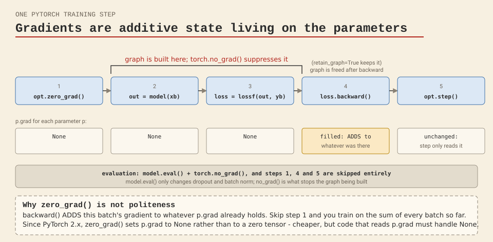

# PyTorch: A Study Guide

> **How to read this note.** The twelve sections follow the order that you meet the parts in when you build a model. Each section does three things. It tells you **why** the part exists. It gives you the **calls** in a table. Then it gives you **runnable code** with its real output.
>
> Read it in order the first time. After that, go to the section with your task in its heading.
>
> This note follows the [ASD-STE100](https://www.asd-ste100.org/) Simplified Technical English rules. The sentences are short. The voice is active. There is one exception. The heading "Don't reach for this when" keeps its contraction, because all 72 notes in this wiki use that exact heading.
>
> Every call here is **PyTorch 2.x**. This note gives no legacy spellings.
>
> This note explains the **framework**. It does not derive the mathematics. For the mathematics, read [neural-networks-from-scratch](neural-networks-from-scratch.md), which writes the forward and the backward pass in numpy first. The two notes fit together: that note gives you the lines, and this note tells you which PyTorch call replaces each one.

## Why This Exists

**Problem.** PyTorch is easy to copy and hard to understand. You can paste a training loop that works and still not know why `zero_grad()` is there. Or why the loss wants raw scores and not probabilities. Or why your accuracy changes when you forget one line. Then something breaks, and you have no model of the parts, so you change lines at random.

**Key insight.** PyTorch adds exactly **two** things to numpy. The first is a tensor that knows its device and its dtype. The second is a tensor that **remembers what made it**, so the framework can calculate a gradient without your help.

Everything else in the framework is a convenience built on those two ideas. A Module is a box that finds its own parameters. An optimizer is a loop over those parameters. A DataLoader is a loop over your data. When you see each part as a convenience, you can predict what it does.

**Reach for this when:**
- You want to learn PyTorch properly and not by copying.
- Your loop runs, and you want to know what each line is for.
- A shape error or a dtype error stopped you.
- Your attention layer runs without an error and gives nonsense.
- You must choose a loss, an optimizer or a layer, and you want the reason and not a default.

**Don't reach for this when:**
- You want the mathematics of backpropagation. Read [neural-networks-from-scratch](neural-networks-from-scratch.md).
- You want one call and you already know the concept. Use the table in the section heading and skip the prose.
- You want distributed training, quantisation or custom autograd functions. This note does not cover them.

## Diagrams



Read that diagram again after section 8. It shows the state of `p.grad` at each of the five lines, which is the part that a first reading always misses.

## 1. Tensors: The Array That Knows Where It Lives

**Why it exists.** A numpy array holds numbers in the memory of the CPU. A GPU cannot read that memory. A tensor is the same block of numbers, plus two facts: which **device** holds it, and which **dtype** it uses. Those two facts are the reason that a tensor is not an array.

Most tensor errors are a disagreement about one of those two facts. "Expected all tensors to be on the same device" is the first. "Expected scalar type Long but found Float" is the second.

| Want | Call | Note |
|---|---|---|
| A tensor from Python data | `torch.tensor([[1,2],[3,4]])` | It **infers** the dtype, so whole numbers give `int64` |
| A tensor from a numpy array, with no copy | `torch.from_numpy(arr)` | It **shares the memory**. An edit to the array changes the tensor |
| A tensor from a numpy array, with a copy | `torch.tensor(arr)` | The memory is separate |
| A copy of a tensor | `t.detach().clone()` | Do not use `torch.tensor(t)`, which gives a warning |
| Back to numpy | `t.numpy()` | It also shares the memory. Call `detach()` first if the tensor needs a gradient |
| Zeros, ones, a range, random values | `torch.zeros(2,3)`, `torch.ones_like(t)`, `torch.arange(6.)`, `torch.randn(2,3)` | All take `dtype=`, `device=` and `requires_grad=` |
| The shape | `t.shape`, or `t.size(0)` for one axis | `t.numel()` gives the count of numbers |
| Reshape, with no copy | `t.view(2, 3)` | It raises an error after a `.transpose()`, because the memory is no longer in order |
| Reshape, always | `t.reshape(3, 2)` | It copies when it must. Use this one by default |
| Flatten all axes except the batch | `nn.Flatten()`, or `t.flatten(1)` | |
| One number out of a tensor | `t.item()` | The tensor must hold exactly one number |

Remember three dtype pairings. Images and weights are `float32`. Class labels for `CrossEntropyLoss` must be `int64`, which PyTorch also calls `torch.long`. Masks are `bool`.

```python
import numpy as np, torch
a = torch.tensor([[1, 2], [3, 4]])                      # from data; dtype inferred (int64 here)
print(a.dtype, a.shape, a.sum().item())
print("float version:", torch.tensor([[1, 2]], dtype=torch.float32).dtype)
n = np.array([1.0, 2.0])
shared = torch.from_numpy(n)                            # SHARES memory with the numpy array
copied = torch.tensor(n)                                # copies
n[0] = 99
print("from_numpy sees the edit:", shared[0].item(), "  torch.tensor does not:", copied[0].item())
print("back to numpy (also shared):", shared.numpy()[0])
x = torch.arange(6.)
print("view (needs contiguous):", x.view(2, 3).shape, " reshape (always works):", x.reshape(3, 2).shape)
print("flatten all but batch:", torch.nn.Flatten()(torch.zeros(8, 3, 4, 4)).shape)
print("add_ modifies in place:", torch.ones(2).add_(5).tolist())
dev = "cuda" if torch.cuda.is_available() else ("mps" if torch.backends.mps.is_available() else "cpu")
print("portable device placement:", torch.zeros(2).to(dev).device)   # .to(dev) instead of .cuda()
# Expected output:
# torch.int64 torch.Size([2, 2]) 10
# float version: torch.float32
# from_numpy sees the edit: 99.0   torch.tensor does not: 1.0
# back to numpy (also shared): 99.0
# view (needs contiguous): torch.Size([2, 3])  reshape (always works): torch.Size([3, 2])
# flatten all but batch: torch.Size([8, 48])
# add_ modifies in place: [6.0, 6.0]
# portable device placement: mps:0
```

Read the shared-memory lines. After `n[0] = 99`, the `from_numpy` tensor gives 99, and the `torch.tensor` copy still gives 1.0. One source array gives two different answers.

That is the whole lesson of this section. `from_numpy` is a window onto the array, and `torch.tensor` is a photograph of it.

## 2. Autograd: The Array That Remembers What Made It

**Why it exists.** [neural-networks-from-scratch](neural-networks-from-scratch.md) writes a backward pass by hand. It works, and it is four lines for a two-layer network. Those four lines are also wrong for every other architecture, and you must write them again each time.

Autograd removes that work. When you mark a tensor with `requires_grad=True`, PyTorch records every operation that touches it. The record is a graph. Then `backward()` walks that graph in reverse and fills in `.grad` for you.

So the price of autograd is memory. PyTorch must keep the forward values to walk back through them, which is the reason that training needs much more memory than inference.

| Task | Call |
|---|---|
| Make a tensor trainable | `torch.tensor([2.0], requires_grad=True)`. **The default is `False`** |
| Change the flag later | `t.requires_grad_(True)`, on leaf tensors only |
| Calculate the gradients | `loss.backward()` on a scalar |
| Read a gradient | `p.grad`, which has the shape of `p`, or is `None` |
| Clear the gradients | `opt.zero_grad()` |
| Stop the record | A `with torch.no_grad():` block, or the `@torch.no_grad()` decorator |
| Cut one tensor out of the record | `t.detach()` |
| Keep the graph for a second backward pass | `loss.backward(retain_graph=True)` |
| Limit a large gradient | `torch.nn.utils.clip_grad_norm_(model.parameters(), 1.0)`, after `backward()` and before `step()` |

Three facts cause most of the confusion here, and the code below shows all three.

First, `requires_grad` defaults to `False`. Only the tensors that you mark take part.

Second, `.grad` **adds** to itself. It does not overwrite. A second `backward()` gives you the sum of two gradients.

Third, `zero_grad()` sets `.grad` to `None` and not to a tensor of zeros. The argument `set_to_none=True` is the default in PyTorch 2.x.

```python
import torch
w = torch.tensor([2.0], requires_grad=True)             # no Variable wrapper needed since PyTorch 0.4
print("requires_grad defaults to False:", torch.tensor([2.0]).requires_grad)
y = (3 * w ** 2).sum(); y.backward()
print("dy/dw at w=2 (expect 12):", w.grad.item())
y2 = (3 * w ** 2).sum(); y2.backward()
print("gradients ACCUMULATE, so now 24:", w.grad.item(), "-> call opt.zero_grad() every step")
opt = torch.optim.SGD([w], lr=0.1)
opt.zero_grad()                                          # set_to_none=True is the default in PyTorch 2.x
print("after zero_grad, .grad is", w.grad, "(None, not a zero tensor)")
with torch.no_grad():                                    # no graph is built inside this block
    print("inside no_grad, results need no graph:", (w * 2).requires_grad)
print("detach() cuts one tensor out of the graph:", (w * 2).detach().requires_grad)
print("read one number with .item():", (w * 2).item(), "- use this for a log message")
# Expected output:
# requires_grad defaults to False: False
# dy/dw at w=2 (expect 12): 12.0
# gradients ACCUMULATE, so now 24: 24.0 -> call opt.zero_grad() every step
# after zero_grad, .grad is None (None, not a zero tensor)
# inside no_grad, results need no graph: False
# detach() cuts one tensor out of the graph: False
# read one number with .item(): 4.0 - use this for a log message
```

The second and third facts need a word each.

The **accumulation** is deliberate, and it is not a trap. It lets you add up the gradients of several small batches and then step one time, which imitates a large batch on a small card. The cost is that you must clear the total yourself. That is the whole job of `zero_grad()`.

The **`None`** saves memory, because an unused parameter holds nothing. The cost is that `p.grad.norm()` straight after `zero_grad()` raises `AttributeError`. Pass `set_to_none=False` when you need zeros.

## 3. Modules: Where The Parameters Live

**Why it exists.** A model has many weight tensors. Something must know where all of them are, because the optimizer needs the list, the saver needs the list, and `.to(device)` needs the list. Holding that list by hand does not scale.

`nn.Module` is that list. You declare layers as attributes, and the Module finds them. It then gives you `parameters()`, `state_dict()`, `.to(device)` and `train()`/`eval()` for free.

Two rules follow from how it works. You must call `super().__init__()` first, because that line builds the registry. And you must store layers in `nn.ModuleList` and not in a plain Python list, because a plain list hides them from the registry.

| Task | Call |
|---|---|
| Declare a model | Subclass `nn.Module`, then write `__init__` and `forward` |
| Run it | `model(x)`. Never call `model.forward(x)`, because the call form also runs the hooks |
| A straight chain of layers | `nn.Sequential(nn.Linear(64,100), nn.ReLU(), nn.Linear(100,10))` |
| A list of layers | `nn.ModuleList([...])` or `nn.ModuleDict({...})` |
| Walk the parameters | `for name, p in model.named_parameters():` |
| Count the numbers to train | `sum(p.numel() for p in model.parameters())` |
| Change the mode | `model.train()` and `model.eval()` |
| Freeze a part | `for p in sub.parameters(): p.requires_grad = False` |

**The layers, by job:**

| Job | Layer | Notes |
|---|---|---|
| Fully connected | `nn.Linear(in_features, out_features, bias=True)` | Input is `(N, ..., in_features)` |
| 2-D convolution | `nn.Conv2d(in_channels, out_channels, kernel_size, stride=1, padding=0)` | `padding='same'` is legal at stride 1 |
| Pooling | `nn.MaxPool2d(kernel_size)`, `nn.AvgPool2d(...)` | **`stride` defaults to `kernel_size`** |
| Pool to a chosen size | `nn.AdaptiveAvgPool2d((1,1))` | The usual global average pooling head |
| Flatten | `nn.Flatten()` | `start_dim=1`, so it keeps the batch axis |
| Normalisation | `nn.BatchNorm2d(num_features)`, `nn.LayerNorm(shape)` | The behaviour differs between `train()` and `eval()` |
| Regularisation | `nn.Dropout(p=0.5)` | It is **off** in `eval()` |
| Activation | `nn.ReLU()`, `nn.GELU()`, `nn.SiLU()`, `nn.Sigmoid()` | Each has a twin in `torch.nn.functional` |
| Recurrent | `nn.LSTM(input_size, hidden_size, num_layers, batch_first=False)`, `nn.GRU(...)`, `nn.RNN(...)` | See section 10 |
| Attention | `nn.MultiheadAttention(embed_dim, num_heads, batch_first=False)` | See section 11 |
| Transformer block | `nn.TransformerEncoderLayer(d_model, nhead, batch_first=True, norm_first=True)` | See section 11 |
| Lookup table | `nn.Embedding(num_embeddings, embedding_dim)` | The input is `int64` indices |

```python
import torch, torch.nn as nn
torch.manual_seed(0)
class Net(nn.Module):                      # a Module is a container that finds its own parameters
    def __init__(self):
        super().__init__()                 # this line registers the machinery. never omit it
        self.body = nn.Linear(4, 8)
        self.drop = nn.Dropout(0.5)
        self.head = nn.Linear(8, 2)
    def forward(self, x):
        return self.head(self.drop(torch.relu(self.body(x))))
net = Net()
print("parameter tensors it found:", [n for n, _ in net.named_parameters()])
print("numbers to train:", sum(p.numel() for p in net.parameters()))
x = torch.ones(1000, 4)
net.train(); spread_train = net(x).std(0).mean().item()   # dropout is ON, so rows differ
net.eval();  spread_eval  = net(x).std(0).mean().item()   # dropout is OFF, so rows are identical
print(f"std across 1000 identical inputs: train {spread_train:.4f}, eval {spread_eval:.4f}")
print("same weights, two answers. that is why you must call eval() before you measure anything.")
# Expected output:
# parameter tensors it found: ['body.weight', 'body.bias', 'head.weight', 'head.bias']
# numbers to train: 58
# std across 1000 identical inputs: train 0.1594, eval 0.0000
# same weights, two answers. that is why you must call eval() before you measure anything.
```

Two results to take from that output.

The Module found four parameter tensors by itself. You declared two layers, and each gave a weight and a bias. `nn.Dropout` has no parameters, so it appears in no list.

The two modes give **two different answers from the same weights**. In `train()` mode the dropout changes the output of each call. In `eval()` mode it does nothing, so 1000 identical inputs give 1000 identical outputs and the spread is 0.

That difference is the reason for section 8.

## 4. Losses: What You Minimise

**Why it exists.** A loss turns a prediction and a target into one number. Gradient descent needs one number, because a slope needs one output.

The important fact about PyTorch losses is not the formula. It is the **kind of number each one wants**. Some want raw scores, which PyTorch calls logits. Some want probabilities. A loss cannot check which kind you gave it, so the wrong kind gives you no error and a worse model.

| Loss | The model output it wants | The target it wants |
|---|---|---|
| `nn.CrossEntropyLoss()` | Raw **logits**, shape `(N, C)`. It applies log-softmax inside | Class indices, shape `(N,)`, dtype `int64` |
| `nn.NLLLoss()` | **Log** probabilities, so apply `log_softmax` first | Class indices |
| `nn.BCEWithLogitsLoss()` | Raw logits, any shape | Floats from 0 to 1, with the same shape |
| `nn.BCELoss()` | Probabilities, so apply sigmoid first | Floats from 0 to 1 |
| `nn.MSELoss()` | Predictions | The same shape as the predictions |
| `nn.L1Loss()`, `nn.SmoothL1Loss()` | Predictions | The same shape |

The rule is short. **Never put a `Softmax` or a `Sigmoid` layer before `CrossEntropyLoss` or `BCEWithLogitsLoss`.** Those two losses squash the values inside, in a form that does not overflow.

The code below shows what the mistake costs:

```python
import torch, torch.nn as nn, torch.nn.functional as F
logits = torch.tensor([[4.0, 0.5, -1.0]])        # raw scores: the model is confident
target = torch.tensor([0])                       # and it happens to be right
probs = F.softmax(logits, dim=1)
print(f"CrossEntropyLoss(logits, target)       {nn.CrossEntropyLoss()(logits, target).item():.4f}  <- correct")
print(f"CrossEntropyLoss(softmax(logits), ...) {nn.CrossEntropyLoss()(probs, target).item():.4f}  <- softmax twice")
print(f"by hand, -log(softmax(logits)[0]):     {-torch.log(probs[0, 0]).item():.4f}  (matches the correct one)")
# Measure the gradient that reaches the LOGITS, because that is what the model learns from.
grads = {}
for name, build in (("direct", lambda z: z), ("doubled", lambda z: F.softmax(z, dim=1))):
    z = logits.clone().requires_grad_()
    nn.CrossEntropyLoss()(build(z), target).backward()
    grads[name] = z.grad.abs().max().item()
print(f"gradient at the logits, loss on raw scores:  {grads['direct']:.5f}")
print(f"gradient at the logits, softmax then loss:   {grads['doubled']:.5f}")
print(f"the extra softmax shrinks it to {grads['doubled'] / grads['direct']:.0%}, and the gap grows with confidence.")
print("so the wrong number is the small problem. the smaller gradient is the real one.")
# Expected output:
# CrossEntropyLoss(logits, target)       0.0363  <- correct
# CrossEntropyLoss(softmax(logits), ...) 0.5745  <- softmax twice
# by hand, -log(softmax(logits)[0]):     0.0363  (matches the correct one)
# gradient at the logits, loss on raw scores:  0.03562
# gradient at the logits, softmax then loss:   0.02257
# the extra softmax shrinks it to 63%, and the gap grows with confidence.
# so the wrong number is the small problem. the smaller gradient is the real one.
```

The wrong loss number is the small problem. The **gradient** is the real one. The second path must send the gradient back through an extra softmax, and a softmax is nearly flat when the model is confident. So the model learns more slowly, and it slows down further as it becomes more confident.

Apply `softmax(dim=1)` yourself only when you must show a probability to a person.

## 5. Optimizers: How One Step Happens

**Why it exists.** After `backward()`, every parameter holds its gradient. Something must now change the parameters. That is one line of arithmetic for each parameter, and an optimizer is the loop that does it.

An optimizer holds two things: the list of parameters, and any state that it keeps between steps. Plain SGD keeps no state. Momentum keeps one running average for each parameter. Adam keeps two.

| Optimizer | Call | What it keeps |
|---|---|---|
| Plain SGD | `torch.optim.SGD(model.parameters(), lr=0.01)` | Nothing |
| SGD with momentum | `torch.optim.SGD(model.parameters(), lr=0.01, momentum=0.9)` | One average for each parameter |
| The default modern choice | `torch.optim.AdamW(model.parameters(), lr=1e-3, weight_decay=0.01)` | Two averages for each parameter |
| Adam with the original decay | `torch.optim.Adam(model.parameters(), lr=1e-3)` | Two averages |
| A rate for each group | `optim.SGD([{'params': head.parameters(), 'lr': 1e-2}, {'params': body.parameters(), 'lr': 1e-4}])` | |
| The rate now | `opt.param_groups[0]['lr']` | |

A **scheduler** changes the learning rate across training. It wraps the optimizer and you call it one time for each epoch.

| Schedule | Call |
|---|---|
| Drop the rate every N epochs | `optim.lr_scheduler.StepLR(opt, step_size=10, gamma=0.1)` |
| Follow a cosine curve down | `optim.lr_scheduler.CosineAnnealingLR(opt, T_max=epochs)` |
| Drop it when the loss stops to improve | `optim.lr_scheduler.ReduceLROnPlateau(opt)` |
| Up then down, one time | `optim.lr_scheduler.OneCycleLR(opt, max_lr=..., total_steps=...)`. Call `step()` for each **batch** |

Start with `AdamW` at `1e-3`. It works at its default on most problems, because it divides each parameter's step by a running average of that parameter's own gradient size. Plain SGD needs a tuned rate to match it.

[neural-networks-from-scratch](neural-networks-from-scratch.md) section 8 explains momentum with a measurement, and it shows why a badly shaped error surface makes the plain step slow.

## 6. Datasets And DataLoaders: Feeding The Loop

**Why it exists.** Training reads the data many times, in small groups, in a new order each time. Writing that by hand gives you an index loop, a shuffle, a stack of examples and an edge case at the end.

PyTorch splits the job in two. A **Dataset** answers "give me example number `i`". A **DataLoader** turns that into batches. The split means that you can change the batching without touching the data, and the loader can read ahead on other processes.

| Task | Call |
|---|---|
| Wrap tensors that are already in memory | `TensorDataset(X, y)` from `torch.utils.data` |
| Write your own dataset | Subclass `Dataset`, then write `__len__` and `__getitem__` |
| Batch, shuffle and read ahead | `DataLoader(ds, batch_size=64, shuffle=True, num_workers=4, pin_memory=True)` |
| Drop the short last batch | `DataLoader(..., drop_last=True)` |
| Split into train and validation | `torch.utils.data.random_split(ds, [0.8, 0.2])` |
| Use a supplied vision dataset | `torchvision.datasets.MNIST(root='./data', train=True, download=True)` |
| The usual image transform | `transforms.Compose([transforms.ToTensor(), transforms.Normalize(mean, std)])` |

Pass `shuffle=True` for training data, and `shuffle=False` for validation and test data. Shuffling the training data matters, because a network can otherwise learn the order of your file.

## 7. The Training Loop

**Why it exists.** Sections 1 to 6 give you the parts. The loop is the order that you must call them in, and the order does not change between architectures. Learn these five lines and you can read any PyTorch program.

```python
opt.zero_grad()            # 1. clear the gradient left by the last batch
out = model(xb)            # 2. forward pass, which also records the graph
loss = lossf(out, yb)      # 3. one number
loss.backward()            # 4. fill in .grad for every parameter
opt.step()                 # 5. change the parameters
```

Each line is there for a reason that you now know. Line 1 exists because `.grad` adds up (section 2). Line 2 records the graph because autograd needs it (section 2). Line 3 gives one number because a slope needs one output (section 4). Line 4 walks the graph. Line 5 is the optimizer's loop (section 5).

The order matters in one place. Line 1 must come before line 4, and not between 4 and 5. If you clear the gradients after `backward()`, you step with nothing.

```python
import torch, torch.nn as nn
from torch.utils.data import TensorDataset, DataLoader
from sklearn.datasets import load_digits
torch.manual_seed(0); torch.set_num_threads(1)
d = load_digits()
perm = torch.randperm(len(d.target), generator=torch.Generator().manual_seed(0))   # digits ship in subject order
X = torch.tensor(d.data / 16.0, dtype=torch.float32)[perm]; y = torch.tensor(d.target)[perm]
ntr = 1400
train = DataLoader(TensorDataset(X[:ntr], y[:ntr]), batch_size=64, shuffle=True)
model = nn.Sequential(nn.Linear(64, 100), nn.ReLU(), nn.Linear(100, 10))
opt, lossf = torch.optim.Adam(model.parameters(), 1e-3), nn.CrossEntropyLoss()   # CE takes LOGITS, no softmax
for epoch in range(8):
    model.train()                                        # matters once the model has dropout or batch norm
    for xb, yb in train:
        opt.zero_grad(); lossf(model(xb), yb).backward(); opt.step()
model.eval()
with torch.no_grad():
    acc = (model(X[ntr:]).argmax(1) == y[ntr:]).float().mean().item()
print(f"test accuracy {acc:.3f}   (majority-class baseline {y[ntr:].bincount().max().item() / len(y[ntr:]):.3f})")
torch.save(model.state_dict(), "/tmp/m.pt")              # save the weights, not the pickled object
clone = nn.Sequential(nn.Linear(64, 100), nn.ReLU(), nn.Linear(100, 10))
print("reload:", clone.load_state_dict(torch.load("/tmp/m.pt")))
# Expected output:
# test accuracy 0.924   (majority-class baseline 0.116)
# reload: <All keys matched successfully>
```

Read that program as five blocks. First, `TensorDataset` and `DataLoader` make shuffled batches. Second, `nn.Sequential` replaces a class, because the forward pass is a chain.

Third, the inner loop is the five lines above. Fourth, `model.train()` and `model.eval()` separate the two phases, and the evaluation sits inside `torch.no_grad()`. Section 8 explains both.

Fifth, `state_dict` holds the weights. Section 12 explains saving.

**Always print a baseline next to an accuracy.** The program prints 0.924 against a majority-class baseline of 0.116. Without the second number the first one cannot be read. Chance on a balanced 10-class problem is about 0.10, so 0.924 is real learning. On a problem with 95% negatives, the same 0.95 would mean the model learned nothing.

## 8. Evaluation: The Two Switches

**Why it exists.** Two things must change when you stop training and start measuring. People remember one of them and lose hours to the other.

`model.eval()` changes the **layers**. Dropout stops to drop. Batch norm stops to update its running statistics and uses the stored ones. Section 3 measured this: the same weights gave a spread of 0.159 in `train()` mode and 0.000 in `eval()` mode.

`torch.no_grad()` changes the **recording**. Autograd stops to build the graph, which makes the pass faster and uses less memory.

They do different jobs, so evaluation needs both:

```python
model.eval()
with torch.no_grad():
    acc = (model(X_test).argmax(1) == y_test).float().mean().item()
model.train()                     # put it back before you train again
```

Two failures follow from missing one of them.

If you forget `eval()`, dropout stays active and your accuracy is wrong. Worse, batch norm updates its statistics from your test data, so the measurement **changed your model**.

If you forget `no_grad()`, the numbers are correct. You only lose speed and memory. This is the cheaper mistake of the two.

One more rule for the loop. Add `loss.item()` to a running total, and never `loss` itself. A loss tensor holds its graph, so a list of them keeps every batch of the epoch in memory.

## 9. Shapes, Part 1: Convolution

**Why it exists.** A convolution changes the height and the width of its input. The first `nn.Linear` after the convolutions needs its `in_features` as a number. So you must be able to calculate the size, because the code will not tell you until it raises an error.

```text
O = floor( (W + 2P - D*(K-1) - 1) / S ) + 1
```

Here `W` is the input size, `K` is the kernel, `P` is the padding, `S` is the stride and `D` is the dilation. The **floor** matters. Without it the formula gives a fraction at a stride of more than 1.

```python
import warnings; warnings.filterwarnings("ignore")   # padding="same" with an even kernel warns about a padded copy
import torch, torch.nn as nn
def out_size(W, K, P=0, S=1, D=1): return (W + 2 * P - D * (K - 1) - 1) // S + 1   # floor, not plain division
print("formula vs PyTorch, (W,K,P,S):")
for W, K, P, S in [(28, 5, 2, 1), (28, 5, 0, 1), (28, 3, 1, 2), (28, 4, 0, 3), (28, 2, 0, 2)]:
    real = nn.Conv2d(1, 1, K, stride=S, padding=P)(torch.zeros(1, 1, W, W)).shape[-1]
    print(f"  ({W},{K},{P},{S}) -> formula {out_size(W, K, P, S):2d}  PyTorch {real:2d}  {'ok' if real == out_size(W,K,P,S) else 'MISMATCH'}")
print('\n"same" padding P=(K-1)/2 keeps the size only for ODD K and stride 1:')
for K in (3, 5, 4):
    P = (K - 1) // 2
    print(f"  K={K}, P={P}: 28 -> {out_size(28, K, P, 1)}" + ("" if K % 2 else "   <- even kernel cannot stay 'same'"))
print("\nPyTorch accepts padding='same' (stride 1 only) and does the arithmetic for you:")
print("  ", nn.Conv2d(1, 1, 4, padding="same")(torch.zeros(1, 1, 28, 28)).shape[-1])
print("\nMaxPool2d defaults stride=kernel_size, which is why 'output = W/K' works for pooling but not for conv:")
print("  pool K=2:", nn.MaxPool2d(2)(torch.zeros(1, 1, 28, 28)).shape[-1], " conv K=2, S=1:", out_size(28, 2, 0, 1))
# Expected output:
# formula vs PyTorch, (W,K,P,S):
#   (28,5,2,1) -> formula 28  PyTorch 28  ok
#   (28,5,0,1) -> formula 24  PyTorch 24  ok
#   (28,3,1,2) -> formula 14  PyTorch 14  ok
#   (28,4,0,3) -> formula  9  PyTorch  9  ok
#   (28,2,0,2) -> formula 14  PyTorch 14  ok
# 
# "same" padding P=(K-1)/2 keeps the size only for ODD K and stride 1:
#   K=3, P=1: 28 -> 28
#   K=5, P=2: 28 -> 28
# ... trimmed
```

Two shortcuts that people over-use. `P = (K-1)/2` keeps the size only for an **odd** kernel at **stride 1**. `O = W/K` works for pooling only, and only because `MaxPool2d` and `AvgPool2d` default `stride` to `kernel_size`. `nn.Conv2d` defaults `stride` to 1, so the same reasoning gives the wrong answer for a convolution.

Two ways to stop doing this arithmetic. Use `padding='same'` at stride 1. Or end the body with `nn.AdaptiveAvgPool2d((1,1))`, which gives one number for each channel whatever the input size was.

## 10. Shapes, Part 2: Recurrent Layers

**Why it exists.** A recurrent layer takes a sequence, so its input has one more axis than a dense layer's. PyTorch puts the time axis first by default, and almost every data pipeline puts the batch axis first. That disagreement is the trap.

| Tensor | Default layout | With `batch_first=True` |
|---|---|---|
| input | `(L, N, H_in)` | `(N, L, H_in)` |
| output | `(L, N, D*H_out)` | `(N, L, D*H_out)` |
| `h0` and `hn`, also `c0` and `cn` | `(D*num_layers, N, H_out)` | **unchanged** |

Here `L` is the number of timesteps, `N` is the batch, and `D` is 2 for a bidirectional layer and 1 otherwise.

Read the last row again. `batch_first=True` moves the batch axis of the input and the output, and it does **not** move the batch axis of the hidden state. That asymmetry is the most common `nn.LSTM` shape bug.

```python
import torch, torch.nn as nn
torch.manual_seed(0)
N, L, D, H, layers = 4, 28, 28, 16, 2                    # batch, timesteps, features, hidden, stacked layers
lstm = nn.LSTM(D, H, layers, batch_first=True)
x = torch.randn(N, L, D)
out, (h, c) = lstm(x)                                    # h0/c0 default to zeros - no need to build them by hand
print("batch_first=True input", tuple(x.shape), "-> out", tuple(out.shape))
print("but the states stay LAYERS-first:", tuple(h.shape), " <- the asymmetry that bites people")
print("last timestep == final layer's h:", torch.allclose(out[:, -1, :], h[-1]))
bi = nn.LSTM(D, H, layers, batch_first=True, bidirectional=True)
out2, (h2, _) = bi(x)
print("bidirectional doubles the feature axis:", tuple(out2.shape), " states:", tuple(h2.shape))
print("for a bi-LSTM out[:, -1] is NOT h[-1]:", torch.allclose(out2[:, -1, :H], h2[-2]),
      "(forward half matches h2[-2], the reverse half lives at out2[:, 0, H:])")
# Expected output:
# batch_first=True input (4, 28, 28) -> out (4, 28, 16)
# but the states stay LAYERS-first: (2, 4, 16)  <- the asymmetry that bites people
# last timestep == final layer's h: True
# bidirectional doubles the feature axis: (4, 28, 32)  states: (4, 4, 16)
# for a bi-LSTM out[:, -1] is NOT h[-1]: True (forward half matches h2[-2], the reverse half lives at out2[:, 0, H:])
```

Three results from that output.

The states were never passed. `h0` and `c0` default to zeros, so you can remove the code that builds them.

For a one-direction stack, `out[:, -1, :]` and `h[-1]` are the same tensor. For a bidirectional stack they are not. `out[:, -1, :H]` holds the final **forward** state, and the final reverse state sits at `out[:, 0, H:]`. So `out[:, -1]` gives your classifier the reverse direction's **first** step. Use `torch.cat([h[-2], h[-1]], dim=1)` instead.

Two more rules. Detach a hidden state that you carry between batches with `h = h.detach()`, or the backward pass walks the whole history. Use `clip_grad_norm_` against a large gradient, which matters most for `nn.RNN(nonlinearity='relu')` across many steps.

## 11. Shapes, Part 3: Attention And Transformers

**Why it exists.** Attention replaced recurrent layers for most sequence work. The API is small, and four details in it cost more time than everything else in this note.

For the mathematics, read [transformer-forward-pass](../math-for-ml/transformer-forward-pass.md). This section gives the API and the four traps.

| Task | Call |
|---|---|
| One attention block | `nn.MultiheadAttention(embed_dim, num_heads, dropout=0.0, batch_first=False)` |
| Call it | `out, weights = mha(query, key, value)`. Give the same tensor three times for self-attention |
| Attention with no module | `F.scaled_dot_product_attention(q, k, v)`. The shape is `(N, heads, L, head_width)` |
| One encoder block | `nn.TransformerEncoderLayer(d_model, nhead, dim_feedforward=2048, batch_first=True, norm_first=True)` |
| A stack of blocks | `nn.TransformerEncoder(layer, num_layers=6)` |
| A decoder | `nn.TransformerDecoderLayer(...)`, then `nn.TransformerDecoder(layer, num_layers=6)` |
| A causal mask | `nn.Transformer.generate_square_subsequent_mask(L)`, or `is_causal=True` |
| Position information | Write your own. PyTorch supplies no positional encoding layer |

### Trap 1: batch_first defaults to False

`nn.MultiheadAttention` and every `nn.Transformer*` layer default to `batch_first=False`. They then read your `(batch, length, width)` tensor as `(length, batch, width)`.

```python
import torch, torch.nn as nn
torch.manual_seed(0)
L, N, E, H = 5, 2, 8, 4                      # sequence length, batch, embedding width, heads
x = torch.randn(N, L, E)                     # the shape you almost always have: batch first
mha_default = nn.MultiheadAttention(E, H)                      # batch_first defaults to False
mha_batched = nn.MultiheadAttention(E, H, batch_first=True)
out_b, w_b = mha_batched(x, x, x)            # correct: it reads x as (batch, length, width)
out_d, w_d = mha_default(x, x, x)            # silent bug: it reads x as (length, batch, width)
print(f"input                        {tuple(x.shape)}   = (batch {N}, length {L}, width {E})")
print(f"batch_first=True  -> output  {tuple(out_b.shape)}   weights {tuple(w_b.shape)}")
print(f"batch_first=False -> output  {tuple(out_d.shape)}   weights {tuple(w_d.shape)}")
print("the second call raises no error. it attends across the BATCH and not across the sequence.")
print("so always pass batch_first=True, for MultiheadAttention and for every Transformer layer.")
# Expected output:
# input                        (2, 5, 8)   = (batch 2, length 5, width 8)
# batch_first=True  -> output  (2, 5, 8)   weights (2, 5, 5)
# batch_first=False -> output  (2, 5, 8)   weights (5, 2, 2)
# the second call raises no error. it attends across the BATCH and not across the sequence.
# so always pass batch_first=True, for MultiheadAttention and for every Transformer layer.
```

Look at the two output shapes. They are the same, so **no error appears**. Only the attention weights show the fault. The shape `(5, 2, 2)` means the layer attended across the batch of 2, and not across the sequence of 5.

Always pass `batch_first=True`.

### Trap 2: two masks, and True means hide

There are two mask arguments and they do different jobs. `attn_mask` has the shape `(L, L)` and shapes the pattern, for example a causal pattern. `key_padding_mask` has the shape `(N, L)` and removes whole positions, for example padding.

In both of them a `True` value means **hide this**. Most people guess the opposite.

```python
import torch, torch.nn as nn
torch.manual_seed(0)
L, N, E, H = 4, 1, 8, 2
x = torch.randn(N, L, E)
mha = nn.MultiheadAttention(E, H, batch_first=True)
# Mask 1: attn_mask hides positions from each other. True means "not allowed to look".
causal = torch.triu(torch.ones(L, L, dtype=torch.bool), diagonal=1)   # hide the future
_, w_causal = mha(x, x, x, attn_mask=causal, need_weights=True, average_attn_weights=True)
# Mask 2: key_padding_mask hides whole positions from everybody. True means "this is padding".
pad = torch.tensor([[False, False, False, True]])                      # position 3 is padding
_, w_pad = mha(x, x, x, key_padding_mask=pad)
print("causal attn_mask, row = the position doing the looking:")
print(w_causal[0].detach().round(decimals=2))
print("  row 0 can see only position 0. row 3 can see all four. the upper triangle is zero.")
print("\nkey_padding_mask with position 3 marked as padding:")
print(w_pad[0].detach().round(decimals=2))
print("  the whole last COLUMN is zero: nobody looks at a pad, including the pad itself.")
print("\nso attn_mask is (L, L) and shapes the pattern. key_padding_mask is (N, L) and drops tokens.")
print("in both, True means HIDE. that sign is the opposite of what most people guess.")
# Expected output:
# causal attn_mask, row = the position doing the looking:
# tensor([[1.0000, 0.0000, 0.0000, 0.0000],
#         [0.5500, 0.4500, 0.0000, 0.0000],
#         [0.3700, 0.2600, 0.3700, 0.0000],
#         [0.2900, 0.2400, 0.1900, 0.2800]])
#   row 0 can see only position 0. row 3 can see all four. the upper triangle is zero.
# 
# key_padding_mask with position 3 marked as padding:
# tensor([[0.3600, 0.3000, 0.3400, 0.0000],
#         [0.4000, 0.3200, 0.2800, 0.0000],
# ... trimmed
```

Read the two tables of weights. The causal mask gives zeros above the diagonal, so each row sees only itself and the positions before it. The padding mask gives a zero **column**, so no position looks at the pad.

### Trap 3: the functional call uses the opposite sign

`F.scaled_dot_product_attention` is the fused kernel under the modules. Use it when you write your own block. It takes `(N, heads, L, head_width)` and not `(N, L, width)`.

Its boolean `attn_mask` means **keep**, which is the opposite of `nn.MultiheadAttention`.

```python
import torch, torch.nn.functional as F
torch.manual_seed(0)
N, H, L, D = 2, 4, 6, 16                      # batch, heads, length, width per head
q, k, v = (torch.randn(N, H, L, D) for _ in range(3))   # note the shape: heads are a real axis
# The formula from the maths note, written out.
scores = q @ k.transpose(-2, -1) / D ** 0.5   # divide by sqrt(head width), not by sqrt(E)
manual = F.softmax(scores, dim=-1) @ v
fused = F.scaled_dot_product_attention(q, k, v)         # one call, and it picks a fast kernel
print("manual formula equals the fused call:", torch.allclose(manual, fused, atol=1e-6))
# A causal model needs the future hidden. The flag is cheaper than building a mask tensor.
causal_mask = torch.triu(torch.ones(L, L, dtype=torch.bool), diagonal=1)
by_mask = F.scaled_dot_product_attention(q, k, v, attn_mask=~causal_mask)   # True means KEEP here
by_flag = F.scaled_dot_product_attention(q, k, v, is_causal=True)
print("is_causal=True equals a hand-built mask:", torch.allclose(by_mask, by_flag, atol=1e-6))
print(f"shapes: q {tuple(q.shape)} -> out {tuple(fused.shape)}  (batch, heads, length, head width)")
print("watch the sign: a bool attn_mask here means KEEP, but in MultiheadAttention it means HIDE.")
# Expected output:
# manual formula equals the fused call: True
# is_causal=True equals a hand-built mask: True
# shapes: q (2, 4, 6, 16) -> out (2, 4, 6, 16)  (batch, heads, length, head width)
# watch the sign: a bool attn_mask here means KEEP, but in MultiheadAttention it means HIDE.
```

Prefer `is_causal=True` to a mask tensor for a causal model. It is clearer and it needs no memory.

Two notes on speed. `need_weights=True` on `nn.MultiheadAttention` turns the fast kernel off, so pass `need_weights=False` unless you must inspect the weights. The division is by the square root of the **head** width, which is `embed_dim // num_heads`.

### Trap 4: norm_first, and where the parameters sit

`norm_first=True` gives pre-layer-normalisation, which trains more easily. The default `False` gives the post-normalisation order of the 2017 paper.

```python
import warnings, torch, torch.nn as nn
warnings.filterwarnings("ignore")             # nested-tensor notice, harmless with norm_first
torch.manual_seed(0)
E, H, FF, L, N = 32, 4, 64, 7, 2
layer = nn.TransformerEncoderLayer(d_model=E, nhead=H, dim_feedforward=FF,
                                   batch_first=True, norm_first=True)   # norm_first = pre-LN
encoder = nn.TransformerEncoder(layer, num_layers=3)                    # 3 stacked copies
x = torch.randn(N, L, E)
attn = 4 * E * E + 4 * E                      # Q, K, V and the output projection, plus biases
ff = 2 * E * FF + FF + E                      # two linear layers, plus biases
norms = 2 * 2 * E                             # two LayerNorms, each with a weight and a bias
print(f"in {tuple(x.shape)} -> out {tuple(encoder(x).shape)}   the shape never changes")
print(f"attention {attn:,} + feed-forward {ff:,} + 2 LayerNorms {norms} = {attn + ff + norms:,}")
print(f"parameters actually in one layer:                        {sum(p.numel() for p in layer.parameters()):,}")
print(f"here FF = 2E, so the two blocks are nearly equal. above FF = 2E the feed-forward wins.")
causal = nn.Transformer.generate_square_subsequent_mask(L)   # float mask: 0 keeps, -inf hides
print(f"\ngenerate_square_subsequent_mask({L}) row 0: {causal[0].tolist()}")
print("that helper returns a FLOAT mask of 0 and -inf, which attention ADDS to the scores.")
print("norm_first=True is pre-LN, and it trains more easily. The 2017 paper used post-LN.")
# Expected output:
# in (2, 7, 32) -> out (2, 7, 32)   the shape never changes
# attention 4,224 + feed-forward 4,192 + 2 LayerNorms 128 = 8,544
# parameters actually in one layer:                        8,544
# here FF = 2E, so the two blocks are nearly equal. above FF = 2E the feed-forward wins.
# 
# generate_square_subsequent_mask(7) row 0: [0.0, -inf, -inf, -inf, -inf, -inf, -inf]
# that helper returns a FLOAT mask of 0 and -inf, which attention ADDS to the scores.
# norm_first=True is pre-LN, and it trains more easily. The 2017 paper used post-LN.
```

The shape never changes across a transformer block. That property is the reason that you can stack the blocks with no shape arithmetic.

The parameter count splits in a useful way. Attention holds `4 * d_model²` weights, for Q, K, V and the output projection. The feed-forward block holds `2 * d_model * dim_feedforward`. So the feed-forward block holds more weights as soon as `dim_feedforward` is more than twice `d_model`, and the usual ratio is four.

## 12. Finishing: Save, Resume, Devices And Speed

**Why saving needs a rule.** You can pickle a Module, and you should not. A pickled module ties the file to your class definition and to your import paths, so it breaks when you move the code. A `state_dict` is a plain dictionary of tensors, which does not.

| Task | Call |
|---|---|
| Save the weights | `torch.save(model.state_dict(), 'net.pt')` |
| Load the weights | `model.load_state_dict(torch.load('net.pt', weights_only=True))` |
| Save a checkpoint you can resume from | `torch.save({'model': model.state_dict(), 'opt': opt.state_dict(), 'epoch': e}, 'ckpt.pt')` |
| Load onto a different device | `torch.load(path, map_location='cpu')` |
| Load only a part | `model.load_state_dict(sd, strict=False)`, which gives the missing and the unexpected keys |

Save the optimizer state too when you plan to resume. Adam keeps two averages for each parameter (section 5), and a resume without them restarts the optimizer from nothing.

**Devices.** Write the device one time and use `.to(device)` everywhere. Then the same file runs on CUDA, on Apple silicon and on the CPU.

| Task | Call |
|---|---|
| Pick a device one time | `device = torch.device('cuda' if torch.cuda.is_available() else 'cpu')`. Add an `mps` branch on Apple silicon |
| Move a tensor | `x = x.to(device)`, which returns a new tensor |
| Move a model | `model.to(device)`, which changes the module in place |
| Make it faster in one line | `model = torch.compile(model)` |
| Use mixed precision | `with torch.autocast(device_type='cuda', dtype=torch.bfloat16):` around the forward pass |
| Save memory, pay compute | `torch.utils.checkpoint`, which calculates the activations again instead of keeping them |

**Reproducibility.** Seeds matter more than they look. Two runs of the same model can differ by enough to invert a comparison between two models.

| Task | Call |
|---|---|
| Seed everything | `torch.manual_seed(0)`, which also seeds CUDA. Add `np.random.seed(0)` and `random.seed(0)` |
| Seed one sampler | `torch.Generator().manual_seed(0)`, then give it to `DataLoader(generator=...)` |
| Force deterministic kernels | `torch.use_deterministic_algorithms(True)`, plus `CUBLAS_WORKSPACE_CONFIG=:16:8` |

## Trade-offs

| Choice | What you gain | What you give up |
|---|---|---|
| `reshape` everywhere instead of `view` | You never debug a memory-order error | A copy that you did not plan for in a hot loop |
| `nn.Sequential` instead of a class | Three lines instead of fifteen | Any forward pass that is not a chain, such as a skip connection |
| `padding='same'` instead of a number | The kernel size becomes a free choice | The shape chain is no longer visible, and it works at stride 1 only |
| An `AdaptiveAvgPool2d((1,1))` head | The input size stops to matter | The spatial layout, which a dense head could have used |
| `set_to_none=True`, the default | Less memory, and an unused parameter is provably `None` | Any code that reads `p.grad` must handle `None` |
| `torch.compile` | A real speed increase, in one line | A slow first call, harder tracebacks and occasional graph breaks |
| `from_numpy` instead of `torch.tensor` | No copy | Aliasing faults, because an edit to either side changes both |
| `num_workers > 0` | The loader stops to be the bottleneck | Process start-up cost and harder debugging |
| AdamW instead of tuned SGD | It works at its default | Two extra averages for each parameter, so more memory |
| Deterministic kernels and seeds | Runs that repeat, and comparisons you can trust | Some kernels become slower, and some raise an error |
| `nn.MultiheadAttention` instead of `F.scaled_dot_product_attention` | It gives you the projections, the heads and the dropout | Control of the shapes, and the fast path when you ask for weights |

## Common Pitfalls

**The loop**
- **Do not forget `opt.zero_grad()`.** The new gradient adds to the old one, so the effective learning rate grows (§2).
- **Do not clear the gradients between `backward()` and `step()`.** You then step with nothing (§7).
- **Do not read `p.grad` straight after `zero_grad()`.** It is `None` and not zeros (§2).
- **Do not add `loss` to a running total.** Add `loss.item()`, or the graph of every batch stays in memory (§8).

**Evaluation**
- **Do not measure without `model.eval()`.** Dropout stays active and batch norm updates its statistics from your test data, so the number is wrong and the evaluation changed your model (§8).
- **Do not measure without `torch.no_grad()`.** The numbers are correct, and you waste time and memory (§8).
- **Do not report an accuracy with no baseline.** A number with no baseline cannot be read (§7).
- **Do not choose a model on the test set.** Keep a validation split (§6).

**Losses**
- **Do not put a `Softmax` layer before `CrossEntropyLoss`.** The loss squashes the values inside, and the extra softmax shrinks the gradient (§4).
- **Do not give float labels to `CrossEntropyLoss`.** The class indices must be `int64` (§1).

**Shapes**
- **Do not use an output-size formula without the floor** (§9).
- **Do not treat `P = (K-1)/2` as a general rule.** It needs an odd kernel and a stride of 1 (§9).
- **Do not expect `batch_first=True` to move the hidden state** (§10).
- **Do not read `out[:, -1]` as the last state of a bidirectional RNN** (§10).
- **Do not forget `nn.Flatten()` before a linear head** (§1).

**Transformers**
- **Do not leave `batch_first` at its default.** The call gives the correct output shape and the wrong answer, with no error (§11).
- **Do not guess the direction of a mask.** `True` means hide in the module and keep in the functional call (§11).
- **Do not confuse the two masks.** `attn_mask` is `(L, L)` and `key_padding_mask` is `(N, L)` (§11).
- **Do not leave `need_weights=True` in training code.** It turns the fast kernel off (§11).
- **Do not forget the positional information.** Attention alone cannot tell you the order of the tokens (§11).

**Modules**
- **Do not forget `super().__init__()`.** That line builds the registry that finds your parameters (§3).
- **Do not hold layers in a plain Python list.** Use `nn.ModuleList`, or the optimizer never sees them (§3).
- **Do not call `model.forward(x)`.** Call `model(x)`, which also runs the hooks (§3).

## Decision Table

| Scenario | Use this | Not that | Why |
|---|---|---|---|
| A numpy array that you will change later | `torch.tensor(arr)` | `torch.from_numpy(arr)` | `from_numpy` shares the memory (§1) |
| A hand-off of a large array | `torch.from_numpy(arr)` | `torch.tensor(arr)` | It makes no second copy (§1) |
| Reshape the output of a transpose | `reshape` | `view` | `view` needs the memory in order (§1) |
| A multiclass head | `nn.Linear(...)` with `CrossEntropyLoss` | `Softmax` with `NLLLoss` | One fused operation, and it is stable (§4) |
| A binary head | `BCEWithLogitsLoss` | `Sigmoid` with `BCELoss` | The fused form avoids an overflow (§4) |
| Evaluation | `model.eval()` **and** `torch.no_grad()` | Either one alone | They do different jobs (§8) |
| An optimizer, with no time to tune | `AdamW(lr=1e-3)` | `SGD(lr=0.01)` | It works at its default (§5) |
| A convolution that keeps the size | `padding='same'` | A computed `(K-1)/2` | It is correct for an even kernel too (§9) |
| A head that ignores the input size | `nn.AdaptiveAvgPool2d((1,1))` | A computed `Linear(C*H*W, ...)` | There is no shape chain to calculate again (§9) |
| The last state of a bidirectional RNN | `torch.cat([h[-2], h[-1]], dim=1)` | `out[:, -1, :]` | The last timestep mixes the forward end with the reverse start (§10) |
| Self-attention inside your own block | `F.scaled_dot_product_attention` | A hand-written softmax of `q @ k.T` | It picks a fused kernel and uses less memory (§11) |
| A standard encoder | `nn.TransformerEncoderLayer(..., norm_first=True)` | A block that you write | Pre-normalisation trains more easily (§11) |
| A causal model | `is_causal=True` | A mask tensor that you build | No mask tensor in memory (§11) |
| A saved model | `state_dict` and a `.pt` file | A pickled module | A pickled module breaks when your class moves (§12) |
| A training run that you must resume | A checkpoint with the optimizer state | The weights alone | Adam keeps two averages for each parameter (§12) |
| Work on an accelerator | `.to(device)` | `.cuda()` with a branch | One code path for CUDA, MPS and CPU (§12) |
| Training is correct but the memory is full | `torch.utils.checkpoint` | A smaller batch first | It calculates the activations again (§12) |

## References

- [`torch.Tensor` and creation semantics](https://docs.pytorch.org/docs/stable/tensors.html) · [`torch.tensor`](https://docs.pytorch.org/docs/stable/generated/torch.tensor.html)
- [Autograd mechanics](https://docs.pytorch.org/docs/stable/autograd.html) · [`torch.no_grad`](https://docs.pytorch.org/docs/stable/generated/torch.no_grad.html) · [`Optimizer.zero_grad`](https://docs.pytorch.org/docs/stable/generated/torch.optim.Optimizer.zero_grad.html)
- [`nn.Module`](https://docs.pytorch.org/docs/stable/generated/torch.nn.Module.html) · [`nn.Sequential`](https://docs.pytorch.org/docs/stable/generated/torch.nn.Sequential.html) · [`nn.Dropout`](https://docs.pytorch.org/docs/stable/generated/torch.nn.Dropout.html)
- [`nn.CrossEntropyLoss`](https://docs.pytorch.org/docs/stable/generated/torch.nn.CrossEntropyLoss.html) · [Optimizers and schedulers](https://docs.pytorch.org/docs/stable/optim.html) · [`clip_grad_norm_`](https://docs.pytorch.org/docs/stable/generated/torch.nn.utils.clip_grad_norm_.html)
- [`Dataset` and `DataLoader`](https://docs.pytorch.org/docs/stable/data.html)
- [`nn.Conv2d`](https://docs.pytorch.org/docs/stable/generated/torch.nn.Conv2d.html) · [`nn.Flatten`](https://docs.pytorch.org/docs/stable/generated/torch.nn.modules.flatten.Flatten.html) · [`nn.LSTM`](https://docs.pytorch.org/docs/stable/generated/torch.nn.LSTM.html) · [`nn.RNN`](https://docs.pytorch.org/docs/stable/generated/torch.nn.RNN.html)
- [`nn.MultiheadAttention`](https://docs.pytorch.org/docs/stable/generated/torch.nn.MultiheadAttention.html) · [`F.scaled_dot_product_attention`](https://docs.pytorch.org/docs/stable/generated/torch.nn.functional.scaled_dot_product_attention.html) · [`nn.TransformerEncoderLayer`](https://docs.pytorch.org/docs/stable/generated/torch.nn.TransformerEncoderLayer.html) · [`nn.Transformer`](https://docs.pytorch.org/docs/stable/generated/torch.nn.Transformer.html)
- [Saving and loading modules](https://docs.pytorch.org/docs/stable/notes/modules.html) · [CUDA semantics](https://docs.pytorch.org/docs/stable/notes/cuda.html) · [MPS backend](https://docs.pytorch.org/docs/stable/notes/mps.html)
- [`torch.compile`](https://docs.pytorch.org/docs/stable/generated/torch.compile.html) · [Mixed precision](https://docs.pytorch.org/docs/stable/amp.html) · [`torch.utils.checkpoint`](https://docs.pytorch.org/docs/stable/checkpoint.html) · [Reproducibility](https://docs.pytorch.org/docs/stable/notes/randomness.html)
- [ASD-STE100 Simplified Technical English](https://www.asd-ste100.org/) — the specification for the language of this note.

## See Also

- [neural-networks-from-scratch](neural-networks-from-scratch.md) — write the forward and the backward pass in numpy first. Read it with section 2 of this note, because autograd replaces the lines that it derives.
- [transformer-forward-pass](../math-for-ml/transformer-forward-pass.md) — the mathematics behind section 11.
- [convolutional-neural-networks](convolutional-neural-networks.md) — convolution and pooling from first principles, which section 9 assumes.
- [recurrent-neural-networks](recurrent-neural-networks.md) — the RNN and LSTM cells and the gate equations, which section 10 assumes.
- [rnn-attention](rnn-attention.md) — attention before transformers, which explains what the mask arguments are for.
- [artificial-neural-networks](artificial-neural-networks.md) — the activation menu, data preparation and a Keras comparison.
