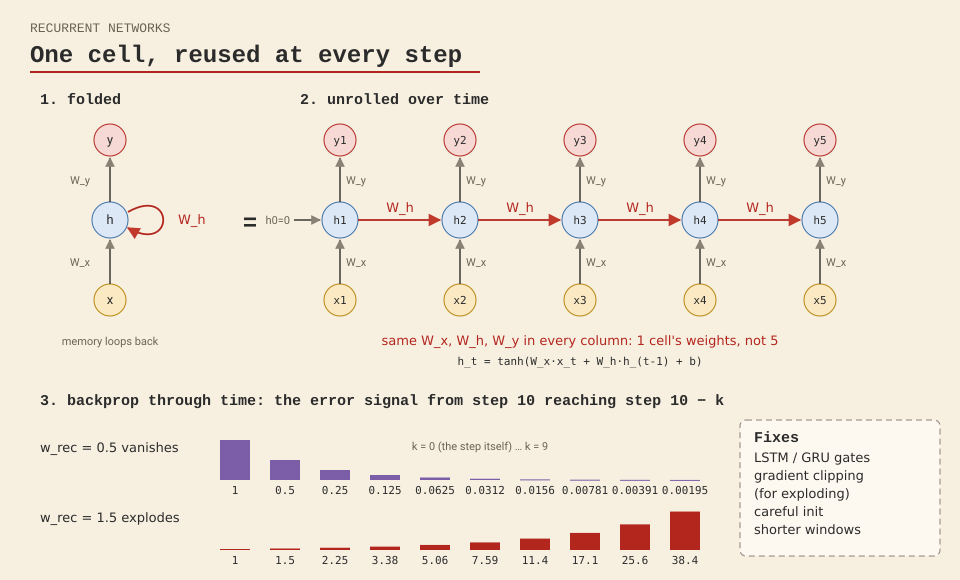
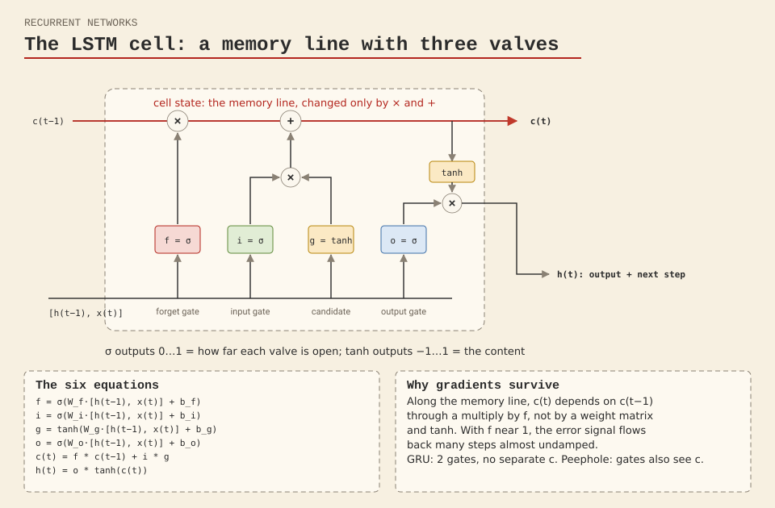

# Recurrent Neural Networks

> **How to read this note.** Study guide for *Deep Learning A-Z*, Part 3: section 11 (intuition), section 12 (a Keras LSTM that predicts Google's stock price) and section 13 (AWS time-series tools: two links to external workshops; see §5). Read §1–3 alongside the intuition lectures and §4 alongside the build lectures. The course's CSV files aren't bundled here, so §4 uses a synthetic random walk with an upward drift, the same length as the course's training data (1,258 trading days). The point of §4 is the baseline: run it before trusting any stock-prediction tutorial.

## Why This Exists

**Problem.** A dense network or a CNN sees one fixed-size input and forgets it immediately. Language, sensor readings and prices arrive as sequences, where what happened five steps ago changes what the current step means. RNN diagrams with loops and LSTM diagrams with a dozen arrows look intimidating, and the most famous demo — predicting stock prices — usually "works" for the wrong reason.

**Key insight.** An RNN is one small network applied at every time step, which passes a memory vector (the hidden state) to its next application. Training it means backpropagating through every step, multiplying by the same recurrent weights each time, so the error signal shrinks or blows up exponentially with distance. An LSTM adds a separate memory line that is updated by gated addition instead of repeated matrix multiplication, so information — and gradient — can survive many steps.

**Reach for this when:**
- Working through Deep Learning A-Z Part 3, or any LSTM time-series tutorial.
- You need to read LSTM/GRU equations, shapes (`batch, timesteps, features`) or parameter counts.
- A sequence model trains but you can't tell whether it learned anything beyond "repeat the last value".

**Don't reach for this when:**
- You're building a language model or translator today. Transformers replaced RNNs there — see [transformer-forward-pass](../math-for-ml/transformer-forward-pass.md).
- You want a serious forecast for business data. Start with naive and seasonal-naive baselines, exponential smoothing or gradient boosting on lag features; deep models earn their place only when they beat those.
- You want to "predict the stock market". Daily prices are close to a random walk; §4 shows what an LSTM really learns there.

## Diagrams





## 1. The idea: one network, reused along time

**The question.** How do you give a network memory without giving it a separate input slot for every past step?

Feed it two things at each step: the current input $x_t$, and its own previous summary $h_{t-1}$. It outputs a new summary $h_t$:

$$h_t = \tanh(W_x x_t + W_h h_{t-1} + b)$$

and, if needed, a prediction $y_t = W_y h_t$. The same $W_x$, $W_h$, $W_y$ are used at every step. Drawn with a loop it's the "folded" picture; copied once per time step it's the "unrolled" picture — a deep network whose layers share their weights. This is the same trick a CNN plays across space ([convolutional-neural-networks](convolutional-neural-networks.md)), played across time.

```python
import torch
torch.manual_seed(0)
rnn = torch.nn.RNN(input_size=1, hidden_size=3, batch_first=True)   # one layer, tanh, 3 hidden units
x = torch.tensor([[[0.5], [-1.0], [2.0], [0.0]]])                   # 1 sequence, 4 time steps, 1 feature
out, h_last = rnn(x)
Wx, Wh = rnn.weight_ih_l0, rnn.weight_hh_l0                          # the ONLY weights, reused at every step
b = rnn.bias_ih_l0 + rnn.bias_hh_l0
h = torch.zeros(3)
for t in range(4):                                                   # unroll by hand
    h = torch.tanh(Wx @ x[0, t] + Wh @ h + b)                        # new memory = f(input now, memory before)
    print(f"t={t} h={h.detach().numpy().round(3)}")
print("matches torch:", torch.allclose(h, h_last[0, 0]), "| weights:", sum(p.numel() for p in rnn.parameters()))
# Expected output:
# t=0 h=[-0.487  0.001 -0.128]
# t=1 h=[-0.327 -0.423  0.48 ]
# t=2 h=[-0.228  0.246 -0.703]
# t=3 h=[-0.535 -0.003  0.11 ]
# matches torch: True | weights: 18
```

Four steps, 18 weights, and the hand-unrolled loop matches PyTorch exactly. The network could process 4 steps or 4,000 with the same 18 weights.

**Input/output shapes.** Sequence models come in a few patterns:
- **many → one**: read a whole review, output one sentiment; read 60 days of prices, output tomorrow's.
- **one → many**: one image in (via a CNN), a caption out, word by word.
- **many → many**: translation (read the sentence, then write it), or a label per video frame.

## 2. Why plain RNNs forget: vanishing and exploding gradients

**The question.** If the network has memory, why can't a plain RNN learn that the word 30 steps ago decides the current one?

Training uses **backpropagation through time** (BPTT): unroll the network, compute the loss, and push the error back through every step. To reach step $t-k$ from step $t$, the error is multiplied by the recurrent weight (times the tanh slope, which is at most 1) $k$ times. With a single number for the recurrent weight, the signal after $k$ steps is roughly $w_{\text{rec}}^k$:

- $w_{\text{rec}} < 1$: the signal **vanishes**. Early steps get almost no gradient, so the network never learns long-range dependencies — and the later layers train on top of early layers that never learned.
- $w_{\text{rec}} > 1$: the signal **explodes**. Weight updates become enormous and training diverges (loss turns to NaN).

With matrices, the same holds for the size of $W_h$'s largest eigenvalue. The snippet shows the scalar version, then measures the real thing: how much the *last* output of a 100-step sequence depends on each input.

```python
import torch
for w in (0.5, 0.9, 1.0, 1.5):                       # the recurrent weight, as a single number
    print(f"w_rec={w}: gradient factor after 10 steps {w ** 10:9.4f}, after 50 steps {w ** 50:.1e}")
def lstm(forget_bias):
    torch.manual_seed(0); net = torch.nn.LSTM(1, 32, batch_first=True)
    with torch.no_grad(): net.bias_ih_l0[32:64] = forget_bias   # torch gate order i,f,g,o: slice 32:64 = forget gate
    return net
torch.manual_seed(0)
for name, net in (("RNN             ", torch.nn.RNN(1, 32, batch_first=True)),
                  ("LSTM            ", lstm(0.0)), ("LSTM f-bias = 3 ", lstm(3.0))):
    torch.manual_seed(0)
    x = torch.randn(1, 100, 1, requires_grad=True)   # one sequence of 100 steps
    out, _ = net(x)
    out[0, -1].sum().backward()                     # how much does the LAST output depend on each input?
    g = x.grad[0, :, 0].abs()
    print(f"{name}|d out_99/d x_t|  t=90: {g[90]:.0e}  t=50: {g[50]:.0e}  t=0: {g[0]:.0e}")
# Expected output:
# w_rec=0.5: gradient factor after 10 steps    0.0010, after 50 steps 8.9e-16
# w_rec=0.9: gradient factor after 10 steps    0.3487, after 50 steps 5.2e-03
# w_rec=1.0: gradient factor after 10 steps    1.0000, after 50 steps 1.0e+00
# w_rec=1.5: gradient factor after 10 steps   57.6650, after 50 steps 6.4e+08
# RNN             |d out_99/d x_t|  t=90: 6e-03  t=50: 1e-11  t=0: 1e-22
# LSTM            |d out_99/d x_t|  t=90: 5e-04  t=50: 1e-11  t=0: 1e-21
# LSTM f-bias = 3 |d out_99/d x_t|  t=90: 6e-02  t=50: 1e-02  t=0: 1e-02
```

Two lessons:
1. The plain RNN's sensitivity to inputs 50 steps back is $10^{-11}$: in practice, zero. That is vanishing gradient.
2. **An LSTM with default initialisation forgets just as fast.** Its forget gate starts around σ(0) = 0.5, so the memory line is multiplied by ~0.5 per step — the same $0.5^k$ decay. Set the forget-gate bias to 3 (gate ≈ 0.95) and the signal from 100 steps back is $10^{-2}$: nineteen orders of magnitude stronger. Keras does a milder version by default (`unit_forget_bias=True` adds 1); PyTorch doesn't.

Standard fixes: gated cells (LSTM, GRU) for vanishing; **gradient clipping** (`torch.nn.utils.clip_grad_norm_`, Keras `clipnorm=`) for exploding; sensible initialisation; and shorter windows when long memory isn't needed.

## 3. LSTM: a memory line with valves

**The question.** What's the smallest change that lets information travel many steps without being squashed by $W_h$ and tanh each time?

Give the cell a second state, the **cell state** $c_t$, that runs along the top of the diagram like a conveyor belt. It is never multiplied by a weight matrix. It only changes in two ways: an element-wise multiply (forget some of it) and an element-wise add (write something new). Three **gates** decide how much of each happens. Each gate is a sigmoid layer looking at $[h_{t-1}, x_t]$, outputting numbers between 0 (valve closed) and 1 (valve open):

| Gate | Formula | Job |
|---|---|---|
| forget $f_t$ | $\sigma(W_f [h_{t-1}, x_t] + b_f)$ | how much of the old memory to keep |
| input $i_t$ | $\sigma(W_i [h_{t-1}, x_t] + b_i)$ | how much of the new candidate to write |
| candidate $g_t$ | $\tanh(W_g [h_{t-1}, x_t] + b_g)$ | what could be written (−1 to 1) |
| output $o_t$ | $\sigma(W_o [h_{t-1}, x_t] + b_o)$ | how much of the memory to expose |

$$c_t = f_t \odot c_{t-1} + i_t \odot g_t \qquad h_t = o_t \odot \tanh(c_t)$$

($\odot$ is element-wise multiplication.) Read it as a sentence: *keep a fraction of the old memory, add a fraction of the new candidate, and show a filtered view of the result.*

**Example.** Translating "The boy who lived next to the station … was …": one slot of the cell state stores "subject is singular, masculine". It must survive the whole relative clause (forget gate ≈ 1, input gate ≈ 0 for that slot), then shape the verb and its ending (output gate opens). When a new subject appears, the forget gate drops the old one and the input gate writes the new one.

**Why the gradient survives.** Along the cell-state line, $\partial c_t / \partial c_{t-1} = f_t$ — a gate value, not a weight matrix pushed through tanh. When the network wants to remember, $f_t \approx 1$ and the error signal passes back nearly undamped.

The equations above are exactly what PyTorch computes:

```python
import torch
torch.manual_seed(0)
cell = torch.nn.LSTMCell(input_size=2, hidden_size=3)
x, h, c = torch.randn(2), torch.zeros(3), torch.zeros(3)
W = torch.cat([cell.weight_ih, cell.weight_hh], 1)          # one big matrix acting on [x, h_prev]
z = W @ torch.cat([x, h]) + cell.bias_ih + cell.bias_hh
i, f, g, o = z.chunk(4)                                     # torch's gate order: input, forget, candidate, output
i, f, g, o = torch.sigmoid(i), torch.sigmoid(f), torch.tanh(g), torch.sigmoid(o)
c_new = f * c + i * g                                       # forget some old memory, write some new
h_new = o * torch.tanh(c_new)                               # expose a filtered view of the memory
h_t, c_t = cell(x[None], (h[None], c[None]))
print("by hand == torch:", torch.allclose(h_new, h_t[0]), torch.allclose(c_new, c_t[0]))
count = lambda m: sum(p.numel() for p in m.parameters())
print("params, 50 units on 1 input:  RNN", count(torch.nn.RNN(1, 50)), " GRU", count(torch.nn.GRU(1, 50)),
      " LSTM", count(torch.nn.LSTM(1, 50)))
# Expected output:
# by hand == torch: True True
# params, 50 units on 1 input:  RNN 2650  GRU 7950  LSTM 10600
```

An LSTM has four weight blocks (f, i, g, o), so 4× the parameters of a plain RNN of the same width; a GRU has three.

**What LSTM units learn.** Karpathy's character-level experiments (shown in the course) found a few cells with readable jobs — one tracks position in the line and predicts the line break, one switches on inside quotes, one tracks nesting depth in code — but most cells have no human-readable meaning. Treat "this neuron detects X" as a lucky find, not the norm.

### Variants
- **Peephole connections** — each gate also sees the cell state ($c_{t-1}$, or $c_t$ for the output gate), so it can decide based on what's stored, not only on $h$.
- **Coupled forget/input gates** — use $i_t = 1 - f_t$: you only write as much as you forget.
- **GRU** (gated recurrent unit) — merges cell and hidden state into one $h_t$, with an *update* gate $z_t$ (the coupled forget/input decision) and a *reset* gate $r_t$ (how much past to use for the candidate): $h_t = (1 - z_t) \odot h_{t-1} + z_t \odot \tilde h_t$. Fewer parameters, often just as accurate. The large comparison by Greff et al. found no variant reliably beats the standard LSTM; the forget gate and output activation matter most.

## 4. The course's model: predicting a stock price

**The setup.** Google's daily *opening* price, 2012–2016 (1,258 trading days), to predict January 2017 (20 days). The steps:
1. Scale prices to [0, 1] with `MinMaxScaler`, **fitted on the training years only**.
2. Build windows: each sample is 60 consecutive days (about three months), and its target is day 61. Reshape to `(samples, 60, 1)` — batch, time steps, features.
3. Four stacked LSTM layers of 50 units, each followed by 20% dropout; every LSTM but the last returns its full sequence so the next one has something to read. Then `Dense(1)`.
4. Adam, mean squared error, 100 epochs, batch size 32.
5. To predict day $t$ of the test month, feed the *real* 60 days before it — so the last test windows include real January prices. Undo the scaling and plot real vs predicted.

The course's verdict: the prediction lags the real curve and misses sudden jumps but "follows the trend". Its stated goal is the trend, not exact prices. **The missing piece is a baseline.** Here the same model is trained on a random walk with drift — a series where, by construction, tomorrow's change is unpredictable — and compared with the dumbest possible forecast: *tomorrow = today*. The test period is 250 days instead of 20, so the scores aren't noise.

### PyTorch

```python
import numpy as np, torch, torch.nn as nn, matplotlib.pyplot as plt
from sklearn.preprocessing import MinMaxScaler
torch.manual_seed(0); rng = np.random.default_rng(2)
price = 300 + np.cumsum(0.3 + 4 * rng.standard_normal(1258 + 250))   # random walk with upward drift
train, test = price[:1258], price[1258:]                 # course: 1258 training days; we test on 250, not 20
sc = MinMaxScaler().fit(train[:, None])                  # fit on TRAIN only
s = sc.transform(price[:, None])[:, 0]
def windows(lo, hi):                                     # 60 past days -> next day
    X = np.stack([s[i - 60:i] for i in range(lo, hi)])
    return torch.tensor(X, dtype=torch.float32)[..., None], torch.tensor(s[lo:hi], dtype=torch.float32)
Xtr, ytr = windows(60, 1258); Xte, yte = windows(1258, len(price))   # test windows read REAL past prices
class Net(nn.Module):                                    # course: 4 stacked LSTM(50), dropout 0.2, Dense(1)
    def __init__(self):
        super().__init__(); self.lstm = nn.LSTM(1, 50, num_layers=4, dropout=0.2, batch_first=True)
        self.drop, self.out = nn.Dropout(0.2), nn.Linear(50, 1)
    def forward(self, x): return self.out(self.drop(self.lstm(x)[0][:, -1])).squeeze(1)   # last time step only
net = Net(); opt = torch.optim.Adam(net.parameters(), lr=1e-3)
for epoch in range(20):                                  # course: 100 epochs, batch 32
    for idx in torch.randperm(len(Xtr)).split(32):
        loss = ((net(Xtr[idx]) - ytr[idx]) ** 2).mean()
        opt.zero_grad(); loss.backward(); opt.step()
net.eval()
with torch.no_grad(): pred = sc.inverse_transform(net(Xte).numpy()[:, None])[:, 0]
naive = price[1257:-1]                                   # baseline: tomorrow = today
print("test days outside the training price range:", ((test > train.max()) | (test < train.min())).mean())
rmse = lambda p: np.sqrt(((p - test) ** 2).mean())
print(f"test RMSE  LSTM {rmse(pred):.2f}   naive yesterday {rmse(naive):.2f}")
up = np.diff(price[1257:]) > 0                           # did the price actually go up that day?
print(f"direction accuracy  LSTM {((pred > naive) == up).mean():.2f}   always 'up' {up.mean():.2f}")
print(f"LSTM error vs today {rmse(pred):.2f}  vs YESTERDAY {np.sqrt(((pred - naive) ** 2).mean()):.2f}")

plt.figure(figsize=(8, 3)); d = np.arange(190, 250)        # last 60 test days, zoomed in
plt.plot(d, test[d], "k", label="real"); plt.plot(d, pred[d], "r", label="LSTM"); plt.plot(d, naive[d], "b:", label="yesterday")
plt.legend(); plt.title("the LSTM draws a smoothed, lagging copy of the price"); plt.show()
# Expected output:
# test days outside the training price range: 0.0
# test RMSE  LSTM 7.05   naive yesterday 4.19
# direction accuracy  LSTM 0.58   always 'up' 0.49
# LSTM error vs today 7.05  vs YESTERDAY 6.60
```

Read the numbers:
- **The naive forecast wins**, 4.2 vs 7.1. The LSTM is *worse* than repeating yesterday's price.
- **The LSTM's output is closer to yesterday's price than to today's** (6.6 vs 7.1). It has learned to draw a smoothed copy of recent prices — a moving average. The plot shows it: the red line is the black line, delayed and blurred. That is what "it lags but follows the trend" means.
- **Direction accuracy 0.58** looks like skill but isn't: the daily changes here are independent random draws, so no model can predict them. With 250 days, the 95% range for pure luck is roughly 0.44–0.56; 0.58 is a mildly lucky sample (it stays at 0.58 across model seeds because it's a property of this price path, not the model). On 20 days, as in the course, anything from 0.3 to 0.7 is noise.

**Extrapolation failure.** Change `default_rng(2)` to `default_rng(0)`: that walk drifts above its training-period high, 82% of the test days fall outside the range the scaler saw, and the LSTM's RMSE jumps to about 61 against the naive 4. A MinMax-scaled LSTM learned to output values in roughly [0, 1]; it can't follow a price to a level it never saw. Predict *changes* (returns) instead of levels, and this problem — and most of the lag illusion — goes away.

### Keras

The course's model, almost line for line (with `keras.Input` instead of `input_shape=`, which Keras 3 prefers).

```python
import os; os.environ.setdefault("KERAS_BACKEND", "torch")
import numpy as np, keras
from sklearn.preprocessing import MinMaxScaler
keras.utils.set_random_seed(0); rng = np.random.default_rng(2)
price = 300 + np.cumsum(0.3 + 4 * rng.standard_normal(1258 + 250))   # same random walk as the torch version
train, test = price[:1258], price[1258:]
sc = MinMaxScaler().fit(train[:, None])                  # fit on TRAIN only
s = sc.transform(price[:, None])[:, 0]
X = np.stack([s[i - 60:i] for i in range(60, len(price))])[..., None]   # (samples, 60 timesteps, 1 feature)
y = s[60:]
Xtr, ytr, Xte = X[:1198], y[:1198], X[1198:]
model = keras.Sequential([keras.Input((60, 1))]
    + [l for k in range(4) for l in (keras.layers.LSTM(50, return_sequences=k < 3),   # last LSTM returns 1 vector
                                      keras.layers.Dropout(0.2))]
    + [keras.layers.Dense(1)])
model.compile(optimizer="adam", loss="mean_squared_error")
model.fit(Xtr, ytr, epochs=20, batch_size=32, verbose=0)   # course: epochs=100
pred = sc.inverse_transform(model.predict(Xte, verbose=0))[:, 0]
naive = price[1257:-1]
rmse = lambda p: np.sqrt(((p - test) ** 2).mean())
print(f"test RMSE  LSTM {rmse(pred):.2f}   naive yesterday {rmse(naive):.2f}   params {model.count_params()}")
# Expected output:
# test RMSE  LSTM 7.22   naive yesterday 4.19   params 71051
```

Same data, same 20 epochs × 38 batches, and the same conclusion: about 7 vs the naive 4. Seventy-one thousand parameters to lose to a one-line baseline.

### What the course's "evaluating" and "improving" lectures suggest
- **RMSE** on the test month (`sqrt(mean_squared_error(real, predicted))`), optionally divided by the price range to get a relative error. Good — but always next to the naive baseline's RMSE.
- **Improvements**: more training years (10 instead of 5), more time steps (e.g. 120), more input features (correlated stocks in the third axis), more LSTM layers, more units per layer. None of these fix the core issue: a model trained on levels learns persistence. Better experiments are: predict returns, compare with naive and moving-average baselines, and use walk-forward validation (train on the past, test on the next block, roll forward).

## 5. Section 13: AWS time-series tools

The AWS section is two short articles, each linking to a long external workshop video: one on **SageMaker Canvas** (a no-code UI that trains forecasting models from a CSV), one on **Amazon Forecast** (a managed forecasting service). The workshops are outside the course, so they aren't covered here. Note that AWS stopped onboarding new Amazon Forecast customers in 2024 and points to SageMaker Canvas instead. The same rule applies to both: compare whatever they produce with a naive baseline before using it.

## Trade-offs

- **RNN vs LSTM vs GRU.** Plain RNNs are cheap but forget within ~10 steps; LSTMs remember longer at 4× the parameters; GRUs sit between with 3×, and usually match LSTMs.
- **RNNs vs Transformers.** RNNs process one step at a time (slow to train, can't parallelise across time) but run in constant memory per step. Transformers parallelise and handle long contexts better, at quadratic cost in sequence length. For language, Transformers won; for small streaming signals, RNNs are still reasonable.
- **Window length.** Longer windows give more context but more steps to backprop through and fewer training samples. The course tried 1, 20, 30, 40 and 60 days by eye; tune it on validation data.
- **Deep models vs classical forecasting.** Classical methods are fast, explainable and strong on short univariate series. Deep models pay off with many related series, rich covariates, or lots of data.

## Common Pitfalls

- **No naive baseline.** The single most common mistake in price forecasting. If "tomorrow = today" beats your model, it learned nothing useful.
- **Mistaking lag for trend-following.** A prediction that looks like the real curve shifted right is the model echoing the last values. Compare against the shifted series.
- **Fitting the scaler on all data.** Leaks the test period's min and max into training. Fit on train, `transform` everything else (the course does this right).
- **Predicting price levels outside the training range.** Bounded outputs plus MinMax scaling can't extrapolate. Model returns or differences.
- **Judging on 20 test points.** One month of trading days can't separate skill from luck. Use a longer test period or walk-forward evaluation.
- **Tuning epochs and windows on the test month.** Makes the test set a validation set. Hold out a validation period.
- **Assuming LSTM fixes long memory automatically.** With PyTorch's default forget bias of 0 it decays like a plain RNN at first (§2). Initialise the forget bias to 1–3, or rely on training to learn it.
- **Exploding gradients without clipping.** A NaN loss in an RNN is usually this. Clip the gradient norm.
- **Wrong input shape.** Recurrent layers want `(batch, timesteps, features)` — the course reshapes to `(1198, 60, 1)`. PyTorch defaults to `(timesteps, batch, features)` unless `batch_first=True`.

## Decision Table

| Scenario | Use this | Not that | Why |
|----------|----------|----------|-----|
| Learning how RNNs work | §1 by-hand RNN + §3 LSTM cell | A big library model | You can check every equation |
| Long dependencies in a sequence | LSTM / GRU (forget bias ≥ 1) | Plain RNN | Plain RNN gradients vanish in ~10 steps |
| Loss becomes NaN in an RNN | Gradient clipping | Lower learning rate alone | Exploding gradients come from depth in time |
| Daily price forecasting | Naive / returns-based baselines, walk-forward test | Levels-in, levels-out LSTM | The LSTM learns lag and can't extrapolate |
| Business forecasting with many series | Gradient boosting on lags, or a forecasting library | Hand-rolled stacked LSTM | Stronger baselines, less tuning |
| Text: classification, translation, generation | Transformer | LSTM | Better accuracy, parallel training |
| Small model on a streaming sensor | GRU / LSTM | Transformer | Constant memory per step |

## References

- [Chris Olah — Understanding LSTM Networks (2015)](https://colah.github.io/posts/2015-08-Understanding-LSTMs/) — the diagrams most LSTM explanations (including the course's) are based on.
- [Andrej Karpathy — The Unreasonable Effectiveness of Recurrent Neural Networks (2015)](https://karpathy.github.io/2015/05/21/rnn-effectiveness/) · [Karpathy, Johnson & Fei-Fei — Visualizing and Understanding Recurrent Networks](https://arxiv.org/abs/1506.02078) — the interpretable-cell examples.
- Hochreiter & Schmidhuber — *Long Short-Term Memory*, Neural Computation 9(8), 1997 — the original LSTM.
- [Pascanu, Mikolov & Bengio — On the difficulty of training recurrent neural networks (2013)](https://arxiv.org/abs/1211.5063) — vanishing/exploding gradients and gradient clipping.
- [Greff et al. — LSTM: A Search Space Odyssey (2015)](https://arxiv.org/abs/1503.04069) — peepholes, coupled gates, GRU compared.
- [Cho et al. — Learning Phrase Representations using RNN Encoder–Decoder (2014)](https://arxiv.org/abs/1406.1078) — introduces the GRU.
- [Jozefowicz, Zaremba & Sutskever — An Empirical Exploration of Recurrent Network Architectures (ICML 2015)](https://proceedings.mlr.press/v37/jozefowicz15.html) — the forget-gate bias of 1.
- Goodfellow, Bengio & Courville — [*Deep Learning*, ch. 10: Sequence Modeling](https://www.deeplearningbook.org/contents/rnn.html).
- [Hyndman & Athanasopoulos — *Forecasting: Principles and Practice*, simple forecasting methods](https://otexts.com/fpp3/simple-methods.html) — naive, seasonal naive and drift baselines.
- [PyTorch `nn.LSTM`](https://docs.pytorch.org/docs/stable/generated/torch.nn.LSTM.html) · [Keras `LSTM` layer](https://keras.io/api/layers/recurrent_layers/lstm/)
- [Amazon SageMaker Canvas](https://docs.aws.amazon.com/sagemaker/latest/dg/canvas.html) · [Amazon Forecast](https://docs.aws.amazon.com/forecast/latest/dg/what-is-forecast.html)

## See Also

- [artificial-neural-networks](artificial-neural-networks.md) — Part 1: backprop, Adam, dropout, scaling without leakage.
- [convolutional-neural-networks](convolutional-neural-networks.md) — Part 2: weight sharing across space.
- [transformer-forward-pass](../math-for-ml/transformer-forward-pass.md) — attention, the architecture that replaced RNNs for language.
- [self-organizing-maps](self-organizing-maps.md) — Part 4.
