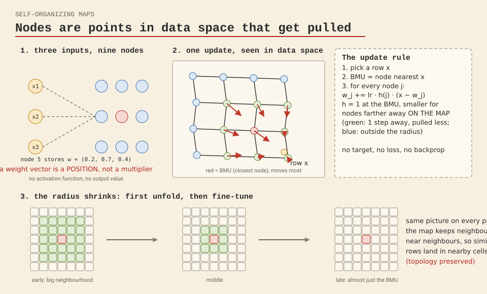
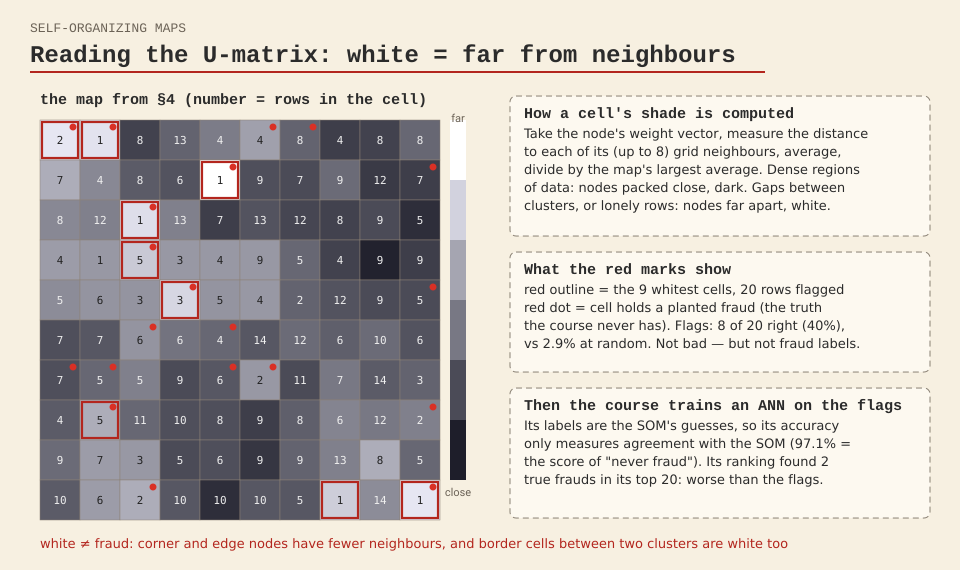

# Self-Organizing Maps

> **How to read this note.** Study guide for *Deep Learning A-Z*, Part 4: section 15 (intuition, including a K-Means refresher), section 16 (finding possible fraud in credit applications with MiniSom) and section 17 (the "mega case study": a SOM feeding an ANN). Read §1–3 alongside the intuition lectures, §4–5 alongside the build lectures. The SOM is written from scratch in numpy, because it's twenty lines and the point is to see there's no backprop. **Keras and PyTorch have no SOM layer** — the course uses the small MiniSom library (§4 shows its modern API), and Keras only appears for the ANN in §5. The course's credit table isn't bundled here, so §4 uses a synthetic 690-row table of the same shape with planted anomalies, so the flags can actually be scored. Install the extras once: `VIRTUAL_ENV=/Users/phahng/Desktop/workarea/.venv uv pip install keras minisom`.

## Why This Exists

**Problem.** A table with 15 columns can't be looked at. A SOM squeezes it onto a small 2-D grid of cells so that similar rows land in the same or neighbouring cells, and you can *see* clusters and outliers. But the vocabulary is confusing — weights that aren't multipliers, a network with no output, "learning" with no loss — and the course's fraud story ("white cells are the cheaters") skips the step where you'd check whether that's true.

**Key insight.** Each node of the grid is a point in the data space (its weight vector is its coordinates). Training repeatedly picks a row, finds the nearest node (the **best matching unit**), and pulls it — and, less strongly, its *grid* neighbours — toward the row. Because neighbours on the grid are pulled together, they end up near each other in data space too, so the grid becomes a flattened map of the data. The pull radius shrinks over time: first the map unfolds roughly, then it fits locally.

**Reach for this when:**
- Working through Deep Learning A-Z Part 4.
- You want a visual, 2-D overview of a mid-sized table (hundreds to tens of thousands of rows) — which rows are similar, where the gaps are.
- You want a first, unsupervised list of unusual rows for a human to review.

**Don't reach for this when:**
- You have labels. Train a classifier; it will beat any unsupervised flagging.
- You want a 2-D picture for exploration only. t-SNE and UMAP usually separate clusters more clearly; PCA is the fast, honest baseline.
- You want an anomaly score for production. Isolation Forest, a nearest-neighbour distance, or an autoencoder's reconstruction error ([autoencoders](autoencoders.md)) are standard and easier to calibrate.

## Diagrams





## 1. Warm-up: K-Means

The course revisits K-Means first because a SOM does something similar — points (centroids or nodes) get pulled toward data — so the K-Means picture makes the SOM easier to see.

**The question.** You have a cloud of points and believe there are $k$ groups. Where are they?

**The algorithm.**
1. Choose $k$.
2. Place $k$ centroids (randomly, or with k-means++).
3. Assign every point to its nearest centroid.
4. Move each centroid to the mean of its points.
5. Repeat 3–4 until no point changes cluster.

Each round can only lower the total squared distance from points to their centroids, the **within-cluster sum of squares**:

$$\text{WCSS} = \sum_{\text{clusters } c} \; \sum_{x \in c} \lVert x - \mu_c \rVert^2$$

### Choosing k: the elbow
WCSS always falls as $k$ grows (with one cluster per point it's 0), so you can't just minimise it. Plot it against $k$ and look for the **elbow**: the point after which extra clusters stop buying much.

```python
import numpy as np, matplotlib.pyplot as plt
from sklearn.cluster import KMeans
from sklearn.datasets import make_blobs
X, _ = make_blobs(n_samples=300, centers=4, cluster_std=1.0, random_state=0)   # 4 true groups
wcss = [KMeans(k, n_init=10, random_state=0).fit(X).inertia_ for k in range(1, 9)]   # inertia_ = WCSS
for k, w in zip(range(1, 9), wcss): print(f"k={k}  WCSS={w:7.0f}")
plt.plot(range(1, 9), wcss, "o-"); plt.xlabel("k"); plt.ylabel("WCSS"); plt.title("elbow at k = 4"); plt.show()
# Expected output:
# k=1  WCSS=   3193
# k=2  WCSS=   1515
# k=3  WCSS=    887
# k=4  WCSS=    541
# k=5  WCSS=    479
# k=6  WCSS=    419
# k=7  WCSS=    366
# k=8  WCSS=    320
```

From 3 to 4 clusters, WCSS drops by 346; from 4 to 5, by only 62 — the elbow is at 4, the true number. The elbow is a judgement call on real data; the silhouette score is a more objective second opinion.

### The random-initialisation trap
K-Means only finds a *local* optimum, and which one depends on where the centroids start. Two starting centroids inside the same true group can end up splitting it while two other groups get merged.

**k-means++** spreads the starting centroids out: the first is a random point, and each next one is chosen with probability proportional to its squared distance from the nearest centroid so far. It improves the odds; it doesn't guarantee the best answer. The real fix is **several restarts, keep the lowest WCSS** — what `n_init` does.

```python
import numpy as np
from sklearn.cluster import KMeans
from sklearn.datasets import make_blobs
X, _ = make_blobs(n_samples=300, centers=6, cluster_std=0.6, random_state=0)   # 6 tight groups
best = KMeans(6, n_init=50, random_state=0).fit(X).inertia_      # the good solution's WCSS
for init, n_init in (("random", 1), ("k-means++", 1), ("k-means++", 10)):
    runs = [KMeans(6, init=init, n_init=n_init, random_state=s).fit(X).inertia_ for s in range(200)]
    stuck = np.mean(np.array(runs) > best * 1.05)                 # ended in a clearly worse local optimum
    print(f"{init:9s} n_init={n_init:2d}: {stuck:5.1%} of runs stuck   worst WCSS {max(runs):4.0f} vs best {best:.0f}")
# Expected output:
# random    n_init= 1: 57.0% of runs stuck   worst WCSS  973 vs best 211
# k-means++ n_init= 1:  9.5% of runs stuck   worst WCSS  528 vs best 211
# k-means++ n_init=10:  0.0% of runs stuck   worst WCSS  211 vs best 211
```

## 2. How a SOM learns

### Weights are coordinates
Take 3 input columns and a 3×3 grid of 9 nodes. Every node is connected to all 3 inputs, so it has 3 weights — but those weights are not multiplied by the inputs and summed. They are the node's **position** in the 3-D data space: node 5 might sit at (0.2, 0.7, 0.4). A node is a "ghost row" trying to sit among the real rows. There's no activation function and no output value. (Nine nodes for three columns is still a reduction: the *map* is 2-D, whatever the number of nodes.)

### One update
1. Pick a row $x$.
2. Find the **best matching unit** (BMU): the node whose weight vector is closest to $x$ (Euclidean distance — so scale every column to [0, 1] first, or the widest column decides everything).
3. Move every node $j$ toward $x$:
   $$w_j \leftarrow w_j + \eta(t)\, h_j(t)\, (x - w_j), \qquad h_j(t) = \exp\!\left(-\frac{\lVert r_j - r_{\text{BMU}} \rVert^2}{2\sigma(t)^2}\right)$$
   where $r_j$ is node $j$'s (row, column) on the **grid**. The BMU gets $h = 1$; nodes one grid step away get less; far nodes get almost nothing.
4. Shrink the learning rate $\eta$ and the radius $\sigma$ a little, and repeat.

No target, no loss function, no backprop — just "move toward what you're closest to, and drag your neighbours along".

### Why the map keeps its shape
Because grid neighbours are always dragged together, nodes that are adjacent on the grid end up close in data space. So two rows that land in neighbouring cells are similar. That's **topology preservation**: the map is a crumpled sheet laid over the data, not a random scatter of centroids. A big radius early lets the whole sheet unfold; a small radius late lets each part fit its local data.

With 2 input columns you can watch it happen. Start with all 100 nodes bunched in the middle:

```python
import numpy as np, matplotlib.pyplot as plt
rng = np.random.default_rng(0)
X = rng.random((2000, 2))                                 # 2-D data so we can SEE the map: uniform square
R = C = 10
grid = np.array([(r, c) for r in range(R) for c in range(C)])   # each node's fixed (row, col) on the map
W = rng.random((R * C, 2)) * 0.1 + 0.45                  # node weights = node POSITIONS in input space, bunched up
def errors(W):
    d = ((X[:, None] - W[None]) ** 2).sum(-1)             # distance of every row to every node
    b1, b2 = d.argsort(1)[:, 0], d.argsort(1)[:, 1]      # best and second-best matching unit
    qe = np.sqrt(d[np.arange(len(X)), b1]).mean()        # quantisation error: how far rows are from their BMU
    te = (np.abs(grid[b1] - grid[b2]).max(1) > 1).mean() # topographic error: BMU and runner-up not neighbours
    return qe, te
print("before: quantisation %.3f  topographic %.2f" % errors(W))
T = 10000
for t in range(T):
    x = X[rng.integers(len(X))]                           # one random row
    bmu = ((W - x) ** 2).sum(1).argmin()                  # the node closest to it
    sigma, lr = 5.0 * (0.05 / 5.0) ** (t / T), 0.5 * (0.01 / 0.5) ** (t / T)   # both shrink over time
    h = np.exp(-((grid - grid[bmu]) ** 2).sum(1) / (2 * sigma ** 2))   # neighbourhood: 1 at BMU, fades on the MAP
    W += lr * h[:, None] * (x - W)                        # pull BMU and its map-neighbours toward x. No backprop.
print("after:  quantisation %.3f  topographic %.2f" % errors(W))
G = W.reshape(R, C, 2)
plt.scatter(*X.T, s=2, c="lightgray")
for k in range(R): plt.plot(*G[k].T, "b-", lw=0.8); plt.plot(*G[:, k].T, "b-", lw=0.8)   # map rows and columns
plt.title("the 10x10 map unfolds over the data"); plt.gca().set_aspect("equal"); plt.show()
# Expected output:
# before: quantisation 0.325  topographic 1.00
# after:  quantisation 0.037  topographic 0.00
```

- **Quantisation error** — average distance from each row to its BMU — drops from 0.33 to 0.04: the nodes spread out to cover the data.
- **Topographic error** — share of rows whose best and second-best nodes aren't grid neighbours — drops from 1.00 to 0.00: the grid is no longer tangled.

The plot shows the 10×10 grid stretched evenly over the square. With 15 columns you can't plot this, which is why SOMs are read through the U-matrix instead.

### SOM vs K-Means
Both move prototypes toward data. K-Means moves each centroid independently, so centroid 3 and centroid 4 have no relationship. A SOM moves nodes *together with their grid neighbours*, so the nodes are ordered: the map can be read as a picture. With the neighbourhood shrunk to zero, a SOM is essentially online K-Means with $k$ = number of nodes.

### Classic examples
The course shows a SOM of countries on ~40 World Bank quality-of-life indicators (rich countries at one corner, poorest at the other, colours then painted back onto a world map), a colour SOM (8 RGB colours self-arrange so similar colours sit together, in a different layout each run), and a map of US Congress voting records where the two parties separate. These show what SOMs are good for: arranging many-column records so a human can see structure.

## 3. Reading a SOM: the U-matrix

A trained 10×10 map has 100 nodes, each a 15-number vector. To see it, colour each cell by how far its node is from its grid neighbours — the **U-matrix** (unified distance matrix; the course calls it *mean inter-neuron distance*, MID; MiniSom's `distance_map()`):

- **Dark cell** — the node is close to its neighbours. It sits inside a dense region of data.
- **White cell** — the node is far from its neighbours. It sits in a gap: on the border between two clusters, or alone near a few unusual rows.

You can also mark each row's BMU, coloured by a known column (the course uses green squares for approved applications, red circles for rejected), to see whether the map's regions line up with it.

Two things the colour doesn't tell you:
- **White ≠ anomaly.** A ridge of white cells between two clusters is just a border. Corner and edge nodes have fewer neighbours, which also skews their score.
- **A cell's rows aren't equally odd.** A row's own distance to its BMU — its **quantisation error** — is a per-row anomaly score that needs no eyeballing.

## 4. The course's build: possible fraud in credit applications

**The setup.** 690 credit-card applications (the UCI *Statlog Australian Credit Approval* data): a customer ID, 14 anonymised attributes, and whether the application was approved. There are **no fraud labels**. The course's reasoning: frauds are unusual, unusual rows end up in white cells, so look there — and prioritise the ones that were *approved*.

The course's steps:
1. Scale all columns to [0, 1] with `MinMaxScaler`. (It includes the customer ID as a feature — an arbitrary number that shouldn't influence distances. Drop it.)
2. `MiniSom(x=10, y=10, input_len=15, sigma=1.0, learning_rate=0.5)`, `random_weights_init(X)`, `train_random(X, num_iteration=100)`.
3. Plot `distance_map()` with a colour bar, and draw each row's BMU as a marker coloured by approval.
4. Pick the white cells by eye, collect their rows with `win_map(X)`, and `inverse_transform` them to recover customer IDs.

Here the same pipeline runs on a synthetic table where 20 of the 690 rows are planted frauds (unusual values on a few attributes), so for once the flags can be checked. The cells are picked automatically — the whitest cells until they hold 20 rows — and the same budget of 20 rows is also chosen by quantisation error.

```python
import numpy as np
from sklearn.preprocessing import MinMaxScaler
rng = np.random.default_rng(0)                            # synthetic stand-in for the 690-row credit table
n, n_fraud = 690, 20
cls = rng.integers(0, 2, n)                               # Class: 1 = approved, 0 = not
A = rng.normal(0, 1, (n, 14)) + cls[:, None] * rng.normal(0, 1.5, 14)   # 14 anonymised attributes
fraud = np.zeros(n, bool); fraud[rng.choice(n, n_fraud, replace=False)] = True   # ground truth the course never has
A[fraud] += rng.choice([-3, 3], (n_fraud, 14)) * (rng.random((n_fraud, 14)) < 0.25)   # odd values on ~4 attributes
X = MinMaxScaler().fit_transform(A)                       # CustomerID left out on purpose
R = C = 10; grid = np.array([(r, c) for r in range(R) for c in range(C)])
W = X[rng.integers(0, n, R * C)].copy()                   # init nodes on random rows (like MiniSom random_weights_init)
T = 10000                                                 # course: num_iteration=100, i.e. 100 single rows
for t in range(T):
    x = X[rng.integers(n)]; bmu = ((W - x) ** 2).sum(1).argmin()
    d = 1 + t / (T / 2)                                   # MiniSom's default decay of sigma and learning rate
    h = np.exp(-((grid - grid[bmu]) ** 2).sum(1) / (2 * (1.0 / d) ** 2))   # sigma = 1.0
    W += (0.5 / d) * h[:, None] * (x - W)                # learning rate = 0.5
Wg = W.reshape(R, C, -1)
U = np.array([[np.mean([np.linalg.norm(Wg[r, c] - Wg[i, j]) for i in range(max(r - 1, 0), min(r + 2, R))
               for j in range(max(c - 1, 0), min(c + 2, C)) if (i, j) != (r, c)]) for c in range(C)] for r in range(R)])
U /= U.max()                                              # U-matrix (MiniSom's distance_map): mean distance to neighbours
dist = ((X[:, None] - W[None]) ** 2).sum(-1)
bmu = dist.argmin(1); qe = np.sqrt(dist.min(1))           # each row's winning node, and how far it is from it
order = np.argsort(U.ravel())[::-1]                       # cells from whitest to darkest
k = next(k for k in range(1, R * C) if np.isin(bmu, order[:k]).sum() >= n_fraud)   # whitest cells holding >= 20 rows
flag = np.isin(bmu, order[:k])                            # instead of picking cells by eye
print(f"base rate of fraud: {fraud.mean():.1%}  (= precision of flagging rows at random)")
print(f"U-matrix: {flag.sum()} rows in the {k} whitest cells, precision {fraud[flag].mean():.1%}, recall {fraud[flag].sum()}/{n_fraud}")
top = np.argsort(qe)[-flag.sum():]                        # same number of rows, ranked by distance to their own node
print(f"quantisation error: top {len(top)} rows, precision {fraud[top].mean():.1%}, recall {fraud[top].sum()}/{n_fraud}")
# Expected output:
# base rate of fraud: 2.9%  (= precision of flagging rows at random)
# U-matrix: 20 rows in the 9 whitest cells, precision 40.0%, recall 8/20
# quantisation error: top 20 rows, precision 55.0%, recall 11/20
```

Read the numbers:
- **Random flagging finds fraud 2.9% of the time.** Both SOM methods are far better than that — the idea works.
- **Ranking rows by their own quantisation error beats picking white cells** (55% vs 40%): it scores the row, not its neighbourhood, and needs no eyeballing.
- **On real data you can't compute these numbers.** Without labels, the course's list is a list of *unusual* applications. Whether they're fraud is for an investigator to decide.

### The course's code in modern MiniSom

MiniSom is now a pip package (the course copies an old `minisom.py` file). It has a `random_seed` argument — without it, the white cells move every run (the course's own picks change between lectures).

```python
import numpy as np
from minisom import MiniSom                               # pip install minisom
from sklearn.preprocessing import MinMaxScaler
rng = np.random.default_rng(0)
X = MinMaxScaler().fit_transform(rng.normal(size=(690, 14)))   # any 690 x 14 table scaled to [0, 1]
for iters in (0, 100, 10_000):                             # course: 100 iterations = only 100 single rows seen
    som = MiniSom(10, 10, input_len=14, sigma=1.0, learning_rate=0.5, random_seed=0)   # course settings + a seed
    som.random_weights_init(X)                             # start nodes on randomly chosen rows
    if iters: som.train_random(X, iters)
    print(f"{iters:>6} iterations: quantisation error {som.quantization_error(X):.3f}")
U = som.distance_map()                                     # U-matrix, scaled to max 1
cells = som.win_map(X)                                     # {(i, j): rows whose BMU is that node}
i, j = np.unravel_index(U.argmax(), U.shape)
print("whitest cell:", (int(i), int(j)), "| rows in it:", len(cells.get((i, j), [])), "| U shape:", U.shape)
# Expected output:
#      0 iterations: quantisation error 0.445
#    100 iterations: quantisation error 0.437
#  10000 iterations: quantisation error 0.395
# whitest cell: (3, 8) | rows in it: 5 | U shape: (10, 10)
```

Note what `num_iteration=100` means: 100 *single rows*, not 100 passes over the data. With 690 rows, the course's map has seen each row about once at most, and barely moved from its starting point. Use thousands of iterations (or `train(X, n, random_order=True)` for several passes).

## 5. The mega case study: SOM flags → ANN

**What the course does.** Re-run the SOM, take the rows in the white cells as "frauds", and create a column `is_fraud` (1 for those rows, 0 for the rest). Train a tiny ANN — 15 inputs (the attributes plus the approval column), 2 hidden units, a sigmoid output, batch size 1, 2 epochs — on all 690 rows, with no test split. Then rank every customer by the ANN's predicted probability of fraud.

**The catch.** The ANN's labels are the SOM's guesses — **pseudo-labels**, not ground truth. It can only learn to imitate the SOM, so its accuracy measures agreement with the SOM, and its ranking can't be better informed than the SOM itself.

```python
import os; os.environ.setdefault("KERAS_BACKEND", "torch")
import keras
import numpy as np
from sklearn.preprocessing import MinMaxScaler
rng = np.random.default_rng(0)                            # synthetic stand-in for the 690-row credit table
n, n_fraud = 690, 20
cls = rng.integers(0, 2, n)                               # Class: 1 = approved, 0 = not
A = rng.normal(0, 1, (n, 14)) + cls[:, None] * rng.normal(0, 1.5, 14)   # 14 anonymised attributes
fraud = np.zeros(n, bool); fraud[rng.choice(n, n_fraud, replace=False)] = True   # ground truth the course never has
A[fraud] += rng.choice([-3, 3], (n_fraud, 14)) * (rng.random((n_fraud, 14)) < 0.25)   # odd values on ~4 attributes
X = MinMaxScaler().fit_transform(A)                       # CustomerID left out on purpose
R = C = 10; grid = np.array([(r, c) for r in range(R) for c in range(C)])
W = X[rng.integers(0, n, R * C)].copy()                   # init nodes on random rows (like MiniSom random_weights_init)
T = 10000                                                 # course: num_iteration=100, i.e. 100 single rows
for t in range(T):
    x = X[rng.integers(n)]; bmu = ((W - x) ** 2).sum(1).argmin()
    d = 1 + t / (T / 2)                                   # MiniSom's default decay of sigma and learning rate
    h = np.exp(-((grid - grid[bmu]) ** 2).sum(1) / (2 * (1.0 / d) ** 2))   # sigma = 1.0
    W += (0.5 / d) * h[:, None] * (x - W)                # learning rate = 0.5
Wg = W.reshape(R, C, -1)
U = np.array([[np.mean([np.linalg.norm(Wg[r, c] - Wg[i, j]) for i in range(max(r - 1, 0), min(r + 2, R))
               for j in range(max(c - 1, 0), min(c + 2, C)) if (i, j) != (r, c)]) for c in range(C)] for r in range(R)])
U /= U.max()                                              # U-matrix (MiniSom's distance_map): mean distance to neighbours
dist = ((X[:, None] - W[None]) ** 2).sum(-1)
bmu = dist.argmin(1); qe = np.sqrt(dist.min(1))           # each row's winning node, and how far it is from it
order = np.argsort(U.ravel())[::-1]                       # cells from whitest to darkest
k = next(k for k in range(1, R * C) if np.isin(bmu, order[:k]).sum() >= n_fraud)   # whitest cells holding >= 20 rows
flag = np.isin(bmu, order[:k])                            # instead of picking cells by eye
flag = flag.astype("float32")                             # the SOM's flags become the "labels"  -> pseudo-labels
F = np.column_stack([X, cls])                             # course: attributes + Class (approved) as ANN input
keras.utils.set_random_seed(0)
ann = keras.Sequential([keras.Input((15,)), keras.layers.Dense(2, activation="relu"),
                        keras.layers.Dense(1, activation="sigmoid")])   # course: 2 hidden units, sigmoid out
ann.compile(optimizer="adam", loss="binary_crossentropy", metrics=["accuracy"])
ann.fit(F, flag, batch_size=1, epochs=2, verbose=0)       # course: batch 1, 2 epochs, no hold-out
p = ann.predict(F, verbose=0).ravel()
print(f"ANN accuracy vs SOM flags {((p > 0.5) == flag).mean():.1%}   'never fraud' scores {1 - flag.mean():.1%}")
top = np.argsort(p)[-20:]                                 # the course's output: customers ranked by p
print(f"precision vs TRUE fraud, top 20:  ANN ranking {fraud[top].mean():.0%}   SOM flags {fraud[flag > 0].mean():.0%}   random {fraud.mean():.0%}")
# Expected output:
# ANN accuracy vs SOM flags 97.1%   'never fraud' scores 97.1%
# precision vs TRUE fraud, top 20:  ANN ranking 10%   SOM flags 40%   random 3%
```

- **97.1% accuracy** sounds great, and is exactly what you'd get by predicting "not fraud" for everyone, because only 20 of 690 rows are flagged.
- **Its top 20 contains 2 true frauds**; the SOM's own flags held 8. Imitating a noisy labeller with a tiny network, from 2 epochs, loses most of what the labeller knew.

What the hybrid is *for*, honestly: turning the SOM's hard in/out flags into a smooth score you can apply to new applications. If you do that, at least compare it with the quantisation-error ranking (§4), which already gives a score, and get a few cases labelled by humans to measure precision.

## Trade-offs

- **SOM vs t-SNE/UMAP for visualisation.** A SOM gives a fixed grid you can colour by any column and reuse for new rows; t-SNE/UMAP usually separate clusters more clearly but give a scatter, not a grid, and distances between clusters mean little.
- **Grid size.** More nodes give finer detail but fewer rows per node, so the map gets noisy; a common rule of thumb is about $5\sqrt{n}$ nodes (≈130 for 690 rows, so 10×10 is reasonable).
- **sigma and learning rate.** A large starting radius unfolds the map and preserves topology; a small one (the course's 1.0 on a 10×10 grid) fits locally faster but can leave the map tangled. Check topographic error.
- **Picking cells by eye vs scoring rows.** Eyeballing is visual and explainable; scoring rows (quantisation error) is reproducible and, in §4, more precise.
- **Unsupervised flags vs labels.** No labels are needed — at the cost of not knowing whether the flags mean what you want.

## Common Pitfalls

- **Calling SOM outliers "fraud".** They're unusual rows. Without labels, it's a review list, not a fraud list.
- **Measuring a model trained on pseudo-labels against those same labels.** The accuracy is circular. Report the base rate and, if possible, precision on a hand-labelled sample.
- **No baseline.** "37 suspected frauds" means nothing without the random-pick rate and a simpler score to compare with.
- **Feeding ID columns into distance-based models.** The ID becomes a fake feature. Drop it before scaling.
- **Not scaling.** Euclidean distance on raw columns lets the widest column (income, say) decide every BMU. Scale to [0, 1] first.
- **No seed.** The map (and the white cells) change every run. Set `random_seed` — or better, rank rows by a score so the output doesn't depend on which cells you eyeball.
- **Too few iterations.** `num_iteration` counts single rows. 100 iterations on 690 rows is less than one pass.
- **Reading white cells as anomalies at the map's border.** Edges and corners have fewer neighbours, and inter-cluster ridges are white by construction.
- **K-Means with one start.** Use k-means++ *and* `n_init` > 1. scikit-learn's default `n_init="auto"` runs k-means++ only once, so set `n_init=10` explicitly.

## Decision Table

| Scenario | Use this | Not that | Why |
|----------|----------|----------|-----|
| Learning how SOMs work | numpy SOM on 2-D data (§2) | A library on 15 columns | You can watch the grid unfold |
| Visual overview of a mid-sized table | SOM + U-matrix, or UMAP | Raw scatter of two columns | Uses all columns at once |
| Unsupervised list of unusual rows | Quantisation error, Isolation Forest, kNN distance | White cells picked by eye | Reproducible per-row score |
| You have fraud labels | Supervised classifier, evaluated on a hold-out | SOM | Labels beat guesses |
| Turning SOM flags into a score | Quantisation error directly | ANN trained on the flags | Same information, no circular training |
| Number of K-Means clusters | Elbow + silhouette | WCSS alone | WCSS always falls with k |
| K-Means initialisation | k-means++ with n_init ≥ 10 | One random start | Random starts get stuck often |

## References

- Kohonen, T. — *The Self-Organizing Map*, Proceedings of the IEEE 78(9), 1990 — the original overview.
- [MiniSom on GitHub](https://github.com/JustGlowing/minisom) · [MiniSom on PyPI](https://pypi.org/project/MiniSom/) — the library the course uses.
- [Mat Buckland — Kohonen's Self Organizing Feature Maps (ai-junkie)](http://www.ai-junkie.com/ann/som/som1.html) — the colour-map tutorial and demo shown in the course.
- [Wikipedia — Self-organizing map](https://en.wikipedia.org/wiki/Self-organizing_map) · [U-matrix](https://en.wikipedia.org/wiki/U-matrix)
- [Nadieh Bremer — Self-organizing maps: creating hexagonal heatmaps](https://www.visualcinnamon.com/2013/07/self-organizing-maps-creating-hexagonal/) — the advanced SOM plots shown in the course.
- [UCI — Statlog (Australian Credit Approval)](https://archive.ics.uci.edu/dataset/143/statlog+australian+credit+approval) — the course's 690-row dataset.
- [Arthur & Vassilvitskii — k-means++: The Advantages of Careful Seeding (2007)](https://theory.stanford.edu/~sergei/papers/kMeansPP-soda.pdf)
- [scikit-learn — K-Means user guide](https://scikit-learn.org/stable/modules/clustering.html#k-means) · [`KMeans` API (init, n_init, inertia_)](https://scikit-learn.org/stable/modules/generated/sklearn.cluster.KMeans.html) · [silhouette analysis example](https://scikit-learn.org/stable/auto_examples/cluster/plot_kmeans_silhouette_analysis.html)

## See Also

- [artificial-neural-networks](artificial-neural-networks.md) — Part 1: the ANN reused in the mega case study.
- [autoencoders](autoencoders.md) — Part 6: reconstruction error as an alternative anomaly score.
- [boltzmann-machines](boltzmann-machines.md) — Part 5: another unsupervised model with no backprop in its classic form.
- [embedding-training](../ml-systems/embedding-training.md) — learning distance-meaningful representations when you do have a notion of similarity.
