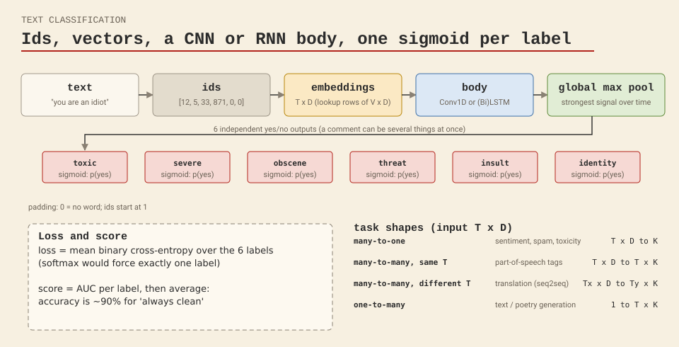

# Text Classification: Embeddings, 1D CNNs and RNNs

> **How to read this note.** Study guide for *Deep Learning: Advanced NLP and RNNs* (Lazy Programmer), section 2 (a review of embeddings, CNNs and RNNs built around the Kaggle Toxic Comments task), plus section 1 (welcome), section 7 (Keras basics) and the appendix (sections 9–13). Section 8 (course conclusion) holds a 4-minute "what to learn next" video without captions, a multiple-choice course test and an interactive role-play exercise; none of them is covered here. The course's Toxic Comments data needs a Kaggle download, so the snippets use a synthetic stand-in with the same shape: rare, overlapping labels triggered by particular words. Keras snippets run on the PyTorch backend. Later sections: [seq2seq-bidirectional-rnns](seq2seq-bidirectional-rnns.md), [rnn-attention](rnn-attention.md), [memory-networks](memory-networks.md). RNN and LSTM basics (vanishing gradients, the LSTM cell) are in [recurrent-neural-networks](recurrent-neural-networks.md).

## Why This Exists

**Problem.** Neural networks multiply numbers; text is strings of varying length. Between "here is a CSV of comments" and "a model that flags toxic ones" sit several steps — tokenizing, padding, embedding, choosing a body, choosing an output layer and a metric — and each has a default that silently breaks things (softmax on multi-label data, accuracy on imbalanced data, padding id collisions).

**Key insight.** Every text model is the same pipeline: **ids → embedding rows → a body that mixes information along time → pool to one vector → one output per label**. Only the body changes between a CNN and an LSTM; the data pipeline stays identical.

**Reach for this when:**
- Classifying sentences or documents with a small custom model (spam, sentiment, toxicity, intent).
- A text model's accuracy looks great and its predictions look useless.
- Reading Keras LSTM code and unsure what `return_sequences` / `return_state` return.

**Don't reach for this when:**
- You have a modest labelled set and want the best accuracy — fine-tuning a pretrained transformer (or an LLM) usually wins ([huggingface-open-models](../llm-engineering/huggingface-open-models.md)).
- The output is itself a sequence — see [seq2seq-bidirectional-rnns](seq2seq-bidirectional-rnns.md).

## Diagrams



## 1. From words to vectors

**Why not one-hot?** A one-hot vector per word works mechanically, but every word is equally far from every other — "great" is as close to "awful" as to "excellent". An **embedding** gives each word a dense vector of D numbers, learned so that words used similarly end up close together; directions can carry meaning (king − man + woman ≈ queen; see [generative-ai-and-prompting](../llm-engineering/generative-ai-and-prompting.md) §4).

**The embedding matrix** is V × D (vocabulary size by dimension), one row per word. Multiplying a one-hot vector by it just selects a row, so frameworks skip the multiplication and index directly:

```python
import numpy as np
texts = ["the movie was great", "the plot was awful", "great acting"]
vocab = {"<pad>": 0, "<unk>": 1}                         # 0 = padding, 1 = unknown word
for t in texts:
    for w in t.split(): vocab.setdefault(w, len(vocab))
def encode(t, T=5):                                      # words -> ids, then pad/truncate to length T
    ids = [vocab.get(w, 1) for w in t.split()][:T]
    return ids + [0] * (T - len(ids))
X = np.array([encode(t) for t in texts + ["awful acting by everyone"]])
print(X)
rng = np.random.default_rng(0)
W = rng.normal(size=(len(vocab), 3)).round(2)           # embedding matrix: V x D (here D = 3)
onehot = np.eye(len(vocab))[X[0]]                        # T x V one-hot rows
print("one-hot @ W equals row lookup:", np.allclose(onehot @ W, W[X[0]]))
print("embedded sentence shape (T x D):", W[X[0]].shape)
# Expected output:
# [[2 3 4 5 0]
#  [2 6 4 7 0]
#  [5 8 0 0 0]
#  [7 8 1 1 0]]
# one-hot @ W equals row lookup: True
# embedded sentence shape (T x D): (5, 3)
```

**The tokenizer conventions** the course relies on (Keras `Tokenizer` + `pad_sequences`): ids start at 1 because **0 means padding**; words beyond the vocabulary cap are dropped or mapped to an unknown id; every sequence is padded or cut to a fixed length T (the course: T = 100, vocabulary 20,000). So the embedding layer needs `vocab_size + 1` rows. Keras 3 (checked on 3.15.1) drops `Tokenizer` (`keras.preprocessing.text` is gone; use the `TextVectorization` layer), but `pad_sequences` survives as `keras.utils.pad_sequences`.

**Pretrained embeddings** (GloVe, word2vec) are transfer learning: fill the matrix with vectors trained on billions of words instead of random numbers. Words missing from the file get zero rows. The course freezes them (`trainable=False`) and notes that fine-tuning sometimes made results worse — try both. Modern practice: contextual embeddings from a transformer, where "bank" gets a different vector by the river and at the ATM.

## 2. A CNN body for text

A sentence is a T × D matrix — a one-dimensional signal with D channels, not an image. **Conv1D** slides filters along time only; each filter is a pattern detector over a few consecutive words ("you are an"). **Global max pooling** keeps each filter's strongest match anywhere in the text, so the position doesn't matter. Convolutions run in parallel over time and are much faster than RNNs.

**Multi-label output.** A comment can be toxic *and* obscene *and* an insult, so the course's six labels each get their own **sigmoid** (six logistic regressions sharing one body), trained with **binary cross-entropy** averaged over labels. Softmax would force exactly one label.

```python
import os; os.environ.setdefault("KERAS_BACKEND", "torch")
import numpy as np, keras
from sklearn.metrics import roc_auc_score
rng = np.random.default_rng(0); keras.utils.set_random_seed(0)
# Synthetic "toxic comments": 3 labels, each triggered (noisily) by its own cue words; most comments are clean.
V, T, N = 500, 40, 6000
cues = {0: [10, 11, 12], 1: [20, 21], 2: [30, 31, 32]}   # word ids for e.g. insult / threat / obscene
X = rng.integers(40, V, (N, T)); Y = np.zeros((N, 3), int)
for k, ws in cues.items():
    hit = rng.random(N) < [0.10, 0.04, 0.07][k]           # rare labels, like the real data
    pos = rng.integers(0, T, N)
    X[hit, pos[hit]] = rng.choice(ws, hit.sum()); Y[:, k] = hit & (rng.random(N) > 0.05)   # 5% label noise
Xtr, Xte, Ytr, Yte = X[:5000], X[5000:], Y[:5000], Y[5000:]
model = keras.Sequential([keras.Input((T,)), keras.layers.Embedding(V, 32),
    keras.layers.Conv1D(64, 3, activation="relu"),        # slides along time only
    keras.layers.GlobalMaxPooling1D(),                    # strongest match anywhere in the comment
    keras.layers.Dense(3, activation="sigmoid")])         # 3 independent yes/no outputs (multi-label)
model.compile("adam", "binary_crossentropy")
model.fit(Xtr, Ytr, epochs=5, batch_size=128, verbose=0)
P = model.predict(Xte, verbose=0)
print("per-label AUC:", [round(roc_auc_score(Yte[:, k], P[:, k]), 3) for k in range(3)])
print("accuracy of predicting 'clean' for everything:", (Yte == 0).mean().round(3), "-> accuracy misleads; AUC of a constant = 0.5")
# Expected output:
# per-label AUC: [0.994, 0.989, 0.998]
# accuracy of predicting 'clean' for everything: 0.932 -> accuracy misleads; AUC of a constant = 0.5
```

**The metric.** Predicting "clean" for everything is 93% accurate here — the real data is similarly imbalanced, which is why the course's ~97% accuracy says little. Score each label by **ROC AUC** (the probability that a random positive gets a higher score than a random negative; a constant scores 0.5) and average. The course computes its AUC on all the data including the training part, which inflates it; use a held-out split.

The course's settings: GloVe 100-d (frozen), three `Conv1D(128, 3)` layers with max pooling, global max pool, `Dense(128)`, `Dense(6, sigmoid)`; RMSprop, batch 128, 10 epochs, 20% validation.

## 3. An RNN body

**Why share weights over time?** For a 20-step sequence of 10-d inputs with 15 hidden units and 3 outputs, a plain feedforward net on the flattened input needs 78,000 weights; an RNN reusing the same weights at each step needs 420. Structure beats raw capacity.

**GRU equations**, checked by hand against PyTorch:

```python
import torch
torch.manual_seed(0)
D, M = 4, 3
cell = torch.nn.GRUCell(D, M)
x, h = torch.randn(1, D), torch.randn(1, M)
Wi, Wh = cell.weight_ih.view(3, M, D), cell.weight_hh.view(3, M, M)     # stacked as [reset, update, new]
bi, bh = cell.bias_ih.view(3, M), cell.bias_hh.view(3, M)
r = torch.sigmoid(x @ Wi[0].T + bi[0] + h @ Wh[0].T + bh[0])           # reset gate: how much past to use in the candidate
z = torch.sigmoid(x @ Wi[1].T + bi[1] + h @ Wh[1].T + bh[1])           # update gate
n = torch.tanh(x @ Wi[2].T + bi[2] + r * (h @ Wh[2].T + bh[2]))        # candidate state
h_new = (1 - z) * n + z * h                                            # PyTorch: z keeps the OLD state
print("by hand matches nn.GRUCell:", torch.allclose(h_new, cell(x, h), atol=1e-6))
T, D, M, K = 20, 10, 15, 3                                             # the course's example sizes
print("weights, flat net on all T*D inputs:", T * D * T * M + T * M * T * K, "  RNN (shared over time):", D * M + M * M + M * K)
# Expected output:
# by hand matches nn.GRUCell: True
# weights, flat net on all T*D inputs: 78000   RNN (shared over time): 420
```

The reset gate $r$ decides how much of the old state goes into the candidate $n$; the update gate $z$ blends old state and candidate. Watch the convention: in PyTorch (and the original paper) $z$ keeps the **old** state, $h' = (1 - z) n + z h$; the course writes the opposite. Both describe the same model. The LSTM adds a separate cell state and splits $z$ into forget and input gates ([recurrent-neural-networks](recurrent-neural-networks.md) §3); studies find GRU and LSTM roughly equal — try both.

**What a Keras LSTM returns** — the course's experiment, reproduced:

```python
import os; os.environ.setdefault("KERAS_BACKEND", "torch")
import numpy as np, keras
keras.utils.set_random_seed(0)
np_ = keras.ops.convert_to_numpy                                    # layer outputs may live on a GPU
x = np.random.default_rng(0).normal(size=(1, 8, 2)).astype("float32")     # N=1 sequence, T=8 steps, D=2 features
o, h, c = map(np_, keras.layers.LSTM(3, return_state=True)(x))                      # default: only the last output
print("return_state:            o", tuple(o.shape), " h", tuple(h.shape), " c", tuple(c.shape), " o == h:", np.allclose(o, h))
o, h, c = map(np_, keras.layers.LSTM(3, return_sequences=True, return_state=True)(x))
print("+ return_sequences:      o", tuple(o.shape), " last step of o == h:", np.allclose(o[:, -1], h))
o, h1, c1, h2, c2 = map(np_, keras.layers.Bidirectional(keras.layers.LSTM(3, return_sequences=True, return_state=True))(x))
print("Bidirectional:           o", tuple(o.shape), " forward h == o[last, :3]:", np.allclose(o[:, -1, :3], h1),
      " backward h == o[first, 3:]:", np.allclose(o[:, 0, 3:], h2))
# Expected output:
# return_state:            o (1, 3)  h (1, 3)  c (1, 3)  o == h: True
# + return_sequences:      o (1, 8, 3)  last step of o == h: True
# Bidirectional:           o (1, 8, 6)  forward h == o[last, :3]: True  backward h == o[first, 3:]: True
```

- `return_sequences=False` (default): only the last output, which *is* the final hidden state.
- `return_sequences=True`: one output per step (T × M); its last row is the final state.
- `return_state=True` adds the final $h$ (and $c$ for an LSTM). States are always the *last* step only.

**Task shapes** (diagram, table): many-to-one (classification: last state or max pool over time), many-to-many with the same length (tagging each word), many-to-many with different lengths (translation: seq2seq), one-to-many (generation). For classification the course max-pools over all steps: an early giveaway word may have faded from the last state.

The course's `lstm_toxic.py`: 50-d GloVe, `LSTM(15, return_sequences=True)` → global max pool → `Dense(6, sigmoid)`, Adam 0.01, 5 epochs. Slower than the CNN and slightly better; swapping in a bidirectional LSTM (section 3) gave a small further gain.

## 4. Keras basics (section 7) and the appendix

Section 7 is borrowed from another of the instructor's courses: the same small network written with the **Sequential** API (`model.add(Dense(...))`, `compile` with string names, `fit(..., validation_split=0.2)`, plot `history`) and the **functional** API (`x = Input(...)`, call layers on tensors, `Model(inputs, outputs)`). The functional API is the one this course needs: seq2seq, attention and memory networks all have several inputs or reuse layers. For TF2 the import changes from `keras` to `tensorflow.keras`; in Keras 3 standalone `keras` is back and runs on TensorFlow, JAX or PyTorch (`KERAS_BACKEND`).

The appendix (sections 9–13) is shared across the instructor's courses: environment setup (Anaconda, then pip), implementing each model yourself with a `fit`/`predict` class, "all data is the same" once it's an X/Y table, tuning learning rates in factors of 10 while watching the cost curve, a course-order roadmap, and pointers to Gym setup. Out of date: Theano/CNTK backends, Python 2 as an option, and the claim that deep learning on Windows needs a Linux VM.

## Trade-offs

- **CNN vs RNN body.** Fast, parallel, local patterns vs order-aware, longer-range, slower.
- **Frozen vs fine-tuned embeddings.** Robust with little data vs adapts to your domain but can overfit.
- **Fixed length T.** Simple batching vs truncated long texts and compute wasted on padding (masking or packed sequences fix the latter).
- **Max pooling vs last state.** Catches a decisive word anywhere vs keeps order information at the end.

## Common Pitfalls

- **Softmax for multi-label data.** Forces probabilities to compete; use one sigmoid per label.
- **Reporting accuracy on rare labels.** "Always clean" scores ~90%; report per-label AUC (or precision/recall) on held-out data.
- **Embedding size off by one.** Ids start at 1, so the layer needs `vocab_size + 1` rows.
- **Padding the wrong side without masking.** Post-padding feeds zeros after the text into an RNN's final state; pre-pad, mask, or pool.
- **Mixing up GRU gate conventions.** Formulas differ between sources by $z \leftrightarrow 1 - z$; check against your framework.
- **Copy-pasting TF1-era Keras.** `Adam(lr=...)`, `keras.preprocessing.text.Tokenizer` and Theano backends are gone in Keras 3; use `learning_rate=` and `TextVectorization` (padding code can stay, via `keras.utils.pad_sequences`).

## Decision Table

| Scenario | Use this | Not that | Why |
|----------|----------|----------|-----|
| Several labels can be true | One sigmoid per label + BCE | Softmax + CE | Labels don't compete |
| Rare positive labels | Per-label AUC / PR on held-out data | Accuracy | Imbalance hides failure |
| Short texts, speed matters | Conv1D + global max pool | LSTM | Parallel, nearly as good |
| Word order matters | (Bi)LSTM/GRU + max pool | Bag of words | Sees sequence |
| Small data, best accuracy | Fine-tune a pretrained transformer | Train from scratch | Transfer learning |
| Several inputs or shared layers | Keras functional API | Sequential | Sequential is one chain |

## References

- [Pennington et al. — GloVe (2014)](https://aclanthology.org/D14-1162/) · [Mikolov et al. — word2vec (2013)](https://arxiv.org/abs/1301.3781)
- [Kim — Convolutional Neural Networks for Sentence Classification (2014)](https://arxiv.org/abs/1408.5882)
- [Cho et al. — GRU / RNN encoder-decoder (2014)](https://arxiv.org/abs/1406.1078) · [Chung et al. — Empirical evaluation of gated RNNs (2014)](https://arxiv.org/abs/1412.3555)
- [Kaggle — Toxic Comment Classification Challenge](https://www.kaggle.com/competitions/jigsaw-toxic-comment-classification-challenge)
- [Keras — LSTM layer](https://keras.io/api/layers/recurrent_layers/lstm/) · [PyTorch — GRUCell](https://pytorch.org/docs/stable/generated/torch.nn.GRUCell.html)
- [lazyprogrammer/machine_learning_examples](https://github.com/lazyprogrammer/machine_learning_examples) — course code (`nlp_class3/`).

## See Also

- [recurrent-neural-networks](recurrent-neural-networks.md) — RNN/LSTM fundamentals and vanishing gradients.
- [convolutional-neural-networks](convolutional-neural-networks.md) — 2D convolution and pooling on images.
- [seq2seq-bidirectional-rnns](seq2seq-bidirectional-rnns.md) — section 3–4: bidirectional RNNs and encoder-decoders.
- [responsible-ai](../llm-engineering/responsible-ai.md) — toxicity filtering and bias in deployed classifiers.
