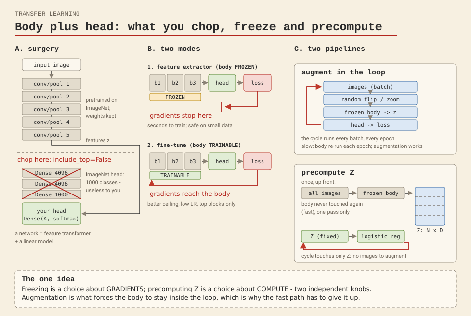
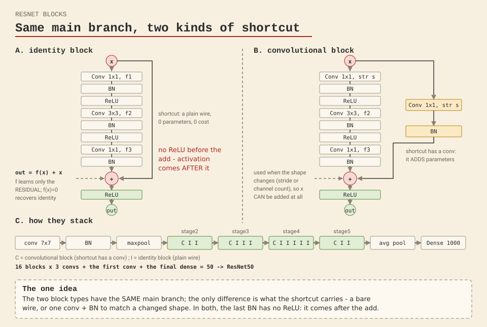

# Transfer Learning and CNN Architectures

> **How to read this note.** Study guide for *Deep Learning: Advanced Computer Vision (GANs, SSD, +More!)*, section 6 (VGG and transfer learning), section 7 (ResNet and Inception) and section 10 (class activation maps). This is the sequel to [convolutional-neural-networks](convolutional-neural-networks.md): that note builds a CNN from scratch, this one stops training bodies and starts borrowing them. Batch norm and optimisers are in [artificial-neural-networks](artificial-neural-networks.md). The course's own framing is "step *outside* the network": sections 1–5 are a review of neurons, ANNs and CNNs already covered in those two notes, and its shared logistics appendix is covered in [rl-foundations-mc-td](../reinforcement-learning/rl-foundations-mc-td.md) §5. The snippets here use small datasets that run on a laptop CPU in under a minute; they need `torch` and `scikit-learn` in the project venv.

## Why This Exists

**Problem.** Training a CNN from scratch needs a large labelled dataset and a lot of compute. Most real problems have neither — a few hundred photos of your own classes, and an afternoon. Meanwhile the network you *would* train would spend its first layers rediscovering edges and textures that a thousand other networks already learned.

**Key insight.** Any trained network is two pieces glued together: a **feature transformer** (the convolutional body) and a **simple linear model** (the final dense layer). The body is general — edges and textures are edges and textures regardless of whose camera took the photo — so you can download someone else's body and train only your own head. Everything else here is about which bodies are worth downloading and why they are shaped the way they are.

**Reach for this when:**
- You have a small or medium image dataset and need a classifier this week.
- You are choosing a backbone (VGG, ResNet, Inception, or a modern successor) and want to know what the architecture buys.
- A deep network trains *worse* than a shallower one and you want to know why skip connections fix it.
- You need to know *where* in the image your classifier is looking, without a detection dataset.
- You are reading code with `include_top=False`, `layer.trainable = False`, `preprocess_input`, `GlobalAveragePooling2D` or `1x1` convolutions in it.

**Don't reach for this when:**
- Your data is tabular. Nobody else has a CSV shaped like yours, so no pretrained weights exist — the course makes this point with its own e-commerce features (time on site, products viewed, referring site). Pretraining transfers for images, text and audio because the *domain* is shared, not because the task is.
- You need bounding boxes or masks as output. Class activation maps (§8) give a soft heatmap, not a detection model.
- You have millions of labelled in-domain images. Then training from scratch is competitive and you are no longer bottlenecked on labels.

## Diagrams


<!-- DIAGRAM SPEC: name=transfer-learning | panels: 3 side by side.
PANEL A "surgery": a left-to-right chain: input image -> [conv/pool body, drawn as 5 stacked blocks, shaded grey and labelled "pretrained on ImageNet"] -> dashed vertical scissors line labelled "chop here (include_top=False)" -> [3 dense blocks labelled "ImageNet head: 1000 classes - useless to you", drawn faded/greyed-out with an X] ; below the scissors line a new small block labelled "your head: Dense(K, softmax)" with an upward arrow joining the body output. Caption under panel: "a network = feature transformer + linear model".
PANEL B "two modes": the same body+head chain drawn twice, stacked. Top copy: body has a padlock icon and the label "frozen - trainable=False"; a backward arrow labelled "gradients" starts at the loss and STOPS at the body boundary (draw a small blocking bar). Label: "feature extractor: seconds to train, safe on small data". Bottom copy: no padlock; the backward gradient arrow passes all the way through the body, annotated "low LR, top blocks only". Label: "fine-tune: better ceiling, needs more data and care".
PANEL C "two pipelines": two boxes side by side. Left box titled "augment in the loop": a cycle arrow labelled "every batch, every epoch" around: image -> random flip/zoom -> frozen body -> z -> head -> loss; annotate "body re-run every epoch (slow), augmentation possible". Right box titled "precompute Z": a one-time arrow "once": all images -> frozen body -> matrix Z (draw a tall skinny N x D table) ; then a separate tight cycle around only: Z -> logistic regression -> loss, annotated "body never touched again (fast), no augmentation possible".
labels: use "->" for arrows, no superscripts.
the one idea it must land: freezing is a choice about gradients; precomputing is a choice about compute - and augmentation is what forces you to keep the body inside the loop. -->


<!-- DIAGRAM SPEC: name=resnet-blocks | panels: 2 side by side, same vertical layout so the single difference pops.
PANEL A "identity block": top node "x". Main branch straight down: [Conv 1x1 f1] -> [BN] -> [ReLU] -> [Conv 3x3 f2] -> [BN] -> [ReLU] -> [Conv 1x1 f3] -> [BN] -> circle node "+" -> [ReLU] -> bottom node "out". A curved shortcut arrow from "x" bypassing everything and entering the "+" node from the right; label the curve "shortcut: plain wire, 0 parameters". Annotate beside the last BN: "note: no ReLU here - the activation comes AFTER the add". Annotate the "+": "out = f(x) + x, so f only has to learn the RESIDUAL; f(x)=0 recovers identity".
PANEL B "convolutional block": identical main branch (add "stride s" on the first conv), but the curved shortcut now passes through two small boxes [Conv 1x1, stride s] -> [BN] before reaching the "+". Label the curve "shortcut: 1 conv + 1 BN -> this block DOES add parameters". Annotate: "used when shape changes (stride or channel count), so x can be added at all".
Bottom strip spanning both panels: a horizontal chain "conv -> BN -> maxpool -> [C,I,I] -> [C,I,I,I] -> [C,I,I,I,I,I] -> [C,I,I] -> global avg pool -> Dense 1000", with a legend "C = conv block, I = identity block" and the annotation "16 blocks x 3 convs + first conv + final dense = 50".
labels: ASCII only, use "->".
the one idea it must land: the two block types differ only on the shortcut branch, and the final ReLU always sits after the addition. -->

## 1. Transfer learning: a network is a body plus a head

**The question.** VGG16 was trained to tell 1000 ImageNet classes apart. You want food vs non-food. What part of VGG16 is worth anything to you?

Look at the last layer of any classifier. It takes a vector and produces class scores through a single matrix multiply and a softmax — it is **logistic regression**. Everything before it exists only to turn a photo into the vector that logistic regression can separate. So:

$$\hat{y} = \underbrace{\text{softmax}(W z + b)}_{\text{linear model}}, \qquad z = \underbrace{\text{body}(x)}_{\text{feature transformer}}$$

The head is specific to ImageNet's label set, and an "airplane" output is guaranteed wrong on a cats-vs-dogs problem. The body is not specific to anything: it was fitted on millions of photos to produce features that make *visual* categories linearly separable. So **chop off the head** and keep the body. In Keras that is the `include_top=False` argument; in torchvision you replace `model.fc` with your own layer.

The course's best framing for this is a CSV. Imagine each image is a row in a spreadsheet (MNIST really is stored that way). Feature transformation turns one CSV into a different CSV — the same thing TF-IDF does to documents or an RBF kernel does to coordinates. Here the transformer happens to be VGG. Taken literally, that means script 1 pushes all your images through VGG and writes out a new CSV of feature vectors, and script 2 fits a classifier on it — and script 2 can be pure scikit-learn, with no deep-learning library in sight. That is not an analogy; it is §2's "approach 2" verbatim.

**Why this helps most when labels are scarce.** Write your data as $N \times D$: $N$ samples, $D$ features. A linear model has $D$ parameters, a deep net has far more, and you want the matrix "skinny rather than fat" — $D \ll N$. Transfer learning helps on both axes at once. It is *as if* you had augmented your $N$ images with the millions that trained the body, and the body's output is lower-dimensional than raw pixels, so the model you actually fit has few parameters and little room to overfit.

Does that actually show up in numbers? This snippet pretrains a small convolutional body on handwritten digits 0–4, then throws the head away and fits plain logistic regression on digits 5–9 — classes the body has never seen — at four different labelled-set sizes. Three feature sets compete: raw pixels, the *same* convolutional architecture left untrained, and the pretrained body.

```python
import numpy as np, torch, torch.nn as nn
from sklearn.datasets import load_digits
from sklearn.linear_model import LogisticRegression
torch.manual_seed(0); torch.set_num_threads(1)
d = load_digits(); X = torch.tensor(d.data / 16.0, dtype=torch.float32).reshape(-1, 1, 8, 8)
y = torch.tensor(d.target)
src, tgt = y < 5, y >= 5                                       # pretrain on digits 0-4, transfer to 5-9
conv = lambda: nn.Sequential(nn.Conv2d(1, 16, 3, padding=1), nn.ReLU(), nn.MaxPool2d(2), nn.Flatten())  # -> 16*4*4
body = conv(); net = nn.Sequential(body, nn.Linear(256, 5))
opt = torch.optim.Adam(net.parameters(), 1e-3)
for _ in range(300):                                           # train on the source task only
    opt.zero_grad(); nn.functional.cross_entropy(net(X[src]), y[src]).backward(); opt.step()
torch.manual_seed(1); rand_body = conv()                       # same shape, never trained
Xt, yt = X[tgt], (y[tgt] - 5).numpy()
with torch.no_grad():
    feats = {"raw pixels": Xt.flatten(1).numpy(), "random conv": rand_body(Xt).numpy(), "pretrained conv": body(Xt).numpy()}
rng = np.random.default_rng(0)
print(f"{'labelled target examples':26s}" + "".join(f"{k:>18s}" for k in feats))
for n in (10, 25, 50, 400):
    row = {}
    for k, F in feats.items():                                 # average over 20 random small training sets
        accs = []
        for rep in range(20):
            idx = rng.permutation(len(Xt)); tr, te = idx[:n], idx[n:]
            accs.append(LogisticRegression(max_iter=3000).fit(F[tr], yt[tr]).score(F[te], yt[te]))
        row[k] = np.mean(accs)
    print(f"{n:<26d}" + "".join(f"{row[k]:18.3f}" for k in feats))
print("with plenty of labels everything works; the pretrained body wins when labels are scarce,")
print("which is the whole point of transfer learning (and note random conv features are no help)")
# Expected output:
# labelled target examples          raw pixels       random conv   pretrained conv
# 10                                     0.639             0.639             0.690
# 25                                     0.837             0.846             0.863
# 50                                     0.919             0.915             0.927
# 400                                    0.971             0.980             0.982
# with plenty of labels everything works; the pretrained body wins when labels are scarce,
# which is the whole point of transfer learning (and note random conv features are no help)
```

Two lessons, both of them the point of the section. First, **transfer pays exactly when labels are scarce**: with 10 labelled examples the pretrained features reach about 0.69 accuracy against roughly 0.64 for raw pixels, and by 400 labels all three feature sets land around 0.97–0.98. The pretrained body did not make the problem *solvable*; it made it solvable sooner. If you have plenty of in-domain labels, the ceiling is the same and you have bought nothing. Second, **the untrained convolutional body is no help at all** — it scores like raw pixels. Convolution is not magic; the *weights* are the asset, and they came from the source task. (The same argument, one generation earlier: the course points out that greedy layer-wise pretraining with stacked autoencoders — train a shallow autoencoder, chop off its decoder, keep the encoder as layer 1, repeat — offered the identical head-only/fine-tune/both choice. See [autoencoders](autoencoders.md).)

## 2. Freeze or fine-tune

Chopping off the head leaves one ambiguity: may gradient descent flow *into* the borrowed weights?

- **Frozen feature extractor.** The body is read-only (`layer.trainable = False`, or `ptm.trainable = False` in one line for the whole model). Only your head learns, so you are fitting a logistic regression on top of fixed features. Trains in seconds. This is the right default on small datasets.
- **Fine-tuning.** Unfreeze the body and let gradients reach it. Higher ceiling, because the features adapt to *your* domain — but you are now training the whole network, with the cost and the overfitting risk that implies.

The course says fine-tuning "will probably lead to better results". **That is too flat to follow as advice.** On a small dataset, unfreezing everything at a normal learning rate destroys the pretrained features in the first few batches — the head is random, so the first gradients are large and arbitrary, and they get backpropagated straight into weights that took weeks of GPU time to find. The practice that actually works, and which the course mentions as a variation without saying the crucial part:

1. Freeze the body, train the head to convergence. (Now the head's gradients are small and sensible.)
2. Unfreeze only the **top** block or two — the layers holding domain-specific features, not the universal edge detectors at the bottom.
3. Continue at a **much lower learning rate** (an order of magnitude or more below step 1).

**The batch-norm trap.** `layer.trainable = False` in TensorFlow 2 does something the lectures never mention: it also puts batch-norm layers into **inference mode**, so they use their stored ImageNet running statistics instead of your batch's. While the body is frozen that is exactly what you want. The moment you unfreeze for fine-tuning it matters a great deal, because the batch-norm layers start updating their running means from your (possibly tiny) batches and the features shift under the head. The usual fix is to keep batch-norm layers frozen even during fine-tuning. Batch norm itself is in [artificial-neural-networks](artificial-neural-networks.md).

**Two pipelines, and why augmentation decides.** Separate from the freeze question is an engineering one. A frozen body of hundreds of layers is still expensive to *evaluate*. The training loop is: compute $z = \text{body}(x)$, compute $\hat{y}$ from $z$, take the gradient with respect to the head's $W$ and $b$ only, update. Since the body never changes, $z$ never changes either — so recomputing it every epoch is pure waste.

- **Approach 1 — body inside the loop.** Keep the whole model together and let a data pipeline hand it augmented images. Slow: the features are recomputed every batch of every epoch. Still far faster than training the body, and may generalise better thanks to the augmentation.
- **Approach 2 — precompute the feature matrix.** Run every image through the body **once**, store the resulting $N \times D$ matrix, and then train only a linear model on it. Extremely fast, and at that point any tabular model works — logistic regression, random forest, gradient boosting, an SVM.

The catch is that these are not freely interchangeable. Augmentation perturbs each image on every pass, so $x$ differs each epoch, so $z$ differs, so **precomputation is impossible the moment you augment**. The course's own measurement makes the cost concrete: pushing its Food-5K training and validation sets through frozen VGG16 took about 55 s and 32 s respectively — and approach 1 pays that on every epoch. Its conclusion after trying both on the same data: the precomputed version was "a lot faster" with accuracy "just as good", so the augmentation was not earning its keep there. Which is the real advice — try both.

Two gotchas in the precompute path that cost real debugging time:

- **Do not shuffle the dataset you precompute from.** You traverse it twice (once inside `predict` to get `X`, once in a loop to collect `y`), and a `tf.data` shuffle reshuffles on *every* pass, so your features and labels end up misaligned. Silent, and it produces a model that trains to chance. The same bug wrecks confusion matrices, which is why the course keeps a separate unshuffled copy of the training set just for evaluation.
- **Standardise the features before the linear model.** Post-ReLU features have a minimum of exactly 0 and a long right tail; `StandardScaler` on them is a one-liner and helps the optimiser.

## 3. Data augmentation, chosen for the dataset

Images are the one data type where inventing samples is honest: a flipped, rotated, slightly zoomed cat is still a cat. (Invent a row of tabular data and you have encoded your own assumptions as if they were observations.) Modern Keras does this with preprocessing **layers** — `RandomFlip`, `RandomRotation`, `RandomZoom`, `RandomTranslation` — placed inside the model right after the input, where they are automatically no-ops at inference time. The older `ImageDataGenerator` is removed in Keras 3; the mechanics are in [convolutional-neural-networks](convolutional-neural-networks.md) §5.

What matters here is that **the transformations must be ones your label survives**. The course's fruit classifier flips horizontally *and vertically*, with the explicit justification that a fruit has no canonical orientation. The same vertical flip on handwritten digits turns a 9 into a 6 and poisons the labels. This is the part you cannot copy from a tutorial: you have to know what your classes mean. Note also that the course never states the magnitudes it uses ("I just chose these randomly for this course"), so there are no numbers here to borrow.

## 4. VGG: more of the same, and the preprocessing trap

VGG (Visual Geometry Group, Oxford, 2014) is deliberately unexciting: it is LeNet's recipe with the blocks repeated more times. Conv, conv, pool; conv, conv, pool; then three repeats of conv, conv, conv, pool; then three fully connected layers. Thirteen convolutions and three dense layers make **VGG16**; VGG19 is the deeper sibling. Only three component types appear in the whole network — convolution, pooling, dense — so nothing in it needs explaining beyond [convolutional-neural-networks](convolutional-neural-networks.md). It did well at ImageNet classification *and* localisation (drawing a box around the object), on a benchmark of 1000 classes and millions of images.

The course's point is blunt: the architecture is not why VGG matters. **The pretrained weights are.** Training time is the bottleneck in deep learning, open-sourced weights remove it, and Keras ships them behind one function call (`weights='imagenet'` downloads them on first use).

How the course swaps the head, as a functional model:

`Input` → `preprocess_input` → augmentation layers → **frozen VGG16 body** → `Flatten` → `Dense(K, activation='softmax')`

Three details in that chain are worth more than they look.

- **`preprocess_input` is part of the model here.** It can be a layer inside the graph or a function applied to the data; inside is tidier, because then anyone who loads your model gets the preprocessing automatically and cannot forget it.
- **Each backbone has its own `preprocess_input`, and they are not compatible.** VGG's (ported from the original Caffe weights) reorders RGB to BGR and subtracts per-channel ImageNet means; ResNet's and Inception's differ. Using the wrong one is the nastiest failure mode in this whole note because **it is silent**: the model still trains, still reports plausible accuracy, and is simply worse than it should be. No exception, no warning.
- **`Flatten` locks the input size.** The body outputs an image (convolutions and pooling only), so you flatten before the dense head — but the flattened length depends on the input dimensions, which is why the course must fix an input size up front. §7 is the fix the course teaches and then never applies to its own code.

The course uses 200×200 inputs for food and 100×100 for fruit rather than VGG's native 224×224. That is legal — `include_top=False` removes the only size-dependent layer — but worth knowing that ImageNet's preprocessing statistics and the network's receptive fields were tuned at 224×224, so small inputs give somewhat weaker features.

**Results the course reports.** Food-5K (3000 training files, 1000 validation files, two classes), frozen VGG16 with augmentation, 10 epochs: about 99% training and 98% validation accuracy. The precomputed-features version of the same problem: about 98% validation. On 60-class Fruits-360, frozen ResNet50 reached about 99% train / 96% validation, while swapping in VGG16 gave about 92%, peaking around 94–95%, with visible overfitting — and despite being the smaller network, **VGG16 took longer to train**.

**Is VGG still the default in 2026? No.** The course's "VGG just seems to work better" was defensible around 2018 and is still true for one specific job — perceptual and style losses, where VGG features behave better than newer networks' for reasons nobody has explained properly. For plain transfer learning it is obsolete: ResNet, ConvNeXt and EfficientNet are better per parameter, and ViT or a CLIP-style encoder is the normal frozen backbone now. VGG16's roughly 138 million parameters (most of them in those three dense layers) are a lot to carry for what they return.

## 5. Why depth alone stopped working: ResNet

**The problem.** "Deeper is better" has a limit, and past it performance does not plateau — it **degrades**. A 56-layer plain network can score worse than a 20-layer one, on the *training* set, so it is not simple overfitting.

**Why that is surprising.** Take a network that works. Append extra layers that compute the identity function, $f(x) = x$. The output is unchanged, so the deeper network must perform *exactly* as well. Append more identity layers; still unchanged. So a deeper network should never be worse than a shallower one, because the extra capacity could always do nothing. The course calls the theoretical learnability of the identity the most important fact in the section, and it is: the degradation is therefore not an **expressiveness** failure but an **optimisation** failure. All the weights are trained at once, and in practice a block of convolutions does not find the identity on its own.

**The fix, in one line.** Draw a wire from the block's input to its output, so the block computes

$$\text{out} = f(x) + x$$

Now the identity costs the block nothing: it only needs $f(x) = 0$, which is what weight decay and random small weights are already pushing it towards. And if the block *can* do better than identity, $f$ is still there to learn with. At worst identity, at best better. The block learns only the **residual** — the mapping you want minus the input you already have. The block has a **main branch** (the real layers) and a **shortcut branch** (the wire). The course notes "skip connection" as a synonym and then declines to use it; the rest of the field uses it constantly, so learn both names.

**Where batch norm and the activations sit.** This is the detail people get wrong when writing a block from memory:

$$x \;\rightarrow\; W \rightarrow \text{BN} \rightarrow \text{ReLU} \rightarrow W \rightarrow \text{BN} \;\rightarrow\; (+\,x) \;\rightarrow\; \text{ReLU}$$

Two ReLUs, and **the second one comes after the addition**, not before. Batch norm goes on every main-branch convolution, before its activation — which also means the convolutions need no bias terms, since batch norm's learned shift subsumes them.

**Identity block vs convolutional block.** ResNet's real blocks have three convolutions on the main branch (1×1 to reduce channels, 3×3 to do the work, 1×1 to restore them — the bottleneck idea of §6), with the third's activation deferred past the addition. They come in two flavours that differ *only* on the shortcut:

- **Identity block** — the shortcut is a bare wire. Requires the main branch to return the input's exact shape, which `same`-mode convolutions give you for free.
- **Convolutional block** — the shortcut carries **one convolution plus one batch norm**, used whenever the shape changes (a stride, or a different channel count), so that `+ x` is even defined. Still a shortcut: fewer operations than the main branch. In the general case you are multiplying $x$ by some $W_s$; that can be a learned projection or, in the degenerate case, an identity with zero padding.

**ResNet50's layout**, and where the 50 comes from:

conv → BN → max pool → [conv block + 2 identity] → [conv block + 3 identity] → [conv block + 5 identity] → [conv block + 2 identity] → **global average pooling** → dense(1000)

Sixteen residual blocks × 3 convolutions = 48, plus the opening convolution and the final dense layer = **50**. The count deliberately ignores batch norm and pooling layers even though batch norm has parameters, because only convolutions and dense layers are counted by convention. ResNets of 100 and 1000+ layers exist. The course notes ResNet50 is over three times deeper than VGG16, and quotes from the paper that a 34-layer ResNet needs about **18% of the operations** of a 19-layer VGG.

**One claim to correct.** The course says residual connections add "zero new parameters". That is true of the identity block — a wire has no weights — and **false for the convolutional block the same lecture defines**, whose shortcut has its own convolution and batch norm. Say "identity shortcuts are free" and you are right.

**And one claim to deepen.** Explaining degradation purely as "a block cannot learn the identity" is close to the paper's own framing but incomplete. The modern account adds that the shortcut gives gradients a short path back to early layers and that residual networks have a measurably smoother loss landscape. Note that the paper's experiments already used batch norm, so plain vanishing gradients are not the story. The follow-up paper (*Identity Mappings in Deep Residual Networks*) studies where exactly to put the activations and argues for a "pre-activation" ordering different from the one above — worth reading if you are writing blocks by hand.

## 6. 1×1 convolutions and Inception

**What a 1×1 convolution is.** On a single-channel image it looks pointless: multiply every pixel by one number. The point only appears once the input has channels. Convolution with a $1 \times 1$ kernel over a tensor with $C_1$ channels takes the length-$C_1$ vector at each pixel and dots it with a length-$C_1$ filter — and since a dot product followed by a nonlinearity *is* logistic regression, a 1×1 convolution is a tiny neural network applied independently to every pixel. With $C_2$ filters, each input pixel is multiplied by a $C_1 \times C_2$ matrix to give a length-$C_2$ output pixel. So:

> A 1×1 convolution is a dense layer with its weights shared across spatial positions.

That is exactly the motivation in the paper the idea comes from, *Network in Network*. Two payoffs: cheap channel mixing (next paragraph), and — the reason the course flags it as an SSD prerequisite — running one little classifier over every sub-image **in parallel**, so a "cat finder" scans all positions at once instead of looping over crops.

(Small correction in passing: the lecture shows a 1×1 convolution "giving back the exact same image". It doesn't — matplotlib rescales intensities for display, which hides the scaling. A negative or zero multiplier, or any bias and ReLU after it, gives a genuinely different tensor.)

**The bottleneck.** Here is the arithmetic the course works through. Input $32 \times 32 \times 192$. A naive 5×5 convolution producing 64 output maps costs about **315 million multiplies**. Put a 1×1 convolution with **48** output maps in front of it first, then do the 5×5 on that, and the cost drops to about **88 million** — for a network that can still represent a great deal of what the original could. Drawn with only the channel dimension, the data is squeezed through a narrow waist: 192 → 48 → 64. It is the autoencoder idea used as an efficiency trick. Forcing the representation through a smaller space is a form of compression, and compression is what makes the next convolution affordable.

**Inception modules.** Filter size is a hyperparameter, and you do not know in advance the scale of the patterns you need — so why bake one in? The Inception answer (Google; GoogLeNet and its descendants Inception V3, V4, Inception-ResNet) is to run **several filter sizes at the same layer**, all in `same` mode so the outputs share spatial dimensions, and **concatenate along the channel axis**. The module the course draws has four branches:

| Branch | Composition | What it contributes |
|---|---|---|
| 1 | 1×1 | pixel-local features, cheapest path |
| 2 | 1×1 → 3×3 → 3×3 | medium receptive field, factorised |
| 3 | 1×1 → 5×5 | wide receptive field, bottlenecked |
| 4 | 3×3 average pool (stride 1) → 1×1 | smoothed context |

Every "convolution" there means convolution + batch norm. The pooling branch uses **stride 1**, so it does not downsample — it blurs, mixing neighbouring pixels — which is what keeps all four branches the same spatial size so the concatenation is legal.

**Treat that table as a composite, not as a published figure.** The branches as the course presents them mix architecture generations: GoogLeNet/Inception V1 uses 1×1, 1×1→3×3, 1×1→5×5 and a 3×3 **max**-pool branch, while V3 is the version that factorises the 5×5 into two stacked 3×3s. Read the papers for an exact module.

**Side branches.** The sprawling GoogLeNet diagram has extra prediction heads poking out of intermediate layers, used **during training only**. The course's intuition for them is that each depth sees features at a different scale, so predicting from several depths ensures objects of all sizes get represented. That intuition is the lecturer's own and it is worth knowing it is not the papers' reason: GoogLeNet motivates the auxiliary heads as a remedy for vanishing gradients in a very deep network, and the Inception V3 paper later concluded they act mainly as **regularisers**. The genuine multi-scale version of the idea belongs to the feature pyramids and multi-scale prediction layers of object detectors — which is where the course is heading next.

## 7. Global pooling: one network, any input size

Everything up to and including the last convolution works at any input resolution. The break is the `Flatten` → `Dense` interface. A final feature map of $5 \times 5 \times 1024$ flattens to 25,600 numbers, so the first dense layer's input dimension is 25,600 — and that number moves with the input size (two stride-2 convolutions take 32 down to 8, but 28 down to 7). One dense layer cannot accept both.

**Global pooling** removes the dependency. `GlobalAveragePooling2D` takes the mean over height and width; `GlobalMaxPooling2D` takes the max. Either collapses $H \times W \times C$ to $C$ numbers, so $5 \times 5 \times 1024$, $6 \times 6 \times 1024$ and $7 \times 7 \times 1024$ all become 1024 features and feed the same head. In raw TensorFlow or torch it is a `reduce_mean` / `mean` over the spatial axes — no layer required.

Why throwing away all spatial information at the end is acceptable: deep layers hold increasingly global features (edges → broad strokes → whole animals), and for classification you want to know *whether* there was a cat, not where. Pooling globally also buys translational invariance for free. This applies to any pretrained network: drop the fully connected layers, global-pool, attach your own head.

Worth noticing: the course teaches this and then uses `Flatten` in every one of its own notebooks, locking in a fixed input size. Global pooling is the better default — and §8 shows it is not merely a convenience.

## 8. Class activation maps: localisation for free

**The problem.** You trained a classifier. It says "dog". You would like to know which pixels convinced it — without labelling a single bounding box.

**Three observations, stacked.** This is the course's derivation and it is a good one.

1. As an image flows through a CNN, spatial size shrinks while channel count grows, and after ReLU every value is $\ge 0$. Treat each channel as **a thing**: "eyes", "nose", "wheel". A face photo lights up the face channels and leaves the wheel channel at zero.
2. A pooled channel value being positive means that feature was found *somewhere*. The **pre-pool** map still says **where** — it is a field of zeros with positive blobs at the hit locations.
3. The final dense layer is a logistic regression, so its weights are interpretable: for a given class, weight > 0 means "this feature supports the class", = 0 means irrelevant, < 0 means evidence against. **This reading is only valid because every feature value is non-negative** — otherwise a negative feature times a negative weight would also mean support.

Combine them. For ResNet50 at 224×224, the last convolutional block outputs $7 \times 7 \times 2048$ (equivalently 2048 separate 7×7 images), global pooling squashes that to a 2048-vector, and the classifier is a $2048 \times 1000$ matrix. Pick one class $c$ — normally the predicted one — take its column of 2048 weights, and form the weighted sum of the 2048 pre-pool maps:

$$\text{CAM}_c[i,j] = \sum_k w_k^{(c)} \, A[i,j,k]$$

That is one 7×7 heatmap. Upsample it to the input size (a zoom by 32 gets 7 to 224) and alpha-blend it over the photo. **Localisation has fallen out of a plain classifier** — no detection dataset, no box regression, no extra training. It is conditional on the class being predicted correctly, and it is coarse (7×7 before upsampling).

### The pooling type is not optional, and the course gets it wrong

This is the one thing in these sections to actively unlearn. The theory lecture says "global max or average pooling", then reasons about *max* throughout, and states that ResNet gives 2048 features "after the final max pool". **Both halves of that are wrong.** ResNet50's head is a **global average** pool (the lecture's own slide shows an average pool, so this reads as a verbal slip that was never caught), and the original CAM paper depends on **global average pooling specifically** — the derivation only goes through for averaging.

Here is why, in arithmetic rather than assertion. With global average pooling the class score is

$$s_c = \sum_k w_k^{(c)} \cdot \frac{1}{HW}\sum_{i,j} A[i,j,k] = \frac{1}{HW} \sum_{i,j} \text{CAM}_c[i,j]$$

The score is **exactly the mean of the CAM**. That identity is the whole justification: the heatmap is a genuine spatial decomposition of the number the model output, so "this region contributed" is literally true. Swap in global max pooling and the sum-over-space no longer factors out, the identity breaks, and the heatmap is at best a heuristic. The snippet below builds a tiny 4-channel, 7×7 activation with two blobs in known places and checks both arrangements:

```python
import torch, torch.nn as nn
torch.manual_seed(0)
# Class activation maps need GLOBAL AVERAGE pooling. With global MAX pooling the trick breaks.
fmaps = torch.zeros(1, 4, 7, 7)                       # 4 feature channels, 7x7 spatial
fmaps[0, 0, 1:3, 1:3] = 3.0                           # channel 0 fires in the top-left
fmaps[0, 1, 4:6, 4:6] = 3.0                           # channel 1 fires in the bottom-right
w = torch.tensor([2.0, -1.0, 0.0, 0.0])               # the classifier's weights for the predicted class
gap = fmaps.mean((2, 3))                              # N x C
score_gap = gap @ w
cam = (fmaps[0] * w[:, None, None]).sum(0)            # weight each channel's map, then sum
print("score from GAP then linear:", round(score_gap.item(), 4))
print("mean of the CAM:           ", round(cam.mean().item(), 4), " <- identical, so the CAM decomposes the score")
gmp = fmaps.amax((2, 3))                              # global MAX pooling instead
print("\nwith global max pooling:   score", round((gmp @ w).item(), 4), "but mean of the same CAM", round(cam.mean().item(), 4))
print("no longer equal: the max throws away how much of the map fired, so the weighted sum is not the score.")
print("\nwhere the CAM points (argmax cell):", divmod(int(cam.argmax()), 7), "= the channel-0 blob, as its weight is positive")
# Expected output:
# score from GAP then linear: 0.2449
# mean of the CAM:            0.2449  <- identical, so the CAM decomposes the score
# 
# with global max pooling:   score 3.0 but mean of the same CAM 0.2449
# no longer equal: the max throws away how much of the map fired, so the weighted sum is not the score.
# 
# where the CAM points (argmax cell): (1, 1) = the channel-0 blob, as its weight is positive
```

With global average pooling the score computed the normal way (pool, then dot with the weights) and the mean of the CAM print as the same number. With global max pooling, the score and the CAM mean are different numbers — the max discards *how much* of the map fired and keeps only the peak, so the weighted sum of maps is no longer the thing the classifier scored. The last line confirms the map points at the channel-0 blob, the one with a positive weight, and not at the channel-1 blob, whose weight is negative.

**So: do not repeat "max pool" when explaining CAM, and if you are designing a network you want CAMs from, give it a GAP head** (which §7 recommends anyway).

### Two more things the course's CAM code needs in 2026

- **The layer names are dead.** The code taps `activation_49` for the last 7×7 activation and `fc1000` for the classifier weights. Neither name exists in current `tf.keras`: ResNet50's last convolutional activation is **`conv5_block3_out`** and the classifier is **`predictions`**. Copied verbatim, that code raises a `ValueError` about an unknown layer. Indexing from the end (`model.layers[-1]` for the classifier) is more robust than any name.
- **Plain CAM has been superseded.** CAM only works on architectures whose head is *global average pooling followed by a single dense layer*. **Grad-CAM** (2017) removes that restriction: instead of reading the classifier's weights directly, it uses the gradient of the class score with respect to a chosen feature map, averaged spatially, as the per-channel weight. That reduces to CAM for a GAP head and works for any architecture and any layer — including networks with several dense layers on top, and non-classification heads. The course never mentions it; a 2026 reader should start there.

**What the maps actually look like.** The course runs its CAM script on Caltech 101/256 images, which are out-of-distribution for an ImageNet model, and reports only qualitatively: a dhole with the heatmap on its face, a porcupine with the heatmap on its spikes, a human photo misclassified as "bow tie" with the heatmap correctly on the bow tie, a table lamp mapped to its base, a pier mapped mostly onto the water. Several predictions are simply wrong, which is expected with 1000 classes. The suggested fix is the right one: transfer-learn the backbone onto your own ~10 classes first, then draw the maps — the predictions get far better and so the maps become meaningful.

## Trade-offs

- **Frozen body vs fine-tuning.** Seconds to train, almost no overfitting risk, works with a hundred images per class vs a higher ceiling at the cost of compute, a careful learning-rate schedule, and the real possibility of destroying the pretrained features.
- **Precomputed features vs body-in-the-loop.** One pass through the backbone and then instant experimentation with any tabular model vs the ability to augment. You cannot have both.
- **VGG vs ResNet vs Inception.** VGG is trivially simple to understand and modify (and still the choice for perceptual losses) vs ResNet's better accuracy per parameter and shorter training vs Inception's multi-scale branches at the cost of an architecture nobody writes from memory.
- **Deeper networks.** More capacity vs an optimisation problem that only skip connections make tractable — depth without shortcuts past ~30 layers makes things worse, not merely slower.
- **1×1 bottlenecks.** A 3–4× cut in multiplies vs a genuine loss of channel information; the compression is a bet that the channels were redundant.
- **Global pooling vs Flatten.** Any input size, translation invariance, fewer parameters, and CAM support vs discarding all spatial layout at the final layer, which costs you on tasks where position matters.
- **CAM vs a real detector.** Free, needs only class labels, one line of linear algebra vs a 7×7 blob instead of a box, one class at a time, and total dependence on the prediction being right.

## Common Pitfalls

- **Using the wrong `preprocess_input`.** Each backbone has its own (VGG's includes an RGB→BGR swap). The model still trains and still reports plausible numbers, it is just quietly worse — the only silent failure in this note, so wire the right one in as a layer and stop thinking about it.
- **Unfreezing everything at your normal learning rate.** The randomly initialised head produces large early gradients that get backpropagated into the pretrained weights. Train the head first, then unfreeze the top blocks at a much lower rate.
- **Forgetting that `trainable = False` also freezes batch-norm statistics.** Fine while the body is frozen, a source of drifting features the moment you fine-tune. Keep batch-norm layers frozen during fine-tuning.
- **Precomputing features from a shuffled dataset.** `tf.data` reshuffles on every traversal, so features collected in one pass and labels in another do not correspond. The model trains to chance and nothing warns you. Same bug breaks confusion matrices.
- **Augmenting in a way the label does not survive.** A vertically flipped fruit is still that fruit; a vertically flipped 9 is a 6.
- **Augmenting the validation or test set.** Preprocessing *layers* are no-ops at inference, which is the point of using them; a hand-rolled pipeline is not automatically.
- **Putting the final ReLU before the addition in a residual block.** The order is `… → BN → add x → ReLU`. Activating before the add means the shortcut's contribution gets clipped and the block no longer trivially represents identity.
- **Writing a residual block that adds mismatched shapes.** Either keep `same`-mode convolutions and equal channel counts (identity block) or put a 1×1 convolution plus batch norm on the shortcut (convolutional block).
- **Claiming skip connections are parameter-free.** True for identity blocks only; convolutional blocks carry a convolution and a batch norm on the shortcut.
- **Reporting the last epoch's accuracy when validation loss is erratic.** The course's ResNet run has a jumpy validation loss; use a checkpoint callback that keeps the best epoch by validation loss or accuracy, and report that.
- **Explaining CAM with max pooling.** The score-equals-CAM-mean identity only holds for global *average* pooling (§8). If your head max-pools, your "CAM" is not decomposing anything.
- **Copying CAM code's layer names.** `activation_49` and `fc1000` no longer exist; use `conv5_block3_out` / `predictions`, or index from the end, or use Grad-CAM.
- **Treating a CAM as an explanation of a wrong prediction.** The map shows what supported the predicted class. If the prediction is wrong, the map faithfully shows you the evidence for a wrong answer.
- **Expecting the course's notebooks to run as-is.** The datasets' original URLs are dead and the re-hosts are years old; one lecture uses `ImageDataGenerator` (removed in Keras 3) while another explicitly abandons it for `image_dataset_from_directory` — a partly re-recorded section. Follow the newer API.

## Decision Table

| Scenario | Use this | Not that | Why |
|----------|----------|----------|-----|
| A few hundred labelled images, need a classifier today | Frozen backbone + logistic regression on precomputed features | Training a CNN from scratch | Minutes instead of days, and far less overfitting |
| Thousands of in-domain images, want the best number | Head first, then fine-tune the top blocks at a low LR | Freezing forever | Features adapt to your domain; §1's snippet shows frozen features stop paying once labels are plentiful |
| Augmentation is clearly helping | Body inside the training loop | Precomputed feature matrix | Augmented inputs change every epoch, so features cannot be cached |
| No augmentation needed | Precompute the $N \times D$ matrix once | Re-running the body every epoch | The course measured ~55 s per pass; approach 1 pays it every epoch |
| Choosing a backbone in 2026 | ResNet / ConvNeXt / EfficientNet, or a ViT/CLIP encoder | VGG16 | Better accuracy per parameter; VGG's ~138M parameters are mostly dense layers you deleted anyway |
| Style transfer or a perceptual loss | VGG | ResNet | The one job where VGG features still measurably win |
| Network needs to accept varying input sizes | `GlobalAveragePooling2D` head | `Flatten` | Flatten's output length depends on H and W |
| Building a network you want CAMs from | GAP → single dense layer | Max pool, or several dense layers | Only GAP makes the CAM a decomposition of the score |
| Explaining an existing model's prediction | Grad-CAM | Plain CAM | Works for any architecture and any layer; CAM needs a GAP + single-dense head |
| Stacking 50+ layers | Residual blocks | A plain deep stack | Degradation is an optimisation failure that shortcuts fix |
| Reducing cost before a 5×5 or 3×3 convolution | 1×1 bottleneck | A smaller filter | The course's worked case: 315M → 88M multiplies |
| You do not know the right filter size | Inception-style parallel branches, concatenated | Guessing one size | Lets the network weight the scales itself |

## References

- [Simonyan & Zisserman — Very Deep Convolutional Networks for Large-Scale Image Recognition (VGG, 2014)](https://arxiv.org/abs/1409.1556)
- [He et al. — Deep Residual Learning for Image Recognition (ResNet, 2015)](https://arxiv.org/abs/1512.03385)
- [He et al. — Identity Mappings in Deep Residual Networks (2016)](https://arxiv.org/abs/1603.05027)
- [Lin, Chen & Yan — Network In Network (1×1 convolutions, 2013)](https://arxiv.org/abs/1312.4400)
- [Szegedy et al. — Going Deeper with Convolutions (GoogLeNet / Inception V1, 2014)](https://arxiv.org/abs/1409.4842)
- [Szegedy et al. — Rethinking the Inception Architecture for Computer Vision (Inception V3, 2015)](https://arxiv.org/abs/1512.00567)
- [Zhou et al. — Learning Deep Features for Discriminative Localization (CAM, 2015)](https://arxiv.org/abs/1512.04150)
- [Selvaraju et al. — Grad-CAM: Visual Explanations from Deep Networks via Gradient-based Localization (2016)](https://arxiv.org/abs/1610.02391)
- [Keras — Transfer learning & fine-tuning guide](https://keras.io/guides/transfer_learning/)
- [Keras Applications — pretrained backbones and their `preprocess_input`](https://keras.io/api/applications/)
- [Keras — ResNet application API (current layer names)](https://keras.io/api/applications/resnet/)
- [Keras example — Grad-CAM class activation visualization](https://keras.io/examples/vision/grad_cam/)

## See Also

- [convolutional-neural-networks](convolutional-neural-networks.md) — the prequel: convolution by hand, stride and output size, ReLU, pooling, flatten, softmax + cross-entropy, and a CNN trained from scratch.
- [artificial-neural-networks](artificial-neural-networks.md) — batch norm and the optimisers the blocks above depend on.
- [autoencoders](autoencoders.md) — greedy layer-wise pretraining, the same freeze-or-fine-tune choice one generation earlier, and the bottleneck idea Inception reuses.
- [model-selection-boosting](../classical-ml/model-selection-boosting.md) — cross-validation, for when a frozen backbone leaves you with a small tabular problem.
- [rl-foundations-mc-td](../reinforcement-learning/rl-foundations-mc-td.md) — §5 covers this instructor's shared course-logistics appendix.
