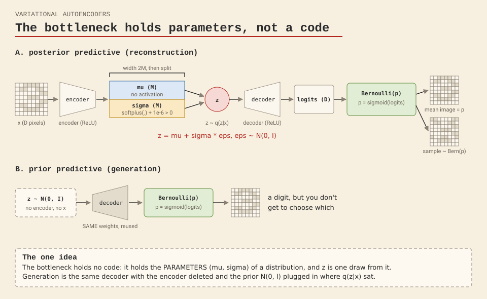
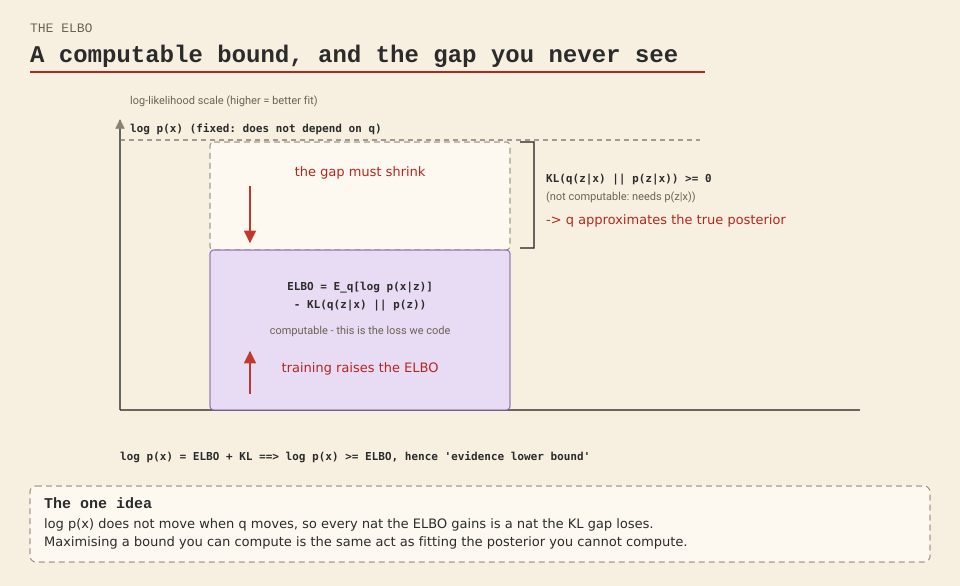

# Variational Autoencoders

> **How to read this note.** Study guide for *Deep Learning: GANs and Variational Autoencoders* (Lazy Programmer), sections 1–3 and 5. §1 is the course's generative-modelling warm-up (section 2) — read it first if "generative model" still means "the thing that makes pictures". §2–§6 are the VAE itself (section 3), in the order the course teaches it, with the derivation in §3 rather than last. §7 translates the course's TensorFlow 1 / Theano code into something that runs in 2026, and §8 lists what the course doesn't tell you. The GAN half of the course (section 4) is a separate note. Section 5 is a Theano/TensorFlow 1 basics review imported from another course, and the appendix (environment setup, "how to code by yourself", learning strategies) is this instructor's shared boilerplate — both are summarised once in [rl-foundations-mc-td](../reinforcement-learning/rl-foundations-mc-td.md) §5, so they aren't repeated here.
>
> Prerequisite for the maths: distributions and maximum likelihood, in [statistics-and-probability](../math-for-ml/statistics-and-probability.md) (§5 distributions, §4 Bayes). Prerequisite for the architecture: [autoencoders](autoencoders.md).

## Why This Exists

**Problem.** A plain [autoencoder](autoencoders.md) compresses and rebuilds, and that's all it does. Hand it a random code vector and you get garbage, because nothing during training said *where* in code space the data lives — the trained codes sit in a few scattered clumps with holes between them. So the obvious plan ("train an autoencoder, then feed the decoder noise") fails, and the fix involves an integral you cannot compute, a bound nobody explains why you need, and a one-line trick without which the gradients don't exist.

**Key insight.** A VAE adds one requirement to an autoencoder: the encoder must output a *distribution* over codes, not a code, and that distribution is pushed toward a fixed prior N(0, I). Now the decoder has been trained on codes that cover a known region, so sampling z ~ N(0, I) and decoding produces something data-like. The price is an extra loss term (a KL divergence), and the whole objective is a lower bound — the ELBO — on the log likelihood you actually wanted to maximise.

**Reach for this when:**
- You trained an autoencoder, fed the decoder random numbers, and got noise.
- You want a generative model with an explicit (if approximate) likelihood, a smooth interpolatable latent space, or a probabilistic encoder for downstream use.
- You're reading a paper with `ELBO`, `q(z|x)`, `reparameterisation`, `KL(q || p)` or `log-variance head` in it and want the terms grounded.
- You're working through this course, or any "VAE on MNIST" tutorial, and the TF1 code won't run.

**Don't reach for this when:**
- You want sharp samples. The pixel-wise factorised decoder (§5) makes VAE samples blurry *by construction*. GANs and diffusion models win here — see [generative-ai-and-prompting](../llm-engineering/generative-ai-and-prompting.md) for where diffusion sits.
- You only want compression, features or anomaly scores. A plain or denoising autoencoder is simpler and does it better; the KL term costs you reconstruction quality (§6).
- You need calibrated density estimates. The ELBO is a *lower* bound on log p(x); the gap is unknown and data-dependent, so comparing ELBOs across models is comparing bounds, not likelihoods.

## Diagrams


<!-- DIAGRAM SPEC: name=vae-forward-pass | two stacked panels sharing a style.
Panel A "posterior predictive (reconstruction)": left, an 8x8 digit tile labelled "x (D pixels)"; arrow -> narrowing trapezoid labelled "encoder (ReLU)"; arrow -> a box split in two halves, top half labelled "mu (M)" with sub-caption "no activation", bottom half labelled "sigma (M)" with sub-caption "softplus(.) + 1e-6 > 0"; both halves feed a small circle labelled "sample z ~ q(z|x)" with a side annotation "z = mu + sigma * eps,  eps ~ N(0, I)"; arrow -> widening trapezoid labelled "decoder (ReLU)"; arrow -> box labelled "logits (D)" -> box labelled "Bernoulli(p = sigmoid(logits))"; two outputs branch from it: "mean image = p" (clean digit tile) and "sampled image ~ Bernoulli(p)" (same digit, speckled).
Panel B "prior predictive (generation)": a dashed box labelled "z ~ N(0, I)" (no encoder, no input image at all) feeding the SAME decoder trapezoid (draw it greyed/reused) -> same Bernoulli box -> one digit tile labelled "a digit, but you don't get to choose which".
Label the single final encoder layer as "width 2M, then split" with a bracket. The one idea: the bottleneck holds distribution PARAMETERS, not a code, and generation just replaces the encoder with the prior. -->


<!-- DIAGRAM SPEC: name=elbo-gap | single panel, a vertical bar chart with one bar.
A horizontal dashed line near the top spanning the panel, labelled "log p(x)  (fixed: does not depend on q)". Below it a solid filled bar rising from the baseline, labelled inside "ELBO = E_q[log p(x|z)] - KL(q(z|x) || p(z))" and annotated "computable - this is the loss we code". The empty space between the top of the bar and the dashed line is bracketed and labelled "KL(q(z|x) || p(z|x)) >= 0  (not computable)". A curved arrow on the bar pointing up labelled "training raises the ELBO"; a matching arrow on the gap pointing down labelled "so the gap must shrink -> q approximates the true posterior". Caption under the baseline: "log p(x) = ELBO + KL  ==>  log p(x) >= ELBO, hence 'evidence lower bound'". The one idea: maximising a computable bound is the same as fitting the posterior you cannot compute. -->

## 1. What "generative model" means (the course's warm-up)

Before any deep learning, the course spends a section making one point: **generative** means you model `p(x | y)` (or `p(x)`) rather than `p(y | x)`, and the payoff is that a fitted density can be *sampled*.

**The simplest generative model there is.** One Gaussian per class. Training is: for each class y, take its rows, compute the sample mean and sample covariance, store them. That's it — `p(x | y) = N(mu_y, Sigma_y)`, fitted by maximum likelihood with closed-form solutions. Classification would be `argmax_y p(x|y)p(y)`, but the course drops accuracy entirely: the point is sampling.

**Two ways to sample, and why the distinction matters later.**
- **Conditional** — fix the class y, draw `x ~ N(mu_y, Sigma_y)`. You choose what to generate.
- **Joint / ancestral** — `p(x, y) = p(y) p(x | y)`: first draw `y ~ p(y)` (a categorical prior learned as count(y)/N), then draw x from that class's Gaussian. You walk down the arrows of the graph `Y -> X`. You don't choose what comes out.

That pair is exactly the posterior-predictive vs prior-predictive split in a VAE (§2) and the latent-vector-in sampling of a GAN. Learn it here where the model is three lines of numpy.

**Why the samples are blurry — the real lesson.** Forcing one Gaussian onto a class forces a *unimodal* density onto a multimodal one. If 500 people write a "2" with a loop at the bottom and 500 write it with a flat base, the class density has two peaks, and a single Gaussian puts its mass between them — an average of two styles, which is nobody's handwriting.

**The fix, and the first latent variable.** A **Gaussian mixture model** fits several Gaussians in proportions:

```
p(x) = sum_k p(z = k) p(x | z = k)
```

`z` is a latent variable: *which* component (which handwriting style) produced this point. Nobody labelled it; it is never observed. Two quantities people confuse:
- `p(z)` — the **prior**: the proportion of the population in each cluster, before looking at x. A vector summing to 1. ("How common is this disease?")
- `p(z | x)` — the **posterior**: which cluster *this* point came from, after seeing it. Bayes rule: `p(z|x) = p(x|z)p(z) / p(x)`, with the evidence `p(x) = sum_z p(x|z)p(z)`. ("Does *this* patient have it, given the test?")

Swapping a single Gaussian per class for a mixture per class makes MNIST samples slightly sharper and much slower to fit — the course states this qualitatively and gives no numbers.

**EM, and what "variational" is extending.** Mixtures are fitted with expectation–maximisation. The point worth keeping: **EM is not a new objective.** It is still plain maximum likelihood; it exists because once you add a latent variable, setting the derivative of the log likelihood to zero has no closed-form solution, so you iterate instead. The course then frames variational inference as "a Bayesian version of EM" — learn *distributions* over the unknowns instead of point estimates.

That analogy is a useful hook but it is loose, and worth correcting before it misleads you: a VAE learns a distribution over **latent variables** (`q(z|x)`, amortised across data points by a neural network), not a distribution over **parameters**. The network weights are still point estimates fitted by gradient descent. A VAE is not "Bayesian" in the Bayesian-neural-network sense the course's framing suggests.

## 2. From autoencoder to VAE: what actually changes

Everything in [autoencoders](autoencoders.md) still applies — encoder, bottleneck, decoder, reconstruction loss, `fit(X, X)`. Three things change.

**1. The bottleneck emits parameters, not a code.** At the end of the encoder you do not get z. You get the parameters of `q(z|x)`, taken to be a **diagonal-covariance Gaussian** (full covariance would need O(M^2) outputs and is skipped). Mechanically: make the last encoder layer **width 2M** and split it in half — first M outputs are the means, last M are the spreads.

Means need no activation (a mean is unbounded). Spreads must be strictly positive, and a linear layer output is not, so the course pushes them through **softplus**, `softplus(a) = log(1 + exp(a))` — a smooth ReLU, differentiable everywhere, always > 0 — plus a small constant (the repo uses `1e-6`; the lectures don't state it) so sigma can't reach 0 and make the Gaussian singular. Implement softplus as `np.log1p(np.exp(a))` for numerical stability, as the course's toy script does.

> **This is non-standard.** Kingma & Welling's paper and essentially every modern implementation emit **log-variance** and compute `sigma = exp(0.5 * logvar)`. That output is unconstrained by construction, needs no smoothing hack, and gives a tidier KL formula. The course's softplus-sigma works, but don't be confused when every other codebase you open looks different — and notice that the `+1e-6` exists precisely to patch a degeneracy the log-variance form never has.

**2. You sample in the middle.** `z ~ q(z|x)`, one draw per data point per step. This is the step that breaks backprop and needs §4.

**3. The decoder output is a distribution too.** Not "the reconstructed image" but the parameters of a distribution over images. For binary pixels that's a **Bernoulli** per pixel, one parameter = P(pixel = 1), so **sigmoid** is the right output activation (or keep raw logits and let the loss apply the sigmoid — numerically better, see §5). The course flags the paradigm shift: in binary classification you get P(y=1|x) and *round* it; here you get a distribution and you **sample** from it.

**The latent space, as the course pictures it.** Think of a blob. The ten digits must each live somewhere on it; the encoder learns where an image belongs, the decoder learns to turn any point back into an image. Two sampling modes follow directly from §1's conditional-vs-joint split:

| Mode | Path | What you control |
|---|---|---|
| **Posterior predictive** | x -> q(z\|x) -> sample z -> decoder -> Bernoulli -> sample image | Everything: it's a reconstruction of a specific input |
| **Prior predictive** | z ~ N(0, I) -> decoder -> Bernoulli -> sample image | Nothing: you get *a* digit, not a chosen digit |

Why does the prior path produce anything meaningful? Only because the training objective explicitly pushes encoded training data toward N(0, I). That push is the KL term in §3. Remove it and the prior path breaks — which is exactly what §6 measures.

## 3. Why a latent-variable model needs a lower bound

**The thing you want.** Maximum likelihood on the data: maximise `log p(x)`. With a latent variable the model defines

```
p(x) = Integral p(x | z) p(z) dz
```

and that integral is hopeless. `p(x|z)` is a neural network, so there is no closed form; z is continuous and M-dimensional, so numerical quadrature dies with dimension; and Monte Carlo with z ~ p(z) is useless in practice because almost every prior sample explains your particular x terribly, so the estimator is dominated by a handful of lucky draws. This is the same wall EM hits (§1), one step worse: EM at least needs `p(z|x)` in closed form, and here it isn't.

**The move.** Give up on `log p(x)` and optimise a *lower bound* on it instead — one that is an expectation under a distribution you control, so a single sample estimates it. The course derives the bound from the goal of approximating the posterior, which is the cleanest way to see where it comes from.

Start with the thing you actually want from an encoder: `q(z|x)` should match the true posterior `p(z|x)`. Measure that with a KL divergence and turn the crank:

```
KL( q(z|x) || p(z|x) ) = E_q[ log q(z|x) - log p(z|x) ]
                                                               (Bayes: p(z|x) = p(x|z)p(z)/p(x))
                       = E_q[ log q(z|x) - log p(x|z) - log p(z) + log p(x) ]
                                                               (log p(x) has no z in it, so it leaves the expectation)
                       = E_q[ log q(z|x) - log p(x|z) - log p(z) ] + log p(x)
```

Move `log p(x)` to the left and flip signs:

```
log p(x) - KL( q(z|x) || p(z|x) )  =  E_q[ log p(x|z) ]  -  KL( q(z|x) || p(z) )
                                      \________________________________________/
                                                        ELBO
```

so

```
log p(x) = ELBO + KL( q(z|x) || p(z|x) )
```

Three readings of that identity, and all three matter:
1. **The right-hand side of the ELBO is computable** — a reconstruction term plus a KL between two Gaussians you both know. That's the loss you code. The left-hand side is not computable but justifies the whole thing.
2. **Any KL is >= 0, so `log p(x) >= ELBO`.** `p(x)` is called the *evidence*; hence **evidence lower bound**.
3. **`log p(x)` doesn't depend on q.** So raising the ELBO must shrink `KL(q || p(z|x))` — maximising the bound *is* making the encoder approximate the true posterior. You get the inference you wanted for free from the objective you could actually optimise. (This is the second diagram above.)

**The two terms, read as a loss.**

```
ELBO = E_{z~q(z|x)}[ log p(x|z) ]  -  KL( q(z|x) || p(z) )
       \______ reconstruction ______/     \___ regulariser ___/
```

Optimisers minimise, so the cost you implement is **−ELBO**.

- **Term 1, the expected log likelihood.** For Bernoulli pixels this is the negative binary cross-entropy between x and the decoder's probabilities, `sum_d [ x_d log(x_hat_d) + (1 - x_d) log(1 - x_hat_d) ]` — the same reconstruction loss a plain autoencoder uses. The course says this is "a very fancy way of doing what we always do", which is fair, but see the caveat in §8: it is a *one-sample Monte Carlo estimate* of an expectation, not the expectation itself.
- **Term 2, the KL to the prior.** `p(z)` is yours to choose and the course picks `N(0, I)` — stating plainly that there is **no theoretical justification, it is chosen for convenience**, and that a bad prior can wreck an otherwise sound model. Since KL is 0 only when the two distributions are identical and grows as they differ, this term simply drags `q(z|x)` toward the standard normal, which is where you want codes to live so that prior sampling works.

**The closed-form Gaussian KL.** Between a diagonal `N(mu, sigma^2)` and `N(0, I)` the integral is analytic, one term per latent dimension, summed over dimensions:

```
KL = sum_j [ -log(sigma_j) + (sigma_j^2 + mu_j^2) / 2 - 1/2 ]
```

In log-variance parameterisation the same quantity reads `0.5 * sum_j [ exp(logvar_j) + mu_j^2 - 1 - logvar_j ]`. Check the sanity: at `mu = 0, sigma = 1` every term is `-0 + 0.5 - 0.5 = 0`. Pushing mu away from 0 costs `mu^2/2`; shrinking sigma toward 0 blows up through `-log sigma` (hence the `+1e-6`); growing sigma costs `sigma^2/2`. Only one term of the ELBO is estimated by sampling — this one is exact, which is why nobody does it by Monte Carlo.

## 4. The reparameterisation trick

**The problem.** Between encoder and decoder sits `z ~ q(z|x)`. You cannot differentiate through "draw a random number": the sampler is not a function of mu and sigma that autograd can trace, so there is no gradient path back to the encoder weights, and the encoder never trains.

**The trick.** Move the randomness out of the path:

```
eps ~ N(0, I)                      (drawn fresh each forward pass)
z   = mu(x; theta) + sigma(x; theta) * eps
```

The intuition is standardisation run backwards: `(x - mu)/sigma` has mean 0 and variance 1, so rearranged, `mu + sigma * eps` has mean mu and variance sigma^2. Same distribution as before — but now **z is a deterministic, differentiable function of the encoder outputs**, with eps a constant that happened to be generated during the forward pass. So

```
dJ/dtheta = (dJ/dz) * (dz/dtheta),    dz/dtheta = dmu/dtheta + eps * dsigma/dtheta
```

and everything is ordinary backprop. The course prefers writing this by hand over any library sampling object, on the grounds that it is explicit and generalises; given that the library object it was shown with no longer exists (§7), that instinct aged well.

The snippet below answers two questions at once: does a sample drawn from a distribution object actually carry a gradient, and what do the reparameterised gradients look like?

```python
import torch
torch.manual_seed(0)
mu = torch.tensor([1.0], requires_grad=True)                  # the encoder's predicted mean
log_var = torch.tensor([0.0], requires_grad=True)
# Wrong way: sample from a distribution object built from mu — the sampler is not differentiable w.r.t. mu.
z = torch.distributions.Normal(mu.detach(), (0.5 * log_var).exp().detach()).sample()
print("plain .sample() carries a gradient path:", z.requires_grad)
# Reparameterisation: push the randomness into eps, so z is a differentiable function of mu and log_var.
eps = torch.randn(1)
z = mu + (0.5 * log_var).exp() * eps
z.backward()
print(f"reparameterised: dz/dmu = {mu.grad.item():.3f} (always 1), dz/dlog_var = {log_var.grad.item():.3f} (= 0.5*sigma*eps)")
mu.grad = log_var.grad = None
kl = -0.5 * (1 + log_var - mu ** 2 - log_var.exp()).sum()     # KL(q(z|x) || N(0,1)), closed form
kl.backward()
print(f"KL at mu=1, sigma=1: {kl.item():.3f}   dKL/dmu = {mu.grad.item():.3f} (pulls the mean back to 0)")
# Expected output:
# plain .sample() carries a gradient path: False
# reparameterised: dz/dmu = 1.000 (always 1), dz/dlog_var = -0.147 (= 0.5*sigma*eps)
# KL at mu=1, sigma=1: 0.500   dKL/dmu = 1.000 (pulls the mean back to 0)
```

`plain .sample()` comes back with `requires_grad = False` — no gradient path at all, confirming the problem. The reparameterised line gives `dz/dmu = 1` exactly (shift the mean by a little, shift the sample by the same little), and `dz/dlog_var = 0.5 * sigma * eps`, which flips sign with eps: a draw above the mean wants a bigger sigma and one below wants a smaller one, and only the average over draws says anything. Then the KL: at `mu = 1, sigma = 1` the closed form gives **0.5**, and `dKL/dmu = mu = 1` — a gradient pointing straight back toward 0. That single number is the whole regulariser: the KL term is a spring tying each encoded mean to the origin.

## 5. Bernoulli or Gaussian decoder?

"The decoder outputs a distribution" forces a choice of *which* distribution, and the choice is just the reconstruction loss under a different name:

| Data | Decoder distribution | Output activation | `log p(x|z)` becomes |
|---|---|---|---|
| Binary / binarised pixels | Bernoulli per pixel | sigmoid (or raw logits + a logits-aware loss) | negative binary cross-entropy |
| Real-valued, roughly unimodal | Gaussian per dimension, fixed variance | identity | negative squared error, plus constants |

Squared error **is** the Gaussian log likelihood up to constants, and cross-entropy **is** the Bernoulli log likelihood. Those are not two analogies, they're the same statement twice. If you've ever wondered why MSE and cross-entropy are the two losses you ever see, this is the answer.

Three practical points the course makes here, all worth keeping:

- **Binarise MNIST** (threshold the grey values to 0/1) if you use a Bernoulli likelihood, so the pixels really are Bernoulli variables. The course does this and says only "I have read that it works better" — no citation, and the threshold isn't stated in the lectures. The standard benchmark protocol is actually **dynamic binarisation**: resample each pixel as Bernoulli(p = intensity) every epoch, which acts as mild regularisation. A fixed threshold is the static, lossier version. The course invites you to try it both ways and reports no result, so that comparison is genuinely open.
- **Keep logits, don't write the cross-entropy formula out.** The course gives three equivalent routes to the reconstruction term — a `Bernoulli.log_prob` call, a framework's `sigmoid_cross_entropy_with_logits`, or the formula typed by hand — and explicitly warns against the third as **numerically unstable** (`log(sigmoid(a))` overflows; the fused logits version uses log-sum-exp). Proving the first two equal on paper and in numpy is one of the course's better exercises.
- **Bernoulli probabilities vs Bernoulli samples.** Both are legitimate outputs. The *mean* image `p` is a clean greyscale digit; a *sample* from Bernoulli(p) is a speckled binary one. Papers almost always show the means. Know which one you're looking at before judging sample quality.

## 6. Training one, and what the KL term buys you

The course trains on MNIST and reports **no numbers at all** — no ELBO values, no reconstruction errors, no sample scores, no training times. Every claim is qualitative: the cost curve converges, samples look like digits, the latent grid morphs smoothly. That's not a criticism of the teaching, but it means there is nothing to verify, so here is the one measurement that makes the central claim concrete.

The question: *is the KL term actually doing anything, or is a VAE just an autoencoder with extra ceremony?* Train the same network twice on sklearn's 8×8 digits — once with the KL term switched off (`beta = 0`, i.e. a plain autoencoder with a pointless noise injection) and once with it on (`beta = 1`, a real VAE) — and score them not by reconstruction but by **how close decoded prior samples land to real digits**, which is the only thing a generative model is for.

```python
import torch, torch.nn as nn
from sklearn.datasets import load_digits
torch.set_num_threads(1)
X = torch.tensor(load_digits().data / 16.0, dtype=torch.float32)    # 1797 8x8 digits, scaled to [0,1]
class VAE(nn.Module):
    def __init__(self, D=64, H=128, Z=2):
        super().__init__()
        self.enc = nn.Sequential(nn.Linear(D, H), nn.ReLU())
        self.head = nn.Linear(H, 2 * Z)                             # one half means, one half spread
        self.dec = nn.Sequential(nn.Linear(Z, H), nn.ReLU(), nn.Linear(H, D))   # Bernoulli logits per pixel
        self.Z = Z
    def forward(self, x):
        mu, raw = self.head(self.enc(x)).split(self.Z, dim=1)
        sigma = nn.functional.softplus(raw) + 1e-6                  # the course's parameterisation (not log-var)
        z = mu + sigma * torch.randn_like(sigma)                    # reparameterisation trick
        return self.dec(z), mu, sigma
def loss_parts(logits, x, mu, sigma):
    rec = nn.functional.binary_cross_entropy_with_logits(logits, x, reduction="none").sum(1)
    kl = (sigma ** 2 + mu ** 2 - 1) / 2 - sigma.log()               # KL(N(mu,sigma) || N(0,1)), per dim
    return rec.mean(), kl.sum(1).mean()
for beta in (0.0, 1.0):
    torch.manual_seed(0)
    m = VAE(); opt = torch.optim.Adam(m.parameters(), 1e-3)
    for _ in range(400):
        logits, mu, sigma = m(X)
        rec, kl = loss_parts(logits, X, mu, sigma)
        opt.zero_grad(); (rec + beta * kl).backward(); opt.step()
    with torch.no_grad():                              # generate: sample the PRIOR and decode
        fake = torch.sigmoid(m.dec(torch.randn(300, 2)))
    realism = torch.cdist(fake, X).min(1).values.mean().item()   # distance to the nearest real digit (lower = better)
    print(f"beta={beta}: reconstruction {rec.item():6.1f}   KL {kl.item():7.2f}   "
          f"distance from generated to nearest real digit {realism:.2f}")
print("beta=0 is a plain autoencoder: it reconstructs fine, but nothing forces the codes to look like N(0,1),")
print("so decoding prior noise lands far from any real digit. The KL term is what makes the model generative.")
# Expected output:
# beta=0.0: reconstruction   22.7   KL   34.77   distance from generated to nearest real digit 1.69
# beta=1.0: reconstruction   23.6   KL    1.79   distance from generated to nearest real digit 1.23
# beta=0 is a plain autoencoder: it reconstructs fine, but nothing forces the codes to look like N(0,1),
# so decoding prior noise lands far from any real digit. The KL term is what makes the model generative.
```

Read the three numbers per row. With `beta = 0` the reconstruction loss is the lower of the two and the KL is enormous — the encoder is free to scatter codes wherever reconstruction is easiest, far from N(0, I). With `beta = 1` reconstruction is slightly worse and the KL is small, because the codes have been pulled into the prior's region. The last column is the verdict: **decoded prior noise lands closer to real digits with the KL term on**. The `beta = 0` model is the better autoencoder and the worse generative model, and its failure is precisely the "holes in code space" problem from the top of this note. That trade — a little reconstruction for a usable latent space — is the entire deal a VAE offers.

Note what the snippet uses: the course's softplus-sigma head (`softplus(raw) + 1e-6`), the explicit reparameterisation line, Bernoulli-logits reconstruction summed over pixels, and the closed-form KL from §3. It is the course's model, in a framework that still exists.

## 7. The 2-D latent grid, and the course's code in 2026

**The visualisation.** Train with the latent dimension set to **2**, then ignore the encoder entirely: lay a **20 × 20 grid** over the square `[-3, 3] x [-3, 3]` in latent space, decode every grid point to its Bernoulli mean image, and tile the 400 images into one **560 × 560** picture (20 × 20 tiles of 28 × 28). Collect all 400 z vectors into one array and make a single batched decode call — the course notes the per-point version is painfully slow.

What it shows, and why each part is worth looking at:
- **Digits morph continuously into their neighbours.** Walking across the grid, a 1 slides into a 7, a 3 into an 8. There is no "digit 3 region" with a wall around it; the decoder is a smooth function of z, and the smoothness is the thing the KL term bought.
- **Boundaries land where handwriting is genuinely ambiguous.** The 1/7 and 3/8 borders are exactly the pairs humans misread.
- **The centre is blurry.** The course reads this as the intersection of all digits — which is partly right. The dominant cause is less flattering (§8).
- **Why it works at all** is the prior: the grid is drawn around the origin because that is where training data was pushed. The same grid on a `beta = 0` autoencoder would be mostly dead space.

One refinement the course misses: a uniform grid over `[-3, 3]` over-samples the tails of a standard normal. The original paper transforms grid points through the **inverse Gaussian CDF** (`scipy.stats.norm.ppf` on evenly spaced probabilities), making the grid uniform in *probability* rather than in z, which spends tiles where the model actually has mass.

**Reading the course's implementations.** The course codes the VAE twice, in TensorFlow 1 and Theano, with deliberately identical APIs so the visualisation script imports either one. The structure is good and worth copying — the frameworks are not.

| In the course | Status in 2026, and what to do |
|---|---|
| `tf.contrib.bayesflow.stochastic_tensor`, `st.SampleValue`, `st.StochasticTensor` | **Gone.** `tf.contrib` was deleted wholesale in TensorFlow 2 and bayesflow was deprecated before that. The lecture that sanity-checks `StochasticTensor` (and the "multiply by a Variable of ones so it will print" workaround) is now entirely obsolete. Use `tfp.distributions.Normal(...).sample()`, or just write the reparameterisation line as §4 does. |
| `tf.placeholder`, `tf.Session`, `feed_dict`, `tf.global_variables_initializer`, `tf.train.RMSPropOptimizer` | All TF1 graph-mode. TF2: eager tensors, a Keras model or `GradientTape`, `tf.keras.optimizers.RMSprop`. Nothing in the TF lectures runs without `tf.compat.v1` + `disable_v2_behavior()`. |
| `tf.distributions.kl_divergence` | Moved to `tfp.distributions.kl_divergence`. The course mentions it, then uses the closed form anyway so that the TF and Theano versions match — which is also what you should do (§3). |
| Theano, `theano.tensor.shared_randomstreams.RandomStreams`, hand-rolled RMSprop | Theano development stopped in 2017; `RandomStreams` was already the slower RNG even then (`MRG_RandomStreams` was the GPU-friendly one). The maintained descendant is [PyTensor](https://pytensor.readthedocs.io/en/latest/). Read the Theano lecture for *mechanics* — it is the one that does the reparameterisation by hand, and it ports to PyTorch almost line for line. |
| Encoder emits `softplus(raw) + 1e-6` as sigma | Works; non-standard. Modern code emits log-variance (§2). |
| `elbo = reduce_sum(ell - kl)` over the whole batch | **Summed, not averaged.** The gradient magnitude then scales with batch size, so the learning rate is silently coupled to `batch_sz` — change one and the other needs changing too. Use a mean over the batch (sum over pixels and latent dims, mean over examples) as §6's snippet does. |
| One z sample per data point per step | A single-sample Monte Carlo estimate of `E_q[log p(x|z)]`. Unbiased, standard, and fine — but it is an estimator with variance, which the course never says (§8). |
| Hyperparameters (learning rate, epochs, batch size, hidden sizes, binarisation threshold) | **Not stated in the lectures.** The repo has values; this note doesn't quote them because they're unverified here. Pick your own and tune. |
| The repo itself | [`lazyprogrammer/machine_learning_examples`](https://github.com/lazyprogrammer/machine_learning_examples); the course folder is named `unsupervised_class3` in the lectures. Data is MNIST from the Kaggle digit-recognizer CSV, expected in a sibling `large_files` folder. |

## 8. What the course leaves out

Honest summary: the derivation and the mechanics are taught well, and the gaps are all on the "what goes wrong in practice" side.

- **Posterior collapse is never mentioned.** If the decoder is powerful enough to model the data without z, the cheapest way to cut the KL term to zero is `q(z|x) = N(0, I)` for every x — the encoder stops encoding, the latent becomes noise, and reconstruction is done by the decoder's own capacity. With a 2-D latent on MNIST you mostly get away with it; with a strong autoregressive decoder, or on harder data, you do not.
- **Nothing on rebalancing the two terms.** The two standard fixes both exist because of the point above: **KL annealing** (start with the KL weight at 0 and ramp it up, so the model learns to use z before it is punished for it) and **beta-VAE** (a fixed weight beta on the KL — beta > 1 trades reconstruction for disentangled latents, beta < 1 the other way). §6's snippet is literally a two-point beta sweep; the course never names the knob.
- **"No theoretical justification for N(0, I)" is honest but undersold.** The consequence has a name: the **aggregate posterior** (the mixture of all `q(z|x)` over the data) doesn't match the prior, leaving **prior holes** — regions you sample from that the decoder never saw. Those holes are a major source of garbage prior-predictive samples, and they're why VampPrior, hierarchical priors and normalising-flow priors exist. The course shrugs.
- **Blurry samples are blamed on ambiguous handwriting.** Partly fair, but the dominant cause is the **factorised likelihood**: the decoder models pixels as independent given z, so when several outputs are plausible it hedges by averaging them — the same mechanism that makes squared-error video prediction blur. This is exactly the weakness GANs attack, and the VAE section never draws the line to the GAN section that follows it.
- **No tighter bounds.** Averaging several z samples and taking a log-mean-exp gives a strictly tighter bound (importance-weighted autoencoders). It's a small change on top of the single-sample estimator, and a natural next step the course doesn't point at.
- **No quantitative results anywhere.** Worth restating because it limits what you can take from the section: there is no ELBO number, no reconstruction error, no sample-quality metric, no runtime. The only numbers stated are from two toy demos (a mean/stddev pair from a random-weight Gaussian-parameterising net, and "close to 5 and 3" from the obsolete sampling sanity check), and both depend on random weights, so they aren't reproducible. If you want to know whether your VAE is good, you have to bring your own yardstick — §6's nearest-real-digit distance is a crude one; ELBO on a held-out split is the standard one.
- **"Cross-entropy is KL plus a constant"** — true here, but only because the target distribution is fixed; the constant is the target's entropy. Fine as stated for classification, not a general identity.

## Trade-offs

- **Reconstruction vs generation.** The KL term costs you reconstruction quality and buys you a latent space you can sample (§6, measured). If you never sample, you are paying for nothing — use a plain autoencoder.
- **VAE vs GAN.** A VAE gives you stable training, an encoder, a likelihood bound and blurry samples. A GAN gives you sharp samples, no encoder, no likelihood and an unstable minimax game. Diffusion models now beat both on image quality at much higher sampling cost.
- **Diagonal vs full covariance for q(z|x).** Diagonal costs 2M outputs and assumes the posterior's axes are independent; full covariance costs O(M^2) and almost nobody does it. The approximation error shows up as a looser bound, not as an error you can see.
- **Softplus-sigma vs log-variance.** Softplus is more intuitive (it *is* the standard deviation) but needs the `+eps` guard; log-variance is unconstrained and standard. No accuracy difference worth caring about; compatibility with everyone else's code is the real argument.
- **Latent dimension.** 2 is for visualising (§7) and nothing else — reconstruction suffers badly. Larger latents reconstruct better and risk unused dimensions collapsing to the prior, which is harmless in itself but means your effective latent size isn't what you set.
- **Summed vs averaged loss.** Summing matches the maths of the ELBO per batch; averaging makes the learning rate independent of batch size. Average, and keep the sums over pixels and latent dimensions.

## Common Pitfalls

- **Feeding noise to a plain autoencoder's decoder.** Nothing trained it to handle that region of code space, so you get artefacts. The KL term is what makes the prior path meaningful (§6) — don't skip it and expect samples.
- **Differentiating through a sampler.** Calling a distribution object's `.sample()` on the encoder's outputs silently detaches the gradient in some APIs and errors in others; either way the encoder doesn't learn. Write `z = mu + sigma * eps` (§4).
- **Letting sigma reach 0.** `-log(sigma)` in the KL goes to infinity. With a softplus head add a small constant; with a log-variance head the problem can't arise, which is the main reason that form is standard.
- **Changing batch size without changing the learning rate** when the loss is summed over the batch (§7). The effective step size moves with batch size and training quietly breaks.
- **Writing `log(sigmoid(logits))` by hand.** Overflows. Use the logits-aware cross-entropy, as the course warns.
- **Comparing ELBOs across different model families.** It is a *lower* bound with an unknown gap; model A can have a worse ELBO and a better likelihood. Compare within a family and on identical data preprocessing, and remember a per-image ELBO on binarised MNIST and on grey MNIST are not the same quantity.
- **Reading a KL near zero as "nicely regularised".** It can equally mean the encoder has stopped encoding — posterior collapse (§8). Look at the reconstruction term and at whether reconstructions depend on their input at all.
- **Judging sample quality from Bernoulli means while thinking they're samples** (§5). Means always look cleaner.
- **Treating a uniform latent grid as a fair tour of the model.** Uniform in z over-samples the tails; use `norm.ppf` spacing (§7).

## Decision Table

| Scenario | Use this | Not that | Why |
|----------|----------|----------|-----|
| Need new samples from a code vector | VAE (or GAN / diffusion) | Plain [autoencoder](autoencoders.md) | An AE's code space has holes; nothing maps noise to data |
| Need compression, features, anomaly scores | Plain or denoising autoencoder | VAE | The KL term costs reconstruction and buys sampling you don't use |
| Need sharp images above all | GAN or diffusion | VAE | Factorised pixel likelihood averages plausible outputs into blur |
| Binary or binarised pixels | Bernoulli decoder + cross-entropy on logits | Gaussian / MSE | Cross-entropy *is* the Bernoulli log likelihood |
| Real-valued unimodal data | Gaussian decoder (MSE + constants) | Bernoulli | MSE *is* the Gaussian log likelihood |
| Sampling z inside the graph | `mu + sigma * eps` | A sampler on the encoder's outputs | Only the reparameterised form has a gradient path |
| KL between q and N(0, I) | Closed form (§3) | Monte Carlo estimate | Analytic, exact, free; only the reconstruction term needs sampling |
| Latent is 2-D for a picture | 2, and accept bad reconstruction | 2 as a default | 2-D is a visualisation choice, not a modelling one |
| KL collapses to ~0 and reconstructions ignore the input | KL annealing, or beta < 1, or a weaker decoder | More training | Posterior collapse is a fixed point, not slow convergence |
| Want disentangled latent factors | beta-VAE (beta > 1) | Plain VAE | Extra KL pressure trades reconstruction for axis-aligned factors |
| Running the course's TF1 / Theano code | Port to PyTorch or Keras 3 | `tf.contrib` / Theano | Both APIs are deleted or unmaintained (§7) |

## References

- [Kingma & Welling — Auto-Encoding Variational Bayes (2013)](https://arxiv.org/abs/1312.6114) — the original: the ELBO, the reparameterisation trick, log-variance heads, the latent-grid figure.
- [Rezende, Mohamed & Wierstra — Stochastic Backpropagation and Approximate Inference in Deep Generative Models (2014)](https://arxiv.org/abs/1401.4082) — the same idea, independently, with the deep-generative-model framing.
- [Doersch — Tutorial on Variational Autoencoders (2016)](https://arxiv.org/abs/1606.05908) — the clearest standalone derivation if §3 moved too fast.
- [Kingma & Welling — An Introduction to Variational Autoencoders (2019)](https://arxiv.org/abs/1906.02691) — book-length treatment by the authors, including priors and tighter bounds.
- [Bowman et al. — Generating Sentences from a Continuous Space (2015)](https://arxiv.org/abs/1511.06349) — where posterior collapse and KL annealing come from.
- [Higgins et al. — beta-VAE (ICLR 2017)](https://openreview.net/forum?id=Sy2fzU9gl) — the KL weight as a knob.
- [Burda, Grosse & Salakhutdinov — Importance Weighted Autoencoders (2015)](https://arxiv.org/abs/1509.00519) — the tighter multi-sample bound.
- [Tomczak & Welling — VAE with a VampPrior (2017)](https://arxiv.org/abs/1705.07120) — the prior-holes problem taken seriously.
- [Keras: Variational AutoEncoder example](https://keras.io/examples/generative/vae/) — a current, runnable reference implementation.
- [`tfp.distributions.Normal`](https://www.tensorflow.org/probability/api_docs/python/tfp/distributions/Normal) — the replacement for the course's dead `stochastic_tensor`. · [`torch.nn.functional.softplus`](https://docs.pytorch.org/docs/stable/generated/torch.nn.functional.softplus.html) · [`sklearn.datasets.load_digits`](https://scikit-learn.org/stable/modules/generated/sklearn.datasets.load_digits.html) (§6's dataset) · [PyTensor](https://pytensor.readthedocs.io/en/latest/) (maintained Theano descendant)
- Course code: [`lazyprogrammer/machine_learning_examples`](https://github.com/lazyprogrammer/machine_learning_examples), folder `unsupervised_class3`.

## See Also

- [autoencoders](autoencoders.md) — the prerequisite: bottleneck, reconstruction loss, sparse/denoising/contractive variants, and why a plain AE can't generate.
- [statistics-and-probability](../math-for-ml/statistics-and-probability.md) — distributions (§5), Bayes (§4) and maximum likelihood, all assumed here.
- [boltzmann-machines](boltzmann-machines.md) — the other latent-variable generative model in this wiki: energy-based, sampled with Gibbs/contrastive divergence instead of bounded with an ELBO.
- [generative-ai-and-prompting](../llm-engineering/generative-ai-and-prompting.md) — where diffusion models, the current answer to "sharp samples", sit.
- [rl-foundations-mc-td](../reinforcement-learning/rl-foundations-mc-td.md) §5 — the shared Lazy Programmer appendix (environment setup, coding by yourself, learning strategies) and the Theano/TensorFlow 1 basics review that this course's section 5 repeats.
