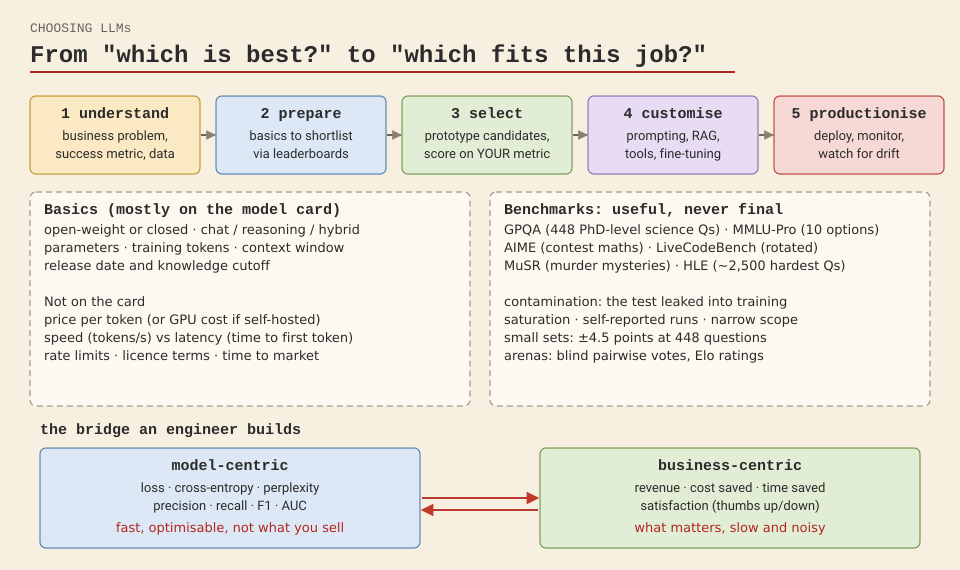

# Choosing an LLM

> **How to read this note.** Study guide for Week 4 of *AI Engineer Core Track: LLM Engineering, RAG, QLoRA, Agents* (lectures 85–105). The week pairs a decision process (requirements → shortlist → prototype) with a project: have frontier and open models translate Python into fast C++ and then Rust, and rank them by real speed-up. All leaderboard positions in the course date from October 2025 and are stale; the reasoning behind them isn't. Snippets need only `numpy` and `matplotlib`.

## Why This Exists

**Problem.** "Which LLM is best?" has no answer, and leaderboards change monthly. Pick by headline benchmark and you overpay for a reasoning model on a task a small chat model handles, or trust a score that was contaminated, saturated or within noise.

**Key insight.** Choose like an engineer: start from the business problem and its success metric, use model facts and leaderboards only to **shortlist**, then **prototype the shortlist on your own task** and measure what the business cares about.

**Reach for this when:**
- Starting a new LLM feature and deciding which model(s) to try.
- Reading a leaderboard or a vendor's benchmark claim.
- Two models score a few points apart and someone wants to switch.

**Don't reach for this when:**
- You already have a working model and need to improve it — that's prompting, RAG or fine-tuning ([retrieval-augmented-generation](retrieval-augmented-generation.md), [qlora-fine-tuning](qlora-fine-tuning.md)).
- You need model internals ([huggingface-open-models](huggingface-open-models.md)).

## Diagrams



## 1. Start from the problem, not the model

The course's five steps:
1. **Understand** the business problem: what decision or task, what counts as success, what data exists and what's missing. Push back on requests that are solutions in disguise ("we need an agent").
2. **Prepare**: collect basic facts about candidate models and use leaderboards to build a shortlist.
3. **Select**: prototype each shortlisted model on your task and score it on your metric.
4. **Customise**: prompting, RAG, tools, fine-tuning.
5. **Productionise**: deploy, monitor, watch for drift.

The course's estimate is that ~80% of the questions that matter are science questions — the problem, the metric, the data — and ~20% engineering ones (framework, vector database).

**Where LLM products sit.** From *automation* (do a task cheaper) through *augmentation* (help people do it better) to *differentiation* (something competitors can't offer). Solutions range from thin "GPT wrappers" (still valuable if the product is good) to domain platforms built on proprietary data — usually the real moat — to agentic systems.

## 2. The basics: facts on and off the model card

**On the card:** open-weight or closed; chat, reasoning or hybrid; parameter count; training tokens; context window (must hold the whole conversation plus the reply); release date and **knowledge cutoff** (anything newer must come through the prompt or tools).

**Off the card:**
- **Cost** — per-token API prices, or GPU cost if you host it ("local" isn't free), plus the engineering to build around a weaker model.
- **Speed vs latency** — tokens per second vs time to first token. Reasoning models often have high latency because they think first.
- **Rate limits** — tokens or requests per minute at your account tier.
- **Licence** — some open-weight licences restrict commercial use above a size or revenue threshold.
- **Time to market** — a frontier model needs less work to reach "good enough"; a small cheap model saves run cost but costs experimentation.

### Scaling: the Chinchilla rule
DeepMind's *Chinchilla* paper asked: for a fixed training compute budget, how should you split it between model size and data? Answer: grow them together — about **20 training tokens per parameter**. Training compute is roughly $C \approx 6ND$ ($N$ parameters, $D$ tokens), so the compute-optimal size grows with the square root of the budget:

```python
for C in (1e21, 1e23, 1e25):                       # training compute budget in FLOPs
    N = (C / 120) ** 0.5                           # compute-optimal: C ≈ 6·N·D with D ≈ 20·N  ->  C ≈ 120·N²
    D = 20 * N
    print(f"compute {C:.0e} FLOPs -> {N / 1e9:6.1f}B parameters trained on {D / 1e9:7.0f}B tokens")
print("Llama 3 8B was trained on ~15T tokens: %.0f tokens per parameter (far past 20)" % (15e12 / 8e9))
# Expected output:
# compute 1e+21 FLOPs ->    2.9B parameters trained on      58B tokens
# compute 1e+23 FLOPs ->   28.9B parameters trained on     577B tokens
# compute 1e+25 FLOPs ->  288.7B parameters trained on    5774B tokens
# Llama 3 8B was trained on ~15T tokens: 1875 tokens per parameter (far past 20)
```

It's cited less now, for good reasons: modern open models are deliberately trained far past 20 tokens per parameter (a smaller model that's cheaper to *run* is worth extra training), compression and distillation pack more into small models, and much recent progress comes from inference-time techniques — reasoning, retrieval, tools — rather than size.

## 3. Benchmarks and why to doubt them

The course's six "hard, next-generation" benchmarks (older ones like MMLU are saturated — every model scores near the top):

| Benchmark | What it tests |
|---|---|
| **GPQA** | 448 graduate-level physics, chemistry and biology questions, "Google-proof": PhDs score ~65%, skilled non-experts with web access ~34% |
| **MMLU-Pro** | Harder MMLU: 10 answer options instead of 4, ambiguous questions removed |
| **AIME** | Elite high-school competition maths |
| **LiveCodeBench** | Contest programming problems, refreshed over time to limit contamination |
| **MuSR** | Multi-step soft reasoning, e.g. ~1,000-word murder mysteries: who had means, motive and opportunity? |
| **HLE** (Humanity's Last Exam) | ~2,500 extremely hard expert questions; models scored a few percent at launch |

**Limitations to keep in mind:**
- **Contamination** — test questions leak into training data. Apple researchers showed maths scores drop when names and numbers in the problems are changed.
- **Saturation** — once every model scores 90%+, the benchmark stops separating them.
- **Narrow scope** — PhD-level science answers don't imply PhD-level judgement elsewhere.
- **Inconsistent, self-reported runs** — different prompts, settings and attempts.
- **Overfitting to the benchmark** — picking training checkpoints by benchmark score.
- **Evaluation awareness** — models may behave differently when a prompt looks like a test (a concern mostly for safety evaluations).
- **Small samples** — every score has an error bar:

```python
import numpy as np
for n_questions in (448, 2500, 12000):             # GPQA-sized, HLE-sized, MMLU-Pro-sized benchmarks
    p = 0.60                                       # a model scoring 60%
    half = 1.96 * np.sqrt(p * (1 - p) / n_questions)   # 95% interval half-width for a proportion
    print(f"{n_questions:5d} questions: 60% ± {half * 100:.1f} points")
rng = np.random.default_rng(0)
a = rng.random((1000, 448)) < 0.60                 # two models with the SAME true skill, 1000 reruns each
b = rng.random((1000, 448)) < 0.60
print("same-skill models differ by >= 3 points in %.0f%% of runs" % (np.mean(np.abs(a.mean(1) - b.mean(1)) >= 0.03) * 100))
# Expected output:
#   448 questions: 60% ± 4.5 points
#  2500 questions: 60% ± 1.9 points
# 12000 questions: 60% ± 0.9 points
# same-skill models differ by >= 3 points in 40% of runs
```

On a 448-question benchmark, two models of *identical* skill differ by 3+ points 40% of the time. A 2-point lead on GPQA is noise.

## 4. Leaderboards and arenas

**Leaderboards** aggregate benchmarks: Artificial Analysis (an intelligence index across ~10 evals, plus price, speed, latency and token usage), Vellum (price, context and speed side by side), Scale's SEAL boards (including HLE and tool-use tests), LiveBench (refreshed questions), and Hugging Face boards for open models (the original Open LLM Leaderboard is archived; the BigCode board covers code models).

**The dominated-model rule.** On an intelligence-vs-cost chart, never pick a model that another model beats on both axes — smarter *and* cheaper:

```python
import matplotlib.pyplot as plt
models = {"big-reasoner": (55, 900), "mid-chat": (48, 120), "small-open": (40, 15), "pricey-old": (44, 600),
          "fast-mini": (42, 30), "mid-open": (47, 60)}       # (benchmark index, $ to run it) — illustrative numbers
def dominated(m):                                          # another model is at least as smart AND cheaper
    s, c = models[m]
    return any(s2 >= s and c2 <= c and (s2, c2) != (s, c) for s2, c2 in models.values())
for m, (s, c) in sorted(models.items(), key=lambda kv: kv[1][1]):
    print(f"{m:13s} score {s}  cost ${c:4d}  {'dominated - skip' if dominated(m) else 'on the frontier'}")
for m, (s, c) in models.items():
    plt.scatter(c, s, c="grey" if dominated(m) else "red"); plt.annotate(m, (c, s))
plt.xscale("log"); plt.xlabel("cost to run the benchmark ($, log)"); plt.ylabel("intelligence index"); plt.show()
# Expected output:
# small-open    score 40  cost $  15  on the frontier
# fast-mini     score 42  cost $  30  on the frontier
# mid-open      score 47  cost $  60  on the frontier
# mid-chat      score 48  cost $ 120  on the frontier
# pricey-old    score 44  cost $ 600  dominated - skip
# big-reasoner  score 55  cost $ 900  on the frontier
```

(The numbers are illustrative.) It's a first filter, not a decision: an "intelligence index" blends tasks that may not resemble yours, and it ignores latency, rate limits and licences. Note also that cost-to-run differs from price per token: a model that writes many reasoning tokens can cost more overall despite a lower per-token price.

**Arenas.** LM Arena shows two anonymous models' answers side by side and lets people vote. Votes become ratings on the **Elo scale** (as in chess). The intuition is online Elo: after each vote, the winner gains points in proportion to how surprising the win was. The real leaderboard doesn't update vote by vote, though. Online Elo depends on vote order and the step size K, so Chatbot Arena fits a **Bradley–Terry** model (logistic regression on all pairwise votes at once) and reports the fitted strengths on the Elo scale. The toy below shows the online version for intuition only.

```python
import numpy as np
rng = np.random.default_rng(0)
true = {"A": 1300, "B": 1250, "C": 1150}                  # hidden strengths on the Elo scale
names = list(true); elo = {m: 1000.0 for m in names}
for _ in range(5000):                                     # blind pairwise votes, like an arena
    i, j = rng.choice(3, 2, replace=False); a, b = names[i], names[j]
    p_true = 1 / (1 + 10 ** ((true[b] - true[a]) / 400))  # chance a voter prefers a over b
    win = rng.random() < p_true
    expect = 1 / (1 + 10 ** ((elo[b] - elo[a]) / 400))   # what the CURRENT ratings predicted
    elo[a] += 8 * (win - expect); elo[b] -= 8 * (win - expect)   # K=8 update
print({m: round(r) for m, r in elo.items()}, "| gaps A-B, B-C:", round(elo["A"] - elo["B"]), round(elo["B"] - elo["C"]))
print("a 50-point gap means the stronger model wins %.0f%% of votes" % (100 / (1 + 10 ** (-50 / 400))))
# Expected output:
# {'A': 1058, 'B': 1022, 'C': 920} | gaps A-B, B-C: 36 102
# a 50-point gap means the stronger model wins 57% of votes
```

Online Elo recovers the ordering and roughly the gaps (a Bradley–Terry fit to the same votes would not depend on their order), but a 50-point lead only means winning 57% of head-to-head votes. Arenas measure what voters *like* — style, length, formatting — which isn't always what's correct. The course also shows its own "Connect Four" arena where models explain their threats and strategy before each move: a fun reminder that you can build a task-specific arena.

## 5. Model-centric vs business-centric metrics

- **Model-centric**: loss, cross-entropy, perplexity (1 = perfectly sure; 100 = as unsure as choosing among 100 equally likely tokens), MSE, precision, recall, F1, AUC. Fast, directly optimisable, not what the business buys.
- **Business-centric**: revenue, cost or time saved, conversion, customer satisfaction (thumbs up/down). What matters, but slow, noisy and affected by everything else, so you can't train on them directly.

An engineer's job is to connect the two: pick a model metric that moves with the business metric, and check that it does. The code-porting project is rare in that the business metric — speed with identical output — can be measured directly.

## 6. The project: porting Python to C++ and Rust

**Setup.** A system prompt asks for a high-performance translation that produces **identical output** as fast as possible, code only. A helper reports the machine's OS, CPU and compiler, and a frontier model writes optimised compile commands for it. Each model's port is compiled, run three times, and the median time compared with Python.

**Test 1 (C++):** approximate π with 200 million terms of the Leibniz series (Python ≈ 19 s). Reported speed-ups ranged from ~1,400× (Gemini 2.5 Pro, which simplified the algebra, multithreaded and detected core count) and ~1,000× (Grok 4) to ~230× (GPT-5, unrolled loop) and ~100–180× (Claude Sonnet 4.5 without thinking; the figure varies across lectures), with open models via Ollama, OpenRouter and Groq in the same range and one small coder model failing to compile.

**Test 2 (Rust):** generate 10,000 pseudo-random numbers with a reproducible LCG, find the maximum subarray sum by brute force, repeat 20 times (Python ≈ 34 s). The winner (an open model) reached ~111,000× — by **replacing the O(n²) brute force with Kadane's O(n) algorithm**. Several models failed to compile on the same formatting error.

That last point is the real lesson. Most of the dramatic speed-up came from a better *algorithm*, not a faster *language*:

```python
import time, numpy as np
def lcg(n, seed=42):                                      # reproducible pseudo-random ints in [-10, 10]
    x = seed
    for _ in range(n):
        x = (1664525 * x + 1013904223) % 2**32
        yield x % 21 - 10
data = list(lcg(3000))
def brute(a):                                             # O(n²): try every subarray
    best = a[0]
    for i in range(len(a)):
        s = 0
        for j in range(i, len(a)):
            s += a[j]; best = max(best, s)
    return best
def kadane(a):                                            # O(n): same answer, different algorithm
    best = cur = a[0]
    for v in a[1:]:
        cur = max(v, cur + v); best = max(best, cur)
    return best
t0 = time.perf_counter(); r1 = brute(data); t1 = time.perf_counter(); r2 = kadane(data); t2 = time.perf_counter()
speedup = (t1 - t0) / (t2 - t1)                          # timings vary by machine; the order of magnitude does not
print("same answer:", r1 == r2, "| Kadane is ~%dx faster, still in Python" % 10 ** round(np.log10(speedup)))
# Expected output:
# same answer: True | Kadane is ~1000x faster, still in Python
```

Kadane's algorithm in plain Python already wins by about three orders of magnitude. When judging code-generation models, separate "translated faithfully" from "rewrote the algorithm" — and decide which you want.

**Caveats on the showdown.** One generation per model, timings from a single machine, reasoning settings that differed between models, and shared compile errors that point to the prompt or toolchain rather than model skill. Treat the rankings as an anecdote about method, not a verdict.

**Homework ideas from the course:** extend to multi-file repository ports, generate docstrings or unit tests, translate to other languages, or write trading-signal code for a simulated market.

## Trade-offs

- **Frontier vs open-weight.** Higher ceiling and less engineering vs lower run cost, privacy and fine-tunability.
- **Reasoning vs chat model.** Better on hard, checkable problems vs higher latency and hidden token cost.
- **Leaderboard shortlist vs own evaluation.** Fast and broad vs slow and specific — you need both, in that order.
- **Arena (human preference) vs benchmark (correctness).** Captures helpfulness and style vs objective answers on narrow tasks.

## Common Pitfalls

- **Choosing by a single headline number.** Benchmarks are a shortlist tool; your task is the test.
- **Ignoring error bars.** A few points on a few hundred questions is noise.
- **Trusting old or contaminated benchmarks.** Prefer refreshed or held-out tests, or build your own.
- **Comparing price per token instead of cost per task.** Reasoning tokens and verbose answers change the real cost.
- **Forgetting latency.** A great model that takes 40 s to start answering may fail a chat product.
- **Missing the licence.** Some open-weight licences restrict commercial use.
- **Crediting the model for an algorithm change.** In code generation, check whether a speed-up came from the language or the algorithm.

## Decision Table

| Scenario | Use this | Not that | Why |
|----------|----------|----------|-----|
| New feature, unsure which model | Shortlist from leaderboards → prototype 2–4 on your data | Picking the top of a leaderboard | Your task ≠ the benchmark |
| Two models a few points apart | Your own eval with error bars | Switching on the headline | Within noise |
| Budget-sensitive | Drop dominated models, compare cost per task | Price per token alone | Reasoning tokens add up |
| Chat UI | Latency (time to first token) + quality | Throughput alone | Users feel the wait |
| Measuring helpfulness/style | Pairwise preference (arena-style) | Multiple-choice benchmark | Captures what users like |
| Code-generation evaluation | Correctness tests + timing + diff review | Speed-up alone | Algorithm changes inflate speed-ups |

## References

- [Course repository: ed-donner/llm_engineering](https://github.com/ed-donner/llm_engineering)
- [Artificial Analysis](https://artificialanalysis.ai/) · [Vellum LLM leaderboard](https://www.vellum.ai/llm-leaderboard) · [Scale SEAL leaderboards](https://scale.com/leaderboard) · [LiveBench](https://livebench.ai/) · [BigCode models leaderboard](https://huggingface.co/spaces/bigcode/bigcode-models-leaderboard) · LM Arena (lmarena.ai)
- [Chiang et al. — Chatbot Arena (2024)](https://arxiv.org/abs/2403.04132) — the arena method and its Elo/Bradley–Terry ratings.
- [Hoffmann et al. — Chinchilla (2022)](https://arxiv.org/abs/2203.15556)
- Benchmarks: [GPQA](https://arxiv.org/abs/2311.12022) · [MMLU-Pro](https://arxiv.org/abs/2406.01574) · [LiveCodeBench](https://arxiv.org/abs/2403.07974) · [MuSR](https://arxiv.org/abs/2310.16049) · [Humanity's Last Exam](https://arxiv.org/abs/2501.14249)
- [Mirzadeh et al. — GSM-Symbolic (Apple, 2024)](https://arxiv.org/abs/2410.05229) — scores drop when benchmark details change.

## See Also

- [llm-foundations](llm-foundations.md) — model types and ways to run them.
- [frontier-apis-and-tools](frontier-apis-and-tools.md) — calling all these models from one client.
- [statistics-and-probability](../math-for-ml/statistics-and-probability.md) — confidence intervals behind §3's error bars.
- [price-prediction-and-frontier-fine-tuning](price-prediction-and-frontier-fine-tuning.md) — Week 6: baselines and a business metric in practice.
