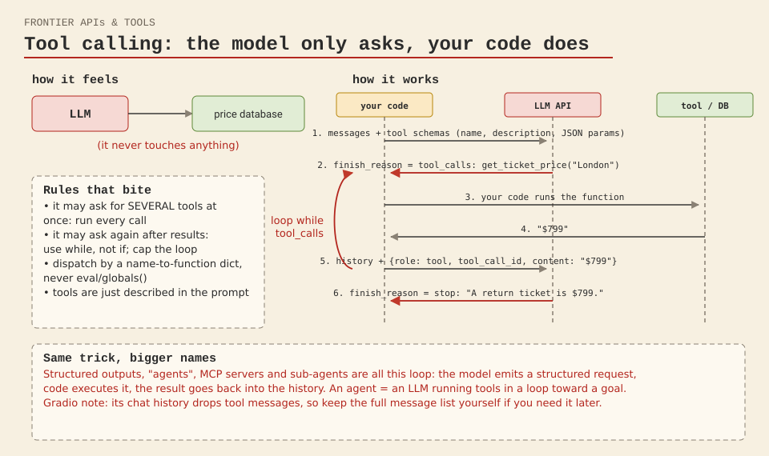

# Frontier APIs, Chat UIs and Tool Calling

> **How to read this note.** Study guide for Week 2 of *AI Engineer Core Track: LLM Engineering, RAG, QLoRA, Agents* (lectures 38–61). The week goes from "call seven providers" to an airline assistant (**FlightAI**) that looks up ticket prices in SQLite, draws a picture of the destination and speaks its answers. Snippets run offline: the `openai` client talks to a fake model through `httpx.MockTransport`, so the tool-calling loop is real code with a scripted LLM. Install: `VIRTUAL_ENV=/Users/phahng/Desktop/workarea/.venv uv pip install openai tiktoken gradio`. Read [llm-foundations](llm-foundations.md) first.

## Why This Exists

**Problem.** Every lab has its own SDK, prices, caching rules and quirks; chat UIs need streaming and history handling; and "tool calling" sounds as if the model can reach into your database. Without a clear mental model you end up with vendor lock-in, slow UIs and agents that silently drop half the requested actions.

**Key insight.** Three ideas carry the whole week. (1) One OpenAI-style client plus `base_url` reaches nearly every model. (2) A chat UI is a callback that receives the message and the history and returns (or yields) text. (3) Tool calling is a loop *in your code*: the model replies with a structured request, you run it, you append the result and call the model again.

**Reach for this when:**
- Comparing or switching between frontier models from code.
- Building a quick demo UI around an LLM.
- Letting an LLM look things up or take actions (database queries, bookings, calculations).
- A tool-using assistant ignores some tool calls or stops after one step.

**Don't reach for this when:**
- The answer needs your documents as context — that's retrieval, [retrieval-augmented-generation](retrieval-augmented-generation.md).
- You need a multi-agent system with planning and memory — [agentic-ai-systems](agentic-ai-systems.md) builds on this.
- You're shipping a production web app: Gradio is for demos and internal tools.

## Diagrams



## 1. Many providers, one client

### Endpoints and SDKs
The course sets up keys for OpenAI, Anthropic, Google, DeepSeek, Groq, xAI and OpenRouter (all optional; a local Ollama model works for free) and reaches all of them with the OpenAI client by changing `base_url`. The native SDKs differ in small ways that matter when you do use them: Anthropic's `messages.create` *requires* `max_tokens` and returns `content[0].text`; Google's `generate_content` returns `.text`.

### Routers vs abstraction layers
- A **router** is a remote service you call that forwards to many models — **OpenRouter**. One key, one bill, hundreds of models.
- An **abstraction layer** is a local library that adapts your call to each provider — **LiteLLM** (light; also reports token counts and cost per call) and **LangChain** (heavier, with many more building blocks). Model strings look like `"anthropic/claude-…"` or `"bedrock/…"`.

### Two ways to make a model smarter
The course poses a two-coin probability puzzle and a "bookworm eats through two volumes on a shelf" puzzle (the classic trick: the first page of volume 1 and the last page of volume 2 face each other on the shelf, so the worm only crosses the covers). A small model gets them wrong; you can fix that by using a **bigger model** (training-time scaling) or by turning up **`reasoning_effort`** on the same model (inference-time scaling). Either works; they cost differently. The same section pits models against each other in a share-or-steal game to show they have different "personalities" — entertaining, but single runs prove nothing.

## 2. Prompt caching: put the fixed part first

**The question.** You ask several questions about the same 50,000-token document. Do you pay for the document every time?

Partly. Providers cache the **start** of a recent prompt; a new prompt that begins with the *exact same tokens* gets those tokens at a large discount (and faster). So the order of your prompt decides what is cacheable:

```python
import tiktoken
enc = tiktoken.get_encoding("o200k_base")
book = "To be, or not to be, that is the question. " * 400      # a long, fixed document
def shared_prefix(a, b):                                       # caching only reuses an IDENTICAL start
    ta, tb = enc.encode(a), enc.encode(b); n = 0
    while n < min(len(ta), len(tb)) and ta[n] == tb[n]: n += 1
    return n, len(tb)
for order in ("changing part first", "fixed part first"):
    def prompt(q, day):
        return f"Today is {day}. {q}\n{book}" if order == "changing part first" else f"{book}\nToday is {day}. {q}"
    n, total = shared_prefix(prompt("Who speaks?", "Mon"), prompt("What is the mood?", "Tue"))
    print(f"{order:20s}: {n:5d} of {total} tokens cacheable")
# Expected output:
# changing part first :     2 of 5210 tokens cacheable
# fixed part first    :  5203 of 5210 tokens cacheable
```

With the date and question first, almost nothing is shared between two calls. With the document first, 99.9% of the tokens match. Provider rules differ: OpenAI caches automatically above a minimum prompt length; Anthropic needs explicit cache markers, charges extra to write the cache and much less to read it; Gemini has implicit and explicit modes. Check current pricing pages — the discounts change often.

## 3. Conversations between models

**The question.** How do you make two LLMs talk to each other, when each API call only knows "user" and "assistant"?

Build each model's history **from its own point of view**: its own past lines are `assistant`, the other model's lines are `user`. With three or more speakers that breaks down; instead give each model the whole transcript as a single user message and ask for its next line.

```python
def as_seen_by(me, transcript, system):                    # each model sees ITS lines as "assistant"
    msgs = [{"role": "system", "content": system}]
    for speaker, text in transcript:
        msgs.append({"role": "assistant" if speaker == me else "user", "content": text})
    return msgs
transcript = [("gpt", "Hi."), ("claude", "Hello! Lovely to meet you."), ("gpt", "Is it, though?")]
for who in ("gpt", "claude"):
    print(who, "->", [(m["role"], m["content"]) for m in as_seen_by(who, transcript, f"You are {who}.")][1:])
# three or more speakers: role-flipping breaks down, so hand everyone the transcript as ONE user message
lines = "\n".join(f"{s}: {t}" for s, t in transcript + [("gemini", "Can we all calm down?")])
print({"role": "user", "content": f"You are Gemini in this chat:\n{lines}\nWrite your next line."}["content"])
# Expected output:
# gpt -> [('assistant', 'Hi.'), ('user', 'Hello! Lovely to meet you.'), ('assistant', 'Is it, though?')]
# claude -> [('user', 'Hi.'), ('assistant', 'Hello! Lovely to meet you.'), ('user', 'Is it, though?')]
# You are Gemini in this chat:
# gpt: Hi.
# claude: Hello! Lovely to meet you.
# gpt: Is it, though?
# gemini: Can we all calm down?
# Write your next line.
```

The "transcript in one message" pattern generalises: any time the context doesn't fit the strict user/assistant alternation (a tutor reviewing previous sessions, a judge reading a debate), write it into the prompt as text.

## 4. Gradio: a UI from a function

**The question.** How do you put a chat window around a model without writing a front end?

**Gradio** builds a web UI from a Python function. You hand it the function (a **callback**); it calls the function when the user acts.
- `gr.Interface(fn, inputs, outputs)` — one function, typed inputs and outputs (Textbox, Markdown, Dropdown, Image, Audio). `launch(share=True)` gives a temporary public link through a tunnel; `auth=("user", "pw")` adds a login; `inbrowser=True` opens a tab.
- `gr.ChatInterface(fn)` — the callback receives `(message, history)`, where history is a list of `{"role", "content", ...}` dicts. In Gradio 6 (checked on 6.32.0) each `content` is a **list of typed blocks** such as `[{"type": "text", "text": "hi"}]`, not a string, and extra keys (`metadata`, `options`) ride along. OpenAI and Anthropic accept text blocks, but code that treats content as a string, file blocks, and strict OpenAI-compatible endpoints do not, so flatten text blocks and keep only `role` + `content`.
- **Streaming** — make the callback a generator and `yield` the text **so far** (not each new piece); Gradio re-renders.
- `gr.Blocks` — lay out your own rows and columns and wire events (`textbox.submit(fn).then(next_fn, …)`). Underneath, Gradio is a Svelte front end talking to a Python server, one route per callback.

```python
import gradio as gr
def text_of(content):                                      # Gradio 6: content is a list of typed blocks
    if isinstance(content, str): return content
    return "".join(b["text"] for b in content if b.get("type") == "text")   # drop file/component blocks
def chat(message, history):                                # Gradio calls this on every user message
    msgs = [{"role": "system", "content": "You are a helpful shop assistant."}]
    msgs += [{"role": h["role"], "content": text_of(h["content"])} for h in history]   # role + plain text only
    msgs.append({"role": "user", "content": message})
    reply = f"(the LLM would see {len(msgs)} messages; last past turn: {msgs[-2]['content']!r})"
    for i in range(1, len(reply) + 1):
        yield reply[:i]                                    # yield the text SO FAR -> Gradio streams it
demo = gr.ChatInterface(fn=chat)                            # demo.launch() opens it in the browser
raw = [{"role": "user", "content": "Do you sell belts?"}, {"role": "assistant", "content": "Yes, in aisle 3."}]
history = gr.Chatbot().preprocess(gr.Chatbot().postprocess(raw))   # the shape the callback really receives
print("history[0]:", history[0]["content"])
print("callback output:", list(chat("How much are they?", history))[-1])
print("gradio", gr.__version__, "| built:", type(demo).__name__)
# Expected output:
# history[0]: [{'text': 'Do you sell belts?', 'type': 'text'}]
# callback output: (the LLM would see 4 messages; last past turn: 'Yes, in aisle 3.')
# gradio 6.32.0 | built: ChatInterface
```

**Context on demand.** The course's clothing-store assistant adds a policy line to the system prompt only when the user mentions a keyword ("belt" → "belts are 60% off"). That's a primitive form of retrieval — inject relevant facts at inference time — and the motivation for RAG in Week 5.

## 5. Tool calling, without the magic

**The question.** How does an LLM "look up a ticket price"?

It can't. It can only output tokens. Tool calling is a protocol:
1. You describe each tool — name, description, JSON schema of its parameters — and send the descriptions with the messages.
2. If the model decides a tool would help, it replies with `finish_reason == "tool_calls"` and a list of calls: tool name plus JSON arguments.
3. **Your code** runs the functions.
4. You append the assistant's request and one `{"role": "tool", "tool_call_id": …, "content": result}` message per call to the history, and call the model again.
5. Repeat until it answers normally.

The course builds this for FlightAI, then fixes the two classic bugs: handling only the first of several **parallel** tool calls, and using `if` where the model may call tools **sequentially** (look up a price, then book) — it needs a `while`. The version below has both fixes, a registry instead of `if name == …` chains, and an iteration cap:

```python
import json, httpx
from openai import OpenAI
def fake_llm(request):                                     # plays the model: asks for tools, then answers
    msgs = json.loads(request.content)["messages"]
    if msgs[-1]["role"] == "user":                         # first pass: request two tool calls in parallel
        calls = [{"id": f"call_{c}", "type": "function", "function": {"name": "get_ticket_price",
                  "arguments": json.dumps({"destination_city": c})}} for c in ("London", "Tokyo")]
        msg, why = {"role": "assistant", "content": None, "tool_calls": calls}, "tool_calls"
    else:                                                  # tool results are in the history now
        prices = [m["content"] for m in msgs if m["role"] == "tool"]
        msg, why = {"role": "assistant", "content": "Return tickets: " + " and ".join(prices)}, "stop"
    return httpx.Response(200, json={"id": "x", "object": "chat.completion", "created": 0, "model": "demo",
                                     "choices": [{"index": 0, "finish_reason": why, "message": msg}]})
client = OpenAI(api_key="sk-demo", http_client=httpx.Client(transport=httpx.MockTransport(fake_llm)))
PRICES = {"london": "$799", "paris": "$899", "tokyo": "$1420"}
def get_ticket_price(destination_city): return f"{destination_city} {PRICES.get(destination_city.lower(), 'unknown')}"
TOOLS = [{"type": "function", "function": {"name": "get_ticket_price", "description": "Return ticket price to a city",
          "parameters": {"type": "object", "properties": {"destination_city": {"type": "string"}},
                         "required": ["destination_city"], "additionalProperties": False}}}]
REGISTRY = {"get_ticket_price": get_ticket_price}          # name -> function; unknown names fail safely
messages = [{"role": "user", "content": "Prices to London and Tokyo?"}]
for step in range(5):                                      # the agent loop, with a hard cap
    r = client.chat.completions.create(model="demo", messages=messages, tools=TOOLS)
    choice = r.choices[0]
    if choice.finish_reason != "tool_calls": break
    messages.append(choice.message.model_dump(exclude_none=True))   # the assistant's tool request
    for call in choice.message.tool_calls:                 # handle EVERY call, not just the first
        fn = REGISTRY.get(call.function.name)
        result = fn(**json.loads(call.function.arguments)) if fn else "error: unknown tool"
        print(f"step {step}: model asked for {call.function.name}{call.function.arguments} -> {result}")
        messages.append({"role": "tool", "tool_call_id": call.id, "content": result})
print("final:", choice.message.content)
# Expected output:
# step 0: model asked for get_ticket_price{"destination_city": "London"} -> London $799
# step 0: model asked for get_ticket_price{"destination_city": "Tokyo"} -> Tokyo $1420
# final: Return tickets: London $799 and Tokyo $1420
```

Two tool calls arrived in one reply and both were run; the second request carried both results and the model answered. The course backs the tool with a SQLite `prices(city, price)` table and adds a `set_ticket_price` exercise.

**Tools are the root of agents.** Tool use cases range from lookups and calculators to actions (booking, sending messages), running code in a sandbox, changing a UI, and — the agentic part — tools that call other LLMs, or a to-do list the model manages for itself. An **agent** in the course's working definition is an LLM running tools in a loop toward a goal; its hallmarks are memory, planning, autonomy, orchestration and tool use. Structured outputs are the same mechanism (a schema the model must fill).

## 6. Multimodal FlightAI

The final assistant chains several models behind one Gradio Blocks layout: the chat model with the price tool, an **image model** that paints a pop-art picture of the destination city (the course uses DALL-E 3 at about $0.04 per image), and a **text-to-speech** model that reads the reply aloud. That's about four model calls per user turn. Gradio's chatbot history doesn't keep tool messages, so store the full message list yourself if later turns need it. The course's bonus lecture runs a "draw an SVG of a panda on rollerblades" test across eight models through OpenRouter — a fun way to see how differently they handle code-as-drawing.

## 7. What has aged

Model names (GPT-4.1, GPT-5, Claude Sonnet 4.5, Gemini 2.5, Grok 4) and prices date from late 2025. DALL-E 3 has been superseded by newer image models; Gradio 6 changed some defaults (the `messages` history format is now standard, with `content` as a list of typed blocks); `reasoning_effort` values differ between model generations; OpenAI's newer Responses API sits alongside Chat Completions. The mechanics in this note — base_url, caching by prefix, the tool loop — haven't changed.

## Trade-offs

- **OpenAI-compatible endpoints vs native SDKs.** Portability vs access to provider-specific features (explicit caching controls, thinking budgets, newer APIs).
- **Router (OpenRouter) vs direct.** One bill and instant access to many models vs an extra hop, a margin on price and another party seeing your data.
- **LiteLLM vs LangChain.** Thin adapter with cost tracking vs a large framework with retrieval, agents and tracing built in — and more to learn and debug.
- **Gradio vs a real front end.** Minutes to a working demo vs limited control over layout, auth and scaling.
- **More tools vs reliability.** Each tool adds capability and another way for the model to pick wrong; keep tool sets small and descriptions sharp.

## Common Pitfalls

- **Handling only `tool_calls[0]`.** The model can request several tools at once; run them all and answer each `tool_call_id`.
- **`if` instead of `while`.** After seeing a result the model may want another tool. Loop until it stops — with a cap.
- **Dispatching with `eval` or `globals()`.** A model-chosen string must never become arbitrary code; use an explicit name → function dict.
- **Dynamic content at the top of the prompt.** The date or user question first kills caching. Fixed content first.
- **Passing UI history straight to a strict API.** Gradio adds keys (`metadata`, `options`) and, in Gradio 6, makes `content` a list of blocks; keep only `role` and `content`, flattened to text.
- **Yielding deltas from a Gradio streaming callback.** Yield the accumulated text, or the UI shows only the last piece.
- **Leaving `share=True` links open.** Anyone with the link can use your app (and your API key's budget); add `auth`.
- **Reading personality tests as benchmarks.** One run of a puzzle or game is an anecdote.

## Decision Table

| Scenario | Use this | Not that | Why |
|----------|----------|----------|-----|
| Try many models fast | OpenRouter or LiteLLM | One SDK per lab | One interface, one key |
| Many questions on one big document | Document first, question last (prompt caching) | Question first | Only identical prefixes are cached |
| Two models in dialogue | Role-flipped history per model | Shared history | Each must see its own lines as assistant |
| Three+ participants | Transcript in one user message | Alternating roles | Roles only model two parties |
| Demo UI in an afternoon | Gradio ChatInterface/Blocks | Custom React app | Callback in, UI out |
| Model must read/write data | Tool calling loop with a registry | Prompting it to "pretend" | Real data, auditable actions |
| Wrong answers on a hard puzzle | Raise reasoning effort or use a bigger model | Re-prompting the same small model | Inference- or training-time scaling |

## References

- [Course repository: ed-donner/llm_engineering](https://github.com/ed-donner/llm_engineering)
- [Gradio: ChatInterface](https://www.gradio.app/docs/gradio/chatinterface) · [Creating a chatbot fast](https://www.gradio.app/guides/creating-a-chatbot-fast) · [Blocks and event listeners](https://www.gradio.app/guides/blocks-and-event-listeners)
- [LiteLLM docs](https://docs.litellm.ai/docs/) · [LangChain introduction](https://python.langchain.com/docs/introduction/) · [Groq docs](https://console.groq.com/docs/overview)
- [Anthropic: tool use overview](https://docs.anthropic.com/en/docs/build-with-claude/tool-use/overview) · [Anthropic: prompt caching](https://docs.anthropic.com/en/docs/build-with-claude/prompt-caching) · [Gemini: context caching](https://ai.google.dev/gemini-api/docs/caching)
- [Anthropic — Building effective agents](https://www.anthropic.com/engineering/building-effective-agents) · [Model Context Protocol](https://modelcontextprotocol.io/)

## See Also

- [llm-foundations](llm-foundations.md) — Week 1: messages, tokens, statelessness, streaming.
- [choosing-llms](choosing-llms.md) — Week 4: how to pick among all these models.
- [retrieval-augmented-generation](retrieval-augmented-generation.md) — Week 5: context on demand, done properly.
- [agentic-ai-systems](agentic-ai-systems.md) — Week 8: a planner agent whose tools are other agents.
