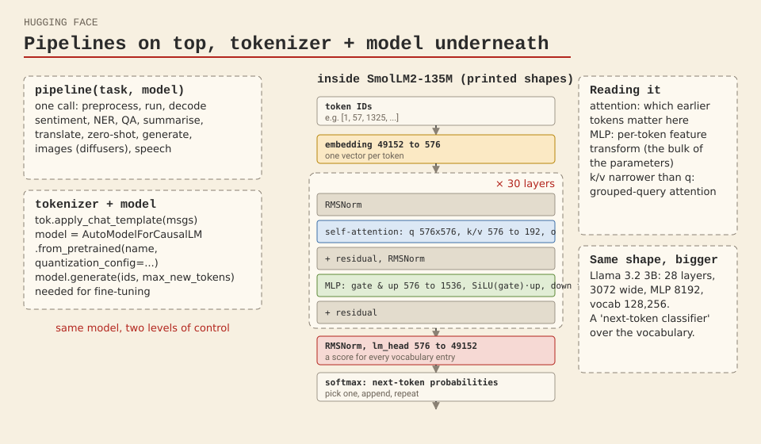
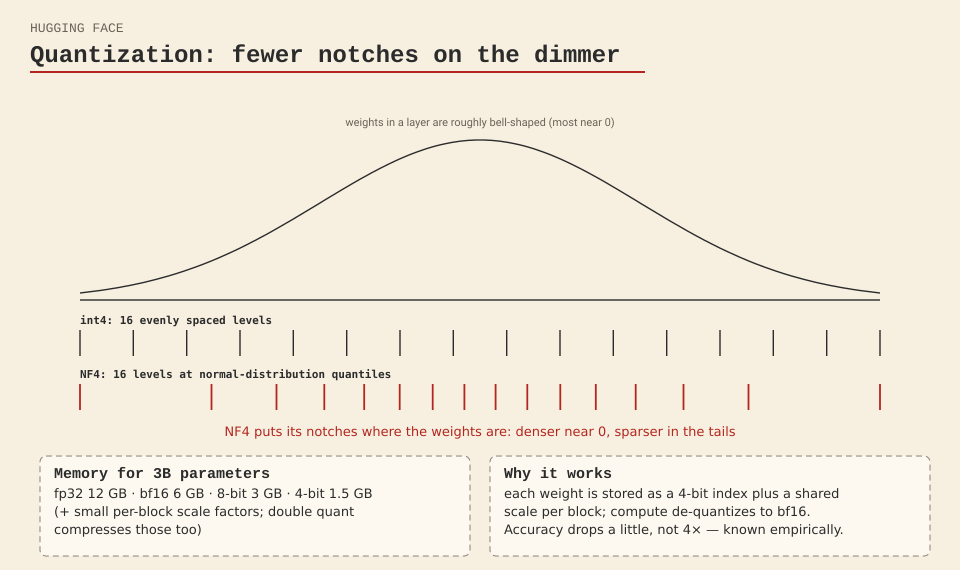

# Open-Weight Models with Hugging Face

> **How to read this note.** Study guide for Week 3 of *AI Engineer Core Track: LLM Engineering, RAG, QLoRA, Agents* (lectures 62–84). The course runs everything on Google Colab GPUs with Llama 3.x, Phi, Gemma, Qwen and DeepSeek models. The snippets here use **SmolLM2-135M-Instruct**, a 135M-parameter chat model with the same Llama-style architecture, so they run on a laptop CPU in seconds (first run downloads ~270 MB). Install: `VIRTUAL_ENV=/Users/phahng/Desktop/workarea/.venv uv pip install transformers torch scipy`. Gated models (Llama, Gemma) need a free Hugging Face account, an accepted licence and an `HF_TOKEN`.

## Why This Exists

**Problem.** Frontier APIs hide the model. To fine-tune, run privately, or just understand what an LLM is, you need the weights, the tokenizer and the code — and a working picture of what `apply_chat_template`, `generate` and "4-bit" actually do. Otherwise the first GPU out-of-memory error or a garbled chat output stops you cold.

**Key insight.** An open model is three things you can hold: a **tokenizer** (text ↔ integer IDs, including special tokens that mark who is speaking), a **stack of decoder layers** that turns those IDs into next-token scores, and the **weights**, which you can store in fewer bits to fit on smaller GPUs. Pipelines wrap all three in one call; the low-level API lets you touch each.

**Reach for this when:**
- Running an open model locally or on Colab, or about to fine-tune one ([qlora-fine-tuning](qlora-fine-tuning.md)).
- A chat model produces odd output and you suspect the prompt format.
- You hit GPU memory limits and wonder whether quantization will help.
- You need a quick task model (sentiment, NER, translation, summarisation, transcription) without paying per call.

**Don't reach for this when:**
- You just need the best answer quality: a frontier API is easier ([frontier-apis-and-tools](frontier-apis-and-tools.md)).
- You want a local chat app with no Python: Ollama does it with one command ([llm-foundations](llm-foundations.md) §7).
- You need the attention maths: [transformer-forward-pass](../math-for-ml/transformer-forward-pass.md).

## Diagrams





## 1. The Hub and the libraries

**Hugging Face** means two things: a **website** (the Hub) and a family of **libraries**.
- The Hub hosts ~2M models, ~500k datasets and **Spaces** — small hosted apps (Gradio, Streamlit, Docker). Filter models by task, size and licence; every model has a card.
- `huggingface_hub` (download/upload, login), `datasets` (load and stream datasets), `transformers` (the models). For fine-tuning: `peft` (LoRA adapters), `trl` (training loops such as `SFTTrainer`), `accelerate` (devices and distributed training).

**Ollama vs transformers.** Ollama packages quantised GGUF weights with optimised C++ behind an API — great for *using* a model. transformers gives you the actual PyTorch model — needed to *change* it.

**GPUs.** LLM inference and training are giant matrix multiplications, which GPUs do in parallel. The binding constraint is **VRAM**: the weights (and, for training, gradients and optimiser state) must fit. Colab offers a free **T4** (15 GB) and paid **A100** (40–80 GB) runtimes. Practical Colab lore from the course: models and pip installs are not cached between runtimes; a "CUDA required" error usually means you were silently moved to a CPU machine — *Disconnect and delete runtime*, then run again from the top.

## 2. Pipelines: one line per task

**The question.** What's the fastest way to use a model for a common task?

A **pipeline** bundles tokenizer, model and post-processing behind one call. You build it once (task, optionally a model and device) and call it many times. The course runs sentiment analysis, named-entity recognition, question answering, summarisation, translation, zero-shot classification and text generation, plus **diffusers** pipelines for images (SDXL Turbo, FLUX) and a text-to-speech model.

```python
from transformers import pipeline, set_seed
set_seed(0)
gen = pipeline("text-generation", model="HuggingFaceTB/SmolLM2-135M-Instruct", device="cpu")   # build once ("cuda" on a GPU)
out = gen([{"role": "user", "content": "Give me one word that rhymes with cat."}], max_new_tokens=10, do_sample=False)
print(out[0]["generated_text"][-1])                        # pipelines apply the chat template for you
# Expected output:
# {'role': 'assistant', 'content': "I'm sorry for the confusion, but as a"}
```

The pipeline handled the chat template and decoding; the 135M model's answer shows why size matters. Two warnings from the course's runs: if you omit `model=`, a default is chosen for you (fine for exploring, not for production — pin it); and task models misread tone — a sarcastic "I should be more excited" came back POSITIVE with 90% confidence. Small task-specific models (translation, NER, classification) are cheap, fast and private compared with calling a frontier model for the same job.

## 3. Tokenizers and chat templates

**The question.** What exactly does the model receive when you send a chat?

### Tokens
The tokenizer splits text into subword tokens and maps each to an integer ID. Every model family has its **own** tokenizer and vocabulary — IDs from one model are meaningless to another. **Special tokens** (begin-of-text, start/end of a turn) have no built-in meaning; the model learned their role because they appeared consistently in training.

```python
from transformers import AutoTokenizer
tok = AutoTokenizer.from_pretrained("HuggingFaceTB/SmolLM2-135M-Instruct")   # downloads the tokenizer once
ids = tok.encode("I am excited to show Tokenizers in action to my LLM engineers")
print(len(ids), "tokens:", tok.convert_ids_to_tokens(ids))                  # 'Ġ' marks a leading space
print("vocabulary size:", len(tok), "| decode round-trip:", tok.decode(ids))
msgs = [{"role": "system", "content": "You are terse."}, {"role": "user", "content": "Tell me a joke"}]
print(tok.apply_chat_template(msgs, tokenize=False, add_generation_prompt=True))   # the chat as ONE string
# Expected output:
# 14 tokens: ['I', 'Ġam', 'Ġexcited', 'Ġto', 'Ġshow', 'ĠToken', 'izers', 'Ġin', 'Ġaction', 'Ġto', 'Ġmy', 'ĠL', 'LM', 'Ġengineers']
# vocabulary size: 49152 | decode round-trip: I am excited to show Tokenizers in action to my LLM engineers
# <|im_start|>system
# You are terse.<|im_end|>
# <|im_start|>user
# Tell me a joke<|im_end|>
# <|im_start|>assistant
```

`Ġ` marks a token that starts with a space; "Tokenizers" became "Token" + "izers", and "LLM" two pieces. SmolLM2's vocabulary has 49,152 entries; Llama 3's has 128,256 (128k plus reserved special tokens).

### Base vs instruct, and the chat template
A **base** model never saw roles; an **instruct** model was fine-tuned on conversations written in a specific format. `apply_chat_template` writes your message list in exactly that format — above, `<|im_start|>role … <|im_end|>` blocks — and, with `add_generation_prompt=True`, ends with an open assistant turn. The model's most likely continuation is then an assistant reply. **A chat is just one flat string with markers.** Use the wrong template (or none) and the model sees an unfamiliar format and rambles. Llama's template even inserts a "Cutting Knowledge Date" and today's date into the system turn; Phi, Qwen and DeepSeek each use different markers.

## 4. The low-level API: next-token probabilities and generate

**The question.** What does the model actually output?

A score for **every** vocabulary token as the next one. Softmax turns scores into probabilities. `generate` picks one (greedy: the top one; sampling: draw by probability), appends it, and runs again.

```python
import torch
from transformers import AutoTokenizer, AutoModelForCausalLM
torch.manual_seed(0)
name = "HuggingFaceTB/SmolLM2-135M-Instruct"                # 135M-parameter chat model, runs on CPU
tok, model = AutoTokenizer.from_pretrained(name), AutoModelForCausalLM.from_pretrained(name)
msgs = [{"role": "user", "content": "What is the capital of France?"}]
inputs = tok.apply_chat_template(msgs, add_generation_prompt=True, return_tensors="pt", return_dict=True)
with torch.no_grad():
    logits = model(**inputs).logits[0, -1]                 # scores for the NEXT token only
probs = torch.softmax(logits, -1)
top = probs.topk(5)
print("next-token candidates:", [(tok.decode(int(i)), round(float(p), 3)) for p, i in zip(top.values, top.indices)])
out = model.generate(**inputs, max_new_tokens=12, do_sample=False)   # greedy: always the top token
print("greedy answer:", tok.decode(out[0, inputs["input_ids"].shape[1]:], skip_special_tokens=True))
# Expected output:
# next-token candidates: [('The', 0.844), ('Paris', 0.042), ('As', 0.015), ('Bon', 0.014), ('I', 0.014)]
# greedy answer: The capital of France is Paris.
```

The model is 84% sure the answer begins with "The", only 4% "Paris" — it plans to answer in a full sentence, and greedy decoding duly writes "The capital of France is Paris." The course visualises this as a tree of the top-3 candidates at each step (via an API's `logprobs`), which makes temperature concrete: low temperature follows the thickest branch; higher temperature sometimes takes another.

The course's standard recipe on a GPU, updated for transformers v5:

1. `tokenizer.pad_token = tokenizer.eos_token` (many tokenizers ship without a pad token).
2. `inputs = tokenizer.apply_chat_template(messages, add_generation_prompt=True, return_tensors="pt", return_dict=True).to("cuda")`. In v5 this returns a dict (`input_ids`, `attention_mask`), not a bare tensor.
3. `model = AutoModelForCausalLM.from_pretrained(name, device_map="auto", quantization_config=bnb_config)`.
4. `model.generate(**inputs, max_new_tokens=80, streamer=TextStreamer(tokenizer))` to stream tokens as they come.
5. Free memory afterwards (`del model`, `gc.collect()`, `torch.cuda.empty_cache()`) before loading the next model.

## 5. What's inside: printing the model

**The question.** What are the boxes in a "decoder-only transformer"?

Print the model and read the shapes:

```python
from transformers import AutoModelForCausalLM
m = AutoModelForCausalLM.from_pretrained("HuggingFaceTB/SmolLM2-135M-Instruct")
print(m.model.embed_tokens, "| decoder layers:", len(m.model.layers), "| head:", m.lm_head)
layer = m.model.layers[0]
print("attention:", {k: tuple(getattr(layer.self_attn, k).weight.shape) for k in ("q_proj", "k_proj", "v_proj", "o_proj")})
print("MLP:", {k: tuple(getattr(layer.mlp, k).weight.shape) for k in ("gate_proj", "up_proj", "down_proj")}, "| act:", layer.mlp.act_fn)
print("norm:", type(layer.input_layernorm).__name__, "| params: %.0fM" % (sum(p.numel() for p in m.parameters()) / 1e6))
# Expected output:
# Embedding(49152, 576, padding_idx=2) | decoder layers: 30 | head: Linear(in_features=576, out_features=49152, bias=False)
# attention: {'q_proj': (576, 576), 'k_proj': (192, 576), 'v_proj': (192, 576), 'o_proj': (576, 576)}
# MLP: {'gate_proj': (1536, 576), 'up_proj': (1536, 576), 'down_proj': (576, 1536)} | act: SiLUActivation()
# norm: LlamaRMSNorm | params: 135M
```

Read top to bottom (the first diagram):
- **Embedding** — a lookup table: each of 49,152 token IDs → a 576-number vector.
- **30 decoder layers**, each:
  - **Self-attention** — every position decides which earlier positions to draw information from, via query, key and value projections and an output projection. Keys and values are only 192 wide here: several query heads share one key/value head (**grouped-query attention**), which saves memory at inference time. Position information is injected inside attention by rotary embeddings (RoPE).
  - **MLP** — a per-token transformation: `gate` and `up` both project 576 → 1536, `SiLU(gate) × up` (the **SwiGLU** form), then `down` back to 576. This is where most parameters live.
  - **RMSNorm** before each part and **residual connections** around each — the network adds to its running representation instead of replacing it.
- **lm_head** — 576 → 49,152: a score for every possible next token. An LLM is a next-token *classifier* over its vocabulary.

Why non-linear activations at all? Without them, any stack of linear layers collapses into one linear map ([artificial-neural-networks](../deep-learning/artificial-neural-networks.md) §2). Llama 3.2 3B has the same shape at larger sizes: 28 layers, width 3072, MLP 8192, vocabulary 128,256.

## 6. Quantization: storing weights in fewer bits

**The question.** A 3B-parameter model is 12 GB in 32-bit floats. How do you fit it on a 15 GB T4 with room to work — or an 8B model at all?

Store each weight with fewer bits. With 8 bits there are 256 possible values; with 4 bits, 16. Like a dimmer switch with fewer notches: the light is still roughly right. Each block of weights keeps one full-precision **scale** factor; each weight stores only an index into the levels.

Which 16 levels? Weights are roughly normally distributed — most near zero. Evenly spaced levels waste notches in the sparse tails. **NF4** ("normal float 4") places its levels at quantiles of a normal distribution, denser near zero:

```python
import numpy as np
rng = np.random.default_rng(0)
w = rng.normal(0, 0.02, 4096).astype(np.float32)          # one row of weights, roughly normal like real layers
def quantize(x, levels):                                   # round each weight to the nearest of the given levels
    scale = np.abs(x).max()                                # absmax scaling: map the block into [-1, 1]
    idx = np.abs(x[:, None] / scale - levels[None]).argmin(1)
    return levels[idx] * scale
int4 = np.linspace(-1, 1, 16)                              # 16 evenly spaced levels
from scipy.stats import norm
nf4 = norm.ppf(np.linspace(0.02, 0.98, 16)); nf4 /= np.abs(nf4).max()   # 16 levels at normal quantiles (NF4 idea)
for name, lv in (("int8 (256 levels)", np.linspace(-1, 1, 256)), ("int4 even", int4), ("nf4-style", nf4)):
    err = np.abs(quantize(w, lv) - w).mean() / np.abs(w).mean()
    print(f"{name:18s}: mean relative error {err:.3f}")
print("memory for 3B params: fp32 %.1f GB, bf16 %.1f GB, 8-bit %.1f GB, 4-bit %.1f GB" % tuple(3e9 * b / 8 / 1e9 for b in (32, 16, 8, 4)))
# Expected output:
# int8 (256 levels) : mean relative error 0.010
# int4 even         : mean relative error 0.161
# nf4-style         : mean relative error 0.111
# memory for 3B params: fp32 12.0 GB, bf16 6.0 GB, 8-bit 3.0 GB, 4-bit 1.5 GB
```

8-bit is almost lossless; NF4-style levels beat evenly spaced 4-bit levels by about a third in this test. In practice, a 4-bit model loses only a little on benchmarks for a 4× memory saving versus 16-bit — much better than throwing away three-quarters of the weights would, which is understood mostly empirically. The course's config (bitsandbytes, GPU only):

- `load_in_4bit=True`, `bnb_4bit_quant_type="nf4"`, `bnb_4bit_use_double_quant=True` (quantise the scale factors too), and a compute dtype of bfloat16 — weights are de-quantised on the fly for each matrix multiply.
- Printed, the linear layers become `Linear4bit`; Llama 3.2 1B's footprint drops to about 1 GB.

Quantization is the "Q" in **QLoRA** ([qlora-fine-tuning](qlora-fine-tuning.md)).

## 7. Comparing open models, and the meeting-minutes project

The course loads five instruct models with the same recipe and asks each for a joke: Llama 3.2 1B, Phi-4-mini, Gemma 3 270M (needed quantisation turned off to load), Qwen3-4B, and a DeepSeek-R1 distill on Qwen 1.5B — which spent its whole 500-token budget "thinking" and never reached the punchline. Lesson: reasoning distills need a large `max_new_tokens`, and tiny models are tiny.

**Project: meeting minutes from audio.** Take a council-meeting recording, transcribe it (open **Whisper** through the ASR pipeline in ~2 minutes on a T4, or a hosted transcription API in ~30 s for a few cents), then have a 4-bit Llama 3.2 3B write minutes in markdown — summary, discussion points, takeaways and action items with owners — streamed as it goes. It's the canonical "speech model → LLM" chain.

**Homework:** a synthetic-data generator — describe the dataset you want and have several open models produce it — whose real purpose is repeating the tokenizer/model recipe until it's routine.

## 8. What has aged

Model choices (Llama 3.1/3.2, Phi-4-mini, Qwen2.5/Qwen3-2507, DeepSeek V3.1) have successors; Hub counts and Colab prices move; `torch_dtype` is now `dtype`; in transformers v5 `apply_chat_template` defaults to `return_dict=True` and returns a dict, so the course's `model.generate(inputs)` must become `model.generate(**inputs)` (or pass `return_dict=False` to get the old tensor); the course pins `datasets==3.6.0` for one dataset. Two small corrections to the lectures: Llama's norms are **RMSNorm**, not LayerNorm, and rotary position embeddings live in the attention layers, not the embedding layer. Setting `pad_token = eos_token` is a common idiom but can teach a fine-tuned model never to stop; prefer a dedicated pad token when the tokenizer has one.

## Trade-offs

- **Pipeline vs low-level API.** One line and sensible defaults vs full control over prompts, decoding, memory and training.
- **Bigger model vs quantised bigger model vs smaller model.** For a fixed GPU, a 4-bit larger model usually beats a 16-bit smaller one — at some speed cost from de-quantisation.
- **Open model on Colab vs frontier API.** Privacy, no per-token cost and fine-tunability vs setup friction, smaller models and GPU limits.
- **Instruct vs base.** Instruct follows chat prompts; base is a cleaner starting point for teaching one narrow skill.

## Common Pitfalls

- **Wrong or missing chat template.** Use the model's own `apply_chat_template`; never hand-write another model's markers.
- **Mixing tokenizers and models.** IDs are model-specific; load both from the same checkpoint.
- **Forgetting `add_generation_prompt=True`.** The model may continue the user's turn instead of answering.
- **Leaving the model choice to the pipeline default.** Defaults change between versions; pin the model.
- **Out of GPU memory after the second model.** Delete the first and empty the CUDA cache.
- **Reasoning models with small `max_new_tokens`.** They think first and run out before answering.
- **Expecting quantisation to speed up a CPU.** bitsandbytes 4-bit targets GPUs; on CPU use GGUF (Ollama, llama.cpp) instead.
- **Training in the checkpoint's bfloat16 on a CPU.** Recent transformers versions load weights in their stored dtype (often bf16); on CPUs without fast bf16 matmuls the backward pass can be ~40× slower. Pass `dtype=torch.float32` for CPU training.
- **Ignoring licences and gating.** Llama and Gemma need accepted licences; check commercial terms before shipping.

## Decision Table

| Scenario | Use this | Not that | Why |
|----------|----------|----------|-----|
| Standard NLP task, quickly | `pipeline(task, model=pinned)` | Frontier API call per item | Cheap, fast, private |
| Custom prompts, decoding, or fine-tuning | Tokenizer + `AutoModelForCausalLM` | Pipeline | Full control |
| Chat with an instruct model | `apply_chat_template(..., add_generation_prompt=True)` | Raw string prompt | Matches its training format |
| Model too big for the GPU | 4-bit NF4 + double quant | Dropping to a much smaller model first | Small accuracy loss, 4× smaller |
| Local use with no Python | Ollama (GGUF) | transformers on CPU | Optimised inference, one command |
| Speech → summary | Whisper (ASR) → LLM | One model for both | Each model does one job well |

## References

- [Course repository: ed-donner/llm_engineering](https://github.com/ed-donner/llm_engineering)
- [transformers: pipelines](https://huggingface.co/docs/transformers/main_classes/pipelines) · [chat templating](https://huggingface.co/docs/transformers/chat_templating) · [generation with LLMs](https://huggingface.co/docs/transformers/llm_tutorial) · [bitsandbytes quantization](https://huggingface.co/docs/transformers/quantization/bitsandbytes) · [diffusers](https://huggingface.co/docs/diffusers/index)
- [SmolLM2-135M-Instruct model card](https://huggingface.co/HuggingFaceTB/SmolLM2-135M-Instruct) · [SDXL Turbo](https://huggingface.co/stabilityai/sdxl-turbo)
- [Dettmers et al. — QLoRA (2023)](https://arxiv.org/abs/2305.14314) — introduces NF4 and double quantization.
- [Ainslie et al. — GQA: grouped-query attention (2023)](https://arxiv.org/abs/2305.13245)
- [Radford et al. — Whisper (2022)](https://arxiv.org/abs/2212.04356)
- [Brendan Bycroft — LLM visualization](https://bbycroft.net/llm) — an interactive 3-D walk through a GPT's layers.

## See Also

- [llm-foundations](llm-foundations.md) — tokens, sampling and the call loop at the API level.
- [qlora-fine-tuning](qlora-fine-tuning.md) — Week 7: fine-tuning a 4-bit Llama with LoRA adapters.
- [transformer-forward-pass](../math-for-ml/transformer-forward-pass.md) — the attention and MLP maths behind §5.
- [recurrent-neural-networks](../deep-learning/recurrent-neural-networks.md) — what transformers replaced, and why.
