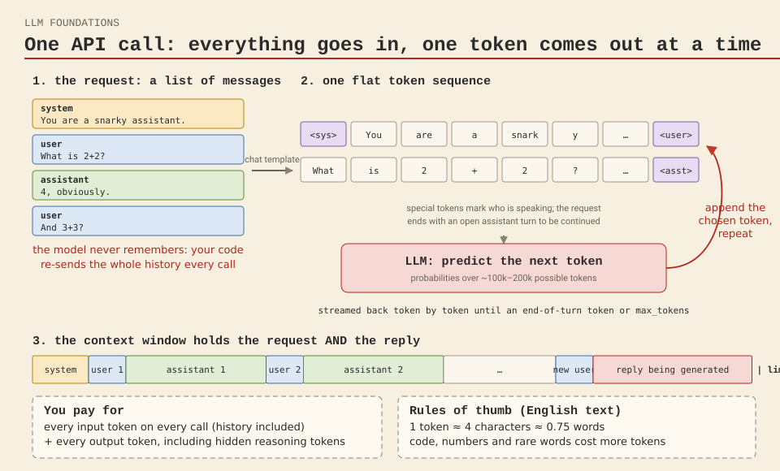
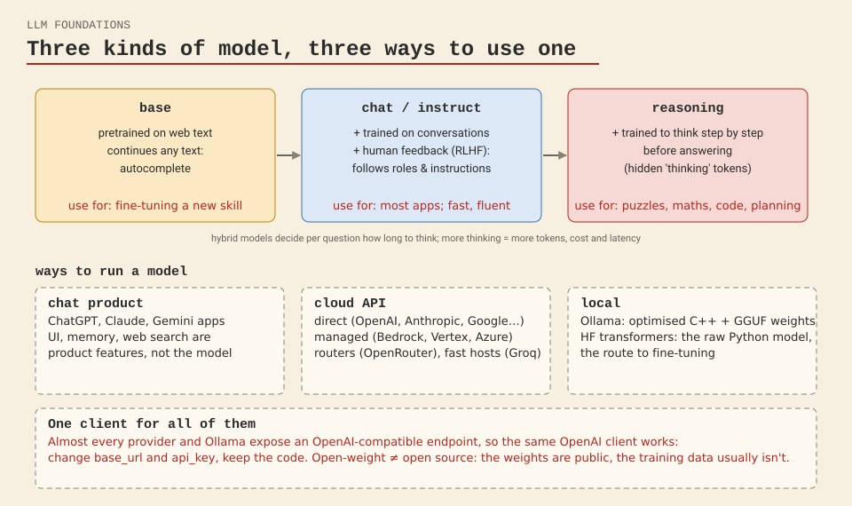

# LLM Foundations: What One API Call Does

> **How to read this note.** Study guide for Week 1 of *AI Engineer Core Track: LLM Engineering, RAG, QLoRA, Agents* (Udemy; lectures 1–37). The course builds a website summarizer and then a company-brochure generator on the OpenAI API. Here every snippet runs **offline with no API key**: the real `openai` client talks to a fake in-process server (`httpx.MockTransport`), so you can see exactly what goes over the wire. Install once: `VIRTUAL_ENV=/Users/phahng/Desktop/workarea/.venv uv pip install openai tiktoken`. Model names and prices in the course date from late 2025 and move fast; treat them as examples.

## Why This Exists

**Problem.** Chat apps make an LLM look like a person who remembers you. Code that calls the API works differently: every call is independent, you send the whole conversation each time, you pay per token for all of it, and the model only ever predicts the next token. Bugs and surprise bills come from not knowing this.

**Key insight.** An LLM call is: messages → one flat sequence of tokens → the model picks a next token, appends it, and repeats. Everything else — memory, roles, JSON output, streaming, "thinking" — is a convention layered on that loop.

**Reach for this when:**
- Starting the LLM Engineering course, or writing your first code against any chat-completions API.
- A conversation gets slow or expensive as it grows, or the model "forgets" something.
- You need to switch providers (OpenAI, Gemini, Claude, a local Ollama model) without rewriting code.

**Don't reach for this when:**
- You need retrieval over your own documents — see [retrieval-augmented-generation](retrieval-augmented-generation.md).
- You want the model to call functions — see [frontier-apis-and-tools](frontier-apis-and-tools.md).
- You want the maths of attention — see [transformer-forward-pass](../math-for-ml/transformer-forward-pass.md).

## Diagrams





## 1. A call is a list of messages

**The question.** What do you actually send?

A list of messages, each with a **role** and **content**:
- `system` — standing instructions: persona, tone, rules ("answer in markdown", "if you don't know, say so").
- `user` — the request.
- `assistant` — the model's earlier replies (you include them to continue a conversation).

The reply comes back in `choices[0].message.content`. The `openai` Python client is only a convenience wrapper: it turns your call into an HTTP POST with a bearer-token header and a JSON body. Point the fake server at it and you can see the whole thing:

```python
import json, httpx
from openai import OpenAI
def fake_server(request: httpx.Request) -> httpx.Response:   # stands in for api.openai.com
    print(request.method, request.url)
    print("auth header:", request.headers["authorization"][:12] + "...")
    print("body:", request.content.decode())
    reply = {"id": "x", "object": "chat.completion", "created": 0, "model": "demo",
             "choices": [{"index": 0, "finish_reason": "stop",
                          "message": {"role": "assistant", "content": "4. Obviously."}}]}
    return httpx.Response(200, json=reply)
client = OpenAI(api_key="sk-demo", base_url="https://api.openai.com/v1",   # swap base_url for Gemini, Ollama, ...
                http_client=httpx.Client(transport=httpx.MockTransport(fake_server)))
r = client.chat.completions.create(model="any-model", messages=[
    {"role": "system", "content": "You are a snarky assistant."},
    {"role": "user", "content": "What is 2+2?"}])
print("reply:", r.choices[0].message.content)
# Expected output:
# POST https://api.openai.com/v1/chat/completions
# auth header: Bearer sk-de...
# body: {"model":"any-model","messages":[{"role":"system","content":"You are a snarky assistant."},{"role":"user","content":"What is 2+2?"}]}
# reply: 4. Obviously.
```

**One client for every provider.** Almost every provider now offers an *OpenAI-compatible* endpoint: Gemini, Anthropic, DeepSeek, Groq, OpenRouter, and a local Ollama server (`http://localhost:11434/v1`, any dummy key). Change `base_url` and `api_key` and the same code talks to a different model. The course uses this throughout instead of each vendor's own SDK.

**Prompts are code.** The system prompt in the course's summarizer is a handful of rules ("summarize this website, ignore navigation text, reply in markdown, don't wrap it in a code block"). Swap "helpful" for "snarky" and the same model answers 2+2 with sarcasm. Iterating on these few sentences is most of the work — and the cheapest lever you have.

## 2. Tokens: what the model reads and what you pay for

**The question.** The model doesn't see characters or words. What does it see?

**Tokens**: chunks between a character and a word. Characters alone would make the sequences very long and force the network to learn spelling; whole words would need an enormous vocabulary and still fail on new words. Subword tokens split the difference: common words are one token, rare words are a few pieces, and a leading space is part of the token (so " important" and "important" differ). Each token is just an integer ID into a vocabulary of roughly 100k–200k entries.

```python
import tiktoken
enc = tiktoken.get_encoding("o200k_base")                  # the tokenizer of GPT-4o-era OpenAI models
for text in ["An important sentence for my class", "Handcrafted quips about witchcraft", "3.14159265358979"]:
    ids = enc.encode(text)
    print(f"{len(text):2d} chars -> {len(ids):2d} tokens:", [enc.decode([i]) for i in ids])
words = "Quantization shrinks transformer checkpoints, letting practitioners fine-tune LLaMA-style models on consumer GPUs".split()
n = len(enc.encode(" ".join(words)))
print(f"{len(words)} words = {n} tokens -> {len(words) / n:.2f} words per token")
# Expected output:
# 34 chars ->  6 tokens: ['An', ' important', ' sentence', ' for', ' my', ' class']
# 34 chars ->  7 tokens: ['Hand', 'crafted', ' qu', 'ips', ' about', ' witch', 'craft']
# 16 chars ->  7 tokens: ['3', '.', '141', '592', '653', '589', '79']
# 12 words = 20 tokens -> 0.60 words per token
```

Common words are one token each; "handcrafted" and "witchcraft" split into pieces; digits go in groups of three, one reason early models were bad at arithmetic. Everyday English averages about **4 characters or 0.75 words per token**; technical text, code and numbers use more tokens per word (0.6 above).

## 3. The API is stateless: the illusion of memory

**The question.** If every call is independent, how does a chatbot remember your name?

It doesn't. Your code keeps the conversation and **sends all of it again** on every call: system prompt, every earlier question, every earlier answer, then the new question. The model reads the whole thing fresh and continues it. "Memory" is just a longer input. Two consequences:

- You **pay for the history again on every turn**, so cost per call grows with the conversation.
- Everything must fit in the **context window** — the maximum tokens per call, *including the reply being generated*.

```python
history = [("system", 60)]                       # (role, tokens): a 60-token system prompt
sent_total = 0
for turn in range(1, 11):
    history.append(("user", 40))                 # each question ~40 tokens
    sent = sum(t for _, t in history)            # the API is stateless: the WHOLE history goes in again
    sent_total += sent
    history.append(("assistant", 150))           # each answer ~150 tokens, part of the next request
    if turn in (1, 2, 5, 10): print(f"turn {turn:2d}: input tokens this call {sent:5d}, input so far {sent_total:6d}")
price_in = 1.25 / 1e6                            # example price: $1.25 per million input tokens
print(f"input cost of the 10-turn chat: ${sent_total * price_in:.4f}; call 10 costs {1810 / 100:.0f}x call 1")
# Expected output:
# turn  1: input tokens this call   100, input so far    100
# turn  2: input tokens this call   290, input so far    390
# turn  5: input tokens this call   860, input so far   2400
# turn 10: input tokens this call  1810, input so far   9550
# input cost of the 10-turn chat: $0.0119; call 10 costs 18x call 1
```

The tenth call sends 18× as many input tokens as the first. Long chats get expensive and slow; that's why apps summarise or trim old turns, and why providers offer **prompt caching** (a discount when the start of the input is identical to a recent call — put fixed content first).

**What you're billed for.** Input tokens and output tokens, priced separately per million (output costs several times more). **Reasoning models also bill their hidden "thinking" tokens as output**, even though you never see them. Chat subscriptions and API billing are separate accounts.

## 4. One token at a time: sampling and temperature

**The question.** If the model outputs probabilities, how does it pick a word?

The model scores every vocabulary token as the possible next one. Softmax turns the scores into probabilities; then the server **samples** one. **Temperature** divides the scores before the softmax: low temperature sharpens the distribution toward the top token, high temperature flattens it.

```python
import numpy as np
tokens = ["Paris", "Lyon", "France", "the", "banana"]
logits = np.array([6.0, 3.5, 3.0, 2.0, -1.0])            # model scores for the next token after "The capital of France is"
for T in (0.2, 1.0, 2.0):                                  # temperature divides the logits before softmax
    p = np.exp(logits / T); p /= p.sum()
    print(f"T={T}: " + "  ".join(f"{t} {q:.2f}" for t, q in zip(tokens, p)))
rng = np.random.default_rng(0)
p = np.exp(logits); p /= p.sum()
print("10 samples at T=1:", [tokens[i] for i in rng.choice(5, 10, p=p)])   # sampling, not always the top token
# Expected output:
# T=0.2: Paris 1.00  Lyon 0.00  France 0.00  the 0.00  banana 0.00
# T=1.0: Paris 0.87  Lyon 0.07  France 0.04  the 0.02  banana 0.00
# T=2.0: Paris 0.60  Lyon 0.17  France 0.13  the 0.08  banana 0.02
# 10 samples at T=1: ['Paris', 'Paris', 'Paris', 'Paris', 'Paris', 'Lyon', 'Paris', 'Paris', 'Paris', 'Lyon']
```

At T = 0.2 the model is effectively deterministic; at T = 2 it says "the" or "banana" sometimes. Temperature 0 is *mostly* repeatable but not guaranteed (batching and GPU arithmetic vary). Want creativity? Ask for it in the prompt; cranking temperature mostly adds noise.

Generation repeats this loop — pick a token, append it, predict again — until the model emits an end-of-turn token or hits `max_tokens`. That's why answers can be **streamed**.

## 5. Streaming

With `stream=True` the server sends each new piece of text as soon as it's generated, as **server-sent events** (one `data:` line per chunk). The client yields chunks; you append each `delta.content` and re-render.

```python
import json, httpx
from openai import OpenAI
def fake_server(request):                                  # replies as a server-sent-event (SSE) stream
    words = ["Streaming ", "sends ", "the ", "answer ", "in ", "pieces."]
    events = "".join("data: " + json.dumps({"id": "x", "object": "chat.completion.chunk", "created": 0, "model": "demo",
                     "choices": [{"index": 0, "delta": {"content": w}, "finish_reason": None}]}) + "\n\n" for w in words)
    return httpx.Response(200, headers={"content-type": "text/event-stream"}, content=events + "data: [DONE]\n\n")
client = OpenAI(api_key="sk-demo", http_client=httpx.Client(transport=httpx.MockTransport(fake_server)))
stream = client.chat.completions.create(model="demo", messages=[{"role": "user", "content": "hi"}], stream=True)
so_far = ""
for chunk in stream:                                       # one chunk per piece of text, as it is generated
    so_far += chunk.choices[0].delta.content or ""
    print(repr(so_far))                                    # a UI re-renders the text-so-far each time
# Expected output:
# 'Streaming '
# 'Streaming sends '
# 'Streaming sends the '
# 'Streaming sends the answer '
# 'Streaming sends the answer in '
# 'Streaming sends the answer in pieces.'
```

Streaming doesn't make the answer faster to finish; it makes the first words appear sooner, which is what users notice.

## 6. JSON output and chaining calls: the brochure project

**The course project.** Given a company's website, write a brochure for customers, investors and recruits. Two LLM calls:
1. **Pick the useful links.** Scrape the homepage's links and ask a cheap model which ones matter (about page, careers, products — not privacy or terms pages). Ask for JSON, and give **one example of the exact shape** in the system prompt (one-shot prompting). Turn on **JSON mode** (`response_format={"type": "json_object"}`), which constrains decoding so the output always parses.
2. **Write the brochure.** Fetch those pages, paste their text (truncated to ~5,000 characters) into a second prompt, and stream the markdown result.

```python
import json, httpx
from openai import OpenAI
def fake_server(request):                                  # plays the LLM for both calls
    body = json.loads(request.content)
    if body.get("response_format") == {"type": "json_object"}:   # call 1: pick useful links, as JSON
        text = json.dumps({"links": [{"type": "about page", "url": "https://acme.test/about"},
                                     {"type": "careers page", "url": "https://acme.test/jobs"}]})
    else:                                                  # call 2: write the brochure from what call 1 chose
        text = "# Acme\nWe build anvils. Pages used: " + body["messages"][-1]["content"]
    return httpx.Response(200, json={"id": "x", "object": "chat.completion", "created": 0, "model": "demo",
        "choices": [{"index": 0, "finish_reason": "stop", "message": {"role": "assistant", "content": text}}]})
client = OpenAI(api_key="sk-demo", http_client=httpx.Client(transport=httpx.MockTransport(fake_server)))
links_prompt = ('Pick the links useful for a company brochure. Reply in JSON like '
                '{"links": [{"type": "about page", "url": "https://..."}]}. Skip privacy and terms pages.')   # one-shot example
r1 = client.chat.completions.create(model="demo", response_format={"type": "json_object"},
        messages=[{"role": "system", "content": links_prompt}, {"role": "user", "content": "Links: /about /jobs /privacy"}])
links = json.loads(r1.choices[0].message.content)["links"]   # JSON mode: safe to parse
urls = ", ".join(l["url"] for l in links)
r2 = client.chat.completions.create(model="demo", messages=[{"role": "user", "content": urls}])
print(links); print(r2.choices[0].message.content)
# Expected output:
# [{'type': 'about page', 'url': 'https://acme.test/about'}, {'type': 'careers page', 'url': 'https://acme.test/jobs'}]
# # Acme
# We build anvils. Pages used: https://acme.test/about, https://acme.test/jobs
```

Chaining small, specific calls — each with one job and a checkable output — beats one giant prompt. The same model may return different link sets on different runs (the course saw 3 to 14 links for the same site), so code must tolerate variation. Newer APIs offer **structured outputs** with a full JSON schema; JSON mode only guarantees *valid* JSON, not the right fields (see [agentic-ai-systems](agentic-ai-systems.md) §2).

The scraper uses `requests` + BeautifulSoup, so it only sees server-rendered HTML; sites that build their page with JavaScript come back nearly empty (a headless browser such as Playwright fixes that).

## 7. Kinds of models and ways to run them

### Base, chat, reasoning, hybrid
- **Base model** — trained only to continue text from the web. Ask it a question and it may continue with more questions. Useful as a starting point for fine-tuning a new skill ([qlora-fine-tuning](qlora-fine-tuning.md)).
- **Chat / instruct model** — further trained on conversations with system/user/assistant roles, then with human feedback (RLHF), so it follows instructions. Before this, people coaxed GPT-3 with "Q: … A:" prompt tricks.
- **Reasoning model** — trained to write out step-by-step thinking before answering (it grew out of "think step by step" prompting). Better on puzzles, maths and code; slower and costlier. **Budget forcing** (the *s1* paper) shows thinking length can be stretched at inference time by inserting "Wait" when the model tries to stop.
- **Hybrid** — decides per question how much to think, or exposes a `reasoning_effort` knob.

Rule of thumb from the course: reasoning models for hard, checkable problems; chat models for speed, cost and fluent writing (the writing claim is anecdotal).

### Open-weight vs closed
Closed **frontier** models (GPT, Claude, Gemini, Grok) are reached only through an API. **Open-weight** models (Llama, Qwen, Gemma, Mistral/Mixtral, Phi, DeepSeek, gpt-oss) publish their weights — but rarely their training data, so "open source" is a stretch. Small "DeepSeek-R1" variants are **distillations**: Qwen or Llama models trained on the big model's outputs.

### Three ways to use a model
1. **Chat products** (ChatGPT, Claude, Gemini apps). Memory, web search and file tools are product features around the model, not the model itself.
2. **Cloud APIs** — directly from the lab, through a cloud platform (Bedrock, Vertex AI, Azure), through a router (OpenRouter), or from a fast-inference host (Groq — not to be confused with xAI's Grok).
3. **Local** — **Ollama** runs optimised C++ inference on quantised GGUF weights and serves an OpenAI-compatible API; **Hugging Face transformers** runs the actual Python model code, which is what you need to inspect or fine-tune it ([huggingface-open-models](huggingface-open-models.md)).

### What frontier models are good and bad at
Strong at synthesis, drafting, explanation and code. Weak spots: a **knowledge cutoff** (they'll confidently "correct" a model name newer than their training data back to an older one), **confident hallucination** (they're trained to sound plausible), and blind spots on trivial-looking questions — "how many words are in your answer?" tripped several frontier models in the course's tests. Treat them as tireless junior analysts: fast, useful, and in need of review.

## 8. A little history and scale

- **2017** — "Attention Is All You Need" introduces the transformer: simpler and far more parallelisable than LSTMs ([recurrent-neural-networks](../deep-learning/recurrent-neural-networks.md)), so it scales.
- **2018–2020** — GPT-1 (117M parameters), GPT-2 (1.5B), GPT-3 (175B).
- **2022** — ChatGPT: a GPT-3.5 model with instruction tuning and RLHF.
- Since then: GPT-4 and successors, open-weight families, reasoning models, and agents.

Two ways to get a better answer: **training-time scaling** (more parameters and data; the *Chinchilla* result says to grow data roughly in step with parameters) and **inference-time scaling** (let the model reason longer, or give it better context — RAG, tools). They combine. Parameter counts for recent frontier models aren't published; figures like "1.76T for GPT-4" are rumours.

Two definitions of **agent** appear early: an LLM that controls its own workflow, or an LLM calling tools in a loop toward a goal. They're developed in [agentic-ai-systems](agentic-ai-systems.md).

## Trade-offs

- **Frontier API vs local model.** Frontier: best quality, no hardware, pay per token, data leaves your machine. Local: free per call and private, but limited by your RAM/GPU and noticeably weaker at small sizes.
- **Reasoning vs chat model.** Higher accuracy on hard problems vs higher latency and hidden token cost.
- **One OpenAI-compatible client vs vendor SDKs.** Portability and less code vs missing vendor-specific features (some caching controls, extended thinking options, newer APIs such as OpenAI's Responses API).
- **Long history vs trimming.** Context makes answers coherent, but every token costs on every call and very long inputs can dilute attention.

## Common Pitfalls

- **Assuming the model remembers.** It sees only what this request contains. Keep and send the history yourself.
- **Forgetting that history is re-billed.** A long chat's input cost grows every turn; trim, summarise or cache.
- **Ignoring hidden reasoning tokens.** A reasoning model's bill can be many times what the visible answer suggests.
- **Counting words instead of tokens.** Limits and prices are in tokens; measure with the provider's tokenizer (tiktoken for OpenAI).
- **Expecting temperature 0 to be perfectly deterministic.** Close, not guaranteed.
- **Parsing free text as JSON.** Use JSON mode or structured outputs, and still validate.
- **Trusting model self-knowledge.** Ask a model about recent events or newer models and it will guess from its training cutoff.
- **Scraping JS-heavy sites with requests.** You get an empty shell; use a headless browser.
- **Putting API keys in code or notebooks.** Keep them in `.env` (loaded with `python-dotenv`) and out of version control.

## Decision Table

| Scenario | Use this | Not that | Why |
|----------|----------|----------|-----|
| Prototype across providers | OpenAI client + `base_url` | One SDK per vendor | Same code, swap the model |
| Private data, no budget | Local model via Ollama | Frontier API | Nothing leaves the machine |
| Hard maths/logic/code | Reasoning model | Chat model | Thinking tokens buy accuracy |
| Fast, cheap, fluent text | Small chat model | Reasoning model | Lower latency and cost |
| Output feeds code | JSON mode / structured outputs + validation | Regex on prose | Guaranteed to parse |
| Long chat getting slow/expensive | Trim/summarise history, prompt caching | Sending everything forever | Input cost grows every turn |
| Show progress to a user | `stream=True` | Waiting for the full reply | First words appear immediately |

## References

- [Course repository: ed-donner/llm_engineering](https://github.com/ed-donner/llm_engineering)
- [tiktoken](https://github.com/openai/tiktoken) — OpenAI's tokenizer library. (OpenAI's online tokenizer page and API reference are at platform.openai.com.)
- [Gemini OpenAI compatibility](https://ai.google.dev/gemini-api/docs/openai) · [Anthropic OpenAI SDK compatibility](https://docs.anthropic.com/en/api/openai-sdk) · [OpenRouter quickstart](https://openrouter.ai/docs/quickstart) · [Ollama](https://ollama.com)
- [MDN — Server-sent events](https://developer.mozilla.org/en-US/docs/Web/API/Server-sent_events) — the streaming protocol.
- [Vaswani et al. — Attention Is All You Need (2017)](https://arxiv.org/abs/1706.03762)
- [Ouyang et al. — Training language models to follow instructions with human feedback (InstructGPT, 2022)](https://arxiv.org/abs/2203.02155)
- [Hoffmann et al. — Training Compute-Optimal Large Language Models (Chinchilla, 2022)](https://arxiv.org/abs/2203.15556)
- [Muennighoff et al. — s1: Simple test-time scaling (2025)](https://arxiv.org/abs/2501.19393) — budget forcing.
- Bender et al. — *On the Dangers of Stochastic Parrots*, FAccT 2021 — the critique mentioned in the course.

## See Also

- [frontier-apis-and-tools](frontier-apis-and-tools.md) — Week 2: many providers, Gradio UIs, tool calling.
- [huggingface-open-models](huggingface-open-models.md) — Week 3: tokenizers, chat templates and model internals up close.
- [transformer-forward-pass](../math-for-ml/transformer-forward-pass.md) — what happens inside "predict the next token".
- [convolutional-neural-networks](../deep-learning/convolutional-neural-networks.md) §4 — softmax and cross-entropy, the same output layer an LLM uses.
