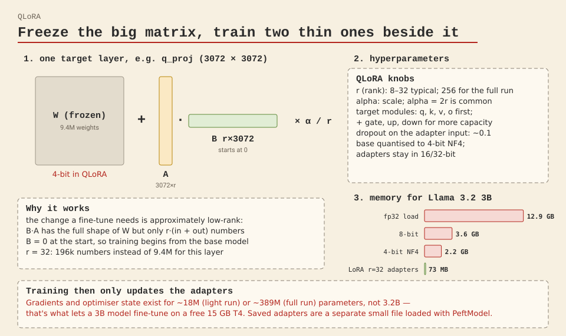
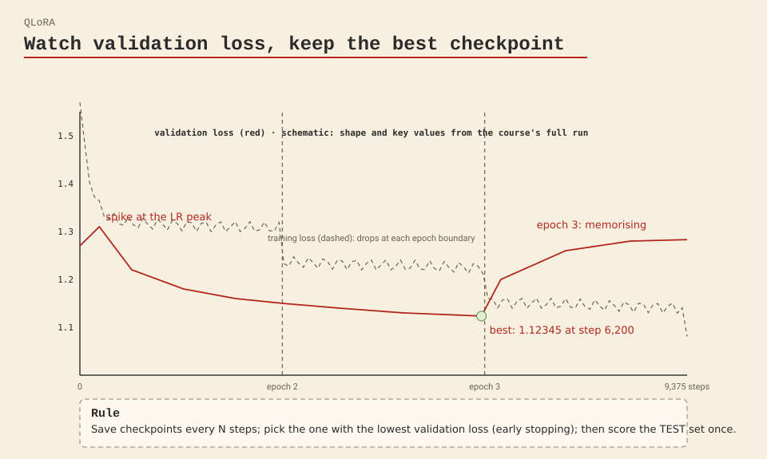

# QLoRA: Fine-Tuning an Open Model to Beat the Frontier

> **How to read this note.** Study guide for Week 7 of *AI Engineer Core Track: LLM Engineering, RAG, QLoRA, Agents* (lectures 165–188). The course fine-tunes **Llama 3.2 3B** (the base model) with QLoRA to predict product prices from descriptions — the task from [price-prediction-and-frontier-fine-tuning](price-prediction-and-frontier-fine-tuning.md) — and ends at **$39.85** mean error, ahead of every frontier model it tried. Training ran on Colab (a free T4 for the light run, a paid A100 for 15+ hours on the full run). Here, LoRA is built from scratch, the course's arithmetic is reproduced, and a real PEFT LoRA fine-tune of **SmolLM2-135M** runs on a laptop CPU in about 30 seconds. The 4-bit part of QLoRA needs a CUDA GPU (bitsandbytes), so the CPU demo is plain LoRA. Install: `VIRTUAL_ENV=/Users/phahng/Desktop/workarea/.venv uv pip install torch transformers peft keras`.

## Why This Exists

**Problem.** Fine-tuning all 3 billion weights of a model needs gradients and optimiser state for every one of them — tens of gigabytes of GPU memory. And the knobs (rank, alpha, target modules, learning rate, schedule, epochs) are easy to set by superstition.

**Key insight.** The change a fine-tune needs is approximately **low-rank**, so you can freeze the original weights and train two thin matrices beside each target layer (**LoRA**). Store the frozen base in 4 bits (**QLoRA**) and a 3B model fine-tunes on a 15 GB GPU. Then let **validation loss**, not training loss, decide when to stop.

**Reach for this when:**
- You want a small open model to learn one specialised skill from a lot of examples.
- Full fine-tuning doesn't fit your GPU.
- Reading LoRA configs or deciding r, alpha and target modules.
- A fine-tune's training loss keeps falling while results get worse.

**Don't reach for this when:**
- The model needs *facts* that change — use RAG ([retrieval-augmented-generation](retrieval-augmented-generation.md)).
- You only need a tone or output format from a frontier model — a small frontier fine-tune or a better prompt ([price-prediction-and-frontier-fine-tuning](price-prediction-and-frontier-fine-tuning.md) §6).
- You have a few hundred examples: prompting with examples is usually enough.

## Diagrams





## 1. LoRA: train a low-rank correction

**The question.** You want to change how a 3072×3072 layer behaves. Do you need to train all 9.4 million of its weights?

Usually not. Fine-tuning for one task tends to change a layer in a few "directions". So keep $W$ frozen and learn a correction $\Delta W = BA$ where $A$ is $r \times d_{in}$ and $B$ is $d_{out} \times r$ with a small rank $r$:

$$y = Wx + \frac{\alpha}{r}\, B A x$$

$B$ starts at zero, so at step 0 the model is exactly the base model; training moves it from there. $BA$ has the full shape of $W$ but only $r(d_{in} + d_{out})$ numbers.

```python
import torch, torch.nn as nn
torch.manual_seed(0)
class LoRALinear(nn.Module):                               # frozen W plus a trainable low-rank update B·A
    def __init__(self, base: nn.Linear, r=4, alpha=8):
        super().__init__(); self.base = base.requires_grad_(False)
        self.A = nn.Parameter(torch.randn(r, base.in_features) * 0.01)   # in -> r
        self.B = nn.Parameter(torch.zeros(base.out_features, r))          # r -> out, starts at 0
        self.scale = alpha / r
    def forward(self, x): return self.base(x) + self.scale * (x @ self.A.T @ self.B.T)
d = 512
base = nn.Linear(d, d)
lora = LoRALinear(base, r=4)
x = torch.randn(256, d)
print("at start identical to base:", torch.allclose(lora(x), base(x)))     # B = 0, so no change yet
target_delta = torch.randn(d, 4) @ torch.randn(4, d) * 0.05               # the "new skill": a rank-4 change
y = base(x) + x @ target_delta.T
opt = torch.optim.Adam([lora.A, lora.B], lr=1e-2)
for step in range(500):
    loss = ((lora(x) - y) ** 2).mean(); opt.zero_grad(); loss.backward(); opt.step()
trainable = lora.A.numel() + lora.B.numel()
print(f"trainable {trainable:,} vs full layer {base.weight.numel():,} ({trainable / base.weight.numel():.1%}); final loss {loss.item():.5f}")
# Expected output:
# at start identical to base: True
# trainable 4,096 vs full layer 262,144 (1.6%); final loss 0.00000
```

The layer learned a rank-4 change perfectly while training 1.6% of the weights. After training you can keep the adapters separate (swap them per task) or merge $W + \frac{\alpha}{r}BA$ into one matrix.

## 2. The knobs: r, alpha, targets, dropout

- **r** (rank) — capacity of the correction. 8, 16 or 32 are typical; the course's full run uses 256 because it has 800k examples. Powers of two are habit, not maths.
- **alpha** — scale of the correction. PEFT multiplies by **alpha / r**, so "alpha = 2r" keeps the scale at 2 whatever r is. (The course describes the scale as alpha; the ratio is what the code uses.)
- **Target modules** — which layers get adapters. Start with the attention projections **q, k, v, o**; add the MLP's **gate, up, down** for more capacity; adapt the `lm_head` only for unusual output formats.
- **Dropout** — ~0.1, applied to the adapter's input during training, to regularise.

The course checked its arithmetic against the adapter files on Hugging Face. Reproducing it from the printed Llama 3.2 3B shapes (28 layers, width 3072, k/v width 1024 from grouped-query attention, MLP 8192):

```python
d, kv, mlp, layers = 3072, 1024, 8192, 28                  # Llama 3.2 3B shapes (from the printed model)
shapes = {"q_proj": (d, d), "k_proj": (d, kv), "v_proj": (d, kv), "o_proj": (d, d),
          "gate_proj": (d, mlp), "up_proj": (d, mlp), "down_proj": (mlp, d)}   # (in, out)
def lora_params(r, targets):                               # each target gets A (in x r) and B (r x out)
    return layers * sum(r * (shapes[t][0] + shapes[t][1]) for t in targets)
attn = ["q_proj", "k_proj", "v_proj", "o_proj"]
for r, targets, name in ((32, attn, "light: r=32, attention"), (256, attn + ["gate_proj", "up_proj", "down_proj"], "full: r=256, attention + MLP")):
    n = lora_params(r, targets)
    print(f"{name:30s} {n / 1e6:6.1f}M trainable params = {n * 4 / 1e6:6.0f} MB in fp32")
print("base model: ~3.2B params -> 4-bit ~2 GB, frozen")
# Expected output:
# light: r=32, attention           18.4M trainable params =     73 MB in fp32
# full: r=256, attention + MLP    389.0M trainable params =   1556 MB in fp32
# base model: ~3.2B params -> 4-bit ~2 GB, frozen
```

Exactly the course's numbers: the light adapters are a 73 MB file next to a model of several gigabytes.

## 3. The Q: a 4-bit frozen base

The frozen weights don't need full precision — they're never updated. QLoRA stores them in **4-bit NF4** (see [huggingface-open-models](huggingface-open-models.md) §6) with double quantization, de-quantising on the fly to bfloat16 for each matrix multiply; the adapters train in 16/32-bit. Llama 3.2 3B: 12.9 GB as loaded in fp32 (6.4 GB is its real bf16 size), 3.6 GB in 8-bit, 2.2 GB in 4-bit, plus the adapters. Gradients and Adam's state exist only for the adapters, which is what makes a free T4 enough for the light run.

In code, it's two configs:
- `BitsAndBytesConfig(load_in_4bit=True, bnb_4bit_quant_type="nf4", bnb_4bit_use_double_quant=True, bnb_4bit_compute_dtype=torch.bfloat16)` passed as `quantization_config` to `from_pretrained`.
- `LoraConfig(r=32, lora_alpha=64, lora_dropout=0.1, target_modules=["q_proj", "k_proj", "v_proj", "o_proj"], task_type="CAUSAL_LM")`.

## 4. A real LoRA fine-tune, small enough for a laptop

**The task, in miniature.** Items like "deluxe speaker" whose price depends on the category and adjective. Prompt format as in the course: *"What does this cost to the nearest dollar?"*, the item, then *"Price is $"*; the completion is the number. The **base** model (not the instruct one) is used, as in the course — for a single-skill completion task it's the cleaner start. Loss is computed **only on the price tokens** (prompt positions get label −100), so the model isn't graded on re-typing the prompt.

```python
import re, numpy as np, torch
from transformers import AutoTokenizer, AutoModelForCausalLM
from peft import LoraConfig, get_peft_model
torch.manual_seed(0); rng = np.random.default_rng(0)
CATS = {"toy": 20, "tool": 60, "speaker": 120, "laptop": 600}   # synthetic items: the price follows the category
ADJ = {"mini": 0.6, "deluxe": 1.6, "pro": 1.4, "basic": 0.8}
def item():
    c, a = rng.choice(list(CATS)), rng.choice(list(ADJ))
    return f"{a} {c}", int(round(CATS[c] * ADJ[a] * rng.uniform(0.9, 1.1)))
prompt = lambda t: f"What does this cost to the nearest dollar?\n{t}\nPrice is $"
name = "HuggingFaceTB/SmolLM2-135M"                         # the BASE model, as in the course (Llama 3.2 3B base)
tok = AutoTokenizer.from_pretrained(name)
model = AutoModelForCausalLM.from_pretrained(name, dtype=torch.float32)   # checkpoint is bf16; fp32 trains ~40x faster on CPU
def predict(m, t):
    ids = tok(prompt(t), return_tensors="pt")
    out = m.generate(**ids, max_new_tokens=4, do_sample=False, pad_token_id=tok.eos_token_id)
    s = re.findall(r"\d+", tok.decode(out[0, ids["input_ids"].shape[1]:]))
    return float(s[0]) if s else 0.0
test = [item() for _ in range(30)]
train_mean = np.mean([item()[1] for _ in range(200)])       # constant guess from training-style items, not the test set
mae = lambda m: np.mean([abs(predict(m, t) - p) for t, p in test])
print(f"base model MAE: ${mae(model):.0f}   (constant baseline ${np.mean([abs(train_mean - p) for _, p in test]):.0f})")
model = get_peft_model(model, LoraConfig(r=8, lora_alpha=16, lora_dropout=0.1,
                                          target_modules=["q_proj", "k_proj", "v_proj", "o_proj"], task_type="CAUSAL_LM"))
model.print_trainable_parameters()
opt = torch.optim.AdamW([p for p in model.parameters() if p.requires_grad], lr=1e-3)
for step in range(60):
    batch = [item() for _ in range(8)]
    enc = [tok(prompt(t) + str(p) + tok.eos_token)["input_ids"] for t, p in batch]
    n_prompt = [len(tok(prompt(t))["input_ids"]) for t, _ in batch]
    L = max(map(len, enc))
    ids = torch.tensor([e + [tok.eos_token_id] * (L - len(e)) for e in enc])
    labels = torch.tensor([[-100] * n + e[n:] + [-100] * (L - len(e)) for e, n in zip(enc, n_prompt)])   # loss on the price only
    loss = model(input_ids=ids, labels=labels).loss
    opt.zero_grad(); loss.backward(); opt.step()
    if step in (0, 20, 59): print(f"step {step:2d} loss {loss.item():.3f}")
model.eval(); print(f"after LoRA fine-tune MAE: ${mae(model):.0f}")
# Expected output:
# base model MAE: $197   (constant baseline $266)
# trainable params: 921,600 || all params: 135,436,608 || trainable%: 0.6805
# step  0 loss 4.317
# step 20 loss 1.449
# step 59 loss 1.124
# after LoRA fine-tune MAE: $18
```

Before training the base model is poor (off by $197, only modestly better than always guessing the training average, $266). After 60 small steps on 0.7% of the parameters it's off by $18 (one seeded run; small-sample numbers move a few dollars with the seed). The course's story at full scale: base Llama 3.2 3B $110.72 (worse than the $106.18 constant guess) → light run $65.40 → full run **$39.85**.

**Why round prices to whole dollars for training?** Cross-entropy grades every token equally, so cents would get as much weight as dollars. And Llama 3's tokenizer has a single token for every integer 0–999, so a price is often one token: price prediction becomes **classification over number tokens**. That has a consequence worth seeing:

```python
import numpy as np
true = "89"                                               # the price token the label says comes next
for name, probs in (("confident near-miss", {"99": 0.70, "89": 0.05, "12": 0.01}),
                    ("hesitant but right", {"89": 0.30, "99": 0.25, "12": 0.01}),
                    ("confident far-miss", {"12": 0.70, "89": 0.05, "99": 0.01})):
    top = max(probs, key=probs.get)
    print(f"{name:20s} top guess {top:>2s}  loss = -log p('89') = {-np.log(probs[true]):.2f}")
# Expected output:
# confident near-miss  top guess 99  loss = -log p('89') = 3.00
# hesitant but right   top guess 89  loss = -log p('89') = 1.20
# confident far-miss   top guess 12  loss = -log p('89') = 3.00
```

The loss only looks at the probability given to the true token. Predicting 99 when the answer is 89 is penalised exactly as much as predicting 12 — the model isn't told "close". Regression-style losses would be, which is one argument for adding a numeric head or an ensemble (Week 8).

The same LoRA idea in Keras — any `Dense` or `EinsumDense` layer can switch it on:

```python
import os; os.environ.setdefault("KERAS_BACKEND", "torch")
import keras
keras.utils.set_random_seed(0)
layer = keras.layers.Dense(1024); layer.build((None, 1024))
print("before LoRA: trainable", sum(w.numpy().size for w in layer.trainable_weights))
layer.enable_lora(rank=8)                                  # freezes the kernel, adds lora_kernel_a/b
print("after LoRA:  trainable", sum(w.numpy().size for w in layer.trainable_weights),
      [w.path.split("/")[-1] for w in layer.trainable_weights])
# Expected output:
# before LoRA: trainable 1049600
# after LoRA:  trainable 17408 ['bias', 'lora_kernel_a', 'lora_kernel_b']
```

## 5. Training hyperparameters

- **Epochs** — passes over the data, reshuffled each time. The course: 1 (light), 3 (full).
- **Batch size** — as large as fits (32 light, 256 full on an A100); smaller batches add noise, which sometimes generalises better.
- **Learning rate** — 1e-4 for these runs; search in powers of ten. Too large overshoots and spikes the loss; too small barely moves.
- **Schedule** — **warmup** (ramp the learning rate up over the first few percent of steps, so early random gradients don't wreck the weights), then **cosine decay** toward zero over the whole run:

```python
import torch
from transformers import get_cosine_schedule_with_warmup
opt = torch.optim.AdamW([torch.nn.Parameter(torch.zeros(1))], lr=1e-4, weight_decay=0.001)
total = 625                                                # the course's light run: 625 steps
sched = get_cosine_schedule_with_warmup(opt, num_warmup_steps=int(0.03 * total), num_training_steps=total)
lrs = []
for step in range(total): lrs.append(sched.get_last_lr()[0]); opt.step(); sched.step()
for s in (0, 9, 18, 100, 312, 500, 624): print(f"step {s:3d}: lr {lrs[s]:.2e}")
# Expected output:
# step   0: lr 0.00e+00
# step   9: lr 5.00e-05
# step  18: lr 1.00e-04
# step 100: lr 9.56e-05
# step 312: lr 5.25e-05
# step 500: lr 1.01e-05
# step 624: lr 6.70e-10
```

- **Gradient accumulation** — sum gradients over several small batches before stepping, to *simulate* a larger batch when memory is short. It doesn't speed training up; the course left it at 1.
- **Optimiser** — AdamW: Adam with weight decay applied separately.
- **Data is a hyperparameter too** — the course truncates prompts at 128 tokens (5.7% of light items get cut), and changing the data was often the biggest lever.

**The tooling.** TRL's `SFTTrainer` with an `SFTConfig` (epochs, batch, LR, scheduler, warmup, eval/save/log steps, `push_to_hub`) on a dataset with `prompt` and `completion` columns; **Weights & Biases** (`report_to="wandb"`) to watch curves live and compare runs; checkpoints pushed to the Hugging Face Hub every N steps — each a git commit you can load later with `PeftModel.from_pretrained(base, repo, revision=commit)`. The trainer appends an end-of-sequence token, so allow a few tokens of slack in the max length.

## 6. Reading the curves: when to stop

The full run: 800k items, 3 epochs, 9,375 steps of 256, about 15–17 hours on an 80 GB A100 (70 GB used), roughly $50 of Colab credit across all the instructor's experiments.

- **Training loss** falls fast at first (≈3 → 1.3) — the model learns the "NNN" + end-of-text format — then drops in **steps at each epoch boundary**. A step down when the data repeats means it's starting to remember items it has seen.
- **Validation loss** is the signal: it reached **1.12345 at step 6,200**, then jumped to ≈1.28 once epoch 3 began — overfitting.
- So: save checkpoints regularly, **choose the one with the lowest validation loss** (early stopping), and only then score the separate **test set** once. Because you used validation to choose, it's no longer an unbiased estimate; that's what test is for.

An early bump in validation loss coincided with the learning-rate peak after warmup — a hint the peak LR was on the high side.

## 7. Results and what to make of them

| Model | Mean abs. error |
|---|---|
| Llama 3.2 3B base, no training | $110.72 |
| Constant (training mean) | $106.18 |
| Llama 3.2 3B QLoRA, light (20k items, 1 epoch, r=32) | $65.40 |
| GPT-5.1 zero-shot (best frontier) | $44.74 |
| Llama 3.2 3B QLoRA, full (800k items, r=256, best checkpoint) | **$39.85** |

A model thousands of times smaller than a frontier model beat it on this task. Keep the caveats in view: the fine-tuned model saw 800k in-distribution examples while the frontier models were zero-shot; the test set is 200 items with no error bars; and Week 8's RAG pricer ($30.19) beat both by giving a frontier model five similar products with known prices. Fine-tuning wins when you have lots of task data; it isn't the only way to win.

**Homework from the course:** beat $39.85 and the 1.12345 validation loss — vary LR, batch size, r, alpha, dropout, target modules, epochs; change the data (truncation, prompt wording); try other base models (Qwen, Gemma, Phi) or the instruct variant.

## Trade-offs

- **Higher r / more target modules.** More capacity vs more memory, slower steps and easier overfitting.
- **4-bit base vs 16-bit base.** Fits small GPUs vs a little accuracy and some speed lost to de-quantisation.
- **More epochs.** More signal vs memorisation — the full run's best checkpoint was before epoch 3.
- **Base vs instruct as starting point.** Cleaner single-skill learning vs keeping chat abilities.
- **Fine-tune vs RAG vs ensemble.** Learns the skill vs looks up evidence vs combines both; in this course the ensemble won.

## Common Pitfalls

- **Judging by training loss.** It always falls; validation loss tells you when to stop.
- **Training on the prompt tokens.** Mask them (labels = −100) so the loss is on the answer.
- **Different prompt formats in training and inference.** Ending with "Price is $" in one and not the other wrecks results.
- **Treating alpha as the scale.** PEFT uses alpha / r; changing r without alpha changes the effective learning rate of the adapters.
- **Expecting gradient accumulation to speed things up.** It saves memory, not time.
- **Selecting a checkpoint on the test set.** Then the test score is optimistic; select on validation.
- **Training in bf16 on a CPU.** Very slow on many CPUs; use fp32 (or a GPU).
- **Using `pad_token = eos_token` carelessly.** If padding is masked out of the loss along with the real EOS, the model may never learn to stop.

## Decision Table

| Scenario | Use this | Not that | Why |
|----------|----------|----------|-----|
| New skill, lots of examples, one GPU | QLoRA on an open base model | Full fine-tuning | Fits in 15 GB, near full-FT quality |
| First LoRA config | r=16–32, alpha=2r, q/k/v/o, dropout 0.1, LR 1e-4 with warmup + cosine | Exotic settings | Sensible defaults; tune from there |
| Underfitting (both losses high) | Raise r, add MLP targets, more data/epochs | Lowering LR | Needs capacity or signal |
| Validation loss rising while training falls | Stop; take the best checkpoint | Training another epoch | Overfitting |
| Multiple tasks on one base | Separate adapters per task | Separate full models | 73 MB each, swap at load time |
| Faster QLoRA training | Unsloth or similar optimised kernels | Plain loops on a slow GPU | 2× or more speed-ups are common |

## References

- [Course repository: ed-donner/llm_engineering](https://github.com/ed-donner/llm_engineering)
- [Hu et al. — LoRA: Low-Rank Adaptation of Large Language Models (2021)](https://arxiv.org/abs/2106.09685)
- [Dettmers et al. — QLoRA (2023)](https://arxiv.org/abs/2305.14314)
- [Kalajdzievski — rsLoRA: a rank-stabilised scaling factor (2023)](https://arxiv.org/abs/2312.03732) — why alpha/√r can work better at large r.
- [Loshchilov & Hutter — Decoupled Weight Decay (AdamW)](https://arxiv.org/abs/1711.05101)
- [Hugging Face PEFT](https://huggingface.co/docs/peft/index) · [TRL SFTTrainer](https://huggingface.co/docs/trl/sft_trainer) · [Weights & Biases](https://wandb.ai/site) · [Unsloth](https://github.com/unslothai/unsloth) · [Keras Dense (enable_lora)](https://keras.io/api/layers/core_layers/dense/)
- [Llama 3.2 3B model card](https://huggingface.co/meta-llama/Llama-3.2-3B)
- [Rumelhart, Hinton & Williams — Learning representations by back-propagating errors (Nature, 1986)](https://www.nature.com/articles/323533a0) — the backprop paper the course cites.

## See Also

- [price-prediction-and-frontier-fine-tuning](price-prediction-and-frontier-fine-tuning.md) — Week 6: data, baselines, and the frontier fine-tune that failed.
- [huggingface-open-models](huggingface-open-models.md) — model internals and quantization.
- [agentic-ai-systems](agentic-ai-systems.md) — Week 8: deploying this model and combining it with RAG.
- [artificial-neural-networks](../deep-learning/artificial-neural-networks.md) — gradient descent, learning rate and batches from first principles.
