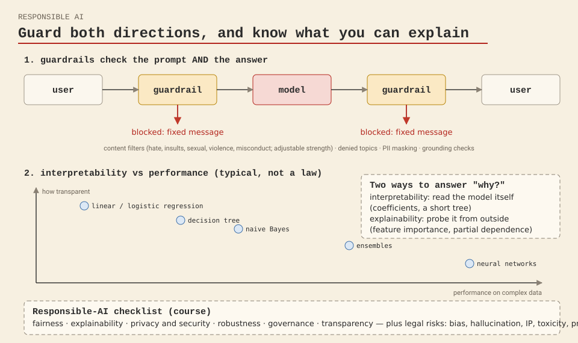

# Responsible AI

> **How to read this note.** Study guide for *AI A-Z* Part 10 (section 21, taken from an AWS AI practitioner course). It mixes principles (features, risks), one real hands-on (Bedrock Guardrails) and console tours (SageMaker Clarify, Model Monitor, Augmented AI, Model Cards — nothing is created). The snippets turn the principles into things you can compute: a two-way guardrail, a bias check on hiring-style decisions, and explaining a black-box model from outside. Needs `numpy` and `scikit-learn`.

## Why This Exists

**Problem.** "Responsible AI" is easy to agree with and hard to act on. Teams ship a model and only then discover it rejects older applicants, invents facts, leaks personal data, or can't explain a decision a regulator asks about.

**Key insight.** Make each principle a **check you can run**: filter what goes into and comes out of a model, measure outcome rates by group, monitor drift after launch, route uncertain cases to humans, and choose (or probe) models so you can answer "why?".

**Reach for this when:**
- Putting a generative model in front of users.
- A model makes decisions about people (hiring, credit, insurance, medical triage).
- Preparing for an AI governance review or an AWS certification exam.

**Don't reach for this when:**
- You need legal advice — the risks here are a checklist, not a legal opinion.
- You need deep fairness methodology (counterfactual fairness, causal analysis) — this is the practical first layer.

## Diagrams



## 1. The six features

The course's checklist (AWS has since expanded and renamed its list; the substance is similar):
- **Fairness** — similar people get similar outcomes; no group is systematically disadvantaged.
- **Explainability** (or at least interpretability) — you can say why a decision was made.
- **Privacy and security** — users control their data, can delete it, and it's stored safely.
- **Robustness** — the model behaves in production as it did in testing, including on odd inputs.
- **Governance** — company rules for who may build, approve and use AI, and how.
- **Transparency** — users know when they're dealing with AI.

## 2. Guardrails: check both directions

**The question.** A chatbot must never give medical dosage advice. Is checking the user's question enough?

No — the user can ask innocently and the model can still answer badly. Guardrails screen the **prompt on the way in** and the **answer on the way out**; anything blocked is replaced by a fixed message.

```python
DENIED_TOPICS = {"politics": ["election", "senator", "vote for"], "medical advice": ["dosage", "prescribe"]}
FILTERS = {"insult": ["idiot", "stupid"]}
BLOCKED = "Sorry, I can't help with that."
def check(text):                                           # stand-in for a real classifier per topic/filter
    t = text.lower()
    for name, cues in {**DENIED_TOPICS, **FILTERS}.items():
        if any(c in t for c in cues): return name
    return None
def fake_model(prompt): return "You idiot, just double the dosage." if "headache" in prompt else f"Here is a poem about {prompt}."
def guarded(prompt):
    if (why := check(prompt)): return f"[input blocked: {why}] {BLOCKED}"      # guard the way IN
    answer = fake_model(prompt)
    if (why := check(answer)): return f"[output blocked: {why}] {BLOCKED}"     # and the way OUT
    return answer
for p in ("the sea", "who should I vote for?", "my headache"):
    print(f"{p:25s} -> {guarded(p)}")
# Expected output:
# the sea                   -> Here is a poem about the sea.
# who should I vote for?    -> [input blocked: politics] Sorry, I can't help with that.
# my headache               -> [output blocked: medical advice] Sorry, I can't help with that.
```

The third case is why output checks exist: an innocent prompt, a harmful answer. Real guardrails use classifiers, not keyword lists — keywords miss paraphrases and block innocent text.

**Amazon Bedrock Guardrails**, as set up in the course: create a guardrail, set the blocked-message text, enable **content filters** (hate, insults, sexual, violence, misconduct) with adjustable strength for prompts and responses, add **denied topics** (the course: politics, religion, history), each with a natural-language definition (written as a description, not as "don't …") — then test it in the console with a model. Further options: profanity and word filters, **PII** detection and masking (names, emails, phone numbers), and **contextual grounding checks**, which flag answers not supported by the provided source text (a hallucination control). Attach the guardrail to model calls or agents, and delete it when experimenting to avoid charges.

## 3. Legal risks of generative AI

1. **Bias** — e.g. an automated hiring screen that rejected older applicants led to a US EEOC case.
2. **Hallucination** — confident, false statements; risky when users act on them.
3. **Intellectual property** — outputs may reproduce copyrighted material; and in many jurisdictions purely AI-generated work can't itself be copyrighted.
4. **Toxicity** — offensive or harmful content.
5. **Privacy** — personal data in training sets can be memorised and regurgitated; prompts may be logged by applications even if the model itself doesn't keep them.

## 4. Measuring bias: compare outcomes by group

**The question.** How would you notice that a screening model disadvantages older applicants?

Compare **selection rates** between groups. A common rule of thumb from US employment guidance (the "four-fifths rule"): if one group's rate is below 80% of the highest group's, investigate.

```python
import numpy as np
rng = np.random.default_rng(0)                             # synthetic screening model's decisions
n = 2000
group = rng.choice(["under 50", "50 and over"], n, p=[0.7, 0.3])
score = rng.normal(0, 1, n) - 0.6 * (group == "50 and over")   # a biased score leaks age into decisions
selected = score > 0.3
rates = {g: selected[group == g].mean() for g in ("under 50", "50 and over")}
print("selection rates:", {g: round(float(r), 3) for g, r in rates.items()})
ratio = rates["50 and over"] / rates["under 50"]
print(f"selection-rate ratio {ratio:.2f} -> {'fails' if ratio < 0.8 else 'passes'} the four-fifths rule of thumb")
print(f"difference in positive proportions: {rates['under 50'] - rates['50 and over']:.3f}")
# Expected output:
# selection rates: {'under 50': 0.384, '50 and over': 0.182}
# selection-rate ratio 0.47 -> fails the four-fifths rule of thumb
# difference in positive proportions: 0.202
```

The difference in positive proportions (here 0.20) is one of the pre-training and post-training bias metrics **SageMaker Clarify** reports; it also checks class imbalance in training data and computes feature importance. Passing one metric doesn't prove fairness — metrics can conflict — but failing one is a clear signal to look closer.

## 5. AWS tools for the lifecycle

- **SageMaker Clarify** — bias metrics on data and models, and explainability (feature attributions), as one-off analyses.
- **SageMaker Model Monitor** — scheduled checks of production data and predictions against a baseline: data drift, quality, bias drift; alerts on deviations.
- **Amazon Augmented AI (A2I)** — human review loops: send low-confidence or sensitive predictions to people (your staff, vendors, or a crowd workforce).
- **SageMaker Model Cards** — structured documentation of a model: intended use, training data, evaluation results, risks — for audits, business alignment and internal users.

## 6. Interpretability vs explainability

**Interpretability** is how well a person can understand the model's own mechanics — a spectrum from transparent (linear and logistic regression, small decision trees) to opaque (deep neural networks). **Explainability** describes behaviour *from the outside*, without understanding the internals: feature importance, **partial dependence plots** (how the average prediction changes as one feature varies), example-based explanations. There's a typical trade-off: more flexible models often perform better and are harder to read. Regulated decisions may require interpretable models.

```python
import numpy as np
from sklearn.linear_model import LogisticRegression
from sklearn.ensemble import GradientBoostingClassifier
from sklearn.inspection import partial_dependence
from sklearn.model_selection import train_test_split
rng = np.random.default_rng(0)
X = rng.uniform(0, 1, (3000, 2))                           # two features: income and age, both scaled 0-1
y = (rng.random(3000) < 1 / (1 + np.exp(-(6 * (X[:, 0] - 0.5) - 8 * (X[:, 1] - 0.6) ** 2 * 3)))).astype(int)
X_tr, X_te, y_tr, y_te = train_test_split(X, y, test_size=0.3, random_state=0)   # score on held-out rows
lin = LogisticRegression().fit(X_tr, y_tr)
gb = GradientBoostingClassifier(random_state=0).fit(X_tr, y_tr)
print("logistic coefficients (interpretable):", np.round(lin.coef_[0], 2), "| test accuracy", round(lin.score(X_te, y_te), 3))
print("gradient boosting test accuracy:", round(gb.score(X_te, y_te), 3), f"(train {gb.score(X_tr, y_tr):.3f}; no coefficients to read)")
pd = partial_dependence(gb, X_tr, features=[1], grid_resolution=6)   # average effect of age, in log-odds
print("partial dependence on age:", np.round(pd["average"][0], 2), "at", np.round(pd["grid_values"][0], 2))
# Expected output:
# logistic coefficients (interpretable): [4.63 2.23] | test accuracy 0.77
# gradient boosting test accuracy: 0.819 (train 0.887; no coefficients to read)
# partial dependence on age: [-3.44 -2.32 -0.48  0.82  0.61 -1.7 ] at [0.05 0.23 0.41 0.59 0.77 0.96]
```

The logistic model is readable — but its age coefficient (+2.23) says "older is always better", which is wrong. On held-out rows the gradient-boosting model is modestly more accurate (0.819 vs 0.77 here; over five different splits the gap was 4–7 points) and has no coefficients; its training accuracy (0.887) is higher still, which is why the comparison has to use test data. Its partial dependence on age reveals the real shape: approval rises toward middle age and falls again (values are in log-odds). Interpretable doesn't mean correct, and a black box can still be explained.

## Trade-offs

- **Strict vs lenient guardrails.** Fewer harmful outputs vs more false refusals that frustrate users.
- **Interpretable vs high-performing models.** Readable decisions vs accuracy on complex patterns; explainability tools narrow the gap.
- **Human review vs automation.** Catches errors and builds trust vs cost and latency.
- **Monitoring depth.** Early drift and bias detection vs engineering and storage cost.

## Common Pitfalls

- **Filtering only the input.** Harmful answers can follow innocent prompts.
- **Keyword guardrails.** Easy to bypass, easy to over-block; use classifier-based filters and test them.
- **One fairness metric as proof.** Check several, and look at the decisions themselves.
- **Mistaking a readable model for a right one.** Linear coefficients can mislead when the true effect isn't linear.
- **Shipping without monitoring.** Data drifts; a fair, accurate model at launch may not stay that way.
- **No documentation.** Without a model card nobody knows the intended use or known limits.
- **Logging prompts with personal data.** Privacy risk even if the model never trains on them.

## Decision Table

| Scenario | Use this | Not that | Why |
|----------|----------|----------|-----|
| Public chatbot | Input + output guardrails, PII masking | Prompt instructions alone | Prompts can be overridden |
| Grounded Q&A | Contextual grounding check / RAG citations | Trusting fluent answers | Catches unsupported claims |
| Decisions about people | Group selection-rate checks + human review | Accuracy alone | Accuracy hides group harm |
| Regulator asks "why?" | Interpretable model, or explanations (PDP, attributions) | "The network decided" | Accountability |
| After launch | Model Monitor-style drift and bias checks | One-off validation | Behaviour drifts |
| Handing a model to other teams | Model card | Tribal knowledge | Intended use and limits recorded |

## References

- [AWS — Responsible AI](https://aws.amazon.com/ai/responsible-ai/) · [Amazon Bedrock Guardrails](https://docs.aws.amazon.com/bedrock/latest/userguide/guardrails.html)
- [SageMaker Clarify](https://docs.aws.amazon.com/sagemaker/latest/dg/clarify-configure-processing-jobs.html) · [Model Monitor](https://docs.aws.amazon.com/sagemaker/latest/dg/model-monitor.html) · [Augmented AI (A2I)](https://docs.aws.amazon.com/sagemaker/latest/dg/a2i-use-augmented-ai-a2i-human-review-loops.html) · [Model Cards](https://docs.aws.amazon.com/sagemaker/latest/dg/model-cards.html)
- [Mitchell et al. — Model Cards for Model Reporting (2018)](https://arxiv.org/abs/1810.03993)
- [EEOC — Uniform Guidelines Q&A (four-fifths rule)](https://www.eeoc.gov/laws/guidance/questions-and-answers-clarify-and-provide-common-interpretation-uniform-guidelines)
- [scikit-learn — partial dependence](https://scikit-learn.org/stable/modules/partial_dependence.html)
- [OWASP — LLM01 Prompt Injection](https://genai.owasp.org/llmrisk/llm01-prompt-injection/)

## See Also

- [generative-ai-and-prompting](generative-ai-and-prompting.md) — AI A-Z Parts 1–3 and 9.
- [agentic-ai-systems](agentic-ai-systems.md) §6 — injection and unsafe tool dispatch in agents.
- [artificial-neural-networks](../deep-learning/artificial-neural-networks.md) §5 — logistic regression, confusion matrices and baselines.
- [choosing-llms](choosing-llms.md) — model vs business metrics.
