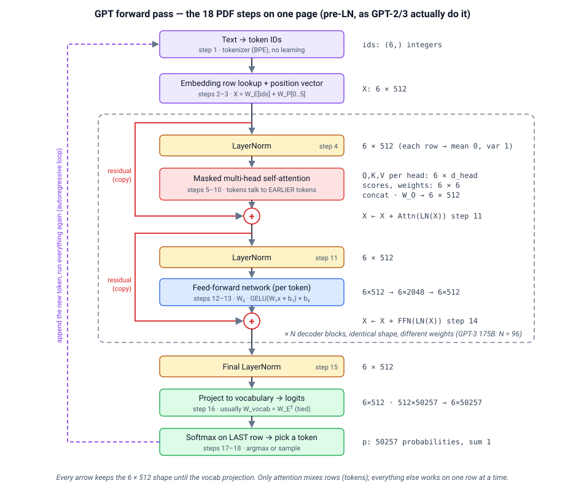
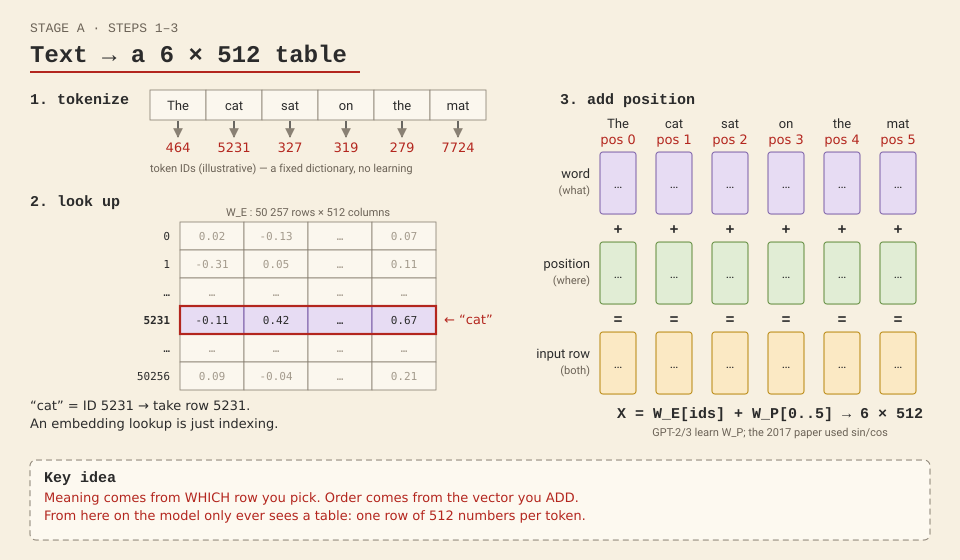
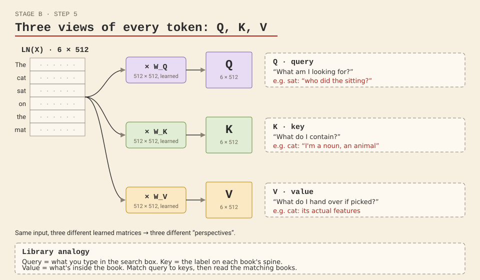
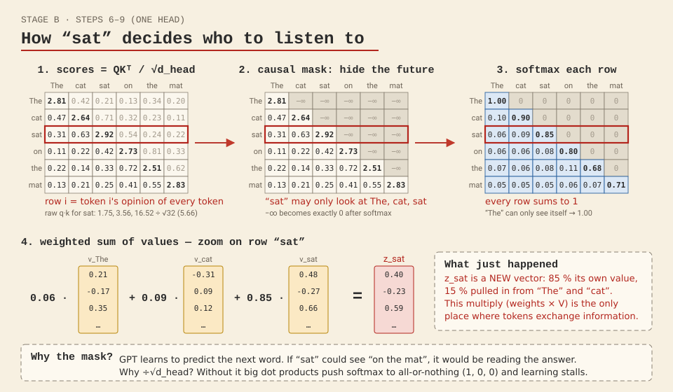
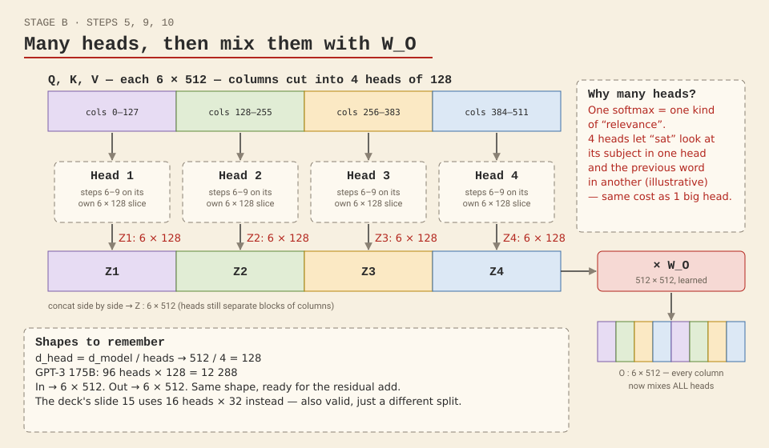
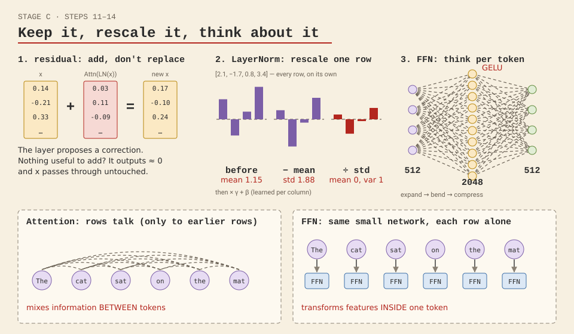
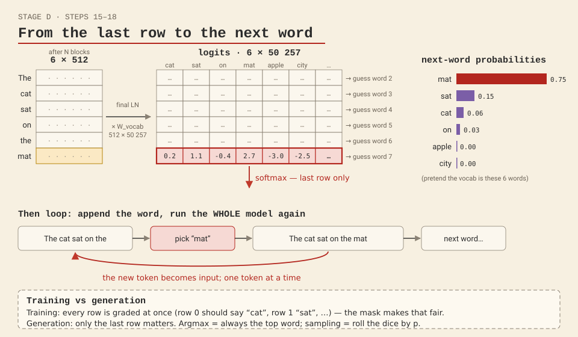

# Transformer (GPT) Forward Pass — A Guided Path

> **How to read this note.** It's a companion to the 45-slide *GPT-3 Walkthrough* deck (Wesam Khallaf): 18 steps that push "The cat sat on the mat" through a decoder-only transformer. The deck has good pictures but no map — every slide looks equally important and you lose the thread around step 6. This note gives you the map: **4 stages, 1 question each, a shape you can check after every step.** Read one stage here, then its slides, then run the snippet. Don't move on until the "check yourself" questions feel easy.

## Why This Exists

**Problem.** Transformer explanations drown you in 18 steps of matrices with equal weight. You end up able to recite "Q, K, V" but not able to say *why* each step is there, what shape comes out, or which steps actually matter. The deck also has a few errors (see [Errata](#errata-for-the-gpt-3-walkthrough-deck)) that will confuse you if you check its arithmetic.

**Key insight.** A GPT is a **6 × 512 table that keeps its shape while it gets edited**. One row per token. Attention is the *only* step where rows read from each other (and only from rows above them); every other step edits each row on its own. At the end, the last row is turned into a probability for every word in the vocabulary.

**Reach for this when:**
- The GPT-3 walkthrough slides (or any "attention step by step" material) feel like a wall of matrices.
- You know the words Q/K/V/softmax but can't explain what goes in and out of each step.
- You want a runnable mini-GPT to poke at before reading nanoGPT or a paper.
- You're confused about where LayerNorm goes, why √d_k, or why only the last row predicts.

**Don't reach for this when:**
- You want *training* (loss, backprop, AdamW) — this is inference only. See [calculus](calculus.md).
- You need encoder-decoder transformers (translation, T5) — cross-attention isn't covered.
- You need production details (KV cache, FlashAttention, RoPE, GQA) — see [References](#references).

## Diagrams

The whole deck on one page. Step numbers match the slides. Keep this open while reading — each stage below also opens with its own close-up picture in the deck's style.



## 0. Three numbers to hold before you start

Everything in the deck is one of three sizes. Learn these and every matrix shape becomes predictable.

| Symbol | Meaning | Deck's toy value | Real GPT-3 175B |
|---|---|---|---|
| $n$ (aka $n_{ctx}$) | number of tokens in the sentence | 6 | up to 2048 |
| $d_{model}$ | length of each token's vector | 512 | 12 288 |
| $V$ | vocabulary size | ~50 000 | 50 257 |

Two derived sizes: $d_{head} = d_{model} / h$ (vector size inside one attention head, $h$ = number of heads) and $4 \cdot d_{model}$ (the FFN's hidden width, 2048 in the toy).

**Shape tracker** — the thing to check after every step:

```
ids (6,) → X (6×512) → [ block: 6×512 → 6×512 ] × N → logits (6×V) → p (V,)
```

## 1. Reading plan

| Stage | PDF steps | Slides | The one question it answers | Time |
|---|---|---|---|---|
| A. Text → vectors | 1–3 | 2–10 | How does a word become numbers *with an order*? | 15 min |
| B. Attention | 4–10 | 11–29 | How does each token pull in information from earlier tokens? | 60 min — the core |
| C. Refine & stabilize | 11–14 | 30–37 | How does the block keep old info and add new features safely? | 20 min |
| D. Stack & predict | 15–18 | 38–43 | How do 6×512 numbers turn into "next word = mat"? | 15 min |

Skip on first read: slides 3–4 (BPE details), 7–8 (repeat slide 6), 26 (repeats 25), 29 (repeats 28), 44 (see errata).

## 2. Stage A — Text → vectors (steps 1–3)

**The question.** A neural net needs numbers. Words aren't numbers, and "cat sat" ≠ "sat cat". So we need (1) a number per word piece and (2) a way to mark position.



**Step 1 — tokenize.** A fixed lookup (BPE) chops text into sub-word pieces and gives each an integer ID. `"unhappiness"` → `un · happ · iness`. No learning, no meaning — just a dictionary.

**Step 2 — embed.** $W_E$ is a $V \times d_{model}$ table. Token ID 5231 ("cat") → take row 5231. That's it: an embedding lookup is **row indexing**, not a formula. The rows are learned during training so similar words end up near each other (slides 5–7).

**Step 3 — add position.** Attention (Stage B) treats tokens as an unordered set, so we *add* a position vector to each row: $X = W_E[\text{ids}] + P$. The deck uses the sinusoidal formula; GPT-2/3 actually use a **learned** position table (just another lookup, row = position). Either way the shape stays $6 \times 512$.

```python
import numpy as np
# Reproduce slide 10's sinusoidal table: d_model=6, positions 0..2
d, pos = 6, np.arange(3)[:, None]
i = np.arange(d)[None, :]
angle = pos / 10000 ** ((i // 2) * 2 / d)       # dims (2k, 2k+1) share one frequency
pe = np.where(i % 2 == 0, np.sin(angle), np.cos(angle))  # sin on even dims, cos on odd
print(pe.round(4))
# Expected output:
# [[ 0.      1.      0.      1.      0.      1.    ]
#  [ 0.8415  0.5403  0.0464  0.9989  0.0022  1.    ]
#  [ 0.9093 -0.4161  0.0927  0.9957  0.0043  1.    ]]
```

**Check yourself.** What shape is $X$? (6 × 512.) If you swap "cat" and "mat", which part of $X$ changes — the embedding part or the position part? (The word-embedding parts of rows 1 and 5 swap; each position keeps its own position vector — so the sums differ and the model can tell the two sentences apart.)

## 3. Stage B — Attention (steps 4–10) — the core

**The question.** "sat" alone is ambiguous. Its meaning depends on "cat". How can row 2 pull information from rows 0–1, deciding *how much* from each, without a hand-written rule?

**The analogy that makes Q/K/V click — a library search:**
- **Query** $q$ — what this token is *looking for* ("I'm a verb, who's my subject?").
- **Key** $k$ — the label each token *advertises* ("I'm a noun, an animal").
- **Value** $v$ — the content each token *hands over* if chosen.

Match query to keys → get relevance scores → take a weighted average of values. That's all attention is.



And here's steps 6–9 for one head at a glance — scores, mask, softmax, weighted sum — following the row for "sat". The sub-sections below explain each panel.



### Step 4 — LayerNorm first
Each row is rescaled to mean 0 / variance 1 so the next matrix multiply sees well-behaved numbers. Row by row, no mixing. (Details in Stage C.)

### Step 5 — three projections
Multiply the (normalized) $X$ by three learned $512 \times 512$ matrices: $Q = XW_Q$, $K = XW_K$, $V = XW_V$. Same input, three different "views". Then **split the 512 columns into $h$ heads** — e.g. 4 heads × 128 columns. Each head is an independent little attention with its own idea of "relevance" (one may track grammar, another nearby words).

### Step 6 — scores = dot products
For one head: $S = QK^\top$, shape $(6 \times d_{head})(d_{head} \times 6) = 6 \times 6$. Entry $S_{ij}$ = "how well does token $i$'s query match token $j$'s key". Row $i$ is token $i$'s opinion of every token. (Dot product as similarity — see [linear-algebra](linear-algebra.md).)

Then divide by $\sqrt{d_{head}}$. Why? A dot product of two random vectors of length $d$ has standard deviation $\sqrt{d}$ — it grows with the head size. Big scores make softmax collapse onto one token and stop learning.

```python
import numpy as np
rng = np.random.default_rng(0)
# Std of q·k grows like sqrt(d_k); dividing by sqrt(d_k) brings it back to ~1
for dk in [4, 64, 128]:
    q, k = rng.normal(size=(2, 10000, dk))     # 10000 random query/key pairs
    dots = (q * k).sum(axis=1)
    print(dk, dots.std().round(2), (dots / np.sqrt(dk)).std().round(2))
# Expected output:
# 4 2.0 1.0
# 64 8.08 1.01
# 128 11.29 1.0
```

```python
import numpy as np
def softmax(x): e = np.exp(x - x.max()); return e / e.sum()
raw = np.array([2.0, 1.0, 0.5]) * np.sqrt(128)  # how big unscaled d_k=128 scores get
print(softmax(raw).round(3))                    # collapses to one-hot: no gradient for the others
print(softmax(raw / np.sqrt(128)).round(3))     # scaled: a real weighting
# Expected output:
# [1. 0. 0.]
# [0.629 0.231 0.14 ]
```

### Step 7 — causal mask
GPT predicts the *next* token, so token $i$ must not peek at tokens after it. Set every entry above the diagonal to $-\infty$. Row 2 ("sat") keeps only columns 0–2.

### Step 8 — softmax each row
Turn each row into weights that are ≥ 0 and sum to 1. $e^{-\infty} = 0$, so masked tokens get exactly zero weight.

```python
import numpy as np
# Slide 24: row "sat" after the mask
s = np.array([0.31, 0.63, 2.92, -np.inf, -np.inf, -np.inf])
w = np.exp(s - s.max()) / np.exp(s - s.max()).sum()   # subtract max = numerically safe softmax
print(w.round(3), w.sum())
# Expected output:
# [0.063 0.086 0.851 0.    0.    0.   ] 1.0
```

### Step 9 — weighted sum of values, then concat heads
$Z = AV$: row "sat" becomes $0.06\,v_{The} + 0.08\,v_{cat} + 0.86\,v_{sat}$ — a **new** vector that blends in context. Each head gives $6 \times d_{head}$; glue the heads side by side → $6 \times 512$ again.

### Step 10 — output projection $W_O$
Concatenation just stacks head outputs next to each other. $ZW_O$ ($512 \times 512$) lets every output column mix information from *all* heads.



**The whole of Stage B in one line:**

$$\text{Attn}(X) = \text{concat}_{h}\Big[\text{softmax}\Big(\tfrac{Q_hK_h^\top}{\sqrt{d_{head}}} + M\Big)V_h\Big]\,W_O \qquad M_{ij} = -\infty \text{ if } j > i$$

**Check yourself.** What's the shape of $S$ for one head? (6 × 6, regardless of $d_{model}$.) Why is row 0 ("The") always $[1, 0, 0, 0, 0, 0]$ after the mask? (It can only see itself.) Which step is the *only* one where tokens exchange information? (Step 9, $AV$.)

## 4. Stage C — Refine & stabilize (steps 11–14)

**The question.** Attention gathered context. Now: how do we (a) not lose what the token already knew, (b) give the model room to compute new features, and (c) keep numbers from blowing up across 96 layers?



### Residual connection — "add, don't replace"
$X \leftarrow X + \text{Attn}(\text{LN}(X))$. The block computes a *correction* and adds it to the original. If a block has nothing useful to say, it outputs ~0 and the token passes through unchanged. This copy path is also what lets gradients reach layer 1 in a 96-layer stack.

### LayerNorm — "rescale each row"
For one row $x \in \mathbb{R}^{d}$: subtract its mean, divide by its standard deviation, then apply a learned scale $\gamma$ and shift $\beta$:

$$\text{LN}(x) = \gamma \odot \frac{x - \mu}{\sqrt{\sigma^2 + \epsilon}} + \beta$$

```python
import numpy as np
# The two example vectors from slides 32 and 39, with gamma=1, beta=0
for x in [np.array([2.1, -1.7, 0.8, 3.4]), np.array([2.4, -1.1, 0.8, 3.0])]:
    c = x - x.mean()
    y = c / np.sqrt(c.var() + 1e-5)            # var() defaults to ddof=0: divide by d, as LayerNorm does
    print(c.round(3), y.round(2), y.mean().round(6), y.var().round(3))
# Expected output:
# [ 0.95 -2.85 -0.35  2.25] [ 0.5  -1.51 -0.19  1.19] 0.0 1.0
# [ 1.125 -2.375 -0.475  1.725] [ 0.71 -1.49 -0.3   1.09] 0.0 1.0
```

(These differ from the slides — the slides' arithmetic is off. See errata.)

### FFN — "think about each token on its own"
$\text{FFN}(x) = W_2\,\text{GELU}(W_1x + b_1) + b_2$, applied to every row separately with the *same* weights. Expand 512 → 2048, bend with a nonlinearity, compress back to 512. Attention decides *what to look at*; the FFN does the per-token computation on what was gathered (much of a model's "stored knowledge" lives in these weights). Then another residual: $X \leftarrow X + \text{FFN}(\text{LN}(X))$.

**The full block** (this is the line to memorize):

```
x = x + Attn(LN₁(x))
x = x + FFN(LN₂(x))
```

**Check yourself.** Does the FFN let "sat" see "cat"? (No — rows are processed independently.) Why must Attn and FFN output exactly 512 columns? (So they can be *added* to $x$.)

## 5. Stage D — Stack & predict (steps 15–18)

**The question.** We have a refined 6 × 512 table. How do we get a word out?



1. **Stack** — repeat the block $N$ times (96 for GPT-3 175B). Same shape in and out, different weights per block.
2. **Final LayerNorm** (step 15) — one last rescale of each row.
3. **Logits** (step 16) — multiply by a $512 \times V$ matrix → $6 \times V$. Each row now has a score for every vocabulary token. GPT-2 reuses the embedding table here ($W_E^\top$, "weight tying") and GPT-3 says it keeps GPT-2's architecture, though the paper doesn't mention tying explicitly. With tying, the score is literally "how similar is this vector to each word's embedding".
4. **Softmax the last row** (step 17) — row $i$ predicts token $i+1$. At generation time we only need the next word, so we use the last row. (During training, *all* 6 rows are used at once — that's why the causal mask exists.)
5. **Pick and loop** (step 18) — argmax or sample, append "mat", run everything again with 7 tokens.

**Check yourself.** If the sentence had 100 tokens, what changes in the weights? (Nothing. Only $n$ — the number of rows — changes.)

## 6. The whole thing in 25 lines

Once each stage makes sense, run this. Every line is labelled with its PDF step. Tiny sizes ($d_{model}=8$, 2 heads, vocab 20) so you can print anything.

```python
import numpy as np
rng = np.random.default_rng(0)
n, d, h, V = 6, 8, 2, 20                         # tokens, d_model, heads, vocab
dh = d // h
def ln(x): return (x - x.mean(-1, keepdims=True)) / np.sqrt(x.var(-1, keepdims=True) + 1e-5)
def softmax(x): e = np.exp(x - x.max(-1, keepdims=True)); return e / e.sum(-1, keepdims=True)
WE, WP = rng.normal(size=(V, d)), rng.normal(size=(n, d))
Wq, Wk, Wv, Wo = rng.normal(size=(4, d, d)) / np.sqrt(d)
W1, W2 = rng.normal(size=(d, 4 * d)) / np.sqrt(d), rng.normal(size=(4 * d, d)) / np.sqrt(4 * d)
ids = np.array([3, 7, 1, 4, 3, 9])
x = WE[ids] + WP                                 # (6, 8)   steps 1-3
a = ln(x)                                        # step 4   pre-attention LN
q, k, v = [(a @ W).reshape(n, h, dh).transpose(1, 0, 2) for W in (Wq, Wk, Wv)]  # (2, 6, 4) step 5
S = q @ k.transpose(0, 2, 1) / np.sqrt(dh)       # (2, 6, 6) step 6
S = np.where(np.triu(np.ones((n, n)), k=1) == 1, -np.inf, S)  # step 7: hide j > i (above diagonal)
A = softmax(S)                                   # step 8
z = (A @ v).transpose(1, 0, 2).reshape(n, d)     # (6, 8)   step 9 weighted sum + concat heads
x = x + z @ Wo                                   # steps 10-11 output proj + residual
x = x + np.maximum(ln(x) @ W1, 0) @ W2           # steps 11-14 LN -> FFN (ReLU here; GPT uses GELU) -> residual
logits = ln(x) @ WE.T                            # steps 15-16 final LN, tied embedding as W_vocab
p = softmax(logits[-1])                          # step 17 last row only
print(x.shape, A.shape, logits.shape, p.argmax(), A[0, 2].round(2))
# Expected output:
# (6, 8) (2, 6, 6) (6, 20) 9 [0.17 0.59 0.24 0.   0.   0.  ]
```

Things to try: print `A[0]` and confirm the upper triangle is 0; delete the mask line and see row 0 attend to the future; set `n = 10` and watch which shapes change. **Causality test:** change `ids[-1]`, rerun, and check `logits[:-1]` hasn't changed — only the last row may depend on the last token.

**Where the 175 billion parameters live** — almost all in the blocks, $12\,d_{model}^2$ per block:

```python
# GPT-3 175B from its shape (L=96, d_model=12288, V=50257, n_ctx=2048)
L, d, V, ctx = 96, 12288, 50257, 2048
attn = 4 * d * d                 # Wq, Wk, Wv, Wo
ffn = 2 * d * (4 * d)            # W1 (d -> 4d), W2 (4d -> d)
total = L * (attn + ffn) + V * d + ctx * d
print(f"{total / 1e9:.1f}B")     # biases + LayerNorm params are a rounding error
# Expected output:
# 174.6B
```

Two thirds of each block is FFN, one third attention. Attention's *compute* is what grows with sequence length ($n \times n$ scores); its *parameter count* doesn't.

## Errata for the GPT-3 Walkthrough deck

Flagged so you don't lose an hour reconciling the slides with each other.

| Slide | What it says | What's actually true |
|---|---|---|
| 11 vs 32, 36–37 | Step 4 normalizes *before* attention (pre-LN, correct). But slide 36 adds the FFN residual to the **normalized** `N` (`R₂ = N + F`), and slide 37 normalizes again after the add (post-LN), so the next block's step 4 normalizes a second time | GPT-3 paper §2.1: "pre-normalization", same as GPT-2. The residual stream is never normalized in place: `R = X + Attn(LN(X))`, then `R₂ = R + FFN(LN(R))` — add `R`, not `N`. The only extra LN is the final one before the vocab projection. Post-LN is the 2017 Transformer. |
| 15 vs 27 | 16 heads × $d_{head}$ 32 on slide 15; 4 heads × 128 on slide 27 | Both are valid splits of 512 — just inconsistent. GPT-3 175B: 96 heads × 128. |
| 9–10 | Sinusoidal positional encoding | GPT-2/3 use **learned** position embeddings. Sinusoidal is from the 2017 paper. The concept (add a position vector) is the same. |
| 6 | Embedding rows up to 88 457 | GPT-3's vocab is 50 257 rows. |
| 18 → 22–24 | Scores 0.31 / 0.63 / 2.92 are raw (unscaled) on slide 18, then reused as "scaled" scores on slide 22 | After ÷√32 they'd be ~0.05 / 0.11 / 0.52 (slide 19 even shows 2.92 → 0.52). The softmax arithmetic on 24 is right for the numbers it uses. |
| 32, 39 | LayerNorm examples: `[2.1, −1.7, 0.8, 3.4]` → subtract mean → `[−0.6, −4.4, −1.9, 0.7]` | The mean is 1.15, so it's `[0.95, −2.85, −0.35, 2.25]` → normalized `[0.5, −1.51, −0.19, 1.19]`. Slide 39's normalized vector is also off. See the Stage C snippet. |
| 44 | GPT-3 Small 1536, Medium 2048, Large 4096, XL 5120, 13B 5120 | GPT-3 paper Table 2.1: Small **768**, Medium **1024**, Large **1536**, XL **2048**, 2.7B 2560, 6.7B 4096, 13B **5140**, 175B 12 288 (96 layers, 96 heads × 128). |

Also unmentioned: GPT-3 alternates dense attention with locally banded sparse attention layers (paper §2.1). Doesn't change the mental model.

## Trade-offs

- **Pre-LN vs post-LN.** Pre-LN (GPT-2/3, most modern LLMs) trains stably and can drop the learning-rate warmup (Xiong et al. 2020), but the un-normalized residual stream can grow large in deep stacks. Post-LN (original Transformer) is fragile to train deep; some papers report slightly better final quality when it does train.
- **Attention cost.** Every token compares with every earlier token: $O(n^2)$ time and memory per layer. That's the price for "any token can read any earlier token in one step" — RNNs are $O(n)$ but pass information through a bottleneck one step at a time.
- **Causal (decoder-only) vs bidirectional.** The mask lets one model both train on every position at once and generate text, but each token only sees the past — worse for pure understanding tasks than BERT-style bidirectional encoders.
- **Weight tying.** Reusing $W_E$ for the output saves $V \times d_{model}$ parameters (~600M in GPT-3) at the cost of forcing input and output word spaces to match.

## Common Pitfalls

- **Thinking attention outputs probabilities over words.** Attention weights are over *positions in the input*; word probabilities only appear at step 17. Mixing these up makes steps 8 and 17 look like the same thing.
- **Thinking only the last token is computed.** All $n$ rows go through every layer, because later tokens need the earlier rows' K and V. Only the *final softmax* uses just the last row. (The KV cache exists to avoid recomputing those earlier rows.)
- **Forgetting the √d_k.** Without it softmax saturates (see the snippet in Stage B), gradients vanish, and training stalls — it's not cosmetic.
- **Masking with 0 instead of −∞.** A 0 score still gets $e^0 = 1$ weight after softmax, so the future leaks in. The mask has to be $-\infty$ (or a very negative number) *before* softmax.
- **Writing softmax as `exp(x)/exp(x).sum()`.** `exp` overflows to `inf` above ~88 in float32 (the usual training dtype) and ~709 in float64 — then `inf/inf = nan`. Subtract the row max first — all snippets here do.
- **Treating heads as separate models.** Heads share the input and are mixed by $W_O$; you can't read one head's output as a final answer.

## Decision Table

| Scenario | Use this | Not that | Why |
|----------|----------|----------|-----|
| First pass through the deck | Stage plan in §1, one stage at a time | Reading all 45 slides in order | The deck gives every slide equal weight; Stage B is most of the understanding |
| Lost in a slide's matrix | Shape tracker in §0 | Checking the numbers | Shapes are always right in the deck; some numbers aren't |
| Want to feel attention | Stage B snippets + `A[0]` in §6 | Re-reading the formula | Seeing the masked 6×6 makes the formula obvious |
| Next step after this note | Karpathy's "Let's build GPT" video + nanoGPT | The GPT-3 paper | Paper is about scale and results; the video builds the same forward pass in PyTorch |
| Need visual intuition for embeddings / attention | 3Blue1Brown Deep Learning ch. 5–6 | More slide decks | Best geometric intuition for "meaning as direction" |
| Want to watch real shapes flow | bbycroft.net/llm 3D visualizer | Static diagrams | Interactive, shows every matrix in nano-GPT |

## References

- [Vaswani et al., *Attention Is All You Need* (2017)](https://arxiv.org/abs/1706.03762) — original transformer; scaled dot-product attention, multi-head, sinusoidal PE, post-LN.
- [Brown et al., *Language Models are Few-Shot Learners* (GPT-3, 2020)](https://arxiv.org/abs/2005.14165) — Table 2.1 has the real model sizes.
- [Xiong et al., *On Layer Normalization in the Transformer Architecture* (2020)](https://arxiv.org/abs/2002.04745) — pre-LN vs post-LN, why pre-LN trains without warmup.
- [3Blue1Brown — Transformers, the tech behind LLMs (Deep Learning ch. 5)](https://www.youtube.com/watch?v=wjZofJX0v4M)
- [3Blue1Brown — Attention in transformers, step-by-step (Deep Learning ch. 6)](https://www.youtube.com/watch?v=eMlx5fFNoYc)
- [Andrej Karpathy — Let's build GPT: from scratch, in code, spelled out](https://www.youtube.com/watch?v=kCc8FmEb1nY)
- [karpathy/nanoGPT](https://github.com/karpathy/nanoGPT) — the forward pass in ~300 lines of PyTorch.
- [Jay Alammar — The Illustrated Transformer](https://jalammar.github.io/illustrated-transformer/) — encoder-decoder version, great Q/K/V pictures.
- [Brendan Bycroft — LLM Visualization](https://bbycroft.net/llm) — interactive 3D walk through a GPT.

## See Also

- [linear-algebra](linear-algebra.md) — dot product as similarity, matrix multiply, embedding lookup as matmul.
- [calculus](calculus.md) — softmax Jacobian, why residuals help gradient flow, AdamW for training transformers.
- [statistics-and-probability](statistics-and-probability.md) — softmax + cross-entropy as MLE over a categorical distribution.
- [markov-chains](markov-chains.md) — autoregressive generation as a (very high-order) Markov chain.
- [embedding-training](../ml-systems/embedding-training.md) — turning the per-token vectors into one embedding (pooling) and training it contrastively.
