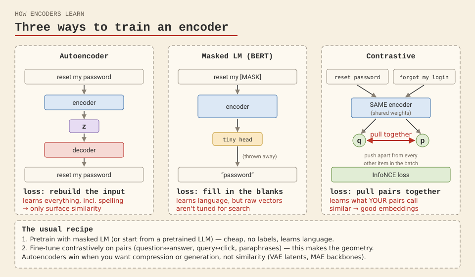
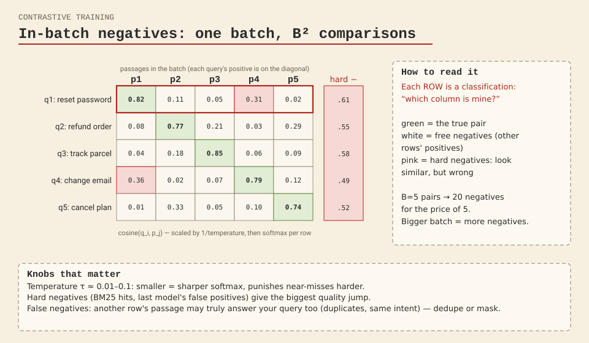

# Training Embeddings: From Lookup Tables to Encoders

> **How to read this note.** Section 0 is the foundation: what an embedding table *is* and how backprop trains it. Read it first if "embedding" still feels like magic. Then the note answers one question: *"to get an encoder that produces good embeddings, do we train an autoencoder and keep the encoder?"* Short answer: usually not. Section 1 shows why. Sections 2–5 give the standard recipe. Section 9 applies section 0 to **categorical columns in a tabular model** (city, product ID, zip code). If your similarity signal comes from **user behavior** (clicks, purchases, ratings) instead of text pairs, read this note first, then [behavioral-embeddings](behavioral-embeddings.md).

## Why This Exists

**Problem.** "Embedding" sounds like a by-product: train any encoder, take its hidden vector, done. In practice raw encoder vectors (an autoencoder's bottleneck, BERT's `[CLS]`) are poor for search. Two sentences that mean the same thing can land far apart, and two that share words but mean different things land close. You only notice once retrieval quality is bad and nobody can say why.

**Key insight.** An embedding space only has the geometry you *trained* it to have. Reconstruction trains "keep enough to rebuild the input". Contrastive learning trains "things in a pair are close, everything else is far". If you want similarity, train for similarity: **pretrain cheaply, then fine-tune contrastively on pairs that define what "similar" means for you.**

**Reach for this when:**
- Building semantic search, RAG retrieval, dedup, clustering, or "more like this".
- An off-the-shelf embedder (BGE, E5, OpenAI) underperforms on your domain and you're deciding whether to fine-tune.
- Someone proposes "train an autoencoder and use the bottleneck as the embedding".
- Choosing pooling (CLS vs mean vs last token), temperature, batch size, or negatives.
- A categorical column has too many values for one-hot (cities, product IDs, zip codes) and you want to embed it in a neural network (§9).
- You want to know what an `Embedding` layer actually learns, and how (§0).

**Don't reach for this when:**
- The similarity signal is user behavior (clicks, buys, ratings, sessions) — see [behavioral-embeddings](behavioral-embeddings.md).
- You want compression or generation (VAE latents, image tokenizers) — there an autoencoder *is* the right tool.
- A general pretrained embedder already scores well on *your* eval set — don't train anything.
- A categorical column has only a handful of values (Gender, three countries). One-hot is simpler and loses nothing.

## Diagrams



## 0. The simplest embedding: a lookup table trained by backprop

**The problem.** You predict churn, and one input is the customer's city. There are 10,000 cities. One-hot gives 10,000 input columns, and every city gets its own private weights into every hidden neuron. Nothing is shared: what the network learns about Munich tells it nothing about Stuttgart. A city with five customers gets weights learned from five rows, which is mostly noise.

**What you want.** You want to give each city a few numbers, say 16, and let training *place* the cities so that cities which behave alike end up with similar numbers. Then a rare city can borrow strength from the common cities near it.

**That is an embedding.** It's a table `W` with one row per category and `d` columns. Category `i` is represented by row `i`. Nothing more.

### It is one-hot times a matrix

Multiplying a one-hot vector by `W` picks out one row of `W`. An embedding layer does exactly that, but skips the multiplication and reads the row directly, which is far cheaper:

```python
import torch, torch.nn as nn
torch.manual_seed(0)
emb = nn.Embedding(5, 3)                         # 5 categories, 3 numbers each: a 5x3 weight table
ids = torch.tensor([1, 3, 1])                    # a batch: category 1, 3, 1
onehot = nn.functional.one_hot(ids, 5).float()   # the same batch as one-hot rows
print('lookup == one-hot @ W:', torch.allclose(emb(ids), onehot @ emb.weight))
emb(ids).sum().backward()
print('grad per row:', emb.weight.grad.abs().sum(1).tolist())
# Expected output:
# lookup == one-hot @ W: True
# grad per row: [0.0, 6.0, 0.0, 3.0, 0.0]
```

So an embedding layer is a linear layer with no bias, fed a one-hot input. Everything you know about training a linear layer applies to it unchanged.

### How it trains: ordinary backprop, one row at a time

There's no special training step. The table is a weight matrix, so the loss gradient flows into it like any other weight. The second line of output shows the one difference. **Only the rows that appeared in the batch get a gradient.** Row 1 appeared twice, so it got twice the gradient of row 3. Rows 0, 2 and 4 didn't appear, so they didn't move.

This has a consequence: a category that is rare in training is rarely updated, so its row stays close to its random starting point. §9 deals with that.

### The geometry is whatever helps the task

Train the table end-to-end on the real target and watch what the rows become. Here 50 cities have a hidden churn group that the model is never told about:

```python
import torch, torch.nn as nn
torch.manual_seed(0)
N_CITY, n = 50, 20_000
group = torch.arange(N_CITY) % 2                       # hidden truth: even cities churn, odd cities don't
city = torch.randint(0, N_CITY, (n,))
y = (torch.rand(n) < torch.where(group[city] == 0, 0.7, 0.1)).float()
emb, out = nn.Embedding(N_CITY, 2), nn.Linear(2, 1)    # each city -> 2 learnable numbers
opt = torch.optim.Adam([*emb.parameters(), *out.parameters()], 0.05)
for _ in range(300):                                   # an ordinary training loop: the table is just weights
    opt.zero_grad()
    nn.functional.binary_cross_entropy_with_logits(out(emb(city)).squeeze(1), y).backward()
    opt.step()
v = nn.functional.normalize(emb.weight.detach(), dim=1)
sim = v @ v.T                                          # cosine similarity between every pair of cities
same = sim[group[:, None] == group[None, :]].mean(); diff = sim[group[:, None] != group[None, :]].mean()
print(f"avg similarity, same churn group: {same:+.2f}   different group: {diff:+.2f}")
# Expected output:
# avg similarity, same churn group: +0.76   different group: -0.76
```

Nobody labelled which cities belong together, yet cities that churn alike ended up pointing the same way. Read that carefully: "close" here means *"affects churn the same way"*, not "near each other on a map". That's this note's key insight in its smallest form. **An embedding space has the geometry its loss gave it, and nothing else.**

### Two ways to get the table

| Way | How | Use when |
|---|---|---|
| End-to-end | Train the table with the task's loss, as above | You have plenty of labelled rows. This is the default for tabular features. |
| Pretrain, then reuse | Learn the table on a self-supervised task first (word2vec predicts neighbouring words, item2vec predicts co-bought items), then load it and either freeze it or fine-tune it | Labels are scarce but raw sequences are plentiful. See [behavioral-embeddings](behavioral-embeddings.md) and, for frozen vs fine-tuned word vectors, [text-classification-embeddings](../deep-learning/text-classification-embeddings.md). |

**From tables to encoders.** Every text encoder in the rest of this note starts with exactly this kind of table, one row per token. A table alone gives one vector per *token*. Sections 1–7 are about what to put on top of it, and which loss to use, when you need one vector per *text* that captures meaning.

## 1. Why not just train an autoencoder?

**The idea.** Encoder squeezes the input to a vector $z$, decoder rebuilds the input from $z$, loss = reconstruction error. Keep the encoder.

**The problem.** Reconstruction rewards keeping whatever is needed to *rebuild the exact input*: which words, in which order. It never says "these two inputs mean the same thing". So $z$ ends up organized by **surface overlap**. "Reset my password" and "forgot my login" share one word, so they're far apart. "Reset my password" and "reset my router" share two, so they're close.

You can see it with the optimal *linear* autoencoder, which is exactly PCA:

```python
import numpy as np
# Reconstruction keeps SURFACE similarity: PCA = the optimal linear autoencoder
docs = ["reset my password", "forgot my login", "reset my router", "bake a cake"]
vocab = sorted({w for d in docs for w in d.split()})
X = np.array([[d.split().count(w) for w in vocab] for d in docs], float)
Xc = X - X.mean(0)
U, S, Vt = np.linalg.svd(Xc, full_matrices=False)   # top-k right singular vectors = linear AE weights
Z = Xc @ Vt[:2].T                                     # 2-d "autoencoder" embedding
cos = lambda a, b: a @ b / np.linalg.norm(a) / np.linalg.norm(b)
print("password~login :", cos(Z[0], Z[1]).round(2))
print("password~router:", cos(Z[0], Z[2]).round(2))
# Expected output:
# password~login : -0.44
# password~router: 1.0
```

A deep, nonlinear autoencoder doesn't fix this. Nothing in its loss knows that "password" and "login" are related.

**Where "train with a decoder, keep the encoder" does happen.**
- **MAE** (masked autoencoder for images): rebuild masked patches, drop the decoder. Gives a strong *backbone for fine-tuning*, but its raw features are weaker for nearest-neighbour search than contrastive/DINO features.
- **T5-style encoder-decoders**: pretrained with a decoder; Sentence-T5 keeps the encoder and then *still* fine-tunes contrastively.
- **VAEs / image tokenizers**: the goal is compression, so reconstruction is the point.

## 2. The standard recipe: pretrain, then contrastive fine-tune

### Stage 1 — pretrain (learn the language, no labels)

| Option | What it is | Used by |
|---|---|---|
| Masked LM | Hide ~15 % of tokens, predict them with a tiny head that's thrown away | BERT, RoBERTa → most classic embedders |
| Start from a decoder LLM | Take a pretrained GPT-style model; use its last-token hidden state | E5-Mistral, GTE-Qwen, NV-Embed |
| Weakly-supervised contrastive pretraining | Contrastive on huge noisy pairs scraped from the web (title↔body, question↔answer) | E5, BGE, GTE |

This gives an encoder that *understands* text. Its vectors aren't yet arranged for similarity.

### Stage 2 — contrastive fine-tuning (this creates the geometry)

Take pairs $(q_i, p_i)$ that should be close. Encode both with the **same encoder** (a *bi-encoder*). For each query, the right passage must beat every other passage in the batch:

$$\mathcal{L} = -\frac{1}{B}\sum_{i=1}^{B} \log \frac{\exp(\cos(q_i, p_i)/\tau)}{\sum_{j=1}^{B} \exp(\cos(q_i, p_j)/\tau)}$$

That's **InfoNCE**: a $B$-way softmax classification per row, "which column is mine?". The other rows' passages are **in-batch negatives** — free.



```python
import numpy as np
rng = np.random.default_rng(0)
def info_nce(q, p, temp):
    q = q / np.linalg.norm(q, axis=1, keepdims=True); p = p / np.linalg.norm(p, axis=1, keepdims=True)
    logits = q @ p.T / temp                          # (B, B): row i vs every passage in the batch
    logits -= logits.max(1, keepdims=True)           # stable log-softmax
    logp = logits - np.log(np.exp(logits).sum(1, keepdims=True))
    return -np.diag(logp).mean()                     # the matching passage sits on the diagonal
B, d = 8, 32
q = rng.normal(size=(B, d))
rand, close = rng.normal(size=(B, d)), q + 0.5 * rng.normal(size=(B, d))
print("chance level log(B):", np.log(B).round(2))
for t in (1.0, 0.05):
    print(f"temp={t}: random {info_nce(q, rand, t):.2f}   aligned {info_nce(q, close, t):.3f}")
# Expected output:
# chance level log(B): 2.08
# temp=1.0: random 2.08   aligned 1.331
# temp=0.05: random 4.66   aligned 0.000
```

Read it: with random pairs the loss sits at chance ($\log B$). Small $\tau$ makes the softmax sharp, so being right scores near 0 and being wrong costs a lot. Typical $\tau$ is 0.01–0.1.

**No labelled pairs?** *SimCSE* passes the same sentence through the encoder twice. Dropout makes the two vectors slightly different, and that pair is the positive. It works surprisingly well as a start, but real pairs beat it.

## 3. Where the pairs come from

The pairs *are* your definition of similarity, so this is the most important design choice.

| Source | Pair | Teaches |
|---|---|---|
| Q&A data, FAQ, support tickets | question ↔ answer | asymmetric retrieval (short query → long passage) |
| Search logs | query ↔ clicked doc | what users actually wanted (noisy, position-biased) |
| Document structure | title ↔ body, heading ↔ section | topical similarity, free at scale |
| Paraphrase / NLI / duplicate questions | sentence ↔ paraphrase | symmetric "same meaning" |
| LLM-generated | synthetic query ↔ your passage | domain adaptation when you have docs but no queries |
| User behavior | user ↔ item, item ↔ co-bought item | preference, not meaning — see [behavioral-embeddings](behavioral-embeddings.md) |

## 4. Negatives — where quality is won or lost

- **In-batch negatives** are free but mostly *easy* (a password question vs a cake recipe). Bigger batches → more negatives → better, which is why embedders train with batches in the thousands. Tricks like GradCache or cross-device gathering grow the effective batch.
- **Hard negatives** look relevant but aren't: BM25 hits without the answer, or the previous model's top-ranked mistakes. Adding a few per query gives the biggest jump. When mining from your own model, **skip the top few ranks** — they're often actually correct.
- **False negatives** are the trap: another row's passage may genuinely answer your query too (duplicates, popular intents). The loss then pushes apart things that should be close. Dedupe the batch or mask known duplicates.

## 5. Pooling — from token vectors to one vector

The encoder outputs one vector per token. You need one per text.

| Pooling | How | Use when |
|---|---|---|
| Mean | average token vectors, **ignoring padding** | default for BERT-style encoders (Sentence-BERT) |
| `[CLS]` | take the first token's vector | the model was trained that way (BGE) |
| Last token | take the final token's vector | decoder LLMs — with a causal mask only the last token has seen the whole text |

Whatever you pick, use the same pooling at training and inference, and L2-normalize so dot product = cosine.

```python
import numpy as np
# Mean pooling must ignore padding tokens
h = np.array([[[1., 1.], [3., 3.], [0., 0.]],     # sentence 1: 2 real tokens + 1 pad
              [[2., 0.], [2., 0.], [2., 0.]]])    # sentence 2: 3 real tokens
mask = np.array([[1, 1, 0], [1, 1, 1]])[..., None]  # (batch, tokens, 1); None adds the trailing axis
print("naive :", h.mean(1))
print("masked:", (h * mask).sum(1) / mask.sum(1))
# Expected output:
# naive : [[1.33333333 1.33333333]
#  [2.         0.        ]]
# masked: [[2. 2.]
#  [2. 0.]]
```

## 6. A real fine-tune (template)

With sentence-transformers the whole recipe is a few lines. `MultipleNegativesRankingLoss` *is* InfoNCE with in-batch negatives. This block downloads a model, so it has no expected output here.

```python
# Template — needs `sentence-transformers` + `datasets` and a GPU; not run in this note.
from sentence_transformers import SentenceTransformer, SentenceTransformerTrainer
from sentence_transformers.training_args import SentenceTransformerTrainingArguments
from sentence_transformers.losses import MultipleNegativesRankingLoss, MatryoshkaLoss
from datasets import Dataset
pairs = Dataset.from_dict({"anchor": ["how do I reset my password?"], "positive": ["Go to Settings → Security → Reset."]})
model = SentenceTransformer("BAAI/bge-base-en-v1.5")                 # stage 1 already done for you
loss = MatryoshkaLoss(model, MultipleNegativesRankingLoss(model), matryoshka_dims=[768, 256, 64])  # truncatable dims
args = SentenceTransformerTrainingArguments(output_dir="ft", per_device_train_batch_size=128,  # batch = negatives
                                            learning_rate=2e-5, num_train_epochs=1, warmup_ratio=0.1)
SentenceTransformerTrainer(model=model, args=args, train_dataset=pairs, loss=loss).train()
```

**Matryoshka** training applies the loss on prefixes of the vector (first 64, 256, 768 dims) so you can truncate embeddings later to save storage, losing little quality.

## 7. Evaluate before (and after) you train

Build a small eval set *first*: a few hundred real queries with their correct documents. Measure **recall@k** (is the right doc in the top $k$?) and nDCG over your *whole* corpus. Public leaderboards (MTEB) tell you which model to start from, not how it does on your data.

```python
import numpy as np
rng = np.random.default_rng(0)
# Recall@k: did the right document land in the top k?
N, d = 1000, 64
docs = rng.normal(size=(N, d))
queries = docs[:100] + 3.0 * rng.normal(size=(100, d))   # query i should retrieve doc i
scores = queries @ docs.T
rank = (scores > scores[np.arange(100), np.arange(100)][:, None]).sum(1)  # docs scoring above the gold one
for k in (1, 10):
    print(f"recall@{k}:", (rank < k).mean())
# Expected output:
# recall@1: 0.2
# recall@10: 0.48
```

## 8. Images and multimodal (same idea)

- **CLIP / SigLIP**: contrastive on (image, caption) pairs — an image tower and a text tower meet in one space.
- **SimCLR / DINO**: two augmentations of the same image are the positive pair (DINO uses a teacher-student variant instead of explicit negatives).
- **MAE**: the one popular reconstruction-based method — great for fine-tuning, weaker for raw similarity.

## 9. Categorical features in a tabular model

§0 showed the mechanism. This section is the practical question behind it: *a table has a categorical column, so how do I feed it to a neural network?*

### Start with the cheap encodings, and know where they break

**One-hot** gives one 0/1 column per value. It's exact and has no hidden assumptions, but the input width grows with the number of values, and no information is shared between categories. It's the right answer for a handful of values (Gender, three countries).

**A plain number** (label or ordinal encoding: France=0, Germany=1, Spain=2) is a single column, but one weight now has to say "Germany sits exactly between France and Spain". **Scaling doesn't fix this.** Standardising turns 0/1/2 into about −1.2/0/+1.2, which keeps the same order and the same even spacing. A plain number is right only when the order is real (Small < Medium < Large) or there are two values (a single 0/1 flag carries the same information as one-hot).

When the number of values gets large, one-hot stops working. These are the alternatives:

| Encoding | Idea | Cost |
|---|---|---|
| Rare values → "Other" | Keep the frequent values, lump the rest into one bucket, then one-hot | Loses detail about the rare values, which was often just noise |
| Frequency | Replace each value with how often it appears | Cheap, but two values with the same count become identical |
| Hashing trick | Hash each value into a fixed number of buckets (sklearn `FeatureHasher`, Keras `Hashing`) | Fixed memory and new values need no handling, but unrelated values collide in the same bucket |
| Target encoding | Replace each value with the mean target for that value | Leaks the label unless it's computed out-of-fold or ordered. See [aws-ml-model-development](../classical-ml/aws-ml-model-development.md) §3, where naive encoding scores *below* the baseline on test data. This is the usual choice for tree models. |
| **Embedding** | Map each value to an ID and learn a dense row per ID (§0) | Needs enough rows per value to learn them. Neural networks only. This is the usual choice for neural networks. |

### Build the ID mapping on train only, with a reserved row

An embedding layer takes integer IDs, so you first need a mapping from value to ID. Two decisions matter. First, **count on the training split only**, exactly as you fit a scaler on train only. Second, **reserve ID 0** for values that are rare in training *and* values never seen before:

```python
import numpy as np
from collections import Counter
train_cities = ["Berlin"] * 50 + ["Paris"] * 30 + ["Lyon"] * 2 + ["Ulm"] * 1
test_cities = ["Paris", "Ulm", "Oslo"]                 # Oslo never appears in training
MIN_COUNT = 5                                          # rarer than this -> share the "rare / unknown" row
counts = Counter(train_cities)                         # count on TRAIN only, like a scaler
kept = sorted(c for c, k in counts.items() if k >= MIN_COUNT)
vocab = {c: i + 1 for i, c in enumerate(kept)}         # ids start at 1: id 0 is reserved for rare / unknown
to_id = lambda cs: np.array([vocab.get(c, 0) for c in cs])   # dict.get(..., 0): anything not kept -> 0
print("vocab:", vocab)
print("train rows that use id 0:", (to_id(train_cities) == 0).sum())
print("test ids:", to_id(test_cities))
print("embedding table rows:", len(vocab) + 1)
# Expected output:
# vocab: {'Berlin': 1, 'Paris': 2}
# train rows that use id 0: 3
# test ids: [2 0 0]
# embedding table rows: 3
```

Why share one row between "rare" and "unknown"? Look at the second line of output. Three training rows (Lyon and Ulm) use ID 0, so row 0 actually trains, and it learns how *a rare city* behaves. That's the best guess you have for Oslo, which the model has never seen.

If you reserve an unknown ID but no training row ever uses it, row 0 never gets a gradient (§0), so every new city is scored with a random vector. In Keras, `StringLookup(num_oov_indices=1)` reserves the out-of-vocabulary row for you. You still have to send the rare values to it yourself, for example with `StringLookup(max_tokens=...)`, which keeps only the most frequent values.

### Put it in the model

The embedding output is a vector, so concatenate it with the scaled numeric columns and feed the result to the usual dense layers:

```python
import torch, torch.nn as nn
torch.manual_seed(0)
N_CITY, N_NUM, DIM, HID = 10_000, 7, 16, 64
class Churn(nn.Module):
    def __init__(self):
        super().__init__()
        self.city = nn.Embedding(N_CITY + 1, DIM)       # +1: row 0 is "rare / unknown"
        self.mlp = nn.Sequential(nn.Linear(DIM + N_NUM, HID), nn.ReLU(), nn.Linear(HID, 1))
    def forward(self, city_id, numeric):
        x = torch.cat([self.city(city_id), numeric], dim=1)   # glue the city vector to the scaled numbers
        return self.mlp(x).squeeze(1)
net = Churn()
print("output shape:", tuple(net(torch.randint(0, N_CITY + 1, (4,)), torch.randn(4, N_NUM)).shape))
emb_first = net.city.weight.numel() + sum(p.numel() for p in net.mlp[0].parameters())
onehot_first = (N_CITY + 1 + N_NUM) * HID + HID         # one-hot: every city gets its own 64 weights
print(f"city -> first hidden layer: embedding {emb_first:,} params   one-hot {onehot_first:,} params")
# Expected output:
# output shape: (4,)
# city -> first hidden layer: embedding 161,552 params   one-hot 640,576 params
```

The embedding uses a quarter of the parameters, and more importantly every city's 16 numbers feed into the *same* 64 hidden neurons, so what the network learns about cities is shared. Give each categorical column its own table and concatenate them all. Numeric columns still need scaling, and the embedding vectors don't.

### Choose the vector size

There's no formula, only rules of thumb, and you tune from there:

```python
for n in (3, 50, 1_000, 100_000):
    fastai = min(600, round(1.6 * n ** 0.56))           # fastai's emb_sz_rule
    fourth = round(n ** 0.25)                            # the common "fourth root" rule
    print(f"{n:>7,} categories: fastai {fastai:>3}   fourth root {fourth:>2}")
# Expected output:
#       3 categories: fastai   3   fourth root  1
#      50 categories: fastai  14   fourth root  3
#   1,000 categories: fastai  77   fourth root  6
# 100,000 categories: fastai 600   fourth root 18
```

The two rules disagree by a factor of 10 to 30, which tells you the choice is loose. Look at the rows per category, not just the category count. Each row has `d` free numbers to learn, so a city seen 20 times can't support 64 of them. If many categories are rare, choose the smaller size, raise `MIN_COUNT`, or add dropout or weight decay on the embedding output. §0's demo learned a clean structure for 50 cities with only 2 numbers each.

## Trade-offs

- **Contrastive vs reconstruction.** Contrastive needs pairs and careful negatives but gives the geometry you want. Reconstruction needs no labels but gives surface similarity.
- **Bi-encoder vs cross-encoder.** A bi-encoder embeds query and document separately, so documents are pre-computed and search is a fast nearest-neighbour lookup. A cross-encoder reads both together and is far more accurate, but can only rerank a short list. Standard pattern: bi-encoder retrieves top 100, cross-encoder reranks.
- **Fine-tune vs off-the-shelf.** Fine-tuning wins on narrow domains with real pairs, but you own the training data, the eval and re-indexing every document when the model changes.
- **Batch size.** Bigger batch = more negatives = better embeddings, at the cost of memory.
- **Dimensions.** More dims = more capacity but more storage and slower search. Matryoshka lets you defer the choice.
- **Embedding vs one-hot for a categorical column.** An embedding shares strength between similar categories and stays small with 10,000 values, but it needs a vocabulary, an unknown row and enough rows per category. One-hot needs none of that and is exact for a few values.
- **End-to-end vs pretrained table.** End-to-end gives geometry fitted to your target, but it needs labels. A pretrained table (word2vec, item2vec) works with few labels, but its idea of "similar" comes from co-occurrence, not your target.

## Common Pitfalls

- **Using a raw autoencoder / raw BERT `[CLS]` as the embedding.** Neither was trained for similarity (see §1). Fine-tune contrastively or use a model that was.
- **Evaluating on MTEB only.** Leaderboard rank doesn't transfer to your domain. A 300-query in-domain eval set decides better than any leaderboard.
- **Ignoring false negatives.** Duplicates inside a batch teach the model to push identical meanings apart. Dedupe before batching.
- **Mining hard negatives from the very top ranks.** The top hits are often true positives you didn't label; skip the first few.
- **Mismatched pooling / missing prefixes.** E5 expects `"query: "` / `"passage: "`, BGE has its own instruction for queries. Leaving them off at inference silently drops quality.
- **Mixing embedding versions in one index.** Vectors from two models (or two fine-tunes) aren't comparable. Re-embed everything when the model changes.
- **Tiny fine-tuning sets.** Under ~1 000 pairs the model overfits fast. Generate synthetic queries with an LLM or stay with the pretrained model.
- **Feeding a category ID straight into a `Dense` layer.** The ID is then a number with a fake order (city 4,812 is "bigger" than city 12). An ID means something only when you use it to look up a row (§0).
- **Expecting scaling to fix label encoding.** Standardising 0/1/2 keeps the same order and the same even spacing, so the fake order stays (§9).
- **Building the vocabulary on all the data.** Test-only categories then get rows of their own that never trained, and your validation score hides the cold-start problem you'll face in production. Count on the training split only (§9).
- **An unknown row that never trains.** If no training row maps to the unknown ID, that row keeps its random starting value, and every new category is scored with noise. Map the rare training values to it as well (§9).
- **Too large a vector for too few rows.** Each category has `d` free numbers. A 64-number vector for a category seen 20 times memorises those 20 rows (§9).

## Decision Table

| Scenario | Use this | Not that | Why |
|----------|----------|----------|-----|
| General semantic search, English | Pretrained BGE / E5 / GTE, no training | Training from scratch | Already contrastively trained on billions of pairs |
| Domain search with real query–doc pairs | Contrastive fine-tune + hard negatives | Autoencoder on your corpus | Pairs define the similarity you need |
| Domain docs but no queries | LLM-generated synthetic queries → contrastive | SimCSE alone | Synthetic pairs carry task signal; SimCSE only knows "same sentence" |
| Need best top-10 accuracy | Bi-encoder retrieve + cross-encoder rerank | Bigger bi-encoder only | Rerankers see query and doc together |
| Storage-constrained index | Matryoshka-trained model, truncate dims | PCA after the fact | Truncation was part of training |
| Compression / generation | Autoencoder / VAE | Contrastive | Reconstruction is the actual goal |
| Similarity = user preference | [behavioral-embeddings](behavioral-embeddings.md) | Text pairs | Meaning ≠ what people buy together |
| Categorical column, a few values | One-hot | Embedding | Exact, no vocabulary to maintain |
| Categorical column, two values or truly ordered | One number (0/1, or 0/1/2 for S/M/L) | One-hot | The order is real, so one weight is enough |
| Categorical column, thousands of values, neural network | Embedding + rare/unknown row (§9) | One-hot | Shares strength between categories and stays small |
| Categorical column, thousands of values, tree model | Ordered or out-of-fold target encoding | Naive target encoding | Naive encoding leaks the label |
| New values keep arriving, memory is fixed | Hashing trick | A growing vocabulary | Fixed size and no rebuild, at the cost of collisions |

## References

- [Reimers & Gurevych — Sentence-BERT (2019)](https://arxiv.org/abs/1908.10084) — siamese bi-encoder + mean pooling.
- [Gao et al. — SimCSE (2021)](https://arxiv.org/abs/2104.08821) — dropout as augmentation; unsupervised and NLI-supervised.
- [van den Oord et al. — Contrastive Predictive Coding (2018)](https://arxiv.org/abs/1807.03748) — origin of the InfoNCE loss.
- [Karpukhin et al. — Dense Passage Retrieval (2020)](https://arxiv.org/abs/2004.04906) — in-batch + BM25 hard negatives for QA retrieval.
- [Wang et al. — E5: Weakly-Supervised Contrastive Pre-training (2022)](https://arxiv.org/abs/2212.03533)
- [Xiao et al. — C-Pack / BGE (2023)](https://arxiv.org/abs/2309.07597)
- [Wang et al. — Improving Text Embeddings with LLMs (E5-Mistral, 2023)](https://arxiv.org/abs/2401.00368) — decoder LLM + synthetic data.
- [Kusupati et al. — Matryoshka Representation Learning (2022)](https://arxiv.org/abs/2205.13147)
- [Muennighoff et al. — MTEB (2022)](https://arxiv.org/abs/2210.07316)
- [Devlin et al. — BERT (2018)](https://arxiv.org/abs/1810.04805) — masked language modeling.
- [He et al. — Masked Autoencoders (MAE, 2021)](https://arxiv.org/abs/2111.06377)
- [Radford et al. — CLIP (2021)](https://arxiv.org/abs/2103.00020)
- [Sentence-Transformers documentation](https://www.sbert.net/)
- [Guo & Berkhahn — Entity Embeddings of Categorical Variables (2016)](https://arxiv.org/abs/1604.06737) — embeddings for tabular categories, the Rossmann Kaggle result.
- [Weinberger et al. — Feature Hashing for Large Scale Multitask Learning (2009)](https://arxiv.org/abs/0902.2206) — the hashing trick.
- [Mikolov et al. — word2vec (2013)](https://arxiv.org/abs/1301.3781) — pretraining an embedding table on neighbouring words.
- [PyTorch `nn.Embedding`](https://docs.pytorch.org/docs/stable/generated/torch.nn.Embedding.html)
- [Keras `Embedding`](https://keras.io/api/layers/core_layers/embedding/) and [`StringLookup`](https://keras.io/api/layers/preprocessing_layers/categorical/string_lookup/)
- [fastai tabular model (`emb_sz_rule`)](https://github.com/fastai/fastai/blob/main/fastai/tabular/model.py)
- [Google ML Crash Course — Embeddings](https://developers.google.com/machine-learning/crash-course/embeddings)

## See Also

- [behavioral-embeddings](behavioral-embeddings.md) — the same contrastive core, with pairs from clicks, purchases, ratings, sessions and graphs.
- [text-classification-embeddings](../deep-learning/text-classification-embeddings.md) — word-embedding tables, padding and unknown IDs, pretrained GloVe frozen vs fine-tuned.
- [matrix-factorization-recommenders](matrix-factorization-recommenders.md) — user and item embedding tables as the factor matrices.
- [artificial-neural-networks](../deep-learning/artificial-neural-networks.md) — the churn network that one-hot encodes its few categories.
- [aws-ml-model-development](../classical-ml/aws-ml-model-development.md) — target encoding, why the naive version leaks, and CatBoost's ordered fix.
- [transformer-forward-pass](../math-for-ml/transformer-forward-pass.md) — what the encoder computes before pooling; why last-token pooling suits causal models.
- [linear-algebra](../math-for-ml/linear-algebra.md) — dot product, cosine similarity, PCA/SVD.
- [statistics-and-probability](../math-for-ml/statistics-and-probability.md) — softmax + cross-entropy, which InfoNCE is.
