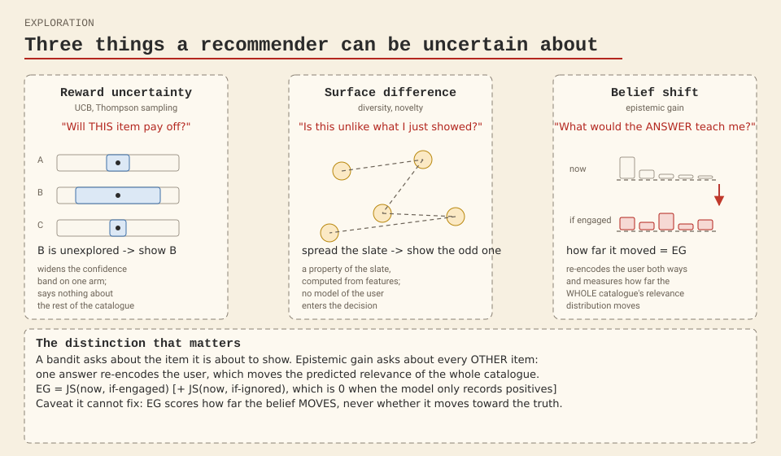

# Exploration for Recommenders: Showing an Item to Learn Something

## Why This Exists

**Problem.** [recommender-systems](recommender-systems.md) §6 names the failure honestly — an item-item recommender that is *too* accurate recommends only the obvious, and your whole front page becomes sports cars. But the only fix on offer there is a Thompson-sampled score, which explores because it is *unsure what an item's rating is*. That does nothing for a different and more common gap: the system is perfectly sure about everything it has seen, and has simply never found out that you also love jazz documentaries. No amount of reward-uncertainty exploration discovers an interest that never appears in your history.

**Key insight.** Separate *what you are uncertain about* from *how you explore*. A bandit is uncertain about one arm's payoff. A diversity re-ranker is not uncertain about anything — it just spaces items apart. A third option is to be uncertain about **the user model itself**, and to pick the item whose outcome would move your beliefs about the *whole catalogue* the most. That quantity has a name — **epistemic gain** — and it is computable without retraining anything.

**Reach for this when:**
- Engagement is fine but the system keeps serving one narrow slice, and new interests only ever surface by accident.
- You already have bandits or a diversity re-ranker and want to know what a third exploration axis would add.
- You need to argue for an exploration budget in metrics other than click-through rate.
- You want the general pattern: approximate an expensive counterfactual signal with a small head on frozen embeddings.

**Don't reach for this when:**
- The model is poorly fit in the first place. Fix relevance first; §4 shows the gain from directed exploration *shrinks* as the base model gets worse.
- You only need an item's payoff estimated — that is a bandit: [multi-armed-bandits](../reinforcement-learning/multi-armed-bandits.md).
- The problem is a cold-start user with no history. Epistemic gain needs a user representation to perturb; see [behavioral-embeddings](behavioral-embeddings.md) §6.
- The interest lives outside your candidate pool. A ranking-layer signal can never surface an item retrieval did not fetch.

## Diagrams



## 1. Three things you can be uncertain about

| Signal | The question it asks | What it looks at | Covered in |
|---|---|---|---|
| Reward uncertainty (UCB, Thompson) | "Will *this* item pay off?" | the posterior of one arm | [multi-armed-bandits](../reinforcement-learning/multi-armed-bandits.md) |
| Surface difference (diversity, novelty) | "Is this unlike what I just showed?" | item features, slate composition | [recommender-systems](recommender-systems.md) §6 |
| Belief shift (epistemic gain) | "What would the *answer* teach me about everything else?" | the whole catalogue's predicted relevance, before vs after | this note |

The third is the only one that reasons about **cross-item transfer**: one answer re-encodes the user, which shifts the predicted relevance of thousands of items at once. A bandit learns about the arm it pulled; epistemic gain picks the arm whose outcome teaches the most about the arms it did *not* pull.

## 2. Epistemic gain, concretely

Let $R_u$ be the model's relevance distribution over the whole catalogue (a softmax over scores). For a candidate item $i$, build two hypothetical futures — the user engages, or does not — re-encode the user each way without touching the model weights, and measure how far the distribution moved:

$$EG(u, i) = JS\!\left(R_u, R_u^{i+}\right) + JS\!\left(R_u, R_u^{i-}\right)$$

Jensen-Shannon divergence rather than KL because it is symmetric and bounded, so the two terms are comparable and the result is normalizable. For a sequential model that only records *positive* interactions, a non-engagement changes the input sequence not at all, so the second term is identically zero and only the engage branch matters.

The whole mechanism in one user's shoes — history is three items from one genre:

```python
import numpy as np
from scipy.spatial.distance import jensenshannon
rng = np.random.default_rng(0)
G = np.repeat(np.arange(3), 10)                 # 30 items in 3 genres
items = np.eye(3)[G] + 0.15 * rng.normal(size=(30, 3))   # frozen "pretrained" item vectors
def rel(hist):                                  # user vector = mean of engaged items (a frozen encoder)
    s = items @ items[hist].mean(0) / 0.25      # temperature 0.25 sharpens the distribution
    return np.exp(s - s.max()) / np.exp(s - s.max()).sum()
hist = [0, 1, 2]                                # this user has only ever engaged with genre 0
R = rel(hist)
for i in (4, 12, 25):                           # same genre / genre 1 / genre 2
    eg = jensenshannon(R, rel(hist + [i]), base=2) ** 2   # jensenshannon returns the DISTANCE: square it
    print(f"item {i:2d} (genre {G[i]})  relevance {R[i]:.4f}   epistemic gain {eg:.4f}")
# Expected output:
# item  4 (genre 0)  relevance 0.0180   epistemic gain 0.0011
# item 12 (genre 1)  relevance 0.0008   epistemic gain 0.0457
# item 25 (genre 2)  relevance 0.0005   epistemic gain 0.0645
```

A fourth item from the familiar genre is the most *relevant* thing in the catalogue and teaches almost nothing (EG 0.0011). The cross-genre items are 40–60× more informative and nearly irrelevant. **Relevance and epistemic gain point in opposite directions**, which is why the interesting question is how to combine them rather than which to pick.

## 3. Does blending it in actually discover interests?

The honest test needs a catalogue much larger than the number of slots — otherwise greedy exhausts the familiar genre and "discovers" the rest by running out of options, which is not exploration. Six genres of 50 items, 20 rounds, one item per round drawn from a 30-item retrieval pool. Each user truly likes genre 0 (seeded in their history) plus one hidden genre, and engages with probability 0.9 inside a liked genre, 0.05 outside it.

**Interest coverage (IC)** is the fraction of a user's truly-liked genres with at least one positive engagement; **hit rate** is the fraction of slots that earned an engagement. They trade against each other, which is the entire point.

```python
import numpy as np
NG, PER, ROUNDS, POOL = 6, 50, 20, 30        # 6 genres x 50 items: catalogue >> the 20 slots we get
rng = np.random.default_rng(0)
G = np.repeat(np.arange(NG), PER)
items = np.eye(NG)[G] + 0.15 * rng.normal(size=(NG * PER, NG))   # frozen "pretrained" item vectors
N = len(items)
def sm(S):                                    # column-wise softmax; temp 0.25 sharpens relevance
    S = S / 0.25 - (S / 0.25).max(0, keepdims=True); E = np.exp(S); return E / E.sum(0, keepdims=True)
def ent(P): return -(P * np.log2(np.clip(P, 1e-12, None))).sum(0)
def jsd(R, Q): return ent((R[:, None] + Q) / 2) - (ent(R[:, None]) + ent(Q)) / 2   # JS divergence
def mm(x):
    lo, hi = x.min(), x.max()
    return np.zeros_like(x) if hi - lo < 1e-12 else (x - lo) / (hi - lo)           # per-round min-max
def run(strategy, taste, seed, alpha=0.6, eps=0.1):
    r = np.random.default_rng(seed)
    hist = [i for i in range(N) if G[i] == 0][:3]          # history: three genre-0 items, nothing else
    seen, hits, found = set(hist), 0, {0} & taste
    for _ in range(ROUNDS):
        unseen = np.array([i for i in range(N) if i not in seen])
        cand = r.choice(unseen, min(POOL, len(unseen)), replace=False)      # retrieval pool
        hsum, hn = items[hist].sum(0), len(hist)
        R = sm((items @ (hsum / hn))[:, None])[:, 0]                        # relevance over the catalogue
        if strategy == "random":   pick = r.choice(cand)
        elif strategy == "greedy": pick = cand[R[cand].argmax()]
        elif strategy == "eps":    pick = r.choice(cand) if r.random() < eps else cand[R[cand].argmax()]
        else:
            U = (hsum[None, :] + items[cand]) / (hn + 1)                   # hypothetical: user engaged
            EG = jsd(R, sm(items @ U.T))                                   # how far the belief moves
            sc = (1 - alpha) * mm(R[cand]) + alpha * mm(EG) if strategy == "eg" else mm(R[cand]) * mm(EG)
            pick = cand[sc.argmax()]
        seen.add(pick)
        if r.random() < (0.9 if G[pick] in taste else 0.05):               # engage only if truly liked
            hist = hist + [pick]; hits += 1; found.add(G[pick])
    return len(found & taste) / len(taste), hits / ROUNDS                  # interest coverage, hit rate
def avg(strategy, **kw):                       # 40 users, each liking genre 0 plus one hidden genre
    res = [run(strategy, {0, 1 + s % (NG - 1)}, 1000 + s, **kw) for s in range(40)]
    return np.mean([a for a, _ in res]), np.mean([b for _, b in res])
for s in ("greedy", "random", "eps", "eeg", "eg"):
    ic, hr = avg(s); print(f"{s:7s} interest coverage {ic:.3f}   hit rate {hr:.3f}")
print("EG-blend, sweeping the exploration weight alpha:")
for a in (0.0, 0.2, 0.4, 0.5, 0.6, 0.8):
    ic, hr = avg("eg", alpha=a); print(f"  alpha {a:.1f}   coverage {ic:.3f}   hit rate {hr:.3f}")
# Expected output:
# greedy  interest coverage 0.500   hit rate 0.871
# random  interest coverage 0.950   hit rate 0.328
# eps     interest coverage 0.688   hit rate 0.836
# eeg     interest coverage 0.812   hit rate 0.641
# eg      interest coverage 0.963   hit rate 0.622
# EG-blend, sweeping the exploration weight alpha:
#   alpha 0.0   coverage 0.500   hit rate 0.871
#   alpha 0.2   coverage 0.500   hit rate 0.871
#   alpha 0.4   coverage 0.500   hit rate 0.871
#   alpha 0.5   coverage 0.863   hit rate 0.709
#   alpha 0.6   coverage 0.963   hit rate 0.622
#   alpha 0.8   coverage 0.963   hit rate 0.530
```

Read the table, not the headline:

- **Greedy never leaves home.** IC 0.500 means it found exactly the genre it started with, for every user, every time, while posting the best hit rate (0.871). A model with a great engagement metric and half the user undiscovered is precisely the paper's argument.
- **Random discovers nearly everything (0.950) and wastes two slots in three** (hit rate 0.328). Undirected exploration works and costs a fortune.
- **EG-blending matches random's discovery at nearly twice the hit rate** — IC 0.963 at 0.622. That gap *is* the case for directed exploration: not that it discovers more than random, but that it discovers the same amount far more cheaply.
- **Expected EG (relevance × EG) is the conservative middle** (0.812 / 0.641). It suppresses implausible picks by construction, which also suppresses the signal exactly where an interest is undiscovered and relevance is therefore near zero.
- **ε-greedy barely helps** (0.688): a 10% random slot rarely lands in the one hidden genre out of five.

### The alpha threshold is real, and bigger than advertised

Below α = 0.5 the blend is **bit-for-bit identical to greedy** — 0.500 coverage at every one of α = 0, 0.2, 0.4. Then it jumps. This looks like it contradicts the paper's practical recommendation of α ∈ [0.1, 0.2], but it is the same statement: their worst-case sufficient condition is α > 1/(1+γ), and they argue [0.1, 0.2] suffices *because* real relevance gaps between the greedy-best and EG-best item are small (under 0.2). Per-round min-max normalization manufactures the worst case — it rescales the pool's best relevance to exactly 1.0 and the EG-best item toward 0, making the gap maximal by construction. **How you normalize the two signals decides what α means**, so a published α never transfers; sweep it against your own normalization and read the knee off the coverage/hit-rate curve.

## 4. Two limits worth internalizing

### Epistemic gain cannot tell a real interest from a dead end

EG measures how far the belief *moves*, never whether it moves toward the truth. Give a user one known genre, one they will hate, and one they secretly love:

```python
import numpy as np
from scipy.spatial.distance import jensenshannon
rng = np.random.default_rng(0)
G = np.repeat(np.arange(3), 10)                 # genre 0 = known, 1 = disliked, 2 = secretly loved
items = np.eye(3)[G] + 0.15 * rng.normal(size=(30, 3))
def rel(hist):
    s = items @ items[hist].mean(0) / 0.25
    return np.exp(s - s.max()) / np.exp(s - s.max()).sum()
hist = [0, 1, 2]                                 # history: genre 0 only
R = rel(hist)
for i, label in ((15, "genre 1 (user will HATE it)"), (25, "genre 2 (user will LOVE it)")):
    eg = jensenshannon(R, rel(hist + [i]), base=2) ** 2
    print(f"{label:28s} relevance {R[i]:.4f}   epistemic gain {eg:.4f}")
# Expected output:
# genre 1 (user will HATE it)  relevance 0.0010   epistemic gain 0.0592
# genre 2 (user will LOVE it)  relevance 0.0005   epistemic gain 0.0645
```

0.0592 against 0.0645 — indistinguishable, and necessarily so. Both items sit equally far outside the user's history, so both would shift the representation by about as much. EG buys you *systematic coverage of the unknown*, not clairvoyance about which unknown is worth having. The payoff in §3 comes from never wasting a slot on the already-known genre, not from guessing right.

### The better your base model, the more directed exploration buys

Degrade the frozen item vectors until the genre structure drowns in noise, and watch which strategy suffers:

```python
import numpy as np
NG, PER, ROUNDS, POOL, ALPHA = 6, 50, 20, 30, 0.6
def sm(S):
    S = S / 0.25 - (S / 0.25).max(0, keepdims=True); E = np.exp(S); return E / E.sum(0, keepdims=True)
def ent(P): return -(P * np.log2(np.clip(P, 1e-12, None))).sum(0)
def jsd(R, Q): return ent((R[:, None] + Q) / 2) - (ent(R[:, None]) + ent(Q)) / 2
def mm(x):
    lo, hi = x.min(), x.max()
    return np.zeros_like(x) if hi - lo < 1e-12 else (x - lo) / (hi - lo)
def run(strategy, taste, seed, G, items):
    N = len(items); r = np.random.default_rng(seed)
    hist = [i for i in range(N) if G[i] == 0][:3]
    seen, found = set(hist), {0} & taste
    for _ in range(ROUNDS):
        unseen = np.array([i for i in range(N) if i not in seen])
        cand = r.choice(unseen, min(POOL, len(unseen)), replace=False)
        hsum, hn = items[hist].sum(0), len(hist)
        R = sm((items @ (hsum / hn))[:, None])[:, 0]
        if strategy == "greedy": pick = cand[R[cand].argmax()]
        else:
            U = (hsum[None, :] + items[cand]) / (hn + 1)
            sc = (1 - ALPHA) * mm(R[cand]) + ALPHA * mm(jsd(R, sm(items @ U.T)))
            pick = cand[sc.argmax()]
        seen.add(pick)
        if r.random() < (0.9 if G[pick] in taste else 0.05):
            hist = hist + [pick]; found.add(G[pick])
    return len(found & taste) / len(taste)
print("noise = how far the frozen model's item vectors drift from the real genre structure")
for noise in (0.15, 0.6, 1.5, 3.0):
    rng = np.random.default_rng(0)
    G = np.repeat(np.arange(NG), PER)
    items = np.eye(NG)[G] + noise * rng.normal(size=(NG * PER, NG))
    g, e = (np.mean([run(s, {0, 1 + u % (NG - 1)}, 1000 + u, G, items) for u in range(40)]) for s in ("greedy", "eg"))
    print(f"  noise {noise:4.2f}   greedy {g:.3f}   EG-blend {e:.3f}   EG buys {e - g:+.3f}")
# Expected output:
# noise = how far the frozen model's item vectors drift from the real genre structure
#   noise 0.15   greedy 0.500   EG-blend 0.963   EG buys +0.463
#   noise 0.60   greedy 0.738   EG-blend 1.000   EG buys +0.262
#   noise 1.50   greedy 0.925   EG-blend 1.000   EG buys +0.075
#   noise 3.00   greedy 0.950   EG-blend 0.975   EG buys +0.025
```

**Greedy gets *better* as the model gets worse** — 0.500 up to 0.950 — because a noisy embedding space ranks almost arbitrarily, so greedy explores by accident. The filter bubble is a symptom of a *confident, coherent* model, and the value of directed exploration collapses from +0.46 to +0.03 as that confidence erodes. Two consequences: a strong base model is a prerequisite rather than an alternative, and if a bubble is not visible in your metrics, check whether your relevance model is simply too weak to form one yet.

## 5. Shipping it

Four integration modes, in increasing order of how much they disturb an existing stack:

| Mode | Score | Character |
|---|---|---|
| Score blending | $(1-\alpha)\,r + \alpha\,EG_{\text{norm}}$ | one knob, needs the α sweep from §3 |
| Expected EG | $r \cdot JS(R_u, R_u^{i+}) + (1-r) \cdot JS(R_u, R_u^{i-})$ | no α; self-suppressing, and conservative for the same reason |
| Bandit context augmentation | append $EG$ to the bandit's context vector | keeps reward-uncertainty exploration and *adds* the axis |
| RL reward component | EG as an extra reward term | proposed, not evaluated in the paper |

Bandit augmentation is the one the paper's own experiments favour, and it is also the least invasive: the bandit keeps doing what it does, with one more feature. That composes rather than competes with [multi-armed-bandits](../reinforcement-learning/multi-armed-bandits.md).

**The cost problem, and the reusable pattern.** Exact EG needs a catalogue-wide softmax per hypothetical per candidate — with a 1,000-item pool that is millions of scores for one request. The fix is the part worth stealing even if you never ship EG: **compute the expensive signal offline, then fit a small head to predict it.** The paper trains a two-layer MLP ([64, 32], ReLU, dropout 0.1, MSE loss on log-transformed min-max-normalized labels) on *frozen* base-model embeddings. At serving time EG becomes one extra forward pass per candidate instead of a catalogue sweep. Same shape as any distillation: an expensive teacher offline, a cheap student online.

## 6. Measuring interest discovery

Hit rate and NDCG cannot see this problem — greedy wins both in §3 while finding half the user. You need a second axis:

- **Interest coverage** — the fraction of a user's latent interest categories with at least one positive engagement. Needs ground-truth categories, which in practice means genre or topic tags, and it is only as meaningful as those tags.
- **Catalogue coverage** — the fraction of distinct items appearing in anyone's top-k. Easy to game: random exploration raises it without discovering anything about any individual user. Not a substitute for interest coverage.
- **Dual regret** — reward regret (engagement sacrificed by exploring) alongside coverage regret (interests still undiscovered). The useful framing: greedy accrues coverage regret *linearly forever*, because it never recommends outside its best cluster, whereas directed exploration can in principle finish discovery in a bounded number of rounds.

Report coverage *and* hit rate as a pair, always. Either alone is trivially optimized by a strategy nobody wants.

## Trade-offs

- **Discovery against immediate engagement.** There is no free version. In §3 the move from greedy to EG-blending bought +0.46 coverage for −0.25 hit rate. Whether that trade is worth it depends on how much a discovered interest is worth over a user's lifetime — a number nobody has, which is why this is a product decision dressed as a hyperparameter.
- **Blending against bandit augmentation.** Blending is a few lines over any existing scorer; it also replaces your tuned exploration with a single α. Augmentation preserves reward-uncertainty exploration and adds the epistemic axis, at the cost of needing a bandit in production already.
- **Exact EG against a predicted one.** Exact is faithful and unservable. The head is O(1) per candidate and inherits every weakness of the embeddings it reads plus its own approximation error, measured against labels you only generate offline.
- **A global α against a per-user budget.** One α treats a curious user and a comfort-watcher identically. A per-user exploration budget is the obvious extension and is not something the paper evaluates, so treat it as an idea rather than a result.

## Common Pitfalls

- **Testing exploration on a small catalogue.** If the slots approach the size of the familiar cluster, greedy discovers everything by exhaustion and every strategy ties at IC 1.000 — the first version of §3 did exactly this and showed nothing. The catalogue must dwarf the number of rounds.
- **Transplanting a published α.** α is only meaningful relative to how relevance and EG are scaled. Under per-round min-max normalization the useful range started at 0.5, not the 0.1–0.2 the paper recommends for its own normalization.
- **Reading a belief shift as a correct belief.** A large JS divergence means the model changed its mind, not that it is now right (§4). EG is a coverage instrument, not an accuracy one.
- **Expecting EG to fix a weak relevance model.** Its value falls as the base model degrades (§4). Relevance first.
- **Putting the signal only in the ranker.** Epistemic gain cannot surface an item the retrieval stage never returned, so a bubble enforced by candidate generation is invisible to it. Audit retrieval separately.
- **Letting catalogue coverage stand in for interest coverage.** Random exploration improves the former while teaching you little about any one user.
- **Forgetting that a non-engagement teaches nothing in a positives-only model.** The negative JS term is exactly zero there, so EG is driven entirely by the engage branch, and a ruled-out genre keeps looking informative until its items are drained from the pool.

## Decision Table

| Scenario | Use this | Not that | Why |
|----------|----------|----------|-----|
| New item needs impressions to earn a score | Thompson-sampled score ([multi-armed-bandits](../reinforcement-learning/multi-armed-bandits.md)) | Epistemic gain | The uncertainty is about *that item's* payoff |
| Engagement is healthy, the front page is one note | EG as a bandit context feature | ε-greedy | A random slot rarely lands in the one hidden interest (§3) |
| A slate that is all near-duplicates | Diversity re-ranking ([recommender-systems](recommender-systems.md) §6) | Epistemic gain | A slate-composition problem, not a knowledge problem |
| You need exploration to be cheap at serving time | EG prediction head on frozen embeddings | Exact catalogue-wide EG | Millions of scores per request otherwise |
| Relevance model is weak or barely fit | Improve the base model | Any exploration layer | The gain collapses as the model degrades (§4) |
| Proving exploration earned its keep | Interest coverage paired with hit rate | NDCG or catalogue coverage alone | Greedy wins accuracy while finding half the user |

## References

- Nemirovsky, Nirmal Singh Khokher, Jois, Zagha & Delgado — *There's Something About You: Epistemic Recommendation for Latent Interest Discovery*, RecSys '26 (Disney). DOI 10.1145/3773078.3831822. Introduces epistemic gain, the four integration modes, the EG prediction head and the dual-regret framing. ACM blocks automated requests, so this is a plain citation.
- [EGRec reference implementation](https://github.com/egrec-paper/egrec) — the authors' code.
- Lin — *Divergence Measures Based on the Shannon Entropy*, IEEE Trans. Information Theory 37(1), 1991. The symmetric, bounded JS divergence the EG definition rests on.
- [`scipy.spatial.distance.jensenshannon`](https://docs.scipy.org/doc/scipy/reference/generated/scipy.spatial.distance.jensenshannon.html) — returns the JS *distance*; square it for the divergence, as the snippets above do.

**What the paper actually demonstrates**, stated plainly, because the framing travels better than the evidence: 20-round simulations on KuaiRec and MovieLens-1M, two sequential backbones (SASRec, GRU), **three seeds**. The clearest win is GRU/KuaiRec, where adding EG to Neural Thompson Sampling lifts interest coverage from 0.788 to 0.850, about 8%. On SASRec/KuaiRec the margin over plain NeuralTS is within standard error (1.255 vs 1.252), and on MovieLens/GRU the EG variant lands *below* greedy (0.659 vs 0.756) with high cross-seed variance. The theory's coverage guarantee rests on an "EG gap" assumption the authors report holding for 33.7% of users on KuaiRec/SASRec, and they do not verify it persists during exploration. Interest coverage is defined as a fraction yet several reported values exceed 1.0, which is unexplained. Treat this as a well-posed idea with directionally encouraging evidence, not a settled result.

## See Also

- [recommender-systems](recommender-systems.md) — the scoring ladder, the Thompson-sampled score, and the "too accurate" problem this note answers differently.
- [multi-armed-bandits](../reinforcement-learning/multi-armed-bandits.md) — reward-uncertainty exploration in full; the natural host for an EG context feature.
- [behavioral-embeddings](behavioral-embeddings.md) — where the user representation EG perturbs comes from, plus cold start and time-split evaluation.
- [matrix-factorization-recommenders](matrix-factorization-recommenders.md) — the latent space whose geometry decides whether cross-item transfer works at all.
