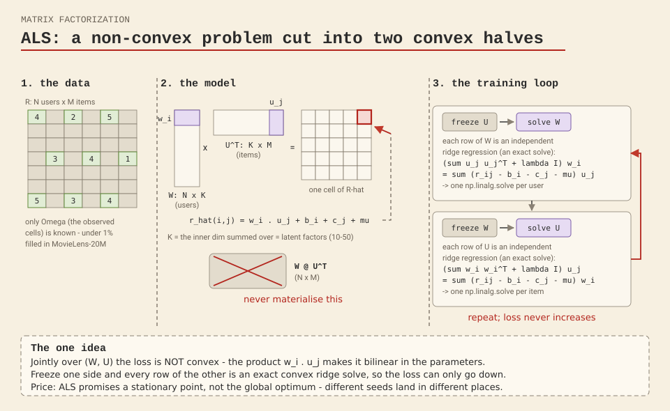

# Matrix Factorization for Rating Prediction

> **How to read this note.** It picks up where [recommender-systems](recommender-systems.md) stops. That note covers ranking formulas and neighbourhood collaborative filtering — "find users like you, average their ratings". This one replaces the similarity table with *learned vectors*, which turns recommendation back into ordinary fit/predict machine learning. Sections 1–6 are the model and its classical training; §7 rebuilds the same thing as a neural network; §8–9 are the two scale stories (an RBM over star ratings, and ALS on a cluster). Source: *Recommender Systems and Deep Learning in Python* (Lazy Programmer), the matrix-factorization, RBM and Spark sections.

## Why This Exists

**Problem.** Neighbourhood collaborative filtering needs a similarity score for every pair of users (or items), which is an $N^2$ table you cannot store at web scale and cannot fill in where two users barely overlap. It also has no parameters, so there is nothing to *learn* — no training curve, no regularization, no way to trade capacity against data. And it cannot answer "why": it says "people like you liked this", never "you like action and this is action".

**Key insight.** Give every user a short vector $w_i$ and every item a short vector $u_j$, and let their dot product be the predicted rating. Fit those vectors to the ratings you actually observed. The shared $K$-dimensional space *is* the model: it is small enough to generalize, it transfers taste between users who never overlapped, and its dimensions turn out to be interpretable taste axes nobody had to collect.

**Reach for this when:**
- You have explicit ratings (stars, scores) and want to predict the missing ones.
- A similarity table is too big, too sparse, or too slow to refresh.
- You want user and item vectors you can reuse downstream (clustering, retrieval, features for a ranker).
- You need a strong, cheap baseline before anyone is allowed to propose a deep recommender.

**Don't reach for this when:**
- Your signal is implicit (clicks, watches, purchases) rather than ratings — the loss changes, and the right variants (weighted ALS, BPR, two-tower) live in [behavioral-embeddings](behavioral-embeddings.md).
- You need predictions for users or items with *zero* history. Factorization has nothing to fit; see the cold-start section of [behavioral-embeddings](behavioral-embeddings.md).
- You need the final ranking with rich context features (time of day, device, position). Factorization is a scorer, not a ranker.
- The catalogue is tiny. A per-item mean plus a per-user offset is most of the win and has no hyperparameters.

## Diagrams



<!-- DIAGRAM SPEC: name=mf-als-alternation | panels: (1) LEFT "the data": an N x M grid labelled "R (ratings)" with only about 1 in 6 cells filled with a number (e.g. 4, 2, 5, 3) and the rest blank/greyed; caption under it "only Omega (the observed cells) is known; <1% filled in MovieLens-20M". (2) MIDDLE "the model": a tall skinny box "W : N x K (users)" times a short wide box "U^T : K x M (items)", with the inner dimension K annotated "summed over = latent factors"; one row of W (row i) and one column of U^T (column j) highlighted in an accent colour, with an arrow pointing to ONE single cell of a faint R-shaped grid labelled "r_hat(i,j) = w_i . u_j + b_i + c_j + mu"; a red crossed-out big box labelled "W @ U^T (N x M)" with the caption "never materialise this". (3) RIGHT "the training loop": two stacked half-steps in a cycle. Top half-step: U box drawn frozen/greyed with a padlock icon, W box in accent colour, label "freeze U -> each row of W is an independent ridge regression: (sum u_j u_j^T + lambda I) w_i = sum (r_ij - b_i - c_j - mu) u_j   -> np.linalg.solve". Bottom half-step: mirror image, W frozen with padlock, U in accent colour, label "freeze W -> each row of U is an independent ridge regression". A curved arrow loops from the bottom half-step back up to the top, labelled "repeat; loss never increases". | labels: use "->" for arrows, "x^2" style for powers, "lambda" spelled out. | the one idea it must land: the joint problem over (W, U) is NOT convex, but each half of the alternation is an exact convex ridge solve - that is why ALS works and why it only promises a stationary point, not the global optimum. -->

## 1. What factorization fixes, in numbers

The course runs on MovieLens-20M: **20 million ratings** over roughly **130,000 users** and **26,000 movies** (the real dataset has 138,493 users and 27,278 movies — the lecture rounds, and its arithmetic is internally consistent with the rounded figures). That grid has

$$N \times M \approx 130{,}000 \times 26{,}000 \approx 3.38 \text{ billion cells}$$

of which 20 million are filled: a density of about $20\times10^6 / 3.38\times10^9 \approx 0.006$, well under 1%. A similarity table over users is the same order of magnitude as that grid. Factorization at $K = 10$ instead stores

$$NK + MK \approx 1.56 \text{ million parameters} \approx 0.0005 \times (N \times M)$$

— **fewer parameters than training ratings**, which is the course's informal argument for why it generalizes rather than memorizes.

Two operational rules follow, and the course repeats them all section:

1. **Never materialize anything $N \times M$.** Not the ratings matrix, not the predictions.
2. **Never compute `W @ U.T`.** A single cell $w_i \cdot u_j$ is $K$ multiplications; the full product is 3.38 billion of them.

Everything awkward about the implementations below — dictionaries instead of arrays, per-user loops, sparse matrices, generators — exists to honour those two rules.

## 2. The model, and what a latent dimension means

$$\hat{r}_{ij} = w_i \cdot u_j + b_i + c_j + \mu$$

- $W$ is $N \times K$, one row per user; $U$ is $M \times K$, one row per item. $K$ is the **latent dimensionality**, normally 10–50.
- $b_i$ is a **user bias**, $c_j$ an **item bias**, and $\mu$ the global mean of the *training* ratings — computed once and never learned.

**Why the dot product is the right shape.** The dot product is proportional to cosine similarity, so it asks "how well do user $i$'s tastes line up with item $j$'s attributes?" Pretend for a moment that $K$ is small and the dimensions are genres:

```
w_i          = ( 1.0,  0.8, -1.0,  0.1,  1.0)   # likes action and comedy, hates romance
Lego Batman  = ( 1.0,  1.5, -1.3,  0.0,  1.2)   -> dot =  4.7
The Notebook = (-1.0, -1.0,  1.0,  0.0, -1.0)   -> dot = -3.8
```

Note that agreement in *either* direction contributes positively: a user who hates romance ($-1$) meeting a film with no romance ($-1$) multiplies to $+1$. Disagreement is what costs you. (The course's slide announces $K=5$ but lists six genre names beside five-entry vectors — copy the vectors, not the label list.)

**In a trained model nobody labels the dimensions.** They are **latent features** — hidden causes — and you interpret them after the fact, the way you interpret clusters: sort the items by their value on dimension 1, read the top ten, and if they are *The Notebook*, *Titanic* and *A Cinderella Story* you call it "romance". This is the payoff over a supervised model: a supervised recommender needs hand-collected user features (age, gender, location) and item features (genre, runtime, cast), and somebody has to collect them. Factorization **discovers** the features from rating patterns alone.

**Why the biases are not optional.**

- Linear regression has an intercept for a reason: without it the line is forced through the origin. A dot product with no offset is forced through zero, but ratings live on a 1–5 scale centred nowhere near zero.
- Users have different scales. An optimist's 4 is a pessimist's 5. Neighbourhood CF already handled this by working with **deviations from each user's average**; $b_i$ is that same correction, learned.
- Items have different quality *at the same coordinates*. *Avatar*'s latent features — sci-fi, aliens, action — are shared almost exactly by *Battlefield Earth*, which the course cheerfully calls one of the worst sci-fi films ever made. No set of taste axes separates them. An item-quality offset does.

The interpretation worth memorizing: **a bias is the average deviation of the true rating from the model without that bias.** That is exactly what its update formula computes (§4).

## 3. The loss: observed cells only

Let $\Omega$ be the set of observed $(i,j)$ pairs, $\psi_i$ the items user $i$ rated, and $\Omega_j$ the users who rated item $j$. The regularized squared-error objective is

$$J = \sum_{(i,j) \in \Omega} \left(r_{ij} - \hat{r}_{ij}\right)^2 + \lambda\left(\|W\|_F^2 + \|U\|_F^2 + \|b\|^2 + \|c\|^2\right)$$

The sum runs over $\Omega$ **only**. This single detail is what separates matrix factorization from classical linear algebra: a missing rating contributes nothing — not a zero, not a penalty, nothing. The $1/|\Omega|$ normalizer is dropped as a positive constant that cannot move the argmin, which is also why the loss you *print* while training should be the un-regularized mean squared error: the regularizer only exists for its gradient, so its value is not comparable to anything.

The Frobenius penalty differentiates row-wise — $\partial \|W\|_F^2 / \partial w_i = 2 w_i$ — which is why it will drop straight into the solve below as a $+\lambda I$ term.

## 4. Alternating least squares

**The derivation.** Differentiate $J$ with respect to one user's vector $w_i$ and set it to zero. Only the terms where user $i$ appears survive:

$$\frac{\partial J}{\partial w_i} = 2 \sum_{j \in \psi_i} \left(r_{ij} - w_i \cdot u_j - b_i - c_j - \mu\right)(-u_j) + 2\lambda w_i = 0$$

Three facts turn this into something solvable. The dot product is commutative, so $w_i \cdot u_j = u_j^T w_i$. Its result is a **scalar**, so it can be moved past a vector. And $w_i$ does not depend on $j$, so it leaves the summation — which converts $\sum_j u_j (u_j^T w_i)$ into $\left(\sum_j u_j u_j^T\right) w_i$, an **outer product** accumulated into a $K \times K$ matrix. What is left is $Ax = b$:

$$\underbrace{\left(\sum_{j \in \psi_i} u_j u_j^T + \lambda I\right)}_{A,\ K \times K} w_i = \underbrace{\sum_{j \in \psi_i} \left(r_{ij} - b_i - c_j - \mu\right) u_j}_{b,\ K}$$

That is **ridge regression's closed form**, with the fixed item vectors playing the role of the design matrix. By symmetry, holding $W$ fixed gives the mirror image per item:

$$\left(\sum_{i \in \Omega_j} w_i w_i^T + \lambda I\right) u_j = \sum_{i \in \Omega_j} \left(r_{ij} - b_i - c_j - \mu\right) w_i$$

The biases come out as plain averages (the derivative of $b_i$ with respect to itself is 1, so every other term drops; $b_i$ is still *inside* the sum, so pulling it out leaves $\sum_j 1 = |\psi_i|$ as the denominator):

$$b_i = \frac{\sum_{j \in \psi_i}\left(r_{ij} - w_i \cdot u_j - c_j - \mu\right)}{|\psi_i| + \lambda}, \qquad c_j = \frac{\sum_{i \in \Omega_j}\left(r_{ij} - w_i \cdot u_j - b_i - \mu\right)}{|\Omega_j| + \lambda}$$

Since the denominator is $|\psi_i| + \lambda$ rather than $|\psi_i|$, regularization simply **shrinks** the biases toward zero — and the shrinkage fades as a user rates more items, because $\lambda$ stays fixed while $|\psi_i|$ grows. Read those two formulas in words and you get the definition quoted in §2: a bias is the mean residual of the model without it. (Watch the denominator: $\lambda$ is *added* to the count, not multiplied through it. The snippet below divides by `len(j) + reg`, which is this formula; dividing by $|\psi_i|(1+\lambda)$ instead over-shrinks every bias by a factor that grows with the number of ratings.)

**Solve, never invert.** `np.linalg.solve(A, b)` is both faster and more numerically accurate than forming `np.linalg.inv(A) @ b`. The matrix is only $K \times K$, so each solve is trivially cheap — the cost is that you do $N + M$ of them per sweep.

**Why it has to alternate.** $W$'s update needs $U$ and $U$'s update needs $W$; substituting one into the other does not collapse them, because the model genuinely has two parameter blocks. So: initialize both randomly, then loop `{update every row of W; update every row of U}`. Two practical notes from the course: the update order does not matter (the loss is symmetric in the two blocks), and you should use the **just-updated** values rather than a saved copy — it is cheaper and you are alternating anyway.

**What convergence actually guarantees.** The course says each step "always gets closer to a local minimum". The precise statement is more useful: $J$ is **not convex jointly** in $(W, U)$ — the product $w_i \cdot u_j$ is bilinear, and you can scale $W$ up and $U$ down for free — but it **is convex in each block separately**. Each half-step is an exact minimization of a convex problem, so it cannot increase the loss. Therefore ALS is **monotonically non-increasing and converges to a stationary point**. There is no guarantee of a global optimum, and different random initializations land in different solutions.

**Does any of this beat the baseline?** The snippet below builds a synthetic $150 \times 80$ rating matrix from exactly 3 latent factors plus noise, hides 20% of the observed cells, and runs the ALS above — biases, $+\lambda I$ and all — at four values of $K$. It answers two questions at once: does factorization earn its complexity, and does $K$ matter?

```python
import numpy as np
rng = np.random.default_rng(0)
U, I, K_true = 150, 80, 3
P0, Q0 = rng.normal(size=(U, K_true)), rng.normal(size=(I, K_true))
true = 3 + 0.6 * P0 @ Q0.T + rng.normal(0, .3, (U, I))
rated = rng.random((U, I)) < .5
test = rated & (rng.random((U, I)) < .2)
train = rated & ~test
def als(K=3, reg=1.0, iters=15):
    P, Q = rng.normal(0, .1, (U, K)), rng.normal(0, .1, (I, K))
    bu, bi = np.zeros(U), np.zeros(I)
    mu = true[train].mean()
    for _ in range(iters):
        for u in range(U):                                   # solve each user's vector with the items held fixed
            j = np.where(train[u])[0]
            if not len(j): continue
            A = Q[j].T @ Q[j] + reg * np.eye(K)              # ridge normal equations
            b = Q[j].T @ (true[u, j] - mu - bu[u] - bi[j])
            P[u] = np.linalg.solve(A, b)
            bu[u] = (true[u, j] - mu - bi[j] - Q[j] @ P[u]).sum() / (len(j) + reg)
        for i in range(I):                                   # then each item's vector with the users held fixed
            v = np.where(train[:, i])[0]
            if not len(v): continue
            A = P[v].T @ P[v] + reg * np.eye(K)
            b = P[v].T @ (true[v, i] - mu - bu[v] - bi[i])
            Q[i] = np.linalg.solve(A, b)
            bi[i] = (true[v, i] - mu - bu[v] - P[v] @ Q[i]).sum() / (len(v) + reg)
    pred = mu + bu[:, None] + bi[None, :] + P @ Q.T
    return ((pred - true)[test] ** 2).mean()
print(f"global mean baseline MSE {((true[train].mean() - true)[test] ** 2).mean():.3f}")
for K in (1, 3, 10, 40):
    print(f"MF via ALS, K={K:<3d}      MSE {als(K):.3f}" + ("   <- true number of factors" if K == K_true else ""))
# Expected output:
# global mean baseline MSE 1.014
# MF via ALS, K=1        MSE 0.787
# MF via ALS, K=3        MSE 0.105   <- true number of factors
# MF via ALS, K=10       MSE 0.137
# MF via ALS, K=40       MSE 0.134
```

Three things to take from those numbers. **Factorization crushes the baseline**: predicting the global mean everywhere gives MSE 1.014, and ALS at the true $K=3$ gives 0.105 — about a tenth of the error. It is also a large step up from neighbourhood CF: item-item collaborative filtering on *this same synthetic data* scores 0.343 in [recommender-systems](recommender-systems.md), so the learned factors recover structure the similarity table cannot. **$K$ is a real hyperparameter, not a formality**: $K=1$ (0.787) underfits badly — one axis cannot express three independent tastes — while the true $K=3$ is the sweet spot. And **too large mostly stops helping rather than exploding**: $K=10$ and $K=40$ land at 0.137 and 0.134, slightly worse than $K=3$ but nowhere near the baseline, because the $\lambda I$ shrinks the directions there is no signal for. Without regularization that curve would turn upward instead of flattening. Tune $K$ on held-out data; the course suggests starting in the 10–50 range for real datasets.

**On implementation cost.** The course's naive version loops over every rating inside the per-user loop and takes **7–8 minutes per epoch** on MovieLens-20M. Replacing the inner loop with fancy indexing — pre-build `user -> (item_ids, ratings_array)` and `item -> (user_ids, ratings_array)` dictionaries, then write `A = U[ids].T @ U[ids] + reg*np.eye(K)` — gets it to **30–40 seconds per epoch** for identical results. Fully vectorizing is left as a challenge with two real obstacles: the left-hand side would need an $N \times K \times K$ tensor passed to `solve` (because $U^T U$ is only correct if everyone rated everything), and a vectorized bias update needs the forbidden `W @ U.T`. One more thing worth copying: wrap the item loop in a `try/except`, because a random split can leave an item with zero training ratings and an empty $A$.

## 5. Why this is not SVD (even though everyone calls it SVD)

The singular value decomposition factors a **fully observed** matrix exactly. For $X$ of shape $N \times M$ with $N > M$ and full rank:

$$X_{(N \times M)} = U_{(N \times M)}\, S_{(M \times M)}\, V^T_{(M \times M)}$$

The factors come from eigendecomposition: $U$ holds the eigenvectors of $XX^T$, $V$ those of $X^TX$, and $S = \sqrt{\operatorname{diag}(\lambda_1 \dots \lambda_M)}$ — both products share the same eigenvalues. $U$ and $V$ are **orthonormal**, and the columns are **ordered by importance**, which is what makes truncation meaningful: keeping the top $K$ gives shapes $N \times K$, $K \times K$, $K \times M$ and is provably the **best rank-$K$ approximation** in Frobenius norm. That is `sklearn.decomposition.TruncatedSVD`, and it is also the usual motivation for factorization: if a matrix splits into three factors it certainly splits into two, since the $K \times K$ middle can be absorbed into either side. (The course's lectures state the SVD shapes inconsistently and one of them asserts that $SV^T$ is $N \times K$; it is $K \times M$. Trust the shapes above — and see [linear-algebra](../math-for-ml/linear-algebra.md) for the derivation.)

So why insist the model above is *not* SVD?

1. **SVD cannot be computed on a matrix with missing entries at all.** Not slowly, not approximately — the eigendecomposition needs every cell. Everything in §4 exists precisely because 99.4% of the cells are absent.
2. **ALS is unconstrained.** Nothing forces the columns of $W$ or $U$ to be orthogonal or unit-length, and nobody reparameterizes them afterwards. They are just two matrices whose product fits the observed cells.

The name stuck for historical reasons: during the Netflix Prize, Simon Funk published this algorithm in a blog post titled with "SVD", and "Funk SVD" entered the literature. "SVD++" is the same model with bias terms and implicit-feedback counts. Both are matrix factorization. Say **matrix factorization**.

One caveat the course glides past. One lecture argues that SVD's job is *harder* (it must reproduce every cell) so factorization's job must be easier. That is true as an existence argument on a fully observed matrix, but it says nothing about **generalization**: that a rank-$K$ fit to 0.6% of the cells predicts the other 99.4% is an empirical fact about ratings data, not a theorem of linear algebra. Relatedly, "$X^TX$ is proportional to the covariance of $X$" only holds if $X$ is column-centred — which the course does flag, and which is one more argument for the $\mu$ and bias terms.

## 6. The probabilistic reading: where squared error and L2 come from

Both the loss and the penalty look arbitrary until you write down a generative model. Suppose each rating is Gaussian noise around the dot product:

$$r_{ij} \sim \mathcal{N}\!\left(w_i \cdot u_j,\ \sigma^2\right) \quad\Longrightarrow\quad \log p(R \mid W, U) = -\frac{1}{2\sigma^2}\sum_{(i,j)\in\Omega}\left(r_{ij} - w_i \cdot u_j\right)^2 + \text{const}$$

Constants and positive scale factors cannot move the argmax, so **maximizing the log-likelihood is exactly minimizing the sum of squared errors**. The course's line is worth keeping: we were doing maximum likelihood the whole time without knowing it.

Now add zero-mean Gaussian priors on the factors, parameterized by **precision** $\lambda = 1/\text{variance}$ (that parameterization is the entire punchline). By Bayes' rule $p(W, U \mid R) \propto p(R \mid W, U)\, p(W)\, p(U)$ — the evidence $p(R)$ is constant in the parameters and drops — so the log posterior is

$$-\frac{1}{2\sigma^2}\sum_{(i,j)\in\Omega}\left(r_{ij} - w_i \cdot u_j\right)^2 - \frac{\lambda}{2}\left(\|W\|^2 + \|U\|^2\right) + \text{const}$$

which is the objective from §3. **L2-regularized matrix factorization is exactly MAP estimation under Gaussian priors.** This is Probabilistic MF (Mnih & Salakhutdinov, 2007), and it means the two choices you never justified — squared loss, L2 penalty — are the Gaussian assumption stated twice. See [statistics-and-probability](../math-for-ml/statistics-and-probability.md) for MLE, MAP and conjugate priors in general.

**Bayesian MF** (Salakhutdinov & Mnih, 2008) goes one step further and refuses the point estimate: if everything is a random variable, you want the predictive distribution

$$\mathbb{E}[r_{ij} \mid R] = \int (w_i \cdot u_j)\, p(W, U \mid R)\, dW\, dU$$

Expand $p(r_{ij} \mid R)$ into $p(r_{ij} \mid W, U)\, p(W, U \mid R)$; the inner expectation of the Gaussian is just its mean $w_i \cdot u_j$, so what remains is the expectation of the dot product **under the posterior** — approximable by a sample mean, which means Monte Carlo, which in practice means MCMC and specifically **Gibbs sampling**. The course treats the training algorithm as out of scope (it labels the lecture 100% optional) and never names the paper; it is BPMF, by the same authors as the RBM recommender in §8.

## 7. The same model as a neural network

Nothing above required a neural network, and gradient descent was never the only option. But the translation is short, and it is what unlocks the nonlinear variants.

**Embeddings *are* $W$ and $U$.** An embedding layer maps a discrete token to a vector by indexing an $N \times K$ lookup table — row $i$ of that table *is* $w_i$. Multiplying a one-hot vector by the embedding matrix and indexing a row are the same operation. So a user embedding of shape $N \times K$, a movie embedding of shape $M \times K$, and a dot product between the two retrieved rows reproduce §2 exactly, and autodiff plus Adam replaces the ALS solve. (See [artificial-neural-networks](../deep-learning/artificial-neural-networks.md) for embeddings-as-lookup, Adam and the training loop.) Worth internalizing: gradient descent is a general smooth-function optimizer, not a neural-network-only tool, and **ALS and SGD are both legitimate ways to fit the same model**.

**Bias terms are width-1 embeddings.** An $N \times 1$ embedding returns a length-1 vector, which is a scalar, which is $b_i$. Same for $M \times 1$ and $c_j$. Join everything with an `Add`.

**The global mean is handled by moving it to the other side.** Rather than injecting a constant into the graph, subtract $\mu$ from the targets: fit on `train_ratings - mu` and `validation_data=(..., test_ratings - mu)`. Algebraically identical. **But it leaves a trap the course never mentions: the saved model's outputs are mean-shifted, so you must add $\mu$ back at serving time.** (The course's justification — that Keras exposes layers, not tensors, so a constant would need "ugly hacks" — is also obsolete and was always an overstatement: a `Lambda` layer, a custom layer, or simply initializing the output layer's bias to $\mu$ does it in one line.)

The shape bookkeeping is the only fiddly part: an embedding assumes a possible sequence of length $T$, so it returns `(batch, T, K)` and here $T=1$. Hence `Dot(axes=2)` on two `(batch, 1, K)` tensors gives `(batch, 1, 1)`, the bias embeddings give `(batch, 1, 1)` too, and a final `Flatten` gives `(batch, 1)`. A good debugging habit from the course: build a sub-`Model` that ends at any intermediate layer and print its output shape.

### Deep MF: concatenate instead of dotting

Flatten both embeddings to `(batch, K)`, `Concatenate` to `(batch, 2K)`, push that through a Dense stack, and finish with `Dense(1)` and **no activation** (it is a regression). The conceptual point is the good one: the per-user and per-item feature vector you were told you would have to collect by hand is what the embeddings hand you for free — and now an MLP can use it nonlinearly.

### Residual MF: let the MLP learn what MF cannot

Inspired by ResNet and Inception: share the embeddings, run them into *two* branches — the linear dot-product-plus-biases branch and the MLP branch — and `Add` the two scalars. The MF branch does what it is good at; the MLP branch is left fitting the **residual**, i.e. only the structure a bilinear model structurally cannot represent.

### Neural collaborative filtering

The NCF paper ([He et al. 2017](https://arxiv.org/abs/1708.05031)) arrives at nearly the model above by a different route, over **implicit** data: a binary interaction matrix (1 if the user interacted — "spent more than three seconds on the product page"), with counts as an option under a different loss. Useful points from the course's read-through:

- **"All data is the same."** Not one line of the architecture changes when you swap explicit ratings for implicit interactions; only the labels and the loss do.
- With 0/1 labels, squared error presumes Gaussian noise, so **binary cross-entropy** is the right loss. Their loss also carries a per-$(u,i)$ **weight**, which is where confidence or importance goes.
- Their "GMF" (generalized matrix factorization) is MF-as-a-neural-net, and their GMF+MLP fusion is the two-branch model above.

Three honest differences the course's "we already did everything in the paper" glosses over: NeuMF uses **separate embedding tables** for the two branches (the course shares one pair), it **concatenates** the branches where the course **adds** them, and it trains with log loss plus **negative sampling** on implicit feedback. Papers generally do not justify the choice of combiner; add and concatenate are both in use.

### AutoRec: the ratings matrix as the data matrix

An autoencoder predicts its own input — `fit(X, X)` rather than `fit(X, y)` — and a **denoising** autoencoder reconstructs a clean input from a corrupted one, which is literally *filling in blanks*. Swap missing pixels for missing ratings and you have the recommender problem. See [autoencoders](../deep-learning/autoencoders.md) for the architecture itself (including a movie-recommender autoencoder); what AutoRec adds is a change of viewpoint:

- **The samples are users, not ratings.** Every previous model treated each of the 20M filled cells as one training example. AutoRec treats each **row** of the ratings matrix as one sample: a user is an "image", a movie is a "pixel", so $N$ = users = samples and $M$ = movies = features. Epochs get dramatically faster — 130,000 samples instead of 20 million. The matrix could be transposed, but the paper found users-as-rows better.
- **You now do need an $N \times M$ object**, breaking rule 1 of §1 — resolved with `scipy.sparse` (build with `lil_matrix` for incremental assignment, convert to `csr` to save and slice, densify one batch at a time).
- **The cost must be masked.** Missing ratings are stored as zeros, and a plain autoencoder would faithfully learn to reproduce those zeros. Mask inside the loss, since Keras's loss signature is `(y_true, y_pred)` and the outer mask is not in scope: build the mask from `y_true != 0`, multiply the difference by it, and divide the sum of squares by the mask's sum rather than by the batch size. (This is why ratings on a 0.5–5.0 scale are convenient — zero is unambiguously "missing".)
- **Centring interacts with the mask.** Subtract `mu * mask`, not `mu`. Since $\mu$ is not an exact multiple of 0.5 it can never turn a real rating into 0 and corrupt the mask, and masking the subtraction stops you from fabricating a $-\mu$ rating in an empty cell.
- **Extra input noise.** The paper adds none; the course argues some is necessary, because perfectly reconstructing ratings you already know is useless — and notes that zeroing inputs at random *is* dropout, so dropout covers it.
- **The test-MSE gotcha, which is the most reusable idea here.** If you feed the test ratings in as input, the autoencoder will simply copy them to the output and the validation loss will look superb and mean nothing. Feed the **training** ratings, take the reconstruction, and score only at the cells in $\Omega_{\text{test}}$ using a test mask. The course states the general principle twice: *train data makes both train and test predictions — that is the whole point of a recommender.*

The course's AutoRec run uses batch size 128, 20 epochs and L2 `1e-4`, and reports that L2 helped even on top of dropout. Hidden size, activations, dropout rate and optimizer are never stated and are explicitly left as things to tune.

### What the course actually measured: nothing

This is the most important caveat in the note. **Across the entire matrix-factorization and deep-learning section the course reports no quantitative results at all.** Every outcome is qualitative: "we do pretty well" (ALS), "the same result" (the vectorized rewrite), "looks better than what we got before, but that could be because the data was split differently" (Keras MF), "on par with matrix factorization" (deep MF and AutoRec), "doesn't seem like the results have improved" (residual). The only numbers in the section are the timings, the dataset arithmetic and the hyperparameters above. So:

- Do not quote MSE values for these models; there are none to quote, and a study guide that invents them is worse than one that admits the gap.
- Treat "deep ≈ MF on MovieLens" as **weakly supported**: the course says outright that it did not search hard for hyperparameters. It happens to agree with the literature — well-tuned MF is a brutally strong baseline ([Dacrema et al. 2019](https://arxiv.org/abs/1907.06902), [Rendle et al. 2020](https://arxiv.org/abs/2005.09683)) — but the course's run is not evidence for it.
- Likewise "SGD worked better than Adam here" is one anecdote from an untuned run whose learning rate is never stated. Not guidance.

**API drift to fix before running any of this code.** `fit_generator` has been **removed** — `fit` itself takes generators, `tf.data.Dataset`s and `keras.utils.Sequence` subclasses (and a bare Python generator is not epoch-safe in modern Keras, so subclass `Sequence` or use `tf.data`). `keras.backend as K` is gone in Keras 3: `K.cast` / `K.not_equal` / `K.sum` become `keras.ops.*`. Keras handles sparse inputs in several paths now, and `tf.data` makes the hand-written generator unnecessary. `Dot(axes=2)` and `Add()` are still current.

## 8. Star ratings in an RBM: the categorical trick

The course spends a section on a restricted Boltzmann machine recommender. [boltzmann-machines](../deep-learning/boltzmann-machines.md) is the canonical home for RBMs — energy functions, the partition function, free energy, Gibbs sampling, contrastive divergence and a worked binary movie recommender. Two things this course adds are specific to *ratings* and belong here.

**One-hot visible units with a softmax.** A Bernoulli RBM cannot represent a star rating: a sigmoid confines both ends to $[0,1]$. Rescaling ratings into $[0,1]$ like pixels would work, but the paper the course follows instead makes each visible unit a **$K$-way categorical** variable. MovieLens ratings run 0.5–5.0 in half-stars, so $K = 10$ one-hot categories **per movie**:

```
rating 0.5  ->  1 0 0 0 0 0 0 0 0 0
rating 5.0  ->  0 0 0 0 0 0 0 0 0 1
missing     ->  0 0 0 0 0 0 0 0 0 0
```

Shapes become $v: D \times K$, $W: D \times K \times M$, $b: D \times K$, $c: M$, $h: M$ — where in this section $D$ = movies, $K$ = rating classes and $M$ = hidden units, deliberately overriding the course-wide convention. Hidden units stay Bernoulli, so visible→hidden keeps its sigmoid; hidden→visible becomes a **softmax over each movie's $K$ rating levels**. The energy term $\sum_{d,k} W[d,k,m]\, v[d,k]$ is a double contraction — two axes at once, with no standard notation, implemented as `tf.tensordot(V, W, axes=[[1,2],[0,1]])`. The important consequence: because the energy is still a scalar, **the entire free-energy derivation carries over verbatim** with dot products reread as double dots. The formula does not change.

**Why masking has to hit the reconstruction.** A missing rating is *already* an all-zero $K$-vector. So force the sampled reconstruction $v'$ to be all-zero wherever the input was all-zero. Then $F(v)$ and $F(v')$ receive **identical contributions** at that movie, their difference is zero, and the gradient for that movie is zero — no update happens. This is a cleaner derivation than "clamp the unrated cells": it explains *why* clamping works, and it generalizes. Masking only the input is not enough.

**Predicting a rating from a distribution.** Argmax is one option; the paper used the **probability-weighted average** over rating levels. With probabilities $0.05, 0.10, 0.20, 0.50, 0.15$ over five star levels:

$$1(0.05) + 2(0.10) + 3(0.20) + 4(0.50) + 5(0.15) = 3.6$$

Argmax says 4; more probability mass sits below 4 than above, so the average pulls under it. Trying both is left as an exercise with no reported answer.

**The same honesty warning applies, harder.** The RBM section reports **no MSE, no epoch count, no batch size, no hidden-unit count and no learning rate** — it ends with "our results are not bad". It also runs on a *shrunken* subset of MovieLens-20M whose dimensions are never stated, and compares against no baseline at all (not a global mean, not a per-movie mean). With no baseline, "not bad" is unfalsifiable. Also note that the course's implementation is TensorFlow 1.x — `tf.placeholder`, `tf.Session`, `tf.train.AdamOptimizer`, `tf.distributions.Categorical` — none of which exist in TensorFlow 2+; port the *math* and the *categorical representation*, not the scaffolding. (The course's "why don't we just use a library?" lecture has no captions, so it is not covered here.)

## 9. Scale: ALS on a Spark cluster

**What is actually parallel.** Look back at §4: with $U$ frozen, every user's ridge solve is independent of every other user's. That is the structure a cluster exploits — not the file size. The course's definition of "big data" is deliberately deflationary: *any technology that requires distributed computing*, in three flavours — sharded databases, sharded files, and distributed compute (`for i in range(n)` where $n$ is 1.8 billion). Only the third applies here. The MovieLens file fits on a laptop; the ALS loop is what you spread out.

**How the data is partitioned.** The ratings file becomes an RDD, split into partitions spread across workers. `spark-submit` broadcasts your script to every machine, and the master coordinates **which slice of the data each worker handles** — including re-assigning work from failed machines. Lineage, which explains why installing Spark drags in Hadoop and therefore Java: MapReduce at Google → Hadoop at Yahoo → Spark on top of Hadoop. The useful Python bridge: a function you pass to pandas' `.apply()` is the same idea as Python's `map`, the same `map` as in MapReduce and in Spark.

The course's job is small: load the ratings CSV, strip the header row (Spark does not know about headers), map each line to a `Rating(user, item, rating)`, `randomSplit`, then `ALS.train(train, K=10, iterations=10)`. Evaluation is a SQL-style join: map both the predictions and the truth to `((user, item), value)` — two-element tuples whose first element is itself a tuple, because Spark joins on the first element — then join and average the squared differences. **Lazy evaluation** is visible live: every line up to `ALS.train` returns instantly, because Spark is only recording a plan.

**When Spark is the wrong answer.** Single-machine runtime is linear in the work: 100× the iterations is 100× the time. Spark flattens that line at large sizes but adds a large *constant* overhead — broadcasting the script, coordinating workers, re-running failed tasks — so it only wins past a crossover point. Reaching for a cluster before that point is the common mistake, and it is a **bigger** mistake now than when the course was recorded: one machine with hundreds of gigabytes of RAM plus DuckDB or Polars handles what needed a cluster in 2018, which pushes the crossover considerably to the right.

**What the course's cluster run actually showed.** The full dataset fails *locally* with a Java out-of-memory exception. On a cluster it completes, and the final test MSE appears on screen described only as "around what we expect" — **no number is read out**, so there is nothing to quote here either. The instructor's own verdict is that there was no big advantage to using Spark for this job, for three reasons: the script still reads from the **local filesystem**, the data is 700 MB uncompressed (146 MB gzipped — Spark reads gzip transparently, which matters when shipping files to many machines), and laptop→AWS network latency dominates.

**Cost and cleanup — the part that bites.** The course's own cluster recipe is `spark-ec2` with spot instances, which is thoroughly obsolete (see the pitfalls below), but the operational warnings transfer to EMR, Databricks, or Spark on EKS unchanged:

- **Terminate, do not stop.** A stopped instance is still reserved and still unavailable to anyone else; only termination ends the meter. Destroy the cluster through whatever tool created it so the whole stack goes with it.
- **Treat the teardown step as part of the job, not a chore afterwards.** The course tells its own horror stories of bills in the thousands from clusters left running; this is the single most common way a learning exercise becomes an incident.
- **Spot capacity can disappear mid-job.** A three-hour job dying at hour two is the realistic failure. Checkpoint, or use a capacity-optimized allocation strategy.
- **Redirect output to a file.** Spark and Hadoop print so much that your actual result scrolls away.

See [aws-ml-data-preparation](../classical-ml/aws-ml-data-preparation.md) and [aws-ml-deployment-mlops](../classical-ml/aws-ml-deployment-mlops.md) for the managed-service versions of the storage and job-orchestration pieces.

**Serving: batch job, real-time API.** The architecture the course lands on is worth keeping because it is still how most recommenders ship. The Spark job is **batch** — minutes to hours. The API is **real-time** — fast, scalable, per-user. Bridge them with a database: Spark writes predictions to Postgres or MySQL, the API reads from it and stays blissfully unaware of how they got there. The payoff is failure behaviour: if the batch job dies, the API serves *stale* predictions instead of breaking. This is also the honest explanation for why recommendations on big sites are sometimes visibly out of date.

## Trade-offs

- **Factorization vs neighbourhood CF.** You gain a compact model, taste transfer between non-overlapping users, and regularization knobs. You give up the trivial explainability of "people who liked X liked Y", the ability to add a new rating without retraining, and determinism — different initializations give different factors.
- **ALS vs SGD.** ALS takes big exact steps, has essentially one hyperparameter ($\lambda$, plus $K$), and parallelizes perfectly across users or items. SGD handles arbitrary losses and nonlinear extensions, streams, and costs you a learning rate, a schedule and a batch size. For plain squared-error MF, ALS usually converges in a handful of sweeps.
- **$K$ small vs large.** Small $K$ underfits (see the snippet's $K=1$); large $K$ stops paying and costs memory and serving latency. With L2 the penalty for overshooting is mild, which is why most people pick 10–50 and tune $\lambda$ instead.
- **Biases vs pure factorization.** Biases buy a lot for four parameters' worth of concept and absorb the "optimist vs pessimist" and "good film vs bad film at the same coordinates" effects. They also soak up signal the factors could have modelled, which is usually a feature, not a bug.
- **Deep MF vs plain MF.** The MLP can express interactions a bilinear model cannot, and gives you somewhere to inject side features. It costs tuning, training time and serving complexity for a gain that, in this course and in the published replications, failed to materialize on MovieLens.
- **Per-rating samples vs per-user samples (AutoRec).** Rows-as-samples makes epochs an order of magnitude faster and lets one forward pass score a user's whole catalogue. It also forces you to hold an $N \times M$ sparse object, write masking into the loss, and manage batches yourself.
- **Cluster vs one big machine.** A cluster buys headroom past the crossover point. It costs constant overhead, operational risk, money that accrues by the hour, and an entire class of failure modes (lost workers, interrupted spot capacity, forgotten teardown).

## Common Pitfalls

- **Treating missing ratings as zeros.** Zero is not a rating. A sum over all $N \times M$ cells fits the missingness pattern, not the preferences — and in a 0.5–5.0 dataset it also trains the model to predict "0.5-ish" everywhere. Sum over $\Omega$ only, and if you must store zeros (sparse matrices, AutoRec), mask the loss.
- **Computing `W @ U.T`.** It is 3.38 billion cells on MovieLens-20M and it will take your machine down. Score single cells, or one user's row at a time.
- **Quoting "ALS always gets closer to a local minimum."** It is loose. The objective is non-convex jointly and convex per block; each exact block solve cannot increase the loss, so ALS is monotonically non-increasing and converges to a **stationary point**. No global guarantee, and the solution depends on the initialization.
- **Calling it SVD.** Plain SVD cannot be computed on a matrix with missing entries, and ALS enforces no orthogonality — so "SVD" (and "Funk SVD", and "SVD++") are historical labels, not descriptions. If you tell a colleague you ran SVD they will reasonably expect orthonormal factors and a full matrix.
- **Omitting the bias terms.** Without them the prediction is forced through the origin on a scale centred near 3.5, and no amount of $K$ fixes a systematic offset.
- **Forgetting to add $\mu$ back at serving time.** If you trained on `ratings - mu`, every prediction the saved model emits is low by $\mu$. The course never says this, because it never serves the model.
- **Printing the regularized loss as your metric.** The penalty exists for its gradient; its magnitude is not comparable across $\lambda$ settings or against anyone else's MSE. Report the un-regularized MSE (in Keras, pass `metrics=['mse']` alongside the loss, which is exactly why the course does).
- **Scoring an autoencoder recommender on its own inputs.** Feed it test ratings and it will copy them to the output; the validation loss will look wonderful and measure nothing. Feed train ratings, score only at test cells.
- **Reporting no baseline.** Neither the RBM nor the Spark section compares against a global mean or a per-movie mean, which makes "our results are not bad" unfalsifiable — the snippet in §4 exists partly to show how much of the apparent skill a global mean already accounts for. Always print the baseline.
- **A random 80/20 split over all ratings.** It leaks the future relative to deployment (a time-based split is the honest evaluation) and guarantees that some users and items land in only one side — which is exactly why the course's ALS loop needs a `try/except` around items with no training ratings. The course never raises either issue.
- **Running the course's code as written.** `fit_generator` is removed, `keras.backend` is `keras.ops`, the RBM section is TensorFlow 1.x and will not import, `pyspark.mllib`'s RDD-based ALS went into maintenance at Spark 2.0 and was **removed in Spark 4.0** (use the DataFrame-based `pyspark.ml.recommendation.ALS` with `rank`, `maxIter`, `regParam` and `coldStartStrategy="drop"`), and `spark-ec2` has been unmaintained since Spark 1.6 — the lecture even shows it failing in one region. Use EMR, EMR Serverless, Databricks or Spark on Kubernetes.
- **Copying the course's AWS specifics.** `m3.large` is a retired instance family, so the quoted \$0.03/hour spot price means nothing today; the "spot is an auction and you bid against the world" framing was already wrong by late 2017, when EC2 moved to a smoothed market price where your maximum is a safety cap (with two-minute interruption notices); "the latest Spark doesn't play nice with S3" is no longer true — with `hadoop-aws`, `s3a://` URLs and the S3A committers, object storage is the default Spark data lake and HDFS is the legacy option, inverting the lecture's advice. Also, Spark's standalone master listens on **7077**, not the "777" read out in the lecture (8080 is the web UI).
- **Over-reading "word2vec and GloVe are just matrix factorization."** GloVe explicitly factorizes a weighted log-co-occurrence matrix. For word2vec the honest statement is that skip-gram with negative sampling *implicitly* factorizes a shifted PMI matrix (Levy & Goldberg, 2014) — equivalent objective, different algorithm.

## Decision Table

| Scenario | Use this | Not that | Why |
|----------|----------|----------|-----|
| Explicit ratings, want missing ones predicted | MF with biases, ALS, tuned $K$ and $\lambda$ | Neighbourhood CF similarity table | Compact, regularizable, transfers taste between non-overlapping users |
| Implicit signals (clicks, watches, buys) | Weighted ALS / BPR / two-tower — [behavioral-embeddings](behavioral-embeddings.md) | Squared error on a 0/1 matrix | Missing is unseen, not disliked; squared error assumes Gaussian noise on a binary label |
| Plain squared-error MF, fits in memory | ALS | SGD | Exact block steps, one real hyperparameter, converges in a few sweeps |
| Side features, nonlinear interactions, or a shared training stack | Embeddings + MLP in Keras/PyTorch | ALS | Autodiff takes any loss and any architecture; ALS only solves the ridge form |
| "Deep recommender" proposed in a design review | Well-tuned MF as the baseline first | Jumping to NCF / transformers | Published replications keep finding tuned MF matches or beats them |
| One forward pass must score a user's whole catalogue | AutoRec-style row autoencoder with a masked loss | Per-cell MF scoring loop | Rows-as-samples makes epochs and full-catalogue scoring far cheaper |
| Star ratings in a generative/energy model | Categorical ($K$-way softmax) visible units, masked reconstruction — [boltzmann-machines](../deep-learning/boltzmann-machines.md) | Bernoulli RBM on rescaled ratings | A sigmoid cannot represent a 10-level rating; the softmax form keeps the free-energy derivation intact |
| Data fits on one machine | numpy/scipy ALS, or DuckDB/Polars for the joins | A Spark cluster | Spark's constant overhead dominates until well past the crossover |
| Genuinely distributed data, hourly retrains | Managed Spark (EMR / EMR Serverless / Databricks) with `pyspark.ml` ALS | `spark-ec2` + `pyspark.mllib` | Both are removed or unmaintained; managed services also handle teardown |
| Serving predictions to a web front end | Batch job writes to a database, API reads it | API calls the model (or Spark) inline | Batch latency is minutes to hours; a dead job then serves stale data instead of errors |

## References

- Koren, Bell & Volinsky — "Matrix Factorization Techniques for Recommender Systems", *IEEE Computer* 42(8), 2009. The canonical write-up of the biased MF model in §2, from the Netflix Prize winners. (Plain-text citation; search the title.)
- [Spark MLlib — Collaborative Filtering](https://spark.apache.org/docs/latest/ml-collaborative-filtering.html) — the current DataFrame-based `ALS` (`rank`, `maxIter`, `regParam`, `coldStartStrategy`) that replaces the course's removed `pyspark.mllib` code.
- [Mnih & Salakhutdinov — Probabilistic Matrix Factorization (NeurIPS 2007)](https://www.cs.toronto.edu/~amnih/papers/pmf.pdf) — the §6 result: MLE equals least squares, Gaussian priors equal L2.
- [Salakhutdinov & Mnih — Bayesian Probabilistic Matrix Factorization using MCMC (ICML 2008)](https://www.cs.toronto.edu/~amnih/papers/bpmf.pdf) — the Gibbs-sampling version the course describes but leaves unnamed.
- [Salakhutdinov, Mnih & Hinton — Restricted Boltzmann Machines for Collaborative Filtering (ICML 2007)](https://www.cs.toronto.edu/~amnih/papers/rbmcf.pdf) — the categorical/softmax visible units and weighted-average prediction of §8.
- Sedhain, Menon, Sanner & Xie — "AutoRec: Autoencoders Meet Collaborative Filtering", *WWW 2015*. Two pages; the users-as-rows choice in §7. (Plain-text citation; search the title.)
- [He et al. — Neural Collaborative Filtering (2017)](https://arxiv.org/abs/1708.05031) — GMF, MLP and the NeuMF fusion.
- [Dacrema, Cremonesi & Jannach — Are We Really Making Much Progress? (2019)](https://arxiv.org/abs/1907.06902) — most neural recommenders fail to beat tuned baselines.
- [Rendle, Krichene, Zhang & Anderson — Neural Collaborative Filtering vs. Matrix Factorization Revisited (2020)](https://arxiv.org/abs/2005.09683) — the dot product is hard to beat.
- Levy & Goldberg — "Neural Word Embedding as Implicit Matrix Factorization", *NeurIPS 2014*. The precise version of "word2vec is matrix factorization". (Plain-text citation; search the title.)
- [Simon Funk — "Netflix Update: Try This at Home" (2006)](https://sifter.org/~simon/journal/20061211.html) — the blog post that gave matrix factorization the misleading name "SVD".
- [scikit-learn — `TruncatedSVD`](https://scikit-learn.org/stable/modules/generated/sklearn.decomposition.TruncatedSVD.html) — the real truncated SVD, for a fully observed matrix.
- [Keras — `Dot` layer](https://keras.io/api/layers/merging_layers/dot/) — the `axes=2` contraction used by the Keras MF model.
- [MovieLens-20M README (GroupLens)](https://files.grouplens.org/datasets/movielens/ml-20m-README.html) — the actual 138,493 users / 27,278 movies / 20,000,263 ratings the course rounds off.

## See Also

- [recommender-systems](recommender-systems.md) — ranking formulas and neighbourhood collaborative filtering; the baseline this note improves on, and the source of the item-item CF number quoted in §4.
- [behavioral-embeddings](behavioral-embeddings.md) — implicit feedback, weighted ALS, BPR, two-tower retrieval, cold start, popularity baselines and time-split evaluation.
- [boltzmann-machines](../deep-learning/boltzmann-machines.md) — energy, the partition function, free energy, Gibbs sampling and contrastive divergence; §8 above only adds the categorical rating representation.
- [autoencoders](../deep-learning/autoencoders.md) — the architecture behind AutoRec, including a movie-recommender autoencoder.
- [artificial-neural-networks](../deep-learning/artificial-neural-networks.md) — embeddings as lookup tables, Adam and the training loop.
- [linear-algebra](../math-for-ml/linear-algebra.md) — SVD, eigendecomposition and low-rank approximation.
- [statistics-and-probability](../math-for-ml/statistics-and-probability.md) — MLE, MAP, priors and the Gaussian assumptions behind §6.
- [aws-ml-data-preparation](../classical-ml/aws-ml-data-preparation.md) and [aws-ml-deployment-mlops](../classical-ml/aws-ml-deployment-mlops.md) — managed storage, job orchestration and the deployment side of the batch-to-database-to-API pattern in §9.
