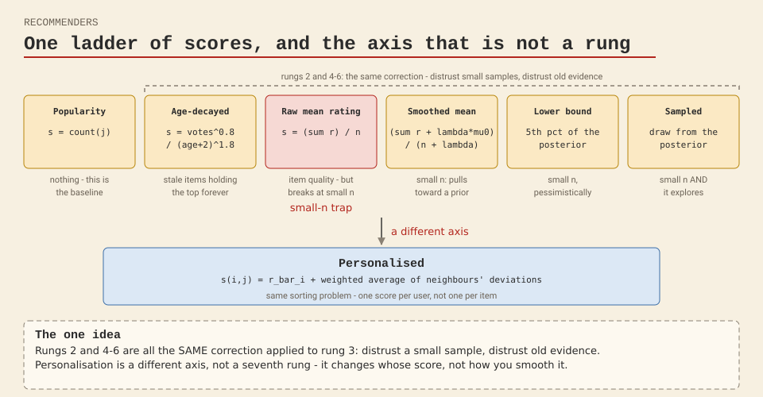
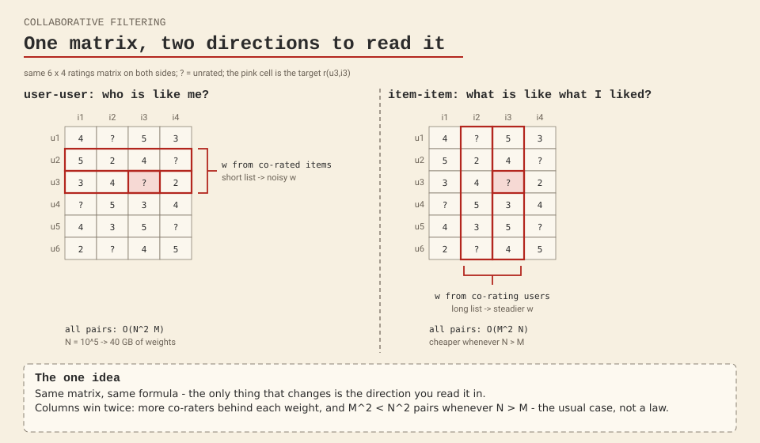

# Ranking and Collaborative Filtering

> **How to read this note.** It covers the *arithmetic* layer of recommenders: how to turn counts and ratings into a score you can sort by, with no learned parameters anywhere. Sections 1–3 give every item one score `s(j)` — the same list for everybody. Sections 4–6 give every (user, item) pair its own score `s(i,j)` — the first genuinely personalised thing in the stack. For learned models (matrix factorization, deep recommenders, RBMs) go to [matrix-factorization-recommenders](matrix-factorization-recommenders.md); for embedding-based retrieval, implicit feedback and the evaluation protocol go to [behavioral-embeddings](behavioral-embeddings.md).

## Why This Exists

**Problem.** Before anything is learned, something has to be sorted. You have vote counts, star ratings and timestamps, and you need an ordering for a feed, a search results page or a "top rated" shelf. Every obvious score is broken in a way that only shows up in production: the raw average puts a single 5-star review above a thousand 4-star ones, raw popularity freezes the front page on a three-year-old article, and "most purchased alongside" recommends bed sheets to everyone because everyone buys bed sheets.

**Key insight.** Almost every fix is the same move — **don't trust a small sample**. Whether you add pseudo-counts, rank by the bottom of a confidence interval, or rank by a random draw from a posterior, you are expressing the same thing: an item with five votes should not outrank an item with four hundred on the strength of those five. And once you want *personalised* scores, you still don't need a model — a weighted average of other people's deviations from their own means gets most of the way there.

**Reach for this when:**
- You need a defensible sort order *today* and have votes, ratings or timestamps but no trained model.
- A "top rated" list is dominated by items with one or two glowing reviews.
- You are building a feed and need stories to turn over as they age.
- You want the cheapest possible personalisation — a correlation matrix and a weighted average — as a baseline before any embedding model.
- You are reading production ranking code (Reddit, Hacker News) and want to know why the exponents are where they are.

**Don't reach for this when:**
- You have implicit signals only (clicks, plays, purchases) and no ratings — the missing-vs-zero problem dominates, so go to [behavioral-embeddings](behavioral-embeddings.md) §2.
- Your catalogue or user base is large enough that an all-pairs similarity matrix won't fit (see §6) — factorize instead: [matrix-factorization-recommenders](matrix-factorization-recommenders.md).
- The question is "which single item do I show in this one slot, and how do I learn from the outcome" — that's a bandit: [multi-armed-bandits](../reinforcement-learning/multi-armed-bandits.md).
- You need the final ordering of a short list with rich features — this is candidate scoring, not ranking-model territory.

## Diagrams


<!-- DIAGRAM SPEC: name=rs-score-ladder | one horizontal ladder, 6 rungs left to right, each rung a small box with a title, a formula line and a one-line "what it fixes" caption underneath | rung 1 "Popularity": s(j) = count(j); fixes: nothing, the baseline | rung 2 "Age-decayed": s(j) = votes^0.8 / (age+2)^1.8; fixes: stale items hold the top forever | rung 3 "Raw mean rating": s(j) = sum r / n; fixes: differing item quality; BUT marked with a red X and the label "breaks at small n" | rung 4 "Smoothed mean": s(j) = (sum r + lambda*mu0) / (n + lambda); fixes: small n, pulls toward a prior | rung 5 "Lower bound": s(j) = 5th percentile of the posterior; fixes: small n, pessimistically | rung 6 "Sampled": s(j) ~ posterior; fixes: small n AND explores | then a vertical step DOWN from the whole row into one wider box "Personalised: s(i,j) = r_bar_i + weighted average of neighbours' deviations" with the caption "same sorting problem, one score per user" | rungs 1-6 shaded one colour, the bottom box a second colour | the one idea it must land: rungs 2-6 are all the same correction (distrust small samples / old evidence) and personalisation is a separate axis, not a further rung -->

## 1. Popularity, and its three failure modes

The baseline is one SQL query — `select item_id from items order by views desc` — and the premise is *other people liked this, so you probably will too*. It is not machine learning and it is often the right answer under a deadline. It also fails in three distinct ways, and naming them is how you decide what to build next:

- **Context.** The most-reviewed restaurant in a city you are visiting is McDonald's. True, popular, useless.
- **Taste.** Top 40 is literally what most people pay for, so it is the best *average* bet — and wrong for any particular listener who hates it. Fixing this is what the rest of the note is for.
- **Age.** A three-year-old news article can be the most-read item you have ever published and still be the wrong front page. Fixing this is §2.

A related non-ML move is **association**: items bought together. The naive score `P(A | B)` — how often A and B were bought together over how often B was bought — has a trap. At a baby store, crib buyers also buy bed sheets, so `P(sheets | crib)` is high; but *everyone* buys sheets, so the association carries no information. The fix is **lift**, which divides out the base rate:

$$\text{lift}(A, B) = \frac{P(A, B)}{P(A)\,P(B)} = \frac{P(A \mid B)}{P(A)}$$

It is symmetric in A and B and equals exactly 1 under independence. If 10% of customers buy A overall but 20% of B-buyers do, lift is 2 — B-buyers are twice as likely. Support, confidence and lift as a full framework (and the algorithms that mine them) live in [association-rules](../classical-ml/association-rules.md).

## 2. Feed scores: votes up, age down

A news feed needs a score that rises with popularity and falls with age, fast enough that nothing holds the top slot forever. Two published formulas are worth reading because the shape of each term is the whole design.

**Hacker News:**

$$s = \frac{(\text{points} - 1)^{0.8}}{(\text{age}_{\text{hours}} + 2)^{1.8}} \times \text{penalty}$$

Four decisions, each legible:

- **Exponent 0.8 on votes** makes popularity *sublinear*. Your first 100 votes are worth more than the next 100 once you already have 1000. The justification is the vote distribution itself — a long tail, like word frequencies: most posts get one or two votes, a handful get hundreds.
- **Exponent 1.8 on age** is called **gravity** and sets the decay rate. Because 1.8 > 0.8, the denominator always outgrows the numerator, so **no vote count holds the top spot forever** — that single inequality is the design.
- **`+2` hours** keeps a brand-new post from having age 0 and a score of infinity. Every submission starts two hours old.
- **`penalty`** is a business-rules multiplier, not mathematics: self-posts rank below external links, controversial threads get knocked down. It is not published and has only ever been reverse-engineered, so treat any specific penalty you read about as a guess about a system that may have changed.

**Reddit (links)** is the additive version of the same idea:

$$s = \text{sign}(u - d) \cdot \log_{10}\!\big(\max(|u - d|, 1)\big) \;+\; \frac{t_{\text{submitted}} - t_0}{45000}$$

- The `max(·, 1)` exists only because `log(0)` is undefined.
- **The sign belongs to the vote term, not the time term.** This is the detail worth remembering: heavily downvoted content goes negative, and the time term is untouched. The course claims nearly every blog that reproduces this formula attaches the sign to the time term — the lesson being to read the source rather than the explanation of the source.
- The time term is measured **from a fixed epoch** (around 8 December 2005, when Reddit's ranking was rewritten), and it is *linear and always positive*. So Reddit scores grow without bound as the site ages; only relative scores within an era mean anything. Equivalently: Reddit does not decay old posts, it *rewards new ones* — the same ordering, read from the other end.
- Log-votes against linear time again means time wins eventually.

The divisor `45000` seconds (about 12.5 hours per unit of log-votes) and the log base come from Reddit's published source, not from the course, which states neither.

This snippet evaluates both formulas on four stories to show what the exponents actually buy you:

```python
import numpy as np
NOW = 1700000000                                       # fix "now" so the numbers are reproducible
def hn(votes, age_h, gravity=1.8):                     # Hacker News: votes sublinear, age super-linear
    return (votes - 1) ** 0.8 / (age_h + 2) ** gravity
def reddit(ups, downs, age_h):                         # Reddit "hot": log-votes + submission time
    s = ups - downs
    order = np.log10(max(abs(s), 1))                   # the 10th upvote matters more than the 1000th
    submitted = NOW - age_h * 3600                     # older story -> smaller timestamp -> smaller score
    # the real formula adds (submitted - 2005 epoch)/45000; that constant shifts every story equally,
    # so we show it relative to NOW, which keeps the ordering and stays readable
    return np.sign(s) * order + (submitted - NOW) / 45000         # 45000 s ~ 12.5 h per unit of log-votes
print(f"{'story':28s}{'HN':>9}{'reddit':>12}")
for name, v, h in [("100 votes, 1h old", 100, 1), ("100 votes, 12h old", 100, 12),
                   ("500 votes, 12h old", 500, 12), ("20 votes, 0.5h old", 20, 0.5)]:
    print(f"{name:28s}{hn(v, h):9.2f}{reddit(v, 0, h):12.3f}")
print("HN: 12 hours of ageing costs more than five times the votes, so the front page turns over.")
print("Reddit: one unit of log-votes (10x the score) buys about 12.5 hours of freshness.")
# Expected output:
# story                              HN      reddit
# 100 votes, 1h old                5.47       1.920
# 100 votes, 12h old               0.34       1.040
# 500 votes, 12h old               1.25       1.739
# 20 votes, 0.5h old               2.03       1.261
# HN: 12 hours of ageing costs more than five times the votes, so the front page turns over.
# Reddit: one unit of log-votes (10x the score) buys about 12.5 hours of freshness.
```

Read the HN column first. A story with 100 votes at 1 hour old scores about 5.5; the *same* story twelve hours later scores about 0.34 — ageing cost it a factor of sixteen. Buying that back with votes is far harder: five times the votes (500 at 12 hours) only lifts it to about 1.2. So a twelve-hour-old story with 500 votes loses to a thirty-minute-old story with 20. That asymmetry is why the front page turns over.

The Reddit column shows the same trade expressed additively. Its time term is on *submission time*, not age, so the snippet prints each score relative to "now" — a constant shift that leaves the ordering untouched but keeps the numbers readable, since the real formula's 2005 epoch makes every score a five-figure number whose differences hide in the decimals. Going from 100 to 500 votes adds `log10(5) ~ 0.7`, which the time term matches in about 8.7 hours of recency.

## 3. Why the mean rating is the wrong score

Two items, both averaging 4 stars. One has 3 ratings, the other 100. The mean says they are identical; obviously they are not, and the thing the mean throws away is **confidence**.

The frequentist framing: the sample mean is itself a random variable. If ratings have mean `mu` and variance `sigma^2`, then

$$\bar{X} \sim N\!\left(\mu, \frac{\sigma^2}{n}\right), \qquad \text{CI}_{95} = \bar{x} \pm 1.96 \frac{s}{\sqrt{n}}$$

where 1.96 is the inverse normal CDF at 97.5% (`scipy.stats.norm.ppf(0.975)`), and `n` enters through the variance — four times the ratings halves the interval width. For up/down votes the ratings are Bernoulli, so `Var = p̂(1 - p̂)` and

$$\text{CI}_{95} = \hat{p} \pm 1.96\sqrt{\frac{\hat{p}(1 - \hat{p})}{n}}$$

Derivations and the CLT argument live in [statistics-and-probability](../math-for-ml/statistics-and-probability.md).

**The ranking policy: sort by the lower bound.** Be pessimistic. On the two 4-star items, the 100-rating item has the narrower interval, so its lower bound is higher and it ranks first; the *upper* bound would have given exactly the wrong answer. This single rule — rank by a pessimistic estimate, not a point estimate — is the whole idea.

The interval above is the **Wald** interval, and it is badly behaved in precisely the regime this section cares about: tiny `n`, or `p̂` near 0 or 1, where it can produce bounds outside [0, 1]. The standard fix is **Wilson's score interval**, built from the same three ingredients (`p̂`, `z`, `n`):

$$\frac{\hat{p} + \dfrac{z^2}{2n} \;\pm\; z\sqrt{\dfrac{\hat{p}(1-\hat{p})}{n} + \dfrac{z^2}{4n^2}}}{1 + \dfrac{z^2}{n}}$$

The procedure does not change — still sort by the lower bound, just a more honest one. Reddit scores *comments* with exactly this. The course introduces Wilson as merely "more accurate" and never reads the formula out; it is more than that, it is the fix for a regime where the normal interval is simply invalid.

**Extending it to 5 stars** by converting each rating into fractional up/down votes, summing, then applying Wilson:

| Rating | up | down |
|---|---|---|
| 1 star | 0 | 1 |
| 3 stars | 0.5 | 0.5 |
| 5 stars | 1 | 0 |

(2 and 4 stars interpolate to 0.25/0.75 and 0.75/0.25 — the course says "and so forth" without stating them.) It works, and it is very pessimistic: a good product with one 3-star rating is punished twice, once by the unlucky rating and once by the fat interval. It also **discards dispersion**: an item rated all-3-stars and an item rated half-1 / half-5 produce the same pseudo-counts despite wildly different risk. The principled version models the five levels as a Dirichlet-multinomial; the pseudo-vote hack is one option, presented as one option.

### The three fixes, side by side

The second fix is the **smoothed (damped) average**, which also repairs the `0/0` you get at `n = 0`:

$$s(j) = \frac{\sum_i x_i + \lambda\mu_0}{n + \lambda}$$

`mu_0` is a default — the global average rating across your catalogue is a good choice, a flat "3 stars" is a bad one, because then every new item on your site looks mediocre to a reader who reads 3 stars as bad. With `mu_0 = 3` and `lambda = 1`, the course's worked numbers: one 4-star rating scores **3.5**, five of them **3.83**, a thousand of them **3.999**. The score slides smoothly from the prior to the sample mean as evidence arrives.

The third fix is to **rank by a random draw** from the item's posterior rather than by any fixed summary — Thompson sampling. One draw per item per page view, re-sorted every time. An item you know nothing about has a wide distribution, so sometimes it draws high and gets shown; an item with 400 votes draws within a hair of its true rate every time. Explore and exploit fall out with no epsilon, no bonus term and no schedule. The derivation, the regret argument and the comparison with UCB belong to [multi-armed-bandits](../reinforcement-learning/multi-armed-bandits.md).

This snippet ranks the same four items four ways — raw mean, smoothing toward a prior of 0.6 worth 20 votes, the 5th percentile of the Beta posterior (a Wilson-style lower bound computed exactly), and one posterior draw:

```python
import numpy as np
from scipy.stats import beta
items = [("A", 5, 5), ("B", 90, 100), ("C", 300, 400), ("D", 0, 1)]   # name, upvotes, total votes
prior_mean, prior_strength = 0.6, 20                                   # our belief before seeing an item's votes
rng = np.random.default_rng(0)                                         # one RNG, drawn from independently per item
print(f"{'item':5s}{'raw':>8}{'bayes':>8}{'wilson':>8}{'sample 1':>10}{'sample 2':>10}")
for name, up, n in items:
    post = beta(up + 1, n - up + 1)                                    # posterior over the true success rate
    bayes = (up + prior_mean * prior_strength) / (n + prior_strength)  # smoothing: pull small samples to the prior
    wilson = post.ppf(0.05)                                            # 5th percentile: a pessimistic lower bound
    s1, s2 = post.rvs(2, random_state=rng)                             # two independent Thompson draws
    print(f"{name:5s}{up/n:8.2f}{bayes:8.2f}{wilson:8.2f}{s1:10.2f}{s2:10.2f}")
print("raw rating ties A (5/5) with a perfect score; smoothing and the lower bound both rank B and C above it.")
print("the two sample columns differ run to run - that randomness is what makes an uncertain item resurface.")
# Expected output:
# item      raw   bayes  wilson  sample 1  sample 2
# A        1.00    0.68    0.61      1.00      0.78
# B        0.90    0.85    0.84      0.92      0.95
# C        0.75    0.74    0.71      0.75      0.76
# D        0.00    0.57    0.03      0.32      0.32
# raw rating ties A (5/5) with a perfect score; smoothing and the lower bound both rank B and C above it.
# the two sample columns differ run to run - that randomness is what makes an uncertain item resurface.
```

Item A is 5 up out of 5 and the raw average gives it a perfect 1.00 — top of the list on five votes. Both corrections demote it: smoothing pulls it to roughly 0.68 and the lower bound to roughly 0.61, below B (90/100 → about 0.85 smoothed, 0.84 bounded) and below C (300/400 → about 0.74 smoothed, 0.71 bounded). Note that B stays ahead of C even though C has four times the evidence: a lower bound rewards evidence, but not enough to overturn a genuinely better rate.

Item D (0 up out of 1) is where the two fixes visibly disagree. Smoothing lifts it from 0.00 to about 0.57 — nearly the prior, because one vote barely counts against 20 pseudo-votes — while the lower bound leaves it at about 0.03. Both are defensible and they encode opposite policies: smoothing is *optimistic* about items you know nothing about (it assumes they are average until proven otherwise), a lower bound is *pessimistic* (it assumes nothing until proven). Which you want depends on whether unknown items need help getting impressions or need to earn them.

The last two columns are two independent draws from each item's posterior. They differ from each other, and they would differ again on the next page view — that is the whole mechanism: a well-evidenced item samples in a narrow band, while a barely-rated one scatters, so it occasionally outranks the leader and earns the traffic that will settle its score.

## 4. Smoothing is not a hack — it is a posterior mean

The damped average in §3 looks like an engineering fudge: invent a prior value, invent a weight, mix. It isn't. It is **exactly** the posterior mean of a conjugate Bayesian model, and the weight `lambda` is exactly the number of pseudo-observations you are claiming your prior is worth.

For up/down votes, with a `Beta(alpha, beta)` prior and Bernoulli data, the posterior is `Beta(alpha + successes, beta + failures)`, whose mean is

$$\frac{\alpha + \sum_i x_i}{\alpha + \beta + n}$$

— add-one smoothing, generalised. `alpha` and `beta` act as pseudo-counts of successes and failures.

For star ratings, with Gaussian data of known precision `tau = 1/sigma^2` and a Gaussian prior `mu ~ N(m, 1/lambda)`:

$$\lambda' = \lambda + n\tau, \qquad m' = \frac{\lambda m + \tau \sum_i x_i}{\lambda + n\tau}$$

Divide numerator and denominator by `tau` and you get the smoothed average verbatim, with the prior's weight revealed as `lambda / tau` — the ratio of prior precision to data precision, measured in pseudo-ratings. At `n = 0` the posterior mean is the prior mean; as `n` grows, the data term dominates and you converge on the sample mean.

```python
import numpy as np
# The ad-hoc "damped mean" used for ranking IS the posterior mean of a conjugate model.
up, n = 4, 5                                                  # 4 upvotes out of 5 votes
alpha, beta = 3.0, 2.0                                        # prior: as if we had already seen 3 up, 2 down
ad_hoc = (up + alpha) / (n + alpha + beta)                    # "add a pseudo-count" smoothing
posterior_mean = (alpha + up) / (alpha + up + beta + (n - up))  # mean of Beta(alpha+up, beta+n-up)
print(f"Beta-Bernoulli: smoothed average {ad_hoc:.4f} == posterior mean {posterior_mean:.4f}")
# Same story for ratings with a Gaussian prior, in precision (1/variance) form.
ratings = np.array([5.0, 4.0, 5.0]); tau, lam, m = 1.0, 2.0, 3.5   # data precision, prior precision, prior mean
lam_post = lam + len(ratings) * tau
m_post = (lam * m + tau * ratings.sum()) / lam_post
print(f"Gaussian-Gaussian: posterior mean {m_post:.4f} == "
      f"weighted blend {(lam * m + tau * ratings.sum()) / (lam + len(ratings) * tau):.4f}")
print(f"  prior worth {lam/tau:.0f} pseudo-ratings of {m}; raw mean is {ratings.mean():.2f}, shrunk to {m_post:.2f}")
print("\nSo 'pull small samples toward a prior' needs no apology - it is exact Bayesian inference,")
print("and the prior strength is just how many pseudo-observations you are willing to assume.")
# Expected output:
# Beta-Bernoulli: smoothed average 0.7000 == posterior mean 0.7000
# Gaussian-Gaussian: posterior mean 4.2000 == weighted blend 4.2000
#   prior worth 2 pseudo-ratings of 3.5; raw mean is 4.67, shrunk to 4.20
# 
# So 'pull small samples toward a prior' needs no apology - it is exact Bayesian inference,
# and the prior strength is just how many pseudo-observations you are willing to assume.
```

The Beta line shows the two computations agreeing exactly: 4 up out of 5, with a prior worth 3 up and 2 down, gives 0.7000 whether you call it "add pseudo-counts" or "the mean of Beta(7, 3)". The Gaussian line takes three ratings (5, 4, 5 — raw mean 4.67) against a prior mean of 3.5 with twice the data's precision, and shrinks the estimate to 4.2: the prior is worth exactly two pseudo-ratings of 3.5, so the blend is `(2 × 3.5 + 14) / 5`.

The practical payoff: you stop tuning `lambda` by feel and start choosing it by asking *how many observations is my prior belief worth?* Conjugate priors generally — which likelihood/prior pairs stay in the family, and why that lets you skip the normalising integral — are in [statistics-and-probability](../math-for-ml/statistics-and-probability.md).

**What smoothing does *not* do is explore.** The ranking it produces is still deterministic, so an item that got unlucky early can be starved of impressions forever. The course calls the smoothed average "half a solution"; strictly it is zero of the exploration solution and all of the shrinkage solution. Only the sampled score in §3 explores.

## 5. Collaborative filtering: one score per user, per item

Everything above produces `s(j)` — one score per item, the same list for everybody. (Demographic models are a partial exception: predicting "will this user buy" from age, location and item attributes concatenated into one feature vector personalises to a *bucket*, never to your own history, and it needs metadata that vendors enter badly and users increasingly block. PageRank is also in this family — a popularity score from a link graph, covered in [markov-chains](../math-for-ml/markov-chains.md).)

Collaborative filtering moves to `s(i,j)`: a predicted rating for *this* user and *this* item, and the ranking score **is** that prediction.

### The ratings matrix

Let `i` index users (1..N) and `j` index items (1..M). `R` is the N×M **user-item ratings matrix**, `r_ij` the rating user `i` gave item `j`. Two sets carry all the bookkeeping:

- `Omega_j` = the users who rated item `j`
- `Psi_i` = the items user `i` rated, and `Psi_{i,i'} = Psi_i ∩ Psi_{i'}` = the items both users rated

Two framings make this matrix easier to think about:

- **It is a term-document matrix with different labels.** Rows are documents, columns are words, entries are counts — the same object, which is why SVD and factorization carry straight over from NLP.
- **The empty cells are *missing*, not zero.** In a word-count matrix a zero is a real observation. Here a zero rating would mean "worse than one star", a real and bad opinion. Missing means *unknown*, and filling those in is the entire job. And sparsity is commercially *good news*: a dense matrix would mean every user has already seen everything, leaving nothing to recommend.

### Building the formula in four steps

The Alice/Bob/Carol intuition: Alice rates Batman, X-Men and Star Wars highly and two romances badly; Bob agrees with her on everything he has seen but hasn't seen Star Wars; Carol is Alice's mirror image. Recommend Star Wars to Bob — and note that **Carol is useful too**: her likes are Bob's anti-recommendations.

1. **Plain average** of everyone who rated `j`. Treats Alice and Carol identically. No good.

2. **Weighted average**, with `w_{i,i'}` the similarity between users `i` and `i'`:
   $$s(i,j) = \frac{\sum_{i' \in \Omega_j} w_{i,i'}\, r_{i'j}}{\sum_{i' \in \Omega_j} w_{i,i'}}$$
   Dividing by the weights keeps the result on the rating scale.

3. **Mean-centre by user.** Your "4 stars" is not mine. An optimist rates good films 5 and terrible films 3; a pessimist rates most films 1 and a favourite 4. What carries information is the **deviation from your own average**, `r_ij - r̄_i`, because your average *is* your bias. So predict a deviation and add your own mean back.

4. **Put them together** — the user-user CF score:
   $$s(i,j) = \bar{r}_i + \frac{\sum_{i' \in \Omega_j} w_{i,i'}\,(r_{i'j} - \bar{r}_{i'})}{\sum_{i' \in \Omega_j} |w_{i,i'}|}$$

The absolute value in the denominator is not decoration: correlation weights can be **negative**, and without `|·|` a mix of positive and negative neighbours can make the denominator near zero or flip the sign of the correction.

Two notes on what this does and doesn't change. Adding `r̄_i` back is cosmetic for *ranking one user's items* — it is a constant with respect to `j`, so you could sort on deviations alone — but it matters for MSE. And the whole thing is "input features = other users' deviations, weights = `w`, target = my deviation", which is linear-regression *shaped*; you could fit the weights by least squares instead of using correlation. It is not literally linear regression, though: Pearson weights are not least-squares estimates, there is no fitted intercept, and `/ sum|w|` is not part of any regression objective.

### The weights: Pearson, and the cosine that isn't quite

Pearson correlation over the items both users rated:

$$w_{i,i'} = \frac{\sum_{j \in \Psi_{i,i'}} (r_{ij} - \bar{r}_i)(r_{i'j} - \bar{r}_{i'})}{\sqrt{\sum_{j \in \Psi_{i,i'}} (r_{ij} - \bar{r}_i)^2}\;\sqrt{\sum_{j \in \Psi_{i,i'}} (r_{i'j} - \bar{r}_{i'})^2}}$$

Cosine similarity is `x·y / (||x|| ||y||)`, and Pearson is cosine *after centring*. Since this algorithm already works on deviations, computing cosine on the centred data **is** computing Pearson — there is no separate variant to implement.

That equivalence holds only if the centring and the index set match, and this is the one place the course's code quietly diverges from both textbook formulas: its numerator sums over the intersection `Psi_{i,i'}` while each standard deviation in the denominator is computed over that user's **entire** rated set `Psi_i`. That is neither textbook Pearson (which would use the intersection throughout) nor plain cosine, and it has a predictable effect — the denominator is too big, so every `|w|` is **systematically shrunk** and the clean [-1, 1] bound is lost. It is a common approximation and it mostly works, because shrinking all weights uniformly barely changes a ratio that divides by `sum|w|`. But do not read the course's "Pearson and cosine are the same here, so there's nothing to compare" as covering the version it actually runs: the shortcut is in exactly the place the two formulas differ.

### Limiting the neighbourhood — two independent mechanisms

1. **Minimum co-rated items.** If `Psi_{i,i'}` is empty there is no correlation to compute; if it has two elements the correlation is noise. So set a threshold — the course uses 5 — and refuse to weight pairs below it. Few samples, bad estimate: the same reasoning as all of §3.
2. **K nearest neighbours.** Summing over all N users is slow and has to be repeated for every item you rank, so when pre-computing the weights keep only the K most similar users per user. The course uses **K = 25 for user-user** and **K = 20 for item-item**, and the reason user-user wants more neighbours is that with a short list it becomes hard to find anyone who rated the item in question at all.

Truncation costs you information, and in a specific way: a strongly *negative* correlation is just as informative as a positive one (Carol predicts Bob). The genuinely useless neighbours are the ones with `w ≈ 0` — uncorrelated, orthogonal. So "top K by absolute correlation" has a better claim than "top K by raw correlation", and the course leaves the choice open.

### Item-item: the same machinery, transposed

Instead of "find users like me", ask "find items like the items I already liked" — Power Rangers and Transformers are similar *because users rated them similarly*, with no content features anywhere.

$$s(i,j) = \bar{r}_j + \frac{\sum_{j' \in \Psi_i} w_{j,j'}\,(r_{ij'} - \bar{r}_{j'})}{\sum_{j' \in \Psi_i} |w_{j,j'}|}$$

with `w_{j,j'}` the correlation between two items over the users who rated both. Watch the notation: **`r̄` is the user's average in user-user CF and the item's average in item-item CF**, a genuine ambiguity in the standard notation that the course flags rather than hides. The numerator term `r_ij' - r̄_j'` reads as "how much more than the average user does `i` like item `j'`" — so if `i` loves `j'` and `j'` correlates with `j`, that pushes `j` up.

The clean way to see the symmetry: pretend items have feelings and transpose the matrix. Entry `(j, i)` becomes how much item `j` "likes" user `i`, and item-item CF is *mathematically identical* to user-user CF. What differs is the data and the cost (§6).


<!-- DIAGRAM SPEC: name=rs-user-vs-item-cf | two panels side by side, each showing the SAME 6x4 grid of rating cells (users as rows labelled u1..u6, items as columns labelled i1..i4, most cells showing a number 1-5, a few blank with "?", one blank cell highlighted as the prediction target) | left panel "user-user: who is like me?": two full ROWS boxed and joined by a bracket labelled "w over co-rated items (short list -> noisy weight)", caption below "all pairs: O(N^2 M); N=10^5 -> 40 GB of weights" | right panel "item-item: what is like what I liked?": two full COLUMNS boxed and joined by a bracket labelled "w over co-rating users (long list -> steadier weight)", caption below "all pairs: O(M^2 N); cheaper whenever N > M" | the one idea it must land: it is the same matrix and the same formula, only the direction you read it in changes - and the column direction has both more data per weight and fewer pairs -->

CF beats its own baselines by a wide margin, and this snippet shows the gap on a synthetic 150×80 ratings matrix generated from three hidden taste factors, with half the pairs rated and a fifth of those held out. It implements both directions with mean-centring and Pearson weights over the co-rated entries:

```python
import numpy as np
rng = np.random.default_rng(0)
U, I, K = 150, 80, 3                                          # users, items, hidden taste dimensions
P, Q = rng.normal(size=(U, K)), rng.normal(size=(I, K))
true = 3 + 0.6 * P @ Q.T + rng.normal(0, .3, (U, I))          # ratings driven by K hidden factors
rated = rng.random((U, I)) < .5                               # half the pairs are rated
test = rated & (rng.random((U, I)) < .2)                      # hold out a fifth of those
R = np.where(rated & ~test, true, np.nan)
def centred(M):                                               # "above or below this row's own average"
    return M - np.nanmean(M, 1, keepdims=True)
def weights(D, min_common=10):                                # Pearson correlation over co-rated columns
    n = len(D); W = np.zeros((n, n))
    for i in range(n):
        for j in range(i + 1, n):
            both = ~np.isnan(D[i]) & ~np.isnan(D[j])
            if both.sum() < min_common: continue
            a, b = D[i][both], D[j][both]
            d = np.linalg.norm(a) * np.linalg.norm(b)
            if d: W[i, j] = W[j, i] = a @ b / d
    return W
def predict(D, W, means, r, c, k=25):                         # weighted average of neighbours' deviations
    nb = [v for v in np.argsort(-np.abs(W[r])) if W[r, v] and not np.isnan(D[v, c])][:k]
    den = sum(abs(W[r, v]) for v in nb)
    return means[r] + (sum(W[r, v] * D[v, c] for v in nb) / den if den else 0.0)
pairs = list(zip(*np.where(test)))
mse = lambda f: np.mean([(f(u, i) - true[u, i]) ** 2 for u, i in pairs])
Du, Di = centred(R), centred(R.T)
Wu, Wi = weights(Du), weights(Di)
mu_u, mu_i = np.nanmean(R, 1), np.nanmean(R.T, 1)
print(f"global mean      MSE {mse(lambda u, i: np.nanmean(R)):.3f}")
print(f"user's own mean  MSE {mse(lambda u, i: mu_u[u]):.3f}")
print(f"user-user CF     MSE {mse(lambda u, i: predict(Du, Wu, mu_u, u, i)):.3f}")
print(f"item-item CF     MSE {mse(lambda u, i: predict(Di, Wi, mu_i, i, u)):.3f}")
# Expected output:
# global mean      MSE 1.014
# user's own mean  MSE 1.060
# user-user CF     MSE 0.355
# item-item CF     MSE 0.343
```

Predicting the global mean for everything gives MSE 1.014. Predicting each user's own mean — which is the mean-centring step *alone*, with no neighbours at all — gives 1.060, slightly **worse**: user bias is real, but on its own it buys nothing here. Adding the weighted-neighbour term is what works: user-user CF reaches 0.355 and item-item CF 0.343, roughly a threefold reduction against the baselines. Item-item edging ahead matches what the course finds on MovieLens, and here the mechanism is visible — each item-item weight is estimated from the users who rated both items, which in a 150×80 matrix is a far longer list than the items any two users share.

## 6. The cost asymmetry, and why nobody serves this live

The weights are the expensive part, and the two directions are not symmetric.

| Quantity | Cost |
|---|---|
| Similarity between one pair of users | `O(M)` |
| One user against everyone | `O(N M)` |
| **All user-user pairs** | `O(N^2 M)` |
| **All item-item pairs** | `O(M^2 N)` |
| One user's full ranked list | `O(NM)` for the scores + `O(M log M)` to sort |

You cannot dodge the `N^2`: even if you keep only K neighbours, you must *compute* every weight before you can sort to find the top K. And `N > M` in essentially every real recommender — more customers than products — so item-item wins on both counts: fewer pairs *and* more data per pair.

The memory wall is worth doing arithmetic on, because it is what forces every practical decision downstream. At N = 10^5 users there are 10^10 user-user weights; at 4 bytes each (float32) that is 4×10^10 bytes = **40 GB**, against a typical machine's 4–32 GB. It does not fit, and the `N^2` *time* is independently unacceptable. The standard responses:

- **Subset the data.** The course's exercise trims MovieLens to the top 1000 users and top 200 movies by rating count — which also makes the remaining matrix much *denser* than the original.
- **Pre-compute offline.** Weights, and often the complete ranked list per user, built by a batch job (a nightly or mid-afternoon cron run) so the serving API just returns a stored list: no scoring, no `O(M log M)` sort, not even an `O(M)` scan.
- **Cap the output** at L items for `O(M log L)` instead of `O(M log M)`.
- **Use the right primitives.** A dict-of-lists or `scipy.sparse.csr_matrix` lets you iterate `O(|Omega|)` over the ratings that exist instead of `O(NM)` over the whole grid, and `sklearn.metrics.pairwise.cosine_similarity` computes all the weights in one BLAS call. That last one is the real reason nobody writes the double Python loop in production.
- **Factorize instead.** A rank-`k` factorization replaces the `N^2` similarity matrix with `(N + M) × k` parameters: [matrix-factorization-recommenders](matrix-factorization-recommenders.md).

### What the course's numbers are and aren't

On its 1000-user × 200-movie MovieLens subset, with K = 25 and a minimum of 5 co-rated items, the course reports **user-user train MSE ≈ 0.46 / test ≈ 0.6**, and with K = 20, **item-item train ≈ 0.5 / test ≈ 0.55**. Both are stated as approximations from a single run.

Two things not to take away from those numbers. First, the course compares its 0.6 test MSE against published MovieLens benchmarks of **RMSE 0.8–0.9** (so MSE ≈ 0.64) and concludes CF beats the matrix-factorization benchmark. That is not like-for-like: the course's number comes from the *densest corner* of the data — the 1000 most active users crossed with the 200 most-rated movies — where prediction is far easier than on the full sparse 20M. The course concedes the subsetting in passing and draws the comparison anyway. (It does correctly warn that RMSE and MSE must not be compared directly, since square-rooting a number below 1 makes it larger.) Second, "item-item is more accurate and overfits less" rests on one unseeded run of one subset, with no cross-validation and no error bars — and the *train* error actually got worse (0.46 → 0.50). The *reason* offered is sound and is what the synthetic experiment in §5 reproduces; the single pair of numbers is suggestive, not evidence.

For how to evaluate a recommender properly — time-aware splits, full-catalogue metrics, the popularity baseline, ranking metrics rather than MSE — see [behavioral-embeddings](behavioral-embeddings.md) §7. The course names mean average precision, DCG, precision@n, mean reciprocal rank, Kendall's tau and Spearman's rho and then explicitly declines to teach any of them, arguing that your real objective is revenue (proxied by clicks and impressions) and the only instrument is an A/B test. That argument has force — and it is also how a course ends up reporting MSE as its only number.

The second argument there is better: **there is no correct ranking.** Should Xbox outrank PlayStation, and by whose criteria? Accuracy can be the wrong target. An item-item recommender that is too accurate recommends only the obvious — watch sports-car videos and your entire front page becomes sports cars until you get bored and leave. The course calls this "the YouTube problem" and suggests user-user CF's worse MSE may be *preferable* in production. Surprise, diversity and coverage are what you are actually trading against.

The MovieLens dataset the course uses is **MovieLens 20M**: 20,000,263 ratings from **138,493 users** across **27,278 movies**, on a 5-star scale with half stars (so predictions get clamped to [0.5, 5]). The course says "about 100,000-something users" and "about 20,000 movies" — spoken approximations, both wrong by a wide margin, and user IDs running to 138,493 rather than ~100,000 matters if you are preallocating arrays by `max(userId) + 1` as the course's scripts do.

## Trade-offs

- **Smoothing vs lower bound vs sampling.** Smoothing is one line and gives a usable score at `n = 0`, but it explores nothing and its ordering is deterministic. A lower bound is the most defensible static ranking and is pessimistic by construction, so genuinely good new items climb slowly. Sampling is the only one that explores, at the cost of a non-reproducible page (support will ask why two users see different orders) and a harder debugging story.
- **Non-personalised vs collaborative filtering.** One global list is cacheable, explainable, cold-start-proof and often most of the value. CF needs a per-user computation, a similarity matrix that may not fit in memory, and history you may not have.
- **User-user vs item-item.** Item-item weights rest on more data, cost less when `N > M`, and are stable enough to recompute rarely — but they are *more* prone to the obvious-recommendation failure. User-user adapts faster to a user's shifting taste and is more expensive in every dimension.
- **Neighbourhood CF vs factorization.** Neighbourhood CF has no training step, no hyperparameter search beyond K and the co-rating threshold, and every prediction is explainable ("because users similar to you rated it highly"). Factorization scales, handles sparsity better and generally wins on accuracy, while giving up all of that interpretability.
- **Clamping predictions.** Clamping to the legal rating range helps MSE marginally and can *hurt* recommendations: a predicted 6.0 is a strong signal of extreme enthusiasm, and clamping throws that ordering information away.
- **MSE vs ranking metrics.** MSE is trivial to compute and differentiable and measures the wrong thing. Nobody reads your predicted rating; they read the order of the top ten.

## Common Pitfalls

- **Ranking by the raw mean.** A single 5-star review beats a thousand 4-star ones, so your "top rated" shelf fills with items nobody has used. Smooth, bound or sample — all three are one line.
- **Treating a missing rating as zero.** Zero is a real and terrible opinion; missing is the absence of one. Imputing zeros biases every weight and every prediction downward.
- **Using the Wald interval at small `n` or extreme `p̂`.** It is miscalibrated exactly where ranking lives (a handful of impressions, CTR near 0) and can emit bounds outside [0, 1]. Use Wilson or Agresti–Coull, or compute the Beta posterior quantile directly as the snippet in §3 does.
- **Collapsing stars into pseudo up/down votes and stopping there.** It discards dispersion, so all-3-stars and half-1-half-5 score identically despite completely different risk. Fine as a first pass; know what you threw away.
- **Believing smoothing explores.** It does not. The ranking stays deterministic, so an item that got unlucky in its first ten impressions can be starved forever. Only sampling (or an explicit exploration budget) fixes that.
- **Trusting the course's `|w|` as Pearson.** Its numerator runs over co-rated items while its denominators run over each user's whole rated set, so the weights are neither Pearson nor cosine and are systematically shrunk. Harmless in a `sum|w|`-normalised ratio, wrong if you ever interpret `w` as a correlation or threshold on it.
- **Quoting "user-user CF beats the MovieLens matrix-factorization benchmark".** The course's 0.6 test MSE comes from the top 1000 users × top 200 movies — the densest, easiest corner of the data — and the benchmark it is compared against was measured on the full dataset. The comparison is not like-for-like.
- **Concluding item-item > user-user from one run.** The course's 0.55 vs 0.6 is a single unseeded run on a single subset with no error bars. The *mechanism* (more co-raters per item pair than co-rated items per user pair) is sound and reproducible; the margin is not established.
- **Splitting train/test at random.** The course shuffles rows and cuts at 80%, which lets the model predict a user's past from their future — and MovieLens ships a `timestamp` column that the course explicitly drops. A recommender wants a time-aware split ([behavioral-embeddings](behavioral-embeddings.md) §7).
- **Buying data from a broker to solve cold start.** The course offers this as plain common sense with no caveats. In 2026 it is a GDPR/CCPA/ePrivacy minefield: acquiring demographics or browsing history for personalisation needs a lawful basis and usually explicit consent, and "we bought it" is not one. The defensible answers are to *ask* the user at signup (MovieLens itself does), to use methods that need no user data (a neutral prior, popularity), or to put content features in the item tower ([behavioral-embeddings](behavioral-embeddings.md) §6).
- **`df.apply(fn, axis=1)` over 20M rows.** The course's preprocessing needs a progress print every 100,000 rows because of this. `pd.factorize`, `.map(mapping)` or `.astype('category').cat.codes` do the same ID remapping in seconds.
- **Pickles named `.json`.** The course's preprocessing writes binary pickles to `*.json` filenames, which traps anyone grepping the repo — and unpickling executes arbitrary code, so never do it to a downloaded artefact.
- **Reading Reddit's or HN's published formula as current production.** Reddit's `_sort.pyx` is a snapshot of a since-rewritten codebase (and Pyrex, the language it was written in, has been superseded by Cython); HN's penalty term was never published and the reverse-engineering is years old. HN has also never allowed downvotes on *submissions*, only comments — so read `points` as already-net. Treat both formulas as historically published designs to learn the shape from, not as live systems.

## Decision Table

| Scenario | Use this | Not that | Why |
|----------|----------|----------|-----|
| First ranking, no model, deadline today | Popularity or a smoothed average | Collaborative filtering | One query; often most of the value, and it is the baseline you must beat anyway |
| "Top rated" shelf with mixed rating counts | Wilson / Beta posterior lower bound | Raw mean | Rewards evidence; single-review items stop winning |
| A feed that must turn over | Votes^a / (age + c)^b with `b > a` | Votes alone | The inequality `b > a` is what guarantees nothing holds the top forever |
| New items need impressions to earn a score | Thompson-sampled score ([multi-armed-bandits](../reinforcement-learning/multi-armed-bandits.md)) | Smoothed average | Smoothing is deterministic and never explores |
| Choosing the prior weight in a damped mean | Pick `lambda` as "pseudo-observations my prior is worth" | Tuning `lambda` by feel | It *is* a conjugate posterior mean, so `lambda` has an exact meaning (§4) |
| "Customers who bought X" from co-purchase counts | Lift, not `P(A\|B)` ([association-rules](../classical-ml/association-rules.md)) | Raw co-occurrence | Divides out base rate, so universal items stop dominating |
| Explicit ratings, modest catalogue, want explainability | Item-item CF | Factorization | No training step, cheaper when `N > M`, and every prediction has a reason |
| More users than items, want the best neighbourhood model | Item-item | User-user | More co-raters per weight, and `O(M^2 N) < O(N^2 M)` |
| Similarity matrix won't fit in memory | [matrix-factorization-recommenders](matrix-factorization-recommenders.md) | Subsetting the data until it fits | Rank-`k` factors are `(N+M)k` parameters instead of `N^2` weights |
| Implicit signals only (clicks, plays), large catalogue | [behavioral-embeddings](behavioral-embeddings.md) | Rating-prediction CF | Missing-is-not-negative needs confidence weights or a pairwise loss |
| Deciding which recommender actually ships | Online A/B test on revenue/clicks | Offline MSE | MSE measures predicted ratings; the product is an ordering |

## References

- [How Not To Sort By Average Rating — Evan Miller](https://www.evanmiller.org/how-not-to-sort-by-average-rating.html) — the canonical write-up of the Wilson lower-bound ranking policy.
- [Binomial proportion confidence interval — Wilson score interval](https://en.wikipedia.org/wiki/Binomial_proportion_confidence_interval) — Wald vs Wilson vs Agresti–Coull, and why Wald fails at small `n`.
- [Conjugate prior](https://en.wikipedia.org/wiki/Conjugate_prior) — the Beta–Bernoulli and Gaussian–Gaussian updates used in §4.
- [Lift (data mining)](https://en.wikipedia.org/wiki/Lift_%28data_mining%29) — the association score from §1.
- [Sarwar, Karypis, Konstan & Riedl — Item-Based Collaborative Filtering Recommendation Algorithms (WWW 2001)](https://files.grouplens.org/papers/www10_sarwar.pdf) — the primary source for §5's item-item formulation and its cost argument.
- [Collaborative filtering — overview](https://en.wikipedia.org/wiki/Collaborative_filtering) — notation and the memory-based/model-based split.
- [MovieLens datasets — GroupLens](https://grouplens.org/datasets/movielens/) and the [ml-20m README](https://files.grouplens.org/datasets/movielens/ml-20m-README.html) — the authoritative 20,000,263 ratings / 138,493 users / 27,278 movies counts.
- [scipy.stats.beta](https://docs.scipy.org/doc/scipy/reference/generated/scipy.stats.beta.html) — `.ppf` for the posterior quantile and `.rvs` for the sampled score.
- [sortedcontainers — SortedList](https://grantjenks.com/docs/sortedcontainers/) — the third-party structure the course's K-neighbour trick relies on (never named in the lectures); `heapq.nlargest` is the standard-library alternative.
- Reddit's historical ranking source (`_sort.py` / `_sort.pyx` in the archived `reddit-archive/reddit` repository) and Hacker News's ranking formula are both discussed from published/reverse-engineered descriptions; neither reflects current production.
- Herlocker, Konstan, Terveen & Riedl, "Evaluating Collaborative Filtering Recommender Systems" (ACM TOIS, 2004) — why accuracy metrics under-describe a recommender. Cited as text; no stable open URL verified.
- Koren & Bell, "Advances in Collaborative Filtering" (in *Recommender Systems Handbook*) — the bridge from neighbourhood methods to factorization. Cited as text.
- Course: *Recommender Systems and Deep Learning in Python* (Lazy Programmer), sections 1–3. Note that sections 1–2 contain **no code at all** — the course says so outright, arguing these methods are either trivial to implement (Reddit, HN) or pointless without a live site and an A/B test. One lecture titled "Bayesian Ranking (Beginner Version)" deliberately withholds the method: it demos Thompson sampling without naming the Beta distribution or giving the update rule, deferring both to an optional "Scary Version" section. The shared Lazy Programmer appendix material is covered in [rl-foundations-mc-td](../reinforcement-learning/rl-foundations-mc-td.md) §5.

## See Also

- [behavioral-embeddings](behavioral-embeddings.md) — implicit feedback, weighted ALS, BPR, two-tower retrieval, item2vec/SASRec, graph methods, cold start, time-split evaluation and the popularity baseline.
- [matrix-factorization-recommenders](matrix-factorization-recommenders.md) — matrix factorization, the deep-learning recommenders and RBMs.
- [multi-armed-bandits](../reinforcement-learning/multi-armed-bandits.md) — explore/exploit, UCB and Thompson sampling in full.
- [statistics-and-probability](../math-for-ml/statistics-and-probability.md) — distributions, confidence intervals and conjugate priors.
- [association-rules](../classical-ml/association-rules.md) — support, confidence and lift as a framework.
- [markov-chains](../math-for-ml/markov-chains.md) — PageRank as a limiting distribution, the other non-personalised score the course covers.
