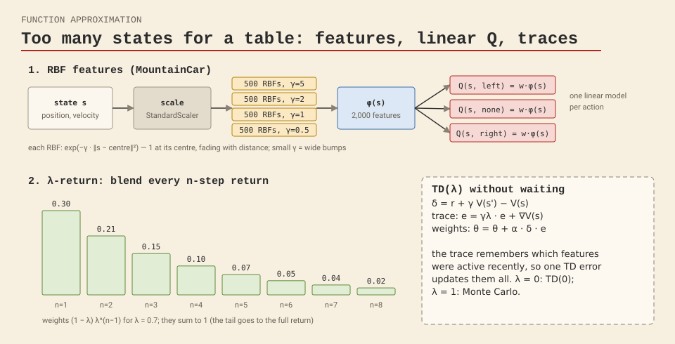

# Function Approximation, n-Step Returns and TD(λ)

> **How to read this note.** Study guide for *Advanced AI: Deep Reinforcement Learning in Python*, section 3 (OpenAI Gym and basic techniques: CartPole and MountainCar) and section 4 (TD(λ)). Read [rl-foundations-mc-td](rl-foundations-mc-td.md) first. The course's code uses the old Gym API, TensorFlow 1 and Theano; here everything runs on Gymnasium 1.x with numpy and scikit-learn, and the course's own settings (checked against its public repo) are listed next to each method. All snippets finish in under 30 seconds.

## Why This Exists

**Problem.** A Q-table needs one entry per state. CartPole's state is four real numbers; MountainCar's is two. Chopping them into bins works badly, and a neural network dropped in naively often doesn't learn at all.

**Key insight.** Describe each state by **features** and learn a **linear** function of them — fixed radial-basis features make the learning problem as easy as linear regression while still capturing curved value functions. Then speed up credit assignment by learning from **several steps of reward at once** (n-step, TD(λ)).

**Reach for this when:**
- The state is a small continuous vector and you want something that learns reliably in seconds.
- You need to understand what DQN's replay buffer and target network are fixing.
- Reading about eligibility traces, λ-returns or GAE (generalised advantage estimation, a λ-return for advantages).

**Don't reach for this when:**
- The state is an image — use a CNN-based DQN ([deep-q-learning](deep-q-learning.md)).
- The state has many dimensions — RBF features need exponentially many centres to cover it.

## Diagrams



## 1. Gymnasium and a baseline worth beating

**CartPole:** state = cart position, cart velocity, pole angle, pole angular velocity; two actions (push left, push right); +1 per step until the pole falls or the time limit. **MountainCar:** state = position, velocity; three actions (left, nothing, right); −1 per step; the engine is too weak to drive up the hill, so the car must rock back and forth to build momentum.

The course's first "learning" method is **random search**: the policy pushes right if $s \cdot w > 0$; try 100 random weight vectors, keep the best.

```python
import numpy as np, gymnasium as gym
rng = np.random.default_rng(0)
env = gym.make("CartPole-v1")                           # +1 per step, capped at 500
def avg_length(w, episodes=20, seed=0):
    total = 0
    for i in range(episodes):
        s, _ = env.reset(seed=seed + i); done = False
        while not done:
            a = int(s @ w > 0) if w is not None else int(rng.integers(2))   # linear policy: push right if s·w > 0
            s, r, term, trunc, _ = env.step(a); total += r; done = term or trunc
    return total / episodes
print("random actions:", avg_length(None))
best_w, best = None, -1
for _ in range(100):                                    # random search: try 100 weight vectors, keep the best
    w = rng.uniform(-1, 1, 4); score = avg_length(w)
    if score > best: best_w, best = w, score
print("best of 100 random linear policies:", best, "  on fresh episodes:", avg_length(best_w, 100, seed=1000))
# Expected output:
# random actions: 22.9
# best of 100 random linear policies: 500.0   on fresh episodes: 500.0
```

Random pushing lasts ~23 steps; a random linear policy maxes out CartPole-v1 (500 steps; the course's CartPole-v0 stopped at 200). CartPole is easy — a useful sanity check that any fancier agent must beat this.

## 2. Bins: making a continuous state discrete

Clip each of the 4 state variables to a range and cut it into 10 bins; the combination of bin indices is one of $10^4$ table rows. Tabular Q-learning then works unchanged. The course's run: γ = 0.9, ε = 1/√(n+1), 10,000 episodes, and a reward of **−300** when the pole falls before the time limit. That reward hack exists because the old Gym API reported "pole fell" and "time ran out" the same way; Gymnasium separates them as `terminated` and `truncated`.

Bins waste resolution where states never go and are too coarse where they do (choose edges from histograms of visited states, or equal-probability bins).

## 3. RBF features and a linear Q per action

**The idea.** A radial basis function $\phi(x) = \exp(-\gamma \lVert x - c \rVert^2)$ is 1 at its centre $c$ and fades with distance (here $\gamma$ is an *inverse* width, not the discount: larger $\gamma$ means a narrower bump, width $\propto 1/\sqrt{\gamma}$). Scatter many centres over the state space, and each state becomes a vector of "how close am I to each centre". A linear model on those features can represent a curved value surface. Two ways to see it: a linear model on fixed features, or a network with one hidden layer of RBF units whose weights never train.

**The course's MountainCar setup**, reproduced: scale states with `StandardScaler`, then four `RBFSampler`s (random Fourier features approximating an RBF kernel) with $\gamma$ = 5, 2, 1 and 0.5 (narrowest to widest) and 500 components each. `RBFSampler` has no centres: `fit` only reads the number of input dimensions and draws random frequencies $W \sim \mathcal N(0, 2\gamma)$ and offsets $b$, giving features $\cos(Wx + b)$ whose inner products approximate the RBF kernel. The sampled states only matter for fitting the `StandardScaler`. The four banks are joined by `FeatureUnion` into 2,000 features; one `SGDRegressor` per action, i.e. $Q(s, a) = w_a^\top \phi(s)$ — the same layout as a network with one output per action. Q-learning updates only the model of the action taken.

```python
import numpy as np, gymnasium as gym
from sklearn.pipeline import FeatureUnion
from sklearn.preprocessing import StandardScaler
from sklearn.kernel_approximation import RBFSampler      # random Fourier features approximating an RBF kernel
from sklearn.linear_model import SGDRegressor
env = gym.make("MountainCar-v0"); env.action_space.seed(0); env.observation_space.seed(0)   # each space has its own RNG; reward −1 per step, 200-step cap
samples = np.array([env.observation_space.sample() for _ in range(10000)])
scaler = StandardScaler().fit(samples)
rbf = FeatureUnion([(f"rbf{g}", RBFSampler(gamma=g, n_components=500, random_state=0)) for g in (5.0, 2.0, 1.0, 0.5)])
rbf.fit(scaler.transform(samples))                      # 4 gammas x 500 = 2,000 features
phi = lambda s: rbf.transform(scaler.transform([s]))
models = [SGDRegressor(learning_rate="constant", eta0=0.01, random_state=0) for _ in range(3)]   # one linear Q per action
for m in models: m.partial_fit(phi(env.reset(seed=0)[0]), [0])   # start every Q near 0: optimistic, since returns < 0
Q = lambda f: np.array([m.predict(f)[0] for m in models])
lengths = []
for ep in range(200):
    s, _ = env.reset(seed=ep); f = phi(s); done, steps = False, 0
    while not done:
        a = int(np.argmax(Q(f)))                        # greedy: optimism does the exploring
        s2, r, term, trunc, _ = env.step(a); f2 = phi(s2); steps += 1
        target = r if term else r + 0.99 * Q(f2).max()  # Q-learning target
        models[a].partial_fit(f, [target]); f, done = f2, term or trunc
    lengths.append(steps)
print("first episode that reached the flag:", next(i for i, l in enumerate(lengths) if l < 200) + 1)
print("mean steps, last 20 episodes:", np.mean(lengths[-20:]), " (200 = never reached it)")
# Expected output:
# first episode that reached the flag: 41
# mean steps, last 20 episodes: 185.7  (200 = never reached it)
```

**Optimistic initial values.** Fitting each model once on a target of 0 makes every Q-value start near 0. MountainCar's returns are always negative, so 0 is *optimistic*: every untried action looks better than the ones the agent has tried and been disappointed by. Acting greedily then explores on its own — no ε needed. With these seeds it first reached the flag in episode 41. Changing only the observation-space seed (0–4) moved that to episodes 32–41 and the last-20 mean to 145.6–185.7 steps; seed 0 is the worst of the five. Over 300 episodes, every seed's 50-episode mean dropped from about 190–199 steps to about 130–189 by episodes 51–100 and then levelled off or crept back up (to 153–186 in episodes 251–300), so it gets faster quickly and then stalls instead of improving steadily. The course trains 300 episodes with γ = 0.99 and plots the **cost-to-go** $-\max_a Q(s, a)$ over (position, velocity) — a surface showing the *discounted* number of steps from each state to the goal. With reward −1 per step, $-\max_a Q = (1-\gamma^k)/(1-\gamma)$ for a state $k$ steps away, which is about 63 for $k = 100$ and never above 100. It equals the step count only when $\gamma = 1$.

**CartPole with RBFs.** Sampling states from the observation space to fit the scaler fails here (velocity bounds are infinite), so the course hand-picks ranges, uses four $\gamma$ values (0.05, 1, 0.5, 0.1) × 1,000 components, writes its own one-line SGD regressor (learning rate 0.1) and later ports it to Theano and TF.

**Why not just a neural network?** The section's last lecture explains what goes wrong: consecutive samples come from one episode in order and are highly correlated, and the network fits recent states while forgetting earlier ones (**catastrophic forgetting**). Experience replay and target networks, introduced with DQN, are the fixes ([deep-q-learning](deep-q-learning.md) §2).

## 4. n-step returns and TD(λ)

**The question.** One-step TD moves value back one state per update. If the reward is 100 steps away, that takes a long time. Can one update reach further?

**n-step return:** use $n$ real rewards before bootstrapping,

$$G_t^{(n)} = r_{t+1} + \gamma r_{t+2} + \dots + \gamma^{n-1} r_{t+n} + \gamma^n V(s_{t+n}).$$

$n = 1$ is TD(0); $n$ = the rest of the episode is Monte Carlo. The update needs $n$ future steps, so updates lag behind. (The course's MountainCar version: n = 5, learning rate 0.01, ε = 0.1 · 0.97ⁿ.)

**λ-return:** average all n-step returns with weights that shrink geometrically (diagram, part 2),

$$G_t^\lambda = (1 - \lambda) \sum_{n \ge 1} \lambda^{n-1} G_t^{(n)},$$

with $(1 - \lambda)$ making the weights sum to 1. λ = 0 gives TD(0), λ = 1 Monte Carlo.

**Eligibility traces** get (approximately) the same effect without waiting. Keep a trace $e$ of recently active features; after every step, apply the one TD error to all of them:

$$\delta = r + \gamma V(s') - V(s), \qquad e \leftarrow \gamma \lambda\, e + \nabla V(s), \qquad \theta \leftarrow \theta + \alpha\, \delta\, e.$$

For a linear model, $\nabla V(s)$ is just the feature vector; for a table, it's a 1 in the current state's slot. The course compares the trace to momentum. On a 19-state random walk:

```python
import numpy as np
np.seterr(all='ignore')                                 # big alpha + long traces can blow up; we score those as inf
rng = np.random.default_rng(0)
n = 19                                                   # 19-state random walk: −1 off the left end, +1 off the right
true = np.arange(-(n - 1), n, 2) / (n + 1)               # exact values: −0.9 … +0.9
def td_lambda(lam, alpha, episodes=10):
    V = np.zeros(n)
    for _ in range(episodes):
        e, s = np.zeros(n), n // 2                       # eligibility trace: how much credit each state is owed
        while True:
            s2 = s + rng.choice([-1, 1])
            r, done = (-1.0, True) if s2 < 0 else (1.0, True) if s2 >= n else (0.0, False)
            delta = r + (0.0 if done else V[s2]) - V[s]  # TD error (gamma = 1)
            e *= lam; e[s] += 1                          # decay old credit, add the current state
            V += alpha * delta * e                       # every recently visited state moves
            if done: break
            s = s2
    err = np.sqrt(((V - true) ** 2).mean())
    return err if np.isfinite(err) else np.inf
for lam in (0.0, 0.4, 0.8, 0.95, 1.0):
    best = min((np.mean([td_lambda(lam, a) for _ in range(50)]), a) for a in (0.01, 0.02, 0.05, 0.1, 0.2, 0.4, 0.6, 0.8))
    print(f"lambda={lam:<5} best RMS error after 10 episodes {best[0]:.3f}  (alpha={best[1]})")
# Expected output:
# lambda=0.0   best RMS error after 10 episodes 0.217  (alpha=0.8)
# lambda=0.4   best RMS error after 10 episodes 0.143  (alpha=0.6)
# lambda=0.8   best RMS error after 10 episodes 0.181  (alpha=0.2)
# lambda=0.95  best RMS error after 10 episodes 0.256  (alpha=0.1)
# lambda=1.0   best RMS error after 10 episodes 0.446  (alpha=0.02)
```

Intermediate λ (0.4–0.8) beats both extremes, and the best step size shrinks as λ grows — with long traces, one TD error moves many states at once, so large α diverges. (The course's TD(λ) MountainCar run: λ = 0.7, γ = 0.9999, learning rate 0.01.)

**Forward vs backward view.** The λ-return looks ahead (forward view); traces push credit back to past states (backward view). They match exactly only when updates are applied at the end of the episode; *true online TD(λ)* (van Seijen & Sutton, 2014) makes them match step by step. The course's "Q-learning with traces" doesn't reset traces after exploratory actions, so it isn't Watkins' Q(λ).

## Trade-offs

- **Bins vs features.** Trivial to implement vs far better generalisation from the same data.
- **RBF vs deep networks.** Stable, fast, linear learning vs scales to images and high dimensions (with replay and target networks).
- **Optimistic init vs ε-greedy.** Systematic exploration, no schedule vs only works when you know the scale of the returns.
- **Small vs large n (or λ).** Low variance, slow credit assignment vs fast propagation, noisy targets and smaller usable step sizes.

## Common Pitfalls

- **Fitting the scaler on samples from unbounded spaces.** CartPole's velocity bounds are infinite, so `observation_space.sample()` can't draw them uniformly (Gymnasium 1.x falls back to a standard normal for those dimensions), and the scaler ends up fitted to a distribution unrelated to the states the agent visits. Fit the scaler on visited states instead. (`RBFSampler`'s random frequencies don't depend on the data; if you place Gaussian centres by hand, take them from visited states too.)
- **Forgetting to scale.** RBF widths only mean something if every input dimension has a similar scale.
- **Misreading `SGDRegressor`.** `alpha` is the L2 penalty, not the learning rate (`eta0` is); the course mixes them up.
- **Large α with long traces.** Updates add up across many states and diverge; shrink α as λ grows.
- **Treating a time limit as failure.** Only `terminated` should zero the bootstrap; reward hacks like −300 were working around the old API.
- **Expecting a neural net to drop in.** Without replay and a target network it chases correlated, moving targets.

## Decision Table

| Scenario | Use this | Not that | Why |
|----------|----------|----------|-----|
| 2–6 continuous state variables | RBF features + linear Q | Bins | Smooth generalisation |
| Negative rewards everywhere | Optimistic initial values | Large ε | Explores systematically |
| Reward far from most states | n-step or TD(λ), λ ≈ 0.5–0.9 | TD(0) | Faster credit assignment |
| Image or high-dimensional state | Deep Q-network | RBF features | Feature count explodes |
| Need a quick sanity baseline | Random search over linear policies | Nothing | Shows how hard the task really is |

## References

- [Sutton & Barto, 2nd ed.](http://incompleteideas.net/book/the-book-2nd.html) — ch. 7 (n-step), ch. 9 (function approximation, RBFs, coarse coding), ch. 12 (eligibility traces).
- [Rahimi & Recht — Random Features for Large-Scale Kernel Machines (2007)](https://papers.nips.cc/paper/2007/hash/013a006f03dbc5392effeb8f18fda755-Abstract.html) — what `RBFSampler` implements.
- [van Seijen & Sutton — True Online TD(λ) (2014)](https://proceedings.mlr.press/v32/seijen14.html)
- [scikit-learn RBFSampler](https://scikit-learn.org/stable/modules/generated/sklearn.kernel_approximation.RBFSampler.html) · [SGDRegressor](https://scikit-learn.org/stable/modules/generated/sklearn.linear_model.SGDRegressor.html)
- [Gymnasium CartPole](https://gymnasium.farama.org/environments/classic_control/cart_pole/) · [MountainCar](https://gymnasium.farama.org/environments/classic_control/mountain_car/)

## See Also

- [rl-foundations-mc-td](rl-foundations-mc-td.md) — MC, TD and exploration on tables.
- [deep-q-learning](deep-q-learning.md) — replacing the RBF features with a network, and the stabilisers it needs.
- [policy-gradients](policy-gradients.md) — the next section: learning the policy directly, with the same RBF features.
- [actor-critic-a3c](actor-critic-a3c.md) — n-step returns used for advantages.
