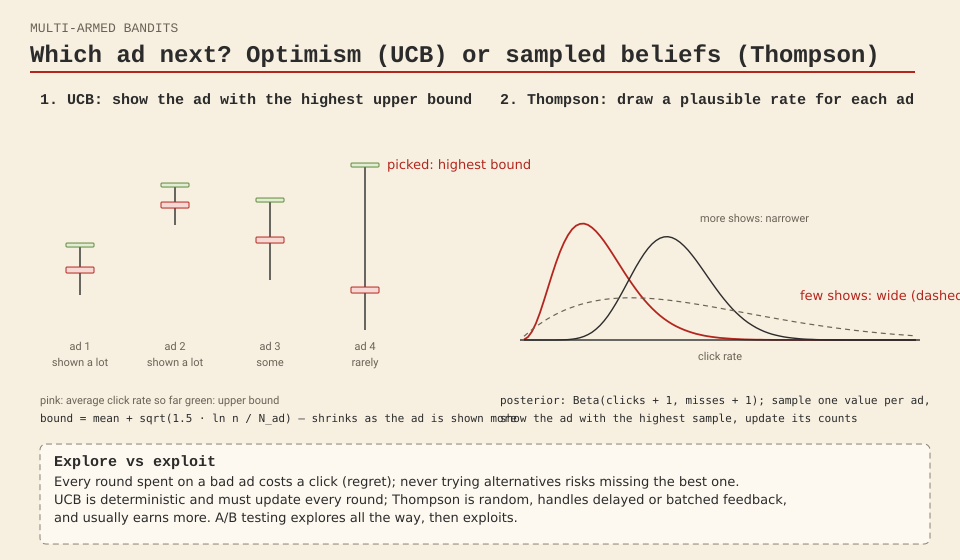

# Multi-Armed Bandits: UCB and Thompson Sampling

> **How to read this note.** Study guide for *Machine Learning A-Z*, Part 6 (sections 31–33, which the course calls reinforcement learning): the multi-armed bandit problem, Upper Confidence Bound and Thompson sampling, each built in Python and R on `Ads_CTR_Optimisation.csv` — 10,000 users × 10 ad versions, with a 1 where that user would click that ad. The snippets simulate ads with fixed click rates. The quizzes aren't included. ε-greedy on a bandit is in [rl-foundations-mc-td](rl-foundations-mc-td.md) §4; full RL with states is in [q-learning](q-learning.md).

## Why This Exists

**Problem.** You have 10 versions of an ad and want the one people click most. Showing each equally until you're sure (an A/B test) wastes thousands of impressions on bad versions; going with the early leader risks locking in a fluke.

**Key insight.** Decide each round from what you've seen so far: either be **optimistic** — show the ad whose click rate *could* plausibly be highest (UCB) — or **sample** a plausible click rate for each ad from your current beliefs and show the winner (Thompson). Both explore uncertain ads and shift to the best one as evidence accumulates.

**Reach for this when:**
- Online choice among a few options with immediate feedback: ads, headlines, recommendations, pricing tests.
- You care about the reward collected *during* the experiment, not just the final answer.

**Don't reach for this when:**
- Actions change future situations (states) — that's full RL ([q-learning](q-learning.md)).
- The best option depends on who the user is — use contextual bandits.
- You need a clean causal estimate with fixed sample sizes — a standard A/B test is simpler to analyse.

## Diagrams



## 1. The problem

A **multi-armed bandit** is a row of slot machines ("one-armed bandits") with unknown payout rates; each pull is a trial. Every pull of a worse machine costs you the difference — **regret** — but without pulling the others you'll never know they're worse. An A/B test explores all arms equally and only exploits afterwards; bandits blend the two continuously. The course's simplification: each ad has a fixed click-through rate; real rates drift (seasonality, ad fatigue).

## 2. Upper Confidence Bound

For each ad $i$ after $n$ rounds, with $N_i$ shows and average reward $\bar r_i$:

$$\text{UCB}_i = \bar r_i + \sqrt{\frac{3}{2} \cdot \frac{\ln n}{N_i}}$$

Show the ad with the highest bound. Rarely shown ads have wide bonuses, so they get tried; as $N_i$ grows the bonus shrinks and the average takes over. Untried ads get an infinite bound so each is shown once first (the course sets it to `1e400`, which Python and R both read as infinity). The constant 3/2 is the course's; the textbook UCB1 uses 2.

## 3. Thompson sampling

Treat each ad's click rate as unknown with a uniform prior. After $c$ clicks and $m$ misses, the posterior is $\text{Beta}(c + 1, m + 1)$. Each round, draw one sample from each ad's posterior and show the ad with the highest draw. The posterior narrows as evidence grows:

```python
import numpy as np
from scipy import stats
for clicks, shows in [(3, 10), (30, 100), (300, 1000)]:
    post = stats.beta(clicks + 1, shows - clicks + 1)    # posterior for the click rate after a uniform prior
    lo, hi = post.ppf([0.05, 0.95])                       # 90% credible interval
    print(f"{clicks:3d}/{shows:<4d} clicks: CTR around {post.mean():.3f}, 90% interval [{lo:.3f}, {hi:.3f}]")
# Expected output:
#   3/10   clicks: CTR around 0.333, 90% interval [0.135, 0.564]
#  30/100  clicks: CTR around 0.304, 90% interval [0.232, 0.381]
# 300/1000 clicks: CTR around 0.300, 90% interval [0.277, 0.324]
```

Ten shows leave the rate anywhere from 14% to 56%; a thousand pin it to ±2 points. Ads with wide posteriors sometimes draw high values and get explored; clearly bad ads almost never do.

## 4. Comparing them

```python
import numpy as np
ctr = np.array([0.05, 0.13, 0.09, 0.16, 0.27, 0.07, 0.11, 0.21, 0.05, 0.10])   # 10 ads' true click rates (unknown to us)
def run(policy, rounds, seed):
    rng = np.random.default_rng(seed); N, S, total = np.zeros(10), np.zeros(10), 0   # shows and clicks per ad
    for n in range(rounds):
        if policy == "random": a = rng.integers(10)
        elif policy == "ucb":                           # mean + confidence bonus; untried ads first
            with np.errstate(divide="ignore", invalid="ignore"):
                ucb = np.where(N > 0, S / N + np.sqrt(1.5 * np.log(n + 1) / N), np.inf)   # the course's 3/2 constant
            a = int(np.argmax(ucb))
        else:                                           # Thompson: sample a plausible CTR per ad from Beta(clicks+1, misses+1)
            a = int(np.argmax(rng.beta(S + 1, N - S + 1)))
        r = rng.random() < ctr[a]; N[a] += 1; S[a] += r; total += r
    return total, int(np.argmax(N))
for rounds in (10_000, 500):
    print(f"--- {rounds} rounds (best possible ≈ {ctr.max() * rounds:.0f} clicks, best ad = index 4)")
    for p in ("random", "ucb", "thompson"):
        res = [run(p, rounds, s) for s in range(20)]
        print(f"{p:9s} mean clicks {np.mean([t for t, _ in res]):7.0f}   found ad 4 in {sum(b == 4 for _, b in res)}/20 runs")
# Expected output:
# --- 10000 rounds (best possible ≈ 2700 clicks, best ad = index 4)
# random    mean clicks    1244   found ad 4 in 2/20 runs
# ucb       mean clicks    2227   found ad 4 in 20/20 runs
# thompson  mean clicks    2588   found ad 4 in 20/20 runs
# --- 500 rounds (best possible ≈ 135 clicks, best ad = index 4)
# random    mean clicks      60   found ad 4 in 1/20 runs
# ucb       mean clicks      75   found ad 4 in 17/20 runs
# thompson  mean clicks      88   found ad 4 in 11/20 runs
```

Over 10,000 rounds both methods find the best ad every time; Thompson collects ~360 more clicks than UCB (closer to the 2,700 a clairvoyant would get) because it stops wasting shows on clearly worse ads sooner. Over 500 rounds UCB more often ends with the right ad as its most-shown, but Thompson still earns more clicks — it exploits good-enough ads while uncertain. The course's numbers on its dataset: random selection ≈ 1,200–1,250 clicks; UCB 2,178 and Thompson ≈ 2,600 (R), both settling on ad 5 (index 4 in Python); in Python UCB still finds the right ad at 1,000 rounds but picks the wrong one at 500, while Thompson is right at 500.

**Why Thompson is usually preferred** (the course's comparison): UCB is deterministic and must be updated after every round; Thompson is random, so it tolerates **delayed or batched feedback** (a website collecting clicks in batches) and has better empirical results.

**The dataset caveat.** The course's file records every user's reaction to *every* ad — real logs only tell you about the ad you actually showed, which is why a bandit is needed at all. The simulation stands in for that: the algorithm reads only the cell of the ad it chose.

## Trade-offs

- **UCB vs Thompson.** Deterministic, simple to reason about vs random, better with delayed feedback, usually more reward.
- **Bandit vs A/B test.** Less regret, adapts during the test vs clean, fixed-sample statistics.
- **Fixed vs drifting rates.** Simple counts vs need discounting or sliding windows to forget stale data.

## Common Pitfalls

- **Treating early winners as final.** Without exploration a lucky ad locks in.
- **Ignoring drift.** Click rates change; old counts make the bandit slow to notice.
- **Single, unseeded runs.** Bandit results vary run to run; compare averages over seeds.
- **Calling bandits full RL.** There's no state or long-term planning; actions don't change the future.
- **Unbounded rewards with Beta posteriors.** Thompson's Beta–Bernoulli form is for 0/1 rewards; use other priors otherwise.

## Decision Table

| Scenario | Use this | Not that | Why |
|----------|----------|----------|-----|
| A few ads, instant clicks | Thompson sampling | Long A/B test | Less regret |
| Feedback arrives in batches | Thompson | UCB | Random draws tolerate delay |
| Need deterministic, auditable choices | UCB | Thompson | Same data → same choice |
| Best ad depends on the user | Contextual bandit (LinUCB, ...) | Plain bandit | Personalisation |
| Choices affect future states | Q-learning / RL | Bandit | State matters |

## References

- [Auer, Cesa-Bianchi & Fischer — Finite-time Analysis of the Multiarmed Bandit Problem (2002)](https://link.springer.com/article/10.1023/A:1013689704352)
- [Russo et al. — A Tutorial on Thompson Sampling (2018)](https://arxiv.org/abs/1707.02038)
- [Chapelle & Li — An Empirical Evaluation of Thompson Sampling (2011)](https://papers.nips.cc/paper/2011/hash/e53a0a2978c28872a4505bdb51db06dc-Abstract.html)
- [Sutton & Barto, 2nd ed., ch. 2](http://incompleteideas.net/book/the-book-2nd.html)

## See Also

- [rl-foundations-mc-td](rl-foundations-mc-td.md) §4 — ε-greedy on a bandit.
- [q-learning](q-learning.md) — when actions change the state.
- [statistics-and-probability](../math-for-ml/statistics-and-probability.md) — Beta distributions and Bayesian updating.
