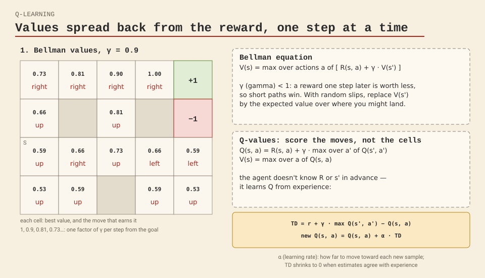

# Q-Learning: Reinforcement Learning from the Bellman Equation Up

> **How to read this note.** Study guide for *AI A-Z*, Part 4 (sections 5–7): nine intuition lectures that build Q-learning on a small maze, and a text article pointing to a downloadable warehouse route-optimisation exercise (its PDF and code aren't reproduced here). The course's maze is a 3×4 grid with a wall, a goal (+1) and a fire pit (−1); here a slightly bigger 4×5 grid of my own plays the same role, solved first by **value iteration** (we know the rules) and then by **Q-learning** (we only get to try things). Needs only `numpy`. Deep versions follow in [deep-q-learning](deep-q-learning.md) and [actor-critic-a3c](actor-critic-a3c.md).

## Why This Exists

**Problem.** Supervised learning needs the right answer for every example. Many problems only give a score at the end — win or lose, landed or crashed — and the agent has to work out which of its earlier moves deserve the credit. The formulas (Bellman, Q, temporal difference) look abstract until you watch values spread across a grid.

**Key insight.** Give every situation a **value**: the reward you can expect from there if you act well, with later rewards discounted. A state's value equals the best "reward now + discounted value of where that move takes you" — the **Bellman equation**. Q-learning estimates these values for state-action pairs **from experience**, nudging each estimate toward what one observed step suggests.

**Reach for this when:**
- Working through AI A-Z Part 4, or any first RL course.
- A problem has a small number of discrete states and actions (grid worlds, simple games, routing between a few locations).
- You need to understand DQN, A3C or PPO — they all build on these ideas.

**Don't reach for this when:**
- States are images or continuous vectors — a Q-table can't hold them; use a network ([deep-q-learning](deep-q-learning.md)).
- You have labelled examples of the right action — that's supervised learning (imitation), usually far easier.
- You know the rules and the state space is small — plain dynamic programming (value iteration, §2) is exact and faster.

## Diagrams



## 1. The setup: agent, environment, reward

An **agent** observes the **state** of an **environment**, takes an **action**, and receives a **reward** and the next state. Repeat. The agent's goal is to maximise the total reward it collects. Nobody tells it which action was right; it only sees rewards — sometimes long after the action that earned them. (Classic RL texts frame this as the reward hypothesis: any goal can be expressed as maximising cumulative reward.)

## 2. The Bellman equation: values spread back from the goal

**The question.** The agent finds the goal by chance. How should that success inform moves made earlier?

First idea: mark every cell on the successful path with value 1. It fails immediately — from a cell between two cells worth 1, the agent can't tell which way is closer. Fix: **discount**. A reward one step away is worth a little less than a reward now, by a factor $\gamma$ (gamma) — like money today versus money next week. Then

$$V(s) = \max_a \big[ R(s, a) + \gamma\, V(s') \big]$$

where $s'$ is where action $a$ takes you. With $\gamma = 0.9$, values fall 1 → 0.9 → 0.81 → 0.73 with distance from the goal, so "move to the neighbour with the higher value" always points toward it. Solving the equation by sweeping it over all cells until nothing changes is **value iteration**:

```python
import numpy as np
# 4 x 5 grid: S start, G goal (+1), X pit (-1), # wall.   Rows top to bottom.
GRID = ["....G",
        ".#.#X",
        "S....",
        "..#.."]
R, C = len(GRID), len(GRID[0])
MOVES = {"up": (-1, 0), "right": (0, 1), "down": (1, 0), "left": (0, -1)}
def step(s, a):                                          # deterministic move; walls and edges block
    r, c = s[0] + MOVES[a][0], s[1] + MOVES[a][1]
    return s if not (0 <= r < R and 0 <= c < C) or GRID[r][c] == "#" else (r, c)
def reward(s): return {"G": 1.0, "X": -1.0}.get(GRID[s[0]][s[1]], 0.0)
terminal = lambda s: GRID[s[0]][s[1]] in "GX"
gamma = 0.9
V = np.zeros((R, C))
for sweep in range(50):                                   # Bellman: V(s) = max_a [ R(s') + gamma * V(s') ]
    for r in range(R):
        for c in range(C):
            if GRID[r][c] == "#" or terminal((r, c)): continue
            V[r, c] = max(reward(step((r, c), a)) + gamma * V[step((r, c), a)] * (not terminal(step((r, c), a))) for a in MOVES)
print(np.round(V, 2))
arrow = {"up": "^", "right": ">", "down": "v", "left": "<"}
policy = [["#" if GRID[r][c] == "#" else GRID[r][c] if terminal((r, c)) else
           arrow[max(MOVES, key=lambda a: reward(step((r, c), a)) + gamma * V[step((r, c), a)] * (not terminal(step((r, c), a))))]
           for c in range(C)] for r in range(R)]
print("\n".join(" ".join(row) for row in policy))
# Expected output:
# [[0.73 0.81 0.9  1.   0.  ]
#  [0.66 0.   0.81 0.   0.  ]
#  [0.59 0.66 0.73 0.66 0.59]
#  [0.53 0.59 0.   0.59 0.53]]
# > > > > G
# ^ # ^ # X
# ^ > ^ < <
# ^ ^ # ^ ^
```

The arrows are a complete instruction set: from any cell, follow them to the goal by the shortest safe route. $\gamma$ is a modelling choice, not a law: closer to 1 values the far future more, lower values make the agent short-sighted.

## 3. Uncertainty: MDPs, policies, and the living penalty

### Markov decision processes
Real actions don't always do what you intend. The course's model: the intended move happens 80% of the time; 10% of the time each, you slip to one side. The future depends only on the current state and action, not on how you got there — the **Markov property**. A **Markov decision process** (MDP) is this setup: states, actions, transition probabilities, rewards. The Bellman equation takes the *expected* value over where you might land:

$$V(s) = \max_a \Big[ R(s, a) + \gamma \sum_{s'} P(s' \mid s, a)\, V(s') \Big]$$

### Plan vs policy
With deterministic moves you can make a **plan** — a fixed sequence of steps. With random slips you need a **policy** — an action for every state, because you may end up anywhere. Value iteration produces a policy.

### The living penalty changes everything
Add a small reward for every ordinary step — usually negative, a cost of "living". The optimal policy changes with it:

```python
import numpy as np
GRID = ["....G", ".#.#X", "S....", "..#.."]
R, C = len(GRID), len(GRID[0])
MOVES = {"^": (-1, 0), ">": (0, 1), "v": (1, 0), "<": (0, -1)}
SIDE = {"^": "<>", "v": "<>", "<": "^v", ">": "^v"}
def step(s, a):
    r, c = s[0] + MOVES[a][0], s[1] + MOVES[a][1]
    return s if not (0 <= r < R and 0 <= c < C) or GRID[r][c] == "#" else (r, c)
terminal = lambda s: GRID[s[0]][s[1]] in "GX"
def solve(living, gamma=0.9):                              # 80% go where you meant, 10% slip to each side
    V = np.zeros((R, C))
    def q(s, a):
        outs = [(0.8, step(s, a))] + [(0.1, step(s, b)) for b in SIDE[a]]
        return sum(p * ({"G": 1, "X": -1}.get(GRID[n[0]][n[1]], living) + gamma * V[n] * (not terminal(n))) for p, n in outs)
    for _ in range(100):
        for r in range(R):
            for c in range(C):
                if GRID[r][c] != "#" and not terminal((r, c)): V[r, c] = max(q((r, c), a) for a in MOVES)
    return [" ".join("#" if GRID[r][c] == "#" else GRID[r][c] if terminal((r, c)) else max(MOVES, key=lambda a: q((r, c), a))
                     for c in range(C)) for r in range(R)]
for living in (0.0, -0.04, -0.3, -2.0):                           # reward for every ordinary step (a "living penalty")
    print(f"living reward {living}:", " | ".join(solve(living)))
# Expected output:
# living reward 0.0: > > > > G | ^ # ^ # X | ^ > ^ < v | ^ ^ # ^ <
# living reward -0.04: > > > > G | ^ # ^ # X | ^ > ^ < < | ^ ^ # ^ <
# living reward -0.3: > > > > G | ^ # ^ # X | ^ > ^ < ^ | ^ ^ # ^ ^
# living reward -2.0: > > > > G | ^ # ^ # X | > > > > ^ | ^ ^ # ^ ^
```

(Each row of the printout is one grid row: `^ > v <` are up, right, down, left.) Watch the cell directly under the pit (row 3, last column):
- **0** — it steps *down*, away from the pit. Moving left would risk a 10% slip up into it, and walking around is free, so take no risk at all.
- **−0.04** — it heads *left* toward the goal, accepting the 10% slip risk: dawdling now costs something.
- **−0.3** — it steps *up, into the pit*. Five paid steps on the safe route (plus the risk of slipping) now cost more than the 2-point gap between the goal's +1 and the pit's −1.
- **−2.0** — even the start row races right toward the pit to end the episode sooner.

The course's 3×4 maze shows the same progression, including a policy that deliberately bumps into a wall to avoid any chance of slipping into the pit.

## 4. Q-values: scoring moves instead of cells

Instead of valuing states, value **state-action pairs**: $Q(s, a)$ is the expected return from taking action $a$ in state $s$ and acting well afterwards.

$$Q(s, a) = R(s, a) + \gamma \sum_{s'} P(s' \mid s, a) \max_{a'} Q(s', a')$$

and the state value is just the best move's value, $V(s) = \max_a Q(s, a)$. The agent no longer needs to know where each action leads; it compares the Q-values of its options and picks the largest.

## 5. Temporal difference: learning Q from experience

**The question.** Value iteration needed the full rules — every transition probability. What if the agent doesn't know them?

Learn from what actually happens. After taking action $a$ in state $s$ and observing reward $r$ and next state $s'$, one step gives a fresh estimate of $Q(s, a)$: $r + \gamma \max_{a'} Q(s', a')$. The **temporal difference** is how far that is from the stored estimate:

$$\text{TD} = r + \gamma \max_{a'} Q(s', a') - Q(s, a)$$

and the update moves the estimate part of the way:

$$Q(s, a) \leftarrow Q(s, a) + \alpha \cdot \text{TD}$$

- $\alpha = 1$: replace the old estimate with the latest sample — fragile, because one unlucky slip overwrites everything.
- $\alpha = 0$: never learn.
- In between: a running average that converges as TD shrinks toward 0 (strictly, $\alpha$ should decay over time for guaranteed convergence).

Using a single observed $s'$ instead of the expectation over all $s'$ isn't a notational shortcut — it's what makes Q-learning **model-free**: the averaging over random outcomes happens over many visits.

**Exploration.** If the agent always takes its current best action, it may never discover a better route. **Epsilon-greedy**: with probability $\epsilon$ take a random action, otherwise the best known one. (The course's intuition lectures skip exploration; it's essential in practice.)

```python
import numpy as np
rng = np.random.default_rng(0)
GRID = ["....G", ".#.#X", "S....", "..#.."]
R, C = len(GRID), len(GRID[0])
MOVES = [(-1, 0), (0, 1), (1, 0), (0, -1)]                 # up, right, down, left
def step(s, a):
    r, c = s[0] + MOVES[a][0], s[1] + MOVES[a][1]
    n = s if not (0 <= r < R and 0 <= c < C) or GRID[r][c] == "#" else (r, c)
    return n, {"G": 1.0, "X": -1.0}.get(GRID[n[0]][n[1]], 0.0), GRID[n[0]][n[1]] in "GX"
Q = np.zeros((R, C, 4)); alpha, gamma, eps = 0.5, 0.9, 0.2
for episode in range(2000):                               # learn from experience: no model of the grid needed
    s, done = (2, 0), False
    while not done:
        a = rng.integers(4) if rng.random() < eps else int(Q[s].argmax())   # epsilon-greedy exploration
        n, r, done = step(s, a)
        target = r + gamma * Q[n].max() * (not done)       # Bellman target from ONE observed step
        Q[s][a] += alpha * (target - Q[s][a])              # move toward it: temporal difference
        s = n
print(np.round(Q.max(2), 2))                               # compare with the value-iteration table
print("greedy path from S:", end=" "); s, path = (2, 0), []
for _ in range(10):
    s, _, done = step(s, int(Q[s].argmax())); path.append(s)
    if done: break
print(path)
# Expected output:
# [[0.73 0.81 0.9  1.   0.  ]
#  [0.66 0.   0.81 0.   0.  ]
#  [0.59 0.66 0.73 0.62 0.  ]
#  [0.53 0.59 0.   0.   0.  ]]
# greedy path from S: [(1, 0), (0, 0), (0, 1), (0, 2), (0, 3), (0, 4)]
```

Learning only from trial and error, the agent recovers the same values value iteration computed (0.73, 0.81, 0.9, 1.0 along the top) and the shortest path. The zeros are cells it rarely or never visited from the start — Q-learning only learns about states it experiences.

## 6. The warehouse exercise

The course's implementation is a downloadable exercise: route a warehouse robot between a dozen named locations, with a reward matrix of which locations connect and a large reward at the target. It's the same algorithm as §5 on a graph instead of a grid. The article notes that tabular Q-learning is rarely used in industry now — deep and policy-gradient methods dominate — but it's the clearest place to see the mechanics.

## Trade-offs

- **Value iteration vs Q-learning.** Exact and fast if you know the rules vs works without a model, but needs many episodes and exploration.
- **γ close to 1 vs lower.** Long-term planning vs faster, more stable learning and short-sightedness.
- **High vs low α.** Fast adaptation vs stable averages; decaying α gets both over time.
- **More vs less exploration (ε).** Discovers better routes vs exploits what's known; decay ε as learning progresses.
- **Reward design.** A living penalty speeds up finding the goal but can produce reckless or bizarre policies if it's too large.

## Common Pitfalls

- **No discounting on a path problem.** All cells on any successful path look equally good.
- **No exploration.** The agent locks onto the first route it finds.
- **Mis-sized step rewards.** A step cost larger than the worst terminal penalty makes "end it now" optimal.
- **Treating a plan as a policy.** In random environments you need an action for every state.
- **Expecting values for unvisited states.** Q-learning knows nothing about states it never reaches; start states and exploration matter.
- **Tables for big state spaces.** The table explodes; move to function approximation.
- **Confusing the Markov property with "no memory needed".** If the state doesn't contain what matters (velocity, history), the problem isn't Markov — add it to the state.

## Decision Table

| Scenario | Use this | Not that | Why |
|----------|----------|----------|-----|
| Small grid, rules known | Value iteration | Q-learning | Exact, no sampling noise |
| Small discrete problem, rules unknown | Tabular Q-learning + ε-greedy | Value iteration | Learns from experience |
| Images or continuous states | DQN ([deep-q-learning](deep-q-learning.md)) | Q-table | Tables can't generalise |
| Continuous actions | Actor-critic / PPO / SAC ([actor-critic-a3c](actor-critic-a3c.md)) | Q-learning | max over actions is hard |
| Agent wanders too long | Small living penalty | Huge penalty | Large penalties make it reckless |

## References

- [Sutton & Barto — *Reinforcement Learning: An Introduction*, 2nd ed. (free online)](http://incompleteideas.net/book/the-book-2nd.html) — chapters 3–6 cover MDPs, dynamic programming and TD/Q-learning.
- [Watkins & Dayan — Q-learning (Machine Learning, 1992)](https://link.springer.com/article/10.1007/BF00992698)
- Bellman, R. — *Dynamic Programming* (1957) — origin of the equation.
- [OpenAI Spinning Up — Key concepts in RL](https://spinningup.openai.com/en/latest/spinningup/rl_intro.html)
- [Gymnasium](https://gymnasium.farama.org/) · [FrozenLake (a tabular environment to practise on)](https://gymnasium.farama.org/environments/toy_text/frozen_lake/)

## See Also

- [deep-q-learning](deep-q-learning.md) — replacing the table with a neural network (LunarLander, Ms. Pac-Man).
- [actor-critic-a3c](actor-critic-a3c.md) — learning a policy directly, with a value function as critic.
- [markov-chains](../math-for-ml/markov-chains.md) — the probability behind MDPs.
- [artificial-neural-networks](../deep-learning/artificial-neural-networks.md) — the function approximator DQN uses.
