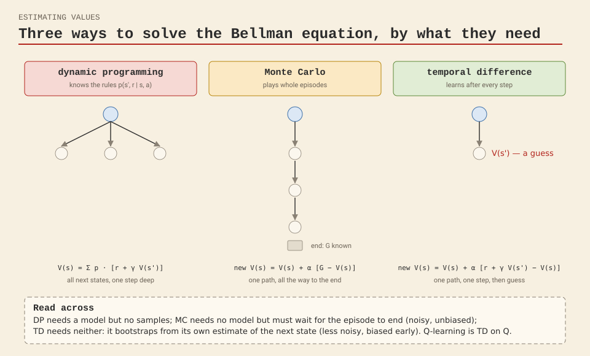

# RL Foundations: Returns, Monte Carlo and Temporal Difference

> **How to read this note.** Study guide for *Advanced AI: Deep Reinforcement Learning in Python* (Lazy Programmer), section 2 (an RL review, theory only, no code) plus the logistics around it: section 1 (welcome), section 8 (Theano and TensorFlow 1 basics) and the appendix (sections 9–13). The Bellman equation, Q-values, TD and Q-learning on a gridworld are already explained in [q-learning](q-learning.md); this note covers what the course adds: **how values are estimated** — exactly, by Monte Carlo, or by TD — and why exploration matters. The snippets need only `numpy`. Later parts of the course: [function-approximation-td-lambda](function-approximation-td-lambda.md), [policy-gradients](policy-gradients.md), [deep-q-learning](deep-q-learning.md) §8, [actor-critic-a3c](actor-critic-a3c.md) §6.

## Why This Exists

**Problem.** "Monte Carlo", "TD", "bootstrapping", "off-policy" and "generalized policy iteration" are the vocabulary every deep RL paper assumes. Without seeing them side by side on a problem with a known answer, it's hard to tell what each one needs and what it gets wrong.

**Key insight.** All of them estimate the same thing — the expected return from a state — and differ only in **what they use as the target**: the full rules of the world (dynamic programming), a whole played-out episode (Monte Carlo), or one step plus their own current guess (TD).

**Reach for this when:**
- Starting the Deep RL in Python course, or any course after a first Q-learning intro.
- You need to explain why DQN's target contains its own prediction.
- An agent never tries an action that might be better (exploration).

**Don't reach for this when:**
- You haven't met the Bellman equation yet — start at [q-learning](q-learning.md).
- The state space is continuous — tables stop working; see [function-approximation-td-lambda](function-approximation-td-lambda.md).

## Diagrams



## 1. Setting up the problem

**Why not supervised learning?** You could label the right action for every frame of a game or a drive, but an hour of 30 fps video is already 108,000 labels, and often nobody knows the right action. RL needs only a goal expressed as a **reward**: a number to maximise.

**Reward design changes behaviour.** In a maze, a reward of +1 only at the exit gives an agent that never finds it nothing to learn from — every action looks equally worthless. A reward of −1 per step makes "get out fast" the best behaviour and gives feedback on every step.

**Episodes and tasks.** An **episode** runs from a start state to a **terminal** state (one game). Some tasks never end (an ad system, a portfolio) — those are **continuing** tasks, and only discounting keeps their returns finite.

**States are built, not given.** One Breakout frame doesn't show which way the ball moves, so DQN stacks the last four frames into one state. The **Markov property** — the next state depends only on the current one — is something you engineer by putting enough history into the state.

**Policies.** A policy maps states to actions. A dictionary works for small discrete problems; for large or continuous ones it becomes a parametrised function, e.g. a softmax over linear scores $\pi(a \mid s) = \text{softmax}(W^\top s)$ — the starting point of [policy-gradients](policy-gradients.md).

**The return.** The agent maximises the discounted sum of *future* rewards,

$$G_t = R_{t+1} + \gamma R_{t+2} + \gamma^2 R_{t+3} + \dots = R_{t+1} + \gamma G_{t+1},$$

and the recursive form is what makes everything below computable: walk the rewards of an episode **backwards** and accumulate `G = r + gamma * G`.

## 2. Values, exactly

The value of a state under a policy $\pi$ is its expected return, and it satisfies the **Bellman expectation equation**

$$V_\pi(s) = \sum_a \pi(a \mid s) \sum_{s', r} p(s', r \mid s, a)\,\big[r + \gamma V_\pi(s')\big].$$

$\pi$ is the agent; $p$ is the world. If you know both, this is a **system of linear equations** — one per state — and you can solve it directly. A 5-state random walk (start in the middle, step left or right at random, +1 for falling off the right end):

```python
import numpy as np
# Random walk: states A..E in a row, start in C, step left/right with prob 0.5.
# Falling off the right end pays +1, the left end 0.  gamma = 1.  What is V(s)?
n, gamma = 5, 1.0
P = np.zeros((n, n)); r = np.zeros(n)                   # P[s, s'] = transition prob under the policy
for s in range(n):
    if s > 0: P[s, s - 1] = 0.5
    if s < n - 1: P[s, s + 1] = 0.5
r[n - 1] = 0.5                                          # expected immediate reward: 0.5 * (+1) from E
V = np.linalg.solve(np.eye(n) - gamma * P, r)           # Bellman: V = r + gamma P V  ->  (I - gamma P) V = r
print("exact V:", V.round(3))
# Expected output:
# exact V: [0.167 0.333 0.5   0.667 0.833]
```

The answer, $V = (1/6, 2/6, \dots, 5/6)$, is the probability of exiting right. This is **prediction** (evaluate a given policy). **Control** asks for the best policy: $V^*(s) = \max_\pi V_\pi(s)$, and with action values $Q^*(s, a)$ the best policy is just $\arg\max_a Q^*(s, a)$. You can't enumerate policies to find it — there are $|A|^{|S|}$ of them — so control alternates evaluation and greedy improvement: **policy iteration**, or its loose version, **generalized policy iteration** (evaluate a little, improve a little, repeat). The course stops at the linear solve; iterative policy evaluation and value iteration (the dynamic-programming methods) are covered in [q-learning](q-learning.md) §2.

## 3. Values from experience: Monte Carlo vs TD

**The question.** For Atari you don't know $p$. How do you get $V$?

**Monte Carlo (MC):** play episodes, compute each visited state's return, and average. Averaging one sample at a time is the **incremental mean**, $\bar x_n = \bar x_{n-1} + \frac{1}{n}(x_n - \bar x_{n-1})$ — the same "new = old + step × (target − old)" shape as gradient descent. With a constant step $\alpha$ instead of $1/n$, recent samples count more (an exponentially decaying average), which suits control, where the policy — and so the target — keeps changing.

**Temporal difference (TD(0)):** don't wait for the episode to end. Replace the return by one reward plus the current estimate of the next state:

$$V(s) \leftarrow V(s) + \alpha\,\big[r + \gamma V(s') - V(s)\big].$$

Using your own estimate inside the target is **bootstrapping**. Derived as gradient descent on $(G - V(s))^2$ with $G$ swapped for $r + \gamma V(s')$, it's called **semi-gradient**: the target depends on the parameters but isn't differentiated.

```python
import numpy as np
rng = np.random.default_rng(0)
n = 5
def episode():                                          # returns visited states and the final reward
    s, path = 2, []
    while 0 <= s < n:
        path.append(s); s += rng.choice([-1, 1])
    return path, 1.0 if s == n else 0.0
V_mc, V_td, counts = np.zeros(n), np.full(n, 0.5), np.zeros(n)
for ep in range(1, 101):
    path, R = episode()
    for s in set(path):                                 # Monte Carlo: average the full return (gamma = 1)
        counts[s] += 1; V_mc[s] += (R - V_mc[s]) / counts[s]   # incremental mean
    for t, s in enumerate(path):                        # TD(0): bootstrap from the next state's estimate
        target = R if t == len(path) - 1 else V_td[path[t + 1]]
        V_td[s] += 0.1 * (target - V_td[s])
    if ep in (10, 100):
        true = np.arange(1, 6) / 6
        print(f"after {ep:3d} episodes  RMS error  MC {np.sqrt(((V_mc - true)**2).mean()):.3f}"
              f"  TD {np.sqrt(((V_td - true)**2).mean()):.3f}")
print("MC:", V_mc.round(2), " TD:", V_td.round(2))
# Expected output:
# after  10 episodes  RMS error  MC 0.115  TD 0.124
# after 100 episodes  RMS error  MC 0.095  TD 0.075
# MC: [0.28 0.43 0.61 0.77 0.86]  TD: [0.22 0.4  0.58 0.76 0.91]
```

After 10 episodes the two are about equal; after 100, TD is closer to the truth. TD learns online, works for continuing tasks, and its targets are less noisy (one random step instead of a whole random path) — at the cost of being biased while its estimates are still wrong. MC is unbiased but noisy and must wait for episodes to end.

**Q-learning** is TD for action values, with a max in the target ([q-learning](q-learning.md) §5). The max makes it **off-policy**: the agent can explore however it likes while learning the values of the greedy policy.

## 4. Exploration: bandits

**The question.** If an agent always picks the action with the highest estimate, what goes wrong?

A three-armed bandit (slot machines that pay 1 with probabilities 0.2, 0.5, 0.75) where the agent starts out believing machine 0 is good:

```python
import numpy as np
rng = np.random.default_rng(0)
true_means = np.array([0.2, 0.5, 0.75])                 # three slot machines, win probabilities
def run(eps, steps=2000):
    Q, N, total = np.zeros(3), np.zeros(3), 0.0
    Q[0] = 1.0                                          # a lucky early belief about machine 0
    for t in range(steps):
        a = rng.integers(3) if rng.random() < eps else int(np.argmax(Q))
        r = float(rng.random() < true_means[a])         # pay 1 with the machine's probability
        N[a] += 1; Q[a] += (r - Q[a]) / N[a]; total += r
    return total / steps, N.astype(int)
for eps in (0.0, 0.01, 0.1, 0.3):
    avg, N = run(eps)
    print(f"eps={eps:<4}  avg reward {avg:.3f}  pulls per machine {N}")
print("best possible 0.750, random 0.483")
# Expected output:
# eps=0.0   avg reward 0.202  pulls per machine [2000    0    0]
# eps=0.01  avg reward 0.690  pulls per machine [ 237    8 1755]
# eps=0.1   avg reward 0.713  pulls per machine [  76   68 1856]
# eps=0.3   avg reward 0.673  pulls per machine [ 170  225 1605]
# best possible 0.750, random 0.483
```

Pure greed ($\epsilon = 0$) keeps pulling the worst machine: it's never disappointed enough to switch, because it never tries the others. A little randomness finds the best machine; too much (0.3) wastes pulls on known-bad ones. ε-greedy is the only exploration method the course teaches; optimistic initial values appear in [function-approximation-td-lambda](function-approximation-td-lambda.md) §3, and UCB and Thompson sampling are the usual next steps.

## 5. Course logistics, Theano/TF basics and the appendix

- **Section 1.** The course arc: OpenAI Gym environments (CartPole, MountainCar, Atari), n-step and TD(λ), policy gradients, RBF networks, then DQN and A3C. Code is in the instructor's public `machine_learning_examples` repository (folder `rl2`), in both TensorFlow 1 and Theano.
- **Section 8** (reused from another course) teaches the two frameworks: symbolic variables, compiled functions and hand-written update rules in Theano; placeholders, sessions and `feed_dict` in TF1. Both are obsolete. The same ideas in PyTorch:

| TF1 / Theano | PyTorch today |
|---|---|
| `tf.placeholder` / `T.matrix` + compile | ordinary tensors; code runs eagerly |
| `tf.Variable` / `theano.shared` | `nn.Parameter` / `requires_grad=True` |
| `T.grad(cost, w)` + `updates=[(w, w - lr*g)]` | `loss.backward()` then `optimizer.step()` |
| `session.run(op, feed_dict=...)` | call the function |

- **Appendix (sections 9–13)**, shared across the instructor's courses: set up Anaconda then pip-install the frameworks; implement each algorithm yourself before watching the solution; treat every dataset as X and Y with a `fit`/`predict` class; plot cost per iteration to choose learning rate and iteration count; debug by printing. Out of date: Python 2 as a choice (end of life 2020), Theano and multi-backend Keras, `gym` + `atari-py` (now `gymnasium` + `ale-py`), and the claim that deep learning on Windows needs a Linux VM.

## Trade-offs

- **Exact solve vs sampling.** Exact and instant for small known models vs works without the rules but needs many episodes.
- **MC vs TD.** Unbiased, needs complete episodes vs online, lower variance, biased early.
- **$1/n$ vs constant $\alpha$.** True average of a fixed target vs tracks a moving target (needed in control).
- **More vs less exploration.** Finds better actions vs wastes steps on known-bad ones; decay ε over time.

## Common Pitfalls

- **Greedy without exploration.** One lucky early estimate locks the agent in forever.
- **Rewards only at the goal.** Sparse rewards give no signal until the goal is found by chance; shape them carefully (a step cost) or explore harder.
- **Computing returns forwards.** Walk rewards backwards with `G = r + gamma * G`; forwards needs a nested loop.
- **Bootstrapping from terminal states.** $V(\text{terminal}) = 0$; don't add $\gamma V(s')$ after the episode ended.
- **Old Gym APIs.** `step()` now returns five values (`terminated` and `truncated` separately) and `reset()` returns `(obs, info)`.
- **Assuming tabular convergence for free.** Q-learning converges only if every state-action pair keeps being visited and step sizes shrink.

## Decision Table

| Scenario | Use this | Not that | Why |
|----------|----------|----------|-----|
| Small problem, rules known | Linear solve / value iteration | Sampling | Exact |
| Rules unknown, short episodes | Monte Carlo | DP | No model needed |
| Long or endless episodes | TD / Q-learning | Monte Carlo | Learns every step |
| Agent stuck on one action | ε-greedy (or optimistic init) | Pure greedy | Keeps trying alternatives |
| Reading old TF1/Theano RL code | Port to PyTorch | Installing TF1 | Frameworks are dead |

## References

- [Sutton & Barto — *Reinforcement Learning: An Introduction*, 2nd ed.](http://incompleteideas.net/book/the-book-2nd.html) — ch. 2 (bandits), 3 (MDPs), 4 (DP), 5 (Monte Carlo), 6 (TD; the random walk is Example 6.2).
- [lazyprogrammer/machine_learning_examples](https://github.com/lazyprogrammer/machine_learning_examples) — the course code (`rl2/`).
- [Gymnasium — migration from Gym](https://gymnasium.farama.org/introduction/migration_guide/)
- [PyTorch autograd tutorial](https://pytorch.org/tutorials/beginner/basics/autogradqs_tutorial.html)

## See Also

- [q-learning](q-learning.md) — the Bellman equation, value iteration and Q-learning on a gridworld.
- [function-approximation-td-lambda](function-approximation-td-lambda.md) — sections 3–4: Gym, RBF features, n-step and TD(λ).
- [policy-gradients](policy-gradients.md) — section 5.
- [markov-chains](../math-for-ml/markov-chains.md) — the probability behind the transition matrix in §2.
