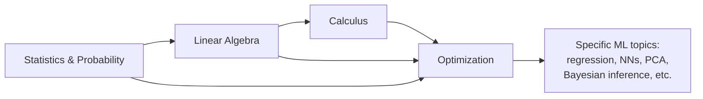

# Math for Machine Learning — Roadmap

## Why This Exists
**Problem.** Modern ML libraries (PyTorch, scikit-learn, TensorFlow) abstract the math away — you can train a model without understanding a single derivative. That works until something breaks: the loss diverges, the model overfits, the gradients vanish, the dataset is multicollinear, the optimizer plateaus. Without the math, every failure mode is a black box.

**Key insight.** You don't need to do the math by hand. You need to recognize the math. When you see "gradient descent stalled," your brain should fire: *partial derivatives → loss surface → saddle point or local minimum*. When you see "PCA dropped accuracy," it should fire: *eigendecomposition of the covariance matrix → variance threshold too aggressive*. The math is the vocabulary for the failure mode.

**Reach for this when:**
- Starting an ML/AI study plan and need to know what's worth learning.
- Stuck on an ML concept (backprop, regularization, attention) and the missing piece is mathematical.
- Choosing between resources — knowing which pillar the resource teaches.
- Interviewing for ML/research roles and need to revise foundations.

**Don't reach for this when:**
- You need a working implementation right now — go to the framework docs.
- You want a pure-math curriculum independent of ML — these notes bias every concept toward where it shows up in models.

## How These Notes Are Written

Each pillar note is a **learning journey**, not a cheatsheet. Every concept follows the same arc:

1. **The problem** — a concrete situation that the math was invented for.
2. **What we'd want** — the intuitive desired behavior, before any formula.
3. **How the math gives it to us** — the formula derived or motivated, not dropped on you.
4. **Why it works** — the geometric or visual picture you can lean on later.
5. **When to apply / drawbacks** — ML applications and the failure modes.

If you ever find yourself reading a formula and not knowing where it came from, scroll up — that's where the *want* was set up. Don't try to memorize formulas in isolation; remember the problem, and the formula falls out naturally.

The cheatsheet-style tables at the end of each note (Decision Table, etc.) exist for quick lookup *after* you've understood the concept — not as a substitute for understanding.

## The Three Pillars

| Pillar | One-line role | Note |
|--------|---------------|------|
| Statistics & Probability | The language of uncertainty — how data behaves and how confident our claims are | [statistics-and-probability](statistics-and-probability.md) |
| Linear Algebra | The language of data — vectors, matrices, transformations on multidimensional inputs | [linear-algebra](linear-algebra.md) |
| Calculus | The language of change — how loss responds to parameters, the engine of training | [calculus](calculus.md) |

## Companion notes (applications of the pillars)

| Note | One-line role |
|------|---------------|
| [markov-chains](markov-chains.md) | State-transition dynamics — transition matrices, stationary distribution, mixing time, MCMC, HMMs, PageRank, and the RL / language-model connection |
| [transformer-forward-pass](transformer-forward-pass.md) | Guided path through a GPT forward pass — embeddings, Q/K/V attention, causal mask, residual + LayerNorm, FFN, logits — with shape tracker, 25-line numpy GPT, and errata for the GPT-3 Walkthrough deck |

## Learning Order (Pragmatic)

**Why this order:** stats first builds intuition for *why* models exist (uncertainty in data). Linear algebra gives the data structures. Calculus shows how training works. Optimization weaves all three together. Don't try to learn them strictly serially — interleave; each pillar reinforces the others.

## What Lives Where (Concept → Pillar)

Quick lookup so you know which note to open when a term comes up:

| Concept | Pillar |
|---------|--------|
| Mean, variance, distribution, hypothesis test, p-value, confidence interval | Statistics & Probability |
| Bayes' theorem, MLE, MAP, prior/posterior, conditional probability | Statistics & Probability |
| Linear regression coefficients & assumptions, logistic regression interpretation | Statistics & Probability (with linear algebra mechanics) |
| Vector, matrix, tensor, dot product, norm | Linear Algebra |
| Matrix multiplication, transpose, inverse, determinant, rank | Linear Algebra |
| Eigenvalues, eigenvectors, SVD, PCA | Linear Algebra |
| Derivative, gradient, partial derivative, directional derivative | Calculus |
| Chain rule, backpropagation, Jacobian, Hessian | Calculus |
| Gradient descent, learning rate, convexity, saddle point | Calculus + Optimization |
| Attention, Q/K/V, softmax over scores, LayerNorm, transformer block | [transformer-forward-pass](transformer-forward-pass.md) (built on Linear Algebra) |

## Recommended Resources (Verified)

**Visual intuition (start here if math feels abstract):**
- [3Blue1Brown — Essence of Linear Algebra (YouTube playlist)](https://www.youtube.com/playlist?list=PLZHQObOWTQDPD3MizzM2xVFitgF8hE_ab) — geometric intuition for vectors, matrices, eigenvalues. The series that makes linear algebra *click*.
- [3Blue1Brown — Essence of Calculus (YouTube playlist)](https://www.youtube.com/playlist?list=PLZHQObOWTQDMsr9K-rj53DwVRMYO3t5Yr) — derivatives as instantaneous rate of change, integrals as accumulation.
- [3Blue1Brown — Neural Networks (YouTube playlist)](https://www.youtube.com/playlist?list=PLZHQObOWTQDNU6R1_67000Dx_ZCJB-3pi) — bridges all three pillars into a working NN explanation; backprop derivation by hand.
- [3Blue1Brown homepage](https://www.3blue1brown.com/) — full topic list.

**Formal courses:**
- [Mathematics for Machine Learning Specialization — Imperial College London (Coursera)](https://www.coursera.org/specializations/mathematics-machine-learning) — three-course sequence (Linear Algebra, Multivariate Calculus, PCA). Paced and structured.
- [Khan Academy — Statistics & Probability](https://www.khanacademy.org/math/statistics-probability) — exhaustive free coverage from descriptive stats through hypothesis testing and Bayesian thinking.

**Books / deep references:**
- [*Mathematics for Machine Learning* — Deisenroth, Faisal, Ong (free PDF)](https://mml-book.github.io/) — the canonical "math for ML" textbook; covers all three pillars in one volume with ML examples.
- [*An Introduction to Statistical Learning* — James, Witten, Hastie, Tibshirani (free PDF)](https://www.statlearning.com/) — the classic applied stats/ML bridge; readable, R and Python editions.
- [*Deep Learning* — Goodfellow, Bengio, Courville (free online)](https://www.deeplearningbook.org/) — Part I is an excellent applied math primer aimed specifically at deep learning.

## Trade-offs
- **Going deep on math vs. shipping models.** You can be productive with surface-level math knowledge — many ML practitioners are. The math investment pays off in research, debugging hard failures, and reading papers. Match the depth to your goal.
- **Visual vs. formal.** 3Blue1Brown gives intuition fast but skips proofs. Coursera/MML provide rigor but slower buildup. Use 3B1B *first* to anchor concepts, then formal sources to firm them up — not the reverse.
- **Breadth vs. depth.** A little of all three pillars beats mastering one. A neural network needs all three at once; missing any pillar leaves blind spots.

## Common Pitfalls
- **Treating the resources as a linear queue.** Don't watch all of 3B1B linear algebra before touching code — interleave with hands-on ML so abstractions stick to concrete failures.
- **Memorizing formulas without geometric intuition.** "Eigenvector = direction unchanged by the transformation" beats memorizing $Av = \lambda v$ in a vacuum. The picture is the durable knowledge.
- **Skipping calculus because frameworks autograd it for you.** Until you debug an exploding gradient or a numerically unstable softmax, you won't see why this matters. It will eventually matter.
- **Ignoring statistics because it "looks easy."** Probability *intuition* is famously counterintuitive (Monty Hall, base-rate fallacy, the prosecutor's fallacy). The formulas are easy; the wisdom is hard.

## Decision Table
| Scenario | Open this | Why |
|----------|-----------|-----|
| Reading a paper that says "we minimize the negative log-likelihood" | [statistics-and-probability](statistics-and-probability.md) | MLE / NLL section |
| Debugging a model where loss goes to NaN | [calculus](calculus.md) | Gradient flow, exploding/vanishing |
| Wondering why PCA components are orthogonal | [linear-algebra](linear-algebra.md) | Eigenvectors of symmetric matrices |
| Choosing between L1 and L2 regularization | [linear-algebra](linear-algebra.md) (norms) + [statistics-and-probability](statistics-and-probability.md) (priors) | Geometry plus probabilistic interpretation |
| Picking a loss function for a new task | [statistics-and-probability](statistics-and-probability.md) | Distributional assumptions → loss |
| Implementing custom backprop | [calculus](calculus.md) | Chain rule, Jacobians |

## See Also
- [statistics-and-probability](statistics-and-probability.md)
- [linear-algebra](linear-algebra.md)
- [calculus](calculus.md)
