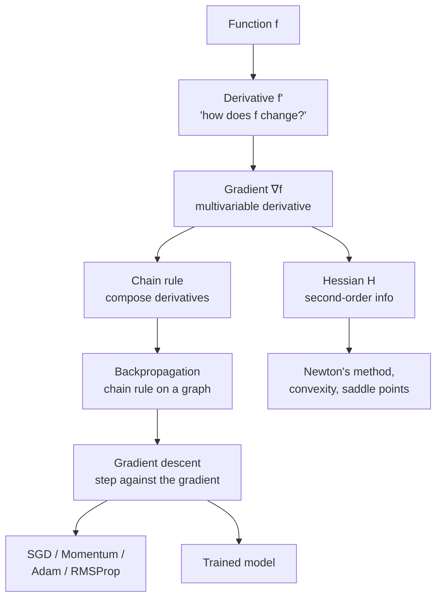
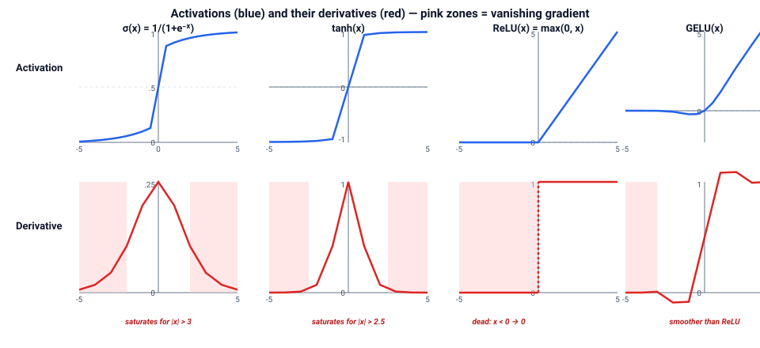
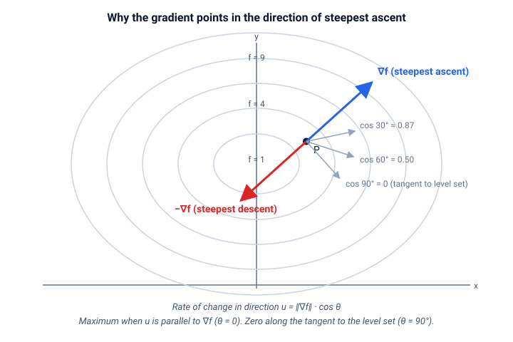
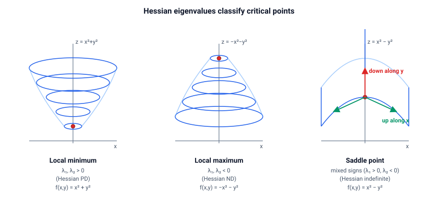
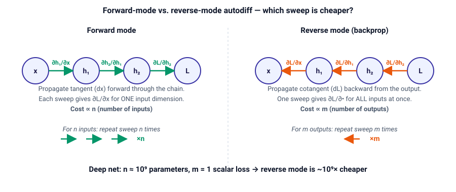
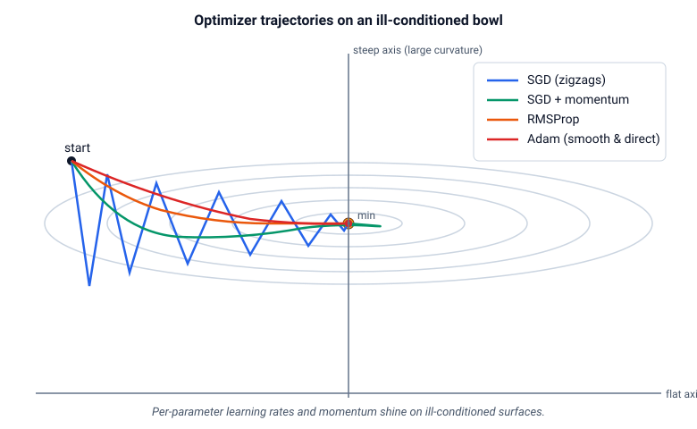

# Calculus for Machine Learning

> **How to read this note.** Each section opens with the *kind of problem* a calculus tool was invented to handle. The formulas come *after* the intuition, never before. If you find yourself staring at a derivative without remembering why we wanted it, scroll up — that's where the *want* was set up.

## Why This Exists

**Problem.** Training a model = finding the parameter values that make a loss small. That's an optimization problem with millions or billions of variables. The only way that's even remotely tractable is calculus: derivatives tell you which way to nudge each parameter to reduce the loss, and the chain rule lets you compute those derivatives efficiently no matter how complicated your model is. The single line `loss.backward()` in PyTorch hides all of this.

When training breaks — loss diverges, gradients vanish, the optimizer stalls — you can't debug what you don't understand. Calculus is the language for these failures.

**Key insight.** Every modern deep network is trained the same way: compute the gradient of the loss with respect to every parameter, then nudge each parameter against its gradient. That's it. **The chain rule is the engine.** Everything else (optimizers, schedules, normalizations, initializations) is engineering to keep gradients well-scaled.

**Reach for this when:**
- Loss diverges to NaN — likely numerical / gradient issue.
- Loss is stuck — saddle, vanishing gradient, dead ReLU, bad LR.
- A paper says "Jacobian," "Hessian," "second-order," "natural gradient."
- Implementing a custom layer or loss and you need backward correctness.
- Choosing an optimizer (SGD vs. Adam) or learning rate schedule.
- Reasoning about backprop, autograd, or the computational graph.

**Don't reach for this when:**
- The question is about distributions / uncertainty — see [statistics-and-probability](statistics-and-probability.md).
- The question is about matrix structure / decompositions — see [linear-algebra](linear-algebra.md).

## Diagrams



## 1. The starting question: how fast is something changing?

### The problem

A car's odometer reads 100 km at noon and 105 km at 12:05. Its average speed in those 5 minutes is 60 km/h. But what if you want the speedometer reading at *exactly* 12:02:30 — instantaneous speed, not an average over an interval?

The first instinct is "make the interval shorter." Look at the change between 12:02:30 and 12:02:31. Then 12:02:30 and 12:02:30.5. Then 12:02:30 and 12:02:30.001.

In the limit, as the interval shrinks to zero, you get an *instantaneous* rate of change. That's the **derivative**:
$$f'(x) = \lim_{h \to 0} \frac{f(x+h) - f(x)}{h}$$

**Geometric picture.** The slope of the tangent line — the line that touches the curve at one point and has the same direction the curve is going at that instant.

**ML reason we care.** A loss surface tells us how bad our model is at a given parameter setting. The derivative of the loss says "if I nudge this parameter a tiny bit, how much does the loss change?" That's the only information we need to make a smart nudge. Calculus is *literally* "how to nudge."

### The shortcuts (differentiation rules)

You almost never compute derivatives from the limit definition. You memorize a few rules and apply them:

- $\frac{d}{dx}c = 0$ — constants don't change.
- $\frac{d}{dx}x^n = nx^{n-1}$ — power rule.
- $(f + g)' = f' + g'$.
- $(fg)' = f'g + fg'$ — product rule.
- $\frac{d}{dx}e^x = e^x$ — the exponential is its own derivative (this is what makes $e$ "the" base).
- $\frac{d}{dx}\ln x = 1/x$.
- **Chain rule** $(f \circ g)'(x) = f'(g(x))\cdot g'(x)$ — see Section 4. The most important rule for ML.

### A few derivatives you'll see daily in NN math

- **Sigmoid** $\sigma(x) = \frac{1}{1+e^{-x}}$ has the gem of a derivative $\sigma'(x) = \sigma(x)(1 - \sigma(x))$. So once you've computed $\sigma(x)$ during the forward pass, you have the derivative for free.
- **tanh** has $\tanh'(x) = 1 - \tanh^2(x)$.
- **ReLU** has derivative 1 if $x > 0$, 0 if $x < 0$ (and we conventionally pick 0 at $x = 0$).
- **Softmax** is vector-valued, so its derivative is a Jacobian: $\partial s_i/\partial z_j = s_i(\delta_{ij} - s_j)$. The "softmax + cross-entropy" gradient simplifies to $\hat{p} - y$ — beautifully clean. Frameworks fuse them for numerical stability.

The picture below shows why sigmoid and tanh are "gradient traps" for deep hidden layers and why ReLU/GELU took over: the pink zones are where the derivative flattens to (nearly) zero — no gradient signal survives to update parameters upstream.



### The smoothness premium

Differentiability requires continuity. Operations like `argmax`, hard `if/else` branches, and step functions break gradients. ML's solution is **smooth surrogates** — softmax instead of argmax, sigmoid instead of step, GELU instead of ReLU at zero. The reason ML loves smoothness is that gradient descent demands it.

### Higher derivatives

The derivative of the derivative tells you about *curvature*.
- $f''(x) > 0$ → curving up (smiley) → convex region.
- $f''(x) < 0$ → curving down (frowny) → concave region.

This becomes the Hessian in higher dimensions (Section 3) and unlocks second-order optimization.

## 2. From one variable to many: gradients

### The problem

Single-variable derivatives are great, but a loss function depends on millions of parameters at once. We need a way to talk about derivatives of $f: \mathbb{R}^n \to \mathbb{R}$ — a single number out, many numbers in.

### The natural object

Imagine standing on a hillside. The height at your location is $f(x, y)$ where $x$ is east-west and $y$ is north-south. Two natural questions: "If I take one small step *east*, does the ground rise or fall, and by how much?" That's $\partial f/\partial x$. Same question, *north*: $\partial f/\partial y$. The gradient bundles those two rates into a vector that says "east-slope this much, north-slope this much." Then the natural next question — "which single direction should I step to climb fastest?" — has a beautiful answer we'll get to shortly.

Formally: for each input dimension, ask "if I nudge *this* input alone (holding the others fixed), how does $f$ change?" That's the **partial derivative** $\partial f / \partial x_i$.

Stack all $n$ partial derivatives into a vector. That's the **gradient**:
$$\nabla f = \left[\frac{\partial f}{\partial x_1}, \dots, \frac{\partial f}{\partial x_n}\right]^T$$

### The crucial geometric fact

The gradient *points in the direction of steepest ascent*. Among all directions you could move, the one that increases $f$ fastest is the gradient direction.



The contours are level sets — walk along one and $f$ doesn't change. The gradient is *perpendicular* to the level set through your point, pointing outward toward higher values. Move at any other angle $\theta$ from $\nabla f$ and your rate of ascent shrinks by $\cos\theta$: half as fast at 60°, zero along the tangent (90°), negative on the far side. The negative gradient is the mirror image — the fastest way *down*.

**Why ML cares.** We want to *minimize* loss. So we step in the direction *opposite* the gradient — the negative gradient is the direction of steepest descent. That's gradient descent in one sentence.

### Directional derivatives — proof of the steepest-ascent claim

The rate of change of $f$ when moving in direction $\mathbf{u}$ (unit vector) is:
$$\nabla_\mathbf{u} f = \nabla f \cdot \mathbf{u} = \|\nabla f\|\cos\theta$$

This is maximized when $\theta = 0$, i.e., when $\mathbf{u}$ is parallel to $\nabla f$. So yes — gradient = steepest ascent.

## 3. Vector-in, vector-out: Jacobians and Hessians

### The Jacobian — for vector-valued functions

A neural network is a *composition* of vector functions: each layer takes a vector and produces a vector. Each one needs a generalized derivative — a matrix of partials:
$$J_{ij} = \frac{\partial f_i}{\partial x_j}$$

For $\mathbf{f}: \mathbb{R}^n \to \mathbb{R}^m$, the Jacobian $J$ is $m \times n$. It's the linear approximation of $\mathbf{f}$ near a point.

Backpropagation = repeated Jacobian-vector products via the chain rule (Section 4). You almost never form a full Jacobian explicitly in ML — that would be a giant matrix. Frameworks do "jvp" or "vjp" (Jacobian-vector product / vector-Jacobian product) lazily.

### The Hessian — second derivatives in many dimensions

For scalar $f: \mathbb{R}^n \to \mathbb{R}$, the matrix of second-order partials is the **Hessian**:
$$H_{ij} = \frac{\partial^2 f}{\partial x_i \partial x_j}$$

Symmetric (under mild smoothness — Schwarz's theorem). It encodes the local *curvature* of $f$ in every direction.

**Why we care.**
- At a critical point ($\nabla f = 0$), the Hessian's eigenvalues classify it: all positive → local min, all negative → local max, mixed → saddle. (See [linear-algebra](linear-algebra.md) for eigenvalues.)
- The Hessian's eigenvalues bound the safe learning rate. If the largest eigenvalue is $\lambda_{\max}$, you need step size $\eta < 2/\lambda_{\max}$ for stability. Bigger curvature means smaller step.
- Newton's method uses $H^{-1}\nabla f$ for an exact step toward the minimum of a quadratic — converges in one step on perfect quadratics, very fast near minima.



Each panel shows one signature of curvature: two positive eigenvalues → bowl → local min; two negative → dome → local max; one of each → saddle, which is a min in one direction and a max in the perpendicular direction. In high dimensions, saddles vastly outnumber true minima — see Section 5.

### The big-NN problem

$H$ is $n \times n$. For a billion-parameter model, that's a quintillion entries. We can't compute or store it. ML mostly avoids second-order methods at scale, or uses cheap approximations:
- **Quasi-Newton** (L-BFGS): build up an approximation to $H^{-1}$ from gradient history. Works for medium-sized problems.
- **Hessian-vector products**: compute $Hv$ for a specific $v$ without forming $H$. Useful for second-order analysis without quadratic memory.
- **Natural gradient / K-FAC**: structured approximations using the Fisher information matrix. Common in RL.

### Multivariable Taylor — the universal local approximation

Around a point $\mathbf{x}$:
$$f(\mathbf{x} + \boldsymbol{\delta}) \approx f(\mathbf{x}) + \nabla f^T\boldsymbol{\delta} + \frac{1}{2}\boldsymbol{\delta}^T H\boldsymbol{\delta}$$

- Use only the linear term → gradient descent.
- Use the quadratic term → Newton's method.

This single equation is the unifying frame for all gradient-based optimization.

## 4. The chain rule and why backprop exists

### The problem

A neural network is layer 1, applied to its input, producing layer-1 output. Layer 2 is applied to that, producing layer-2 output. Etc. Symbolically: $y = f_L(f_{L-1}(\dots f_1(x)))$.

You want $\partial \text{loss} / \partial w_{l}$ for every parameter $w_{l}$ in every layer $l$. How?

### The single-variable chain rule

Imagine you're paid $3 per hour worked, and every hour worked burns 200 calories. If you work one more hour, how many more calories do you burn? Trivially 200. Now flip it: how many more *dollars* per calorie? You earn $3/hr and burn 200 cal/hr, so $3 \div 200\text{ cal} = \$0.015/\text{cal}$. You just used the chain rule: rate of A w.r.t. C = rate of A w.r.t. B $\times$ rate of B w.r.t. C. The chain rule is literally that — how to compose rates through an intermediate variable.

Formally, for $z = f(g(x))$: $\frac{dz}{dx} = \frac{dz}{dy} \cdot \frac{dy}{dx}$ where $y = g(x)$.

In English: "stack" the derivatives — $z$'s rate vs. $y$, times $y$'s rate vs. $x$, gives $z$'s rate vs. $x$. The chain rule is just bookkeeping for "stacked rates."

### The multivariable chain rule

For $z = f(\mathbf{y})$ and $\mathbf{y} = \mathbf{g}(\mathbf{x})$:
$$\frac{\partial z}{\partial x_i} = \sum_j \frac{\partial z}{\partial y_j} \cdot \frac{\partial y_j}{\partial x_i}$$

Or in matrix form: $\nabla_\mathbf{x} z = J_\mathbf{g}^T \nabla_\mathbf{y} z$.

### Backpropagation: chain rule, applied cleverly

Three observations make backprop the dominant algorithm:
1. A neural network is a composition of differentiable operations.
2. The chain rule lets you compute $\partial \text{loss}/\partial w_l$ if you know the local derivatives of every layer.
3. Computing it **backward** (from output to input) is dramatically more efficient than forward, because every layer's gradient *reuses* the gradient of the layer above it.

Pseudo-algorithm for an $L$-layer net:
```
Forward pass:
  cache activations a_l at every layer
Backward pass (output to input):
  δ_L = ∂loss / ∂a_L
  for l = L-1, …, 1:
    ∂loss / ∂W_l = δ_{l+1} · a_l^T
    δ_l = (W_l^T · δ_{l+1}) ⊙ f'(z_l)
```

That's `loss.backward()` in PyTorch, in essence. It works for any differentiable architecture because **autograd** (Section 11) tracks the operations dynamically.

### Why reverse-mode (and not forward-mode)?

For $f: \mathbb{R}^n \to \mathbb{R}^m$:
- **Forward mode** is efficient when $n \ll m$.
- **Reverse mode** is efficient when $n \gg m$.

ML has many parameters ($n$ in millions/billions) and one scalar loss ($m = 1$). Reverse mode wins by a factor of $n/m$. That's the entire reason "deep learning" became practical.



Forward mode needs one sweep *per input dimension* to get all the derivatives; reverse mode needs one sweep *per output*. For a billion-parameter model with a single scalar loss, reverse mode delivers all billion gradients in a single pass — forward mode would need a billion passes.

## 5. The loss landscape: where do you end up?

### The terrain you're walking on

Before talking about how we walk (gradient descent), let's understand the terrain.

Critical points (where $\nabla f = 0$) come in flavors:
- **Local minimum** — Hessian PD, all eigenvalues positive. A bowl.
- **Local maximum** — Hessian ND. A hilltop.
- **Saddle point** — Hessian indefinite, mixed-sign eigenvalues. A mountain pass — minimum in some directions, maximum in others.
- **Plateau** — gradient is small but you're not at a critical point per se. The terrain is just flat. SGD slows here; momentum helps push through.

### Convexity: when the terrain has a single bowl

A function is **convex** if, for any two points, the line segment between them lies above the function. Equivalently (in the smooth case): the Hessian is PSD everywhere.

Convex functions have *no local minima other than the global one*. Gradient descent is *guaranteed* to find the global minimum. Linear regression, logistic regression, SVMs — convex.

### Neural networks are not convex

Multiple local minima, lots of saddle points. Theoretically gradient descent could get stuck. In practice:
- Most local minima of large NNs are roughly equivalent in loss — a deep-learning surprise.
- The main slowdown is *saddle points*, not local minima. As dimension grows, the probability that a random critical point is a saddle (vs. a minimum or maximum) grows exponentially. Most critical points are saddles.
- Stochastic noise and momentum help escape saddles. They're features, not bugs.

## 6. Gradient descent and its zoo

### The core update

$$\theta_{t+1} = \theta_t - \eta \nabla \mathcal{L}(\theta_t)$$

Step against the gradient. Repeat. The whole thing is "go downhill, slowly."
- $\eta$ — **learning rate**. Small → slow but stable. Large → fast but risks divergence.

### Why mini-batches

Computing $\nabla \mathcal{L}$ over the *full* dataset every step is slow. Computing over one example is fast but noisy. The compromise: a **mini-batch** of $B$ examples. By the Law of Large Numbers (see [statistics-and-probability](statistics-and-probability.md)), the mini-batch gradient is a noisy but unbiased estimate of the true gradient.

The noise turns out to be a *feature*, not a bug — it helps escape saddle points and shallow local minima. Mini-batch SGD with $B \in [32, 1024]$ is the workhorse of modern ML.

### Why vanilla SGD isn't enough

If different parameters have very different curvatures (typical in deep nets), one global learning rate doesn't fit all. Some parameters need big steps; others need tiny ones. So we evolved adaptive optimizers.

### The optimizer family tree

| Optimizer | Idea (in plain English) | When to reach for it |
|---|---|---|
| **Momentum** | Don't just step on the gradient; build up "velocity" — gradients accumulate over time, smoothing direction. | Vision, anywhere you want SGD with smoother dynamics |
| **Nesterov momentum** | Same but evaluates gradient at the look-ahead position. Often slightly better. | Same as momentum |
| **AdaGrad** | Per-parameter learning rate scaled by $\sqrt{\sum g^2}$ — lower LR for parameters that have seen big gradients. | Sparse data (NLP with bag-of-words). Drawback: LR shrinks forever, eventually freezes. |
| **RMSProp** | Per-param LR scaled by an *EMA* of $g^2$ — recent gradients matter more than ancient ones. | Recurrent nets, non-stationary problems |
| **Adam** | Combine momentum + RMSProp. Each parameter gets a smoothed gradient direction *and* its own LR. | The "default" — works out of the box on most things |
| **AdamW** | Adam with *decoupled* weight decay (the L2 penalty isn't lumped into the gradient). | Modern default for transformers, LLMs |
| **L-BFGS** | Quasi-Newton — uses gradient history to approximate the Hessian. | Small to medium deterministic problems with batch gradients |



The elongated bowl is the pathological case adaptive optimizers were built for: the steep direction wants a small step, the flat direction wants a big one. Vanilla SGD picks *one* LR that has to work for both — so it zigzags across the narrow axis while barely progressing along the wide one. Momentum smooths those zigzags, RMSProp rescales per-parameter to march faster along the flat axis, and Adam combines both.

### Learning-rate schedules

A constant LR is rarely optimal. You'd like big LR at the start (to make progress) and small LR at the end (to settle into a minimum). Common schedules:

- **Step decay** — divide LR by 10 every $k$ epochs. Old-school but works.
- **Cosine annealing** — smoothly decay from initial to ~0. Popular in vision and transformers.
- **Linear warmup + decay** — small LR at the very start (avoids early instability when activations are wild), ramp up, then decay. Standard for transformers.
- **OneCycle** — oscillate between bounds; sometimes converges very fast.
- **Reduce on plateau** — drop LR when validation loss stops improving.

### The geometric reason LR has to be small enough

For a quadratic with Hessian $H$, the maximum stable LR is $\eta < 2/\lambda_{\max}(H)$. Larger and you bounce out of the bowl. Smaller and you crawl.

This is *also* why batch normalization, layer normalization, and good initialization matter so much: they keep the curvature well-behaved across layers, raising the LR ceiling, making training easier and faster.

## 7. Newton's method and why we don't usually use it

### The problem

Gradient descent uses only first-order info (the gradient). It "doesn't know" that some directions have huge curvature and others have none, so it picks a learning rate that has to work for the worst case. Could we go faster if we knew the curvature?

### The Newton step

Use the Hessian for a second-order step:
$$\theta_{t+1} = \theta_t - H^{-1}\nabla\mathcal{L}$$

For a perfect quadratic, this lands at the minimum *in one step*. Near a minimum it converges *quadratically* — error squares each iteration.

### Why we mostly don't

- $H$ is $n \times n$. For a million-parameter model, it's intractable.
- Inverting $H$ costs $O(n^3)$.
- Far from a minimum, $H$ may not be PD, and Newton's step can go uphill.

So ML almost always sticks with first-order methods. Quasi-Newton (L-BFGS) is a middle ground that approximates $H^{-1}$ from gradient history and works well for medium scale. **Natural gradient / K-FAC** uses the Fisher information matrix as a structured curvature proxy and is popular in RL.

## 8. Constrained optimization (briefly)

### The problem

Sometimes parameters live on a constraint — they have to sum to 1 (probability simplex), or be non-negative, or satisfy some hard rule. Plain gradient descent doesn't respect these.

### The classical solution: Lagrange multipliers

For "minimize $f$ subject to $g(\mathbf{x}) = 0$," form the Lagrangian:
$$\mathcal{L}(\mathbf{x}, \lambda) = f(\mathbf{x}) - \lambda g(\mathbf{x})$$

and find a saddle point: $\nabla_\mathbf{x}\mathcal{L} = 0$ and $g(\mathbf{x}) = 0$. The multiplier $\lambda$ is a "price" on violating the constraint — at the optimum, that price exactly balances the gradient.

For inequality constraints, the **KKT** (Karush-Kuhn-Tucker) conditions generalize Lagrange. SVMs derive from KKT. So do constrained policy methods in RL.

### Why most ML doesn't use hard constraints

We use *penalties* (regularization) instead of hard constraints. They're easier to optimize and more flexible. Constraints reappear:
- SVMs (the dual problem).
- RL with safety constraints.
- Generative models with explicit normalization (probability simplex).

## 9. Failure modes and what they tell you

A working knowledge of calculus turns "training is broken" into "I know which gradient is misbehaving."

| Symptom | Likely calculus reason | Fix |
|---|---|---|
| Loss → NaN or Inf | Exploding gradients | Gradient clipping; lower LR; BatchNorm/LayerNorm |
| Loss not decreasing | Vanishing gradients | Better init (He/Xavier); residual connections; ReLU/GELU instead of sigmoid in hidden layers |
| Loss oscillates wildly | LR too high relative to curvature | Decrease LR; add momentum; normalize features |
| Loss plateaus then drops | Crossing a saddle | Wait it out; momentum helps; try LR warmup |
| Sigmoid output stuck near 0 or 1 | Saturated sigmoid (gradient → 0) | Numerically stable softmax; logit clipping; better init |
| Dead ReLU neurons | Stuck at $x < 0$, gradient permanently 0 | Leaky ReLU; GELU; smaller LR; better init |

## 10. Integrals (briefly)

ML uses derivatives constantly and integrals rarely — but they appear:
- **Expectation** $E[f(X)] = \int f(x) p(x)\,dx$.
- **Marginalization** $p(x) = \int p(x, y)\,dy$.
- **Continuous distribution normalizers** (the Gaussian's $\sqrt{2\pi}\sigma$).
- **Variational inference** — minimize a divergence integral, often via the ELBO.

When integrals are intractable (almost always in deep learning), ML uses **Monte Carlo**: sample and average. By the Law of Large Numbers, the sample average converges to the integral. This is how every stochastic estimate in modern ML works.

## 11. Automatic differentiation (autograd)

### What it is

Frameworks (PyTorch, JAX, TensorFlow) implement **reverse-mode automatic differentiation**. As you call ops, they build a directed graph. Each op records its inputs/outputs and a local gradient function. `loss.backward()` traverses the graph backward, applying the chain rule.

### What this gives you

- *Exact* gradients, not finite-difference approximations.
- Handles arbitrary differentiable code — loops, conditionals, indexing.
- The reason deep learning at scale is even possible.

### Caveats — places autograd quietly fails

- **Non-differentiable ops** break the graph. `argmax`, hard indexing, hard sampling — use `.detach()` to mark "no gradient through here," or replace with a smooth surrogate.
- **In-place operations** (`x += y`) can corrupt tensors that backward needs. Prefer non-inplace versions.
- `torch.no_grad()` disables graph building — useful for inference (saves memory).
- **Custom gradients** via `torch.autograd.Function` — when you need to override backward (straight-through estimator, custom CUDA op).
- Calling `loss.backward()` twice on the same graph fails because PyTorch frees activations after the first. Use `retain_graph=True` only when you really need it.

## Trade-offs

- **First-order vs. second-order optimization.** First-order (SGD, Adam) is cheap, scales. Second-order (Newton, L-BFGS) converges fast but costs $O(n^2)$ memory or worse. ML almost always picks first-order.
- **SGD vs. Adam.** SGD with momentum often generalizes better; Adam learns fast and is robust to LR tuning. Vision: SGD-momentum + cosine schedule. NLP / transformers: AdamW.
- **Exact vs. mini-batch gradient.** The mini-batch is noisy but the noise is helpful (escapes saddles). Plus it's the only thing that fits in memory.
- **Smooth surrogate vs. true loss.** Hinge loss is non-smooth but mathematically clean; cross-entropy is smooth and easier to optimize. Smooth surrogates dominate in practice.

## Common Pitfalls

- **Forgetting the negative sign.** It's $\theta - \eta\nabla\mathcal{L}$, not plus. Gradient is *ascent*; we descend.
- **Mistaking SGD noise for divergence.** Mini-batch loss curves are jagged by design; smooth them before judging.
- **Hand-deriving gradients without checking.** Use `torch.autograd.gradcheck` against numerical finite differences (only for small models, never as a runtime cost).
- **Calling `loss.backward()` twice.** Activations are freed after the first call. Use `retain_graph=True` if you really need a second pass — but usually it means there's a logic bug.
- **In-place ops on tensors needed for backward.** Prefer `x = x + y` over `x += y` when the original $x$ matters.
- **Treating ReLU as non-differentiable at zero.** Convention says derivative is 0 (or 1) at 0. The set has measure zero — autograd ignores it safely.
- **Implementing softmax + cross-entropy separately.** It's numerically unstable. Use the framework's fused version. The combined gradient is the simple $\hat{p} - y$.
- **Choosing a giant LR for a freshly-initialized model.** Initial activations and gradients are wild. Use linear warmup.

## Decision Table
| Scenario | Tool | Why |
|----------|------|-----|
| Default optimizer for transformers / LLMs | AdamW | Adaptive + decoupled weight decay; modern standard |
| Default optimizer for ResNets / vision | SGD with momentum + cosine LR | Generalizes well; well-understood |
| Sparse-feature linear models | AdaGrad / FTRL | Per-param LR matches sparsity |
| Small problem, deterministic, smooth loss | L-BFGS | Quasi-Newton converges fast |
| Pretrained model, small dataset (fine-tune) | Smaller LR; possibly freeze early layers | Avoid catastrophic forgetting |
| RNN / sequence model | RMSProp or Adam + gradient clipping | Vanishing/exploding gradients across time |
| Loss diverges to NaN | Lower LR, gradient clipping, check init | Curvature × LR exceeds stability bound |
| Implementing custom op | `torch.autograd.Function` with explicit forward/backward | Default autograd can't see custom CUDA |
| Verifying a hand-derived gradient | `torch.autograd.gradcheck` | Compare against numerical finite difference |

## References
- [3Blue1Brown — Essence of Calculus (YouTube playlist)](https://www.youtube.com/playlist?list=PLZHQObOWTQDMsr9K-rj53DwVRMYO3t5Yr) — geometric intuition for derivatives and integrals.
- [3Blue1Brown — Neural Networks (YouTube playlist)](https://www.youtube.com/playlist?list=PLZHQObOWTQDNU6R1_67000Dx_ZCJB-3pi) — episodes 3–4 derive backprop by hand. The fastest path from "what is a derivative" to "I understand backprop."
- [*Mathematics for Machine Learning* — Deisenroth et al.](https://mml-book.github.io/) — Chapter 5 (vector calculus), Chapter 7 (continuous optimization).
- [*Deep Learning* — Goodfellow, Bengio, Courville](https://www.deeplearningbook.org/) — Chapter 4 (numerical computation), Chapter 8 (optimization for training deep models).
- [Mathematics for Machine Learning Specialization (Coursera)](https://www.coursera.org/specializations/mathematics-machine-learning) — Course 2 is Multivariate Calculus, ending in NN training.
- Boyd & Vandenberghe, *Convex Optimization* (free PDF) — for going deep on optimization theory.

## See Also
- [Math for ML — Roadmap](INDEX.md)
- [statistics-and-probability](statistics-and-probability.md) — losses are likelihoods; the *what* you're minimizing
- [linear-algebra](linear-algebra.md) — Jacobians, Hessians, and the matrix calculus identities behind closed-form solutions
