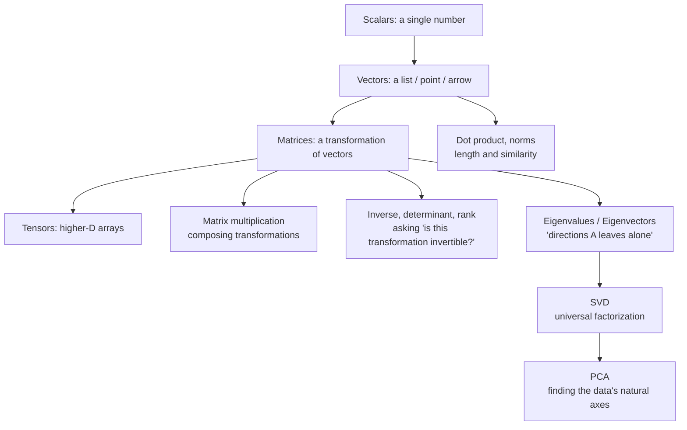
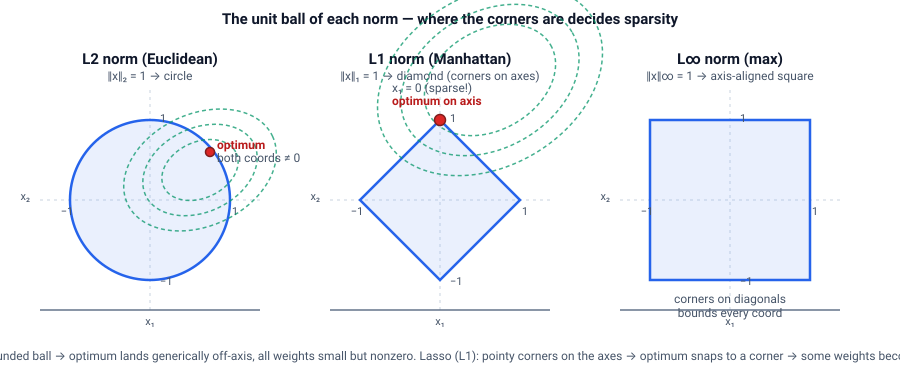
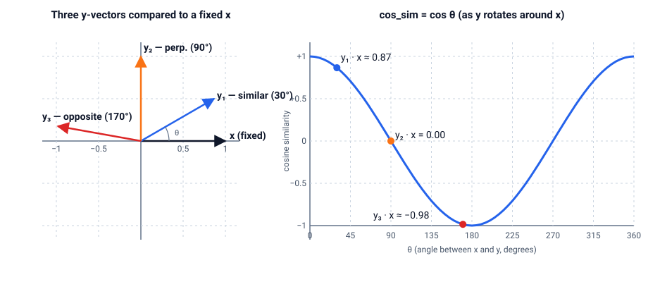
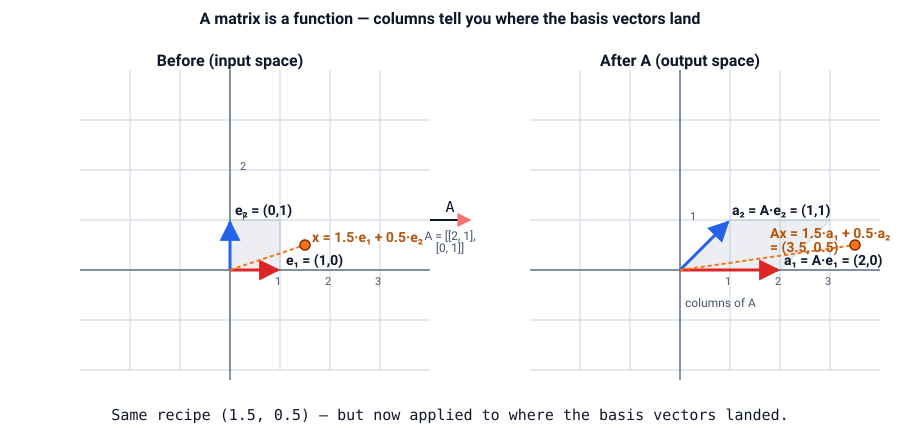
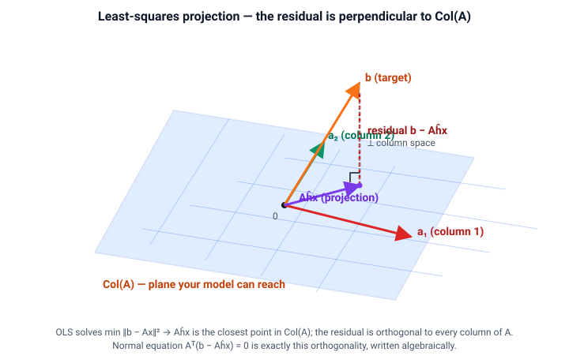
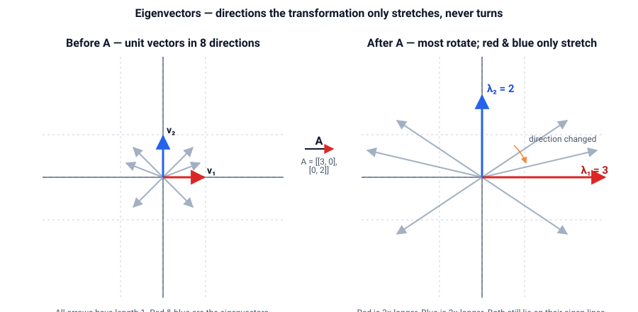
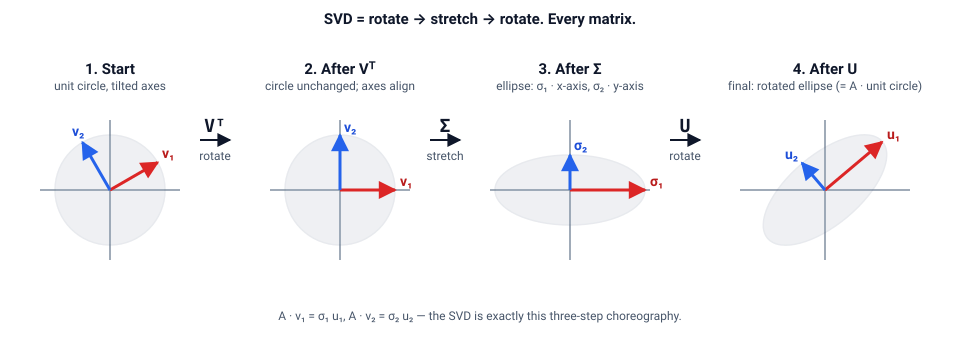

# Linear Algebra for Machine Learning

> **How to read this note.** Each section starts with the *kind of problem* that pushed people to invent the math. Once you see the problem, the formula isn't a thing to memorize — it's the natural answer. If you're reading symbols and feel lost, scroll up to where the symbol was *born*.

## Why This Exists
**Problem.** A 224×224 RGB image is 150,528 numbers. A user's purchase history is a long list of products. A neural network's weights are a giant grid. ML is *drowning* in high-dimensional data. You can't reason about 150,528-dimensional things by visualizing them — you need an *algebra* for them. That's linear algebra.

**Key insight.** A matrix isn't a grid of numbers. **A matrix is a function** — it eats a vector and produces another vector. Once you stop seeing $A$ as "a 3×3 array" and start seeing it as "the thing that takes any vector and rotates/stretches/projects it in a specific way," the rest of linear algebra unlocks.

**Reach for this when:**
- A shape error breaks your model and you need to reason about dimensions.
- You're choosing between L1 and L2 norms — the geometry differs.
- A paper says "low-rank approximation," "Gram matrix," "eigendecomposition," "spectral."
- Implementing or understanding PCA, SVD, or any dimensionality reduction.
- Reading attention or transformer math (it's all matrix multiplication).

**Don't reach for this when:**
- The question is about uncertainty / probability — see [statistics-and-probability](statistics-and-probability.md).
- The question is about gradients or optimization — see [calculus](calculus.md).

## Diagrams



## 1. From numbers to vectors: why we need a list at all

> **Notation convention.** **Bold** ($\mathbf{x}, \mathbf{v}$) = vectors, plain italic ($x_i, c, \lambda$) = scalars, capitals ($A, V$) = matrices.

### The problem

You want to describe a single thing — a house. One number isn't enough: you need its size, its bedrooms, its price, its lat/long. So you make a list:
$$\mathbf{x} = [1500, 3, 600000, 37.7, -122.4]$$

Now every house in your dataset is a list of 5 numbers. You can't add or compare houses by squinting at lists. You need *operations* on lists. That's why we lift "list of numbers" into a mathematical object: a **vector**.

### Three ways to picture the same vector

A vector $\mathbf{x} \in \mathbb{R}^n$ (where $\mathbb{R}^n$ is the set of all $n$-tuples of real numbers — $n$-dimensional space) can be seen as:

1. **A list of numbers.** The natural ML view: one row of your dataset.
2. **A point** in $n$-dimensional space. Useful when thinking about distances, neighbors, clusters.
3. **An arrow** from origin to that point. Useful when thinking about *operations* — addition, scaling, rotation. This is the 3Blue1Brown view.

You'll switch between these constantly. They're the same object; different views illuminate different things.

### The bare minimum operations

- **Addition** $\mathbf{x} + \mathbf{y}$ — componentwise. Geometric picture: tip-to-tail. (You can't add houses, but you can add *change vectors*: "move 100 sqft larger, 1 bedroom up, $50k higher" is a vector you'd add to a house.)
- **Scalar multiplication** $c\mathbf{x}$ — stretch (or shrink, or flip) the arrow.

Two operations, infinite ML applications. Every "average over a batch" is vector addition. Every "scale by learning rate" is scalar multiplication.

## 2. Measuring and comparing vectors

### The problem: how long is this vector?

If a vector represents a "size of error," you want a number for that size. If a vector is a parameter weight, you want a number for "how big are these weights" (so you can penalize them in **regularization** — adding a penalty on weight size to the loss, discouraging overfitting).

You'd think there's *one* answer. There isn't. There are several reasonable definitions of "length," called **norms**, and each has different ML consequences.

### The standard length: L2

Pythagoras gives the obvious one: square the components, add them, square root.
$$\|\mathbf{x}\|_2 = \sqrt{x_1^2 + x_2^2 + \dots + x_n^2}$$

This is the **L2 norm** (Euclidean length). It's "as the crow flies."

### Manhattan length: L1

Sometimes you can't fly — you walk on a grid. Add the absolute distances along each axis:
$$\|\mathbf{x}\|_1 = |x_1| + |x_2| + \dots + |x_n|$$

This is the **L1 norm** (taxicab / Manhattan). Surprisingly important in ML: you'll see why in regularization.

### The Lp family

Generalize:
$$\|\mathbf{x}\|_p = \left(\sum_i |x_i|^p\right)^{1/p}$$

- $p = 1$ → L1.
- $p = 2$ → L2.
- $p = \infty$ → max element: $\max_i |x_i|$.
- $p = 0$ → count of nonzeros (technically not a true norm, but the conceptual goal of "sparsity").

### Why this matters: the pictures of "constant length"

Plot all vectors with norm = 1.

- **L2.** A perfect circle.
- **L1.** A diamond — corners on the axes.
- **L∞.** A square — corners on the diagonals.

These pictures *explain* why L1 induces sparsity and L2 doesn't. When you minimize a loss subject to "norm of weights ≤ some constant," the optimum tends to land on a *corner* of the constraint region. The L1 ball has corners *on the axes*, meaning some components are exactly zero. The L2 ball has no corners, so the optimum is generically off-axis (all components are nonzero, just small).



This is why **lasso (L1) does feature selection** and **ridge (L2) only shrinks**. (Lasso = linear regression with an L1 penalty on coefficients, which drives many to zero; ridge = the same with an L2 penalty, which shrinks all toward zero without zeroing them.)

See the geometry play out on a toy problem — a 3-feature dataset where only feature 0 is actually relevant. L1 zeros the irrelevant coefficients; L2 just shrinks them:

```python
import numpy as np
from sklearn.linear_model import Lasso, Ridge
rng = np.random.default_rng(0)
X = rng.standard_normal((80, 3))                 # 3 features
y = 2.5 * X[:, 0] + rng.standard_normal(80) * 0.1  # only feature 0 matters
lasso = Lasso(alpha=0.1).fit(X, y)  # L1 penalty; alpha = strength
ridge = Ridge(alpha=1.0).fit(X, y)  # L2 penalty; alpha = strength
print("Lasso coefs:", np.round(lasso.coef_, 3))   # .coef_ = trained weights
print("Ridge coefs:", np.round(ridge.coef_, 3))   # e.g. [~2.4, small, small] — nonzero
# Expected output:
# Lasso coefs: [2.419 0.    0.   ]
# Ridge coefs: [2.475 0.006 0.005]
```

The lasso coefficients on features 1 and 2 collapse to exactly `0.0`; the ridge coefficients on the same features are small but nonzero. Corners on the axes vs. no corners — the pictures were literal.

### Comparing two vectors: dot product

How similar are two vectors? Multiply componentwise and sum:
$$\mathbf{x}^T\mathbf{y} = \sum_i x_i y_i$$

Here $\mathbf{x}^T$ is the **transpose** — the row form of a column vector; more generally the transpose flips a matrix over its diagonal, so $A^T_{ij} = A_{ji}$.

The geometric meaning, which is the one to remember:
$$\mathbf{x}^T\mathbf{y} = \|\mathbf{x}\|\|\mathbf{y}\|\cos\theta \quad \text{where } \theta \text{ is the angle between the two vectors.}$$

- Big positive dot product → vectors point in similar directions.
- Zero → perpendicular.
- Negative → opposite directions.



The left panel shows the three cases as arrows; the right panel plots cos θ as y sweeps around the circle — that single cosine curve *is* how cosine similarity varies with the angle between two vectors.

### Cosine similarity: the unit-vector trick

If you only care about *direction*, not magnitude (which is usually true for **embeddings** — learned vector representations of items (words, users, images) where geometry encodes meaning; "cat" and "kitten" should be close regardless of how loud you wrote them):
$$\cos\theta = \frac{\mathbf{x}^T\mathbf{y}}{\|\mathbf{x}\|\|\mathbf{y}\|}$$

This is **cosine similarity**. ML appearances:
- Embedding similarity (Word2Vec, sentence transformers, recommender systems).
- The core operation inside self-attention is essentially "compute dot products of queries and keys, then softmax."
- Document retrieval and RAG.

Quick sanity check — all three norms of the same vector, plus cosine similarity checked against $\cos\theta$:

```python
import numpy as np
x = np.array([3.0, -4.0, 12.0])
y = np.array([1.0,  2.0,  2.0])
# ord=1 -> L1 (sum |xi|); ord=2 -> L2 (Euclidean); ord=inf -> max |xi|
print("L1:", np.linalg.norm(x, 1), "L2:", np.linalg.norm(x, 2), "Linf:", np.linalg.norm(x, np.inf))
cos_sim = x @ y / (np.linalg.norm(x) * np.linalg.norm(y))  # default ord=2
theta = np.arccos(np.clip(cos_sim, -1, 1))  # clip guards float drift past [-1, 1]
print("cos_sim:", cos_sim, "angle (deg):", np.degrees(theta), "cos(theta):", np.cos(theta))
# Expected output:
# L1: 19.0 L2: 13.0 Linf: 12.0
# cos_sim: 0.48717948717948717 angle (deg): 60.84463457371704 cos(theta): 0.4871794871794871
```

L2 of $(3, -4, 12)$ is $13$, L1 is $19$, L∞ is $12$. `cos_sim` and `cos(theta)` match — the definition is self-consistent.

### So which values mean "similar"?

You've computed `cos_sim = (X @ y) / (‖X‖ ‖y‖)` and now have a number in $[-1, +1]$. How do you decide whether two vectors are similar or different? Rough conventions:


| `cos_sim` | Angle θ | Interpretation | Typical use |
|---|---|---|---|
| **0.95–1.00** | 0°–18° | Near-duplicate / synonym | Deduplication |
| **0.80–0.95** | 18°–37° | Very similar / same topic | Semantic search top-k |
| **0.60–0.80** | 37°–53° | Related | RAG relevance cutoff |
| **0.30–0.60** | 53°–73° | Loosely related | Discovery / "you might also like" |
| **~0–0.30** | ~73°–90° | Unrelated | Below the noise floor |
| **< 0** | > 90° | Semantically opposite | Rare in modern embeddings — most sit in $[0, 1]$ |

**Important caveat.** These ranges are **calibration-dependent**. Different embedding models put things at different similarity levels — OpenAI's `text-embedding-3-small` might score "car" vs "vehicle" at 0.65, while `all-MiniLM-L6-v2` scores the same pair at 0.82. The *absolute* threshold depends on the model; the *ordering* is what's reliable.

**How to pick a threshold in practice** — three tactics, in order of rigor:

1. **Rank, don't threshold.** Return the top-$k$ closest results instead of "everything above 0.7." Ranking is model-invariant; the raw numbers aren't.
2. **Plot the distribution.** Compute `cos_sim` for many pairs from your data. You usually see two humps — a "similar-pair" bump and a "random-pair" bump. Pick the threshold in the valley between them.
3. **Calibrate on labeled pairs.** If you have "known similar" and "known different" example pairs, sweep the threshold and pick the point that gives the precision/recall you want.

**Matrix-multiply framing (why this is fast).** In practice you don't compute cosine similarity one pair at a time — you *L2-normalize each row* of your matrix of embeddings, then one matrix multiply gives you *all pairwise similarities at once*:

![Blue M×d document matrix D_norm on the left, yellow d-length query vector q_norm in the middle, green M-length output vector sims on the right. A highlighted doc row and its corresponding output entry are connected by a red arrow labeled "row i · q_norm → sims[i]". Footer shows (M×d) @ (d,) = (M,), one BLAS call, ~1000× faster than a Python loop, with the all-pairs (M×d) @ (d×N) = (M×N) generalization.](assets/embedding-matmul-flow.svg)

**How the trick works — three moves:**

1. **Stack all $M$ document vectors as rows of one matrix $D$**, shape $(M \times d)$ — one row per doc, columns are the $d = 384$ embedding dimensions.
2. **Normalize each row to unit length**: `D_norm = D / np.linalg.norm(D, axis=1, keepdims=True)`. Now every row has L2 norm 1. Do the same for the query. The `keepdims=True` argument keeps the shape as $(M, 1)$ so broadcasting divides row-wise cleanly.
3. **One matrix-vector product**: `sims = D_norm @ q_norm`. Because every row of `D_norm` and `q_norm` itself is unit-length, the raw dot product is *already* cosine similarity — the $\|\cdot\|$ divisors are all 1. Row $i$ of the output is $\hat{\mathbf{d}}_i \cdot \hat{\mathbf{q}} = \cos\theta_i$.

Shape-check: $(M \times d) \, @ \, (d,) = (M,)$. One number per document, all computed in a single call.

**Why this is dramatically faster than a Python loop.** The single `@` is one Python function call that hands the work to **BLAS** — a heavily optimized C library (OpenBLAS / MKL / Apple Accelerate) that uses SIMD (8 multiplies per CPU instruction), cache tiling, and multi-threading. A Python `for` loop over $M$ docs does $M$ Python function calls with all that hardware capability disabled. Real numbers on a laptop for $M = 10{,}000, d = 384$: Python double-loop ≈ 100 ms, `numpy` `@` ≈ 2 ms — same answer, ~50× faster on CPU alone. On GPU with `torch`, another ~100× on top.

**All-pairs generalization.** Have $M$ docs *and* $N$ queries? Stack both into matrices $D$ ($M \times d$) and $Q$ ($N \times d$) — both normalized — then $S = D_{\text{norm}} \cdot Q_{\text{norm}}^T$ gives you the entire $M \times N$ pairwise similarity matrix in one shot. `S[i, j]` = cosine similarity of doc $i$ against query $j$. Every real-world vector database (Pinecone, Weaviate, Milvus, pgvector, FAISS) is built on this primitive — normalize once, matmul at query time, and top-$k$ over the result. Approximate nearest-neighbor indexes (HNSW, IVF-PQ) only kick in past ~1M vectors, when even a full matmul is too slow; below that, this three-step trick is the whole story.

```python
import numpy as np
rng = np.random.default_rng(0)

d = 384
base = rng.normal(size=d)                          # topic anchor
docs = np.stack([
    base + 0.1 * rng.normal(size=d),   # A — near
    base + 0.3 * rng.normal(size=d),   # B — close
    base + 0.8 * rng.normal(size=d),   # C — loose
    rng.normal(size=d),                # D — unrelated
    rng.normal(size=d),                # E — unrelated
])
query = base + 0.2 * rng.normal(size=d)
labels = ["A (near)", "B (close)", "C (loose)", "D (unrel)", "E (unrel)"]

q = query / np.linalg.norm(query)                             # unit-length query
D = docs / np.linalg.norm(docs, axis=1, keepdims=True)        # unit-length rows
cos_sims = D @ q                                              # one matmul → all sims

for lab, cs in sorted(zip(labels, cos_sims), key=lambda t: -t[1]):
    verdict = ("near-dup"     if cs > 0.95 else
               "very similar" if cs > 0.80 else
               "related"      if cs > 0.60 else
               "loosely rel." if cs > 0.30 else
               "unrelated")
    print(f"{lab:11s} cos={cs:+.3f}  →  {verdict}")
# Expected output:
# A (near)    cos=+0.977  →  near-dup
# B (close)   cos=+0.945  →  very similar
# C (loose)   cos=+0.743  →  related
# E (unrel)   cos=+0.021  →  unrelated
# D (unrel)   cos=-0.013  →  unrelated
```

Those five values are the A/B/C/D/E markers on the diagram above — you can trace each one into its bucket. Notice how A crossed the "near-dup" threshold (0.95), B landed in "very similar," C fell into "related," and D/E clustered near zero as expected for genuinely independent vectors (D actually came out slightly negative — just noise, well inside the "unrelated" band). **That's the whole workflow**: matrix-multiply → per-pair cosines → look up the bucket → decision.

## 3. Matrices: the transformation view

### The problem

A vector is a single thing. But you want to *do something* to vectors — rotate them, project them, change their basis. We need objects that take vectors as input and return vectors as output. Functions on vectors.

The simplest non-trivial functions are **linear** — they preserve addition and scaling: $f(\mathbf{x} + \mathbf{y}) = f(\mathbf{x}) + f(\mathbf{y})$ and $f(c\mathbf{x}) = c f(\mathbf{x})$. Every linear function from $\mathbb{R}^n$ to $\mathbb{R}^m$ is a *matrix*. That's the punchline of linear algebra.

### The "where do the basis vectors go" trick

You can describe a linear transformation entirely by where it sends the standard basis vectors $\mathbf{e}_1, \mathbf{e}_2, \dots$ ($\mathbf{e}_j$ = the vector with a 1 in position $j$ and 0 elsewhere — the $j$-th standard basis vector). Stack those destinations as columns. That's the matrix:

$$A = [\,\mathbf{a}_1\, |\, \mathbf{a}_2\, |\, \dots\, |\, \mathbf{a}_n\,], \quad A\mathbf{e}_j = \mathbf{a}_j$$

The $j$-th column of $A$ is "where the $j$-th basis vector lands after $A$ is applied." Once you see that, $A\mathbf{x}$ becomes natural: $\mathbf{x}$ is a recipe for combining basis vectors (a **linear combination** of vectors = a weighted sum $c_1 \mathbf{v}_1 + c_2 \mathbf{v}_2 + \dots$), and $A\mathbf{x}$ is the same recipe applied to where they landed.



This is the central idea of 3Blue1Brown's *Essence of Linear Algebra*. It single-handedly transforms linear algebra from "manipulating grids of numbers" to "manipulating space."

See it: multiplying $A$ by the identity peels off the columns — each column is literally where a basis vector lands.

```python
import numpy as np
A = np.array([[2.0, 1.0],
              [0.0, 1.0]])
print("A @ e1 =", A @ np.array([1.0, 0.0]))  # -> first column of A
print("A @ e2 =", A @ np.array([0.0, 1.0]))  # -> second column of A
print("A @ I  =\n", A @ np.eye(2))            # -> A itself
# Expected output:
# A @ e1 = [2. 0.]
# A @ e2 = [1. 1.]
# A @ I  =
#  [[2. 1.]
#  [0. 1.]]
```

The output columns of `A @ I` are exactly the columns of `A`. That's why $A$'s columns *are* the transformation.

### Multiplying matrices = composing transformations

If $B$ takes you from world A to world B, and $A$ takes you from world B to world C, then $AB$ takes you from world A to world C.
$$AB\mathbf{x} = A(B\mathbf{x})$$

That's why matrix multiplication exists in the form it does. The seemingly arbitrary rule $(AB)_{ij} = \sum_k A_{ik}B_{kj}$ is just the bookkeeping that makes composition work.

### The shape rule (and why it matters)

$(m \times n)(n \times p) = (m \times p)$ — inner dimensions must match. **This is the source of 90% of "shape mismatch" errors in ML.** When you see one in PyTorch:
- Print every tensor's shape on the way in.
- Trace where the dimensions go astray.
- Often it's a forgotten transpose or a batch dimension that shouldn't be where it is.

### Order matters

$AB \neq BA$. "Rotate then scale" is different from "scale then rotate" in general. This breaks the intuition you have from regular numbers, and it's the source of the second-most-common class of bugs (after shape errors).

### A small zoo of important matrices

- **Identity** $I$: does nothing. $I\mathbf{x} = \mathbf{x}$.
- **Diagonal**: scales each axis independently. Cheap to compute with.
- **Symmetric** ($A = A^T$): covariance matrices, kernels, Hessians. Symmetric matrices are *very* well-behaved — orthogonal eigenvectors, real eigenvalues, more.
- **Orthogonal** ($Q^TQ = I$): preserves lengths and angles. Pure rotation/reflection.
- **Triangular**: efficient to solve linear systems (back-substitution).
- **Sparse**: mostly zeros. Critical for big-graph and big-text data.

## 4. Inverses and "can I undo this?"

### The problem

You applied a transformation $A\mathbf{x} = \mathbf{b}$. Given $\mathbf{b}$, can you recover $\mathbf{x}$?

If yes, the inverse $A^{-1}$ exists, and $\mathbf{x} = A^{-1}\mathbf{b}$.

If $A$ collapses dimensions — say it projects 3D onto a 2D plane — then multiple $\mathbf{x}$'s map to the same $\mathbf{b}$, and there's no way to undo. $A$ has no inverse.

### When does an inverse exist?

$A^{-1}$ exists iff $A$ is square *and* its columns are linearly independent. "Linearly independent" means no column is a combination of the others — no redundancy, no collapsed dimension.

Equivalent ways to say this:
- $A$ has full rank.
- $\det(A) \neq 0$.
- $A$ has no zero singular values.
- $A\mathbf{x} = 0$ implies $\mathbf{x} = 0$.

Pick whichever phrasing is most natural in context — they're all the same statement.

### The dirty secret: nobody computes inverses

In practice, you almost never compute $A^{-1}$ explicitly. To solve $A\mathbf{x} = \mathbf{b}$, use `np.linalg.solve(A, b)` instead of `np.linalg.inv(A) @ b`. Why?
1. Inverting is more expensive than solving.
2. Inverting is *less numerically stable* — it amplifies floating-point errors.

If your code computes an inverse, it's probably a bug or a missed optimization.

### What about non-square or singular matrices?

The **Moore-Penrose pseudoinverse** $A^+$ generalizes the inverse. For tall matrices with linearly independent columns:
$$A^+ = (A^TA)^{-1}A^T$$

Recognize this? It's the **OLS (ordinary least squares)** regression formula — fit a linear model by minimizing $\|A\mathbf{x} - \mathbf{b}\|_2^2$. Linear regression *is* a pseudoinverse computation. And the pseudoinverse projects onto the column space of $A$ (defined in §5 below) in the least-squares sense.

### Determinant: the volume scaler

$\det(A)$ is a single number that tells you *how much $A$ scales volumes*.
- $\det(A) = 2$: doubles all volumes.
- $\det(A) = 0$: collapses some dimension to zero (no volume left).
- $\det(A) < 0$: also flips orientation.

If $\det(A) = 0$, the transformation has flattened space, you've lost information, and no inverse can recover it. That's the geometric reason "$\det = 0$ means non-invertible."

Watch the unit cube get stretched — its volume scales by exactly $|\det(A)|$:

```python
import numpy as np
from itertools import product
A = np.array([[2.0, 0.5, 0.0],
              [0.0, 3.0, 0.0],
              [0.0, 0.0, 1.5]])
corners = np.array(list(product([0.0, 1.0], repeat=3))).T   # 3 x 8, unit cube corners
transformed = A @ corners
print("det(A) =", np.linalg.det(A))          # signed volume-scale factor of A
# Volume via the parallelepiped spanned by A's columns:
print("|det(A)| =", abs(np.linalg.det(A)))   # |det| = volume scale (sign = orientation)
print("transformed corner range x:", transformed[0].min(), "to", transformed[0].max())
# Expected output:
# det(A) = 8.999999999999998
# |det(A)| = 8.999999999999998
# transformed corner range x: 0.0 to 2.5
```

$\det(A) = 2 \cdot 3 \cdot 1.5 = 9$ (upper-triangular → product of diagonal). The unit cube maps to a parallelepiped of volume 9.

### Rank: how much information survives

The **rank** of a matrix is the number of linearly independent columns (equivalently, rows). It's the dimension of the *output space* of $A$.

- An $m \times n$ matrix can have rank up to $\min(m, n)$.
- Full rank → no redundancy.
- Low rank → there's compression hiding in here.

**ML.** Real-world data is *almost always* low-rank. A user-item ratings matrix is millions × millions, but the ratings actually lie on a low-dimensional manifold (genres, user types). Recommender systems exploit this: factorize the matrix into two low-rank pieces and you've compressed it, learned latent features, and filled in missing entries — all at once.

**Rank-nullity theorem**: $\dim(\text{null}(A)) + \text{rank}(A) = $ number of columns of $A$.

A rank-deficient matrix in the flesh — row 3 is row 1 + row 2, so rank is 2, not 3:

```python
import numpy as np
from scipy.linalg import null_space
A = np.array([[1.0, 2.0, 3.0],
              [4.0, 5.0, 6.0],
              [5.0, 7.0, 9.0]])  # row 3 = row 1 + row 2
print("shape:", A.shape, "rank:", np.linalg.matrix_rank(A))  # rank via SVD (default tol)
ns = null_space(A)  # orthonormal basis of {x : A x = 0} via SVD
print("null space basis (shape", ns.shape, "):\n", ns)
print("A @ null_vec =", A @ ns[:, 0])  # ~ zero vector
# Expected output:
# shape: (3, 3) rank: 2
# null space basis (shape (3, 1) ):
#  [[-0.40824829]
#  [ 0.81649658]
#  [-0.40824829]]
# A @ null_vec = [1.55431223e-15 8.88178420e-16 1.33226763e-15]
```

Rank 2 out of 3, so the null space is 1-dimensional (by rank-nullity above). `A @ ns[:, 0]` is essentially zero — that direction is what $A$ destroys.

## 5. Vector spaces: the playground for everything above

### The problem

We've been doing operations on vectors and matrices. But *which vectors* can $A$ produce? Which can it not? Where does information get lost?

### Subspaces a matrix cares about

Given $A$ ($m \times n$), four subspaces tell the whole story:

- **Column space** $\text{Col}(A)$ — span of $A$'s columns; the set of all possible outputs $A\mathbf{x}$.
- **Null space** $\text{Null}(A)$ — vectors $\mathbf{x}$ that get sent to zero. The information $A$ destroys.
- **Row space** $\text{Row}(A) = \text{Col}(A^T)$.
- **Left null space** $\text{Null}(A^T)$.

If you ever wonder "why doesn't this least-squares problem have a unique answer?" — likely the null space is non-trivial. Multiple $\mathbf{x}$'s give the same output.

### Span, basis, dimension

- **Span** of a set of vectors = all linear combinations of them.
- **Basis** = a smallest set whose span is the whole space. Like a coordinate system.
- **Dimension** = size of any basis. Independent of which basis.
- **Orthonormal basis** = basis where vectors are unit-length and pairwise perpendicular. Easiest to work with.

### Projection: the heart of regression

You have a target vector $\mathbf{b}$. Your model can only produce vectors of the form $A\mathbf{x}$ (i.e., things in the column space of $A$). What's the *closest* such vector to $\mathbf{b}$?

Drop a perpendicular from $\mathbf{b}$ onto $\text{Col}(A)$. That's the projection:
$$\text{proj} = A(A^TA)^{-1}A^T\mathbf{b}$$

This is *exactly* OLS regression. You're projecting your target onto the subspace of vectors your model can express. The **residual** $\mathbf{b} - A\hat{\mathbf{x}}$ (what the model can't capture) lives in the *left null space* — orthogonal to your model's column space, hence the model can't capture it. That orthogonality is what "least squares" buys you geometrically.



Build the projection matrix and confirm two properties: idempotence ($P^2 = P$) and that $Pb$ equals the least-squares fit $A\hat{\mathbf{x}}$ (the hat means "estimated / best-fit"; $\hat{\mathbf{x}}$ is the solution minimizing $\|A\mathbf{x} - \mathbf{b}\|_2$):

```python
import numpy as np
A = np.array([[1.0, 0.0],
              [1.0, 1.0],
              [1.0, 2.0],
              [1.0, 3.0]])                     # 4x2, tall
b = np.array([1.0, 2.0, 2.0, 4.0])
P = A @ np.linalg.pinv(A)                       # pinv = Moore-Penrose pseudoinverse (via SVD)
print("P shape:", P.shape, "idempotence err:", np.linalg.norm(P @ P - P))
x_hat, *_ = np.linalg.lstsq(A, b, rcond=None)   # solves min ||Ax - b||; rcond=None uses new default
print("P @ b:      ", P @ b)
print("A @ x_hat:  ", A @ x_hat)                # same vector
print("residual perpendicular to columns?:", A.T @ (b - A @ x_hat))
# Expected output:
# P shape: (4, 4) idempotence err: 3.1707024946691817e-16
# P @ b:       [0.9 1.8 2.7 3.6]
# A @ x_hat:   [0.9 1.8 2.7 3.6]
# residual perpendicular to columns?: [-3.33066907e-16 -6.66133815e-16]
```

$P$ is idempotent to machine precision, $Pb$ matches $A\hat{\mathbf{x}}$, and $A^T(b - A\hat{\mathbf{x}})$ is zero — the residual is orthogonal to every column of $A$.

## 6. Eigenvalues and eigenvectors: directions a transformation respects

### The problem

A matrix $A$ takes vectors and rotates/stretches/skews them. Most directions get sent somewhere different. **But are there special directions that $A$ leaves alone?** Directions where $A$ only *scales* the vector, not rotates it?

If yes — those special directions tell you the *intrinsic axes* of the transformation. They're the natural coordinate system for $A$.

### The defining equation

A direction $\mathbf{v} \neq 0$ that $A$ leaves "the same direction" satisfies:
$$A\mathbf{v} = \lambda\mathbf{v}$$

- $\mathbf{v}$ is an **eigenvector** (the unchanged direction).
- $\lambda$ is the **eigenvalue** (how much it gets scaled along that direction).

That's it. The whole concept is in the equation $A\mathbf{v} = \lambda\mathbf{v}$.

### Visualizing it

Imagine $A$ is a rubber sheet stretching transformation. Most arrows on the sheet, after stretching, point a different direction. But two specific arrows (the eigenvectors) keep pointing the same way — they only get longer or shorter (by the eigenvalues). Those two directions *are* the natural axes of the stretch.



### Why ML cares

- Eigenvalues of repeated matrices control growth/decay. RNN gradients pass through the same weight matrix many times. If eigenvalues > 1, gradients explode. If < 1, gradients vanish. Decades of recurrent network design (LSTMs, GRUs, careful init) are about controlling these eigenvalues.
- For *symmetric* matrices, eigenvectors are orthogonal — they form a perfect coordinate system. Covariance matrices, Hessians, kernel matrices, normal-equation matrices — all symmetric. (**Kernel matrix**: $K_{ij} = k(\mathbf{x}_i, \mathbf{x}_j)$ — pairwise similarity of data points under some similarity function $k$.) Their eigendecompositions reveal structure cleanly.
- **The Hessian is where eigenvalues meet optimization.** The Hessian $H$ is the local quadratic approximation of a loss surface — think of it as an ellipsoid bowl (or saddle) fitted to the loss at a point. Its **eigenvectors are the axes of that bowl**, and its **eigenvalues are the curvature along each axis**. All positive → bowl (local min). All negative → dome (local max). Mixed signs → saddle. This is why second-order optimizers (Newton, natural gradient) *rescale* gradients by $H^{-1}$: they stretch the bowl into a sphere so gradient descent takes uniform steps in every direction. See [calculus](calculus.md).
- PCA literally finds eigenvectors of the covariance matrix.

### How they're computed (in principle)

Solve the **characteristic equation** $\det(A - \lambda I) = 0$ for $\lambda$, then $(A - \lambda I)\mathbf{v} = 0$ for $\mathbf{v}$. By hand, only feasible for $n \leq 3$. In practice: `np.linalg.eig`. Don't compute by hand.

### Eigendecomposition

If $A$ has $n$ linearly independent eigenvectors, you can write:
$$A = V\Lambda V^{-1}$$

with $\Lambda$ diagonal (eigenvalues) and $V$'s columns as the eigenvectors. This says: "$A$, in the right coordinate system, is just a scaling matrix."

For symmetric $A$, the special version (which you'll encounter constantly) is:
$$A = V\Lambda V^T$$

with $V$ orthogonal. This is the **spectral theorem**, and it's the cleanest, most useful identity in ML linear algebra.

Check the defining equation directly — for each eigenpair, $A\mathbf{v} - \lambda\mathbf{v}$ should be ~zero:

```python
import numpy as np
A = np.array([[4.0, 1.0, 0.0],
              [1.0, 3.0, 1.0],
              [0.0, 1.0, 2.0]])                # symmetric -> real eigenvalues, orthogonal eigenvectors
eigvals, eigvecs = np.linalg.eigh(A)           # eigh: symmetric/Hermitian — real vals, orthonormal vecs (vs. eig which may return complex)
for lam, v in zip(eigvals, eigvecs.T):
    residual = np.linalg.norm(A @ v - lam * v)
    print(f"lambda={lam:+.4f}  ||A v - lambda v|| = {residual:.2e}")
# Reconstruction from V Lambda V^T:
print("reconstruct error:", np.linalg.norm(A - eigvecs @ np.diag(eigvals) @ eigvecs.T))
# Expected output:
# lambda=+1.2679  ||A v - lambda v|| = 2.29e-16
# lambda=+3.0000  ||A v - lambda v|| = 3.14e-16
# lambda=+4.7321  ||A v - lambda v|| = 1.33e-15
# reconstruct error: 2.4248784069758646e-15
```

Residuals are at floating-point noise (`~1e-15`), and $V\Lambda V^T$ reproduces $A$ — the spectral theorem in one printout.

## 7. SVD: the universal factorization

### The problem

Eigendecomposition is great, but it only works for square matrices, and best for symmetric ones. Most matrices in ML aren't square (data matrix $X$ is $n \times d$). We want a similarly insightful decomposition for *any* matrix.

### The answer: SVD

For *any* matrix $A$ ($m \times n$):
$$A = U\Sigma V^T$$

- $U$ ($m \times m$) — orthogonal; columns are *left singular vectors*.
- $\Sigma$ ($m \times n$) — diagonal-ish; non-negative *singular values* on the diagonal, sorted descending.
- $V$ ($n \times n$) — orthogonal; columns are *right singular vectors*.

### What it says, geometrically

Every linear transformation, no matter how complicated, is just three steps:
1. **$V^T$** — rotate (change to a "nice" basis).
2. **$\Sigma$** — stretch each axis by a different factor (the singular values).
3. **$U$** — rotate again.

Three operations. Universal. Works on rectangular, singular, anything.



### The killer application: low-rank approximation

If you keep only the top $k$ singular values, you get the best rank-$k$ approximation to $A$ (best in **Frobenius norm** $\|A\|_F = \sqrt{\sum_{i,j} A_{ij}^2}$ — the L2 norm applied to the matrix flattened into a vector; equivalently, total squared error). This is the **Eckart-Young theorem**, and it powers a stunning amount of ML:

- **PCA** — top singular vectors of centered data are the principal components.
- **Recommender systems** — factor a giant user-item matrix into two thin matrices.
- **LSI (Latent Semantic Indexing) / topic modeling** — SVD on a term-document matrix gives semantic topics.
- **Image compression** — drop small singular values, reconstruct close to original.
- **Model compression / LoRA (Low-Rank Adaptation)** — replace a big weight matrix with a low-rank correction during fine-tuning.
- **Numerical pseudoinverse** — $A^+ = V\Sigma^+ U^T$ where $\Sigma^+$ inverts non-zero singular values. Stable when $A^TA$ would be singular.

### When the singular values "fall off a cliff"

Plot the singular values of a real-world matrix in decreasing order. Often the first few are huge and the rest are tiny — the matrix is *effectively low-rank*. That's why low-rank approximations are so good in practice: most of the matrix is noise or redundancy.

SVD, full reconstruction, then a rank-$k$ truncation — Eckart-Young in code:

```python
import numpy as np
rng = np.random.default_rng(0)
A = rng.standard_normal((5, 4)) @ rng.standard_normal((4, 6))   # 5x6, rank <= 4
U, S, Vt = np.linalg.svd(A, full_matrices=False)  # reduced SVD: U m×k, S len k, Vt k×n (k=min(m,n))
print("A.shape:", A.shape, "U:", U.shape, "S:", S.shape, "Vt:", Vt.shape)
print("singular values:", np.round(S, 3))
A_full = U @ np.diag(S) @ Vt
print("full reconstruct err:", np.linalg.norm(A - A_full))
for k in [1, 2, 3, 4]:
    A_k = U[:, :k] @ np.diag(S[:k]) @ Vt[:k, :]
    print(f"rank-{k} Frobenius err:", np.linalg.norm(A - A_k, 'fro'))
# Expected output:
# A.shape: (5, 6) U: (5, 5) S: (5,) Vt: (5, 6)
# singular values: [6.874 2.217 1.674 0.547 0.   ]
# full reconstruct err: 6.224057291043854e-15
# rank-1 Frobenius err: 2.831071008204299
# rank-2 Frobenius err: 1.7607059345389193
# rank-3 Frobenius err: 0.5467941155373953
# rank-4 Frobenius err: 6.183792598200554e-15
```

The full reconstruction is machine-zero. Each larger $k$ shrinks the Frobenius error monotonically; at $k = 4$ it's already zero because the underlying matrix has rank 4.

## 8. PCA: the capstone

### The problem

Your data has 1000 features. You suspect most of the variation is captured by far fewer. How do you find a smaller set of axes that captures the most variation?

### The intuition

Pretend your data is a cloud of points in 1000-dimensional space. There's a direction in this space along which the cloud is *most spread out*. That's the most informative axis. Once you've found it, look for the next most spread-out direction — but require it to be perpendicular to the first (so you're capturing *new* information). Continue.

The directions you collect are the **principal components**. Project your data onto them, keep the top $k$, and you've reduced from 1000 dimensions to $k$ while keeping as much variation as possible.

### The math (motivated)

"Spread-out direction" means high variance when projected. Variance after projecting onto a unit vector $\mathbf{w}$ is $\mathbf{w}^T C \mathbf{w}$, where $C = \frac{1}{n-1}X^TX$ is the (sample) covariance matrix of the centered data $X$.

Maximizing $\mathbf{w}^T C \mathbf{w}$ subject to $\|\mathbf{w}\|=1$ is a constrained optimization. Lagrange multipliers give you: the optimal $\mathbf{w}$ is an eigenvector of $C$, and the value of the objective is its eigenvalue.

So the algorithm:
1. **Center the data** (subtract feature means). Critical — without this, you find directions of high *raw value*, not high variance.
2. **Compute the covariance matrix** $C = \frac{1}{n-1}X^TX$.
3. **Eigendecompose** $C = V\Lambda V^T$ (symmetric, so this is clean).
4. **Sort eigenvectors by eigenvalue, descending.** Top eigenvectors = principal components.
5. **Project** $X_{\text{reduced}} = XV_k$ where $V_k$ is the top $k$ columns of $V$.

Equivalently — and numerically preferred — apply SVD directly to the centered data $X$. The right singular vectors are the principal components.

### What PCA gives you

- **Dimensionality reduction.** Throw away low-variance directions.
- **Visualization.** Project to 2D or 3D for a scatterplot.
- **Decorrelation.** Output components are uncorrelated by construction.
- **Noise reduction.** High-variance = signal (usually). Drop the tiny components and you've denoised.

### Where PCA lies to you

- **Non-linear structure.** PCA can't unfold a swiss roll. Use t-SNE, UMAP, or autoencoders for nonlinear reduction.
- **Variance ≠ importance.** Sometimes the discriminative information is in a *low-variance* direction. PCA, oblivious to labels, can throw it away. (LDA — linear discriminant analysis — uses labels.)
- **Scale sensitivity.** Features with bigger units dominate the variance. Always **standardize** features (zero mean, unit variance) before PCA. Otherwise your PCA is dominated by whichever feature happens to be measured in big numbers.

## 9. Positive (semi-)definite matrices: when symmetric is extra-nice

A symmetric matrix $A$ is:
- **Positive definite (PD)** if $\mathbf{x}^T A \mathbf{x} > 0$ for all $\mathbf{x} \neq 0$. All eigenvalues are positive.
- **Positive semi-definite (PSD)** if $\mathbf{x}^T A \mathbf{x} \geq 0$. Eigenvalues $\geq 0$.

**Where they show up.**
- **Covariance matrices** are always PSD (they're $\frac{1}{n-1}X^TX$, and $\mathbf{x}^T X^T X \mathbf{x} = \|X\mathbf{x}\|^2 \geq 0$).
- **Kernel matrices** in SVMs and Gaussian processes must be PSD (Mercer's theorem).
- **A PD Hessian at a critical point** ⇒ local minimum. (See [calculus](calculus.md).)
- **PD matrices have a unique square root** — used in whitening, decorrelation, and many statistical procedures.

## 10. Matrix calculus, just enough

You don't need to derive these. You need to *recognize* them when they appear.

| Expression | Gradient w.r.t. $\mathbf{x}$ |
|---|---|
| $\mathbf{a}^T \mathbf{x}$ | $\mathbf{a}$ |
| $\mathbf{x}^T A \mathbf{x}$ | $(A + A^T)\mathbf{x}$, or $2A\mathbf{x}$ if $A$ symmetric |
| $\|\mathbf{x}\|_2^2 = \mathbf{x}^T\mathbf{x}$ | $2\mathbf{x}$ |
| $\|A\mathbf{x} - \mathbf{b}\|_2^2$ | $2A^T(A\mathbf{x} - \mathbf{b})$ — sets the OLS normal equation |

Setting that last gradient to zero gives the Normal Equation $A^TA\mathbf{x} = A^T\mathbf{b}$ — i.e., linear regression. The full multivariable picture is in [calculus](calculus.md).

## 11. Tensors: matrices in more dimensions

In ML practice, "tensor" just means "n-dimensional array." The operations are generalizations of matrix operations:

- Order 1: vectors.
- Order 2: matrices (your data, your weights).
- Order 3: e.g., (batch, sequence, hidden) — transformer activations.
- Order 4: e.g., (batch, channel, height, width) — image batches in CNNs.

**Operations to be fluent in.**
- **Reshape / view** — change the shape (no copy).
- **Permute / transpose** — swap axes (e.g., NHWC vs. NCHW).
- **Broadcasting** — implicit expansion across compatible axes. Source of countless silent bugs: $(n, 1)$ added to $(1, n)$ becomes $(n, n)$ — that's almost certainly not what you wanted.
- **Einsum** — `torch.einsum("ij,jk->ik", A, B)` is matrix multiply. Slightly cryptic, deeply expressive — the universal contraction language.

## 12. Numerical conditioning: why some math is fragile

### The problem

You solve a linear system $A\mathbf{x} = \mathbf{b}$. A tiny change in $\mathbf{b}$ produces a huge change in $\mathbf{x}$. Your model's coefficients flip sign on the next mini-batch. Why?

### The number that explains it

The **condition number** $\kappa(A) = \sigma_{\max} / \sigma_{\min}$ — ratio of largest to smallest singular value.

- $\kappa$ near 1 — well-conditioned. Stable.
- $\kappa$ huge — ill-conditioned. Tiny perturbations blow up.

### Why ridge regression helps multicollinearity

**Multicollinearity** = predictor features are (near-)linearly dependent, making $X^TX$ near-singular and coefficient estimates unstable. If features are highly correlated, $X^TX$ has a tiny smallest eigenvalue (near-singular). Condition number is huge. Coefficients are wild.

Ridge adds $\lambda I$ to $X^TX$. The smallest eigenvalue becomes $\lambda_{\min} + \lambda$, lifted off zero. Condition number drops. Solutions stabilize. Same effect, two perspectives: numerical (better conditioning) and Bayesian (Gaussian prior). They're the same fact wearing different clothes.

## Trade-offs

- **Eigendecomposition vs. SVD.** Eig only works on square (and well only on symmetric); SVD works on anything. SVD is slower but the safe default.
- **Computing inverse vs. solving systems.** Always solve, don't invert. `solve` is faster and more stable.
- **Dense vs. sparse representations.** Dense is simple and SIMD-friendly. Sparse is essential for text and graph data — different ecosystem (scipy.sparse, torch.sparse) but order-of-magnitude wins.
- **Low-rank vs. full-rank.** Low-rank trades accuracy for speed and memory. The trade is great when singular values fall off a cliff (most real matrices).

## Common Pitfalls

- **Order matters: $AB \neq BA$.** Top source of shape errors.
- **Forgetting to center before PCA.** Without centering, you find directions of high *raw value*, not high variance.
- **Forgetting to standardize before PCA.** Features with bigger units dominate variance and the principal components.
- **Treating $\det(A) = 0$ as "almost invertible."** It's *singular*. There is no inverse.
- **Computing $(X^TX)^{-1}$ explicitly.** Use `np.linalg.lstsq` or `solve`. Direct inversion is unstable when columns are correlated.
- **Confusing rank with size.** A 1000×1000 matrix can have rank 5 — its data lives on a 5-dim subspace. ML data is almost always low-rank in practice.
- **Misreading SVD orientation.** NumPy returns $V^T$. PyTorch returns $V$. Check the docs every time.
- **Broadcasting silently doing the wrong thing.** $(n, 1) + (1, n) = (n, n)$. Probably a bug.

## Decision Table
| Scenario | Tool / Concept | Why |
|----------|---------------|-----|
| Reduce dimensions of dense numeric data | PCA | Captures linear variance structure |
| Reduce dimensions, non-linear structure | t-SNE / UMAP / autoencoder | PCA is linear |
| Solve $A\mathbf{x} = \mathbf{b}$ | `np.linalg.solve` | Stable, fast |
| Overdetermined least squares | `np.linalg.lstsq` / pseudoinverse | OLS, stable |
| Compress a learned weight matrix | Truncated SVD / LoRA | Eckart-Young optimal |
| Find directions of greatest variance | Eigendecomp of covariance | Top eigenvectors of $X^TX$ |
| Compute embedding similarity | Cosine similarity | Magnitude-invariant |
| Diagnose unstable linear model | Condition number of $X^TX$ | Multicollinearity diagnostic |
| Add regularization | $\lambda I$ to $X^TX$ | Conditioning + Gaussian prior |
| Want sparsity in feature selection | $L^1$ penalty | Diamond ball corners on axes |
| Implement self-attention | Three matrix multiplies + softmax | Pure linear algebra + nonlinearity |

## References
- [3Blue1Brown — Essence of Linear Algebra (YouTube playlist)](https://www.youtube.com/playlist?list=PLZHQObOWTQDPD3MizzM2xVFitgF8hE_ab) — start *here*. Build the geometric pictures first; everything else collapses into place.
- [*Mathematics for Machine Learning* — Deisenroth et al.](https://mml-book.github.io/) — Chapters 2–4 are the cleanest formal LA-for-ML treatment.
- [*Deep Learning* — Goodfellow, Bengio, Courville](https://www.deeplearningbook.org/) — Chapter 2 (linear algebra) is tuned specifically for deep learning.
- [Mathematics for Machine Learning Specialization (Coursera)](https://www.coursera.org/specializations/mathematics-machine-learning) — Course 1 is Linear Algebra; Course 3 ends in PCA.
- Strang, *Introduction to Linear Algebra* (book + free MIT OCW lectures) — the classic. Slower but rewarding.

## See Also
- [Math for ML — Roadmap](INDEX.md)
- [statistics-and-probability](statistics-and-probability.md) — covariance matrices, regression as projection, the geometry of L1 vs. L2
- [calculus](calculus.md) — gradients of vector/matrix functions, optimization
