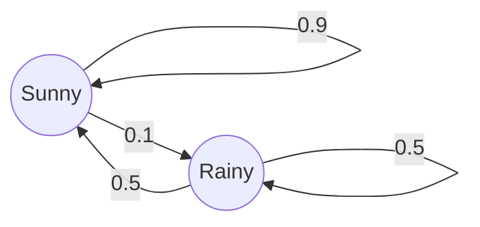
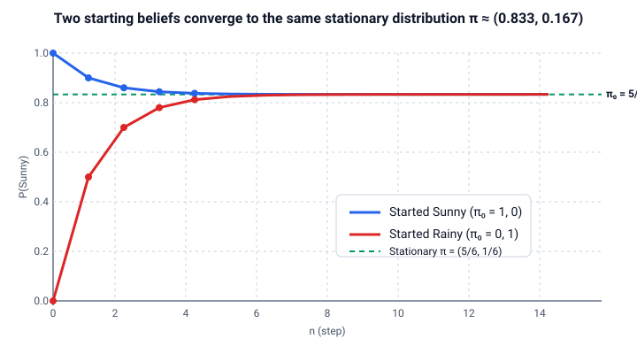

# Markov Chains

> **How to read this note.** Same arc as the rest of the math-for-ml wiki — start with a concrete problem, build to the formula, then see it in code. If a formula looks strange, scroll up: the paragraph above is where it was born.

## Why This Exists

**Problem.** You want to model a system that changes over time — the weather, a stock's regime, a customer's session, a random walker on a graph, an RL agent moving through a maze, a language model generating tokens one at a time. What makes this tractable is that in *many* real systems, the next step depends only on the *current* state, not the whole history. That's the "Markov" assumption. Once you accept it, an entire toolbox opens: transition matrices, stationary distributions, mixing time, MCMC.

**Key insight.** A Markov chain is just a *directed graph* with probabilities on the edges. Multiplying the transition matrix repeatedly propagates a distribution forward in time; that repeated multiplication converges (under mild conditions) to a fixed distribution — the *stationary distribution*. Everything from PageRank to Bayesian sampling is a special case of that convergence.

**Reach for this when:**
- Modeling anything that evolves in discrete time with "state = enough context" — weather, RL, customer funnels, gene expression, page navigation.
- Doing Bayesian inference where the posterior can't be integrated in closed form (MCMC).
- Understanding how PageRank / random-walk embeddings work.
- Building or debugging a Hidden Markov Model.
- Working with language models — token generation is a Markov chain over the model's state.

**Don't reach for this when:**
- The next state genuinely depends on far-back history (fully non-Markovian dynamics). Fixes: enlarge the state to include that history, or use RNN/Transformer.
- You need *continuous* time with rare events — that's a continuous-time Markov chain (CTMC) / Poisson process, related but a different toolset.

## Diagrams

The whole chapter fits in one picture: state, arrow, probability.



Every arrow out of a state must sum to 1. That's it.

## 1. What "Markov" actually means

**The problem.** Modeling how a system evolves. If the next state can depend on the *entire* history, you have hopeless bookkeeping. What if we could get away with less?

**The Markov property (memorylessness):**

$$P(X_{t+1} = j \mid X_t = i, X_{t-1}, X_{t-2}, \ldots, X_0) = P(X_{t+1} = j \mid X_t = i)$$

In English: *given the present, the future is independent of the past.* The current state is a "sufficient statistic" for all future behavior.

**Why this is powerful and dangerous.**
- Powerful: you only need to store the current state, not the full history. Massive compression.
- Dangerous: you have to *design* the state so that it really does contain all the predictive information. If tomorrow's weather actually depends on last week's, "Sunny/Rainy" isn't enough state — you'd need something like "Sunny with a week of rain behind it." The Markov property is a modeling *choice*, not a fact about the world.

**The escape hatch.** If a system needs $k$ steps of history, define your state as the tuple of the last $k$ observations. That's a *higher-order* Markov chain — still Markov, just over a bigger state space. This is exactly what an $n$-gram language model does.

## 2. The transition matrix

**The problem.** How do we write down all the transition probabilities compactly?

**The setup.** Let the states be $\{1, 2, \ldots, N\}$. The **transition matrix** $P$ is an $N \times N$ matrix where

$$P_{ij} = P(X_{t+1} = j \mid X_t = i)$$

**Row $i$ = "if I'm in state $i$ right now, where might I be next?"** Rows sum to 1 (they're proper probability distributions):

$$\sum_j P_{ij} = 1 \quad \text{for every } i$$

Matrices with non-negative entries and rows summing to 1 are called **row-stochastic**. That's the entire structural constraint on Markov chains.

**Example — 2-state weather model.**

$$P = \begin{pmatrix} P_{SS} & P_{SR} \\ P_{RS} & P_{RR} \end{pmatrix} = \begin{pmatrix} 0.9 & 0.1 \\ 0.5 & 0.5 \end{pmatrix}$$

Read row 1: "If today is Sunny, tomorrow is Sunny with prob 0.9 and Rainy with prob 0.1." Read row 2: "If today is Rainy, tomorrow is Sunny with prob 0.5 and Rainy with prob 0.5." Sunny is "sticky"; Rainy is a coin flip.

**Simulate a sample path.**

```python
import numpy as np

P = np.array([[0.9, 0.1],
              [0.5, 0.5]])
rng = np.random.default_rng(0)  # seeded RNG for reproducibility

s = 0            # start Sunny
path = [s]
for _ in range(19):
    s = rng.choice(2, p=P[s])  # weighted draw from current row of P
    path.append(s)

print("".join("S" if d == 0 else "R" for d in path))
# Expected output:
# SSSSSSRRRRRRSSSSSSSS
```

You can *see* the stickiness — long runs of S and R rather than random alternation.

## 3. Propagating a distribution one step forward

**The problem.** You have a probability distribution over states today: $\pi_t = (p_1, p_2, \ldots, p_N)$. What's the distribution tomorrow?

**The intuition.** For each starting state $i$, you're in it with probability $\pi_t(i)$, and from there you land in $j$ with probability $P_{ij}$. Sum over all $i$:

$$\pi_{t+1}(j) = \sum_i \pi_t(i) \cdot P_{ij}$$

That's just a matrix-vector product, with the distribution treated as a *row* vector:

$$\pi_{t+1} = \pi_t \cdot P$$

(This is the reason "row-stochastic" is the convention — the multiplication goes on the *right*. In some texts they use column-stochastic matrices and left-multiply; same idea, transposed.)

**By induction:** $\pi_n = \pi_0 \cdot P^n$. The $n$-step transition matrix is just $P$ raised to the $n$-th power.

**Watch $P^n$ over time.**

```python
import numpy as np

P = np.array([[0.9, 0.1],
              [0.5, 0.5]])

for n in [1, 2, 5, 20]:
    Pn = np.linalg.matrix_power(P, n)  # computes P^n (n-step transitions)
    print(f"P^{n:2d} =\n{np.round(Pn, 4)}\n")
# Expected output:
# P^ 1 =
# [[0.9 0.1]
#  [0.5 0.5]]
#
# P^ 2 =
# [[0.86 0.14]
#  [0.7  0.3 ]]
#
# P^ 5 =
# [[0.835  0.165 ]
#  [0.8248 0.1752]]
#
# P^20 =
# [[0.8333 0.1667]
#  [0.8333 0.1667]]
```

Watch what happens: **the rows become identical.** By step 20, it no longer matters whether you started Sunny or Rainy — the probability of being Sunny is 0.833 either way. That's the punchline of the whole chapter.

## 4. The stationary distribution

**The problem.** The rows of $P^n$ converged to something. What is that "something," and what does it mean?

**Definition.** A distribution $\pi$ is **stationary** if applying $P$ leaves it unchanged:

$$\pi = \pi \cdot P$$

Once your belief is $\pi$, one more step keeps it at $\pi$. It's a *fixed point* of the transition operator.

**Reading the equation.** $\pi P = \pi$ says $\pi$ is a **left eigenvector of $P$ with eigenvalue 1**. Every row-stochastic matrix has 1 as an eigenvalue (that's a theorem — row-stochastic ⇒ $P \mathbf{1} = \mathbf{1}$, so 1 is a right eigenvalue with eigenvector $\mathbf{1}$; eigenvalues of $P$ and $P^T$ are the same set, so there's a left eigenvector for 1 too). So the stationary distribution is always *computable* — it's a linear-algebra problem.

**Solve it for our weather chain.** Let $\pi = (s, 1-s)$. Then

$$s = 0.9 s + 0.5(1 - s) \;\;\Longrightarrow\;\; s = 0.5 + 0.4 s \;\;\Longrightarrow\;\; 0.6 s = 0.5 \;\;\Longrightarrow\;\; s = \frac{5}{6}$$

So $\pi = (5/6, 1/6) \approx (0.833, 0.167)$. That matches what $P^{20}$ showed us — in the long run, ~83% of days are sunny.

**Interpret it two ways** (both correct):
- **Time average.** If you simulate one long trajectory, the fraction of time spent in state $i$ converges to $\pi_i$.
- **Ensemble average.** If you run many independent chains in parallel for a long time, at any given step the fraction of them in state $i$ is $\pi_i$.

These two views being *equal* is called **ergodicity** — see §6.

**Compute it two ways in code.**

```python
import numpy as np

P = np.array([[0.9, 0.1],
              [0.5, 0.5]])

# Method A — power iteration (start anywhere, apply P many times)
pi_pi = np.array([1.0, 0.0])
for _ in range(200):
    pi_pi = pi_pi @ P

# Method B — left eigenvector of P with eigenvalue 1
vals, vecs = np.linalg.eig(P.T)          # eig of transpose: left eigvecs of P become right eigvecs of P.T
idx = np.argmin(np.abs(vals - 1))        # pick the eigenvalue equal to 1 (stationarity)
pi_eig = np.real(vecs[:, idx])           # strip tiny imaginary parts from eig's complex output
pi_eig /= pi_eig.sum()                   # normalize to a probability distribution

print(f"power iteration : π = {pi_pi}")
print(f"left eigenvector: π = {pi_eig}")
# Expected output:
# power iteration : π = [0.83333333 0.16666667]
# left eigenvector: π = [0.83333333 0.16666667]
```

Both agree, both match the algebra. **Power iteration** is what Google's original PageRank was, and it's the basic engine of MCMC too — just multiply repeatedly.

## 5. Convergence — the picture

The reason the previous section works is that repeated multiplication *forgets the starting state* and pulls every initial distribution toward $\pi$. Here's what that looks like:



Two chains — one starting Sunny, one starting Rainy — glide toward the same 83.3% asymptote. After about 10 steps you can't tell them apart. The **mixing time** is the number of steps to get "close enough" to $\pi$; for this chain it's under 10.

**Trace it in code.**

```python
import numpy as np

P = np.array([[0.9, 0.1],
              [0.5, 0.5]])

for start in [np.array([1.0, 0.0]), np.array([0.0, 1.0])]:
    pi = start.copy()
    row = [f"start={pi}"]
    for _ in range(8):
        pi = pi @ P
        row.append(f"{pi[0]:.4f}")
    print(" -> ".join(row))
# Expected output:
# start=[1. 0.] -> 0.9000 -> 0.8600 -> 0.8440 -> 0.8376 -> 0.8350 -> 0.8340 -> 0.8336 -> 0.8334
# start=[0. 1.] -> 0.5000 -> 0.7000 -> 0.7800 -> 0.8120 -> 0.8248 -> 0.8299 -> 0.8320 -> 0.8328
```

Note the *rate* of convergence — each step, the gap to 0.8333 shrinks by a factor of **0.4**. That's not a coincidence: 0.4 is the *second-largest eigenvalue* of $P$. The mixing rate is governed by the **spectral gap** $1 - |\lambda_2|$: closer to 1 = mixes fast; closer to 0 = mixes slowly.

## 6. When does convergence work? — irreducibility, aperiodicity, ergodicity

Convergence to a *unique* stationary distribution isn't automatic. Two things can break it.

**Reducibility.** A chain is **irreducible** if you can get from any state to any other (possibly in multiple steps). If not, the state space splits into disconnected islands, each with its own stationary distribution.

Example — reducible chain:

$$P = \begin{pmatrix} 1 & 0 & 0 \\ 0 & 0.5 & 0.5 \\ 0 & 0.3 & 0.7 \end{pmatrix}$$

State 1 is an absorbing island (never leaves). States 2 and 3 form another island. There's no single $\pi$ — where you end up depends on where you started.

**Periodicity.** A state has **period** $k$ if returns to it can only happen in multiples of $k$ steps. If every state has period 1, the chain is **aperiodic**.

Example — periodic chain (bipartite flip-flop):

$$P = \begin{pmatrix} 0 & 1 \\ 1 & 0 \end{pmatrix}$$

Starting at state 1: you're in state 1 at steps 0, 2, 4, … and in state 2 at steps 1, 3, 5, …. There's no convergence to a smooth distribution — the chain oscillates forever. It *does* have a stationary distribution $\pi = (0.5, 0.5)$ (the time-average), but $\pi_n$ never settles to it.

**The theorem.** An **ergodic** chain — one that is both irreducible and aperiodic — has:
- A unique stationary distribution $\pi$.
- $\pi_n \to \pi$ from any starting distribution.
- Time averages along one long trajectory equal ensemble averages: $\frac{1}{n}\sum_{t=0}^{n-1} f(X_t) \to \sum_i \pi_i f(i)$.

For most practical Markov chains — anything with self-loops (like our weather example, where $P_{SS} = 0.9$) — aperiodicity is automatic. Irreducibility just means "the graph is one connected piece."

## 7. Where Markov chains show up in ML

The whole machinery pays off because it maps onto famous algorithms:

**PageRank.** Model the web as a Markov chain where a "random surfer" is on a page and, with prob $0.85$, clicks a random outgoing link; with prob $0.15$, teleports to a random page (this teleport is what makes the chain irreducible and aperiodic — without it the surfer would get trapped in dead ends). PageRank of a page = stationary probability of being on it. Google's original algorithm was: compute $\pi$ by power iteration.

**MCMC (Markov Chain Monte Carlo).** You want to sample from a distribution $\pi$ that's hard to sample directly (e.g. a Bayesian posterior with intractable normalizer). Trick: *design* a Markov chain whose stationary distribution is exactly $\pi$, then run it. After it mixes, the samples $X_t$ are (correlated) draws from $\pi$.
- **Metropolis-Hastings** designs $P$ by "propose then accept/reject."
- **Gibbs sampling** cycles through coordinates.
- **HMC / NUTS** (in Stan, PyMC) use gradient information to propose smarter moves.
The reason MCMC exists as a field is that you can build such a $P$ *without* ever having to compute $\pi$'s normalizer — you only need ratios $\pi(y)/\pi(x)$.

**Hidden Markov Models (HMMs).** A Markov chain over *hidden* states $Z_t$, plus an emission model $P(X_t \mid Z_t)$ for observations. Given the observations, you infer the latent state sequence. Used in speech recognition, part-of-speech tagging, gene finding, quant regime detection.

**Reinforcement Learning.** An MDP is a Markov chain with actions and rewards. Value iteration, policy iteration, and Q-learning are all algorithms about stationary quantities on Markov chains.

**Language models — at generation time.** Autoregressive LMs generate tokens by sampling $x_{t+1} \sim P(\cdot \mid \text{state}_t)$, where $\text{state}_t$ is the KV cache. That's a (huge-state) Markov chain — which is why "temperature" and "top-k" are just knobs on the transition probabilities.

**Random walks on graphs.** Node2vec, DeepWalk, and other graph-embedding methods define a Markov chain on the graph and use stationary/short-time statistics as features.

## Trade-offs

- **Simplicity vs. fidelity.** The Markov assumption is a modeling choice. In finance, "state = current price" is famously wrong (returns have long-memory volatility); enlarging the state (last $k$ returns, or a latent regime) helps. Every real-world chain is only *approximately* Markov.
- **Small state vs. rich behavior.** Making the state richer buys expressiveness but costs $|S|^2$ transition parameters. Discrete-time Markov chains scale badly past ~thousands of states unless you exploit structure (sparse graphs, factored transitions, function approximation as in deep RL).
- **Deterministic vs. stochastic transitions.** A chain with deterministic transitions is essentially a rotation on the state space — no mixing, no stationary distribution beyond the cycle it's on. The stochasticity is what makes ergodic theory work.
- **Mixing time vs. sample quality.** MCMC samples are correlated. Cut the correlation by thinning (keep every $k$-th) or running multiple chains — but both cost compute. The "how many samples do I actually need?" question is a research topic.

## Common Pitfalls

- **Believing your state is Markov when it isn't.** Symptom: your simulated trajectories don't match reality even when the transition matrix fits the marginals. Fix: enlarge the state, or use a richer model class.
- **Running MCMC too short.** The first samples are biased by the starting point (the "burn-in"). Discard them. Diagnose with $\hat R$ (Gelman-Rubin) across parallel chains, or trace plots — if the chain hasn't visibly wandered, it hasn't mixed.
- **Assuming ergodicity without checking.** If your chain has disconnected components (reducibility) or a period > 1, there's no unique $\pi$ to converge to. Symptom: samples cluster in one region forever. Fix: add a small "teleport" probability (PageRank's trick) or redesign the proposal.
- **Confusing "$P_{ij}$" row/column conventions.** Some texts use column-stochastic matrices ($\pi_{n+1} = P \pi_n$ with column vectors). Both are correct; check which one your library / paper uses before multiplying.
- **Thinking large eigenvalue gap = fast mixing everywhere.** The spectral gap governs *worst-case* mixing. A specific chain might get "close enough" for your purposes much sooner. Trust simulation over gap-based bounds for practical questions.
- **Trying to sample from a peaky, disconnected posterior with vanilla MCMC.** Vanilla Metropolis-Hastings gets stuck in one mode. Use tempered / parallel-tempered chains, or a proposal that can make long jumps.

## Decision Table

| Scenario | Reach for | Not that | Why |
|----------|-----------|----------|-----|
| Modeling a discrete system evolving over time | Markov chain with well-designed state | RNN | If the Markov assumption is honest, this is simpler and interpretable. |
| Sampling from a Bayesian posterior with an intractable normalizer | MCMC (Metropolis-Hastings / HMC / NUTS) | Grid search over parameter space | Grid dies in high dimensions; MCMC scales. |
| Ranking web pages by importance | Random-walk (PageRank) | Static in-degree count | Captures indirect importance — links from important pages count more. |
| Sequential labeling (speech, POS tagging) | HMM or its neural cousins | Static classifier | State transitions carry sequence structure the classifier can't see. |
| Fast, differentiable long-context modeling | Transformer / RNN | Higher-order Markov | Beyond $k \approx 5$, transition tables blow up combinatorially. |
| Reasoning about equilibrium of an interacting system | Stationary distribution | Simulation until vibes | π is a *formula*; simulation is a *sample*. Both agree but π is cheaper and more accurate. |

## References

- [Markov Chains — Wikipedia](https://en.wikipedia.org/wiki/Markov_chain) — encyclopedic, especially good on the classification of states.
- [*Introduction to Probability* — Grinstead & Snell (free PDF), Chapter 11](https://math.dartmouth.edu/~prob/prob/prob.pdf) — the canonical undergrad chapter on finite Markov chains.
- [*Markov Chains and Mixing Times* — Levin & Peres (2nd ed., free PDF)](https://pages.uoregon.edu/dlevin/MARKOV/mcmt2e.pdf) — the modern reference on mixing time and spectral gap.
- [PageRank paper — Brin & Page, 1998](https://web.stanford.edu/class/cs315b/assignment_1/PageRank_paper.pdf) — the algorithm that funded a company by treating the web as a Markov chain.
- [PyMC MCMC docs](https://www.pymc.io/projects/docs/en/stable/api/samplers.html) — hands-on entry to running MCMC in Python.

## See Also

- [statistics-and-probability](statistics-and-probability.md) — for the Bayesian context that motivates MCMC.
- [linear-algebra](linear-algebra.md) — eigenvectors and eigenvalues (the stationary distribution is a left eigenvector with eigenvalue 1).
- [calculus](calculus.md) — HMC and other gradient-based MCMC samplers use derivatives of the log-posterior.
