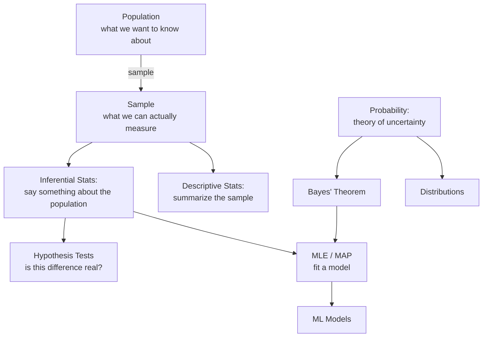
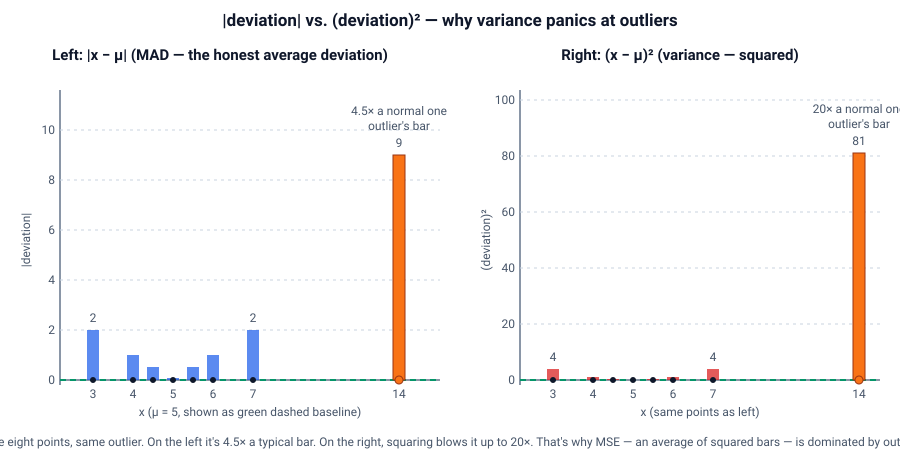
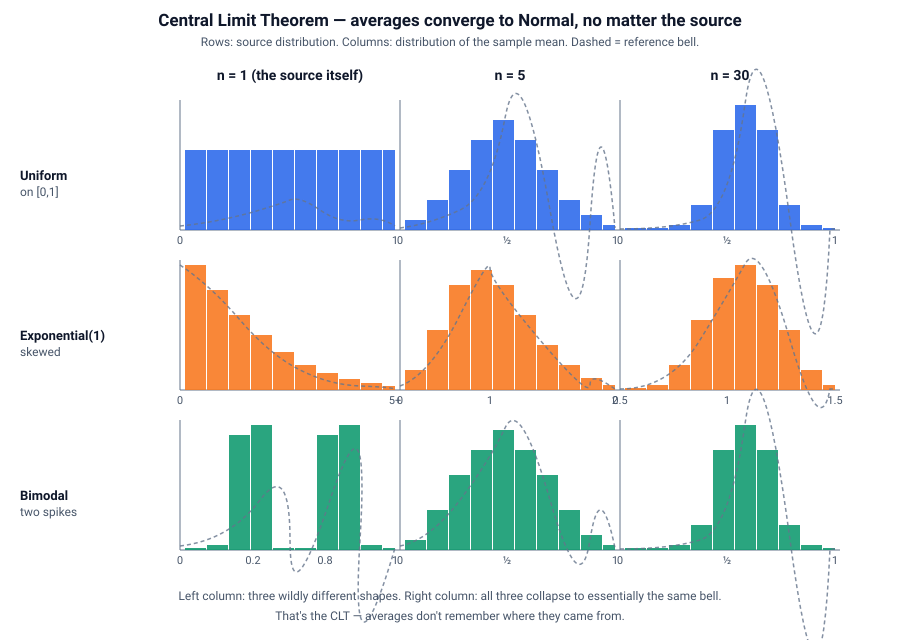
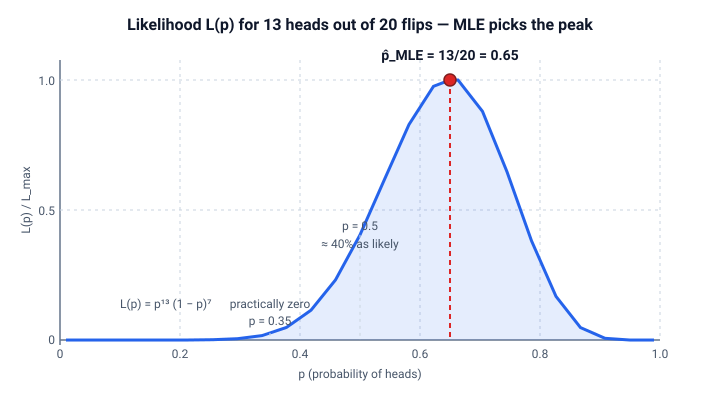
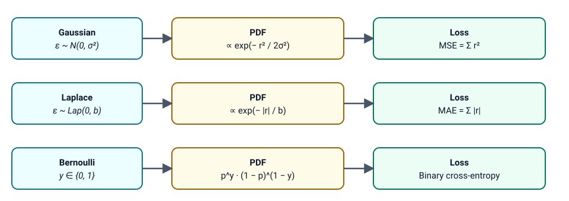
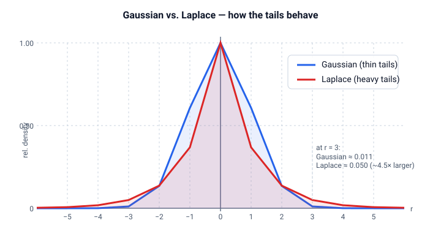
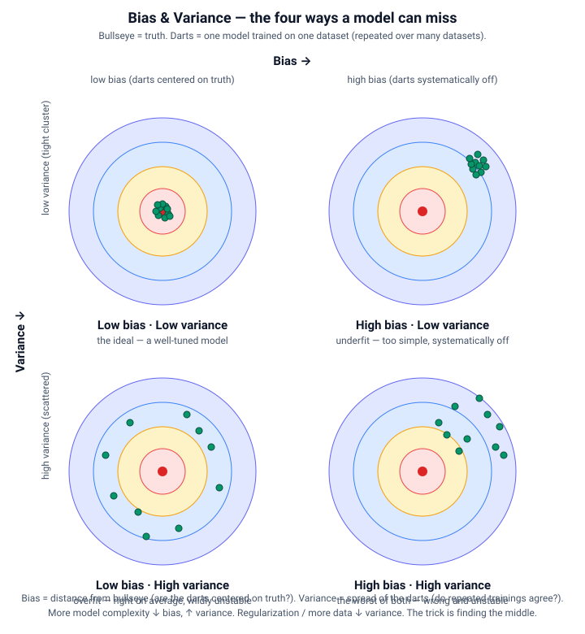

# Statistics & Probability for Machine Learning

> **How to read this note.** Each section starts with a *problem you'd actually face*, then walks toward the math that solves it. The formulas come *after* the intuition. If you find yourself reading a formula and not knowing where it came from, scroll up — the prior paragraph is where the formula was born.

## Why This Exists
**Problem.** You build a model. It claims an image is a cat with 94% confidence. What does that 94% *mean*? Could you bet money on it? You evaluate two models — one is 91% accurate, the other 92%. Is the second actually better, or did it just get lucky on this test set? You see a feature that *looks* correlated with the target. Is that signal you can use, or coincidence?

These are not engineering questions. They are statistical questions. ML without statistics is a black box that occasionally gives you numbers — and you have no language to argue with it.

**Key insight.** Machine learning *is* applied statistics. A loss function is a likelihood. Regularization is a prior. Cross-validation is a hypothesis test. Once you see this, ML stops being a bag of tricks and becomes one coherent thing.

**Reach for this when:**
- Picking a loss function (MSE? cross-entropy? Huber?) — the answer comes from "what's the noise distribution?"
- Interpreting a model's confidence — calibration, predictive intervals.
- Reading a paper that says "MLE", "posterior", "log-likelihood", "KL divergence".
- Debugging a model that overfits — bias-variance, regularization.
- Designing an A/B test or evaluating an experiment.

**Don't reach for this when:**
- You need matrix mechanics — go to [linear-algebra](linear-algebra.md).
- You need optimizer mechanics — go to [calculus](calculus.md).

## Diagrams



## 1. Why we need statistics at all: populations vs. samples

**The problem.** You want to know the average height of every adult on Earth. You can't measure all of them. So you measure a few thousand people and *hope* their average tells you something about everyone.

That gap — between "what we measured" (a sample) and "what we want to know about" (a population) — is the central problem of statistics. Every guarantee, error bar, and confidence interval is some statement about how far the sample can be from the truth.

**Reach for this:**
- The *population* is the full set of things you'd want a claim about. Often hypothetical or impossible to access.
- A *sample* is what you actually measured. ML training data is *always* a sample.
- A *sampling bias* is when the sample doesn't represent the population. This is the silent killer of ML projects: a face recognition model trained mostly on one demographic will fail on others, not because the math is wrong but because the sample wasn't the population it'll be deployed against.
- The bedrock assumption of supervised learning is that samples are **i.i.d.** — independent and identically distributed. In English: every example is drawn the same way, and one doesn't influence the next. Time series violate this. Data leakage between train and test violates this. Covariate shift (deployment data drifts away from training data) violates this.

If you forget every other word in this section, remember: **the model only knows the sample. You're trusting the sample to look like the world.**

## 2. Describing a sample: the bare minimum numbers

### Where is the data centered?

**The problem.** Two classes both averaged 70 on an exam. In one class, everyone got 70. In the other, half got 100 and half got 40. The "average" hides this. You need a number that says *roughly where* the data sits.

That's **central tendency**. Three options, each useful for different reasons:

- **Mean** — add up all the values, divide by count. Simple. But sensitive to outliers: one billionaire in a sample of 100 people obliterates the meaning of "average wealth."
  $$\mu = \frac{1}{n}\sum_{i=1}^n x_i$$

- **Median** — sort the data, take the middle value. Robust to outliers. The billionaire is still in the sample, but they don't drag the median up to a meaningless number.

- **Mode** — most frequent value. The only one that makes sense for categorical data ("most common eye color in the dataset").

**ML takeaway.** When you're imputing missing values, you're picking one of these. Numeric + symmetric data → mean. Numeric + skewed data → median. Categorical → mode. The right choice prevents your imputation from systematically distorting the distribution.

Watch mean vs. median react to a single outlier — one billionaire tacked onto nine ordinary incomes:

```python
import numpy as np
incomes = np.array([30, 35, 40, 42, 45, 48, 50, 55, 60, 1_000_000])  # last value = outlier
print(f"mean   = {np.mean(incomes):,.1f}")   # ~100,040 — dragged by outlier
print(f"median = {np.median(incomes):,.1f}") # 46.5 — unmoved
print(f"pop var  (ddof=0) = {np.var(incomes, ddof=0):,.1f}")
print(f"sample var (ddof=1) = {np.var(incomes, ddof=1):,.1f}")  # slightly larger
print(f"std = {np.std(incomes):,.1f}")
# Expected output:
# mean   = 100,040.5
# median = 46.5
# pop var  (ddof=0) = 89,991,900,254.1
# sample var (ddof=1) = 99,991,000,282.3
# std = 299,986.5
```

Takeaway: the mean shifts by orders of magnitude; the median barely moves. Sample variance (`ddof=1`) is always larger than population variance (`ddof=0`) by exactly the factor $n/(n-1)$.

### How spread out is the data?

**The problem.** "Average is 70" doesn't tell you whether it's "everyone got 70" or "half got 100, half got 40." We need a *spread* number.

**First attempt.** Average of all the deviations from the mean: $\frac{1}{n}\sum(x_i - \mu)$. Sounds reasonable. But the positives cancel the negatives — by definition, this is always zero. Useless.

**Second attempt.** Average of *absolute* deviations: $\frac{1}{n}\sum|x_i - \mu|$. Works, and it's even called the *mean absolute deviation*. Why don't we use it more?

**Third attempt.** Average of *squared* deviations:
$$\sigma^2 = \frac{1}{n}\sum_{i=1}^n (x_i - \mu)^2$$

This is **variance** (specifically the *population* variance, dividing by $n$). When estimating variance *from a sample*, you divide by $n-1$ instead — this is **Bessel's correction**, and it removes a systematic underestimate that comes from using the sample mean in place of the true mean. In numpy this is the difference between `np.var(x, ddof=0)` (population, the default) and `np.var(x, ddof=1)` (sample).

Two reasons we usually pick squared over absolute deviations:
1. Squaring is *differentiable everywhere*. Absolute value isn't (kink at zero). When ML wants to minimize spread via gradient descent, smooth functions cooperate; non-smooth functions don't. (See [calculus](calculus.md) for why this matters.)
2. Squaring penalizes big deviations *much more* than small ones. A deviation of 10 contributes 100 to variance; a deviation of 1 contributes 1. If you want a number that's *very upset* about outliers, variance is it.

The downside: variance is in *squared units* (squared dollars, squared centimeters), which doesn't mean anything to humans. So we usually report **standard deviation** $\sigma = \sqrt{\sigma^2}$ instead — same units as the data, easy to interpret.

To *see* what squaring does — and why it matters — compare the two side by side on the same eight points, one of which is an outlier:



**ML takeaway.** The reason MSE (mean squared error) is the default regression loss is exactly this: it's variance of the residuals. You're minimizing the spread of your prediction errors, weighting big errors much more than small ones. If you don't want that — if your data has heavy tails and big errors are *expected* — use mean absolute error or Huber loss instead.

### How are two variables related?

**The problem.** "When height goes up, weight tends to go up too." Can we put a number on "tends to"?

**Idea.** When $x$ is above its mean, is $y$ also above its mean? Multiply the two deviations and average them:

$$\text{Cov}(X, Y) = \frac{1}{n}\sum_{i=1}^n (x_i - \mu_X)(y_i - \mu_Y)$$

This is **covariance**:
- Positive ⇒ they tend to move together (above-average $x$ pairs with above-average $y$).
- Negative ⇒ they tend to move opposite.
- Zero ⇒ no linear relationship (could still be a nonlinear one!).

**Problem with covariance.** Its magnitude depends on the units. Covariance of (height in cm, weight in kg) is a different number from (height in mm, weight in kg) — but the relationship is the same. Useless for comparing across pairs.

**Fix.** Divide by both standard deviations to make it unitless:

$$\rho = \frac{\text{Cov}(X, Y)}{\sigma_X \sigma_Y}$$

This is **Pearson correlation**, always between $-1$ and $+1$:
- $+1$ — perfect linear relationship, going up.
- $-1$ — perfect, going down.
- $0$ — no linear relationship.

Verify on a small dataset with a clear positive relationship (`y ≈ 2x + noise`):

```python
import numpy as np
rng = np.random.default_rng(seed=0)
x = np.linspace(0, 10, 50)
y = 2 * x + rng.normal(0, 1.5, size=50)

cov_matrix = np.cov(x, y, ddof=1)     # 2x2 covariance matrix
corr_matrix = np.corrcoef(x, y)       # 2x2 correlation matrix
print(f"Cov(x, y) = {cov_matrix[0, 1]:.2f}")
print(f"Corr(x, y) = {corr_matrix[0, 1]:.3f}")

# Correlation by hand from the covariance and stds
by_hand = cov_matrix[0, 1] / (np.std(x, ddof=1) * np.std(y, ddof=1))
assert np.isclose(by_hand, corr_matrix[0, 1])
print(f"By hand match: {by_hand:.3f}")
# Expected output:
# Cov(x, y) = 19.24
# Corr(x, y) = 0.981
# By hand match: 0.981
```

Correlation lands near 0.98 — strong linear signal even with noise. The by-hand check shows correlation is *literally* covariance normalized by both standard deviations.

**ML takeaways.**
- The covariance matrix of your features (every pair's covariance, in a matrix) is the central object that PCA decomposes — see [linear-algebra](linear-algebra.md).
- Highly correlated features cause **multicollinearity** in linear regression — you can't tell which feature is doing the work, and the coefficients become unstable.
- **Correlation is not causation.** Ice cream sales correlate with drowning deaths (both rise in summer). A model that learned "more ice cream → more drownings" would be statistically right and substantively wrong. Always ask: is there a hidden third variable?


The dashed edge is what a naive correlation sees; the solid edges are what's actually happening. Always ask: what's the arrow into *both*?

## 3. From describing a sample to reasoning about uncertainty

The previous section was *descriptive*: given numbers, summarize them. Now we want *inferential*: given numbers, say something about what *would* happen.

To do that we need probability — a calculus of uncertainty.

### What is probability, exactly?

**The problem.** You flip a coin. Before it lands, you say "50% heads." What does that 50% mean? You can't observe a 50% — you observe heads or tails.

Two answers, both useful:
- **Frequentist.** "If you flipped this coin a million times, about 500,000 would be heads." Probability = long-run frequency.
- **Bayesian.** "I'm equally willing to bet on either side." Probability = degree of belief.

Most ML lives implicitly in a frequentist world (data is the source of truth) with occasional Bayesian flavor (priors, regularization).

### The minimal rules

A probability $P(A)$ is just a number satisfying:
1. $P(A) \geq 0$ — never negative.
2. $P(\text{anything happens}) = 1$ — total probability sums to 1.
3. If $A$ and $B$ can't both happen (disjoint), then $P(A \text{ or } B) = P(A) + P(B)$.

That's it. Everything else (independence, conditional probability, the entire field) is built on these three rules.

### Random variables and their "shapes"

**The problem.** "Probability of heads = 0.5" is fine for a coin. But what about height? Height is a continuous range — what's the probability someone is *exactly* 175.000... cm? Zero, because there are infinitely many possible heights.

So we don't talk about the probability of a *single value* for continuous things. We talk about the probability of a *range*.

A **random variable** is a function that turns outcomes into numbers (height of a randomly picked person, or 0/1 for a coin flip). The way its probabilities are distributed is described by:

- **PMF (Probability Mass Function)** for discrete variables: $P(X = x)$ — direct probability of each value. Roll of a fair die: $P(X = 1) = P(X = 2) = \dots = P(X = 6) = 1/6$.
- **PDF (Probability Density Function)** for continuous variables: $f(x)$ where $P(a \leq X \leq b) = \int_a^b f(x)\,dx$.
- **CDF (Cumulative Distribution Function)** for both: $F(x) = P(X \leq x)$.

**Crucial trap.** A PDF value is *not* a probability. It can be greater than 1. $f(x) = 5$ doesn't mean a 500% chance — it means probability per unit width. You only get a probability by integrating over a range.

### Joint, marginal, conditional — and why they matter

Given two random variables $X$ (e.g., having a disease) and $Y$ (e.g., test result):

- **Joint** $P(X, Y)$ — both at once. "I have the disease *and* the test is positive."
- **Marginal** $P(X)$ — ignore $Y$. "What fraction of people have the disease?" Get it by summing/integrating over the other variable.
- **Conditional** $P(X | Y)$ — given $Y$. "Given the test is positive, what's the chance I have the disease?"

These three quantities are linked by definition:
$$P(X | Y) = \frac{P(X, Y)}{P(Y)}$$

In English: "$X$ given $Y$" = "both" divided by "$Y$ alone." This obvious-looking formula is the key to Bayes' theorem next.

**Independence.** $X$ and $Y$ are independent ($X \perp Y$) if knowing one tells you nothing about the other. Equivalently: $P(X | Y) = P(X)$, or $P(X, Y) = P(X)P(Y)$.

**Expectation.** The "average value" of a random variable, weighted by its probabilities:
$$E[X] = \sum_x x \cdot P(X = x) \quad \text{or} \quad \int x f(x)\,dx$$

A wonderful, often-underused property: **linearity of expectation**.
$$E[aX + bY] = aE[X] + bE[Y]$$

This holds *even when $X$ and $Y$ are not independent*. It's a freebie that makes a lot of ML math much shorter than you'd expect.

## 4. Bayes' theorem: the formula you'll use forever

### The problem

You take a medical test that's "99% accurate." It comes back positive. Should you panic?

Most people say yes. The math says: probably not.

Here's why. Suppose:
- The disease is rare: 1% of people have it.
- The test is 99% sensitive (true positive rate among sick people).
- The test is 99% specific (true negative rate among healthy people).

Imagine 10,000 people. Roughly:
- 100 have the disease. Of those, 99 test positive (true positives), 1 negative.
- 9,900 are healthy. Of those, 99 test positive (false positives), 9,801 negative.

Total positives: $99 + 99 = 198$. Of those, only $99$ actually have the disease.

**Probability of disease given positive test = 99/198 ≈ 50%.**

A "99% accurate" test, when applied to a rare disease, leaves you with a coin flip. This isn't a math trick — it's how reality works, and people get it wrong constantly. (It has a name: the **base rate fallacy**.)

Compute it directly with Bayes' rule:

```python
p_disease = 0.01         # base rate (prior)
sensitivity = 0.99        # P(positive | disease)
specificity = 0.99        # P(negative | no disease)

# P(positive) via total probability
p_pos = sensitivity * p_disease + (1 - specificity) * (1 - p_disease)
# Bayes' rule
p_disease_given_pos = (sensitivity * p_disease) / p_pos
print(f"P(disease | positive) = {p_disease_given_pos:.3f}")  # ~0.500
# Expected output:
# P(disease | positive) = 0.500
```

The result: even with a 99%-accurate test, a positive result on a 1%-prevalence disease implies only ~50% chance of actually being sick. The prior dominates.

Here it is with every one of the 10,000 people drawn as a dot:


### What we just did, in a formula

We started with $P(\text{positive} | \text{disease})$ — probability of evidence given hypothesis. We wanted $P(\text{disease} | \text{positive})$ — the other direction. The bridge between them is **Bayes' theorem**:

$$P(H | D) = \frac{P(D | H) \cdot P(H)}{P(D)}$$

- $P(H | D)$ — **posterior**: probability of hypothesis given data.
- $P(D | H)$ — **likelihood**: probability of data given hypothesis.
- $P(H)$ — **prior**: probability of hypothesis before seeing data.
- $P(D)$ — **evidence** / total probability of data: just a normalizing constant.

In words: *"posterior is proportional to likelihood times prior."* The ML way to read it: **the model updates its belief by combining what it expected (prior) with what it saw (likelihood)**.

### Why this is the most important formula in ML

- **Naive Bayes classifier** literally is Bayes' theorem applied with a "features are independent" assumption.
- **Bayesian inference** is updating model parameters using Bayes' theorem on observed data.
- **MAP estimation** (next section) finds the best parameter under a prior — that's MLE plus a prior, which is just Bayes' rule again.
- **Regularization** can be derived as a prior (see Section 7).
- **Why your spam filter works**, why **medical diagnosis** is a probabilistic task, why **A/B testing** can be done Bayesianly.

If you remember one formula from this whole note, make it Bayes'.

### Watch belief actually shift: prior × likelihood → posterior

Concrete example: you have a coin and want to know $p = P(\text{heads})$. You start with a gentle prior — Beta(2, 2) — that says "probably fair, but I'm not confident." You flip 10 times and see 8 heads. The likelihood peaks at $p = 0.8$. Multiply, renormalize, and you get the posterior — Beta(10, 4), peaking around $p = 0.75$:


The posterior lands *between* the prior and the likelihood — a data-weighted compromise. With more flips the likelihood sharpens and the prior loses influence; with fewer flips the prior dominates. That is Bayes updating in one picture.

The Beta distribution is *conjugate* to the Bernoulli — after $h$ heads and $t$ tails, a Beta($\alpha, \beta$) prior becomes a Beta($\alpha + h, \beta + t$) posterior. No integration needed:

```python
from scipy import stats
# Prior: Beta(2, 2) — mild belief the coin is fair
alpha_prior, beta_prior = 2, 2
heads, tails = 8, 2

# Posterior: Beta(alpha + heads, beta + tails)
alpha_post, beta_post = alpha_prior + heads, beta_prior + tails

prior_mean = alpha_prior / (alpha_prior + beta_prior)
post_mean = alpha_post / (alpha_post + beta_post)
print(f"Prior:     Beta({alpha_prior}, {beta_prior}) mean = {prior_mean:.3f}")
print(f"Posterior: Beta({alpha_post}, {beta_post}) mean = {post_mean:.3f}")

# scipy agrees
assert np.isclose(stats.beta(alpha_post, beta_post).mean(), post_mean)
# Expected output:
# Prior:     Beta(2, 2) mean = 0.500
# Posterior: Beta(10, 4) mean = 0.714
```

Prior mean is 0.500 (fair coin); posterior mean shifts to ~0.714 — pulled toward the data (8/10 = 0.8) but tempered by the prior.

## 5. Common distributions: the "shapes" data tends to take

### The problem

Real-world data isn't an arbitrary jumble of numbers. It tends to follow a small number of recognizable shapes — bell curves, exponentials, counts. Knowing these shapes lets you:
- Pick the right model assumption (Gaussian noise? Bernoulli outcome?).
- Generate synthetic data.
- Reason about what's "extreme" (a 7-foot person is extreme; a $7$-billion-dollar net worth is extreme; the math for "extreme" depends on the shape).

So we name and parameterize the most common shapes.

### The most important continuous shape: the Normal (Gaussian)

You measure height. You measure noise on a sensor. You sum a bunch of small independent things. They all look bell-shaped — symmetric, peaking in the middle, tapering off in both directions. That's the Normal distribution:

$$f(x) = \frac{1}{\sqrt{2\pi}\sigma} \exp\left(-\frac{(x-\mu)^2}{2\sigma^2}\right)$$

The formula looks ugly, but the *picture* is the bell curve. Two parameters: $\mu$ (where it's centered) and $\sigma$ (how wide).

The 68-95-99.7 rule is worth memorizing: that fraction of values fall within 1, 2, 3 standard deviations of the mean.

**Why does Normal show up everywhere?** Because of the **Central Limit Theorem** (Section 6). It's not magic; it's a deep theorem about averaging.

### The most important discrete shape: Bernoulli / Binomial

A **Bernoulli** trial: one yes/no outcome with probability $p$. The flip of a coin, the click on an ad, the pass/fail of a single test. One parameter, $p$.

A **Binomial** is the count of yeses across $n$ Bernoulli trials. "Out of 100 emails, how many were spam?" Two parameters: $n$ and $p$.

Draw large samples and confirm the sample means match the theoretical ones. Theoretical means: Normal is $\mu$, Bernoulli is $p$, Poisson is $\lambda$:

```python
import numpy as np
rng = np.random.default_rng(seed=0)
N = 100_000

normal_samples = rng.normal(loc=5.0, scale=2.0, size=N)   # μ=5, σ=2
bernoulli_samples = rng.binomial(n=1, p=0.3, size=N)      # p=0.3
poisson_samples = rng.poisson(lam=4.0, size=N)            # λ=4

print(f"Normal:    theoretical μ=5.0,  sample mean={normal_samples.mean():.3f}")
print(f"Bernoulli: theoretical p=0.3,  sample mean={bernoulli_samples.mean():.3f}")
print(f"Poisson:   theoretical λ=4.0,  sample mean={poisson_samples.mean():.3f}")
# Poisson variance also equals λ — check:
print(f"Poisson variance ≈ λ: {poisson_samples.var():.3f}")
# Expected output:
# Normal:    theoretical μ=5.0,  sample mean=4.998
# Bernoulli: theoretical p=0.3,  sample mean=0.300
# Poisson:   theoretical λ=4.0,  sample mean=4.006
# Poisson variance ≈ λ: 4.035
```

All three sample means land within ~0.01 of the theoretical values. For Poisson, mean *equals* variance — a defining property.

### Quick reference — distributions you'll see in ML

| Distribution            | Shape / Models                         | When ML uses it                                    |
| ----------------------- | -------------------------------------- | -------------------------------------------------- |
| **Bernoulli**           | One yes/no                             | Binary classification target (cat / not-cat)       |
| **Binomial**            | Count of yeses in $n$ trials           | CTR models, A/B test analysis                      |
| **Categorical**         | One-of-K outcome                       | Multiclass labels (cat / dog / bird)               |
| **Multinomial**         | Counts across K outcomes in $n$ trials | Word counts, bag-of-words                          |
| **Uniform**             | All values equally likely              | Random initialization, sampling                    |
| **Normal (Gaussian)**   | Symmetric bell                         | Regression noise, NN weight init, latent variables |
| **Multivariate Normal** | Bell curve in many dimensions          | Latent variables, GMMs                             |
| **Exponential**         | Time between events                    | Survival analysis                                  |
| **Poisson**             | Count of rare events in fixed interval | Rare-event count regression                        |
| **Beta**                | Probability over $[0,1]$               | Bayesian prior to Bernoulli's $p$                  |
| **Dirichlet**           | Probability vector summing to 1        | LDA topic priors                                   |
| **Gamma**               | Positive continuous                    | Conjugate priors                                   |
| **Laplace**             | Sharp peak, heavy tails                | Connects to L1 regularization                      |

You don't need to memorize every formula. You need to know which shape to *reach for* when describing data. "This is bounded between 0 and 1 — Beta. This is a count — Poisson. This is a sum of small effects — Normal."

## 6. Why averages tend to look Normal: the Central Limit Theorem

### The problem

You flip a coin 1,000 times and count heads. You'd expect about 500. But what's the *distribution* of "number of heads across many such experiments"? Surprise: it's bell-shaped, even though each individual flip is binary.

Roll a die 1,000 times and average the results. The average distribution? Bell-shaped, even though each roll is uniform over 1–6.

Take *any* distribution — uniform, exponential, weird and lumpy — sample $n$ values from it, take the mean. As $n$ grows, the distribution of those means becomes Normal.

This is the **Central Limit Theorem**:

$$\sqrt{n}(\bar{X}_n - \mu) \xrightarrow{d} \mathcal{N}(0, \sigma^2)$$

**In plain English.** The sample mean of i.i.d. data approaches a Normal distribution as you collect more samples, no matter what shape the original data had.

Verify the $\sigma/\sqrt{n}$ shrinkage of the sample-mean's standard deviation. For Uniform(0, 1), the population $\sigma = 1/\sqrt{12} \approx 0.2887$:

```python
import numpy as np
rng = np.random.default_rng(seed=0)
sigma_pop = 1 / np.sqrt(12)  # true σ of Uniform(0, 1)
trials = 10_000

for n in [1, 5, 30]:
    sample_means = rng.uniform(0, 1, size=(trials, n)).mean(axis=1)
    theoretical_std = sigma_pop / np.sqrt(n)
    print(f"n={n:2d}: mean={sample_means.mean():.3f}, "
          f"std={sample_means.std():.4f}, "
          f"σ/√n={theoretical_std:.4f}")
# Expected output:
# n= 1: mean=0.499, std=0.2891, σ/√n=0.2887
# n= 5: mean=0.501, std=0.1287, σ/√n=0.1291
# n=30: mean=0.500, std=0.0529, σ/√n=0.0527
```

The mean stays near 0.5 (LLN); the std shrinks like $\sigma/\sqrt{n}$ — halving requires quadrupling the sample. That's why "double the data" only cuts your error bars by ~30%, not 50%.

The 3×3 grid below is the payoff — pick any source distribution (row), take averages of size $n$ (column), and watch the shape morph:



### Why this is the headline theorem of statistics

- **It explains why Normal is everywhere.** Anything that's an average or a sum of many small effects ends up Normal.
- **It's why "error bars" use $\pm 2\sigma/\sqrt{n}$.** Once you know the means are approximately Normal, the 95% confidence interval falls out for free.
- **It justifies the Gaussian noise assumption** in linear regression: if measurement error is the sum of many tiny independent effects, it's approximately Normal.
- **The Law of Large Numbers** is the simpler companion: as $n \to \infty$, $\bar{X}_n \to \mu$. This is why averaging over a mini-batch gives a useful gradient estimate in SGD — many noisy estimates average out to the truth.

## 7. From data to model parameters: Maximum Likelihood Estimation (MLE)

### The problem

Someone hands you a coin and flips it 20 times: **13 heads, 7 tails**. Is it fair? Biased? What's your best guess for $p$, the probability of heads?

You have data. You have a model (Bernoulli with unknown $p$). You want the "best" value of $p$. What does "best" even mean?

### The intuition — score each guess by how well it explains what happened

Try $p = 0.35$. Under that model, seeing 13 heads out of 20 would be a freakish accident. Try $p = 0.65$. Now those 13 heads are exactly what you'd expect. Try $p = 0.9$. Too extreme — you'd have expected more heads than you saw.

The **plausibility** of a given $p$ = the probability the model assigns to *the data you actually observed*. That number has a name: the **likelihood**.

$$L(p) = P(\text{data} \mid p) = p^{13} (1-p)^{7}$$

(13 heads each contribute a factor of $p$, 7 tails each contribute $1-p$; multiply.)

Note the flip in what's variable: the *data* is fixed (that's what you observed), and $p$ is the free parameter. $L(p)$ is a function of $p$. Plot it:



**The MLE recipe in one sentence:** pick the value that makes the observed data most likely — the peak of $L$.

$$\hat p_{\text{MLE}} = \arg\max_p L(p)$$

For this example, the peak is at $p = 0.65 = 13/20$. That's why we teach kids "13 out of 20 = 0.65" — it's literally MLE for a Bernoulli. Every empirical frequency you've ever computed was an MLE.

### The three moves that solve every MLE problem

Real MLE has more than one data point, and multiplying dozens or thousands of probabilities together underflows to zero in floating point. So there's a standard three-move dance:

**Move 1 — factorize (i.i.d.).** If the data points are independent, the joint likelihood is a product of per-point likelihoods:

$$L(\theta) = P(D \mid \theta) = \prod_{i=1}^n P(x_i \mid \theta)$$

**Move 2 — take the log.** Products become sums. Products of tiny numbers underflow; sums of `log(tiny)` are fine. And log is monotonic, so the argmax doesn't move.

$$\log L(\theta) = \sum_{i=1}^n \log P(x_i \mid \theta)$$

**Move 3 — set derivative to zero.** For a smooth likelihood, the peak is where $\frac{d \log L}{d\theta} = 0$. Solve for $\theta$; that's $\hat\theta_{\text{MLE}}$.

By convention we flip the sign and *minimize* the **negative log-likelihood (NLL)** instead — same optimum, and it aligns with the "loss" framing we use for gradient descent. That's the whole story: **NLL is the loss function of most probabilistic ML models.** Cross-entropy loss for a classifier is NLL under a categorical likelihood; MSE for a regressor is NLL under a Gaussian likelihood. More on that in the next subsection.

### Worked example 1 — coin flips (one parameter)

For our coin, $L(p) = p^{13}(1-p)^7$. Log it:

$$\log L(p) = 13 \log p + 7 \log(1 - p)$$

Differentiate and set to zero:

$$\frac{d \log L}{dp} = \frac{13}{p} - \frac{7}{1 - p} = 0 \;\;\Longrightarrow\;\; 13(1 - p) = 7 p \;\;\Longrightarrow\;\; \hat p = \frac{13}{20} = 0.65$$

The intuitive answer (heads-so-far over flips-so-far) falls out of the derivative — it wasn't a lucky guess. The general pattern: for $k$ heads out of $n$ flips, $\hat p_{\text{MLE}} = k/n$.

Verify in code:

```python
import numpy as np

n_heads, n_tails = 13, 7
p_grid = np.linspace(0.01, 0.99, 99)
L = p_grid**n_heads * (1 - p_grid)**n_tails
p_hat = p_grid[np.argmax(L)]

print(f"MLE by grid search:  p̂ = {p_hat:.3f}")
print(f"Closed-form (calc):  p̂ = {n_heads / (n_heads + n_tails):.3f}")
peak = L[np.argmax(L)]
at_half = L[np.argmin(np.abs(p_grid - 0.5))]
print(f"L(0.65) / L(0.5)  = {peak / at_half:.2f}× more likely")
# Expected output:
# MLE by grid search:  p̂ = 0.650
# Closed-form (calc):  p̂ = 0.650
# L(0.65) / L(0.5)  = 2.49× more likely
```

The grid-search peak and the calculus-derived answer agree. And the peak is only ~2.5× more likely than $p = 0.5$ — with only 20 flips there's *huge* uncertainty about whether the coin is really biased. MLE gives a point estimate but no uncertainty; you'd need a full posterior (next subsection) or a confidence interval (§9) for that.

### Worked example 2 — Gaussian sample (two parameters)

You have $n$ measurements $x_1, \ldots, x_n$ and want to fit a Normal $\mathcal{N}(\mu, \sigma^2)$. Same three moves.

**Factorize:**

$$L(\mu, \sigma^2) = \prod_{i=1}^n \frac{1}{\sqrt{2\pi\sigma^2}} \exp\!\left(-\frac{(x_i - \mu)^2}{2\sigma^2}\right)$$

**Log:**

$$\log L = -\frac{n}{2}\log(2\pi\sigma^2) \;-\; \frac{1}{2\sigma^2} \sum_{i=1}^n (x_i - \mu)^2$$

**Derivative in $\mu$**, set to zero — only the second term depends on $\mu$:

$$\frac{\partial \log L}{\partial \mu} = \frac{1}{\sigma^2}\sum_{i=1}^n (x_i - \mu) = 0 \;\;\Longrightarrow\;\; \hat\mu = \frac{1}{n}\sum_{i=1}^n x_i = \bar x$$

The MLE for the mean of a Gaussian is *the sample average*. That's not a coincidence — it's *because* we assumed Gaussian noise that "take the average" is the right thing to do. Under Laplace noise, the MLE for the center is the *median*, not the mean.

**Derivative in $\sigma^2$**, set to zero — both terms depend on it:

$$\frac{\partial \log L}{\partial \sigma^2} = -\frac{n}{2\sigma^2} + \frac{1}{2\sigma^4}\sum_{i=1}^n (x_i - \hat\mu)^2 = 0 \;\;\Longrightarrow\;\; \hat\sigma^2 = \frac{1}{n}\sum_{i=1}^n (x_i - \bar x)^2$$

Note the $\frac{1}{n}$, **not** $\frac{1}{n-1}$. MLE gives the *population* variance formula (`np.var(x, ddof=0)`). The $\frac{1}{n-1}$ "unbiased" version (`ddof=1`, Bessel's correction) is a different thing — it corrects for a small downward bias in MLE's variance estimate. MLE doesn't care about bias, only likelihood.

Verify in code:

```python
import numpy as np
rng = np.random.default_rng(seed=0)
true_mu, true_sigma = 5.0, 2.0
x = rng.normal(true_mu, true_sigma, size=1000)

mu_hat = x.mean()
sigma2_hat_mle = x.var(ddof=0)          # MLE — divides by n
sigma2_hat_unbiased = x.var(ddof=1)     # Bessel — divides by n-1
print(f"MLE μ̂  = {mu_hat:.3f}  (true = {true_mu})")
print(f"MLE σ̂² = {sigma2_hat_mle:.3f}  (true = {true_sigma**2})")
print(f"Unbiased σ̂² = {sigma2_hat_unbiased:.3f}")
# Expected output:
# MLE μ̂  = 4.904  (true = 5.0)
# MLE σ̂² = 3.816  (true = 4.0)
# Unbiased σ̂² = 3.820
```

MLE variance is *slightly* smaller than the unbiased version — that's the bias Bessel corrects. Both converge to the truth as $n \to \infty$.

**Zoom out.** Every MLE problem is these same three moves. Only the algebra of Move 3 changes. Once you can do it for the coin and the Gaussian by hand, you can do it for anything — and once you know the answer is called "the loss function," the whole zoo of ML losses stops being a zoo.

### The connection that unlocks loss design

Different assumed noise distributions yield different MLE losses:

| Assumed noise distribution    | Loss derived from MLE               |
| ----------------------------- | ----------------------------------- |
| Gaussian on regression target | **Mean Squared Error (MSE)**        |
| Laplace on regression target  | **Mean Absolute Error (MAE)**       |
| Bernoulli on binary target    | **Binary cross-entropy** (log loss) |
| Categorical on multiclass     | **Categorical cross-entropy**       |
| Poisson on count target       | **Poisson NLL**                     |

**The big realization.** Picking a loss function = picking a noise distribution. If your residuals are heavy-tailed, MSE (Gaussian assumption) is wrong — it overweights outliers because the Gaussian thinks big residuals are very unlikely. Try Huber loss or MAE.

#### Where does this table come from?

For regression, we model $y = f_\theta(x) + \epsilon$. The noise $\epsilon$ is the random junk making predictions miss. We *choose* a distribution for $\epsilon$ — Gaussian is only the default, not a law of nature.

Once you pick that distribution, MLE mechanically produces the loss. The recipe is always the same four steps:


Each row of the table above is that recipe applied to a different PDF:



Walk through Gaussian → MSE explicitly:

$$P(y_i \mid x_i, \theta) = \frac{1}{\sqrt{2\pi}\sigma}\exp\!\left(-\frac{(y_i - f_\theta(x_i))^2}{2\sigma^2}\right)$$

Take log: $\log P = -\frac{(y_i - f_\theta(x_i))^2}{2\sigma^2} + \text{const}$. Sum, flip sign, drop constants:

$$\text{NLL} \propto \sum_i (y_i - f_\theta(x_i))^2$$

That's MSE. The **squared** term isn't a design choice — it fell out of the Gaussian's exponent. Same drill for Laplace gives $|r|$ (that's MAE), for Bernoulli gives $-y\log p - (1-y)\log(1-p)$ (that's binary cross-entropy).

So "I chose MSE" and "I assumed my residuals are Gaussian" are the **same statement**. Same optimization problem, same $\hat\theta$.

#### Why MSE panics at outliers, and MAE doesn't

Look at how fast each PDF decays as the residual grows. Both are normalized so their peak at zero is 1:

| \|residual\| | Gaussian ∝ e^(−r²/2) | Laplace ∝ e^(−\|r\|) |
| ------------ | -------------------- | -------------------- |
| 0            | 1.000                | 1.000                |
| 1            | 0.607                | 0.368                |
| 2            | 0.135                | 0.135                |
| 3            | 0.011                | 0.050                |
| 4            | 0.0003               | 0.018                |
| 5            | 0.000004             | 0.0067               |
| 6            | 0.00000001           | 0.0025               |

A residual of 5 is "1 in 270,000" under Gaussian, but "1 in 150" under Laplace. When MLE encounters that residual under the Gaussian assumption, the model literally believes it shouldn't have happened — so it rewrites $\theta$ hard to shrink that one residual, even if that worsens fit on the other honest points.

The two shapes side by side (both peak at zero):



#### The loss shapes MLE actually minimizes

That tail behavior propagates into the shape of the loss itself. Per-example loss as a function of residual $r$:

| $r$  | MSE = $r^2$ | MAE = $\|r\|$ | Huber ($\delta$ = 1) |
| ---- | ----------- | ------------- | -------------------- |
| 0    | 0           | 0             | 0                    |
| 0.5  | 0.25        | 0.5           | 0.125                |
| 1    | 1           | 1             | 0.5                  |
| 2    | **4**       | 2             | 1.5                  |
| 3    | **9**       | 3             | 2.5                  |
| 5    | **25**      | 5             | 4.5                  |
| 10   | **100**     | 10            | 9.5                  |

MSE grows **quadratically** — one point with $r = 10$ contributes as much loss as a hundred points with $r = 1$. A single outlier drowns out 100 good points. MAE grows **linearly** — an outlier's vote is bounded. Huber is quadratic near zero (efficient on the bulk) and linear far away (tolerant of outliers).


#### Huber loss — the pragmatic middle

**The problem.** MSE is smooth and gradient-friendly but panics at outliers. MAE ignores outliers but has a kink at zero — the gradient jumps from $-1$ to $+1$ across the origin, which makes optimization noisy near the minimum. You want the *smoothness of MSE for the well-behaved bulk* and the *tolerance of MAE for the tails*.

**The fix.** Glue them together at some threshold $\delta$:

$$
L_\delta(r) = \begin{cases}
\tfrac{1}{2} r^2 & \text{if } |r| \le \delta \\[2pt]
\delta\bigl(|r| - \tfrac{1}{2}\delta\bigr) & \text{if } |r| > \delta
\end{cases}
$$

Quadratic inside the "trust region" $[-\delta, \delta]$; linear outside. The $-\tfrac{1}{2}\delta$ term inside the linear branch isn't magic — it's what makes the two pieces meet smoothly at $|r| = \delta$ (both the value and the first derivative are continuous there). That C¹ continuity is why Huber is gradient-friendly everywhere, unlike MAE's kink.

**What $\delta$ controls.** It's the "how big does a residual have to be before I stop trusting it as normal noise?" knob.
- **Small $\delta$** (e.g. 0.5·σ of clean residuals) → most residuals treated as outliers → Huber behaves close to MAE.
- **Large $\delta$** (e.g. 5·σ) → almost every residual is inside the quadratic region → Huber behaves close to MSE.
- **Standard rule of thumb:** $\delta \approx 1.345 \cdot \hat\sigma$ (Huber's own recommendation) gives 95% asymptotic efficiency vs MSE when the data really is Gaussian, plus robustness when it isn't.

**Probabilistic interpretation.** In the MLE frame we've been using, MSE ↔ Gaussian noise, MAE ↔ Laplace noise. Huber corresponds to a noise distribution that's **Gaussian in the middle and Laplace in the tails** — the noise model you'd write down if you believed *most* observations are clean but some fraction are contaminated by heavy-tailed junk.

**Trying it out.**

```python
import numpy as np

def huber(r, delta=1.0):
    r = np.asarray(r, dtype=float)
    quad = 0.5 * r**2
    lin = delta * (np.abs(r) - 0.5 * delta)
    return np.where(np.abs(r) <= delta, quad, lin)

r = np.array([0, 0.5, 1, 2, 3, 5, 10])
print("MSE  ", 0.5 * r**2)
print("MAE  ", np.abs(r))
print("Huber", huber(r, delta=1.0))
# Expected output:
# MSE   [ 0.     0.125  0.5    2.     4.5   12.5   50.   ]
# MAE   [ 0.   0.5  1.   2.   3.   5.  10. ]
# Huber [0.    0.125 0.5   1.5   2.5   4.5   9.5  ]
```

At $r = 10$: MSE contributes 50, MAE contributes 10, Huber contributes 9.5 — Huber matches MAE's growth rate for big residuals while keeping MSE's smoothness for small ones. (This snippet uses $\tfrac{1}{2}r^2$ so the quadratic-region math lines up with the definition above; the earlier table showed $r^2$ directly.)

**Where you'll meet it.** `sklearn.linear_model.HuberRegressor`, `scipy.special.huber`, PyTorch's `nn.SmoothL1Loss` (that's Huber with $\delta = 1$ rebranded), object-detection heads in Faster/Mask R-CNN and RetinaNet (the "smooth L1" for bounding-box regression). Robust statistics uses the same idea under the name *M-estimation*.

**Common pitfalls.**
- **Picking $\delta$ by eyeball on the training set** — do it on a validation split or use a robust scale estimate like $\hat\sigma = 1.4826 \cdot \text{MAD}$ (median absolute deviation).
- **Forgetting $\delta$ isn't scale-invariant** — if you standardize your target, you also have to rescale $\delta$, or its meaning flips.
- **Treating Huber as a silver bullet** — if outliers dominate (say >30% of the data is contaminated), the linear tail still lets them tilt the fit. At that point you want a redescending M-estimator like Tukey's biweight, which sends the loss to a constant in extreme tails.

#### What this does to a fit line

Five points on a line, one bad sensor reading:


MSE sees $r^2$ blow up and bends $\theta$ to reduce that one residual, even though it worsens fit on the four honest points. MAE weights the outlier the same as any residual of comparable size and stays flat.

#### The decision, as a flow


The habit worth building: before you pick a loss, **look at the residuals**. Losses are noise assumptions in disguise. Match the assumption to the data.

### Adding a prior: from MLE to MAP and regularization

**Problem with MLE.** Sometimes there isn't enough data to nail down $\theta$. MLE will pick whatever fits the limited data best, even if that's a wild solution.

**Fix.** Use Bayes' theorem to combine the data-driven likelihood with a prior belief — a built-in preference for "reasonable" $\theta$:

$$\hat\theta_{\text{MAP}} = \arg\max_\theta P(D | \theta) P(\theta)$$

Take logs: minimize $-\log P(D|\theta) - \log P(\theta)$. The first term is the data fit (the loss you already had). The second term is a penalty for $\theta$ being far from what the prior considers "reasonable."

This is **regularization**. And it's the *same idea* as Bayesian inference, just kept as a point estimate.

| Prior on $\theta$ | Equivalent regularizer |
|---|---|
| Gaussian $\mathcal{N}(0, \sigma^2)$ | **L2** regularization (ridge) — penalizes $\sum \theta_i^2$ |
| Laplace $\text{Lap}(0, b)$ | **L1** regularization (lasso) — penalizes $\sum |\theta_i|$ |

This explains a famous behavior: L1 produces *sparse* solutions (many zero coefficients), L2 doesn't. The Laplace prior has a sharp peak (non-differentiable kink) at zero, giving it a strong preference for exact zeros; the Gaussian is smooth and rounded at zero, so it only shrinks coefficients toward zero without setting them to it. The geometry of this is in [linear-algebra](linear-algebra.md) (the L1 ball has corners on the axes).

## 8. Why models fail to generalize: bias and variance

### The problem

You train a model. It nails the training set. On the test set, it bombs. Why?

Or: your training error and test error are both high. Different problem. Why?

These two failure modes are the bias-variance trade-off, and they're worth understanding deeply.

### The decomposition

For a model $\hat{f}(x)$ trying to predict $y = f(x) + \varepsilon$ where $\varepsilon$ is noise:

$$E[(y - \hat{f}(x))^2] = \underbrace{(E[\hat{f}(x)] - f(x))^2}_{\text{Bias}^2} + \underbrace{\text{Var}(\hat{f}(x))}_{\text{Variance}} + \underbrace{\sigma^2}_{\text{Irreducible}}$$

The expected squared error breaks into three pieces. Each one tells you something different.

- **Bias** — on average across many possible training sets, how far is your model from the truth? High bias = your model is *systematically* wrong (too simple — straight line trying to fit a curve). This is **underfitting**.
- **Variance** — how much does your model change when you change the training set? High variance = your model latches onto noise (too flexible — fitting every wiggle in the data). This is **overfitting**.
- **Irreducible noise** — the part you can't beat. Even a perfect model has some error because the world has randomness.

The dartboard picture makes bias and variance concrete — each dart is one model trained on one dataset; repeated training gives the whole pattern:



### Measure it in code

Fit a low-complexity model (degree-1 polynomial) and a high-complexity model (degree-10) on many bootstrap resamples. Evaluate each at a fixed test point $x^\* = 0.75$ (where $\sin(2\pi x^\*) = -1$). Compute $\text{Bias}^2$ (systematic offset from truth) and $\text{Variance}$ (spread across resamples):

```python
import numpy as np
rng = np.random.default_rng(seed=0)

def true_f(x):
    return np.sin(2 * np.pi * x)

n = 30                                    # training set size
x_star = np.array([0.75])                 # single test point
y_star_true = true_f(x_star)[0]           # = -1
n_bootstraps = 500

def predictions(degree):
    preds = []
    for _ in range(n_bootstraps):
        x_train = rng.uniform(0, 1, size=n)
        y_train = true_f(x_train) + rng.normal(0, 0.2, size=n)
        coef = np.polyfit(x_train, y_train, degree)
        preds.append(np.polyval(coef, x_star)[0])
    return np.array(preds)

for deg in [1, 10]:
    preds = predictions(deg)
    bias_sq = (preds.mean() - y_star_true) ** 2
    variance = preds.var()
    print(f"degree={deg:2d}: bias²={bias_sq:.4f}, variance={variance:.4f}, "
          f"total={bias_sq + variance:.4f}")
# Expected output:
# degree= 1: bias²=0.2646, variance=0.0179, total=0.2825
# degree=10: bias²=0.0001, variance=0.0189, total=0.0191
```

Degree-1 has high bias² (~0.26 — a line can't hit $-1$ at $x=0.75$ while averaging through 0-mean noise) and low variance. Degree-10 has near-zero bias² but higher variance (each bootstrap fits a wildly different curve). The two failure modes trade off — that's the whole story.

### Why this is a *trade-off*

Make the model more complex (more parameters, more flexibility) → bias goes down (it can fit more shapes), variance goes up (it fits the noise too).

Make the model simpler → bias goes up, variance goes down.

You're looking for the sweet spot. Tools that pull toward the bias side: regularization, simpler models, more data. Tools that pull toward the variance side: more parameters, more features.

### Modern caveat

This trade-off is the classical story for small models. Large neural networks routinely have low bias *and* low variance once they're heavily overparameterized — a phenomenon called **double descent**. For practical purposes, the trade-off remains a useful diagnosis tool: high training error → bias problem, low training error + high test error → variance problem.

## 9. Hypothesis testing: is this difference real?

### The problem

You ran A/B test. Variant B converted at 5.2%, variant A at 5.0%. Is B actually better, or did random variation produce that gap by chance?

You compared two models. One scored 91%, one 92%. Real improvement, or noise?

You added a feature. Loss dropped slightly. Worth keeping?

These all reduce to: *given some randomness, can I trust this difference?*

### The classical (frequentist) workflow

1. State a **null hypothesis** $H_0$ — "there's no difference; both variants convert the same."
2. State an **alternative** $H_1$ — "there is a difference."
3. Pick a **test statistic** — a number summarizing the data (e.g., difference in observed conversion rates).
4. Figure out the distribution of that statistic *if $H_0$ were true*. (This is the hard part. Tools like the t-test, z-test, chi-squared test give you closed-form answers for common cases.)
5. Compute the **p-value**: probability of seeing a statistic at least as extreme as observed, *assuming $H_0$*. A tiny p-value means "if $H_0$ were true, we'd almost never see data this extreme."
6. If $p < \alpha$ (typically 0.05), **reject** $H_0$.

### What the p-value is *not*

- It is *not* the probability that the null is true.
- It is *not* the probability that your effect is real.
- It is $P(\text{data this extreme} | H_0 \text{ is true})$ — and that's a different conditional than people instinctively read.

### Two errors to be aware of

| | Reality: $H_0$ true | Reality: $H_0$ false |
|---|---|---|
| You decide to reject $H_0$ | **Type I** (false positive) — rate $\alpha$ | Correct |
| You decide not to reject | Correct | **Type II** (false negative) — rate $\beta$ |

- **Power** = $1 - \beta$ — the chance of detecting a real effect. Small samples = low power = you'll miss real effects.

The two shaded tails below are exactly $\alpha$ and $\beta$. The dashed line is the decision threshold; sliding it left or right trades one error for the other:


### Confidence intervals

Reporting "95% CI: [4.8%, 5.6%]" is more useful than "p = 0.03." Both are saying similar things, but the CI tells you the *range of plausible values* for the parameter — not just whether to reject one specific number.

A frequentist 95% CI: "if you ran this experiment many times, 95% of the constructed intervals would contain the true parameter." Subtle and famously misread (people instinctively think it means "95% chance the true value is in this interval" — that's a *Bayesian credible interval*, philosophically distinct, practically often equivalent).

### ML twins of statistical sins

- **p-hacking** = running many tests, reporting only significant ones. ML version: trying many architectures and reporting the best test-set number → test-set overfitting.
- **Multiple comparisons** = running 20 tests at $\alpha = 0.05$ gives ~1 false positive even under all-null. Use Bonferroni or FDR correction.

## 10. Linear regression: the simplest "real" model

### The problem

You have features $X$ and a target $y$. You believe (or hope) that $y$ is roughly a linear function of $X$, plus some noise. Find the best linear function.

### Build it from intuition

Linear in the features means: $\hat{y} = \beta_0 + \beta_1 x_1 + \beta_2 x_2 + \dots = X\beta$ (in matrix form, including a bias column).

"Best fit" means: minimize the sum of squared errors $\sum_i (y_i - \hat{y}_i)^2$.

We pick squared errors not because they're "obvious" but because (Section 7) MSE is the MLE under a Gaussian noise assumption. If we set up the problem as $y = X\beta + \varepsilon$ with $\varepsilon \sim \mathcal{N}(0, \sigma^2 I)$ and solve $\arg\max_\beta P(y | X, \beta)$, we get exactly: minimize $\|y - X\beta\|^2$.

Take the derivative, set to zero, and you get a closed-form solution:

$$\hat\beta = (X^TX)^{-1} X^T y$$

This is the **Normal Equation**. Geometrically, it's the *projection* of $y$ onto the column space of $X$ — the closest point to $y$ that the model is capable of producing. (See [linear-algebra](linear-algebra.md) for the projection picture.)

Verify that MSE-minimization and Gaussian-NLL-minimization return the *same* $\hat\beta$:

```python
import numpy as np
rng = np.random.default_rng(seed=0)
n = 100
X = np.column_stack([np.ones(n), rng.normal(size=n)])  # bias column + one feature
true_beta = np.array([1.0, 2.0])
sigma = 0.5
y = X @ true_beta + rng.normal(0, sigma, size=n)

# Method 1: least-squares
beta_ls, *_ = np.linalg.lstsq(X, y, rcond=None)

# Method 2: minimize Gaussian NLL directly
#   NLL = n/2 · log(2πσ²) + (1/2σ²) · Σ(y − Xβ)²
# For fixed σ, this is minimized by the same β as MSE.
resid = y - X @ beta_ls
mse = (resid ** 2).mean()
nll = 0.5 * n * np.log(2 * np.pi * sigma**2) + resid @ resid / (2 * sigma**2)
print(f"β̂ (least squares) = {beta_ls}")     # ≈ [1.0, 2.0]
print(f"MSE = {mse:.4f}, NLL = {nll:.2f}")
print(f"NLL = (const) + MSE·n/(2σ²): "
      f"{0.5*n*np.log(2*np.pi*sigma**2) + mse*n/(2*sigma**2):.2f}")
# Expected output:
# β̂ (least squares) = [0.97248127 2.02754144]
# MSE = 0.2276, NLL = 68.11
# NLL = (const) + MSE·n/(2σ²): 68.11
```

The NLL is MSE plus additive constants that don't depend on $\beta$ — so *any* $\beta$ that minimizes MSE also minimizes NLL. That's what "MSE = MLE under Gaussian" means numerically.

### What we assumed without saying so

The closed-form solution + standard inferences (p-values on coefficients, confidence intervals) rest on assumptions:

1. **Linearity** — the relationship between features and target is, well, linear.
2. **Independence** of observations.
3. **Homoscedasticity** — error variance is constant across $X$.
4. **Normality of errors** — for inference (CIs, p-values). Not strictly needed just for prediction.
5. **No perfect multicollinearity** — features aren't linearly dependent (else $X^TX$ is singular and you can't invert).

Violations don't always kill you, but they invalidate the *uncertainty* claims about coefficients. Use diagnostic plots (residuals vs. fitted, QQ plots).

### When OLS isn't enough: regularized variants

When the model is unstable (multicollinearity) or has too many features for the data, plain OLS coefficients go wild. The fix is regularization — equivalent (Section 7) to adding a prior:

- **Ridge regression** — adds $\lambda \|\beta\|_2^2$. Shrinks all coefficients, never to zero. Prior: Gaussian.
- **Lasso** — adds $\lambda \|\beta\|_1$. Drives some coefficients exactly to zero (feature selection!). Prior: Laplace.
- **Elastic Net** — mixes both.

## 11. Logistic regression: the bridge to classification

### The problem

You want to predict a binary outcome — spam or not, click or not. You can't just use linear regression: it'll predict negative values and values bigger than 1, neither of which is a probability.

### Build it from intuition

What we want: the model's output should be in $[0, 1]$, interpretable as $P(y=1 | x)$.

What we have: a linear combination $z = x^T\beta$, which is a real number on $(-\infty, \infty)$.

We need to *squash* $z$ into $[0, 1]$. The standard squashing function is the **sigmoid**:

$$\sigma(z) = \frac{1}{1 + e^{-z}}$$

It's S-shaped: $\sigma(-\infty) = 0$, $\sigma(0) = 0.5$, $\sigma(+\infty) = 1$. Smooth, differentiable everywhere.

So: $P(y=1 | x) = \sigma(x^T\beta)$.

### Why sigmoid (not some other squash)?

Take the inverse. The **logit** (log-odds) is:
$$\log\frac{P(y=1)}{P(y=0)} = x^T\beta$$

So logistic regression is "linear in log-odds." A unit increase in feature $x_j$ multiplies the *odds* of $y=1$ by $e^{\beta_j}$. This is the standard interpretation people use when communicating logistic regression results.

### The loss

By Section 7 (MLE for a Bernoulli outcome), the loss falls out as **binary cross-entropy** / log loss:

$$\mathcal{L} = -\sum_i \left[y_i \log \hat{p}_i + (1 - y_i) \log(1 - \hat{p}_i)\right]$$

If $y_i = 1$, the loss is $-\log \hat{p}_i$ — small when the model said high probability of class 1. If $y_i = 0$, the loss is $-\log(1 - \hat{p}_i)$ — small when the model said low probability of class 1. So pushing the right way reduces loss, in both cases.

### The catch

Unlike OLS, **there's no closed-form solution** for logistic regression. You must optimize numerically — gradient descent, Newton's method, or IRLS. This is why it's the natural bridge to neural networks: same loss family, just optimized iteratively. See [calculus](calculus.md) for the optimization side.

## 12. Information theory in two pictures

### Why ML cares

Cross-entropy is everywhere — it's what every classifier minimizes. But where does cross-entropy *come from*? From a beautifully physical idea: **information**.

### Entropy: how surprised should you be?

**The problem.** A weather app says "70% rain." If it rains, you're a little surprised but not shocked. If it had said "1% rain" and it rains, you'd be very surprised.

So: information content of an event = how surprised you are. Mathematically, surprise should be:
- Bigger when the event is unlikely.
- Zero for certain events.
- Additive for independent events (two independent surprises = total surprise).

The function that satisfies all three is: $\text{surprise}(x) = -\log P(x)$.

The **entropy** of a distribution is the *expected surprise*:
$$H(X) = -\sum_x P(x) \log P(x)$$

A uniform distribution has the highest entropy (you can never predict the outcome). A spike at one value has zero entropy (you always know what's coming).

### Cross-entropy: the cost of using the wrong distribution

**Problem.** You think the data follows distribution $Q$ (your model). The true distribution is $P$. How "expensive" is your model's mismatch with reality?

The expected number of bits needed to encode samples from $P$ using a code that's optimal for $Q$:
$$H(P, Q) = -\sum_x P(x) \log Q(x)$$

If $Q = P$, cross-entropy equals entropy — minimum cost. The further $Q$ is from $P$, the higher the cost.

**ML connection.** When training a classifier, $P$ is the true label distribution (often a one-hot vector — all probability on the true class), $Q$ is your model's prediction. Cross-entropy loss is *literally measuring how badly your model's distribution differs from the truth*.

### KL divergence: how different are two distributions?

$$D_{KL}(P \| Q) = \sum_x P(x) \log \frac{P(x)}{Q(x)} = H(P, Q) - H(P)$$

Cross-entropy minus entropy. Always $\geq 0$, zero iff $P = Q$. **Not symmetric** — $D_{KL}(P\|Q) \neq D_{KL}(Q\|P)$.

Verify all three quantities by hand and against `scipy.stats.entropy`:

```python
import numpy as np
from scipy import stats

P = np.array([0.7, 0.2, 0.1])   # true distribution
Q = np.array([0.5, 0.3, 0.2])   # model distribution

# By hand — using natural log (nats). scipy.stats.entropy uses natural log by default.
H_P = -np.sum(P * np.log(P))                    # entropy of P
H_PQ = -np.sum(P * np.log(Q))                   # cross-entropy H(P, Q)
KL_PQ = np.sum(P * np.log(P / Q))               # D_KL(P || Q)
KL_QP = np.sum(Q * np.log(Q / P))               # asymmetry check

print(f"H(P)         = {H_P:.4f}")
print(f"H(P, Q)      = {H_PQ:.4f}")
print(f"D_KL(P || Q) = {KL_PQ:.4f}")
print(f"D_KL(Q || P) = {KL_QP:.4f}   (≠ D_KL(P || Q) — asymmetric)")

# scipy check
assert np.isclose(stats.entropy(P), H_P)
assert np.isclose(stats.entropy(P, Q), KL_PQ)   # note: this is KL, not cross-entropy!
# Identity: H(P, Q) = H(P) + D_KL(P || Q)
assert np.isclose(H_PQ, H_P + KL_PQ)
# Expected output:
# H(P)         = 0.8018
# H(P, Q)      = 0.8869
# D_KL(P || Q) = 0.0851
# D_KL(Q || P) = 0.0920   (≠ D_KL(P || Q) — asymmetric)
```

Note the scipy gotcha: `stats.entropy(P, Q)` returns *KL divergence*, not cross-entropy. The identity `H(P, Q) = H(P) + D_KL(P||Q)` is why minimizing cross-entropy loss (with fixed one-hot $P$) is equivalent to minimizing KL — $H(P)$ is constant.

**ML uses:**
- **VAEs** (variational autoencoders) — loss has a "KL to prior" term.
- **Variational inference** — approximate intractable posteriors by minimizing KL.
- **Reinforcement learning** — policy regularization, often a KL constraint between old and new policy (TRPO, PPO).
- **Distillation** — train a small model to match a big model's output distribution by minimizing KL.

## Trade-offs

- **Frequentist vs. Bayesian.** Frequentist: parameters are fixed, data is random. Bayesian: parameters have distributions, posteriors describe belief. Bayesian is more principled and gives uncertainty for free; it's also slower and harder to compute. Most ML is implicitly frequentist, with occasional Bayesian flavor (priors as regularizers, MC dropout for uncertainty).
- **MLE vs. MAP vs. full Bayesian.** MLE: point estimate, no prior. Cheap, the default. MAP: point estimate + prior. Adds regularization. Full Bayesian: posterior distribution over parameters, uncertainty everywhere. Expensive but unbeatable when calibration matters.
- **Parametric vs. non-parametric models.** Parametric (linear regression, neural nets) have fixed-size parameter vectors. Non-parametric (kNN, kernel methods, Gaussian processes) grow with the data. Parametric is faster at scale; non-parametric is more flexible but doesn't scale to huge datasets.

## Common Pitfalls

- **Confusing PDF with probability.** $f(x) = 5$ does not mean a 500% chance. It means probability per unit width — only meaningful when integrated.
- **Misinterpreting p-values.** A p-value is *not* the probability the null is true. It's $P(\text{data} | H_0)$, full stop.
- **Multiple comparisons.** 20 tests at $\alpha = 0.05$ → ~1 false positive even when nothing's there. Use Bonferroni / FDR correction.
- **Correlation = causation.** They aren't equal. Always ask about confounders.
- **i.i.d. violation in time series.** Random train/test splits leak the future into training. Always split temporally.
- **Trusting confidence intervals as credible intervals.** They're philosophically different (frequentist vs. Bayesian) and occasionally numerically different. Be careful with very small samples or non-Normal posteriors.
- **MLE without enough data.** With limited data, MLE picks degenerate solutions (a Gaussian fit to one point has zero variance). Use MAP / regularization.
- **Picking MSE for heavy-tailed targets.** MSE assumes Gaussian noise. Outliers will bully your model. Try MAE or Huber.

## Decision Table
| Scenario | Tool | Why |
|----------|------|-----|
| Continuous target, residuals look bell-shaped | Linear regression with MSE | MLE under Gaussian noise |
| Binary target | Logistic regression / NN with sigmoid + BCE | MLE under Bernoulli |
| Multiclass target | Softmax + cross-entropy | MLE under Categorical |
| Heavy-tailed residuals | Huber / MAE / Laplace likelihood | MSE is bullied by outliers |
| Want feature selection | L1 (lasso) | Laplace prior pushes coefficients to zero |
| Want gentle shrinkage | L2 (ridge) | Gaussian prior shrinks but doesn't zero out |
| Need calibrated uncertainty | Bayesian inference / MC dropout / ensembles | Point estimates don't quantify uncertainty |
| Comparing two models on one test set | Paired t-test / McNemar | Account for the same items |
| Reporting accuracy with error bars | Bootstrap CI / CLT-based CI | Error bars *are* the statistical claim |

## References
- [*Mathematics for Machine Learning* — Deisenroth et al. (free PDF)](https://mml-book.github.io/) — Chapters 6 (probability) and 8 (continuous optimization).
- [*An Introduction to Statistical Learning* — James, Witten, Hastie, Tibshirani](https://www.statlearning.com/) — Ch. 3 (linear regression), Ch. 4 (logistic regression / classification). Readable, applied.
- [Khan Academy — Statistics & Probability](https://www.khanacademy.org/math/statistics-probability) — full free curriculum, perfect for shoring up gaps.
- [*Deep Learning* — Goodfellow, Bengio, Courville](https://www.deeplearningbook.org/) — Chapter 3 (probability) is the cleanest deep-learning-flavored intro.
- [Mathematics for Machine Learning Specialization (Coursera)](https://www.coursera.org/specializations/mathematics-machine-learning) — formal coverage, with PCA capstone.

## See Also
- [Math for ML — Roadmap](INDEX.md)
- [linear-algebra](linear-algebra.md) — covariance matrices, regression as projection, the geometry behind L1 vs. L2
- [calculus](calculus.md) — how the models in this note actually get fit
