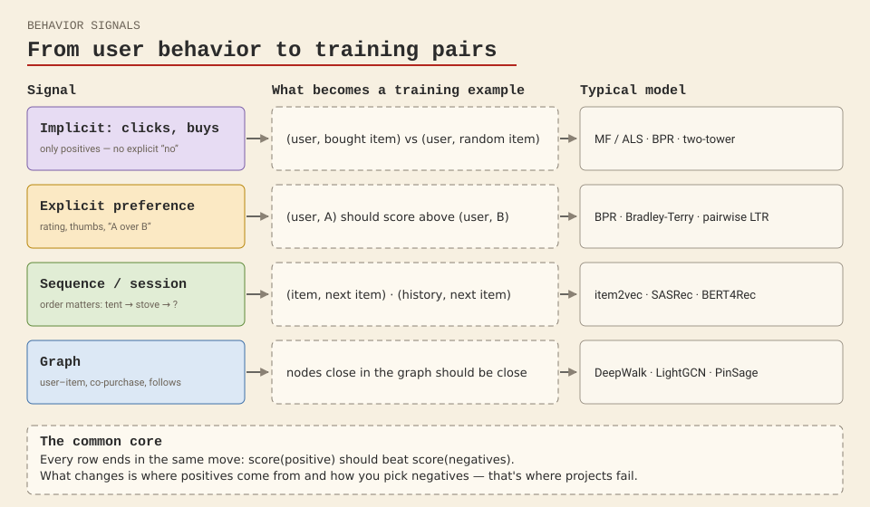
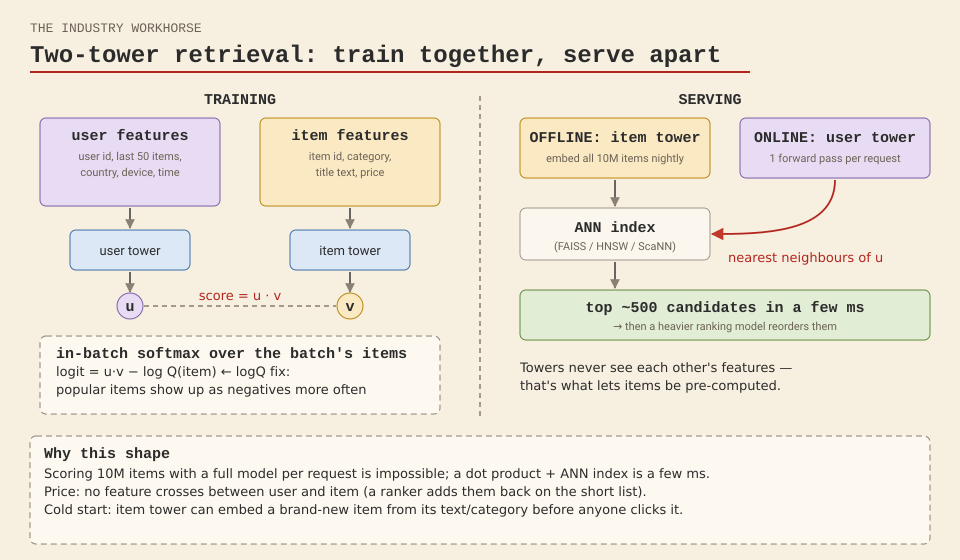

# Embeddings from Behavior Signals

> **How to read this note.** It builds on [embedding-training](embedding-training.md): there, "similar" came from text pairs; here it comes from **what people do** — buy, click, rate, watch in sequence. The training move is the same (positive should outscore negatives). What changes is where positives come from, how you pick negatives and how you evaluate. Sections 2–5 cover one signal type each; read only the ones you need. Sections 6–7 (cold start, evaluation) apply to all of them.

## Why This Exists

**Problem.** You have transaction logs, ratings or sessions and want embeddings for users and items: for recommendations, "customers also bought", personalized search or as features for another model. The naive version — treat every purchase as 1 and everything else as 0, then fit something — quietly learns "recommend the bestsellers", leaks the future into training and can't handle a product added yesterday.

**Key insight.** Behavior embeddings are contrastive learning where **the pair is (user or context, item they chose)** and **the negatives are items they didn't choose**. Almost every method is a variation on *which pairs*, *which negatives* and *how much to trust each signal*. The hard parts are biases in the logs (popularity, position, feedback loops), not the model.

**Reach for this when:**
- Building candidate retrieval for recommendations (home feed, "for you", similar items).
- Turning purchase or click logs into user/item vectors for downstream models.
- Learning from preferences (ratings, thumbs, pairwise choices).
- Modeling sessions or sequences ("what's next in the basket").
- Recommendations are dominated by popular items and you need to know why.

**Don't reach for this when:**
- Similarity should mean *content meaning* (same topic, paraphrase) — use [embedding-training](embedding-training.md).
- You have tiny data (a few hundred users). A popularity list or simple co-occurrence counts will beat any learned embedding.
- You need final ranking with rich features — embeddings are for *retrieval*; a separate ranker (GBDT or deep model on many features) usually orders the short list.

## Diagrams



## 1. The one idea, mapped from text embeddings

| Text embeddings | Behavior embeddings |
|---|---|
| query | user (or user's recent history, or the current item) |
| passage | item |
| (query, relevant passage) | (user, item they bought / clicked / rated high) |
| in-batch negatives = other passages | in-batch negatives = other users' items |
| hard negatives = BM25 near misses | shown-but-not-clicked, same-category items |

Same InfoNCE / softmax loss, same in-batch matrix ([embedding-training](embedding-training.md) §2). Everything below is about adapting it to messy behavior data.

## 2. Implicit feedback — clicks, purchases, transactions

**The defining problem: you only see positives.** A purchase says "yes". A missing purchase does *not* say "no" — the user may never have seen the item. So you can't train "0 = dislike". Three standard ways around it:

### Weighted matrix factorization (ALS)
Give each user a vector $u$ and each item a vector $v$; predict $u \cdot v \approx 1$ for interactions and $\approx 0$ otherwise, but **weight observed pairs by confidence** $c = 1 + \alpha \cdot \text{count}$ and unobserved pairs weakly. Solved with alternating least squares (fix items, solve users in closed form; swap). Fast, strong, still a great baseline (Hu, Koren & Volinsky 2008).

### BPR — learn to rank, not to predict 0/1
Bayesian Personalized Ranking samples triples (user $u$, bought item $i$, random item $j$) and only asks for $s_{ui} > s_{uj}$:

$$\mathcal{L}_{\text{BPR}} = -\log \sigma(u\cdot v_i - u\cdot v_j)$$

"Item I bought should beat a random item" is a much weaker — and more honest — claim than "random item = 0".

```python
import numpy as np
rng = np.random.default_rng(0)
U, I, d = 20, 10, 4                                  # users 0-9 like items 0-4, users 10-19 like 5-9
bought = {u: set(rng.choice(5, 3, replace=False) + (0 if u < 10 else 5)) for u in range(U)}
P, Q = 0.1 * rng.normal(size=(U, d)), 0.1 * rng.normal(size=(I, d))
for _ in range(50000):
    u = rng.integers(U); i = rng.choice(list(bought[u])); j = rng.integers(I)
    if j in bought[u]: continue                      # j must be an item u did NOT buy
    g = 1 / (1 + np.exp(P[u] @ (Q[i] - Q[j])))       # gradient weight of -log sigmoid(s_ui - s_uj)
    pu = P[u].copy()
    P[u] += 0.05 * (g * (Q[i] - Q[j]) - 0.01 * P[u])
    Q[i] += 0.05 * (g * pu - 0.01 * Q[i]); Q[j] += 0.05 * (-g * pu - 0.01 * Q[j])
unseen = [k for k in range(I) if k not in bought[0]]
print("user 0 bought:", sorted(int(k) for k in bought[0]))
print("scores on unseen:", {k: round(float(P[0] @ Q[k]), 1) for k in unseen})
print("mean unseen sci-fi:", np.mean([P[0] @ Q[k] for k in (0, 1)]).round(2), " mean cooking:", np.mean([P[0] @ Q[k] for k in range(5, 10)]).round(2))
# Expected output:
# user 0 bought: [2, 3, 4]
# scores on unseen: {0: 0.7, 1: -0.3, 5: -0.6, 6: -0.8, 7: -4.5, 8: -3.1, 9: -1.9}
# mean unseen sci-fi: 0.19  mean cooking: -2.2
```

User 0 never touched items 0–1, but other sci-fi buyers did, so they score above every cooking item. That transfer through other users *is* collaborative filtering.

### Two-tower model — the industry workhorse
Replace "one free vector per user/item ID" with two neural networks: a **user tower** (ID, recent history, country, device, time) and an **item tower** (ID, category, title text, price). Score = dot product. Train with in-batch softmax over each batch's items.



**The logQ correction.** In-batch negatives are other users' clicks, so a popular item shows up as a negative in proportion to its popularity. Without correction, the model over-punishes popular items during training. The fix (Yi et al. 2019): subtract $\log Q(\text{item})$ — the item's sampling probability — from each logit **during training only**.

```python
import numpy as np
rng = np.random.default_rng(0)
pop = np.array([0.6, 0.3, 0.1])                       # share of all clicks per item
neg = np.zeros(3)
for _ in range(10000):
    batch = rng.choice(3, size=8, p=pop)              # in-batch negatives = the other clicks in the batch
    neg += np.bincount(batch, minlength=3)            # bincount: occurrences of 0, 1, 2
print("how often each item is a negative:", (neg / neg.sum()).round(2))
s = np.array([2.0, 2.0, 2.0])                         # raw scores for one user
print("logQ-corrected training logits:  ", (s - np.log(pop)).round(2))
# Expected output:
# how often each item is a negative: [0.6 0.3 0.1]
# logQ-corrected training logits:   [2.51 3.2  4.3 ]
```

The popular item appears as a negative 6× as often as the rare one. The correction offsets that per item. At serving time you use the raw $u\cdot v$.

## 3. Explicit preferences — ratings, thumbs, "A over B"

- **Ratings (1–5 stars):** classic MF regresses $u\cdot v + b_u + b_i \approx r$ with squared error (the Netflix Prize model). It works, but ratings are rare and biased: people rate what they chose to watch, and mostly when they loved or hated it.
- **Pairwise preferences:** if the user picked A over B (thumbs-up vs thumbs-down, chose one of two, clicked rank 3 but skipped rank 1), train $s_A > s_B$. That's the **Bradley–Terry** model — the same logistic-on-the-gap form as BPR, and the same loss a reward model or DPO uses for LLM preference data.

```python
import numpy as np
# A preference "A over B" = logistic on the score gap (Bradley-Terry; same form as BPR and the DPO loss)
s_a, s_b = 1.2, 0.4
p_a = 1 / (1 + np.exp(-(s_a - s_b)))
print("P(A preferred):", p_a.round(3), " loss:", (-np.log(p_a)).round(3))
# Expected output:
# P(A preferred): 0.69  loss: 0.371
```

- **Combine signals by weight, not by mixing labels:** a purchase is worth more than an add-to-cart, which is worth more than a click. Use per-example weights or separate tasks rather than one 0/1 label.

## 4. Sequences and sessions — order matters

### item2vec / prod2vec — word2vec on sessions
Treat each session (or a user's purchase history) as a sentence and each item as a word. Items that appear near each other get similar vectors. Then train skip-gram with negative sampling (word2vec) on these pairs:

```python
# item2vec / prod2vec: sessions are "sentences", items are "words"
sessions = [["tent", "stove", "lantern"], ["tent", "sleeping_bag", "stove"], ["flour", "sugar", "butter"]]
window = 1                                            # neighbours within 1 step count as context
pairs = [(s[i], s[j]) for s in sessions for i in range(len(s)) for j in range(len(s))
         if i != j and abs(i - j) <= window]
print(len(pairs), pairs[:4])
# Expected output:
# 12 [('tent', 'stove'), ('stove', 'tent'), ('stove', 'lantern'), ('lantern', 'stove')]
```

Cheap, gives great "similar items", but item-only — no user vector, and order inside the window is ignored.

### SASRec / BERT4Rec — a transformer over item IDs
**SASRec** is a GPT over a user's item history: the same causal-masked self-attention as in [transformer-forward-pass](../math-for-ml/transformer-forward-pass.md), with item IDs as tokens. Train it on next-item prediction with sampled softmax. The last position's hidden state is the **user embedding**; the item embedding table holds the **item embeddings**. **BERT4Rec** is the masked (BERT-style) version.

Use these when order really matters (episodes, playlists, shopping journeys). For "people who bought X bought Y" without order, MF or item2vec is usually as good and much cheaper.

## 5. Graphs — users, items and their connections

Behavior logs are a bipartite graph: user —bought→ item. Graph methods let information travel multiple hops ("users like you" → "items they liked").

- **DeepWalk / node2vec:** generate random walks on the graph, feed them to word2vec as sentences. Same trick as item2vec, with walks instead of sessions.
- **LightGCN:** start with ID embeddings and repeatedly average each node with its neighbours (normalized by degree), then average the layers. No weights, no nonlinearity — just smoothing over the graph:

```python
import numpy as np
# LightGCN-style propagation: users who share items end up mixed together
R = np.array([[1, 1, 0],                              # user A bought items 0, 1
              [0, 1, 1]])                             # user B bought items 1, 2
A = np.block([[np.zeros((2, 2)), R], [R.T, np.zeros((3, 3))]])   # bipartite graph, 5 nodes
deg = A.sum(1)
A_hat = A / np.sqrt(np.outer(deg, deg))               # symmetric normalisation D^-1/2 A D^-1/2
E0 = np.eye(5)                                        # one-hot start: row = "who contributed"
E = (E0 + A_hat @ E0 + A_hat @ A_hat @ E0) / 3        # average of 0, 1, 2 hops
print("user A mixes in [A, B, i0, i1, i2]:", E[0].round(2))
# Expected output:
# user A mixes in [A, B, i0, i1, i2]: [0.58 0.08 0.24 0.17 0.  ]
```

User A now contains a bit of user B (two hops, via the shared item 1) but nothing of item 2, which is three hops away. Train the starting embeddings with BPR on top.
- **PinSage:** GraphSAGE-style sampling + content features, built for billions of nodes at Pinterest.

## 6. Cold start and features

ID embeddings exist only for IDs seen in training. A product listed this morning has no vector.

- **Put content into the item tower** (title text embedding from [embedding-training](embedding-training.md), category, price, image embedding). New items get a vector from their features alone.
- **ID dropout:** randomly drop the ID feature during training so the tower learns to work from content alone.
- **New users:** use context (device, country, the item they're viewing now) and the first few interactions; fall back to popularity per segment.
- **Hash rare IDs** into shared buckets so the long tail doesn't get untrained random vectors.

## 7. Evaluation — where most behavior projects fool themselves

- **Split by time, not at random.** Train on everything before date T, test on after. A random split lets the model see a user's future to predict their past.
- **Leave-last-out** (each user's last interaction is the test) is the common offline protocol; keep the catalog as of that time.
- **Compute metrics over the full catalog.** "Rank the true item among 100 random negatives" (sampled metrics) can reorder which model looks best.
- **Always report a popularity baseline.** With power-law data it's embarrassingly strong:

```python
import numpy as np
rng = np.random.default_rng(0)
# Popularity is a brutal baseline when clicks follow a power law
items = 1000
p = 1 / np.arange(1, items + 1); p /= p.sum()         # Zipf: item k has weight 1/k
test = rng.choice(items, size=5000, p=p)              # held-out next clicks
top10 = np.argsort(-p)[:10]                           # "recommend the 10 most popular"
print("popularity recall@10:", np.isin(test, top10).mean().round(3))
# Expected output:
# popularity recall@10: 0.393
```

A model with recall@10 = 0.35 here would be *worse than no personalization*. Also report coverage (how much of the catalog ever gets recommended) and recall on long-tail items.
- **Offline metrics only estimate.** Final call is an online A/B test, because the logs only contain what the old system chose to show.

## Trade-offs

- **ID embeddings vs feature towers.** Pure ID models (MF, item2vec) are simple and strong for items with history but useless for cold start. Feature towers handle new items but are heavier to build and serve.
- **Pointwise vs pairwise vs softmax losses.** Pointwise (predict 0/1 or rating) is simple but needs fake negatives. Pairwise (BPR) is honest about implicit data but sees one negative per step. Softmax (in-batch / sampled) sees many negatives at once and is the modern default, but needs bias corrections like logQ.
- **Sequence models vs bag-of-items.** SASRec captures order and recency at the cost of training and serving complexity. For most "also bought" problems order adds little.
- **Graph propagation.** Multi-hop smoothing helps sparse users but over-smooths (everyone drifts toward the popular core) and makes incremental updates harder.
- **Debiasing vs relevance.** Correcting popularity raises long-tail exposure, sometimes at a short-term CTR cost. Decide what you're optimizing for.

## Common Pitfalls

- **Treating "not purchased" as "disliked".** Most missing pairs are unseen, not rejected. Use confidence weights, BPR or sampled softmax — never dense 0 labels with full weight.
- **Random train/test split.** Leaks the future (and duplicates of the same session) into training. Split by time.
- **No popularity baseline.** Without it you can't tell a working model from a bestseller list (see §7).
- **Uncorrected in-batch negatives.** Popular items get over-penalized as negatives, distorting the space. Apply the logQ correction or mix in uniformly sampled negatives.
- **Feedback loops.** The model trains on clicks from items the *previous* model chose to show, so it keeps re-recommending them. Log what was shown, add exploration, and consider propensity weighting.
- **Position bias as preference.** Rank 1 gets clicked because it's rank 1. Use "shown but skipped" as negatives carefully, or model position explicitly.
- **Bots and power users.** A handful of accounts with thousands of interactions can dominate training. Cap interactions per user or downweight them.
- **Fancy model before solid MF.** Well-tuned matrix factorization often matches neural recommenders (Rendle et al. 2020). Get the baseline right first.

## Decision Table

| Scenario | Use this | Not that | Why |
|----------|----------|----------|-----|
| Purchase/click logs, mostly returning users, first version | Weighted ALS or BPR matrix factorization | Deep two-tower first | Strong, fast, few knobs; sets the bar |
| Large catalog, many new items, rich metadata | Two-tower with content features + logQ-corrected in-batch softmax | Pure ID embeddings | Item tower embeds new items from features |
| "Customers also bought" / similar items | item2vec on sessions or co-purchase pairs | Full user model | Item–item is all you need; cheap to retrain |
| Order matters (playlists, episodes, journeys) | SASRec / BERT4Rec | Bag-of-items MF | Self-attention over the sequence uses order and recency |
| Sparse users, rich graph structure | LightGCN / PinSage on the user–item graph | Plain MF | Multi-hop neighbours fill in sparse histories |
| Pairwise choices / thumbs up-down | Bradley–Terry / BPR pairwise loss | Rating regression | Pairs are what was actually observed |
| Content meaning, not preference | [embedding-training](embedding-training.md) | Behavior logs | Co-purchase ≠ same meaning |

## References

- [Hu, Koren & Volinsky — Collaborative Filtering for Implicit Feedback Datasets (2008)](http://yifanhu.net/PUB/cf.pdf) — confidence-weighted MF / ALS.
- [Rendle et al. — BPR: Bayesian Personalized Ranking from Implicit Feedback (2009)](https://arxiv.org/abs/1205.2618)
- [Covington et al. — Deep Neural Networks for YouTube Recommendations (2016)](https://research.google/pubs/deep-neural-networks-for-youtube-recommendations/) — candidate generation + ranking split.
- [Yi et al. — Sampling-Bias-Corrected Neural Modeling for Large Corpus Item Recommendations (2019)](https://research.google/pubs/sampling-bias-corrected-neural-modeling-for-large-corpus-item-recommendations/) — two-tower + logQ correction.
- [Huang et al. — Embedding-based Retrieval in Facebook Search (2020)](https://arxiv.org/abs/2006.11632) — two-tower in production; hard-negative lessons.
- [Mikolov et al. — word2vec: Distributed Representations of Words and Phrases (2013)](https://arxiv.org/abs/1310.4546) — skip-gram with negative sampling.
- [Barkan & Koenigstein — Item2Vec (2016)](https://arxiv.org/abs/1603.04259)
- [Grbovic et al. — E-commerce in Your Inbox: Product Recommendations at Scale (prod2vec, 2015)](https://arxiv.org/abs/1606.07154)
- [Kang & McAuley — SASRec: Self-Attentive Sequential Recommendation (2018)](https://arxiv.org/abs/1808.09781)
- [Sun et al. — BERT4Rec (2019)](https://arxiv.org/abs/1904.06690)
- [Perozzi et al. — DeepWalk (2014)](https://arxiv.org/abs/1403.6652)
- [Grover & Leskovec — node2vec (2016)](https://arxiv.org/abs/1607.00653)
- [He et al. — LightGCN (2020)](https://arxiv.org/abs/2002.02126)
- [Ying et al. — PinSage: Graph Convolutional Neural Networks for Web-Scale Recommender Systems (2018)](https://arxiv.org/abs/1806.01973)
- [Rendle et al. — Neural Collaborative Filtering vs. Matrix Factorization Revisited (2020)](https://arxiv.org/abs/2005.09683) — well-tuned dot-product MF is hard to beat.

## See Also

- [embedding-training](embedding-training.md) — InfoNCE, in-batch and hard negatives, pooling, evaluation basics.
- [transformer-forward-pass](../math-for-ml/transformer-forward-pass.md) — the causal self-attention SASRec runs over item IDs.
- [markov-chains](../math-for-ml/markov-chains.md) — random walks (DeepWalk) and PageRank on graphs.
- [linear-algebra](../math-for-ml/linear-algebra.md) — matrix factorization, SVD, dot-product scoring.
