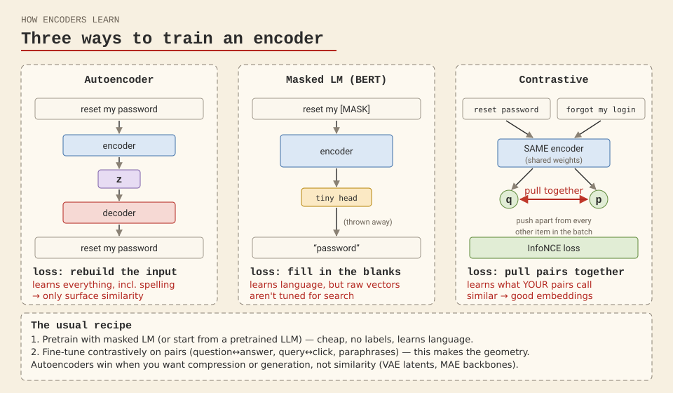
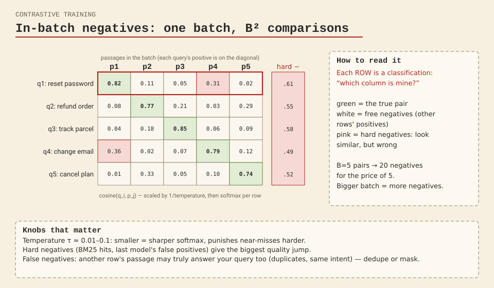

# Training an Encoder for Embeddings

> **How to read this note.** It answers one question: *"to get an encoder that produces good embeddings, do we train an autoencoder and keep the encoder?"* Short answer: usually not. Section 1 shows why. Sections 2–5 give the standard recipe. If your similarity signal comes from **user behavior** (clicks, purchases, ratings) instead of text pairs, read this note first, then [behavioral-embeddings](behavioral-embeddings.md).

## Why This Exists

**Problem.** "Embedding" sounds like a by-product: train any encoder, take its hidden vector, done. In practice raw encoder vectors (an autoencoder's bottleneck, BERT's `[CLS]`) are poor for search. Two sentences that mean the same thing can land far apart, and two that share words but mean different things land close. You only notice once retrieval quality is bad and nobody can say why.

**Key insight.** An embedding space only has the geometry you *trained* it to have. Reconstruction trains "keep enough to rebuild the input". Contrastive learning trains "things in a pair are close, everything else is far". If you want similarity, train for similarity: **pretrain cheaply, then fine-tune contrastively on pairs that define what "similar" means for you.**

**Reach for this when:**
- Building semantic search, RAG retrieval, dedup, clustering, or "more like this".
- An off-the-shelf embedder (BGE, E5, OpenAI) underperforms on your domain and you're deciding whether to fine-tune.
- Someone proposes "train an autoencoder and use the bottleneck as the embedding".
- Choosing pooling (CLS vs mean vs last token), temperature, batch size, or negatives.

**Don't reach for this when:**
- The similarity signal is user behavior (clicks, buys, ratings, sessions) — see [behavioral-embeddings](behavioral-embeddings.md).
- You want compression or generation (VAE latents, image tokenizers) — there an autoencoder *is* the right tool.
- A general pretrained embedder already scores well on *your* eval set — don't train anything.

## Diagrams



## 1. Why not just train an autoencoder?

**The idea.** Encoder squeezes the input to a vector $z$, decoder rebuilds the input from $z$, loss = reconstruction error. Keep the encoder.

**The problem.** Reconstruction rewards keeping whatever is needed to *rebuild the exact input*: which words, in which order. It never says "these two inputs mean the same thing". So $z$ ends up organized by **surface overlap**. "Reset my password" and "forgot my login" share one word, so they're far apart. "Reset my password" and "reset my router" share two, so they're close.

You can see it with the optimal *linear* autoencoder, which is exactly PCA:

```python
import numpy as np
# Reconstruction keeps SURFACE similarity: PCA = the optimal linear autoencoder
docs = ["reset my password", "forgot my login", "reset my router", "bake a cake"]
vocab = sorted({w for d in docs for w in d.split()})
X = np.array([[d.split().count(w) for w in vocab] for d in docs], float)
Xc = X - X.mean(0)
U, S, Vt = np.linalg.svd(Xc, full_matrices=False)   # top-k right singular vectors = linear AE weights
Z = Xc @ Vt[:2].T                                     # 2-d "autoencoder" embedding
cos = lambda a, b: a @ b / np.linalg.norm(a) / np.linalg.norm(b)
print("password~login :", cos(Z[0], Z[1]).round(2))
print("password~router:", cos(Z[0], Z[2]).round(2))
# Expected output:
# password~login : -0.44
# password~router: 1.0
```

A deep, nonlinear autoencoder doesn't fix this. Nothing in its loss knows that "password" and "login" are related.

**Where "train with a decoder, keep the encoder" does happen.**
- **MAE** (masked autoencoder for images): rebuild masked patches, drop the decoder. Gives a strong *backbone for fine-tuning*, but its raw features are weaker for nearest-neighbour search than contrastive/DINO features.
- **T5-style encoder-decoders**: pretrained with a decoder; Sentence-T5 keeps the encoder and then *still* fine-tunes contrastively.
- **VAEs / image tokenizers**: the goal is compression, so reconstruction is the point.

## 2. The standard recipe: pretrain, then contrastive fine-tune

### Stage 1 — pretrain (learn the language, no labels)

| Option | What it is | Used by |
|---|---|---|
| Masked LM | Hide ~15 % of tokens, predict them with a tiny head that's thrown away | BERT, RoBERTa → most classic embedders |
| Start from a decoder LLM | Take a pretrained GPT-style model; use its last-token hidden state | E5-Mistral, GTE-Qwen, NV-Embed |
| Weakly-supervised contrastive pretraining | Contrastive on huge noisy pairs scraped from the web (title↔body, question↔answer) | E5, BGE, GTE |

This gives an encoder that *understands* text. Its vectors aren't yet arranged for similarity.

### Stage 2 — contrastive fine-tuning (this creates the geometry)

Take pairs $(q_i, p_i)$ that should be close. Encode both with the **same encoder** (a *bi-encoder*). For each query, the right passage must beat every other passage in the batch:

$$\mathcal{L} = -\frac{1}{B}\sum_{i=1}^{B} \log \frac{\exp(\cos(q_i, p_i)/\tau)}{\sum_{j=1}^{B} \exp(\cos(q_i, p_j)/\tau)}$$

That's **InfoNCE**: a $B$-way softmax classification per row, "which column is mine?". The other rows' passages are **in-batch negatives** — free.



```python
import numpy as np
rng = np.random.default_rng(0)
def info_nce(q, p, temp):
    q = q / np.linalg.norm(q, axis=1, keepdims=True); p = p / np.linalg.norm(p, axis=1, keepdims=True)
    logits = q @ p.T / temp                          # (B, B): row i vs every passage in the batch
    logits -= logits.max(1, keepdims=True)           # stable log-softmax
    logp = logits - np.log(np.exp(logits).sum(1, keepdims=True))
    return -np.diag(logp).mean()                     # the matching passage sits on the diagonal
B, d = 8, 32
q = rng.normal(size=(B, d))
rand, close = rng.normal(size=(B, d)), q + 0.5 * rng.normal(size=(B, d))
print("chance level log(B):", np.log(B).round(2))
for t in (1.0, 0.05):
    print(f"temp={t}: random {info_nce(q, rand, t):.2f}   aligned {info_nce(q, close, t):.3f}")
# Expected output:
# chance level log(B): 2.08
# temp=1.0: random 2.08   aligned 1.331
# temp=0.05: random 4.66   aligned 0.000
```

Read it: with random pairs the loss sits at chance ($\log B$). Small $\tau$ makes the softmax sharp, so being right scores near 0 and being wrong costs a lot. Typical $\tau$ is 0.01–0.1.

**No labelled pairs?** *SimCSE* passes the same sentence through the encoder twice. Dropout makes the two vectors slightly different, and that pair is the positive. It works surprisingly well as a start, but real pairs beat it.

## 3. Where the pairs come from

The pairs *are* your definition of similarity, so this is the most important design choice.

| Source | Pair | Teaches |
|---|---|---|
| Q&A data, FAQ, support tickets | question ↔ answer | asymmetric retrieval (short query → long passage) |
| Search logs | query ↔ clicked doc | what users actually wanted (noisy, position-biased) |
| Document structure | title ↔ body, heading ↔ section | topical similarity, free at scale |
| Paraphrase / NLI / duplicate questions | sentence ↔ paraphrase | symmetric "same meaning" |
| LLM-generated | synthetic query ↔ your passage | domain adaptation when you have docs but no queries |
| User behavior | user ↔ item, item ↔ co-bought item | preference, not meaning — see [behavioral-embeddings](behavioral-embeddings.md) |

## 4. Negatives — where quality is won or lost

- **In-batch negatives** are free but mostly *easy* (a password question vs a cake recipe). Bigger batches → more negatives → better, which is why embedders train with batches in the thousands. Tricks like GradCache or cross-device gathering grow the effective batch.
- **Hard negatives** look relevant but aren't: BM25 hits without the answer, or the previous model's top-ranked mistakes. Adding a few per query gives the biggest jump. When mining from your own model, **skip the top few ranks** — they're often actually correct.
- **False negatives** are the trap: another row's passage may genuinely answer your query too (duplicates, popular intents). The loss then pushes apart things that should be close. Dedupe the batch or mask known duplicates.

## 5. Pooling — from token vectors to one vector

The encoder outputs one vector per token. You need one per text.

| Pooling | How | Use when |
|---|---|---|
| Mean | average token vectors, **ignoring padding** | default for BERT-style encoders (Sentence-BERT) |
| `[CLS]` | take the first token's vector | the model was trained that way (BGE) |
| Last token | take the final token's vector | decoder LLMs — with a causal mask only the last token has seen the whole text |

Whatever you pick, use the same pooling at training and inference, and L2-normalize so dot product = cosine.

```python
import numpy as np
# Mean pooling must ignore padding tokens
h = np.array([[[1., 1.], [3., 3.], [0., 0.]],     # sentence 1: 2 real tokens + 1 pad
              [[2., 0.], [2., 0.], [2., 0.]]])    # sentence 2: 3 real tokens
mask = np.array([[1, 1, 0], [1, 1, 1]])[..., None]  # (batch, tokens, 1); None adds the trailing axis
print("naive :", h.mean(1))
print("masked:", (h * mask).sum(1) / mask.sum(1))
# Expected output:
# naive : [[1.33333333 1.33333333]
#  [2.         0.        ]]
# masked: [[2. 2.]
#  [2. 0.]]
```

## 6. A real fine-tune (template)

With sentence-transformers the whole recipe is a few lines. `MultipleNegativesRankingLoss` *is* InfoNCE with in-batch negatives. This block downloads a model, so it has no expected output here.

```python
# Template — needs `sentence-transformers` + `datasets` and a GPU; not run in this note.
from sentence_transformers import SentenceTransformer, SentenceTransformerTrainer
from sentence_transformers.training_args import SentenceTransformerTrainingArguments
from sentence_transformers.losses import MultipleNegativesRankingLoss, MatryoshkaLoss
from datasets import Dataset
pairs = Dataset.from_dict({"anchor": ["how do I reset my password?"], "positive": ["Go to Settings → Security → Reset."]})
model = SentenceTransformer("BAAI/bge-base-en-v1.5")                 # stage 1 already done for you
loss = MatryoshkaLoss(model, MultipleNegativesRankingLoss(model), matryoshka_dims=[768, 256, 64])  # truncatable dims
args = SentenceTransformerTrainingArguments(output_dir="ft", per_device_train_batch_size=128,  # batch = negatives
                                            learning_rate=2e-5, num_train_epochs=1, warmup_ratio=0.1)
SentenceTransformerTrainer(model=model, args=args, train_dataset=pairs, loss=loss).train()
```

**Matryoshka** training applies the loss on prefixes of the vector (first 64, 256, 768 dims) so you can truncate embeddings later to save storage, losing little quality.

## 7. Evaluate before (and after) you train

Build a small eval set *first*: a few hundred real queries with their correct documents. Measure **recall@k** (is the right doc in the top $k$?) and nDCG over your *whole* corpus. Public leaderboards (MTEB) tell you which model to start from, not how it does on your data.

```python
import numpy as np
rng = np.random.default_rng(0)
# Recall@k: did the right document land in the top k?
N, d = 1000, 64
docs = rng.normal(size=(N, d))
queries = docs[:100] + 3.0 * rng.normal(size=(100, d))   # query i should retrieve doc i
scores = queries @ docs.T
rank = (scores > scores[np.arange(100), np.arange(100)][:, None]).sum(1)  # docs scoring above the gold one
for k in (1, 10):
    print(f"recall@{k}:", (rank < k).mean())
# Expected output:
# recall@1: 0.2
# recall@10: 0.48
```

## 8. Images and multimodal (same idea)

- **CLIP / SigLIP**: contrastive on (image, caption) pairs — an image tower and a text tower meet in one space.
- **SimCLR / DINO**: two augmentations of the same image are the positive pair (DINO uses a teacher-student variant instead of explicit negatives).
- **MAE**: the one popular reconstruction-based method — great for fine-tuning, weaker for raw similarity.

## Trade-offs

- **Contrastive vs reconstruction.** Contrastive needs pairs and careful negatives but gives the geometry you want. Reconstruction needs no labels but gives surface similarity.
- **Bi-encoder vs cross-encoder.** A bi-encoder embeds query and document separately, so documents are pre-computed and search is a fast nearest-neighbour lookup. A cross-encoder reads both together and is far more accurate, but can only rerank a short list. Standard pattern: bi-encoder retrieves top 100, cross-encoder reranks.
- **Fine-tune vs off-the-shelf.** Fine-tuning wins on narrow domains with real pairs, but you own the training data, the eval and re-indexing every document when the model changes.
- **Batch size.** Bigger batch = more negatives = better embeddings, at the cost of memory.
- **Dimensions.** More dims = more capacity but more storage and slower search. Matryoshka lets you defer the choice.

## Common Pitfalls

- **Using a raw autoencoder / raw BERT `[CLS]` as the embedding.** Neither was trained for similarity (see §1). Fine-tune contrastively or use a model that was.
- **Evaluating on MTEB only.** Leaderboard rank doesn't transfer to your domain. A 300-query in-domain eval set decides better than any leaderboard.
- **Ignoring false negatives.** Duplicates inside a batch teach the model to push identical meanings apart. Dedupe before batching.
- **Mining hard negatives from the very top ranks.** The top hits are often true positives you didn't label; skip the first few.
- **Mismatched pooling / missing prefixes.** E5 expects `"query: "` / `"passage: "`, BGE has its own instruction for queries. Leaving them off at inference silently drops quality.
- **Mixing embedding versions in one index.** Vectors from two models (or two fine-tunes) aren't comparable. Re-embed everything when the model changes.
- **Tiny fine-tuning sets.** Under ~1 000 pairs the model overfits fast. Generate synthetic queries with an LLM or stay with the pretrained model.

## Decision Table

| Scenario | Use this | Not that | Why |
|----------|----------|----------|-----|
| General semantic search, English | Pretrained BGE / E5 / GTE, no training | Training from scratch | Already contrastively trained on billions of pairs |
| Domain search with real query–doc pairs | Contrastive fine-tune + hard negatives | Autoencoder on your corpus | Pairs define the similarity you need |
| Domain docs but no queries | LLM-generated synthetic queries → contrastive | SimCSE alone | Synthetic pairs carry task signal; SimCSE only knows "same sentence" |
| Need best top-10 accuracy | Bi-encoder retrieve + cross-encoder rerank | Bigger bi-encoder only | Rerankers see query and doc together |
| Storage-constrained index | Matryoshka-trained model, truncate dims | PCA after the fact | Truncation was part of training |
| Compression / generation | Autoencoder / VAE | Contrastive | Reconstruction is the actual goal |
| Similarity = user preference | [behavioral-embeddings](behavioral-embeddings.md) | Text pairs | Meaning ≠ what people buy together |

## References

- [Reimers & Gurevych — Sentence-BERT (2019)](https://arxiv.org/abs/1908.10084) — siamese bi-encoder + mean pooling.
- [Gao et al. — SimCSE (2021)](https://arxiv.org/abs/2104.08821) — dropout as augmentation; unsupervised and NLI-supervised.
- [van den Oord et al. — Contrastive Predictive Coding (2018)](https://arxiv.org/abs/1807.03748) — origin of the InfoNCE loss.
- [Karpukhin et al. — Dense Passage Retrieval (2020)](https://arxiv.org/abs/2004.04906) — in-batch + BM25 hard negatives for QA retrieval.
- [Wang et al. — E5: Weakly-Supervised Contrastive Pre-training (2022)](https://arxiv.org/abs/2212.03533)
- [Xiao et al. — C-Pack / BGE (2023)](https://arxiv.org/abs/2309.07597)
- [Wang et al. — Improving Text Embeddings with LLMs (E5-Mistral, 2023)](https://arxiv.org/abs/2401.00368) — decoder LLM + synthetic data.
- [Kusupati et al. — Matryoshka Representation Learning (2022)](https://arxiv.org/abs/2205.13147)
- [Muennighoff et al. — MTEB (2022)](https://arxiv.org/abs/2210.07316)
- [Devlin et al. — BERT (2018)](https://arxiv.org/abs/1810.04805) — masked language modeling.
- [He et al. — Masked Autoencoders (MAE, 2021)](https://arxiv.org/abs/2111.06377)
- [Radford et al. — CLIP (2021)](https://arxiv.org/abs/2103.00020)
- [Sentence-Transformers documentation](https://www.sbert.net/)

## See Also

- [behavioral-embeddings](behavioral-embeddings.md) — the same contrastive core, with pairs from clicks, purchases, ratings, sessions and graphs.
- [transformer-forward-pass](../math-for-ml/transformer-forward-pass.md) — what the encoder computes before pooling; why last-token pooling suits causal models.
- [linear-algebra](../math-for-ml/linear-algebra.md) — dot product, cosine similarity, PCA/SVD.
- [statistics-and-probability](../math-for-ml/statistics-and-probability.md) — softmax + cross-entropy, which InfoNCE is.
