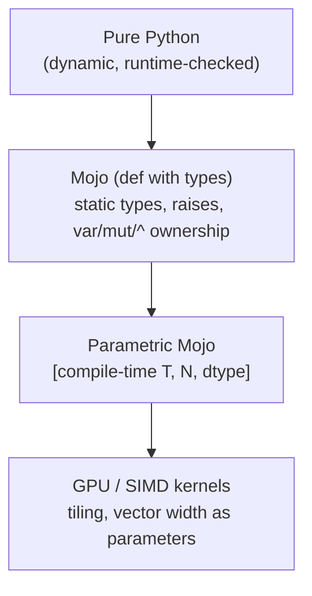

# Mojo Fundamentals — for Python People Who Want the Whole Picture

## Why This Exists

**Problem.** Mojo markets itself as "Python with superpowers" — and the surface really does look like Python. But the *interesting* parts of Mojo (ownership, compile-time parameters in `[]`, SIMD primitives, GPU kernels, statically-typed `def`) aren't in Python at all. Newcomers see `def main():` and assume the rest is just Python plus speed; they hit `var name: String` or `def foo(mut x: Int)` and the model breaks. This note covers the parts that *aren't* Python.

**Key insight.** Mojo is **a systems language wearing a Python jacket.** It accepts Python-shaped syntax (`def`, indentation, classes, decorators) so the surface feels familiar. But the semantics underneath — static types, ownership keywords, explicit `raises`, compile-time `[]` parameters — are closer to Rust or Zig than to CPython.

**Reach for this when:**
- You see `def main():` and `def foo(mut x: Int):` and want to know what's Python and what's not
- You're confused by `mut`/`var`/`ref`/`^` in argument lists
- You hit `[T: AnyType, N: Int](...)` and want to understand `[...]` vs `(...)`
- You want to call NumPy or PyTorch from Mojo (and vice versa)
- You're choosing between Python (productivity), Mojo (Python-compatible + fast), or Rust (no-Python + safer)

**Don't reach for this when:**
- You want a full reference — go to [mojolang.org/docs](https://mojolang.org/docs/)
- You're starting a non-AI/non-numerical project — Mojo's ecosystem isn't there yet; pick Python, Rust, or Go
- You want production deployment guides — [Modular's MAX platform](https://docs.modular.com/max/) has its own docs

---

## Table of Contents

- [§0. Mental Model — Mojo at a Glance](#0-mental-model--mojo-at-a-glance)
- [§1. Hello World and the Shape of `def`](#1-hello-world-and-the-shape-of-def)
- [§2. Variables, Types, and Mutability](#2-variables-types-and-mutability)
- [§3. Ownership and Argument Conventions](#3-ownership-and-argument-conventions)
- [§4. Structs and the Value Lifecycle](#4-structs-and-the-value-lifecycle)
- [§5. Traits — Mojo's Type Contracts](#5-traits--mojos-type-contracts)
- [§6. Compile-Time Parameters — the `[...]` Square Brackets](#6-compile-time-parameters--the--square-brackets)
- [§7. SIMD, Tensors, and Hardware Awareness](#7-simd-tensors-and-hardware-awareness)
- [§8. Python Interop](#8-python-interop)
- [Trade-offs](#trade-offs)
- [Common Pitfalls](#common-pitfalls)
- [Decision Table](#decision-table)
- [References](#references)
- [See Also](#see-also)

---

## 0. Mental Model — Mojo at a Glance

> *TL;DR — Python-syntax on the outside, Rust-style semantics on the inside. One keyword for functions (`def`), with types and explicit error-propagation. `(...)` for runtime args, `[...]` for compile-time parameters. Ownership without lifetimes.*

Mojo is built by [Modular](https://www.modular.com) (Chris Lattner — same person behind [LLVM](https://llvm.org) and [Swift](https://www.swift.org)) to give AI/numerical Python the speed of C while keeping the Python surface. Its design has three big claims:

1. **Python syntax is a starting point.** A `.mojo` file with `def main(): print("hi")` runs. You can mix in NumPy via `Python.import_module`.
2. **Static typing and ownership underneath.** Functions need types, errors must declare `raises`, and values have a single owner. The compiler produces code as fast as Rust or C++.
3. **First-class compile-time programming.** SIMD width, tensor shape, dtype — all expressed as compile-time parameters in `[]`, specialised per call.



You start with familiar Python *syntax* but the language underneath is a systems language — statically typed, with explicit ownership and explicit error propagation.

---

## 1. Hello World and the Shape of `def`

> *TL;DR — every function uses `def`. Type annotations are required on parameters; return types must be declared if the function returns a value; raising errors requires `raises` on the signature.*

### Hello world

Every Mojo program needs a `main()`:

```mojo
def main():
    print("Hello, world!")
```

Save as `hello.mojo`, run with `mojo hello.mojo`. Looks exactly like Python.

### `def` with types

Beyond `main`, `def` requires you to annotate parameters and (when returning a value) the return type:

```mojo
def greet(name: String) -> String:
    return "Hello, " + name + "!"

def add(a: Int, b: Int) -> Int:
    return a + b
```

This is **not** the loose, Python-style `def` you may know. Mojo's `def` is statically typed under the hood. The official rules:

- **Parameter types required.** `def foo(x):` won't compile; you need `def foo(x: Int):`.
- **Return types declared.** Functions that return a value need `-> Type`. `-> None` (or omitting it) means "returns nothing."
- **`raises` is explicit.** Functions can't throw unless declared: `def parse(s: String) raises -> Int: ...`. Non-raising callers must handle errors from raising callees.
- **Typed errors supported.** `def validate(x: Int) raises ValidationError -> Int: ...` lets you constrain the error type.
- **Overloading.** Since types are mandatory, multiple-type support means defining overloads (same name, different parameter types).

---

## 2. Variables, Types, and Mutability

> *TL;DR — `var x = 5` declares; you can omit `var` and let inference handle it. Types are static — set on first assign and fixed for the binding's lifetime.*

### Declaring variables

```mojo
var x: Int = 10          # explicit type and value
var sum: Int             # declared, initialised later
sum = x + x

y = 5                    # implicit var, type inferred as Int
z = "hello"              # implicit var, inferred as String
```

The compiler infers a type from the first assignment and **freezes it for the binding's lifetime**:

```mojo
x = 10
x = "foo"                # ERROR: Cannot convert "StringLiteral" value to "Int"
```

This is the single biggest difference from Python — bindings are statically typed even when types aren't written.

### Primitive types you'll meet

| Type | What it is |
|---|---|
| `Int` | machine-width integer (typically 64-bit) |
| `UInt` | unsigned variant |
| `Float64`, `Float32`, `Float16` | floats of given width |
| `Bool` | `True` / `False` |
| `String` | heap-allocated, mutable UTF-8 string |
| `StringLiteral` | compile-time string literal (`"hi"` in source) |
| `SIMD[DType.float32, 4]` | a 4-wide vector of `f32` — the building block for vectorised math |
| `List[T]` | growable array (Python-style) |
| `Dict[K, V]` | hash map (Python-style) |

`SIMD` is the standout — it's not a library type but a built-in for direct hardware vector control. More in §7.

### Control flow

Identical to Python at the surface:

```mojo
def classify(n: Int) -> String:
    if n < 0:
        return "negative"
    elif n == 0:
        return "zero"
    else:
        return "positive"

def sum_of_squares(n: Int) -> Int:
    var total = 0
    for i in range(n):
        total += i * i
    return total

def countdown(n: Int):
    while n > 0:
        print(n)
        n -= 1
```

Indentation, `:`, `range()` — all Python. The everyday subset works.

---

## 3. Ownership and Argument Conventions

> *TL;DR — every value has exactly one owner. Function arguments use one of four conventions: default (immutable borrow), `mut` (mutable borrow), `var` (take ownership), or `ref` (parametric mutability). The `^` sigil transfers ownership.*

This is Mojo's most Rust-like aspect — and the part that confuses Python migrants the most.

### The four argument conventions

| Convention | What the function gets | Caller's value after |
|---|---|---|
| *(default — no keyword)* | immutable reference | unchanged |
| `mut` | mutable reference | may be modified |
| `var` | takes ownership | gone (or copied, see below) |
| `ref` | reference with parametric mutability | depends on the parametric annotation |

### Default — borrowed, immutable

```mojo
def greet(name: String):           # name is an immutable borrow
    print("Hello, " + name)

def main():
    var n = String("Alice")
    greet(n)                       # n still usable after
    print(n)
```

No keyword needed. The function receives a read-only reference. Cheap for large values — no copy, no move.

### `mut` — mutable borrow

```mojo
def add(mut x: Int, y: Int):
    x += y

def main():
    var a = 1
    var b = 2
    add(a, b)
    print(a)                       # 3
```

The function can mutate `x`; the caller sees the change.

### `var` — take ownership

```mojo
def consume(var s: String):
    print(s)
    # s dropped at end of function

def main():
    var name = String("Alice")
    consume(name^)                 # transfer ownership
    # name is now uninitialised — using it is a compile error
```

`var` *can* receive ownership, but **only if you supply the `^` sigil**. Without `^`, Mojo tries to *copy* the value (and fails to compile if the type isn't copyable).

### `^` — the transfer sigil

`^` is the postfix operator that explicitly transfers ownership:

```mojo
list.append(name^)                 # name's lifetime ends here
# name can't be used afterwards
```

After `^`, the source variable is *uninitialised*. The compiler tracks this and rejects further uses. This is Rust's `move` semantics with explicit punctuation rather than implicit moves on assignment.

### `ref` — parametric mutability

The first three conventions all *commit* to a mutability: default is "always immutable," `mut` is "always mutable," `var` is "I take ownership." But sometimes you need a function that **works for both** — without writing it twice.

The classic example is an accessor like "give me a reference to the first element of a list":

- If the caller has an *immutable* list, the function should return an *immutable* reference (read-only).
- If the caller has a *mutable* list, the function should return a *mutable* reference (so the caller can assign through it).

If you commit to one or the other, you either lose write capability for mutable callers or lock out immutable callers. `ref` solves this by **making the mutability itself a compile-time parameter**.

#### Walking through the example

```mojo
def get_first[is_mut: Bool](ref [is_mut] container: List[Int]) -> ref [is_mut] Int:
    return container[0]
```

There are two layers of brackets, doing different jobs:

| Bracket | What it is |
|---|---|
| `[is_mut: Bool]` *(after the function name)* | a **compile-time parameter** — see §6. The caller fills in `True` or `False`. |
| `ref [is_mut]` *(before the argument/return)* | a **reference whose mutability equals `is_mut`** |

Read it left-to-right:
- `def get_first[is_mut: Bool]` — a function parameterised by a compile-time `Bool` called `is_mut`.
- `(ref [is_mut] container: List[Int])` — takes a reference to a `List[Int]` whose mutability follows `is_mut`. If the caller passes `True`, it's a `mut` reference; if `False`, an immutable one.
- `-> ref [is_mut] Int` — returns a reference to an `Int` with the *same* mutability. The shared `is_mut` ties input and output together.

The compiler generates *two* specialised versions of this function: one for `is_mut = True` (mutable in, mutable out) and one for `is_mut = False` (immutable in, immutable out). Same source, no duplication.

#### Why the inference does the work for you

You almost never write `[is_mut]` at the call site. Mojo infers it:

```mojo
var nums: List[Int] = [1, 2, 3]

var first_ref = get_first(nums)    # nums is mutable → is_mut = True inferred
first_ref = 99                      # OK — mutable reference, can assign

# vs reading through an immutable handle
def show(numbers: List[Int]):       # numbers is immutable (default)
    var x = get_first(numbers)      # is_mut = False inferred
    # x = 99 would fail — immutable reference
    print(x)
```

The caller's context decides which version gets used. From outside, `get_first` "just works" like any normal function — the polymorphism is invisible.

#### Where you'll meet this

- **Indexing methods** on collections (`__getitem__`-style) — `list[i]` needs to work for both reading and writing.
- **Iterators** that yield references into a collection.
- **View / slice types** that should be valid for both read-only views and writable views of the same data.

You rarely write `ref` yourself for application code — the four conventions (default / `mut` / `var` / explicit copy) cover almost everything. But every collection you reach for already uses `ref` internally, and reading stdlib code will go smoother once you can parse the syntax.

### Argument exclusivity

Same rule as Rust: if a function receives a mutable reference to a value, it can't receive any other reference (mutable or immutable) to the same value.

```mojo
def double(mut x: Int, y: Int): ...

var a = 5
double(a, a)                       # ERROR: a is both mut and read
```

This is enforced at compile time. The exception: trivially copyable types like `Int` and `Bool` are passed by copy in registers, so the rule doesn't bite them as often.

### Why this matters — and how it differs from Rust

Mojo's ownership system is **deliberately simpler than Rust's**. The two big simplifications:

- **No explicit lifetimes.** Mojo uses *origins* (an internal tracking mechanism) but doesn't make you write `<'a>` annotations. The compiler infers everything.
- **Default is immutable borrow, not move.** Python-style call semantics work because passing a `String` doesn't move it — you'd have to explicitly write `s^` or `var s:` to consume.

The result: most Python-shaped code "just works" without thinking about ownership. The ceremony only kicks in when you write `var` parameters, `mut`, or `^` — and at those points you're already opting into systems-level thinking.

---

## 4. Structs and the Value Lifecycle

> *TL;DR — `struct` with `var` fields, `__init__` constructor, optional `@fieldwise_init` shortcut. Conform to `Copyable`/`Movable` traits to auto-generate copy/move logic.*

### A basic struct

```mojo
struct MyPair:
    var first: Int
    var second: Int

    def __init__(out self, first: Int, second: Int):
        self.first = first
        self.second = second
```

Reading the new bits:
- **`var` on fields is required** — no auto-typed fields like in Python.
- **`out self`** — declares `self` as a mutable reference that starts uninitialised and must be filled in before the constructor returns.

### `@fieldwise_init` — the boilerplate shortcut

```mojo
@fieldwise_init
struct MyPair:
    var first: Int
    var second: Int
```

The decorator auto-generates `__init__(out self, first: Int, second: Int)`. Use it when your constructor is just "store the args."

### Methods

```mojo
@fieldwise_init
struct Counter:
    var n: Int

    def get(self) -> Int:           # default — borrowed, read-only
        return self.n

    def increment(mut self):        # mutable borrow
        self.n += 1

    @staticmethod
    def from_zero() -> Counter:
        return Counter(0)
```

The `self` parameter follows the same conventions as any other argument (§3) — `self` borrowed by default, `mut self` for mutating methods.

### Copy and move via traits

If you want `Counter` to be copyable (so callers can pass it around freely), declare conformance to the `Copyable` trait:

```mojo
@fieldwise_init
struct Counter(Copyable):
    var n: Int
```

The compiler then *generates* the copy implementation. `Copyable` automatically implies `Movable`.

| Trait | Auto-generates | When you want it |
|---|---|---|
| `Movable` | move constructor | always (almost free; lets `^` work) |
| `Copyable` | copy + move constructors | for value-types that can be duplicated cheaply |
| `ImplicitlyCopyable` | as `Copyable`, but copies happen implicitly | for types that *should* feel like values (e.g., `Int`-shaped) |

The compiler generates the copy and move constructors for you when you conform to these traits — you don't write them by hand.

### Destructor: `__del__`

Mojo calls `__del__` automatically when a value's owner goes out of scope. You only define one if you need custom cleanup:

```mojo
struct FileHandle:
    var fd: Int

    def __init__(out self, path: String):
        self.fd = open_file(path)

    def __del__(deinit self):
        close_file(self.fd)
```

The `deinit self` annotation marks the destructor — `self` is alive on entry, uninitialised on exit.

---

## 5. Traits — Mojo's Type Contracts

> *TL;DR — traits look like Python ABCs but resolve at compile time. Conform with `struct Foo(TraitA, TraitB):`. Bound generic params with `[T: TraitA]`.*

### Defining a trait

```mojo
trait Quackable:
    def quack(self):
        ...
```

`...` is the "body must be implemented by conforming types" placeholder. Compare to Rust traits or Python's `abc.ABC`.

### Conforming

```mojo
@fieldwise_init
struct Duck(Copyable, Quackable):
    def quack(self):
        print("Quack")
```

Just list traits in parentheses after the struct name. The compiler checks that every required method is implemented.

### Generic functions with trait bounds

Two equivalent forms:

```mojo
# Named-parameter form
def make_it_quack[DuckType: Quackable](maybe_a_duck: DuckType):
    maybe_a_duck.quack()

# Shorthand
def make_it_quack2(maybe_a_duck: Some[Quackable]):
    maybe_a_duck.quack()
```

Use the named form when you need to constrain *two* arguments to be the same type (`def pair[T: Quackable](a: T, b: T)`).

### Trait inheritance (refinement)

```mojo
trait Bird(Animal):
    def fly(self):
        ...
```

A `Bird` is required to implement everything `Animal` does, plus `fly`. Anywhere `Animal` is required, a `Bird` is acceptable.

### Trait composition with `&`

Combine traits ad-hoc without naming the combination:

```mojo
def quack_and_go[T: Quackable & Flyable](thing: T):
    thing.quack()
    thing.fly()
```

Or name it for reuse: `comptime DuckLike = Quackable & Flyable`. Unlike refinement, *any* type conforming to both component traits automatically satisfies the composition — no need to declare the composed trait explicitly.

### Built-in traits worth knowing

| Trait | Provides | Typical use |
|---|---|---|
| `Copyable` | copy constructor | value-types you want to clone |
| `Movable` | move constructor | almost everything |
| `Defaultable` | `__init__(out self)` | "give me a default instance" |
| `Sized` | `__len__()` → `len(x)` works | collections |
| `Stringable` (`Writable`) | `print(x)` works | anything you'd display |
| `Comparable`, `Equatable`, `Hashable` | `<`, `==`, hashing | map keys, sorting |
| `Intable` | `__int__()` → `Int(x)` | numeric coercion |
| `AnyType` | the universal base | unconstrained generic parameters |

---

## 6. Compile-Time Parameters — the `[...]` Square Brackets

> *TL;DR — Mojo calls compile-time values "parameters" and runtime values "arguments." `[...]` for parameters, `(...)` for arguments. The compiler generates a specialised version per parameter combination — same idea as Rust monomorphization.*

### Parameters vs arguments

```mojo
def repeat[count: Int](msg: String):
    comptime for i in range(count):
        print(msg)

repeat[3]("Hello")
```

`[count: Int]` — compile-time, must be known when the call is compiled. `(msg: String)` — runtime, evaluated each call.

This terminology trips people up: in most languages "parameter" and "argument" are nearly synonyms. In Mojo, they're a hard distinction the syntax makes visible.

### Parametric structs

```mojo
struct FixedBuffer[size: Int]:
    var data: List[Int]
    # ... using `size` as a compile-time constant
```

`FixedBuffer[4]` and `FixedBuffer[8]` are *different types* (just like `Vec<i32>` vs `Vec<f64>` in Rust).

### Type parameters

```mojo
struct GenericArray[T: Copyable & ImplicitlyDeletable]:
    var data: UnsafePointer[T]
    var size: Int
```

`[T: ...]` is "any type satisfying these traits" — Mojo's equivalent of `<T>` plus trait bounds.

### Parameter inference

You usually don't write `[...]` at call sites; the compiler infers:

```mojo
def rsqrt[dt: DType](x: Scalar[dt]) -> Scalar[dt]:
    return 1 / sqrt(x)

var v: Scalar[DType.float16] = 4
rsqrt(v)                        # dt inferred as DType.float16
```

### When to use parameters vs arguments

**Parameters** (`[]`): values that should drive code specialisation — types, dimensions, SIMD widths, dtypes, dispatch flags.

**Arguments** (`()`): values varying at runtime — the data you're operating on.

Hardware-aware code lives in this distinction. `SIMD[DType.float32, 4]` is parameterised so the compiler emits the exact AVX/NEON instructions for that width/dtype — no runtime dispatch.

### `comptime` blocks

The `comptime` keyword forces evaluation at compile time:

```mojo
comptime for i in range(4):       # unrolled completely
    sum += data[i]

comptime if some_compile_time_flag:
    fast_path()
else:
    slow_path()
```

---

## 7. SIMD, Tensors, and Hardware Awareness

> *TL;DR — `SIMD[dtype, width]` is a built-in vector type. `Int` is just `SIMD[DType.index, 1]`. Tensor work uses the `LayoutTensor` family. GPU programming has dedicated language support.*

This is the "superpowers" half of the Python-with-superpowers tagline.

### SIMD is built-in, not a library

```mojo
var v: SIMD[DType.float32, 4] = SIMD[DType.float32, 4](1.0, 2.0, 3.0, 4.0)
var w: SIMD[DType.float32, 4] = SIMD[DType.float32, 4](10.0, 20.0, 30.0, 40.0)
var sum = v + w                   # 4 lanes added in one instruction
```

The compiler emits one vector-add instruction (`vaddps` on x86 AVX, `fadd` on NEON). No library, no intrinsic call — just an arithmetic operator.

`Int` itself is defined as `SIMD[DType.index, 1]`. Mojo's numeric stack is SIMD all the way down.

### Why this is a Python improvement

In NumPy, `a + b` on vectors works — but each operation walks Python's bytecode interpreter once. Mojo's `SIMD` operations compile to a single CPU instruction. Numerical code that bottlenecks on Python's per-call overhead becomes cache-line-bound or vector-unit-bound instead.

### GPU programming

Mojo has first-class GPU primitives (kernels, layouts, async memory copies, warp-level intrinsics). The full topic deserves its own note — see the [GPU section of the manual](https://mojolang.org/docs/manual/gpu/architecture/). For Python users, the takeaway: writing a custom CUDA kernel in Mojo is roughly as ergonomic as writing a `numba.cuda` kernel, but the rest of your program is Mojo too, so you don't pay the Python-host overhead between kernels.

### Tensors and layouts

`LayoutTensor` and `TileTensor` are the multidimensional-array types optimised for GPU kernels. They expose tile shape, memory layout, and access patterns as compile-time parameters, letting the compiler generate optimal access code. PyTorch/JAX users can think of this as TPU/GPU-style explicit-layout tensors with no Python overhead.

---

## 8. Python Interop

> *TL;DR — `from python import Python; np = Python.import_module("numpy")`. NumPy arrays, dataclasses, anything pip-installed — all reachable from Mojo.*

This is the killer feature that makes Mojo viable as a *gradual* migration from Python.

### Calling Python from Mojo

```mojo
from python import Python

def main() raises:
    var np = Python.import_module("numpy")
    var ar = np.arange(15).reshape(3, 5)
    print(ar)
    print(ar.shape)
```

That `numpy` is the Python NumPy you already have installed. Mojo loads CPython under the hood and calls into it.

The `raises` keyword on `def main()` is important — Python interop can throw, so the function must declare it can raise.

### Calling Mojo from Python

A separate workflow: build Mojo code as a Python extension module, then `import` it from regular Python. Useful for replacing one hot function in an existing Python pipeline without rewriting everything.

### When this is worth it

- You have NumPy/PyTorch code that's bottlenecked on a small kernel — write the kernel in Mojo, leave the rest in Python.
- You want CPython library access (e.g., `requests`, `pandas`) but want some functions to run native-speed.
- You're testing Mojo incrementally without committing the whole codebase.

### When this isn't worth it

- You're not on the AI/numerical path — Python interop adds the CPython runtime to your binary, which kills the "tiny systems-language binary" pitch.
- You're shipping to environments where CPython isn't available.

---

## Trade-offs

- **Python compatibility is partial.** Mojo accepts most Python *syntax* (def, indentation, control flow). It does not accept arbitrary Python *semantics* — class inheritance, dynamic dispatch, monkey-patching, descriptors, metaclasses, the GIL. Treat it as "starts looking like Python; quickly diverges."
- **`def` is statically typed.** Don't expect Python's dynamic-typing flexibility — every parameter needs a type annotation, return types are explicit, and errors don't propagate unless `raises` is on the signature. The Python *syntax* lets you start; the *semantics* are systems-language strict.
- **Ownership without lifetimes is friendlier than Rust — until it isn't.** No `<'a>` annotations is great. But when you eventually need parametric references (`ref [origin] T`), the model gets denser. Most Python users hit a ceiling much later than they'd hit Rust's.
- **Compile-time parameters are powerful and verbose.** `SIMD[DType.float32, 4]` is precise but noisy. Many functions end up with `[]` parameters that feel like ceremony until you start writing performance-critical code.
- **Ecosystem is small.** As of 2026, Mojo's package ecosystem is in its infancy. You get NumPy/PyTorch via Python interop, but native Mojo libraries for web servers, async runtimes, CLI parsing, JSON, etc. are scarce. For non-AI work, Rust/Go/Python have much more.
- **Vendor lock-in concerns.** Mojo is open under the Apache 2.0 license but tightly bound to Modular's MAX platform for production deployment. The bet you make: Modular's stack will dominate AI inference. If it doesn't, your Mojo code becomes orphaned.

---

## Common Pitfalls

- **Using `let`** — it's gone. **Fix:** `var`.
- **Writing `def main():` then calling Python without `raises`** — compile error. **Why:** Python interop can throw. **Fix:** `def main() raises:`.
- **Forgetting `^` when passing to a `var` parameter** — Mojo tries to copy; fails if the type isn't `Copyable`. **Fix:** explicit `value^` to transfer ownership.
- **Using a value after `^`** — uninitialised use. **Why:** transfer ends the source's lifetime. **Fix:** restructure so the producer is the last code that touches the value, or copy before transferring.
- **Mutating through a `def`-style parameter without `mut`** — silently operates on a copy or fails. **Fix:** declare `mut x:` in the function signature.
- **Reassigning a variable to a different type** — `x = 10; x = "foo"` fails. **Why:** types are statically frozen at first assignment. **Fix:** use a new binding name.
- **Mixing `[]` and `()` parameters wrongly** — `repeat[3](msg)` is correct; `repeat(3, msg)` won't typecheck. **Fix:** memorise that `[]` = compile-time, `()` = runtime.
- **Conforming a struct to `Copyable` without all fields being `Copyable`** — compile error. **Fix:** check the field types; non-copyable fields propagate.
- **Expecting Python's iterator protocol everywhere** — Mojo's `for x in container` works for things that implement the right iterator trait, not arbitrary `__iter__` like Python. **Fix:** check the trait requirement for the container you're iterating.
- **Treating Python interop as zero-cost** — every call crosses into CPython, which is expensive. **Fix:** batch your interop crossings (one big `np.dot` call beats a thousand `np.array` constructions).

---

## Decision Table

| Scenario | Pick | Not | Why |
|---|---|---|---|
| Mixing the speed of compiled code with Python libraries | call NumPy/PyTorch via `Python.import_module`, write hot paths in pure Mojo | one or the other | Mojo's pitch is gradual migration |
| Library API meant for other developers | `def` with full type annotations and `raises` where needed | hand-waving the types | Contract is visible; better errors |
| Function takes a large value, reads only | default (borrowed) | `var` | No copy, no ownership transfer |
| Function mutates the caller's value | `mut x:` | `var x:` + return | Less ceremony; clear at call site |
| Function consumes the value (e.g., builder) | `var x:` + caller passes `value^` | `mut` | Explicit ownership transfer |
| Generic over types | `[T: Trait]` parameter | runtime dispatch | Compile-time specialisation |
| Generic over a numeric constant | `[N: Int]` parameter | runtime arg | Lets the compiler unroll/specialise |
| Vector arithmetic | `SIMD[dtype, width]` | `List[Float64]` | Single instruction per op |
| Need NumPy's API | Python interop | rewrite | Mojo can call NumPy directly |
| Need to hot-spot one Python function | Write Mojo extension, leave rest in Python | rewrite whole app | Gradual migration |
| Calling out to CPython many times in a tight loop | batch | per-iteration | CPython crossings are expensive |
| Struct that should auto-derive copy/move | `(Copyable)` trait conformance + `@fieldwise_init` | hand-rolled constructors | Cleaner, idiomatic |

---

## References

### Primary
- [Mojo Manual](https://mojolang.org/docs/manual/) — official, regularly updated
- [Mojo Language Basics](https://mojolang.org/docs/manual/basics) — syntax intro
- [Value ownership](https://mojolang.org/docs/manual/values/) — the `mut`/`var`/`ref` system
- [Value lifecycle](https://mojolang.org/docs/manual/lifecycle/) — constructors, destructors, traits
- [Metaprogramming](https://mojolang.org/docs/manual/metaprogramming/) — parameters and `comptime`
- [Traits](https://mojolang.org/docs/manual/traits) — definitions, conformance, built-ins
- [Structs](https://mojolang.org/docs/manual/structs) — defining types
- [Parameters](https://mojolang.org/docs/manual/parameters/) — compile-time parameter system
- [Python interop](https://mojolang.org/docs/manual/python/) — calling Python from Mojo and back
- [GPU programming](https://mojolang.org/docs/manual/gpu/architecture/) — kernels and layouts

### Background and context
- [Modular blog](https://www.modular.com/blog) — language announcements and design rationale
- [Mojo standard library source](https://github.com/modular/modular) — open-source stdlib for reference

### Community
- [Modular forum](https://forum.modular.com) — Q&A and announcements

## See Also

- [rust-fundamentals](../rust/rust-fundamentals.md) — Mojo's ownership (`mut`/`var`/`^`) is a friendlier variant of Rust's (`&mut`/`move`); Mojo's `[T: Trait]` parameters are roughly Rust's `<T: Trait>` generics; Mojo skips Rust's explicit lifetimes; Mojo's Python-shaped syntax has no Rust analogue.
- [rust-macros](../rust/rust-macros.md) — Mojo's compile-time parameter system overlaps with Rust's macro machinery, but Mojo's is *type-driven* (no token rewriting), making it closer to Rust's const generics than to `macro_rules!`.
- [golang-fundamentals](../golang/golang-fundamentals.md) — Mojo and Go both pitch ergonomic-vs-systems sweet spots; Go achieves it via simplicity and GC, Mojo via Python compatibility and explicit ownership. Different bets, different audiences.
